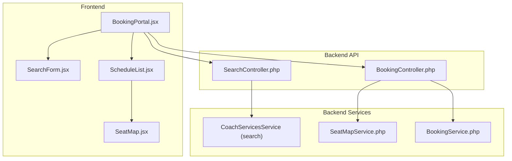
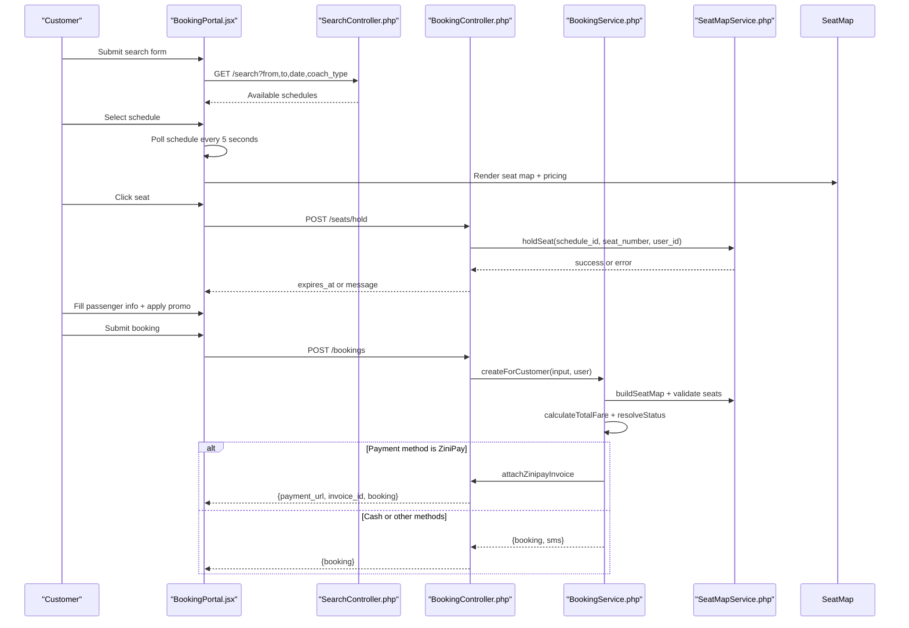
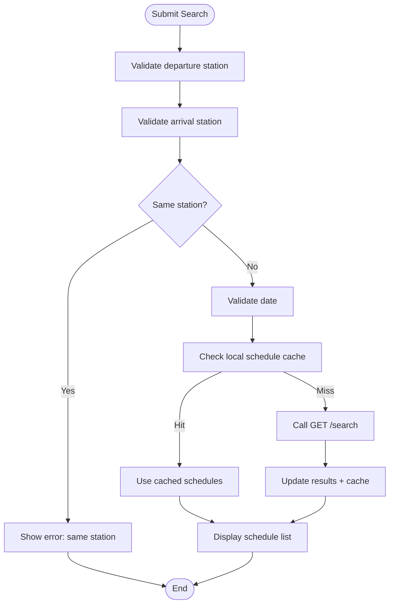
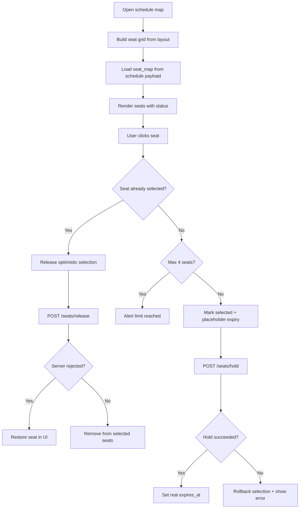
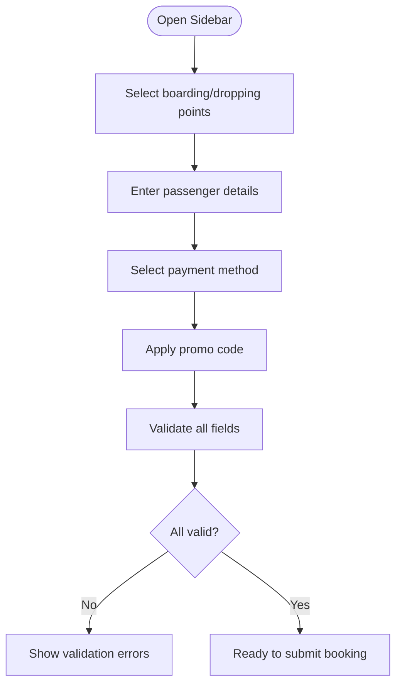
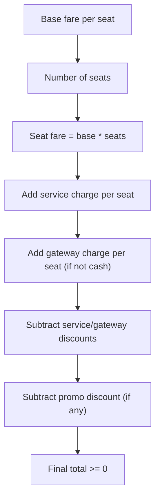
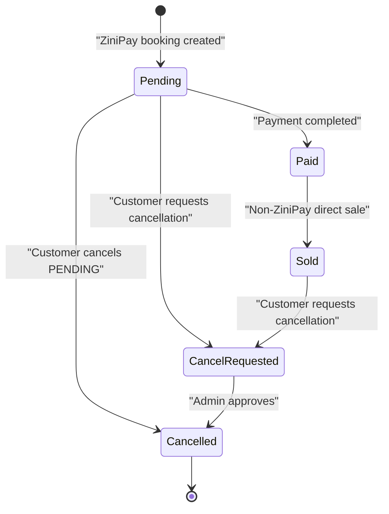
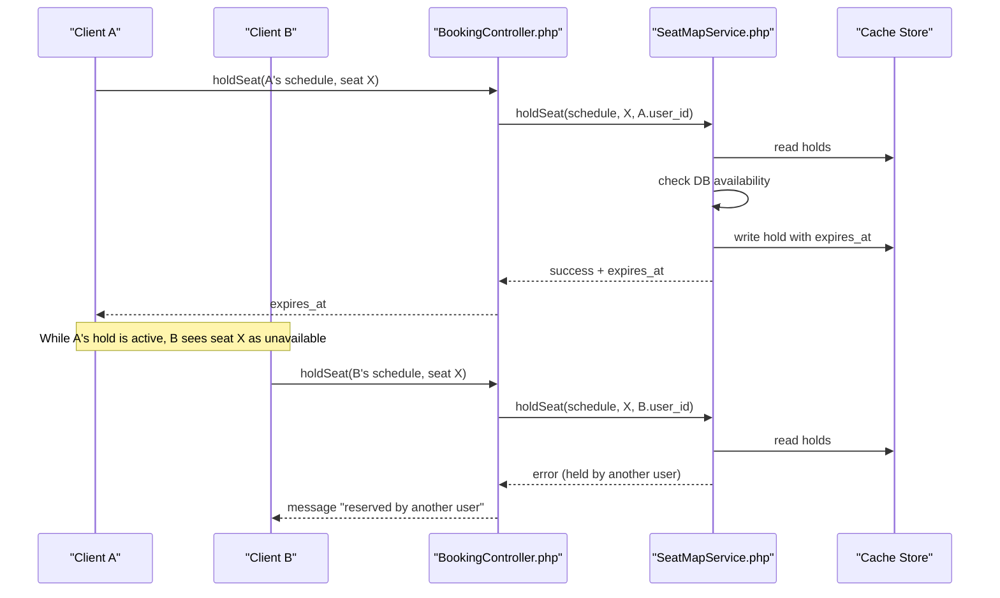
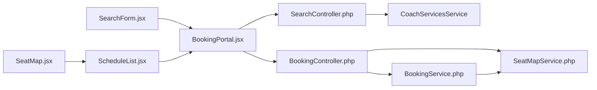

# Booking Process

<cite>
**Referenced Files in This Document**
- [SearchForm.jsx](file://frontend/src/components/SearchForm.jsx)
- [ScheduleList.jsx](file://frontend/src/components/ScheduleList.jsx)
- [SeatMap.jsx](file://frontend/src/components/SeatMap.jsx)
- [BookingPortal.jsx](file://frontend/src/components/BookingPortal.jsx)
- [SearchController.php](file://backend/app/Http/Controllers/API/SearchController.php)
- [BookingController.php](file://backend/app/Http/Controllers/API/BookingController.php)
- [BookingService.php](file://backend/app/Services/BookingService.php)
- [SeatMapService.php](file://backend/app/Services/SeatMapService.php)
</cite>

## Table of Contents
1. [Introduction](#introduction)
2. [Project Structure](#project-structure)
3. [Core Components](#core-components)
4. [Architecture Overview](#architecture-overview)
5. [Detailed Component Analysis](#detailed-component-analysis)
6. [Dependency Analysis](#dependency-analysis)
7. [Performance Considerations](#performance-considerations)
8. [Troubleshooting Guide](#troubleshooting-guide)
9. [Conclusion](#conclusion)

## Introduction
This document explains the complete SonyaBus booking workflow: route search, schedule filtering, seat selection, passenger information collection, pricing calculation, seat holding, booking validation, payment initiation, and confirmation. It focuses on how frontend components coordinate with backend controllers and services to manage state, concurrency, availability, and lifecycle transitions.

The journey is designed around optimistic user interactions with strong server-side validation and locking. Seat availability is shown live, seats can be temporarily held while a customer completes checkout, and bookings are persisted only after all validations pass.

## Project Structure
The booking flow spans React components for the customer UI and Laravel API endpoints plus services for business logic.

**Diagram sources**
- [BookingPortal.jsx:1-654](file://frontend/src/components/BookingPortal.jsx#L1-L654)
- [SearchForm.jsx:1-109](file://frontend/src/components/SearchForm.jsx#L1-L109)
- [ScheduleList.jsx:1-225](file://frontend/src/components/ScheduleList.jsx#L1-L225)
- [SeatMap.jsx:1-612](file://frontend/src/components/SeatMap.jsx#L1-L612)
- [SearchController.php:1-33](file://backend/app/Http/Controllers/API/SearchController.php#L1-L33)
- [BookingController.php:1-150](file://backend/app/Http/Controllers/API/BookingController.php#L1-L150)
- [SeatMapService.php:1-593](file://backend/app/Services/SeatMapService.php#L1-L593)
- [BookingService.php:1-335](file://backend/app/Services/BookingService.php#L1-L335)

**Section sources**
- [BookingPortal.jsx:1-654](file://frontend/src/components/BookingPortal.jsx#L1-L654)
- [SearchController.php:1-33](file://backend/app/Http/Controllers/API/SearchController.php#L1-L33)
- [BookingController.php:1-150](file://backend/app/Http/Controllers/API/BookingController.php#L1-L150)

## Core Components
- Search form: collects departure station, arrival station, date, and coach type.
- Schedule list: shows available coaches, times, duration, distance, fare, and available seat count; expands into seat map when selected.
- Seat map: renders bus layout, manages seat selection, boarding/dropping points, passenger details, promo application, and booking submission.
- Booking portal: orchestrates search, caching, polling, authentication, seat holds, expiration handling, and final booking request.
- Backend search controller: validates search parameters and delegates to coach service.
- Backend booking controller: exposes booking creation, seat hold/release, cancellation, and payment initiation endpoints.
- Booking service: implements transactional booking creation, seat validation, pricing, status resolution, SMS notifications, and ZiniPay invoice attachment.
- Seat map service: builds seat maps, computes pricing breakdowns, formats boarding/dropping points, and manages temporary seat holds via cache.

**Section sources**
- [SearchForm.jsx:1-109](file://frontend/src/components/SearchForm.jsx#L1-L109)
- [ScheduleList.jsx:1-225](file://frontend/src/components/ScheduleList.jsx#L1-L225)
- [SeatMap.jsx:1-612](file://frontend/src/components/SeatMap.jsx#L1-L612)
- [BookingPortal.jsx:1-654](file://frontend/src/components/BookingPortal.jsx#L1-L654)
- [SearchController.php:1-33](file://backend/app/Http/Controllers/API/SearchController.php#L1-L33)
- [BookingController.php:1-150](file://backend/app/Http/Controllers/API/BookingController.php#L1-L150)
- [BookingService.php:1-335](file://backend/app/Services/BookingService.php#L1-L335)
- [SeatMapService.php:1-593](file://backend/app/Services/SeatMapService.php#L1-L593)

## Architecture Overview
The booking process follows a clear sequence from search to confirmation.

**Diagram sources**
- [BookingPortal.jsx:291-575](file://frontend/src/components/BookingPortal.jsx#L291-L575)
- [SearchController.php:14-30](file://backend/app/Http/Controllers/API/SearchController.php#L14-L30)
- [BookingController.php:19-40](file://backend/app/Http/Controllers/API/BookingController.php#L19-L40)
- [BookingController.php:82-116](file://backend/app/Http/Controllers/API/BookingController.php#L82-L116)
- [BookingService.php:28-131](file://backend/app/Services/BookingService.php#L28-L131)
- [SeatMapService.php:194-244](file://backend/app/Services/SeatMapService.php#L194-L244)
- [SeatMapService.php:502-561](file://backend/app/Services/SeatMapService.php#L502-L561)

## Detailed Component Analysis

### Search Form and Schedule Filtering
The search form provides inputs for departure station, arrival station, journey date, and coach type. When submitted, the portal validates required fields, clears previous selections, checks local schedule cache, and calls the backend search endpoint if needed. Results include operator name, coach number, coach type, departure/arrival times, duration, distance, available seat count, and base fare.

Key behaviors:
- Station dropdowns are populated from a stations endpoint.
- Date input is constrained to today or later.
- Coach type filters results at the backend.
- Cache-first strategy reduces backend load and improves responsiveness.
- A refresh button forces a live fetch and updates the cache timestamp.

**Diagram sources**
- [SearchForm.jsx:1-109](file://frontend/src/components/SearchForm.jsx#L1-L109)
- [BookingPortal.jsx:291-380](file://frontend/src/components/BookingPortal.jsx#L291-L380)
- [SearchController.php:14-30](file://backend/app/Http/Controllers/API/SearchController.php#L14-L30)

**Section sources**
- [SearchForm.jsx:1-109](file://frontend/src/components/SearchForm.jsx#L1-L109)
- [BookingPortal.jsx:84-99](file://frontend/src/components/BookingPortal.jsx#L84-L99)
- [BookingPortal.jsx:291-380](file://frontend/src/components/BookingPortal.jsx#L291-L380)
- [SearchController.php:14-30](file://backend/app/Http/Controllers/API/SearchController.php#L14-L30)

### Seat Map Interaction and Real-Time Availability
When a schedule is expanded, the seat map component renders the bus layout based on the bus’s seat layout and total seats. It supports multiple layouts including standard 2+2, 1+2, 2+2_last5, and sleeper configurations. The seat map displays statuses such as available, selected, sold_m, sold_f, booked_m, booked_f, and blocked.

Real-time behavior:
- The portal polls the search endpoint every 5 seconds while a schedule is selected, refreshing the schedule object and updating the seat map.
- Seat selection uses optimistic UI: the seat is immediately marked selected with a placeholder expiry, then the backend hold request confirms or rolls back the selection.
- Expiration checking runs every second to remove expired holds, release them on the backend, and notify the user.

**Diagram sources**
- [SeatMap.jsx:48-190](file://frontend/src/components/SeatMap.jsx#L48-L190)
- [SeatMap.jsx:192-208](file://frontend/src/components/SeatMap.jsx#L192-L208)
- [SeatMap.jsx:386-418](file://frontend/src/components/SeatMap.jsx#L386-L418)
- [BookingPortal.jsx:209-289](file://frontend/src/components/BookingPortal.jsx#L209-L289)
- [SeatMapService.php:194-244](file://backend/app/Services/SeatMapService.php#L194-L244)
- [SeatMapService.php:502-561](file://backend/app/Services/SeatMapService.php#L502-L561)

**Section sources**
- [SeatMap.jsx:1-612](file://frontend/src/components/SeatMap.jsx#L1-L612)
- [BookingPortal.jsx:209-289](file://frontend/src/components/BookingPortal.jsx#L209-L289)
- [SeatMapService.php:194-244](file://backend/app/Services/SeatMapService.php#L194-L244)
- [SeatMapService.php:502-561](file://backend/app/Services/SeatMapService.php#L502-L561)

### Passenger Information Collection and Promo Application
The seat map sidebar collects:
- Boarding point and dropping point, derived from the schedule’s route points.
- Mobile number, passenger name, email, gender.
- Payment method selection (currently ZiniPay).
- Promo code application.

Validation rules enforced before booking:
- At least one seat must be selected.
- Passenger name, phone, and email are required.
- Phone must meet minimum digit length.
- Boarding and dropping points must be selected.

Promo codes are validated through a dedicated endpoint and applied as a discount amount subtracted from the calculated total.

**Diagram sources**
- [SeatMap.jsx:421-542](file://frontend/src/components/SeatMap.jsx#L421-L542)
- [BookingPortal.jsx:445-467](file://frontend/src/components/BookingPortal.jsx#L445-L467)
- [BookingPortal.jsx:469-498](file://frontend/src/components/BookingPortal.jsx#L469-L498)

**Section sources**
- [SeatMap.jsx:421-542](file://frontend/src/components/SeatMap.jsx#L421-L542)
- [BookingPortal.jsx:445-467](file://frontend/src/components/BookingPortal.jsx#L445-L467)
- [BookingPortal.jsx:469-498](file://frontend/src/components/BookingPortal.jsx#L469-L498)

### Pricing Calculations
Pricing is computed both on the frontend and backend:
- Frontend calculates seat fare, service charge, gateway charge, discounts, and applies promo discount to display a grand total.
- Backend calculates the final total fare using the seat map service’s pricing breakdown and applies promotion discount if provided.

Important notes:
- Gateway charges and discounts are applied when the payment method is not cash.
- Promotion discount cannot reduce the total below zero.
- The backend’s total fare is authoritative for persistence and reporting.

**Diagram sources**
- [SeatMap.jsx:386-404](file://frontend/src/components/SeatMap.jsx#L386-L404)
- [SeatMapService.php:343-365](file://backend/app/Services/SeatMapService.php#L343-L365)
- [BookingService.php:304-318](file://backend/app/Services/BookingService.php#L304-L318)

**Section sources**
- [SeatMap.jsx:386-404](file://frontend/src/components/SeatMap.jsx#L386-L404)
- [SeatMapService.php:343-365](file://backend/app/Services/SeatMapService.php#L343-L365)
- [BookingService.php:304-318](file://backend/app/Services/BookingService.php#L304-L318)

### Booking Validation and Lifecycle Management
The backend booking service enforces critical constraints within a database transaction:
- Rejects non-admin users attempting manual cash or BOOKED status.
- Parses and validates seat numbers (at least one, maximum four).
- Loads active bookings with row-level locking to prevent race conditions.
- Rebuilds the seat map and verifies requested seats are selectable.
- Calculates total fare and resolves booking status based on payment method.
- Persists the booking record with passenger and route point data.
- Cleans up seat holds for the user’s selected seats.
- For ZiniPay, attaches an invoice and returns a payment URL; otherwise sends verification SMS and returns the booking.

Status resolution:
- ZiniPay creates PENDING bookings requiring payment completion.
- Other methods typically result in SOLD status.

Cancellation:
- Customers can cancel PENDING bookings directly.
- Cancellation requests for other statuses transition to CANCEL_REQUESTED pending admin approval.

**Diagram sources**
- [BookingService.php:28-131](file://backend/app/Services/BookingService.php#L28-L131)
- [BookingService.php:200-240](file://backend/app/Services/BookingService.php#L200-L240)
- [BookingService.php:320-327](file://backend/app/Services/BookingService.php#L320-L327)

**Section sources**
- [BookingService.php:28-131](file://backend/app/Services/BookingService.php#L28-L131)
- [BookingService.php:200-240](file://backend/app/Services/BookingService.php#L200-L240)
- [BookingService.php:320-327](file://backend/app/Services/BookingService.php#L320-L327)

### Concurrent Booking Scenarios and Seat Holding Mechanisms
Concurrency safety is achieved through:
- Database row-level locking during booking creation to ensure consistent seat availability checks.
- Active booking queries that consider paid/sold/booked statuses and recent pending bookings within a time window.
- Temporary seat holds stored in cache with explicit expiration timestamps.
- Frontend optimistic selection with rollback on failure.
- Automatic release of holds when the user deselects a seat, changes schedule, navigates away, or when expiration occurs.

Seat holding flow:
- Client requests a hold for a specific seat.
- Server validates seat availability against DB and existing holds.
- If available, server sets a hold with an expiration time and returns it to the client.
- Client displays countdown and prevents other users from selecting the same seat.
- On successful booking, holds for those seats are cleaned up.
- On expiration or release, the seat becomes available again.

**Diagram sources**
- [BookingController.php:82-116](file://backend/app/Http/Controllers/API/BookingController.php#L82-L116)
- [SeatMapService.php:502-561](file://backend/app/Services/SeatMapService.php#L502-L561)
- [SeatMapService.php:563-582](file://backend/app/Services/SeatMapService.php#L563-L582)
- [BookingPortal.jsx:209-289](file://frontend/src/components/BookingPortal.jsx#L209-L289)

**Section sources**
- [BookingController.php:82-116](file://backend/app/Http/Controllers/API/BookingController.php#L82-L116)
- [SeatMapService.php:502-561](file://backend/app/Services/SeatMapService.php#L502-L561)
- [SeatMapService.php:563-582](file://backend/app/Services/SeatMapService.php#L563-L582)
- [BookingPortal.jsx:209-289](file://frontend/src/components/BookingPortal.jsx#L209-L289)

### Booking Modification Capabilities
Within the current implementation:
- Direct modification of an existing booking’s seats or passenger details is not exposed through the documented endpoints.
- Cancellation is supported:
  - PENDING bookings can be cancelled directly.
  - Other statuses can transition to CANCEL_REQUESTED, awaiting administrative action.
- After a successful booking, the portal resets selection state and refreshes schedule data in the background.

If future requirements include modifying seats or passenger details, the recommended approach would be:
- Introduce a modify endpoint that revalidates availability and recalculates pricing.
- Implement a new booking lifecycle state for modifications in progress.
- Ensure idempotency and auditability for change history.

**Section sources**
- [BookingService.php:200-240](file://backend/app/Services/BookingService.php#L200-L240)
- [BookingPortal.jsx:525-566](file://frontend/src/components/BookingPortal.jsx#L525-L566)

## Dependency Analysis
The booking system exhibits clear layering:
- Frontend components depend on each other for UI orchestration.
- Controllers delegate business logic to services.
- Services encapsulate domain rules, pricing, seat mapping, and external integrations.

**Diagram sources**
- [SearchForm.jsx:1-109](file://frontend/src/components/SearchForm.jsx#L1-L109)
- [ScheduleList.jsx:1-225](file://frontend/src/components/ScheduleList.jsx#L1-L225)
- [SeatMap.jsx:1-612](file://frontend/src/components/SeatMap.jsx#L1-L612)
- [BookingPortal.jsx:1-654](file://frontend/src/components/BookingPortal.jsx#L1-L654)
- [SearchController.php:1-33](file://backend/app/Http/Controllers/API/SearchController.php#L1-L33)
- [BookingController.php:1-150](file://backend/app/Http/Controllers/API/BookingController.php#L1-L150)
- [BookingService.php:1-335](file://backend/app/Services/BookingService.php#L1-L335)
- [SeatMapService.php:1-593](file://backend/app/Services/SeatMapService.php#L1-L593)

**Section sources**
- [BookingPortal.jsx:1-654](file://frontend/src/components/BookingPortal.jsx#L1-L654)
- [SearchController.php:1-33](file://backend/app/Http/Controllers/API/SearchController.php#L1-L33)
- [BookingController.php:1-150](file://backend/app/Http/Controllers/API/BookingController.php#L1-L150)
- [BookingService.php:1-335](file://backend/app/Services/BookingService.php#L1-L335)
- [SeatMapService.php:1-593](file://backend/app/Services/SeatMapService.php#L1-L593)

## Performance Considerations
- Cache-first search reduces backend load and speeds up repeated queries.
- Polling interval for seat map updates balances freshness with server pressure.
- Row-level locking ensures correctness under concurrent booking attempts.
- Seat holds use short-lived cache entries to minimize memory usage and avoid stale reservations.
- Optimistic UI reduces perceived latency during seat selection.

Recommendations:
- Tune polling interval based on expected traffic and seat turnover rate.
- Monitor cache hit rates and eviction policies for seat holds.
- Consider WebSocket or server-sent events for real-time seat updates if polling becomes insufficient.
- Add rate limiting on seat hold/release endpoints to mitigate abuse.

[No sources needed since this section provides general guidance]

## Troubleshooting Guide
Common issues and resolutions:
- No schedules found: verify departure/arrival stations differ and date is valid; try refreshing to bypass cache.
- Seat not available: another user may have held the seat; wait for expiration or select another seat.
- Connection errors during seat operations: network failures trigger rollback; retry selection.
- Invalid promo code: ensure code exists and is applicable; discount is applied only if valid.
- Booking failed due to invalid seats: reselect seats ensuring they remain available until submission.
- Authentication errors: log in again if session expired; portal will redirect to login.

Operational tips:
- Use the refresh button to force live schedule data.
- Watch the live status indicator for seat map sync timing.
- Keep track of seat hold countdowns; expired seats require reselection.
- Verify payment URL redirection for ZiniPay bookings.

**Section sources**
- [BookingPortal.jsx:291-380](file://frontend/src/components/BookingPortal.jsx#L291-L380)
- [BookingPortal.jsx:445-467](file://frontend/src/components/BookingPortal.jsx#L445-L467)
- [BookingPortal.jsx:469-575](file://frontend/src/components/BookingPortal.jsx#L469-L575)
- [SeatMap.jsx:386-418](file://frontend/src/components/SeatMap.jsx#L386-L418)

## Conclusion
SonyaBus implements a robust booking workflow combining optimistic frontend interactions with strict backend validation and concurrency controls. The search phase leverages caching for performance, while the seat map provides real-time availability and interactive selection. Seat holds protect inventory during checkout, and the booking service ensures data integrity through transactions and locking. Pricing calculations are consistent across frontend and backend, and promotional discounts are applied safely. Cancellation flows support both immediate cancellation and administrative review. Future enhancements could introduce real-time event streaming and explicit booking modification capabilities.

[No sources needed since this section summarizes without analyzing specific files]