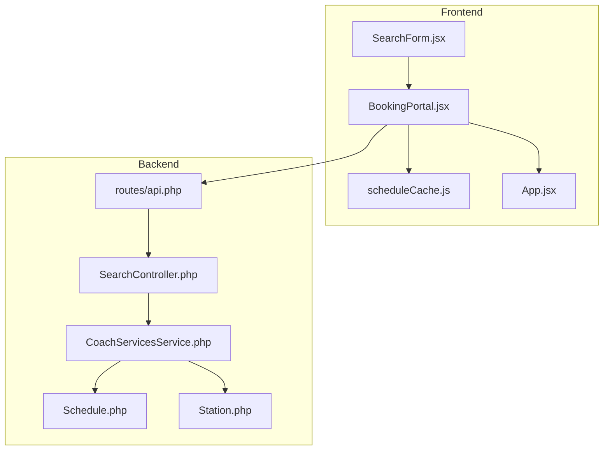
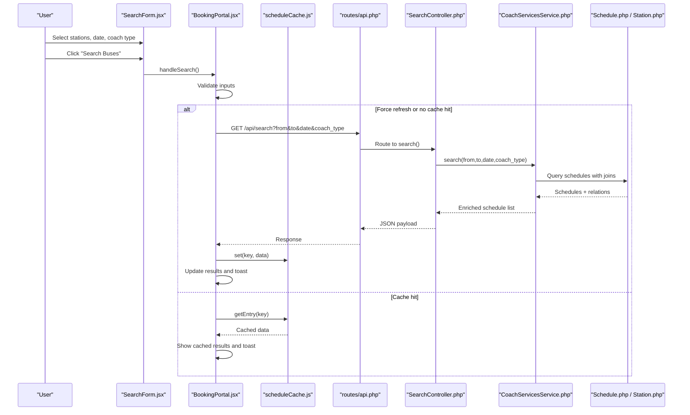
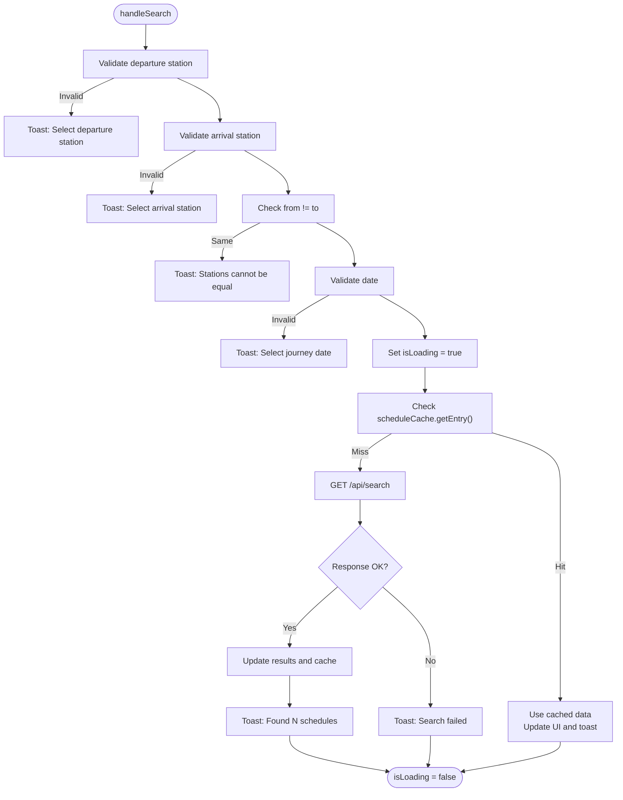
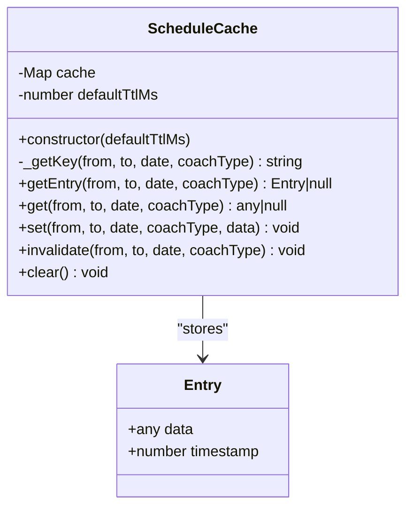
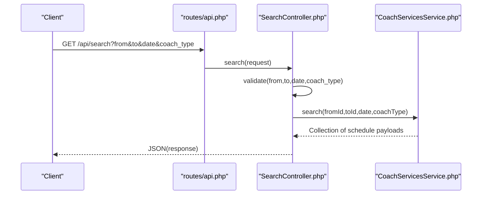
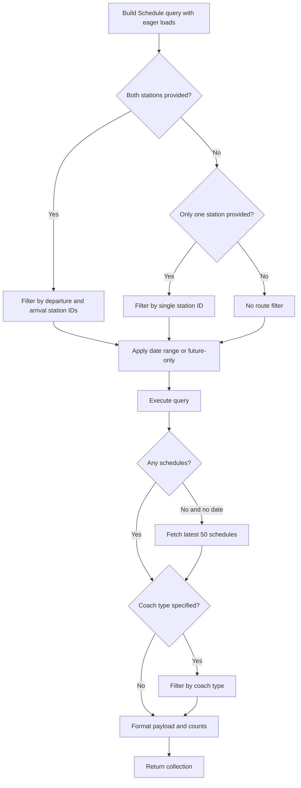
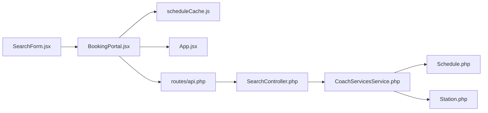

# Search & Discovery

<cite>
**Referenced Files in This Document**
- [SearchForm.jsx](file://frontend/src/components/SearchForm.jsx)
- [BookingPortal.jsx](file://frontend/src/components/BookingPortal.jsx)
- [scheduleCache.js](file://frontend/src/scheduleCache.js)
- [App.jsx](file://frontend/src/App.jsx)
- [SearchController.php](file://backend/app/Http/Controllers/API/SearchController.php)
- [CoachServicesService.php](file://backend/app/Services/CoachServicesService.php)
- [Schedule.php](file://backend/app/Models/Schedule.php)
- [Station.php](file://backend/app/Models/Station.php)
- [api.php](file://backend/routes/api.php)
</cite>

## Table of Contents
1. [Introduction](#introduction)
2. [Project Structure](#project-structure)
3. [Core Components](#core-components)
4. [Architecture Overview](#architecture-overview)
5. [Detailed Component Analysis](#detailed-component-analysis)
6. [Dependency Analysis](#dependency-analysis)
7. [Performance Considerations](#performance-considerations)
8. [Troubleshooting Guide](#troubleshooting-guide)
9. [Conclusion](#conclusion)

## Introduction
This document explains the search and discovery functionality in SonyaBus. It covers how users select departure and arrival stations, filter by journey date and coach type, retrieve schedules from the backend, and benefit from a client-side cache that reduces network calls. It also documents real-time validation, error handling, toast notifications, API integration, parameter validation, response processing, and cache management strategies.

## Project Structure
The search feature spans both frontend and backend:

- Frontend
  - `SearchForm.jsx`: Renders the search form with station selectors, date picker, coach type selector, and submit button.
  - `BookingPortal.jsx`: Owns search state, validates inputs, checks the cache, calls the `/search` endpoint, updates results, and manages user feedback via toast notifications.
  - `scheduleCache.js`: In-memory cache for schedule queries with TTL-based expiration.
  - `App.jsx`: Provides global toast notification logic and API base URL resolution.

- Backend
  - `routes/api.php`: Registers the public `/api/search` GET endpoint under maintenance-mode protection.
  - `SearchController.php`: Validates incoming parameters and delegates to `CoachServicesService`.
  - `CoachServicesService.php`: Builds the schedule query, applies filters, formats seat map data, and returns enriched schedule payloads.
  - `Schedule.php` and `Station.php`: Eloquent models used by the service layer.

**Diagram sources**
- [SearchForm.jsx:1-109](file://frontend/src/components/SearchForm.jsx#L1-L109)
- [BookingPortal.jsx:1-654](file://frontend/src/components/BookingPortal.jsx#L1-L654)
- [scheduleCache.js:1-65](file://frontend/src/scheduleCache.js#L1-L65)
- [App.jsx:94-151](file://frontend/src/App.jsx#L94-L151)
- [api.php:26-32](file://backend/routes/api.php#L26-L32)
- [SearchController.php:14-31](file://backend/app/Http/Controllers/API/SearchController.php#L14-L31)
- [CoachServicesService.php:19-124](file://backend/app/Services/CoachServicesService.php#L19-L124)
- [Schedule.php:8-34](file://backend/app/Models/Schedule.php#L8-L34)
- [Station.php:8-23](file://backend/app/Models/Station.php#L8-L23)

**Section sources**
- [SearchForm.jsx:1-109](file://frontend/src/components/SearchForm.jsx#L1-L109)
- [BookingPortal.jsx:1-654](file://frontend/src/components/BookingPortal.jsx#L1-L654)
- [scheduleCache.js:1-65](file://frontend/src/scheduleCache.js#L1-L65)
- [App.jsx:94-151](file://frontend/src/App.jsx#L94-L151)
- [api.php:26-32](file://backend/routes/api.php#L26-L32)
- [SearchController.php:14-31](file://backend/app/Http/Controllers/API/SearchController.php#L14-L31)
- [CoachServicesService.php:19-124](file://backend/app/Services/CoachServicesService.php#L19-L124)
- [Schedule.php:8-34](file://backend/app/Models/Schedule.php#L8-L34)
- [Station.php:8-23](file://backend/app/Models/Station.php#L8-L23)

## Core Components
- Search form component (`SearchForm.jsx`)
  - Provides UI for selecting departure station, arrival station, journey date, and coach type.
  - Emits search events through props passed from `BookingPortal.jsx`.

- Booking portal (`BookingPortal.jsx`)
  - Holds search state, performs validation, checks cache, calls API, updates results, and shows toast notifications.
  - Manages selected schedule, seats, promotions, and booking flow.

- Schedule cache (`scheduleCache.js`)
  - In-memory Map-based cache keyed by `from`, `to`, `date`, and `coachType`.
  - Supports get, set, invalidate, clear, and TTL expiration.

- Backend search controller (`SearchController.php`)
  - Validates request parameters using Laravel validators.
  - Delegates to `CoachServicesService` and returns JSON.

- Coach services service (`CoachServicesService.php`)
  - Queries schedules with relationships (bus, route, stations, bookings).
  - Applies optional filters for stations, date range, and coach type.
  - Formats seat maps and availability counts.

**Section sources**
- [SearchForm.jsx:1-109](file://frontend/src/components/SearchForm.jsx#L1-L109)
- [BookingPortal.jsx:291-380](file://frontend/src/components/BookingPortal.jsx#L291-L380)
- [scheduleCache.js:1-65](file://frontend/src/scheduleCache.js#L1-L65)
- [SearchController.php:14-31](file://backend/app/Http/Controllers/API/SearchController.php#L14-L31)
- [CoachServicesService.php:19-124](file://backend/app/Services/CoachServicesService.php#L19-L124)

## Architecture Overview
The search workflow integrates React components, an in-memory cache, and a Laravel API:

**Diagram sources**
- [SearchForm.jsx:19-103](file://frontend/src/components/SearchForm.jsx#L19-L103)
- [BookingPortal.jsx:291-380](file://frontend/src/components/BookingPortal.jsx#L291-L380)
- [scheduleCache.js:9-45](file://frontend/src/scheduleCache.js#L9-L45)
- [api.php:26-32](file://backend/routes/api.php#L26-L32)
- [SearchController.php:14-31](file://backend/app/Http/Controllers/API/SearchController.php#L14-L31)
- [CoachServicesService.php:19-124](file://backend/app/Services/CoachServicesService.php#L19-L124)
- [Schedule.php:20-33](file://backend/app/Models/Schedule.php#L20-L33)
- [Station.php:14-22](file://backend/app/Models/Station.php#L14-L22)

## Detailed Component Analysis

### Search Form Component
Responsibilities:
- Render two station dropdowns (departure and arrival).
- Render a date input constrained to today or later.
- Render a coach type selector with options: All, AC, Non AC.
- Submit the search via `handleSearch` prop.

Validation and UX:
- The form itself does not validate; validation is performed in `BookingPortal.jsx` before making requests.
- The submit button is disabled while loading to prevent duplicate submissions.

Key behaviors:
- Station selection updates `searchParams.from` and `searchParams.to`.
- Date selection updates `searchParams.date`.
- Coach type selection updates `searchParams.coachType`.

**Section sources**
- [SearchForm.jsx:19-103](file://frontend/src/components/SearchForm.jsx#L19-L103)

### Booking Portal Search Flow
Responsibilities:
- Maintain search state: stations, date, coach type, results, loading flags, cache metadata.
- Validate required fields and logical constraints (e.g., same origin and destination).
- Check the in-memory cache before calling the API.
- Call the `/api/search` endpoint with query parameters.
- Update results, cache, and toast notifications.
- Refresh seat maps periodically when a schedule is selected.

Validation rules enforced in the portal:
- Departure station must be selected.
- Arrival station must be selected.
- Departure and arrival cannot be the same.
- Journey date must be provided.

Caching strategy:
- Uses `scheduleCache.getEntry()` to check for valid cached data.
- On successful API response, stores results via `scheduleCache.set()`.
- Marks results as cached or fresh and displays last fetched timestamp.

Error handling and user feedback:
- Shows toast messages for success, empty results, validation errors, and network failures.
- Disables search button during loading.

Real-time behavior:
- When a schedule is selected, the portal polls the search endpoint every 5 seconds to refresh seat availability and updates the cache accordingly.

Example search query construction:
- Parameters: `from`, `to`, `date`, `coach_type`.
- Built using `URLSearchParams` and appended to `${API_BASE}/search`.

**Diagram sources**
- [BookingPortal.jsx:291-380](file://frontend/src/components/BookingPortal.jsx#L291-L380)
- [scheduleCache.js:14-35](file://frontend/src/scheduleCache.js#L14-L35)

**Section sources**
- [BookingPortal.jsx:291-380](file://frontend/src/components/BookingPortal.jsx#L291-L380)
- [BookingPortal.jsx:400-443](file://frontend/src/components/BookingPortal.jsx#L400-L443)

### Schedule Cache Implementation
Design:
- Class-based cache with default TTL of 60 seconds.
- Key generation combines `from`, `to`, `date`, and `coachType`.
- Methods:
  - `getEntry(from, to, date, coachType)`: Returns entry if present and not expired.
  - `get(from, to, date, coachType)`: Returns only data portion.
  - `set(from, to, date, coachType, data)`: Stores data with timestamp.
  - `invalidate(from, to, date, coachType)`: Removes specific key.
  - `clear()`: Clears entire cache.

Expiration:
- Entries older than TTL are deleted on read.

Development exposure:
- Exposes `window.__scheduleCache` in development mode for debugging.

Complexity:
- Operations are O(1) average due to Map usage.

**Diagram sources**
- [scheduleCache.js:3-57](file://frontend/src/scheduleCache.js#L3-L57)

**Section sources**
- [scheduleCache.js:1-65](file://frontend/src/scheduleCache.js#L1-L65)

### Backend Search Endpoint and Validation
Routing:
- Public GET `/api/search` is registered under maintenance-mode middleware.

Controller validation:
- `from`: required integer ID existing in `stations`.
- `to`: required integer ID existing in `stations`.
- `date`: required date string in `Y-m-d` format.
- `coach_type`: optional string.

Delegation:
- Controller calls `CoachServicesService::search()` with validated parameters.

Response:
- Returns JSON payload containing schedule details, bus info, route info, seat map, and availability.

**Diagram sources**
- [api.php:26-32](file://backend/routes/api.php#L26-L32)
- [SearchController.php:14-31](file://backend/app/Http/Controllers/API/SearchController.php#L14-L31)

**Section sources**
- [api.php:26-32](file://backend/routes/api.php#L26-L32)
- [SearchController.php:14-31](file://backend/app/Http/Controllers/API/SearchController.php#L14-L31)

### Coach Services Service Logic
Query building:
- Loads schedules with eager-loaded relationships: bus, route.departureStation, route.arrivalStation, and paid bookings scoped via seat map service.

Filters:
- If both `from` and `to` are provided, filters routes by departure and arrival station IDs.
- If only one station is provided, filters routes by that station.
- If a date is provided, filters schedules within the full day boundary.
- If no date is provided, defaults to future schedules from today onward.

Fallback:
- If no future schedules exist and no specific date was requested, fetches up to 50 latest schedules ordered by departure time descending.

Coach type filtering:
- If `coach_type` is provided and not "All", filters schedules by matching bus coach type case-insensitively.

Payload formatting:
- Computes available seat count.
- Formats seat map, boarding/dropping points, seat class, pricing, and optionally seat booking details.

Complexity considerations:
- Eager loading avoids N+1 queries.
- Filtering at the database level reduces payload size.
- Post-query filtering for coach type is applied in memory after retrieval.

**Diagram sources**
- [CoachServicesService.php:19-124](file://backend/app/Services/CoachServicesService.php#L19-L124)

**Section sources**
- [CoachServicesService.php:19-124](file://backend/app/Services/CoachServicesService.php#L19-L124)
- [Schedule.php:20-33](file://backend/app/Models/Schedule.php#L20-L33)
- [Station.php:14-22](file://backend/app/Models/Station.php#L14-L22)

### Toast Notifications and Global State
Global toast helper:
- Defined in `App.jsx` and passed down to child components.
- Displays success or error messages with configurable duration.
- Automatically clears after timeout.

Usage in search:
- Validation errors show immediate toast messages.
- Successful searches show result counts.
- Network errors show connection failure messages.

**Section sources**
- [App.jsx:135-151](file://frontend/src/App.jsx#L135-L151)
- [BookingPortal.jsx:291-380](file://frontend/src/components/BookingPortal.jsx#L291-L380)

## Dependency Analysis
Component and module dependencies:

Coupling and cohesion:
- `SearchForm.jsx` is low-coupling UI focused on rendering and event emission.
- `BookingPortal.jsx` orchestrates state, validation, caching, and API calls.
- `scheduleCache.js` is isolated and reusable across features.
- Backend controller is thin and delegates business logic to the service.
- Service encapsulates query building and formatting logic, improving cohesion.

Potential circular dependencies:
- None detected between frontend modules.
- Backend follows MVC-like separation without circular imports.

External dependencies:
- Laravel routing and validation.
- Eloquent ORM for model relationships.
- Seat map service for formatted seat data (used by coach services service).

**Section sources**
- [SearchForm.jsx:1-109](file://frontend/src/components/SearchForm.jsx#L1-L109)
- [BookingPortal.jsx:1-654](file://frontend/src/components/BookingPortal.jsx#L1-L654)
- [scheduleCache.js:1-65](file://frontend/src/scheduleCache.js#L1-L65)
- [api.php:26-32](file://backend/routes/api.php#L26-L32)
- [SearchController.php:14-31](file://backend/app/Http/Controllers/API/SearchController.php#L14-L31)
- [CoachServicesService.php:19-124](file://backend/app/Services/CoachServicesService.php#L19-L124)

## Performance Considerations
- Client-side caching:
  - Reduces repeated network calls for identical queries within the TTL window.
  - Improves perceived performance and lowers server load.

- Eager loading:
  - Prevents N+1 queries by loading related entities upfront.

- Database filtering:
  - Filters by station IDs and date ranges at the SQL level to minimize result sets.

- Pagination fallback:
  - Limits fallback results to 50 records when no future schedules exist.

- Polling optimization:
  - Seat map polling runs only when a schedule is selected and stops on cleanup.

Recommendations:
- Consider increasing TTL for high-traffic periods or adding cache invalidation triggers on booking completion.
- Add server-side pagination for large route datasets.
- Index frequently filtered columns such as `departure_station_id`, `arrival_station_id`, and `departure_time`.

[No sources needed since this section provides general guidance]

## Troubleshooting Guide
Common issues and resolutions:

- Missing departure or arrival station:
  - The portal shows a toast prompting selection. Ensure both fields are populated before searching.

- Same origin and destination:
  - The portal prevents identical stations and shows a toast. Choose different stations.

- Missing journey date:
  - The portal requires a date and shows a toast if absent.

- Backend unreachable:
  - The app probes multiple API base URLs and displays a backend offline screen if none respond. Retry or configure `VITE_API_BASE_URL`.

- Search returns no results:
  - The portal shows a toast indicating no schedules found. Adjust filters or date.

- Network error during search:
  - The portal shows a connection error toast. Verify backend availability and CORS settings.

- Cache stale data:
  - Use the refresh action to force a new API call and update the cache.

**Section sources**
- [BookingPortal.jsx:291-380](file://frontend/src/components/BookingPortal.jsx#L291-L380)
- [App.jsx:680-689](file://frontend/src/App.jsx#L680-L689)

## Conclusion
SonyaBus’s search and discovery feature combines a clean React form, robust client-side validation, an in-memory schedule cache, and a Laravel-backed API with strict parameter validation and efficient query building. The design emphasizes responsiveness, reliability, and user feedback through toast notifications. By leveraging eager loading, database filtering, and cache TTL, the system delivers fast search experiences while minimizing unnecessary server load. For further optimization, consider tuning cache TTL, adding server-side pagination, and indexing critical query columns.

[No sources needed since this section summarizes without analyzing specific files]