# Seat Selection & Management

<cite>
**Referenced Files in This Document**
- [SeatMap.jsx](file://frontend/src/components/SeatMap.jsx)
- [BookingPortal.jsx](file://frontend/src/components/BookingPortal.jsx)
- [SeatMapService.php](file://backend/app/Services/SeatMapService.php)
- [BookingController.php](file://backend/app/Http/Controllers/API/BookingController.php)
- [BookingService.php](file://backend/app/Services/BookingService.php)
- [booking.php](file://backend/config/booking.php)
</cite>

## Table of Contents
1. [Introduction](#introduction)
2. [Project Structure](#project-structure)
3. [Core Components](#core-components)
4. [Architecture Overview](#architecture-overview)
5. [Detailed Component Analysis](#detailed-component-analysis)
6. [Dependency Analysis](#dependency-analysis)
7. [Performance Considerations](#performance-considerations)
8. [Troubleshooting Guide](#troubleshooting-guide)
9. [Conclusion](#conclusion)

## Introduction
This document explains the interactive seat selection system for the bus booking application. It covers the frontend seat map, real-time availability updates, gender-aware seat blocking, concurrent booking protection, and the 2-minute seat holding mechanism. It also documents optimistic UI updates, rollback strategies, conflict resolution, seat allocation algorithms, hold/release operations, and synchronization between the React frontend and Laravel backend.

## Project Structure
The seat selection feature spans two main layers:

- Frontend (React):
  - `SeatMap.jsx` renders the bus layout, seat grid, status legend, boarding/dropping point selectors, passenger details, promo handling, pricing breakdown, and per-seat hold timers.
  - `BookingPortal.jsx` manages authentication, schedule search, polling-based seat map refresh, seat hold lifecycle, optimistic selection/deselection, expiration checks, and final booking submission.

- Backend (Laravel):
  - `SeatMapService.php` builds seat maps, applies blocked seats, active holds from cache, paid/recent bookings, gender-aware statuses, and provides hold/release helpers.
  - `BookingController.php` exposes `/seats/hold`, `/seats/release`, and `/bookings` endpoints.
  - `BookingService.php` performs transactional booking creation with lock-for-update, revalidates availability, cleans up holds, and integrates payment/SMS flows.
  - `booking.php` configures service charges, gateway charges, discounts, default seat class, and default seat rows.

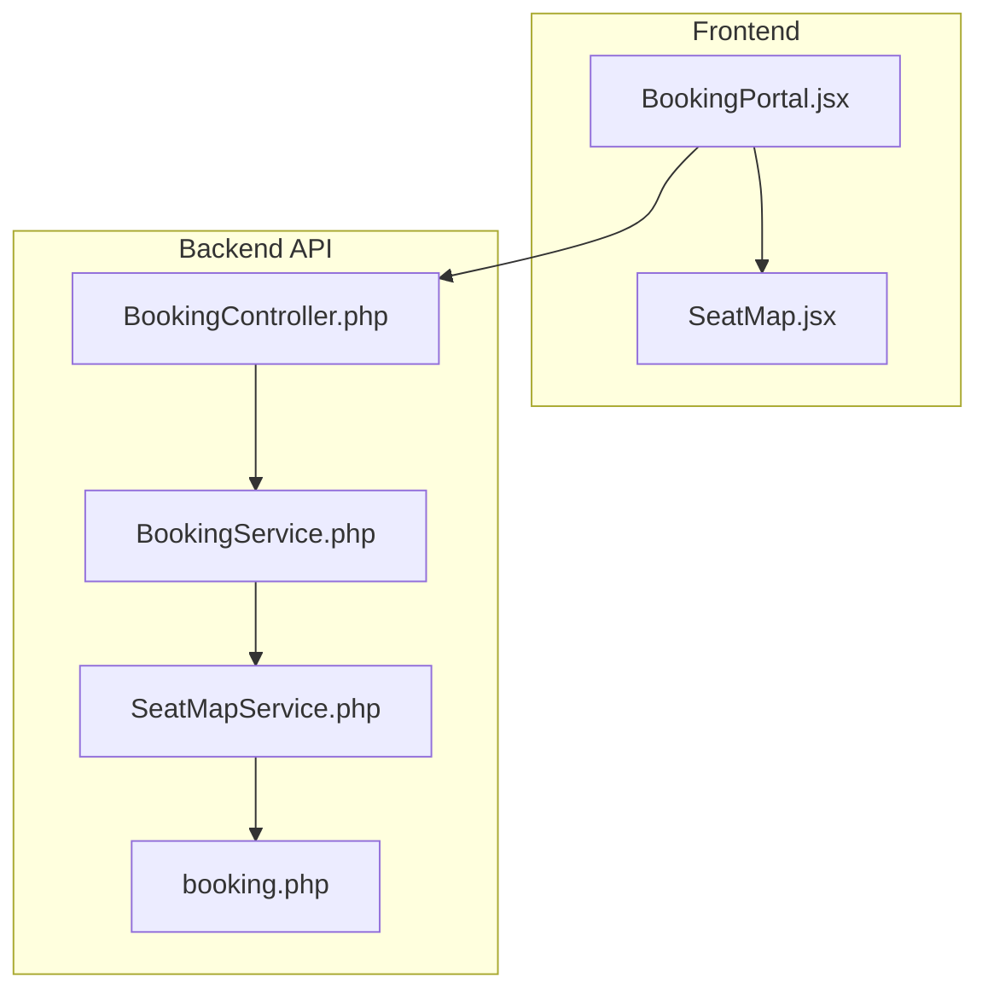

**Diagram sources**
- [BookingPortal.jsx:108-289](file://frontend/src/components/BookingPortal.jsx#L108-L289)
- [SeatMap.jsx:192-383](file://frontend/src/components/SeatMap.jsx#L192-L383)
- [BookingController.php:82-116](file://backend/app/Http/Controllers/API/BookingController.php#L82-L116)
- [BookingService.php:28-131](file://backend/app/Services/BookingService.php#L28-L131)
- [SeatMapService.php:194-244](file://backend/app/Services/SeatMapService.php#L194-L244)
- [booking.php:1-11](file://backend/config/booking.php#L1-L11)

**Section sources**
- [SeatMap.jsx:1-612](file://frontend/src/components/SeatMap.jsx#L1-L612)
- [BookingPortal.jsx:1-654](file://frontend/src/components/BookingPortal.jsx#L1-L654)
- [SeatMapService.php:1-593](file://backend/app/Services/SeatMapService.php#L1-L593)
- [BookingController.php:1-150](file://backend/app/Http/Controllers/API/BookingController.php#L1-L150)
- [BookingService.php:1-335](file://backend/app/Services/BookingService.php#L1-L335)
- [booking.php:1-11](file://backend/config/booking.php#L1-L11)

## Core Components
- Seat Map Rendering:
  - The seat map component generates a grid based on bus layout (`2+2`, `1+2`, `sleeper`, or custom JSON grid). It displays engine, driver, aisle, and seat cells, and shows a legend for statuses such as available, selected, booked male/female, sold male/female, and blocked.
  - Seat selection is gated by `isSeatSelectable`, which currently allows only `available` seats to be selected.

- Real-Time Availability:
  - The portal polls the search endpoint every 5 seconds when a schedule is selected, refreshing results and updating the selected schedule’s seat map. A live indicator shows the last sync time.

- Gender-Aware Blocking:
  - Backend seat mapping assigns gendered statuses (`booked_m`, `booked_f`, `sold_m`, `sold_f`) based on passenger gender and booking status. The frontend uses these keys to render different colors and labels.

- Hold Mechanism:
  - When a user selects a seat, the frontend immediately marks it as selected with a temporary 2-minute expiry (optimistic UI), then calls `/seats/hold`. On success, the server-provided `expires_at` replaces the placeholder. If the server rejects the hold, the frontend rolls back the selection.

- Expiration Handling:
  - A client-side timer checks expirations every second. Expired seats are removed from local state, a toast notification is shown, and a release request is sent to the backend.

- Concurrent Booking Protection:
  - During final booking, the backend locks active bookings with `lockForUpdate`, rebuilds the seat map, validates each requested seat, and creates the booking inside a database transaction. Holds are cleaned up after successful booking.

**Section sources**
- [SeatMap.jsx:48-190](file://frontend/src/components/SeatMap.jsx#L48-L190)
- [SeatMap.jsx:192-383](file://frontend/src/components/SeatMap.jsx#L192-L383)
- [SeatMap.jsx:386-611](file://frontend/src/components/SeatMap.jsx#L386-L611)
- [BookingPortal.jsx:400-443](file://frontend/src/components/BookingPortal.jsx#L400-L443)
- [SeatMapService.php:223-244](file://backend/app/Services/SeatMapService.php#L223-L244)
- [SeatMapService.php:502-582](file://backend/app/Services/SeatMapService.php#L502-L582)
- [BookingService.php:52-131](file://backend/app/Services/BookingService.php#L52-L131)

## Architecture Overview
The seat selection flow combines optimistic frontend interactions with authoritative backend validation.

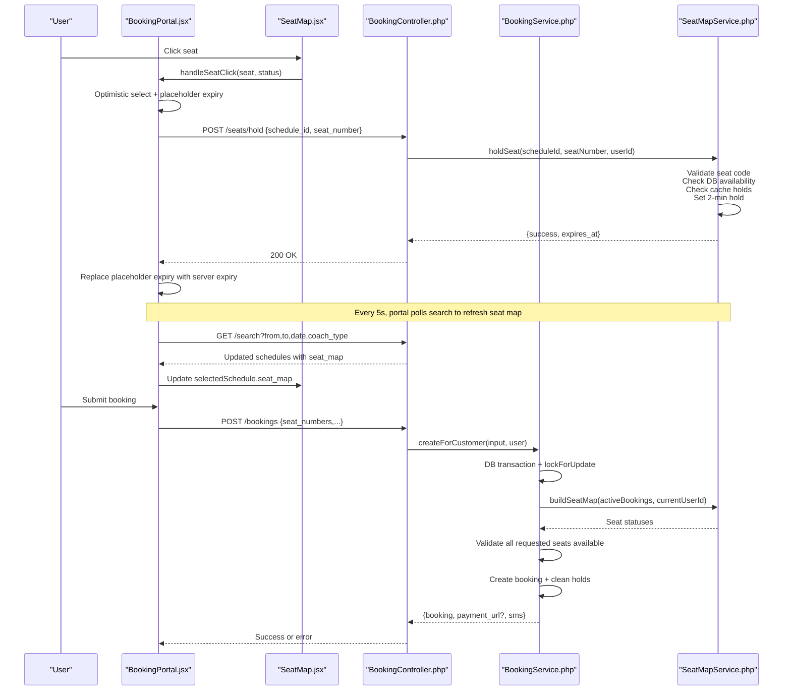

**Diagram sources**
- [BookingPortal.jsx:209-289](file://frontend/src/components/BookingPortal.jsx#L209-L289)
- [BookingPortal.jsx:400-443](file://frontend/src/components/BookingPortal.jsx#L400-L443)
- [BookingPortal.jsx:469-575](file://frontend/src/components/BookingPortal.jsx#L469-L575)
- [BookingController.php:82-116](file://backend/app/Http/Controllers/API/BookingController.php#L82-L116)
- [BookingController.php:19-40](file://backend/app/Http/Controllers/API/BookingController.php#L19-L40)
- [BookingService.php:28-131](file://backend/app/Services/BookingService.php#L28-L131)
- [SeatMapService.php:194-244](file://backend/app/Services/SeatMapService.php#L194-L244)
- [SeatMapService.php:502-582](file://backend/app/Services/SeatMapService.php#L502-L582)

## Detailed Component Analysis

### Seat Map Component
Responsibilities:
- Generate bus layout grids for standard and sleeper layouts.
- Render seat cells with status classes and tooltips.
- Display boarding/dropping points, passenger info, promo input, payment method toggle, fare breakdown, and per-seat hold countdown.
- Use `SEAT_STATUS_LABELS` and `isSeatSelectable` to control interactivity.

Key behaviors:
- Status-driven styling: `status-available`, `status-selected`, `status-booked_m`, `status-booked_f`, `status-sold_m`, `status-sold_f`, `status-blocked`.
- Hold countdown: Uses `seatExpirations[seat]` to show remaining time until reservation expires.
- Legend: Shows semantic meanings for each status key.

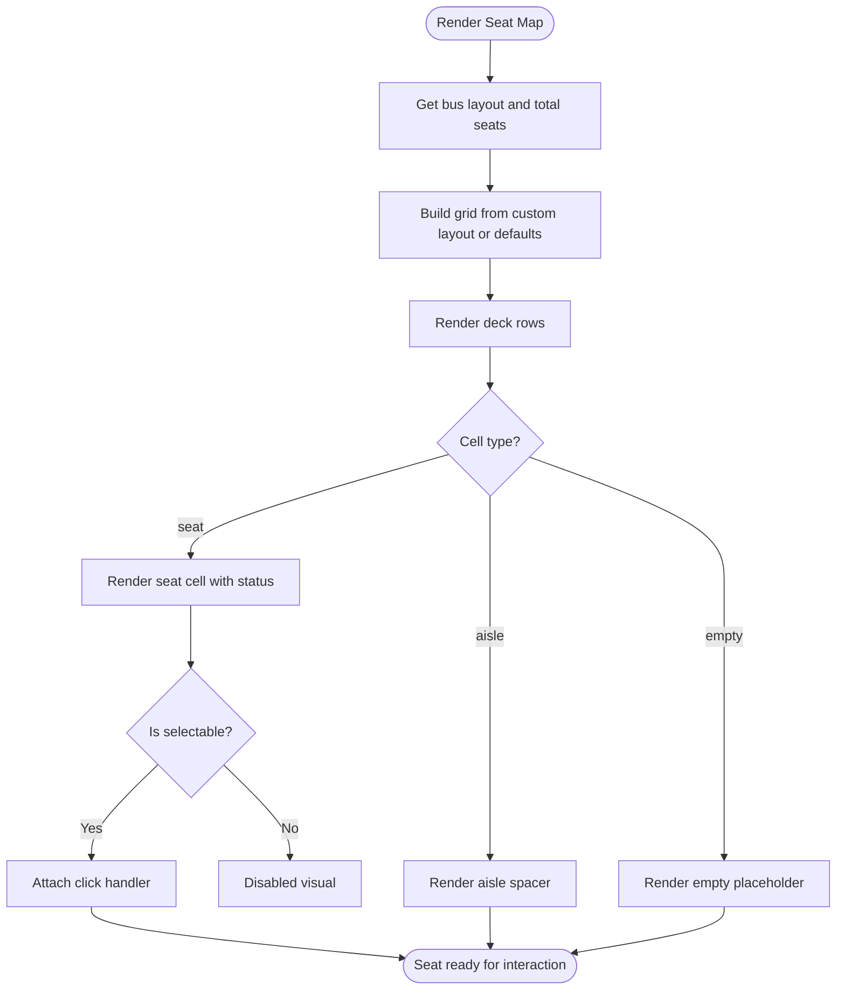

**Diagram sources**
- [SeatMap.jsx:48-190](file://frontend/src/components/SeatMap.jsx#L48-L190)
- [SeatMap.jsx:192-383](file://frontend/src/components/SeatMap.jsx#L192-L383)

**Section sources**
- [SeatMap.jsx:48-190](file://frontend/src/components/SeatMap.jsx#L48-L190)
- [SeatMap.jsx:192-383](file://frontend/src/components/SeatMap.jsx#L192-L383)
- [SeatMap.jsx:386-611](file://frontend/src/components/SeatMap.jsx#L386-L611)

### Real-Time Seat Availability Updates
Mechanism:
- When a schedule is selected, the portal starts a 5-second interval that re-fetches the search results, updates the cached schedule list, and replaces the selected schedule with the fresh version containing an updated `seat_map`.
- The seat map component receives the latest `seat_map` via props and re-renders accordingly.
- A live indicator shows the last sync timestamp and indicates the 5-second refresh cadence.

Error handling:
- Transient network errors during polling are silently ignored to avoid disrupting the user experience.

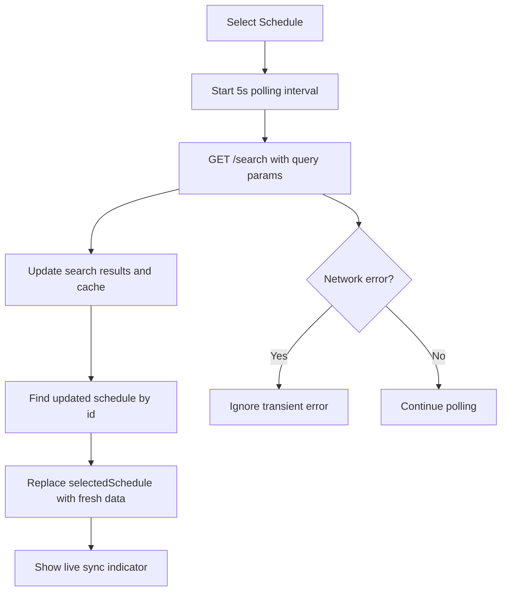

**Diagram sources**
- [BookingPortal.jsx:400-443](file://frontend/src/components/BookingPortal.jsx#L400-L443)

**Section sources**
- [BookingPortal.jsx:400-443](file://frontend/src/components/BookingPortal.jsx#L400-L443)

### Gender-Aware Seat Blocking
Backend logic:
- Seat mapping computes gendered statuses based on `passenger_gender` and booking status:
  - Paid/sold/booked bookings produce `booked_m`, `booked_f`, `sold_m`, or `sold_f`.
  - Recent pending bookings within 10 minutes are treated as active for visibility purposes.
- Blocked seats from the schedule override availability.

Frontend rendering:
- The seat map uses the returned status keys to apply CSS classes and labels.
- Legends explain the meaning of each status.

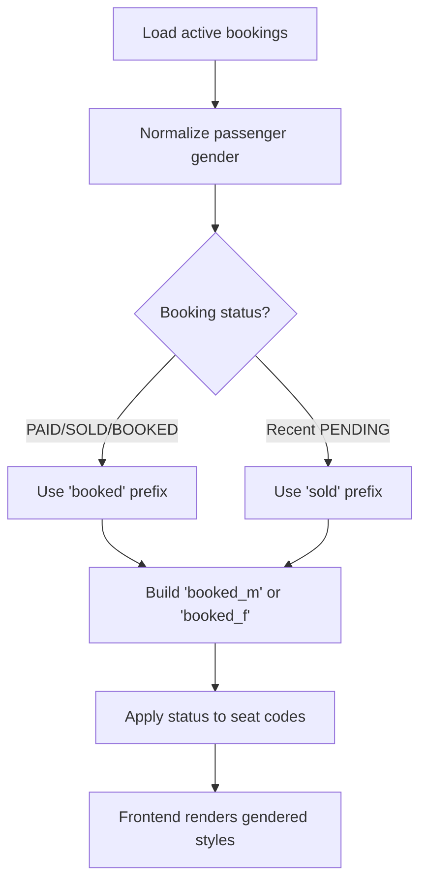

**Diagram sources**
- [SeatMapService.php:223-244](file://backend/app/Services/SeatMapService.php#L223-L244)
- [SeatMap.jsx:359-383](file://frontend/src/components/SeatMap.jsx#L359-L383)

**Section sources**
- [SeatMapService.php:223-244](file://backend/app/Services/SeatMapService.php#L223-L244)
- [SeatMap.jsx:359-383](file://frontend/src/components/SeatMap.jsx#L359-L383)

### Seat Holding Mechanism with 2-Minute Expiration
Frontend behavior:
- On seat click:
  - If deselecting: optimistically remove from selection and call `/seats/release`; roll back if the server rejects.
  - If selecting: add seat to selection with a placeholder 2-minute expiry; call `/seats/hold`; replace placeholder with server-provided `expires_at`; roll back on failure.
- Expiration checker runs every second:
  - Removes expired seats from local state.
  - Shows a toast notification.
  - Calls `/seats/release` for each expired seat.

Backend behavior:
- `holdSeat`:
  - Validates schedule and seat code.
  - Checks DB availability using a seat map built without cache holds.
  - Cleans expired holds from cache.
  - Rejects if another user holds the seat.
  - Sets a 2-minute hold in cache under `schedule_holds:{scheduleId}`.
- `releaseSeat`:
  - Removes the user’s hold for the seat if present.

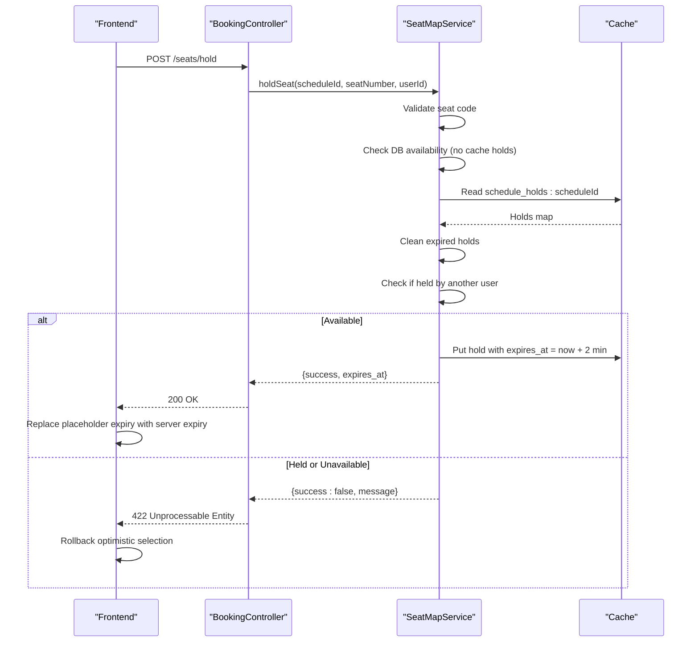

**Diagram sources**
- [BookingPortal.jsx:209-289](file://frontend/src/components/BookingPortal.jsx#L209-L289)
- [BookingPortal.jsx:163-207](file://frontend/src/components/BookingPortal.jsx#L163-L207)
- [BookingController.php:82-116](file://backend/app/Http/Controllers/API/BookingController.php#L82-L116)
- [SeatMapService.php:502-582](file://backend/app/Services/SeatMapService.php#L502-L582)

**Section sources**
- [BookingPortal.jsx:163-207](file://frontend/src/components/BookingPortal.jsx#L163-L207)
- [BookingPortal.jsx:209-289](file://frontend/src/components/BookingPortal.jsx#L209-L289)
- [BookingController.php:82-116](file://backend/app/Http/Controllers/API/BookingController.php#L82-L116)
- [SeatMapService.php:502-582](file://backend/app/Services/SeatMapService.php#L502-L582)

### Optimistic UI Updates and Rollback Strategies
Optimistic selection:
- Immediately update local state with a placeholder expiry.
- Send hold request to backend.
- On success, patch the real expiry.
- On failure or network error, revert local state and show an error toast.

Optimistic deselection:
- Immediately remove seat from selection.
- Send release request.
- On failure or network error, restore seat to selection and show an error toast.

Expiration cleanup:
- Detect expired seats locally.
- Remove from selection and expirations map.
- Notify user and attempt backend release.

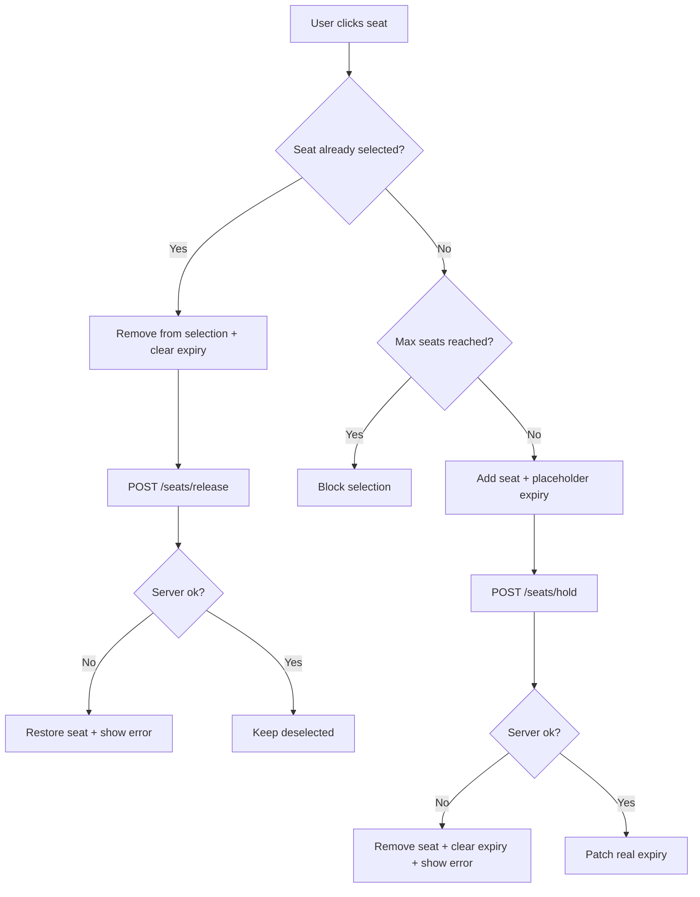

**Diagram sources**
- [BookingPortal.jsx:209-289](file://frontend/src/components/BookingPortal.jsx#L209-L289)

**Section sources**
- [BookingPortal.jsx:209-289](file://frontend/src/components/BookingPortal.jsx#L209-L289)

### Conflict Resolution and Concurrent Booking Scenarios
Conflict detection:
- Hold phase:
  - Backend checks DB availability ignoring cache holds to prevent double-holding across processes.
  - Cache holds are checked to reject requests from other users.
- Booking phase:
  - Database transaction with `lockForUpdate` ensures serializable access to active bookings.
  - Seat map is rebuilt against locked active bookings.
  - Each requested seat is validated before creating the booking.

Resolution outcomes:
- If any requested seat is unavailable, the entire booking fails with a clear message.
- Successful booking cleans up the user’s holds for those seats.

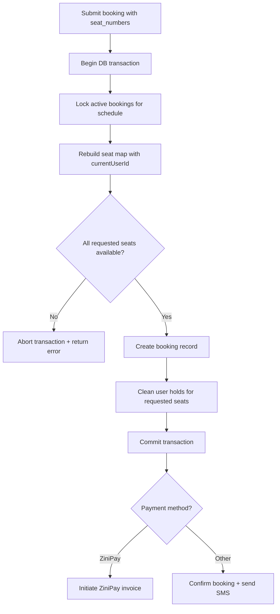

**Diagram sources**
- [BookingService.php:52-131](file://backend/app/Services/BookingService.php#L52-L131)

**Section sources**
- [BookingService.php:52-131](file://backend/app/Services/BookingService.php#L52-L131)

### Seat Allocation Algorithms and Availability Tracking
Seat code generation:
- Supports custom JSON grid (including sleeper decks) and fallback algorithms for `1+2`, `sleeper`, `2+2_last5`, and default `2+2`.
- Generates seat codes by iterating row letters and numbers, respecting bus `total_seats`.

Availability tracking:
- Initializes all generated seats as `available`.
- Applies blocked seats from schedule configuration.
- Applies active holds from cache for other users.
- Marks seats as gendered statuses based on paid/recent bookings.

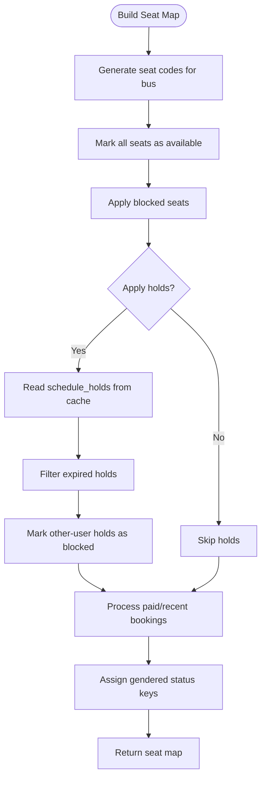

**Diagram sources**
- [SeatMapService.php:49-189](file://backend/app/Services/SeatMapService.php#L49-L189)
- [SeatMapService.php:194-244](file://backend/app/Services/SeatMapService.php#L194-L244)

**Section sources**
- [SeatMapService.php:49-189](file://backend/app/Services/SeatMapService.php#L49-L189)
- [SeatMapService.php:194-244](file://backend/app/Services/SeatMapService.php#L194-L244)

### Synchronization Between Frontend and Backend
- Polling:
  - Frontend polls `/search` every 5 seconds while a schedule is selected, replacing the selected schedule with the fresh version.
- Hold/Release:
  - Frontend calls `/seats/hold` and `/seats/release` to manage reservations.
  - Backend persists holds in cache with expiration timestamps.
- Booking:
  - Frontend submits `/bookings` with selected seats and passenger details.
  - Backend validates availability under a transaction and returns either a payment URL or confirmation.

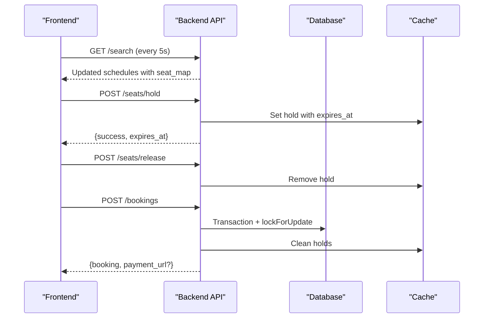

**Diagram sources**
- [BookingPortal.jsx:400-443](file://frontend/src/components/BookingPortal.jsx#L400-L443)
- [BookingPortal.jsx:209-289](file://frontend/src/components/BookingPortal.jsx#L209-L289)
- [BookingController.php:82-116](file://backend/app/Http/Controllers/API/BookingController.php#L82-L116)
- [BookingService.php:52-131](file://backend/app/Services/BookingService.php#L52-L131)
- [SeatMapService.php:502-582](file://backend/app/Services/SeatMapService.php#L502-L582)

**Section sources**
- [BookingPortal.jsx:400-443](file://frontend/src/components/BookingPortal.jsx#L400-L443)
- [BookingPortal.jsx:209-289](file://frontend/src/components/BookingPortal.jsx#L209-L289)
- [BookingController.php:82-116](file://backend/app/Http/Controllers/API/BookingController.php#L82-L116)
- [BookingService.php:52-131](file://backend/app/Services/BookingService.php#L52-L131)
- [SeatMapService.php:502-582](file://backend/app/Services/SeatMapService.php#L502-L582)

## Dependency Analysis
Component relationships:
- `BookingPortal.jsx` depends on `SeatMap.jsx` for rendering and on `BookingController.php` for API interactions.
- `BookingController.php` delegates to `BookingService.php` for business logic and to `SeatMapService.php` for seat-related operations.
- `SeatMapService.php` reads configuration from `booking.php` and interacts with cache and database models.

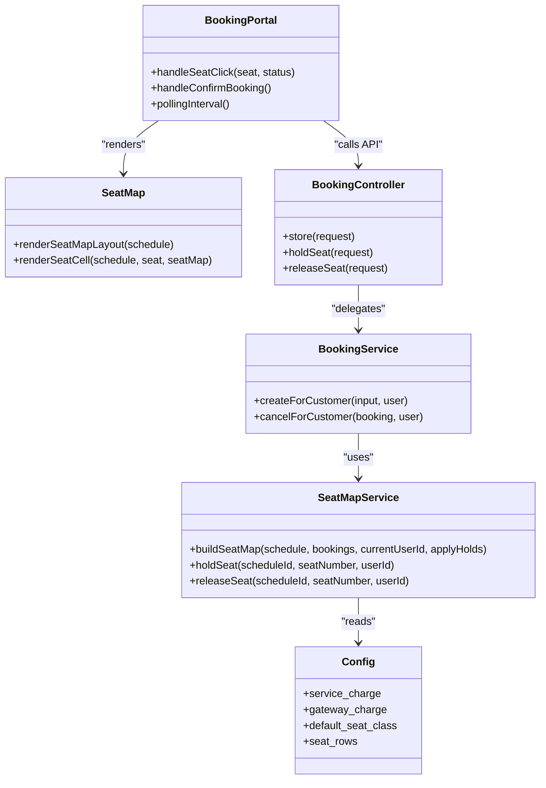

**Diagram sources**
- [BookingPortal.jsx:209-289](file://frontend/src/components/BookingPortal.jsx#L209-L289)
- [SeatMap.jsx:192-383](file://frontend/src/components/SeatMap.jsx#L192-L383)
- [BookingController.php:19-40](file://backend/app/Http/Controllers/API/BookingController.php#L19-L40)
- [BookingController.php:82-116](file://backend/app/Http/Controllers/API/BookingController.php#L82-L116)
- [BookingService.php:28-131](file://backend/app/Services/BookingService.php#L28-L131)
- [SeatMapService.php:194-244](file://backend/app/Services/SeatMapService.php#L194-L244)
- [SeatMapService.php:502-582](file://backend/app/Services/SeatMapService.php#L502-L582)
- [booking.php:1-11](file://backend/config/booking.php#L1-L11)

**Section sources**
- [BookingPortal.jsx:1-654](file://frontend/src/components/BookingPortal.jsx#L1-L654)
- [SeatMap.jsx:1-612](file://frontend/src/components/SeatMap.jsx#L1-L612)
- [BookingController.php:1-150](file://backend/app/Http/Controllers/API/BookingController.php#L1-L150)
- [BookingService.php:1-335](file://backend/app/Services/BookingService.php#L1-L335)
- [SeatMapService.php:1-593](file://backend/app/Services/SeatMapService.php#L1-L593)
- [booking.php:1-11](file://backend/config/booking.php#L1-L11)

## Performance Considerations
- Polling frequency:
  - 5-second polling balances freshness with server load. Consider adaptive polling based on activity (e.g., increase frequency near departure times).
- Seat map computation:
  - Building seat maps iterates through generated seat codes and bookings. For high traffic, consider caching computed seat maps keyed by schedule ID with short TTL.
- Database locking:
  - `lockForUpdate` prevents race conditions but may serialize writes. Ensure indexes on `schedule_id` and status columns to minimize lock contention.
- Cache operations:
  - Hold records are stored in cache with 10-minute overall TTL and 2-minute per-seat expiration. Monitor cache memory usage and eviction policies.
- Frontend state updates:
  - Optimistic updates reduce perceived latency. Ensure robust rollback paths to maintain consistency.

[No sources needed since this section provides general guidance]

## Troubleshooting Guide
Common issues and resolutions:
- Seat appears selected but backend rejects hold:
  - Cause: Another user secured the seat or DB availability changed.
  - Resolution: Frontend rolls back selection and shows an error toast. Verify seat availability via refreshed seat map.
- Hold expires unexpectedly:
  - Cause: Client-side timer detected expiration; backend hold may still exist briefly.
  - Resolution: Frontend releases hold; ensure network connectivity. If release fails, backend will expire hold automatically.
- Booking fails due to unavailable seat:
  - Cause: Seat became unavailable between hold and booking submission.
  - Resolution: Backend validates all requested seats under a transaction and aborts if any are unavailable. Prompt user to select alternative seats.
- Gendered status not reflecting:
  - Cause: Backend assigns gendered statuses based on passenger gender and booking status.
  - Resolution: Verify booking gender field and status. Check seat map payload for correct status keys.

**Section sources**
- [BookingPortal.jsx:209-289](file://frontend/src/components/BookingPortal.jsx#L209-L289)
- [BookingPortal.jsx:163-207](file://frontend/src/components/BookingPortal.jsx#L163-L207)
- [BookingService.php:52-131](file://backend/app/Services/BookingService.php#L52-L131)
- [SeatMapService.php:223-244](file://backend/app/Services/SeatMapService.php#L223-L244)

## Conclusion
The seat selection system combines a responsive frontend with a robust backend to provide accurate, real-time seat availability, gender-aware visualization, and safe concurrent booking. The 2-minute hold mechanism, optimistic UI updates, and transactional booking process ensure a smooth user experience while preventing overbooking. Continuous polling keeps the interface synchronized with backend state, and comprehensive error handling and rollback strategies maintain data integrity under contention.

[No sources needed since this section summarizes without analyzing specific files]