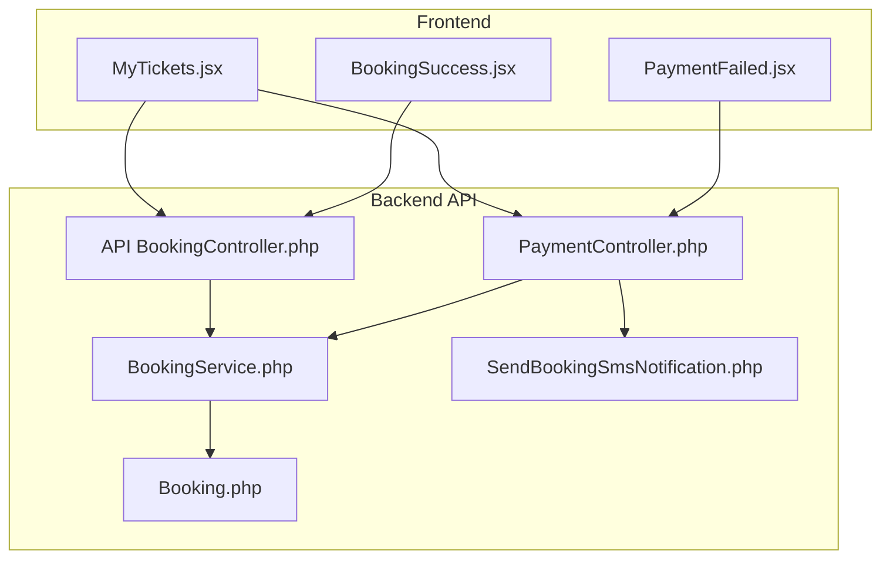
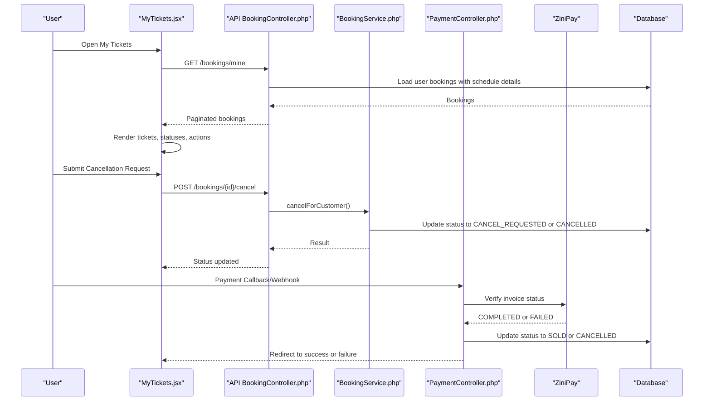
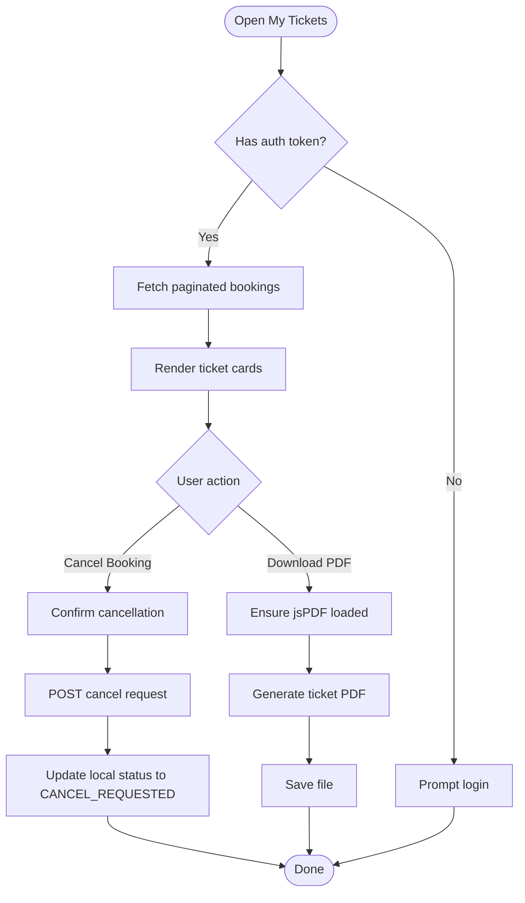
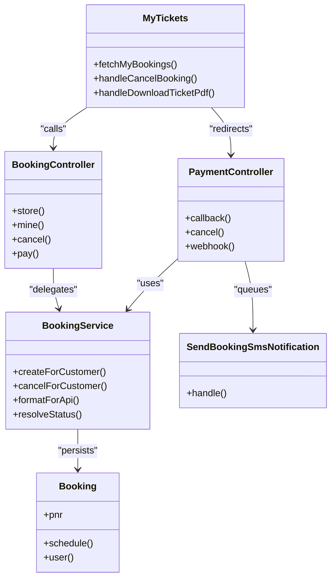

# Post-Booking Management

<cite>
**Referenced Files in This Document**   
- [MyTickets.jsx](file://frontend/src/components/MyTickets.jsx)
- [BookingSuccess.jsx](file://frontend/src/components/BookingSuccess.jsx)
- [PaymentFailed.jsx](file://frontend/src/components/PaymentFailed.jsx)
- [BookingController.php](file://backend/app/Http/Controllers/API/BookingController.php)
- [PaymentController.php](file://backend/app/Http/Controllers/PaymentController.php)
- [BookingService.php](file://backend/app/Services/BookingService.php)
- [Booking.php](file://backend/app/Models/Booking.php)
- [SendBookingSmsNotification.php](file://backend/app/Jobs/SendBookingSmsNotification.php)
</cite>

## Table of Contents
1. [Introduction](#introduction)
2. [Project Structure](#project-structure)
3. [Core Components](#core-components)
4. [Architecture Overview](#architecture-overview)
5. [Detailed Component Analysis](#detailed-component-analysis)
6. [Dependency Analysis](#dependency-analysis)
7. [Performance Considerations](#performance-considerations)
8. [Troubleshooting Guide](#troubleshooting-guide)
9. [Conclusion](#conclusion)

## Introduction
This document explains the post-booking user management features for the bus application. It covers how users view tickets, track booking status, request cancellations, and understand refund handling. It also documents booking success and failure states, payment monitoring through ZiniPay, user notifications, and the MyTickets component’s history, pagination, and ticket re-download capabilities. Examples include different booking states, cancellation workflows, and customer support scenarios such as partial cancellations and booking modifications.

## Project Structure
The post-booking experience spans a React frontend and a Laravel backend:
- Frontend components handle ticket display, success/failure pages, and cancellation requests.
- Backend controllers and services manage booking creation, payment initiation, webhook processing, and cancellation logic.
- The Booking model defines stored fields and exposes a PNR reference.
- SMS notification jobs and services are used to confirm bookings after successful payments.

**Diagram sources**
- [MyTickets.jsx:114-187](file://frontend/src/components/MyTickets.jsx#L114-L187)
- [BookingController.php:19-80](file://backend/app/Http/Controllers/API/BookingController.php#L19-L80)
- [PaymentController.php:21-85](file://backend/app/Http/Controllers/PaymentController.php#L21-L85)
- [BookingService.php:28-131](file://backend/app/Services/BookingService.php#L28-L131)
- [Booking.php:12-47](file://backend/app/Models/Booking.php#L12-L47)
- [SendBookingSmsNotification.php:11-35](file://backend/app/Jobs/SendBookingSmsNotification.php#L11-L35)

**Section sources**
- [MyTickets.jsx:1-435](file://frontend/src/components/MyTickets.jsx#L1-L435)
- [BookingController.php:1-150](file://backend/app/Http/Controllers/API/BookingController.php#L1-L150)
- [PaymentController.php:1-162](file://backend/app/Http/Controllers/PaymentController.php#L1-L162)
- [BookingService.php:1-335](file://backend/app/Services/BookingService.php#L1-L335)
- [Booking.php:1-49](file://backend/app/Models/Booking.php#L1-L49)
- [SendBookingSmsNotification.php:1-37](file://backend/app/Jobs/SendBookingSmsNotification.php#L1-L37)

## Core Components
- MyTickets: Displays the authenticated user’s bookings, supports pagination, PDF download, and cancellation requests.
- BookingSuccess: Shows a boarding pass invoice with PNR, route, seats, fare, and status after successful payment.
- PaymentFailed: Communicates failed or cancelled payment outcomes and returns the user to the home page.
- API BookingController: Validates input, creates bookings, lists user bookings, handles cancellation requests, and initiates ZiniPay payments.
- PaymentController: Handles payment callback, cancellation redirect, and asynchronous webhook updates from ZiniPay.
- BookingService: Encapsulates seat validation, pricing, status resolution, cancellation rules, and API formatting.
- Booking Model: Defines persisted booking fields and generates a readable PNR.
- SendBookingSmsNotification: Queued job that sends SMS verification when bookings are confirmed.

**Section sources**
- [MyTickets.jsx:114-187](file://frontend/src/components/MyTickets.jsx#L114-L187)
- [BookingSuccess.jsx:1-146](file://frontend/src/components/BookingSuccess.jsx#L1-L146)
- [PaymentFailed.jsx:1-47](file://frontend/src/components/PaymentFailed.jsx#L1-L47)
- [BookingController.php:19-80](file://backend/app/Http/Controllers/API/BookingController.php#L19-L80)
- [PaymentController.php:21-136](file://backend/app/Http/Controllers/PaymentController.php#L21-L136)
- [BookingService.php:28-240](file://backend/app/Services/BookingService.php#L28-L240)
- [Booking.php:12-47](file://backend/app/Models/Booking.php#L12-L47)
- [SendBookingSmsNotification.php:11-35](file://backend/app/Jobs/SendBookingSmsNotification.php#L11-L35)

## Architecture Overview
Post-booking flows involve three main paths:
1. Ticket viewing and cancellation: MyTickets calls the API to list bookings and submit cancellation requests.
2. Payment completion: After initiating ZiniPay, the system processes callbacks and webhooks to update booking status and send SMS.
3. Success and failure UI: BookingSuccess and PaymentFailed render final states based on query parameters and backend redirects.

**Diagram sources**
- [MyTickets.jsx:114-187](file://frontend/src/components/MyTickets.jsx#L114-L187)
- [BookingController.php:42-80](file://backend/app/Http/Controllers/API/BookingController.php#L42-L80)
- [BookingService.php:200-240](file://backend/app/Services/BookingService.php#L200-L240)
- [PaymentController.php:21-136](file://backend/app/Http/Controllers/PaymentController.php#L21-L136)

## Detailed Component Analysis

### MyTickets Component
MyTickets is the primary post-booking interface for customers. It:
- Fetches the authenticated user’s bookings via an API endpoint with pagination.
- Formats dates and times for readability.
- Dynamically loads a PDF library to generate downloadable ticket PDFs.
- Allows cancellation requests for eligible bookings and updates local state accordingly.
- Handles authentication errors and network failures gracefully.

Key behaviors:
- Authentication check: If no token exists, it prompts login.
- Pagination: Supports previous/next navigation and refresh.
- Status-based actions:
  - For PAID, SOLD, or BOOKED: shows cancellation notice and allows cancellation request.
  - For CANCEL_REQUESTED: indicates waiting for admin approval.
  - For CANCELLED: indicates refund has been processed.
- PDF download: Generates a ticket PDF including PNR, passenger info, route, bus details, departure time, seats, payment method, status, and total fare.

**Diagram sources**
- [MyTickets.jsx:31-104](file://frontend/src/components/MyTickets.jsx#L31-L104)
- [MyTickets.jsx:114-187](file://frontend/src/components/MyTickets.jsx#L114-L187)

**Section sources**
- [MyTickets.jsx:1-435](file://frontend/src/components/MyTickets.jsx#L1-L435)

### BookingSuccess Component
BookingSuccess renders a boarding pass invoice after successful payment:
- Displays PNR, passenger name, contact number, route, bus operator, coach type, departure date/time, reserved seats, duration, payment method, reservation status, and total fare.
- Provides print functionality and a button to book another ticket.

This component relies on props passed from parent routing/state rather than direct API calls.

**Section sources**
- [BookingSuccess.jsx:1-146](file://frontend/src/components/BookingSuccess.jsx#L1-L146)

### PaymentFailed Component
PaymentFailed communicates unsuccessful payment outcomes:
- Distinguishes between user-cancelled and gateway-failed payments.
- Informs the user that no ticket was issued and held seats were released.
- Offers a return-to-home action.

**Section sources**
- [PaymentFailed.jsx:1-47](file://frontend/src/components/PaymentFailed.jsx#L1-L47)

### API BookingController
The API controller manages:
- Booking creation with validation and delegation to BookingService.
- Listing user bookings with eager loading and formatted responses.
- Customer cancellation requests delegated to BookingService.
- Public booking lookup by ID.
- Seat hold/release operations.
- Payment initiation for ZiniPay, storing invoice IDs and returning payment URLs.

Important endpoints:
- POST /api/bookings: Create booking.
- GET /api/bookings/mine: List user bookings.
- POST /api/bookings/{id}/cancel: Submit cancellation request.
- GET /api/bookings/public/{id}: View public booking details.
- POST /api/bookings/pay/{id}: Initiate ZiniPay payment.

**Section sources**
- [BookingController.php:19-148](file://backend/app/Http/Controllers/API/BookingController.php#L19-L148)

### PaymentController
PaymentController orchestrates payment lifecycle:
- Callback handler: Verifies payment via ZiniPay, updates status to SOLD or CANCELLED, sends SMS confirmation, and redirects to success or failure pages.
- Cancel handler: Cancels pending bookings and redirects appropriately.
- Webhook handler: Processes asynchronous payment notifications, verifies status, updates database, and sends SMS.

Redirect behavior:
- Success: Redirects to frontend with payment=success and PNR.
- Failure: Redirects to frontend with payment=failed and error message.

**Section sources**
- [PaymentController.php:21-160](file://backend/app/Http/Controllers/PaymentController.php#L21-L160)

### BookingService
BookingService centralizes business logic:
- createForCustomer: Validates seats, calculates fare, applies promotions, resolves initial status (PENDING for ZiniPay, SOLD for cash), creates booking, cleans up holds, and attaches ZiniPay invoice if needed.
- cancelForCustomer: Enforces authorization and status transitions:
  - PENDING → CANCELLED immediately.
  - Other paid states → CANCEL_REQUESTED awaiting admin approval.
  - Prevents duplicate cancellation requests.
- formatForApi: Builds a rich response including schedule, bus, route, and PNR.
- resolveStatus: Determines initial booking status based on payment method.

Cancellation workflow:
- Immediate cancellation for pending bookings.
- Admin-mediated cancellation for paid bookings.

**Section sources**
- [BookingService.php:28-131](file://backend/app/Services/BookingService.php#L28-L131)
- [BookingService.php:200-240](file://backend/app/Services/BookingService.php#L200-L240)
- [BookingService.php:242-327](file://backend/app/Services/BookingService.php#L242-L327)

### Booking Model
The Booking model defines:
- Fillable fields including passenger details, seat numbers, fares, payment method, invoice ID, and status.
- Casts total_fare to decimal precision.
- Relationships to Schedule and User.
- A computed PNR attribute formatted as SE followed by a zero-padded ID.

**Section sources**
- [Booking.php:12-47](file://backend/app/Models/Booking.php#L12-L47)

### SendBookingSmsNotification Job
A queued job responsible for sending SMS verification:
- Wraps SMS sending and logs warnings if delivery fails.
- Used after successful payment confirmation.

**Section sources**
- [SendBookingSmsNotification.php:11-35](file://backend/app/Jobs/SendBookingSmsNotification.php#L11-L35)

## Dependency Analysis
The post-booking system exhibits clear separation of concerns:
- Frontend components depend on API endpoints and rely on backend-provided data structures.
- Controllers delegate complex logic to services.
- Services coordinate models, external payment services, and SMS gateways.
- Models encapsulate persistence and computed attributes.

**Diagram sources**
- [MyTickets.jsx:114-187](file://frontend/src/components/MyTickets.jsx#L114-L187)
- [BookingController.php:19-148](file://backend/app/Http/Controllers/API/BookingController.php#L19-L148)
- [PaymentController.php:21-136](file://backend/app/Http/Controllers/PaymentController.php#L21-L136)
- [BookingService.php:28-327](file://backend/app/Services/BookingService.php#L28-L327)
- [Booking.php:12-47](file://backend/app/Models/Booking.php#L12-L47)
- [SendBookingSmsNotification.php:11-35](file://backend/app/Jobs/SendBookingSmsNotification.php#L11-L35)

**Section sources**
- [MyTickets.jsx:114-187](file://frontend/src/components/MyTickets.jsx#L114-L187)
- [BookingController.php:19-148](file://backend/app/Http/Controllers/API/BookingController.php#L19-L148)
- [PaymentController.php:21-136](file://backend/app/Http/Controllers/PaymentController.php#L21-L136)
- [BookingService.php:28-327](file://backend/app/Services/BookingService.php#L28-L327)
- [Booking.php:12-47](file://backend/app/Models/Booking.php#L12-L47)
- [SendBookingSmsNotification.php:11-35](file://backend/app/Jobs/SendBookingSmsNotification.php#L11-L35)

## Performance Considerations
- Pagination: MyTickets uses server-side pagination to limit payload size and improve rendering performance.
- Eager loading: Backend loads related schedule, bus, and route data to avoid N+1 queries.
- Conditional PDF generation: PDF library is loaded only when requested, reducing initial bundle overhead.
- Transactional booking creation: Ensures seat locking and data consistency without blocking unrelated operations.
- Queueing SMS: Notifications are sent asynchronously to avoid blocking payment flows.

[No sources needed since this section provides general guidance]

## Troubleshooting Guide
Common issues and resolutions:
- Session expired while fetching tickets:
  - Symptom: 401 response; frontend clears auth and prompts login.
  - Resolution: Re-authenticate and retry.
- Network error during cancellation:
  - Symptom: Toast error; local state unchanged.
  - Resolution: Retry cancellation; verify connectivity.
- Cannot cancel already cancelled or requested booking:
  - Symptom: Error message indicating already cancelled or request pending.
  - Resolution: Wait for admin approval or contact support.
- Payment callback not updating status:
  - Symptom: Booking remains PENDING after payment attempt.
  - Resolution: Check webhook logs and ensure ZiniPay verification succeeds; verify invoice ID linkage.
- SMS not delivered:
  - Symptom: No SMS after successful payment.
  - Resolution: Inspect queue logs and SMS gateway configuration; review warning logs for reasons.

**Section sources**
- [MyTickets.jsx:114-187](file://frontend/src/components/MyTickets.jsx#L114-L187)
- [PaymentController.php:21-136](file://backend/app/Http/Controllers/PaymentController.php#L21-L136)
- [SendBookingSmsNotification.php:25-35](file://backend/app/Jobs/SendBookingSmsNotification.php#L25-L35)

## Conclusion
The post-booking management system provides a robust user experience for viewing tickets, tracking status, requesting cancellations, and understanding refunds. The frontend components present clear interfaces for success and failure states, while the backend enforces secure payment flows and consistent status transitions. MyTickets centralizes ticket history, pagination, and PDF downloads, supporting both immediate cancellations for pending bookings and admin-mediated cancellations for paid reservations. Payment monitoring via ZiniPay ensures reliable updates through callbacks and webhooks, with SMS notifications confirming successful bookings.

[No sources needed since this section summarizes without analyzing specific files]