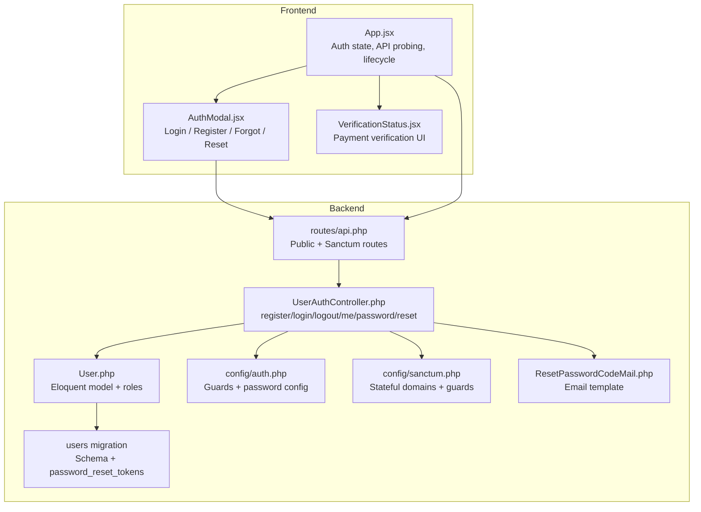
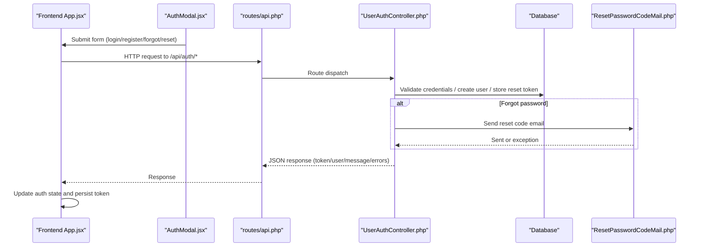
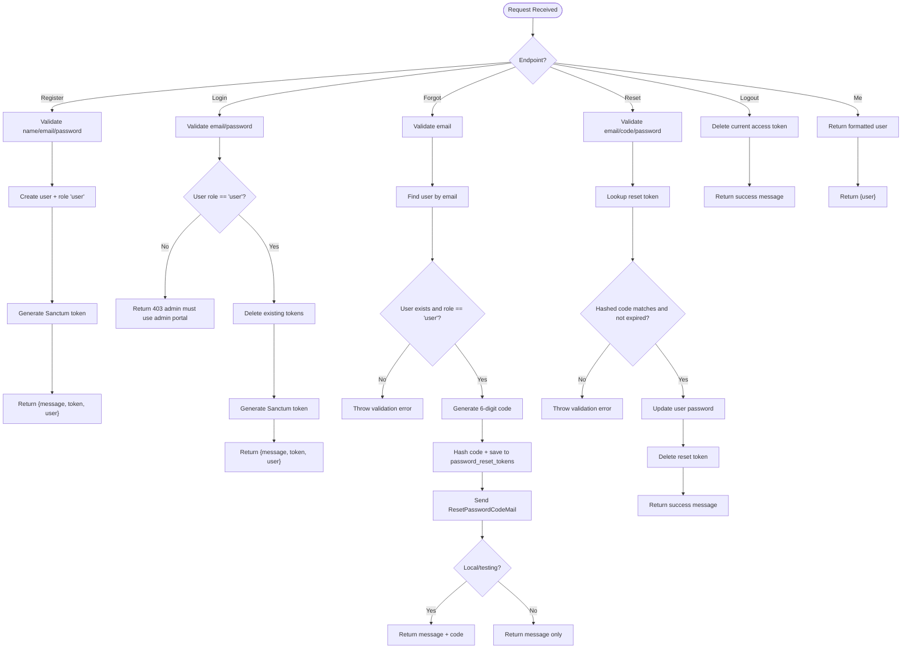
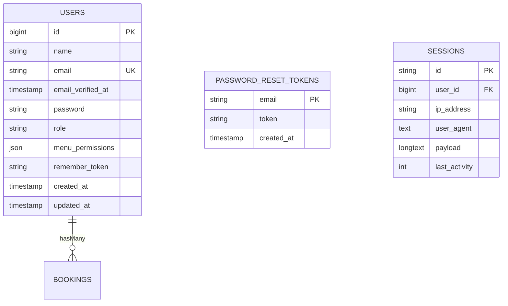
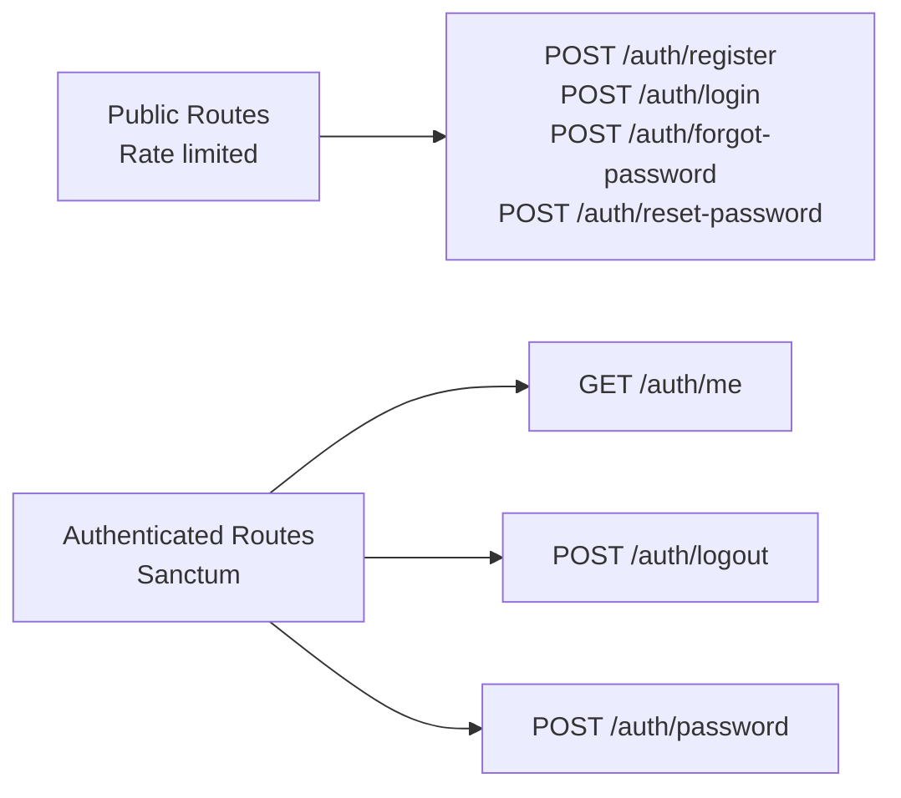
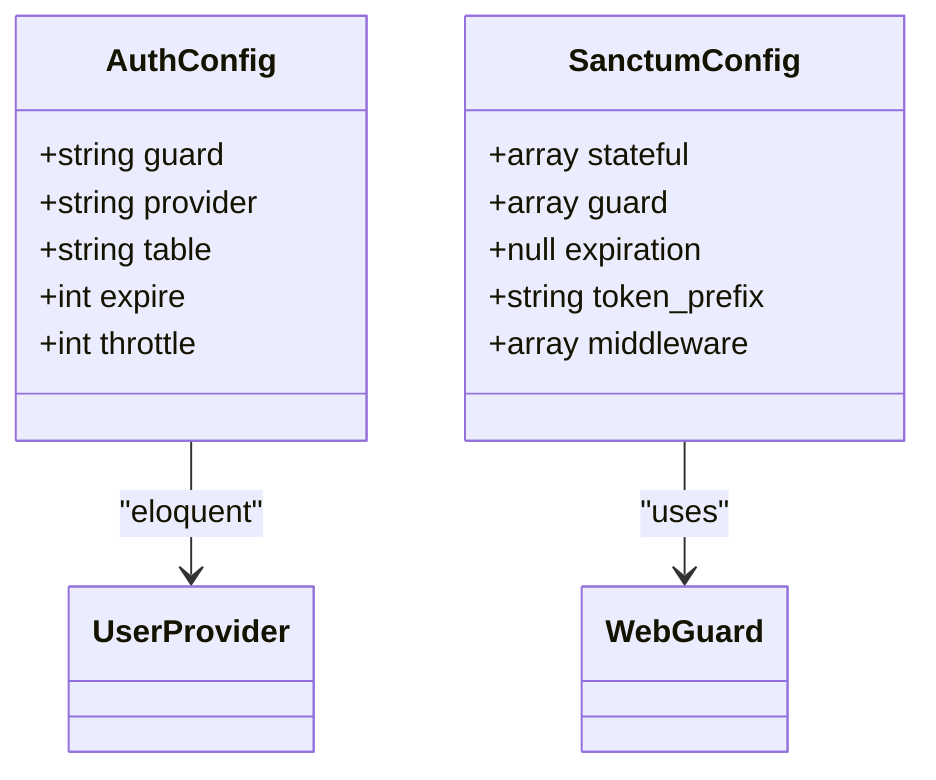
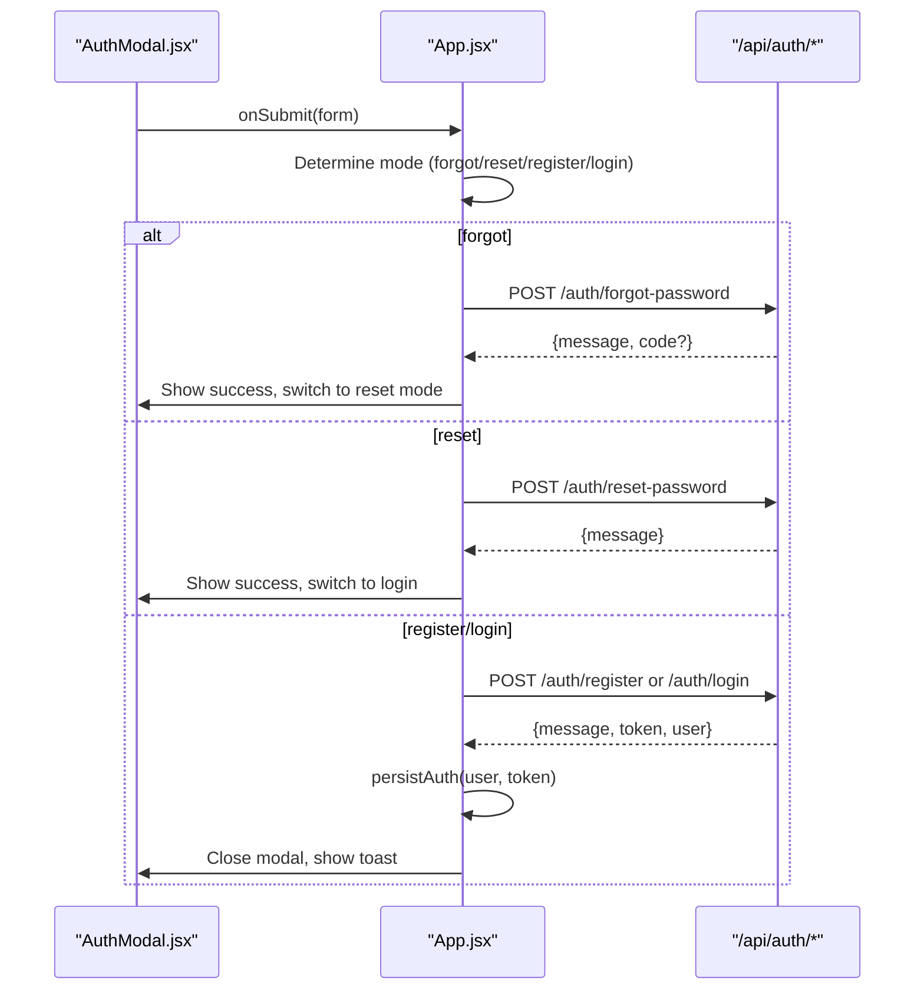
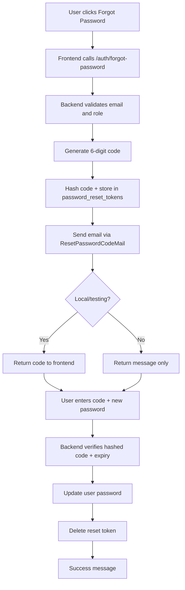
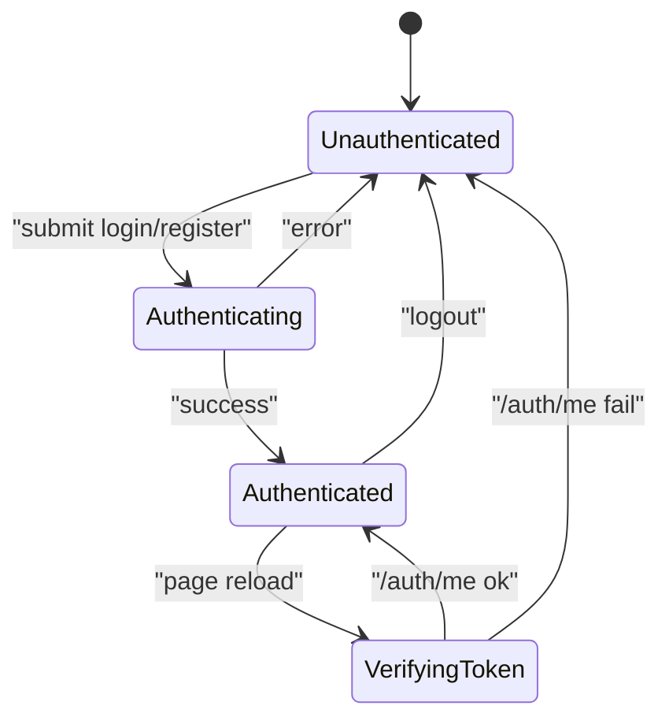
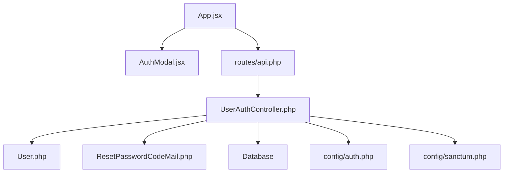

# Registration & Authentication

<cite>
**Referenced Files in This Document**
- [UserAuthController.php](file://backend/app/Http/Controllers/API/UserAuthController.php)
- [User.php](file://backend/app/Models/User.php)
- [api.php](file://backend/routes/api.php)
- [auth.php](file://backend/config/auth.php)
- [sanctum.php](file://backend/config/sanctum.php)
- [0001_01_01_000000_create_users_table.php](file://backend/database/migrations/0001_01_01_000000_create_users_table.php)
- [ResetPasswordCodeMail.php](file://backend/app/Mail/ResetPasswordCodeMail.php)
- [App.jsx](file://frontend/src/App.jsx)
- [AuthModal.jsx](file://frontend/src/components/AuthModal.jsx)
- [VerificationStatus.jsx](file://frontend/src/components/VerificationStatus.jsx)
</cite>

## Table of Contents
1. [Introduction](#introduction)
2. [Project Structure](#project-structure)
3. [Core Components](#core-components)
4. [Architecture Overview](#architecture-overview)
5. [Detailed Component Analysis](#detailed-component-analysis)
6. [Dependency Analysis](#dependency-analysis)
7. [Performance Considerations](#performance-considerations)
8. [Troubleshooting Guide](#troubleshooting-guide)
9. [Conclusion](#conclusion)

## Introduction
This document explains the complete user registration and authentication workflow in SonyaBus. It covers account creation, login, logout, password reset, session management, and how frontend components interact with backend API endpoints. It also documents the user model structure, validation rules, security measures, error handling, and common operational issues such as email delivery problems, verification timeouts, and account recovery procedures.

The current implementation uses:
- Laravel Sanctum for API token-based authentication on protected routes.
- A custom password reset flow using a 6-digit code sent via email.
- Frontend state management in React for auth flows, including modal-driven forms and token persistence.

Note: The project does not implement email address verification during registration. There is no `email_verified_at` update or verification endpoint; the field exists in the database but is not used by the authentication controller.

## Project Structure
The authentication system spans both backend and frontend:

- Backend:
  - API routes under `/api`.
  - Customer authentication endpoints under `/api/auth/*`.
  - Sanctum middleware protects authenticated routes.
  - User model and migrations define the data schema.
  - Mail class sends password reset codes.

- Frontend:
  - Main application component manages auth state, API base URL probing, and lifecycle hooks.
  - Auth modal provides login, register, forgot password, and reset password UI.
  - Verification status component handles payment verification results (not email verification).

**Diagram sources**
- [App.jsx:190-276](file://frontend/src/App.jsx#L190-L276)
- [AuthModal.jsx:1-165](file://frontend/src/components/AuthModal.jsx#L1-L165)
- [VerificationStatus.jsx:1-78](file://frontend/src/components/VerificationStatus.jsx#L1-L78)
- [api.php:41-75](file://backend/routes/api.php#L41-L75)
- [UserAuthController.php:17-218](file://backend/app/Http/Controllers/API/UserAuthController.php#L17-L218)
- [User.php:12-75](file://backend/app/Models/User.php#L12-L75)
- [0001_01_01_000000_create_users_table.php:14-30](file://backend/database/migrations/0001_01_01_000000_create_users_table.php#L14-L30)
- [auth.php:18-101](file://backend/config/auth.php#L18-L101)
- [sanctum.php:21-85](file://backend/config/sanctum.php#L21-L85)
- [ResetPasswordCodeMail.php:11-54](file://backend/app/Mail/ResetPasswordCodeMail.php#L11-L54)

**Section sources**
- [api.php:1-77](file://backend/routes/api.php#L1-L77)
- [App.jsx:1-800](file://frontend/src/App.jsx#L1-L800)

## Core Components
- UserAuthController: Implements customer-facing authentication endpoints including register, login, logout, me, update password, forgot password, and reset password.
- User model: Defines fillable fields, hidden attributes, casts, role helpers, and menu permissions.
- API routes: Define public guest routes for auth and Sanctum-protected routes for authenticated actions.
- Auth configuration: Defines default guard, providers, password reset table, expiry, and throttle settings.
- Sanctum configuration: Defines stateful domains, guards, expiration, token prefix, and middleware.
- Password reset mail: Sends an email containing the reset code to the user.
- Frontend App: Manages auth state, token persistence, API base discovery, and orchestrates auth flows.
- AuthModal: Provides UI for login, register, forgot password, and reset password.
- VerificationStatus: Displays payment verification outcomes (not related to email verification).

Key responsibilities:
- Validation and business logic are enforced server-side in the controller.
- Tokens are created and returned on successful register/login.
- Protected routes require a valid Sanctum token.
- Password reset uses a time-limited hashed code stored in `password_reset_tokens`.

**Section sources**
- [UserAuthController.php:17-218](file://backend/app/Http/Controllers/API/UserAuthController.php#L17-L218)
- [User.php:12-75](file://backend/app/Models/User.php#L12-L75)
- [api.php:41-75](file://backend/routes/api.php#L41-L75)
- [auth.php:18-101](file://backend/config/auth.php#L18-L101)
- [sanctum.php:21-85](file://backend/config/sanctum.php#L21-L85)
- [ResetPasswordCodeMail.php:11-54](file://backend/app/Mail/ResetPasswordCodeMail.php#L11-L54)
- [App.jsx:190-276](file://frontend/src/App.jsx#L190-L276)
- [AuthModal.jsx:1-165](file://frontend/src/components/AuthModal.jsx#L1-L165)
- [VerificationStatus.jsx:1-78](file://frontend/src/components/VerificationStatus.jsx#L1-L78)

## Architecture Overview
The authentication architecture follows a clear separation between frontend UI and backend API:

- Guest routes:
  - POST `/api/auth/register`
  - POST `/api/auth/login`
  - POST `/api/auth/forgot-password`
  - POST `/api/auth/reset-password`

- Authenticated routes (Sanctum):
  - POST `/api/auth/logout`
  - GET `/api/auth/me`
  - POST `/api/auth/password`

Frontend behavior:
- On successful register/login, the frontend stores the token and user object in local storage and sets an Authorization header for subsequent requests.
- On page load, the frontend restores the token from local storage and validates it by calling `/api/auth/me`.
- Logout clears local storage and optionally calls the backend logout endpoint.

Security considerations:
- Rate limiting is applied to guest auth routes.
- Passwords are hashed server-side.
- Reset codes are hashed and time-limited.
- Admin accounts are blocked from the customer API.

**Diagram sources**
- [App.jsx:190-276](file://frontend/src/App.jsx#L190-L276)
- [AuthModal.jsx:1-165](file://frontend/src/components/AuthModal.jsx#L1-L165)
- [api.php:41-75](file://backend/routes/api.php#L41-L75)
- [UserAuthController.php:17-218](file://backend/app/Http/Controllers/API/UserAuthController.php#L17-L218)
- [ResetPasswordCodeMail.php:11-54](file://backend/app/Mail/ResetPasswordCodeMail.php#L11-L54)

## Detailed Component Analysis

### Backend Authentication Controller
Responsibilities:
- Register: Validates input, creates user, generates Sanctum token, returns user and token.
- Login: Validates credentials, ensures user role is customer, deletes previous tokens, creates new token, returns user and token.
- Logout: Deletes current access token.
- Me: Returns formatted user info.
- Update password: Validates current password, updates password, returns updated user.
- Forgot password: Validates email, checks user role, generates 6-digit code, stores hashed code with timestamp, sends email, returns message (and code in local/testing environments).
- Reset password: Validates email/code/password, verifies hashed code and expiry, updates password, deletes reset token.

Validation rules:
- Register: name required string max 100; email required email unique; password required string min 6 confirmed.
- Login: email required email; password required string.
- Update password: current_password required string; password required string min 6 confirmed.
- Forgot password: email required email max 100.
- Reset password: email required email max 100; code required string; password required string min 6 confirmed.

Security measures:
- Admin accounts cannot use customer API.
- Previous tokens are deleted before issuing a new one on login.
- Reset codes are hashed and expire after 60 minutes.
- Email sending errors are logged and may throw validation exceptions in non-local environments.

Error handling:
- ValidationException is thrown for invalid credentials, incorrect current password, invalid/expired reset code, and missing users.
- Network/mail failures during forgot password are caught and either logged or converted into validation messages depending on environment.

**Diagram sources**
- [UserAuthController.php:17-218](file://backend/app/Http/Controllers/API/UserAuthController.php#L17-L218)

**Section sources**
- [UserAuthController.php:17-218](file://backend/app/Http/Controllers/API/UserAuthController.php#L17-L218)

### User Model and Schema
Model highlights:
- Fillable fields include name, email, password, role, menu_permissions.
- Hidden fields include password and remember_token.
- Casts include email_verified_at as datetime, password as hashed, menu_permissions as array.
- Role helpers: isAdmin, isSuperAdmin, isUser.
- Menu permission helper supports super admin bypass and admin menu permissions.

Schema highlights:
- Users table includes id, name, unique email, email_verified_at nullable, password, role default 'user', menu_permissions JSON, rememberToken, timestamps.
- Password reset tokens table includes email primary key, token, created_at nullable.
- Sessions table includes id, user_id, ip_address, user_agent, payload, last_activity.

**Diagram sources**
- [User.php:17-74](file://backend/app/Models/User.php#L17-L74)
- [0001_01_01_000000_create_users_table.php:14-39](file://backend/database/migrations/0001_01_01_000000_create_users_table.php#L14-L39)

**Section sources**
- [User.php:12-75](file://backend/app/Models/User.php#L12-L75)
- [0001_01_01_000000_create_users_table.php:14-39](file://backend/database/migrations/0001_01_01_000000_create_users_table.php#L14-L39)

### API Routes and Middleware
Guest routes:
- POST `/api/auth/register`
- POST `/api/auth/login`
- POST `/api/auth/forgot-password`
- POST `/api/auth/reset-password`

These routes are rate-limited at 10 attempts per minute per IP.

Authenticated routes (Sanctum):
- POST `/api/auth/logout`
- GET `/api/auth/me`
- POST `/api/auth/password`

Protected routes are guarded by Sanctum and maintenance mode check.

**Diagram sources**
- [api.php:41-75](file://backend/routes/api.php#L41-L75)

**Section sources**
- [api.php:41-75](file://backend/routes/api.php#L41-L75)

### Configuration: Auth and Sanctum
Auth configuration:
- Default guard is web.
- Provider uses Eloquent with User model.
- Password reset broker uses password_reset_tokens table, expires in 60 minutes, throttle 60 seconds.

Sanctum configuration:
- Stateful domains include localhost variants and dynamic app URL.
- Guard list includes web.
- Expiration is null (no explicit token expiration override).
- Token prefix configurable via environment.
- Middleware includes session authentication, cookie encryption, CSRF validation.

**Diagram sources**
- [auth.php:18-101](file://backend/config/auth.php#L18-L101)
- [sanctum.php:21-85](file://backend/config/sanctum.php#L21-L85)

**Section sources**
- [auth.php:18-101](file://backend/config/auth.php#L18-L101)
- [sanctum.php:21-85](file://backend/config/sanctum.php#L21-L85)

### Frontend Authentication Flow
App.jsx responsibilities:
- Maintains auth state: user, token, modal visibility, form values, loading flag, return action, dev reset code.
- Builds headers with Authorization Bearer token when present.
- Persists user and token to localStorage.
- Clears auth state on logout or invalidation.
- Handles submit for forgot, reset, register, and login flows.
- Calls `/api/auth/me` to validate restored token.
- Probes backend base URL and shows offline/install states.

AuthModal.jsx responsibilities:
- Renders different forms based on authMode: login, register, forgot, reset.
- Shows dev reset code hint in reset mode.
- Submits to handleAuthSubmit provided by parent.

VerificationStatus.jsx responsibilities:
- Displays payment verification result (success/failure) and allows viewing boarding pass.
- Not related to email verification.

**Diagram sources**
- [App.jsx:190-276](file://frontend/src/App.jsx#L190-L276)
- [AuthModal.jsx:1-165](file://frontend/src/components/AuthModal.jsx#L1-L165)

**Section sources**
- [App.jsx:190-276](file://frontend/src/App.jsx#L190-L276)
- [AuthModal.jsx:1-165](file://frontend/src/components/AuthModal.jsx#L1-L165)
- [VerificationStatus.jsx:1-78](file://frontend/src/components/VerificationStatus.jsx#L1-L78)

### Password Reset Flow
Steps:
1. User enters email in forgot password form.
2. Backend validates email, checks user role, generates 6-digit code.
3. Backend hashes code and stores it in password_reset_tokens with timestamp.
4. Backend sends email via ResetPasswordCodeMail.
5. In local/testing environments, the code is returned to the frontend for convenience.
6. User submits reset code plus new password.
7. Backend verifies hashed code and expiry (60 minutes), updates password, deletes reset token.

**Diagram sources**
- [UserAuthController.php:113-207](file://backend/app/Http/Controllers/API/UserAuthController.php#L113-L207)
- [ResetPasswordCodeMail.php:11-54](file://backend/app/Mail/ResetPasswordCodeMail.php#L11-L54)
- [App.jsx:195-247](file://frontend/src/App.jsx#L195-L247)

**Section sources**
- [UserAuthController.php:113-207](file://backend/app/Http/Controllers/API/UserAuthController.php#L113-L207)
- [ResetPasswordCodeMail.php:11-54](file://backend/app/Mail/ResetPasswordCodeMail.php#L11-L54)
- [App.jsx:195-247](file://frontend/src/App.jsx#L195-L247)

### Session Management
Current behavior:
- Frontend persists token and user in localStorage.
- Authorization header is set for authenticated requests.
- On page load, frontend restores token and validates via `/auth/me`.
- Logout clears localStorage and optionally calls backend logout.

Important note:
- The quick security fixes document suggests switching to cookie-based session authentication instead of storing tokens in localStorage. However, the current running code still uses Bearer tokens in headers and localStorage. If you adopt the suggested changes, ensure CORS and Sanctum stateful domains are configured correctly.

**Diagram sources**
- [App.jsx:153-173](file://frontend/src/App.jsx#L153-L173)
- [App.jsx:414-427](file://frontend/src/App.jsx#L414-L427)
- [App.jsx:278-291](file://frontend/src/App.jsx#L278-L291)

**Section sources**
- [App.jsx:153-173](file://frontend/src/App.jsx#L153-L173)
- [App.jsx:414-427](file://frontend/src/App.jsx#L414-L427)
- [App.jsx:278-291](file://frontend/src/App.jsx#L278-L291)

## Dependency Analysis
Component relationships:
- App.jsx depends on AuthModal.jsx for UI and on API routes for all auth operations.
- UserAuthController depends on User model for data operations and on ResetPasswordCodeMail for email delivery.
- API routes depend on controllers and middleware (rate limiter, Sanctum, maintenance mode).
- Configuration files influence behavior: auth.php controls password reset behavior; sanctum.php controls token/session behavior.

Potential coupling:
- Frontend assumes specific response shapes from backend (e.g., token and user on register/login).
- Backend assumes email service is configured for password reset.

External dependencies:
- Mail service for sending reset emails.
- Database for users, sessions, and password reset tokens.
- Environment variables for API base URL and Sanctum stateful domains.

**Diagram sources**
- [App.jsx:190-276](file://frontend/src/App.jsx#L190-L276)
- [AuthModal.jsx:1-165](file://frontend/src/components/AuthModal.jsx#L1-L165)
- [api.php:41-75](file://backend/routes/api.php#L41-L75)
- [UserAuthController.php:17-218](file://backend/app/Http/Controllers/API/UserAuthController.php#L17-L218)
- [User.php:12-75](file://backend/app/Models/User.php#L12-L75)
- [ResetPasswordCodeMail.php:11-54](file://backend/app/Mail/ResetPasswordCodeMail.php#L11-L54)
- [auth.php:18-101](file://backend/config/auth.php#L18-L101)
- [sanctum.php:21-85](file://backend/config/sanctum.php#L21-L85)

**Section sources**
- [api.php:41-75](file://backend/routes/api.php#L41-L75)
- [UserAuthController.php:17-218](file://backend/app/Http/Controllers/API/UserAuthController.php#L17-L218)
- [App.jsx:190-276](file://frontend/src/App.jsx#L190-L276)

## Performance Considerations
- Rate limiting on guest auth routes helps mitigate brute-force attacks.
- Deleting previous tokens on login reduces stale token accumulation.
- Hashing reset codes and enforcing 60-minute expiry limits exposure window.
- Frontend probes backend base URL with timeouts to avoid long hangs during startup.
- Using Sanctum without explicit token expiration means tokens remain valid until revoked or cleared.

Recommendations:
- Consider implementing token expiration if needed.
- Ensure mail queue is configured for production to avoid blocking requests.
- Monitor failed email deliveries and adjust retry/backoff strategies.

[No sources needed since this section provides general guidance]

## Troubleshooting Guide
Common issues and resolutions:

- Email delivery problems:
  - Symptom: Forgot password returns success but user never receives email.
  - Checks:
    - Verify mail configuration (driver, host, port, credentials).
    - Check logs for mail exceptions.
    - Ensure queue workers are running if using queued mail.
  - Relevant code paths:
    - Forgot password sends email and logs failures.
    - ResetPasswordCodeMail defines email envelope and content.

- Verification timeouts:
  - Symptom: Frontend fails to connect to backend during initial probe.
  - Checks:
    - Confirm VITE_API_BASE_URL or same-origin setup.
    - Verify CORS and Sanctum stateful domains.
    - Check network connectivity and firewall rules.
  - Relevant code paths:
    - App.jsx probes multiple candidate URLs with timeouts.
    - Sanctum config defines stateful domains.

- Account recovery procedures:
  - Symptom: User cannot reset password due to invalid/expired code.
  - Checks:
    - Ensure code was entered within 60 minutes.
    - Confirm email matches the registered account.
    - Verify password_reset_tokens entry exists and is not expired.
  - Relevant code paths:
    - Reset password validates hashed code and expiry.

- Admin accounts attempting customer login:
  - Symptom: 403 response indicating admin must use admin portal.
  - Resolution: Use admin login route instead of customer API.
  - Relevant code path:
    - Login method blocks non-user roles.

- Token validation failures after page reload:
  - Symptom: User appears unauthenticated after refresh.
  - Checks:
    - Ensure localStorage contains token and user.
    - Verify `/auth/me` returns success.
    - Confirm Authorization header is set.
  - Relevant code paths:
    - App.jsx restores token and validates via `/auth/me`.

**Section sources**
- [UserAuthController.php:113-207](file://backend/app/Http/Controllers/API/UserAuthController.php#L113-L207)
- [ResetPasswordCodeMail.php:11-54](file://backend/app/Mail/ResetPasswordCodeMail.php#L11-L54)
- [App.jsx:69-92](file://frontend/src/App.jsx#L69-L92)
- [sanctum.php:21-26](file://backend/config/sanctum.php#L21-L26)
- [App.jsx:414-427](file://frontend/src/App.jsx#L414-L427)

## Conclusion
SonyaBus implements a robust customer authentication system using Laravel Sanctum and a custom password reset flow. The frontend provides a modal-driven UX for login, registration, and password recovery, while the backend enforces validation, role restrictions, and secure token handling. Email verification is not implemented in the current codebase; the focus is on secure login and password recovery. Operators should ensure proper mail configuration, monitor rate limits, and consider adopting cookie-based session authentication if aligning with the suggested security improvements.

[No sources needed since this section summarizes without analyzing specific files]