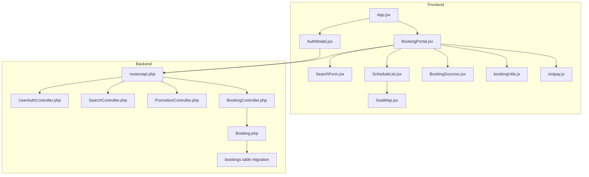
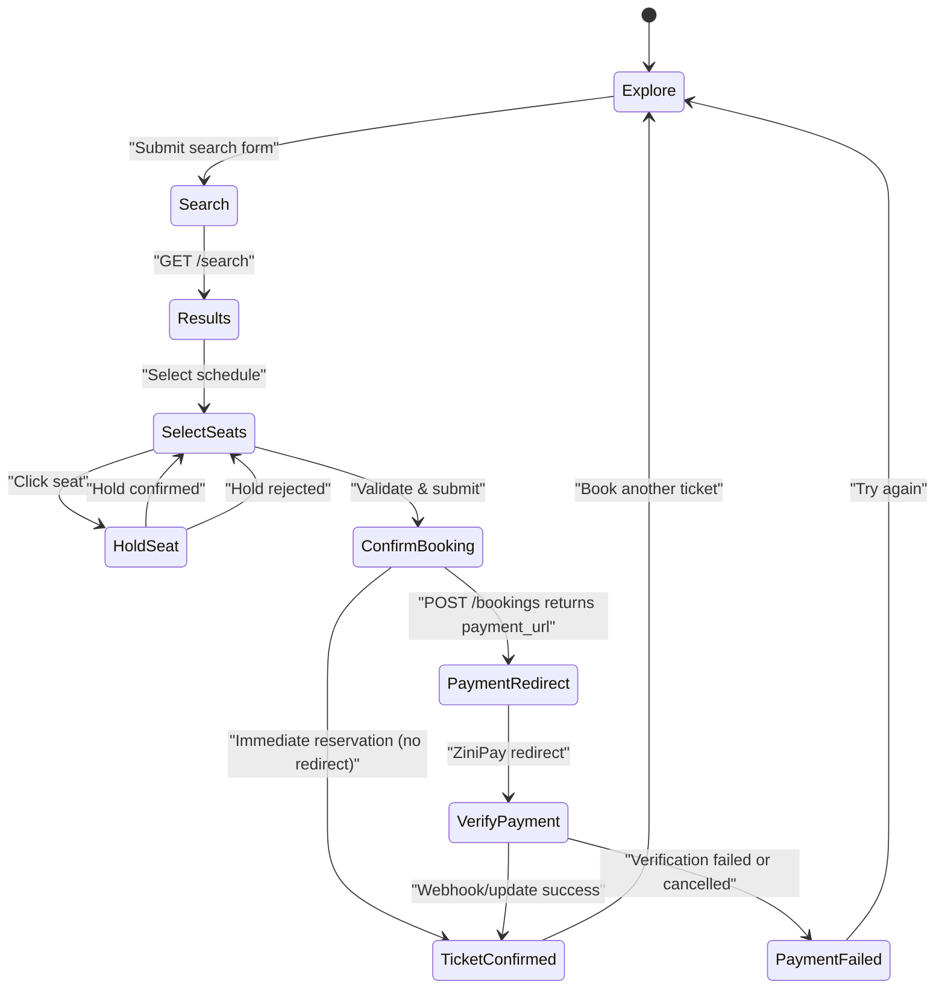
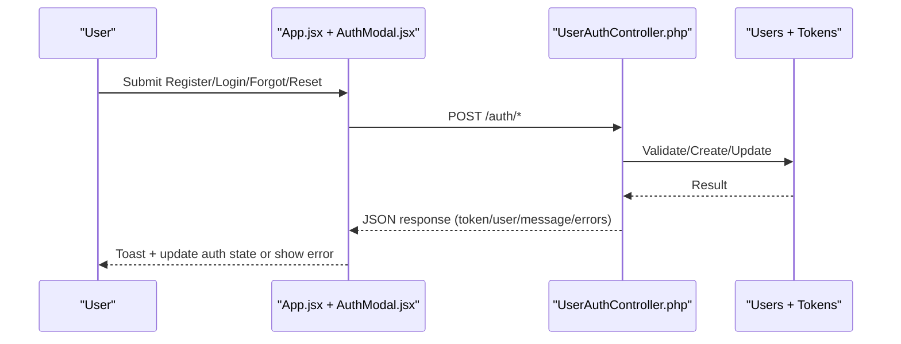
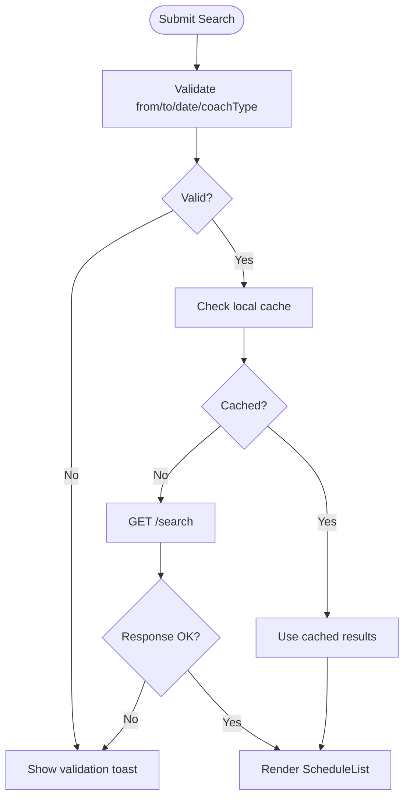
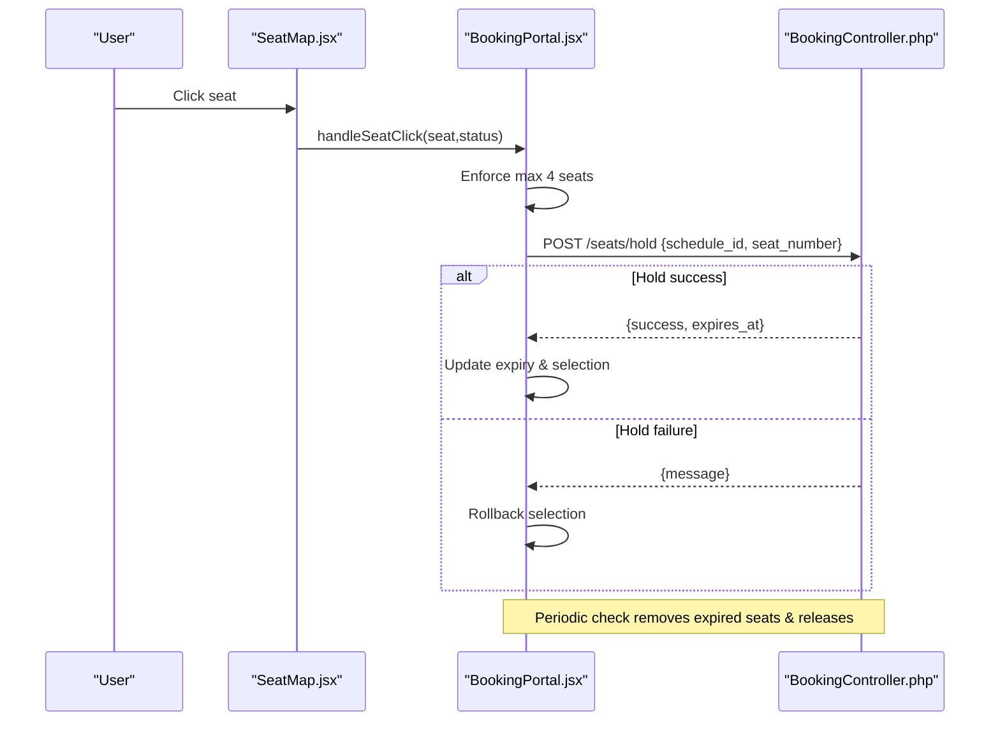
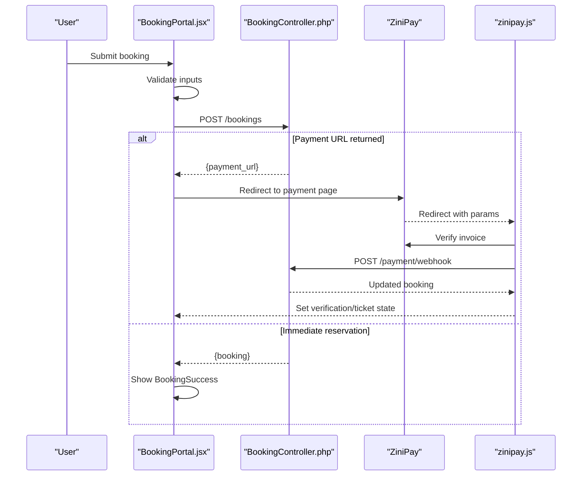
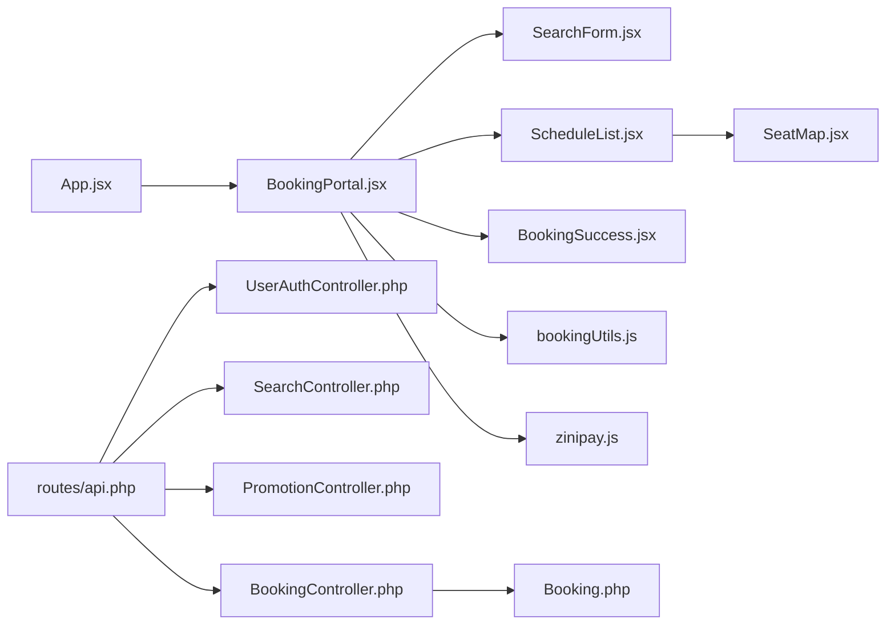

# User Workflows

<cite>
**Referenced Files in This Document**
- [App.jsx](file://frontend/src/App.jsx)
- [AuthModal.jsx](file://frontend/src/components/AuthModal.jsx)
- [BookingPortal.jsx](file://frontend/src/components/BookingPortal.jsx)
- [ScheduleList.jsx](file://frontend/src/components/ScheduleList.jsx)
- [SearchForm.jsx](file://frontend/src/components/SearchForm.jsx)
- [SeatMap.jsx](file://frontend/src/components/SeatMap.jsx)
- [BookingSuccess.jsx](file://frontend/src/components/BookingSuccess.jsx)
- [bookingUtils.js](file://frontend/src/bookingUtils.js)
- [zinipay.js](file://frontend/src/zinipay.js)
- [api.php](file://backend/routes/api.php)
- [UserAuthController.php](file://backend/app/Http/Controllers/API/UserAuthController.php)
- [SearchController.php](file://backend/app/Http/Controllers/API/SearchController.php)
- [PromotionController.php](file://backend/app/Http/Controllers/API/PromotionController.php)
- [BookingController.php](file://backend/app/Http/Controllers/API/BookingController.php)
- [Booking.php](file://backend/app/Models/Booking.php)
- [2026_06_01_000050_create_bookings_table.php](file://backend/database/migrations/2026_06_01_000050_create_bookings_table.php)
</cite>

## Table of Contents
1. [Introduction](#introduction)
2. [Project Structure](#project-structure)
3. [Core Components](#core-components)
4. [Architecture Overview](#architecture-overview)
5. [Detailed Component Analysis](#detailed-component-analysis)
6. [Dependency Analysis](#dependency-analysis)
7. [Performance Considerations](#performance-considerations)
8. [Troubleshooting Guide](#troubleshooting-guide)
9. [Conclusion](#conclusion)

## Introduction
This document explains the complete customer booking journey in SonyaBus, from registration and login through route search, seat selection, passenger information entry, payment processing, and ticket confirmation. It maps user-facing workflows to frontend components and backend API endpoints, documents state transitions, validation rules, error handling, and user feedback mechanisms, and includes diagrams for decision points and alternative paths.

## Project Structure
The customer workflow spans a React frontend and a Laravel backend:
- Frontend: App shell, authentication modal, booking portal with search form, schedule list, seat map, success view, and ZiniPay redirect handling.
- Backend: Public routes for stations/search/promotions, guest auth routes, Sanctum-protected booking and seat hold/release routes, and payment webhook/public booking retrieval.

**Diagram sources**
- [App.jsx:94-800](file://frontend/src/App.jsx#L94-L800)
- [BookingPortal.jsx:9-654](file://frontend/src/components/BookingPortal.jsx#L9-L654)
- [api.php:1-77](file://backend/routes/api.php#L1-L77)

**Section sources**
- [App.jsx:94-800](file://frontend/src/App.jsx#L94-L800)
- [api.php:1-77](file://backend/routes/api.php#L1-L77)

## Core Components
- Authentication: Login, register, forgot/reset password flows via AuthModal and UserAuthController.
- Search and Discovery: SearchForm collects inputs; BookingPortal calls /search; results rendered by ScheduleList.
- Seat Selection and Reservation: SeatMap renders bus layout; BookingPortal handles optimistic holds/releases and expiration checks.
- Passenger Information and Payment: SeatMap collects passenger details; BookingPortal validates and posts to /bookings; ZiniPay redirect handled by zinipay.js.
- Ticket Confirmation: BookingSuccess displays boarding pass invoice; public booking retrieval supports post-payment display.

Key responsibilities:
- App.jsx: Global auth state, site settings, backend probing, routing between views, and ZiniPay redirect orchestration.
- AuthModal.jsx: UI for login/register/forgot/reset with form fields and submission handler provided by App.jsx.
- BookingPortal.jsx: Orchestrates search, caching, seat hold/release, promo application, booking creation, and payment redirection.
- ScheduleList.jsx: Displays schedules, expands seat map, and manages expanded/collapsed state.
- SeatMap.jsx: Renders seat grid, boarding/dropping points, passenger info, promo code, fare breakdown, and confirm booking action.
- BookingSuccess.jsx: Presents final ticket details and print/re-book actions.
- bookingUtils.js: Pricing calculation, seat status helpers, and seat map generation utilities.
- zinipay.js: ZiniPay create/verify helpers and redirect handling.

**Section sources**
- [App.jsx:94-800](file://frontend/src/App.jsx#L94-L800)
- [AuthModal.jsx:1-165](file://frontend/src/components/AuthModal.jsx#L1-L165)
- [BookingPortal.jsx:9-654](file://frontend/src/components/BookingPortal.jsx#L9-L654)
- [ScheduleList.jsx:1-225](file://frontend/src/components/ScheduleList.jsx#L1-L225)
- [SeatMap.jsx:1-612](file://frontend/src/components/SeatMap.jsx#L1-L612)
- [BookingSuccess.jsx:1-146](file://frontend/src/components/BookingSuccess.jsx#L1-L146)
- [bookingUtils.js:1-173](file://frontend/src/bookingUtils.js#L1-L173)
- [zinipay.js:1-179](file://frontend/src/zinipay.js#L1-L179)

## Architecture Overview
The customer booking flow is a multi-stage process with clear state transitions and server-side validations.

**Diagram sources**
- [BookingPortal.jsx:291-575](file://frontend/src/components/BookingPortal.jsx#L291-L575)
- [BookingController.php:19-148](file://backend/app/Http/Controllers/API/BookingController.php#L19-L148)
- [zinipay.js:64-179](file://frontend/src/zinipay.js#L64-L179)

## Detailed Component Analysis

### Authentication Workflow
- Registration:
  - Frontend: AuthModal shows name/email/password/confirmation; App.jsx sends POST /auth/register.
  - Backend: UserAuthController.register validates input, creates user with role user, issues Sanctum token, returns user and token.
- Login:
  - Frontend: AuthModal submits email/password; App.jsx sends POST /auth/login.
  - Backend: UserAuthController.login validates credentials, rejects admin accounts, deletes old tokens, creates new token, returns user and token.
- Forgot Password:
  - Frontend: AuthModal switches to forgot mode; App.jsx sends POST /auth/forgot-password.
  - Backend: UserAuthController.forgotPassword generates 6-digit code, stores hashed token, sends email, optionally exposes code in local/testing environments.
- Reset Password:
  - Frontend: AuthModal shows reset code field; App.jsx sends POST /auth/reset-password.
  - Backend: UserAuthController.resetPassword validates code, enforces 60-minute expiry, updates password, clears reset token.

Validation rules and errors:
- Register: name required, email unique, password min 6 and confirmed.
- Login: email required, password required; invalid credentials return validation error; admin users receive 403.
- Forgot/Reset: email required; reset code must match and be within 60 minutes; invalid code returns validation error.

User feedback:
- Toast messages for success/error on all auth operations.
- Modal closes on successful login/register; optional return action executed.

**Diagram sources**
- [App.jsx:190-276](file://frontend/src/App.jsx#L190-L276)
- [AuthModal.jsx:1-165](file://frontend/src/components/AuthModal.jsx#L1-L165)
- [UserAuthController.php:17-208](file://backend/app/Http/Controllers/API/UserAuthController.php#L17-L208)

**Section sources**
- [App.jsx:190-276](file://frontend/src/App.jsx#L190-L276)
- [AuthModal.jsx:1-165](file://frontend/src/components/AuthModal.jsx#L1-L165)
- [UserAuthController.php:17-208](file://backend/app/Http/Controllers/API/UserAuthController.php#L17-L208)

### Search and Discovery
- Inputs: From station, To station, Date, Coach Type.
- Validation:
  - Departure and destination cannot be empty or equal.
  - Journey date is required and constrained to today or later.
- Flow:
  - BookingPortal.handleSearch validates inputs, checks local cache, then calls GET /search.
  - Results are cached in-memory and displayed by ScheduleList.
- Backend:
  - SearchController.search validates parameters and delegates to service layer.

User feedback:
- Toast messages for no results, network errors, and cached vs live data.

**Diagram sources**
- [BookingPortal.jsx:291-380](file://frontend/src/components/BookingPortal.jsx#L291-L380)
- [SearchController.php:14-31](file://backend/app/Http/Controllers/API/SearchController.php#L14-L31)

**Section sources**
- [SearchForm.jsx:1-109](file://frontend/src/components/SearchForm.jsx#L1-L109)
- [BookingPortal.jsx:291-380](file://frontend/src/components/BookingPortal.jsx#L291-L380)
- [SearchController.php:14-31](file://backend/app/Http/Controllers/API/SearchController.php#L14-L31)

### Seat Selection and Reservation
- Seat Map Rendering:
  - SeatMap uses bookingUtils.getSeatMap to build seat status map based on schedule data and bus layout.
  - Supports layouts: 2+2, 1+2, sleeper, 2+2_last5.
- Seat Selection Rules:
  - Maximum 4 seats per booking enforced in BookingPortal.handleSeatClick.
  - Only available seats are selectable; selected seats are shown with “Selected” label.
- Hold and Release:
  - Optimistic selection updates UI immediately; real hold request sent to POST /seats/hold.
  - On rejection or network error, UI rolls back selection.
  - Expiration timer removes expired seats and releases them on backend.
- Boarding/Dropping Points:
  - Required before confirming booking; defaults updated when schedule changes.
- Promo Code:
  - Applied via GET /promotions/check; discount applied to total payable.

User feedback:
- Toasts for hold failures, connection errors, expired holds, and promo validation.

**Diagram sources**
- [SeatMap.jsx:192-208](file://frontend/src/components/SeatMap.jsx#L192-L208)
- [BookingPortal.jsx:209-289](file://frontend/src/components/BookingPortal.jsx#L209-L289)
- [BookingController.php:82-116](file://backend/app/Http/Controllers/API/BookingController.php#L82-L116)

**Section sources**
- [SeatMap.jsx:1-612](file://frontend/src/components/SeatMap.jsx#L1-L612)
- [bookingUtils.js:1-173](file://frontend/src/bookingUtils.js#L1-L173)
- [BookingPortal.jsx:209-289](file://frontend/src/components/BookingPortal.jsx#L209-L289)
- [BookingController.php:82-116](file://backend/app/Http/Controllers/API/BookingController.php#L82-L116)

### Passenger Information Entry and Payment Processing
- Data Collection:
  - SeatMap collects passenger name, phone, email, gender, and payment method (ZiniPay).
  - Promo code can be applied prior to booking.
- Validation:
  - At least one seat selected.
  - Name, phone (minimum 11 digits), and email required.
  - Boarding and dropping points required.
- Booking Creation:
  - BookingPortal.handleConfirmBooking POSTs to /bookings with schedule_id, passenger details, seat_numbers, payment_method, and optional promo_code.
  - If backend returns payment_url, frontend redirects to payment gateway.
  - Otherwise, sets booking success state and refreshes schedule data.
- Payment Redirect Handling:
  - zinipay.js handles ZiniPay redirect parameters, verifies payment via ZiniPay API, calls backend webhook to update booking status, and displays verification result or success ticket.

User feedback:
- Toasts for validation errors, network errors, payment initiation, verification success/failure, and cancellation/failed payment states.

**Diagram sources**
- [SeatMap.jsx:421-605](file://frontend/src/components/SeatMap.jsx#L421-L605)
- [BookingPortal.jsx:469-575](file://frontend/src/components/BookingPortal.jsx#L469-L575)
- [BookingController.php:19-148](file://backend/app/Http/Controllers/API/BookingController.php#L19-L148)
- [zinipay.js:64-179](file://frontend/src/zinipay.js#L64-L179)

**Section sources**
- [SeatMap.jsx:421-605](file://frontend/src/components/SeatMap.jsx#L421-L605)
- [BookingPortal.jsx:469-575](file://frontend/src/components/BookingPortal.jsx#L469-L575)
- [BookingController.php:19-148](file://backend/app/Http/Controllers/API/BookingController.php#L19-L148)
- [zinipay.js:64-179](file://frontend/src/zinipay.js#L64-L179)

### Ticket Confirmation
- Success View:
  - BookingSuccess displays PNR, passenger details, route, bus/operator, departure time, reserved seats, duration, payment method, status, and total fare.
  - Provides Print Boarding Ticket and Book Another Ticket actions.
- Public Booking Retrieval:
  - After payment completion, frontend fetches GET /bookings/public/{id} to render receipt details.

User feedback:
- Clear success message and actionable buttons to print or start a new booking.

**Section sources**
- [BookingSuccess.jsx:1-146](file://frontend/src/components/BookingSuccess.jsx#L1-L146)
- [BookingController.php:75-80](file://backend/app/Http/Controllers/API/BookingController.php#L75-L80)

## Dependency Analysis
- Frontend dependencies:
  - App.jsx orchestrates global state, auth, site settings, and ZiniPay redirect handling.
  - BookingPortal depends on SearchForm, ScheduleList, SeatMap, BookingSuccess, and utility modules.
  - ScheduleList composes SeatMap and passes props for seat interactions and booking confirmation.
- Backend dependencies:
  - Routes define public and authenticated endpoints.
  - Controllers implement validation and delegate to services/models where applicable.
  - Booking model defines fillable fields, casts, relationships, and PNR attribute.

**Diagram sources**
- [App.jsx:94-800](file://frontend/src/App.jsx#L94-L800)
- [BookingPortal.jsx:9-654](file://frontend/src/components/BookingPortal.jsx#L9-L654)
- [api.php:1-77](file://backend/routes/api.php#L1-L77)
- [Booking.php:1-49](file://backend/app/Models/Booking.php#L1-L49)

**Section sources**
- [api.php:1-77](file://backend/routes/api.php#L1-L77)
- [Booking.php:1-49](file://backend/app/Models/Booking.php#L1-L49)

## Performance Considerations
- In-memory schedule cache reduces repeated network requests for identical queries.
- Live seat map polling every 5 seconds keeps availability current while minimizing load.
- Optimistic UI updates improve perceived responsiveness during seat selection.
- Expiration checks run every second to promptly release expired holds and free seats.
- Site settings polling every 30 seconds ensures branding updates propagate without heavy overhead.

[No sources needed since this section provides general guidance]

## Troubleshooting Guide
Common issues and resolutions:
- Backend offline or install not complete:
  - App.jsx probes API base URLs and shows maintenance/installation screens accordingly. Retry mechanism allows re-probing.
- Authentication failures:
  - Invalid credentials or admin account access blocked; ensure correct user role and valid credentials.
  - Forgot/reset code expired or invalid; request a new code and ensure it is used within 60 minutes.
- Seat hold failures:
  - Network errors or seat already taken; UI rolls back selection and shows toast.
  - Expired holds automatically removed; user must re-select seats.
- Payment issues:
  - ZiniPay verification fails or callback to backend fails; verify environment configuration and retry.
  - Payment cancelled or failed; user can try again or review error message.

**Section sources**
- [App.jsx:295-325](file://frontend/src/App.jsx#L295-L325)
- [App.jsx:502-524](file://frontend/src/App.jsx#L502-L524)
- [UserAuthController.php:41-70](file://backend/app/Http/Controllers/API/UserAuthController.php#L41-L70)
- [UserAuthController.php:113-208](file://backend/app/Http/Controllers/API/UserAuthController.php#L113-L208)
- [BookingPortal.jsx:209-289](file://frontend/src/components/BookingPortal.jsx#L209-L289)
- [zinipay.js:64-179](file://frontend/src/zinipay.js#L64-L179)

## Conclusion
SonyaBus provides a robust, user-friendly booking experience with clear state management, strong validation, and resilient error handling. The frontend components coordinate seamlessly with backend controllers to support registration, login, search, seat reservation, payment processing, and ticket confirmation. Optimistic UI updates, caching, and live seat map polling enhance performance and usability, while comprehensive feedback mechanisms keep users informed throughout the journey.