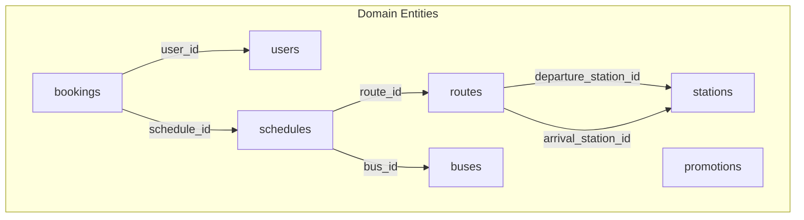
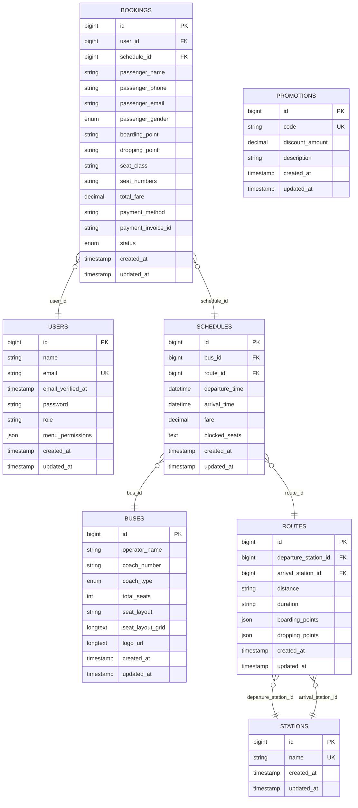
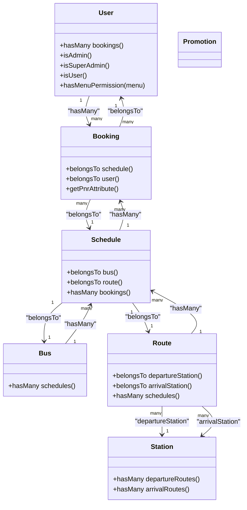
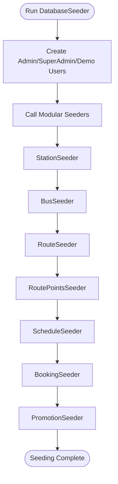
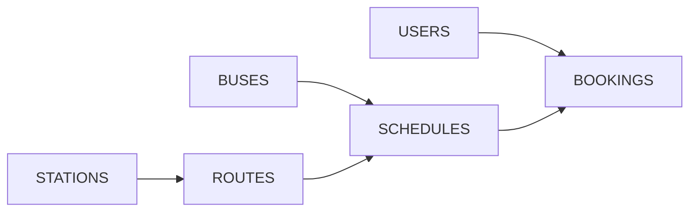

# Database Design

<cite>
**Referenced Files in This Document**
- [0001_01_01_000000_create_users_table.php](file://backend/database/migrations/0001_01_01_000000_create_users_table.php)
- [2026_06_01_000010_create_stations_table.php](file://backend/database/migrations/2026_06_01_000010_create_stations_table.php)
- [2026_06_01_000020_create_buses_table.php](file://backend/database/migrations/2026_06_01_000020_create_buses_table.php)
- [2026_06_01_000030_create_routes_table.php](file://backend/database/migrations/2026_06_01_000030_create_routes_table.php)
- [2026_06_01_000040_create_schedules_table.php](file://backend/database/migrations/2026_06_01_000040_create_schedules_table.php)
- [2026_06_01_000050_create_bookings_table.php](file://backend/database/migrations/2026_06_01_000050_create_bookings_table.php)
- [2026_06_01_000060_create_promotions_table.php](file://backend/database/migrations/2026_06_01_000060_create_promotions_table.php)
- [User.php](file://backend/app/Models/User.php)
- [Bus.php](file://backend/app/Models/Bus.php)
- [Route.php](file://backend/app/Models/Route.php)
- [Schedule.php](file://backend/app/Models/Schedule.php)
- [Booking.php](file://backend/app/Models/Booking.php)
- [Station.php](file://backend/app/Models/Station.php)
- [Promotion.php](file://backend/app/Models/Promotion.php)
- [DatabaseSeeder.php](file://backend/database/seeders/DatabaseSeeder.php)
- [StationSeeder.php](file://backend/database/seeders/StationSeeder.php)
- [BusSeeder.php](file://backend/database/seeders/BusSeeder.php)
- [RouteSeeder.php](file://backend/database/seeders/RouteSeeder.php)
- [ScheduleSeeder.php](file://backend/database/seeders/ScheduleSeeder.php)
- [BookingSeeder.php](file://backend/database/seeders/BookingSeeder.php)
- [PromotionSeeder.php](file://backend/database/seeders/PromotionSeeder.php)
</cite>

## Table of Contents
1. [Introduction](#introduction)
2. [Project Structure](#project-structure)
3. [Core Components](#core-components)
4. [Architecture Overview](#architecture-overview)
5. [Detailed Component Analysis](#detailed-component-analysis)
6. [Dependency Analysis](#dependency-analysis)
7. [Performance Considerations](#performance-considerations)
8. [Troubleshooting Guide](#troubleshooting-guide)
9. [Conclusion](#conclusion)
10. [Appendices](#appendices)

## Introduction
This document provides comprehensive data model documentation for the SonyaBus database schema. It covers entity relationships among Users, Buses, Routes, Schedules, Bookings, Stations, and Promotions; table structures with field definitions, types, keys, indexes, and constraints; Eloquent ORM relationships; query optimization strategies; validation rules; migration patterns; seeding strategies for demo data; performance considerations for large datasets; data lifecycle management; backup strategies; and scaling approaches.

## Project Structure
The database design is implemented using Laravel migrations and Eloquent models. Core entities are defined through migrations under backend/database/migrations, while their corresponding Eloquent models reside under backend/app/Models. Demo data is provided via seeders under backend/database/seeders.

**Diagram sources**
- [2026_06_01_000030_create_routes_table.php:14-28](file://backend/database/migrations/2026_06_01_000030_create_routes_table.php#L14-L28)
- [2026_06_01_000040_create_schedules_table.php:14-30](file://backend/database/migrations/2026_06_01_000040_create_schedules_table.php#L14-L30)
- [2026_06_01_000050_create_bookings_table.php:14-42](file://backend/database/migrations/2026_06_01_000050_create_bookings_table.php#L14-L42)

**Section sources**
- [2026_06_01_000010_create_stations_table.php:11-15](file://backend/database/migrations/2026_06_01_000010_create_stations_table.php#L11-L15)
- [2026_06_01_000020_create_buses_table.php:14-28](file://backend/database/migrations/2026_06_01_000020_create_buses_table.php#L14-L28)
- [2026_06_01_000030_create_routes_table.php:14-28](file://backend/database/migrations/2026_06_01_000030_create_routes_table.php#L14-L28)
- [2026_06_01_000040_create_schedules_table.php:14-30](file://backend/database/migrations/2026_06_01_000040_create_schedules_table.php#L14-L30)
- [2026_06_01_000050_create_bookings_table.php:14-42](file://backend/database/migrations/2026_06_01_000050_create_bookings_table.php#L14-L42)
- [2026_06_01_000060_create_promotions_table.php:14-20](file://backend/database/migrations/2026_06_01_000060_create_promotions_table.php#L14-L20)

## Core Components
This section summarizes each core table’s structure, primary and foreign keys, indexes, and constraints as defined by migrations and models.

- users
  - Primary key: id (auto-increment)
  - Fields: name (string), email (string, unique), email_verified_at (timestamp, nullable), password (string), role (string, default 'user'), menu_permissions (json, nullable), remember_token, timestamps
  - Indexes: email (unique), user_id on sessions (foreign index)
  - Notes: Passwords are hashed at application level; session table includes a nullable user_id index for session lookups.

- stations
  - Primary key: id
  - Fields: name (string, unique), timestamps
  - Indexes: name (unique)

- buses
  - Primary key: id
  - Fields: operator_name (string), coach_number (string), coach_type (enum 'AC' | 'Non AC'), total_seats (integer, default 36), seat_layout (string, default '2+2'), seat_layout_grid (longText, nullable), logo_url (longText, nullable), timestamps
  - Indexes: coach_number

- routes
  - Primary key: id
  - Foreign keys: departure_station_id references stations(id) cascade delete; arrival_station_id references stations(id) cascade delete
  - Fields: distance (string, nullable), duration (string, nullable), boarding_points (json, nullable), dropping_points (json, nullable), timestamps
  - Indexes: departure_station_id, arrival_station_id, composite (departure_station_id, arrival_station_id)

- schedules
  - Primary key: id
  - Foreign keys: bus_id references buses(id) cascade delete; route_id references routes(id) cascade delete
  - Fields: departure_time (datetime), arrival_time (datetime), fare (decimal(8,2)), blocked_seats (text, nullable), timestamps
  - Indexes: bus_id, route_id, departure_time, composite (route_id, departure_time), composite (bus_id, departure_time)

- bookings
  - Primary key: id
  - Foreign keys: user_id references users(id) null on delete; schedule_id references schedules(id) cascade delete
  - Fields: passenger_name (string), passenger_phone (string), passenger_email (string), passenger_gender (enum 'M' | 'F', default 'M'), boarding_point (string, nullable), dropping_point (string, nullable), seat_class (string, default 'E-Class'), seat_numbers (string), total_fare (decimal(10,2)), payment_method (string, default 'bKash'), payment_invoice_id (string, nullable), status (enum 'PENDING','PAID','SOLD','BOOKED','CANCEL_REQUESTED','CANCELLED', default 'PENDING'), timestamps
  - Indexes: user_id, schedule_id, status, passenger_email, passenger_phone, composite (status, created_at), composite (user_id, created_at), composite (schedule_id, status), composite (status, payment_method)

- promotions
  - Primary key: id
  - Fields: code (string, unique), discount_amount (decimal(8,2)), description (string), timestamps
  - Indexes: code (unique)

**Section sources**
- [0001_01_01_000000_create_users_table.php:14-39](file://backend/database/migrations/0001_01_01_000000_create_users_table.php#L14-L39)
- [2026_06_01_000010_create_stations_table.php:11-15](file://backend/database/migrations/2026_06_01_000010_create_stations_table.php#L11-L15)
- [2026_06_01_000020_create_buses_table.php:14-28](file://backend/database/migrations/2026_06_01_000020_create_buses_table.php#L14-L28)
- [2026_06_01_000030_create_routes_table.php:14-28](file://backend/database/migrations/2026_06_01_000030_create_routes_table.php#L14-L28)
- [2026_06_01_000040_create_schedules_table.php:14-30](file://backend/database/migrations/2026_06_01_000040_create_schedules_table.php#L14-L30)
- [2026_06_01_000050_create_bookings_table.php:14-42](file://backend/database/migrations/2026_06_01_000050_create_bookings_table.php#L14-L42)
- [2026_06_01_000060_create_promotions_table.php:14-20](file://backend/database/migrations/2026_06_01_000060_create_promotions_table.php#L14-L20)

## Architecture Overview
The domain centers around scheduling and booking travel between stations. Routes connect stations; schedules assign buses to routes with time windows and fares; bookings represent passenger reservations against schedules. Promotions provide discount metadata that can be applied during checkout.

**Diagram sources**
- [0001_01_01_000000_create_users_table.php:14-39](file://backend/database/migrations/0001_01_01_000000_create_users_table.php#L14-L39)
- [2026_06_01_000010_create_stations_table.php:11-15](file://backend/database/migrations/2026_06_01_000010_create_stations_table.php#L11-L15)
- [2026_06_01_000020_create_buses_table.php:14-28](file://backend/database/migrations/2026_06_01_000020_create_buses_table.php#L14-L28)
- [2026_06_01_000030_create_routes_table.php:14-28](file://backend/database/migrations/2026_06_01_000030_create_routes_table.php#L14-L28)
- [2026_06_01_000040_create_schedules_table.php:14-30](file://backend/database/migrations/2026_06_01_000040_create_schedules_table.php#L14-L30)
- [2026_06_01_000050_create_bookings_table.php:14-42](file://backend/database/migrations/2026_06_01_000050_create_bookings_table.php#L14-L42)
- [2026_06_01_000060_create_promotions_table.php:14-20](file://backend/database/migrations/2026_06_01_000060_create_promotions_table.php#L14-L20)

## Detailed Component Analysis

### Entity Relationships and Eloquent Models
- User
  - Has many Bookings
  - Role-based helpers and menu permissions stored as JSON array cast
- Station
  - Has many Routes as departure or arrival endpoints
- Bus
  - Has many Schedules
- Route
  - Belongs to two Stations (departure and arrival)
  - Has many Schedules
- Schedule
  - Belongs to Bus and Route
  - Has many Bookings
- Booking
  - Belongs to User and Schedule
  - Provides a PNR accessor derived from its id
- Promotion
  - Standalone entity with unique code and discount amount

**Diagram sources**
- [User.php:39-42](file://backend/app/Models/User.php#L39-L42)
- [Station.php:14-22](file://backend/app/Models/Station.php#L14-L22)
- [Bus.php:18-21](file://backend/app/Models/Bus.php#L18-L21)
- [Route.php:26-39](file://backend/app/Models/Route.php#L26-L39)
- [Schedule.php:20-33](file://backend/app/Models/Schedule.php#L20-L33)
- [Booking.php:33-47](file://backend/app/Models/Booking.php#L33-L47)

**Section sources**
- [User.php:17-36](file://backend/app/Models/User.php#L17-L36)
- [Station.php:12-22](file://backend/app/Models/Station.php#L12-L22)
- [Bus.php:12-21](file://backend/app/Models/Bus.php#L12-L21)
- [Route.php:12-39](file://backend/app/Models/Route.php#L12-L39)
- [Schedule.php:12-33](file://backend/app/Models/Schedule.php#L12-L33)
- [Booking.php:12-47](file://backend/app/Models/Booking.php#L12-L47)
- [Promotion.php:12-16](file://backend/app/Models/Promotion.php#L12-L16)

### Data Validation Rules
Validation is enforced at both the database and application layers:
- Database-level constraints
  - Unique constraints: users.email, stations.name, promotions.code
  - Enumerations: buses.coach_type, bookings.passenger_gender, bookings.status
  - Defaults: buses.total_seats, buses.seat_layout, bookings.seat_class, bookings.payment_method, bookings.status
  - Nullable fields where appropriate (e.g., user_id on bookings, various optional fields)
- Application-level casts and accessors
  - JSON arrays: Route.boarding_points, Route.dropping_points, Bus.seat_layout_grid, User.menu_permissions
  - Decimal precision: Schedule.fare, Booking.total_fare, Promotion.discount_amount
  - Datetime casting: Schedule.departure_time, Schedule.arrival_time, User.email_verified_at
  - Accessor: Booking.getPnrAttribute returns a formatted ticket reference

Recommendations:
- Add explicit form/request validation for required fields such as passenger_name, passenger_phone, passenger_email, seat_numbers, and ensure enums are validated before persistence.
- Normalize seat_numbers into a structured format if frequent seat availability checks are needed.

**Section sources**
- [0001_01_01_000000_create_users_table.php:14-24](file://backend/database/migrations/0001_01_01_000000_create_users_table.php#L14-L24)
- [2026_06_01_000010_create_stations_table.php:11-15](file://backend/database/migrations/2026_06_01_000010_create_stations_table.php#L11-L15)
- [2026_06_01_000020_create_buses_table.php:14-28](file://backend/database/migrations/2026_06_01_000020_create_buses_table.php#L14-L28)
- [2026_06_01_000030_create_routes_table.php:14-28](file://backend/database/migrations/2026_06_01_000030_create_routes_table.php#L14-L28)
- [2026_06_01_000040_create_schedules_table.php:14-30](file://backend/database/migrations/2026_06_01_000040_create_schedules_table.php#L14-L30)
- [2026_06_01_000050_create_bookings_table.php:14-42](file://backend/database/migrations/2026_06_01_000050_create_bookings_table.php#L14-L42)
- [2026_06_01_000060_create_promotions_table.php:14-20](file://backend/database/migrations/2026_06_01_000060_create_promotions_table.php#L14-L20)
- [User.php:30-36](file://backend/app/Models/User.php#L30-L36)
- [Route.php:21-24](file://backend/app/Models/Route.php#L21-L24)
- [Bus.php:14-16](file://backend/app/Models/Bus.php#L14-L16)
- [Schedule.php:14-18](file://backend/app/Models/Schedule.php#L14-L18)
- [Booking.php:29-31](file://backend/app/Models/Booking.php#L29-L31)
- [Promotion.php:14-16](file://backend/app/Models/Promotion.php#L14-L16)
- [Booking.php:43-47](file://backend/app/Models/Booking.php#L43-L47)

### Query Optimization Strategies
- Index usage
  - routes: indexed by departure_station_id, arrival_station_id, and composite (departure_station_id, arrival_station_id) to optimize route searches by origin/destination pairs.
  - schedules: indexed by bus_id, route_id, departure_time, and composites (route_id, departure_time), (bus_id, departure_time) to accelerate schedule queries by route/time and bus/time.
  - bookings: heavily indexed for common filters including status, user_id, schedule_id, passenger_email, passenger_phone, and composites (status, created_at), (user_id, created_at), (schedule_id, status), (status, payment_method).
- Eager loading
  - Use eager loading to avoid N+1 when listing schedules with buses/routes or bookings with schedules/users.
- Denormalization considerations
  - For high-read scenarios, consider materialized views or read replicas for search-heavy endpoints like schedule discovery.
- Partitioning
  - Consider partitioning bookings by created_at or status for very large tables to improve maintenance and query performance.

**Section sources**
- [2026_06_01_000030_create_routes_table.php:24-28](file://backend/database/migrations/2026_06_01_000030_create_routes_table.php#L24-L28)
- [2026_06_01_000040_create_schedules_table.php:24-30](file://backend/database/migrations/2026_06_01_000040_create_schedules_table.php#L24-L30)
- [2026_06_01_000050_create_bookings_table.php:32-42](file://backend/database/migrations/2026_06_01_000050_create_bookings_table.php#L32-L42)

### Migration Patterns
- Consistent naming and ordering
  - Migrations follow chronological prefixes and clear table names.
- Foreign key constraints
  - Strong referential integrity with cascade deletes for dependent records (routes, schedules, bookings).
- Nullability semantics
  - Optional relationships (e.g., user_id on bookings) use nullOnDelete to preserve bookings even if users are deleted.
- Index-first approach
  - Critical lookup columns are indexed at creation time to support efficient queries.

**Section sources**
- [2026_06_01_000030_create_routes_table.php:14-28](file://backend/database/migrations/2026_06_01_000030_create_routes_table.php#L14-L28)
- [2026_06_01_000040_create_schedules_table.php:14-30](file://backend/database/migrations/2026_06_01_000040_create_schedules_table.php#L14-L30)
- [2026_06_01_000050_create_bookings_table.php:14-42](file://backend/database/migrations/2026_06_01_000050_create_bookings_table.php#L14-L42)

### Seeding Strategies for Demo Data
- Seed orchestration
  - DatabaseSeeder creates admin/superadmin/demo users and then calls modular seeders in dependency order: stations, buses, routes, route points, schedules, bookings, promotions, sms configs.
- Idempotent seeding
  - updateOrCreate is used across seeders to ensure safe re-runs without duplicates.
- Data generation logic
  - ScheduleSeeder generates multiple schedules per route over several days, adjusting arrival times and fares based on bus type.
  - BookingSeeder creates sample bookings referencing existing schedules.

**Diagram sources**
- [DatabaseSeeder.php:15-53](file://backend/database/seeders/DatabaseSeeder.php#L15-L53)
- [StationSeeder.php:10-30](file://backend/database/seeders/StationSeeder.php#L10-L30)
- [BusSeeder.php:10-25](file://backend/database/seeders/BusSeeder.php#L10-L25)
- [RouteSeeder.php:11-60](file://backend/database/seeders/RouteSeeder.php#L11-L60)
- [ScheduleSeeder.php:13-63](file://backend/database/seeders/ScheduleSeeder.php#L13-L63)
- [BookingSeeder.php:11-56](file://backend/database/seeders/BookingSeeder.php#L11-L56)
- [PromotionSeeder.php:10-27](file://backend/database/seeders/PromotionSeeder.php#L10-L27)

**Section sources**
- [DatabaseSeeder.php:15-53](file://backend/database/seeders/DatabaseSeeder.php#L15-L53)
- [StationSeeder.php:10-30](file://backend/database/seeders/StationSeeder.php#L10-L30)
- [BusSeeder.php:10-25](file://backend/database/seeders/BusSeeder.php#L10-L25)
- [RouteSeeder.php:11-60](file://backend/database/seeders/RouteSeeder.php#L11-L60)
- [ScheduleSeeder.php:13-63](file://backend/database/seeders/ScheduleSeeder.php#L13-L63)
- [BookingSeeder.php:11-56](file://backend/database/seeders/BookingSeeder.php#L11-L56)
- [PromotionSeeder.php:10-27](file://backend/database/seeders/PromotionSeeder.php#L10-L27)

## Dependency Analysis
The following diagram shows how entities depend on each other through foreign keys and Eloquent relationships.

**Diagram sources**
- [2026_06_01_000030_create_routes_table.php:14-28](file://backend/database/migrations/2026_06_01_000030_create_routes_table.php#L14-L28)
- [2026_06_01_000040_create_schedules_table.php:14-30](file://backend/database/migrations/2026_06_01_000040_create_schedules_table.php#L14-L30)
- [2026_06_01_000050_create_bookings_table.php:14-42](file://backend/database/migrations/2026_06_01_000050_create_bookings_table.php#L14-L42)

**Section sources**
- [2026_06_01_000030_create_routes_table.php:14-28](file://backend/database/migrations/2026_06_01_000030_create_routes_table.php#L14-L28)
- [2026_06_01_000040_create_schedules_table.php:14-30](file://backend/database/migrations/2026_06_01_000040_create_schedules_table.php#L14-L30)
- [2026_06_01_000050_create_bookings_table.php:14-42](file://backend/database/migrations/2026_06_01_000050_create_bookings_table.php#L14-L42)

## Performance Considerations
- Index strategy
  - Leverage existing indexes on schedules and bookings for filtering by time, status, and associations.
  - Avoid full-table scans on large bookings by always filtering on indexed columns (status, created_at, schedule_id, user_id).
- Query patterns
  - Prefer range queries on departure_time with proper index usage.
  - Use pagination for list endpoints to reduce payload size.
- Caching
  - Cache static or semi-static data such as stations, routes, and promotions.
  - Cache schedule lists per route/date to reduce repeated heavy joins.
- Storage considerations
  - seat_layout_grid and logo_url are large text fields; ensure they are not included in unnecessary queries.
  - Consider storing large assets externally and keeping only URLs in the database.

[No sources needed since this section provides general guidance]

## Troubleshooting Guide
- Referential integrity errors
  - Deleting a station with active routes will cascade-delete routes; verify business logic before deletion.
  - Deleting a bus or route cascades to schedules; ensure no active bookings exist or handle orphaned bookings appropriately.
- Booking state transitions
  - Ensure status transitions respect allowed states (e.g., CANCEL_REQUESTED to CANCELLED) and validate payment invoice presence for paid bookings.
- Duplicate data
  - Re-run seeders safely due to updateOrCreate usage; confirm uniqueness constraints (email, name, code) prevent duplicates.
- Performance regressions
  - Monitor slow queries on bookings and schedules; add missing composite indexes if new filter combinations emerge.

**Section sources**
- [2026_06_01_000030_create_routes_table.php:14-28](file://backend/database/migrations/2026_06_01_000030_create_routes_table.php#L14-L28)
- [2026_06_01_000040_create_schedules_table.php:14-30](file://backend/database/migrations/2026_06_01_000040_create_schedules_table.php#L14-L30)
- [2026_06_01_000050_create_bookings_table.php:14-42](file://backend/database/migrations/2026_06_01_000050_create_bookings_table.php#L14-L42)

## Conclusion
The SonyaBus database schema is well-structured with clear relationships, strong referential integrity, and thoughtful indexing to support common queries. Eloquent models align closely with the schema, providing intuitive relationships and useful casts/accessors. The seeding strategy ensures consistent demo data. For production scale, focus on query optimization, caching, and potential partitioning or read replicas for high-volume operations.

[No sources needed since this section summarizes without analyzing specific files]

## Appendices

### Data Lifecycle Management
- Creation
  - Users are created via authentication flows; stations, buses, routes, and schedules are managed by administrators; bookings are created by customers.
- Updates
  - Schedules may have blocked seats updated; bookings may transition statuses; promotions may be updated or disabled.
- Archival
  - Consider archiving old bookings by status and date to keep the active table lean.
- Deletion
  - Cascade deletes are used for dependent entities; soft deletes could be introduced for auditability if needed.

[No sources needed since this section provides general guidance]

### Backup Strategies
- Regular automated backups of the database
- Point-in-time recovery enabled where supported
- Validate restore procedures periodically
- Separate backups for large text fields (e.g., seat_layout_grid, logo_url) if stored outside DB

[No sources needed since this section provides general guidance]

### Scaling Approaches
- Horizontal scaling
  - Read replicas for search-heavy endpoints (schedule discovery, route search).
- Vertical scaling
  - Increase memory/CPU for complex reporting and analytics.
- Sharding/partitioning
  - Partition bookings by created_at or status for improved maintenance and query performance.
- Caching layer
  - Redis/Memcached for frequently accessed data (stations, routes, promotions, schedule listings).

[No sources needed since this section provides general guidance]