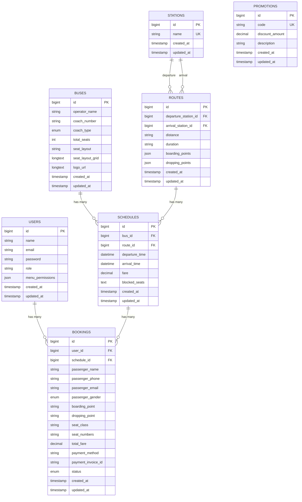
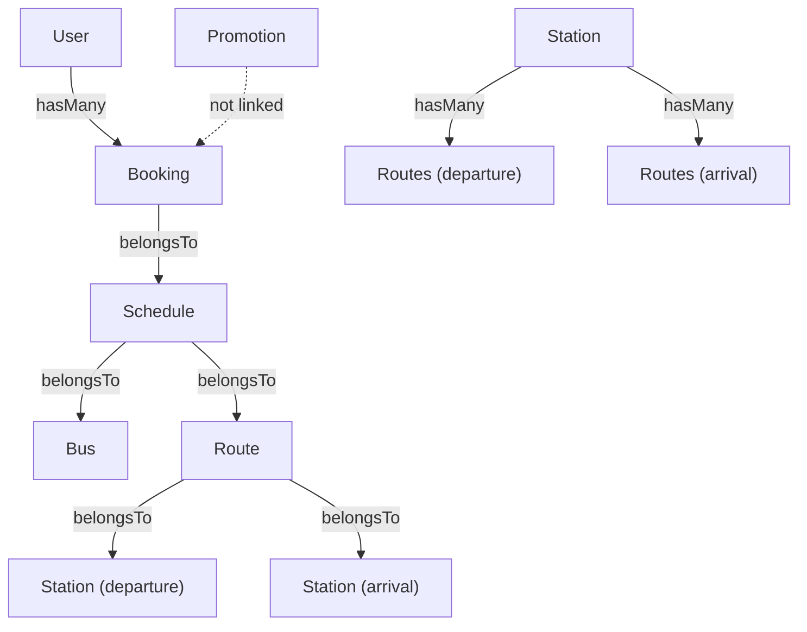
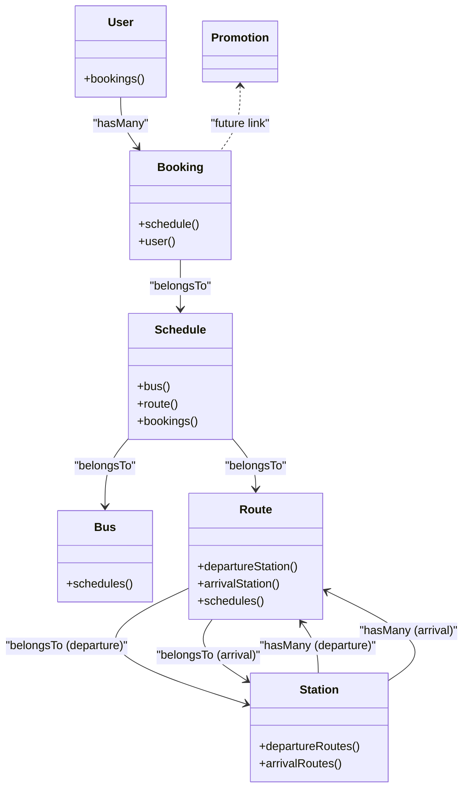

# Entity Relationships

<cite>
**Referenced Files in This Document**   
- [User.php](file://backend/app/Models/User.php)
- [Bus.php](file://backend/app/Models/Bus.php)
- [Route.php](file://backend/app/Models/Route.php)
- [Schedule.php](file://backend/app/Models/Schedule.php)
- [Booking.php](file://backend/app/Models/Booking.php)
- [Station.php](file://backend/app/Models/Station.php)
- [Promotion.php](file://backend/app/Models/Promotion.php)
- [create_stations_table.php](file://backend/database/migrations/2026_06_01_000010_create_stations_table.php)
- [create_buses_table.php](file://backend/database/migrations/2026_06_01_000020_create_buses_table.php)
- [create_routes_table.php](file://backend/database/migrations/2026_06_01_000030_create_routes_table.php)
- [create_schedules_table.php](file://backend/database/migrations/2026_06_01_000040_create_schedules_table.php)
- [create_bookings_table.php](file://backend/database/migrations/2026_06_01_000050_create_bookings_table.php)
- [create_promotions_table.php](file://backend/database/migrations/2026_06_01_000060_create_promotions_table.php)
</cite>

## Table of Contents
1. [Introduction](#introduction)
2. [Project Structure](#project-structure)
3. [Core Components](#core-components)
4. [Architecture Overview](#architecture-overview)
5. [Detailed Component Analysis](#detailed-component-analysis)
6. [Dependency Analysis](#dependency-analysis)
7. [Performance Considerations](#performance-considerations)
8. [Troubleshooting Guide](#troubleshooting-guide)
9. [Conclusion](#conclusion)

## Introduction
This document explains the SonyaBus entity relationship model and how core entities interact through Eloquent ORM relationships, database constraints, and data consistency patterns. It focuses on User, Bus, Route, Schedule, Booking, Station, and Promotion models, covering one-to-many relationships, foreign key constraints, cascade behaviors, referential integrity, query examples, eager loading strategies to prevent N+1 queries, transaction handling for complex operations, and validation rules.

## Project Structure
The entity model is implemented using Laravel Eloquent models under backend/app/Models and their corresponding database migrations under backend/database/migrations. The schema defines primary tables for stations, buses, routes, schedules, bookings, and promotions, with explicit foreign keys and indexes for performance.

**Diagram sources**
- [create_users_table.php](file://backend/database/migrations/0001_01_01_000000_create_users_table.php)
- [create_stations_table.php:11-15](file://backend/database/migrations/2026_06_01_000010_create_stations_table.php#L11-L15)
- [create_buses_table.php:14-28](file://backend/database/migrations/2026_06_01_000020_create_buses_table.php#L14-L28)
- [create_routes_table.php:14-28](file://backend/database/migrations/2026_06_01_000030_create_routes_table.php#L14-L28)
- [create_schedules_table.php:14-30](file://backend/database/migrations/2026_06_01_000040_create_schedules_table.php#L14-L30)
- [create_bookings_table.php:14-42](file://backend/database/migrations/2026_06_01_000050_create_bookings_table.php#L14-L42)
- [create_promotions_table.php:14-20](file://backend/database/migrations/2026_06_01_000060_create_promotions_table.php#L14-L20)

**Section sources**
- [User.php:12-42](file://backend/app/Models/User.php#L12-L42)
- [Bus.php:8-21](file://backend/app/Models/Bus.php#L8-L21)
- [Route.php:8-39](file://backend/app/Models/Route.php#L8-L39)
- [Schedule.php:8-33](file://backend/app/Models/Schedule.php#L8-L33)
- [Booking.php:8-47](file://backend/app/Models/Booking.php#L8-L47)
- [Station.php:8-22](file://backend/app/Models/Station.php#L8-L22)
- [Promotion.php:8-17](file://backend/app/Models/Promotion.php#L8-L17)

## Core Components
- User: Represents authenticated users and passengers. Has a one-to-many relationship with Booking.
- Bus: Represents physical coaches with seating configuration. Has a one-to-many relationship with Schedule.
- Route: Connects two stations (departure and arrival). Has a one-to-many relationship with Schedule.
- Schedule: Represents a specific run of a bus on a route at a given time. Belongs to Bus and Route; has a one-to-many relationship with Booking.
- Booking: Represents a passenger’s reservation on a schedule. Belongs to User and Schedule.
- Station: Represents origin or destination locations referenced by Routes.
- Promotion: Represents discount codes; currently not directly linked to other entities in the model layer.

Key relationship types:
- One-to-many: User → Bookings, Bus → Schedules, Route → Schedules, Station → Routes (departure/arrival), Schedule → Bookings
- Many-to-one: Booking → User, Booking → Schedule, Schedule → Bus, Schedule → Route, Route → Station (departure/arrival)
- No polymorphic relationships are defined among these core entities.

Foreign key constraints and cascade behaviors:
- Routes: departure_station_id and arrival_station_id reference Stations with cascade delete.
- Schedules: bus_id references Buses with cascade delete; route_id references Routes with cascade delete.
- Bookings: user_id references Users with null-on-delete; schedule_id references Schedules with cascade delete.

Indexes:
- Frequent query fields like station IDs, bus/route IDs, departure times, booking statuses, and composite indexes are present to optimize search and reporting.

**Section sources**
- [User.php:39-42](file://backend/app/Models/User.php#L39-L42)
- [Bus.php:18-21](file://backend/app/Models/Bus.php#L18-L21)
- [Route.php:26-39](file://backend/app/Models/Route.php#L26-L39)
- [Schedule.php:20-33](file://backend/app/Models/Schedule.php#L20-L33)
- [Booking.php:33-41](file://backend/app/Models/Booking.php#L33-L41)
- [Station.php:14-22](file://backend/app/Models/Station.php#L14-L22)
- [create_routes_table.php:16-17](file://backend/database/migrations/2026_06_01_000030_create_routes_table.php#L16-L17)
- [create_schedules_table.php:16-17](file://backend/database/migrations/2026_06_01_000040_create_schedules_table.php#L16-L17)
- [create_bookings_table.php:16-17](file://backend/database/migrations/2026_06_01_000050_create_bookings_table.php#L16-L17)

## Architecture Overview
The system centers around scheduling and booking flows:
- A Bus operates on a Route at a scheduled time via Schedule.
- Passengers (Users) create Bookings against a Schedule.
- Stations define endpoints for Routes.
- Promotions exist as standalone discount definitions but are not yet modeled as related to Bookings or Schedules.

**Diagram sources**
- [User.php:39-42](file://backend/app/Models/User.php#L39-L42)
- [Booking.php:33-41](file://backend/app/Models/Booking.php#L33-L41)
- [Schedule.php:20-33](file://backend/app/Models/Schedule.php#L20-L33)
- [Bus.php:18-21](file://backend/app/Models/Bus.php#L18-L21)
- [Route.php:26-39](file://backend/app/Models/Route.php#L26-L39)
- [Station.php:14-22](file://backend/app/Models/Station.php#L14-L22)
- [Promotion.php:8-17](file://backend/app/Models/Promotion.php#L8-L17)

## Detailed Component Analysis

### User Model
- Relationship: One-to-many with Booking.
- Attributes include role-based access helpers and menu permissions cast as arrays.
- Use cases: Retrieve all bookings for a user, check admin privileges, and manage permissions.

Query examples:
- Get user bookings: $user->bookings
- With eager loading: User::with('bookings')->find($id)

Validation considerations:
- Ensure role values are valid before saving.
- Validate menu_permissions array structure if used for authorization.

**Section sources**
- [User.php:17-37](file://backend/app/Models/User.php#L17-L37)
- [User.php:39-74](file://backend/app/Models/User.php#L39-L74)

### Bus Model
- Relationship: One-to-many with Schedule.
- Attributes include coach type, total seats, seat layout grid, and logo URL.
- Use cases: List available buses, retrieve schedules per bus.

Query examples:
- Get bus schedules: $bus->schedules
- With eager loading: Bus::with('schedules')->find($id)

Validation considerations:
- Enforce coach_type enum values.
- Validate seat_layout_grid JSON/array structure.

**Section sources**
- [Bus.php:12-21](file://backend/app/Models/Bus.php#L12-L21)

### Route Model
- Relationships:
  - BelongsTo Station (departure_station_id)
  - BelongsTo Station (arrival_station_id)
  - One-to-many with Schedule
- Attributes include distance, duration, and JSON arrays for boarding/dropping points.
- Use cases: Find routes between stations, list schedules for a route.

Query examples:
- Get departure station: $route->departureStation
- Get arrival station: $route->arrivalStation
- Get route schedules: $route->schedules
- Eager load both stations and schedules: Route::with(['departureStation', 'arrivalStation', 'schedules'])->find($id)

Validation considerations:
- Validate that departure_station_id ≠ arrival_station_id.
- Validate boarding/dropping points arrays.

**Section sources**
- [Route.php:12-39](file://backend/app/Models/Route.php#L12-L39)
- [create_routes_table.php:16-27](file://backend/database/migrations/2026_06_01_000030_create_routes_table.php#L16-L27)

### Schedule Model
- Relationships:
  - BelongsTo Bus
  - BelongsTo Route
  - One-to-many with Booking
- Attributes include departure/arrival times, fare, and blocked seats.
- Use cases: Search available schedules by route/time, get bookings for a schedule.

Query examples:
- Get schedule bus: $schedule->bus
- Get schedule route: $schedule->route
- Get schedule bookings: $schedule->bookings
- Eager load dependencies: Schedule::with(['bus', 'route', 'bookings'])->find($id)

Validation considerations:
- Ensure departure_time ≤ arrival_time.
- Validate fare positivity.
- Validate blocked_seats format.

**Section sources**
- [Schedule.php:12-33](file://backend/app/Models/Schedule.php#L12-L33)
- [create_schedules_table.php:16-30](file://backend/database/migrations/2026_06_01_000040_create_schedules_table.php#L16-L30)

### Booking Model
- Relationships:
  - BelongsTo User (nullable)
  - BelongsTo Schedule
- Attributes include passenger details, seat class/numbers, fare, payment info, and status.
- Use cases: Create bookings, retrieve user tickets, filter by schedule/status.

Query examples:
- Get booking schedule: $booking->schedule
- Get booking user: $booking->user
- Eager load: Booking::with(['user', 'schedule'])->where('status', 'PAID')->get()

Validation considerations:
- Validate passenger fields and seat_numbers format.
- Enforce status transitions (e.g., PENDING → PAID → SOLD).
- Ensure total_fare matches schedule fare minus promotion discount when applicable.

**Section sources**
- [Booking.php:12-47](file://backend/app/Models/Booking.php#L12-L47)
- [create_bookings_table.php:16-42](file://backend/database/migrations/2026_06_01_000050_create_bookings_table.php#L16-L42)

### Station Model
- Relationships:
  - One-to-many with Routes (departure)
  - One-to-many with Routes (arrival)
- Use cases: List routes departing from a station, list routes arriving at a station.

Query examples:
- Get departure routes: $station->departureRoutes
- Get arrival routes: $station->arrivalRoutes
- Eager load: Station::with(['departureRoutes', 'arrivalRoutes'])->find($id)

Validation considerations:
- Enforce unique station names.

**Section sources**
- [Station.php:12-22](file://backend/app/Models/Station.php#L12-L22)
- [create_stations_table.php:11-15](file://backend/database/migrations/2026_06_01_000010_create_stations_table.php#L11-L15)

### Promotion Model
- Currently no direct relationships to other models.
- Use cases: Store discount codes and descriptions; future integration with Booking or Schedule pricing logic.

Validation considerations:
- Enforce unique promotion codes.
- Validate discount_amount non-negative.

**Section sources**
- [Promotion.php:12-17](file://backend/app/Models/Promotion.php#L12-L17)
- [create_promotions_table.php:14-20](file://backend/database/migrations/2026_06_01_000060_create_promotions_table.php#L14-L20)

## Dependency Analysis
Relationships and constraints form a clear hierarchy:
- Stations anchor Routes.
- Buses and Routes compose Schedules.
- Users and Schedules compose Bookings.
- Promotions are independent until integrated.

**Diagram sources**
- [User.php:39-42](file://backend/app/Models/User.php#L39-L42)
- [Bus.php:18-21](file://backend/app/Models/Bus.php#L18-L21)
- [Route.php:26-39](file://backend/app/Models/Route.php#L26-L39)
- [Schedule.php:20-33](file://backend/app/Models/Schedule.php#L20-L33)
- [Booking.php:33-41](file://backend/app/Models/Booking.php#L33-L41)
- [Station.php:14-22](file://backend/app/Models/Station.php#L14-L22)
- [Promotion.php:8-17](file://backend/app/Models/Promotion.php#L8-L17)

**Section sources**
- [create_routes_table.php:16-17](file://backend/database/migrations/2026_06_01_000030_create_routes_table.php#L16-L17)
- [create_schedules_table.php:16-17](file://backend/database/migrations/2026_06_01_000040_create_schedules_table.php#L16-L17)
- [create_bookings_table.php:16-17](file://backend/database/migrations/2026_06_01_000050_create_bookings_table.php#L16-L17)

## Performance Considerations
- Eager Loading: Always use with() to avoid N+1 queries when accessing related data. Examples:
  - User::with('bookings')->get()
  - Bus::with('schedules')->get()
  - Route::with(['departureStation', 'arrivalStation', 'schedules'])->get()
  - Schedule::with(['bus', 'route', 'bookings'])->get()
  - Booking::with(['user', 'schedule'])->get()
  - Station::with(['departureRoutes', 'arrivalRoutes'])->get()
- Indexing Strategy:
  - Foreign keys are indexed implicitly by constraints; additional explicit indexes exist for frequent filters such as departure_time, status, and composite keys.
  - Leverage existing composite indexes like ['route_id', 'departure_time'] and ['bus_id', 'departure_time'] for schedule searches.
- Query Optimization Tips:
  - Select only needed columns using select().
  - Paginate large result sets.
  - Cache frequently accessed data like popular routes and schedules where appropriate.
- Data Consistency Patterns:
  - Use database-level constraints (foreign keys, enums) to enforce referential integrity.
  - Apply application-level validations for business rules (e.g., seat availability, fare calculations).
- Transaction Handling:
  - Wrap multi-step operations (e.g., creating a booking and updating seat availability) in transactions to ensure atomicity.
  - Example pattern: DB::transaction(function () { ... });

[No sources needed since this section provides general guidance]

## Troubleshooting Guide
Common issues and resolutions:
- Missing Related Records:
  - Symptom: Accessing related attributes returns null unexpectedly.
  - Resolution: Ensure parent records exist; verify foreign key constraints and cascade behaviors.
- N+1 Query Problems:
  - Symptom: Slow page loads due to repeated queries.
  - Resolution: Add with() clauses for all related collections; profile queries to identify bottlenecks.
- Constraint Violations:
  - Symptom: Database errors when deleting Stations or Routes.
  - Resolution: Check cascade deletes; ensure dependent records are handled appropriately.
- Validation Failures:
  - Symptom: Invalid data rejected during save.
  - Resolution: Implement robust validation rules for enums, arrays, and numeric fields.

**Section sources**
- [create_routes_table.php:16-17](file://backend/database/migrations/2026_06_01_000030_create_routes_table.php#L16-L17)
- [create_schedules_table.php:16-17](file://backend/database/migrations/2026_06_01_000040_create_schedules_table.php#L16-L17)
- [create_bookings_table.php:16-17](file://backend/database/migrations/2026_06_01_000050_create_bookings_table.php#L16-L17)

## Conclusion
The SonyaBus entity model uses clear one-to-many and many-to-one relationships to represent bus operations, routes, schedules, and bookings. Database constraints and indexes support referential integrity and performance. Eager loading and careful query design are essential to maintain scalability. Future enhancements may include linking Promotions to Bookings or Schedules and expanding validation and transaction handling for complex booking workflows.

[No sources needed since this section summarizes without analyzing specific files]