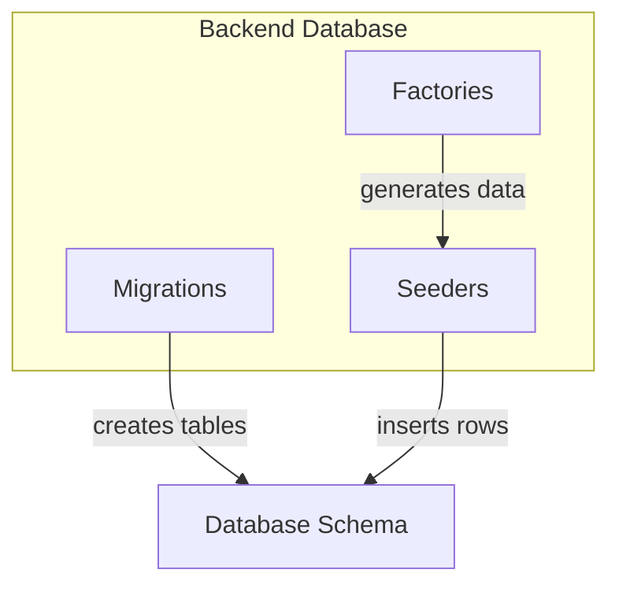
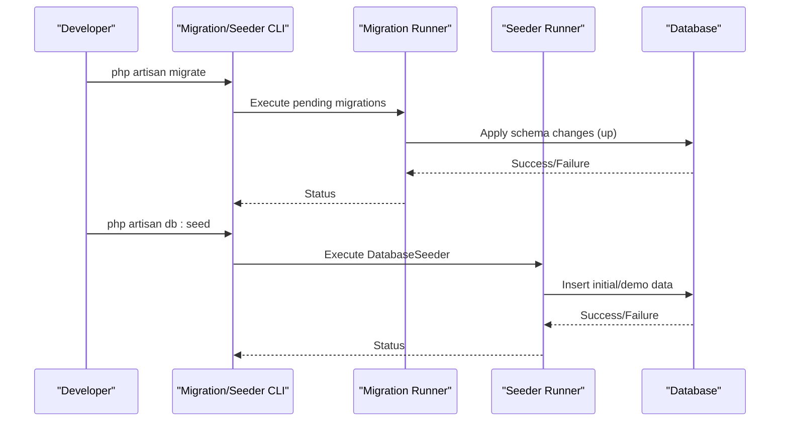
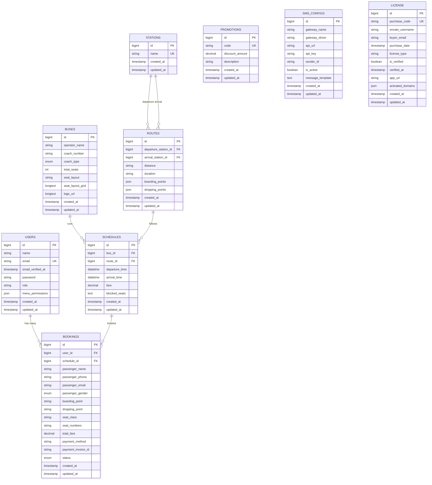

# Migrations & Seeders

<cite>
**Referenced Files in This Document**
- [0001_01_01_000000_create_users_table.php](file://backend/database/migrations/0001_01_01_000000_create_users_table.php)
- [2026_06_01_000010_create_stations_table.php](file://backend/database/migrations/2026_06_01_000010_create_stations_table.php)
- [2026_06_01_000020_create_buses_table.php](file://backend/database/migrations/2026_06_01_000020_create_buses_table.php)
- [2026_06_01_000030_create_routes_table.php](file://backend/database/migrations/2026_06_01_000030_create_routes_table.php)
- [2026_06_01_000040_create_schedules_table.php](file://backend/database/migrations/2026_06_01_000040_create_schedules_table.php)
- [2026_06_01_000050_create_bookings_table.php](file://backend/database/migrations/2026_06_01_000050_create_bookings_table.php)
- [2026_06_01_000060_create_promotions_table.php](file://backend/database/migrations/2026_06_01_000060_create_promotions_table.php)
- [2026_06_02_071612_create_personal_access_tokens_table.php](file://backend/database/migrations/2026_06_02_071612_create_personal_access_tokens_table.php)
- [2026_06_02_090000_create_sms_configs_table.php](file://backend/database/migrations/2026_06_02_090000_create_sms_configs_table.php)
- [2026_06_11_000000_create_site_settings_table.php](file://backend/database/migrations/2026_06_11_000000_create_site_settings_table.php)
- [2026_10_08_100000_create_license_table.php](file://backend/database/migrations/2026_10_08_100000_create_license_table.php)
- [2026_10_08_110000_add_domains_to_license_table.php](file://backend/database/migrations/2026_10_08_110000_add_domains_to_license_table.php)
- [DatabaseSeeder.php](file://backend/database/seeders/DatabaseSeeder.php)
- [StationSeeder.php](file://backend/database/seeders/StationSeeder.php)
- [BusSeeder.php](file://backend/database/seeders/BusSeeder.php)
- [RouteSeeder.php](file://backend/database/seeders/RouteSeeder.php)
- [ScheduleSeeder.php](file://backend/database/seeders/ScheduleSeeder.php)
- [BookingSeeder.php](file://backend/database/seeders/BookingSeeder.php)
- [PromotionSeeder.php](file://backend/database/seeders/PromotionSeeder.php)
- [SmsConfigSeeder.php](file://backend/database/seeders/SmsConfigSeeder.php)
- [UserFactory.php](file://backend/database/factories/UserFactory.php)
</cite>

## Table of Contents
1. Introduction
2. Project Structure
3. Core Components
4. Architecture Overview
5. Detailed Component Analysis
6. Dependency Analysis
7. Performance Considerations
8. Troubleshooting Guide
9. Conclusion

## Introduction
This document explains the database migration and seeding strategy used by SonyaBus. It covers migration file structure, naming conventions, version control practices, table creation and modification operations, rollback procedures, and the seeder architecture for demo data, testing data, and initial configuration. It also documents factory patterns for test data generation, random data strategies, validation during seeding, migration dependencies, conditional migrations, environment-specific configurations, data backup strategies, schema versioning, and deployment considerations for production environments.

## Project Structure
The database layer is organized into three primary directories:
- Migrations: Define schema evolution with up/down methods.
- Seeders: Populate tables with initial or demo data.
- Factories: Generate randomized records for tests and seeders.

[No sources needed since this diagram shows conceptual workflow, not actual code structure]

**Section sources**
- [0001_01_01_000000_create_users_table.php:1-52](file://backend/database/migrations/0001_01_01_000000_create_users_table.php#L1-L52)
- [2026_06_01_000010_create_stations_table.php:1-23](file://backend/database/migrations/2026_06_01_000010_create_stations_table.php#L1-L23)
- [2026_06_01_000020_create_buses_table.php:1-39](file://backend/database/migrations/2026_06_01_000020_create_buses_table.php#L1-L39)
- [2026_06_01_000030_create_routes_table.php:1-39](file://backend/database/migrations/2026_06_01_000030_create_routes_table.php#L1-L39)
- [2026_06_01_000040_create_schedules_table.php:1-41](file://backend/database/migrations/2026_06_01_000040_create_schedules_table.php#L1-L41)
- [2026_06_01_000050_create_bookings_table.php:1-53](file://backend/database/migrations/2026_06_01_000050_create_bookings_table.php#L1-L53)
- [2026_06_01_000060_create_promotions_table.php:1-31](file://backend/database/migrations/2026_06_01_000060_create_promotions_table.php#L1-L31)
- [2026_06_02_071612_create_personal_access_tokens_table.php:1-34](file://backend/database/migrations/2026_06_02_071612_create_personal_access_tokens_table.php#L1-L34)
- [2026_06_02_090000_create_sms_configs_table.php:1-39](file://backend/database/migrations/2026_06_02_090000_create_sms_configs_table.php#L1-L39)
- [2026_06_11_000000_create_site_settings_table.php:1-57](file://backend/database/migrations/2026_06_11_000000_create_site_settings_table.php#L1-L57)
- [2026_10_08_100000_create_license_table.php:1-30](file://backend/database/migrations/2026_10_08_100000_create_license_table.php#L1-L30)
- [2026_10_08_110000_add_domains_to_license_table.php:1-24](file://backend/database/migrations/2026_10_08_110000_add_domains_to_license_table.php#L1-L24)

## Core Components
- Migration files define schema changes using up() to apply and down() to revert.
- Seeder classes populate tables with initial/demo data and can call factories for randomized records.
- Factory classes encapsulate attribute generation logic for models.

Key responsibilities:
- Migrations: Create tables, add columns, indexes, foreign keys, and default data.
- Seeders: Orchestrate data population across related tables.
- Factories: Provide deterministic and randomized data generation for tests and seeders.

**Section sources**
- [DatabaseSeeder.php](file://backend/database/seeders/DatabaseSeeder.php)
- [UserFactory.php](file://backend/database/factories/UserFactory.php)

## Architecture Overview
The migration and seeding pipeline follows a clear sequence:
1. Run migrations to build the schema.
2. Run seeders to populate base data.
3. Optionally run factories within tests or seeders to generate additional data.

[No sources needed since this diagram shows conceptual workflow, not actual code structure]

## Detailed Component Analysis

### Migration File Structure and Naming Conventions
- Timestamped filenames ensure ordering and reproducibility.
- Each migration class implements up() and down() for forward and backward operations.
- Common operations include creating tables, adding columns, defining indexes, and inserting defaults.

Examples of core migrations:
- Users and auth-related tables: [0001_01_01_000000_create_users_table.php:12-40](file://backend/database/migrations/0001_01_01_000000_create_users_table.php#L12-L40)
- Stations: [2026_06_01_000010_create_stations_table.php:9-15](file://backend/database/migrations/2026_06_01_000010_create_stations_table.php#L9-L15)
- Buses: [2026_06_01_000020_create_buses_table.php:12-28](file://backend/database/migrations/2026_06_01_000020_create_buses_table.php#L12-L28)
- Routes with foreign keys and indexes: [2026_06_01_000030_create_routes_table.php:12-28](file://backend/database/migrations/2026_06_01_000030_create_routes_table.php#L12-L28)
- Schedules with composite indexes: [2026_06_01_000040_create_schedules_table.php:12-30](file://backend/database/migrations/2026_06_01_000040_create_schedules_table.php#L12-L30)
- Bookings with status and payment fields: [2026_06_01_000050_create_bookings_table.php:12-42](file://backend/database/migrations/2026_06_01_000050_create_bookings_table.php#L12-L42)
- Promotions: [2026_06_01_000060_create_promotions_table.php:12-20](file://backend/database/migrations/2026_06_01_000060_create_promotions_table.php#L12-L20)
- Personal access tokens: [2026_06_02_071612_create_personal_access_tokens_table.php:12-23](file://backend/database/migrations/2026_06_02_071612_create_personal_access_tokens_table.php#L12-L23)
- SMS configs: [2026_06_02_090000_create_sms_configs_table.php:12-28](file://backend/database/migrations/2026_06_02_090000_create_sms_configs_table.php#L12-L28)
- Site settings with default values: [2026_06_11_000000_create_site_settings_table.php:10-49](file://backend/database/migrations/2026_06_11_000000_create_site_settings_table.php#L10-L49)
- License table: [2026_10_08_100000_create_license_table.php:9-22](file://backend/database/migrations/2026_10_08_100000_create_license_table.php#L9-L22)
- Add domains to license: [2026_10_08_110000_add_domains_to_license_table.php:9-14](file://backend/database/migrations/2026_10_08_110000_add_domains_to_license_table.php#L9-L14)

Rollback examples:
- Drop users and related tables: [0001_01_01_000000_create_users_table.php:45-50](file://backend/database/migrations/0001_01_01_000000_create_users_table.php#L45-L50)
- Drop stations: [2026_06_01_000010_create_stations_table.php:18-21](file://backend/database/migrations/2026_06_01_000010_create_stations_table.php#L18-L21)
- Drop bookings: [2026_06_01_000050_create_bookings_table.php:48-51](file://backend/database/migrations/2026_06_01_000050_create_bookings_table.php#L48-L51)
- Drop site settings: [2026_06_11_000000_create_site_settings_table.php:52-55](file://backend/database/migrations/2026_06_11_000000_create_site_settings_table.php#L52-L55)
- Drop license: [2026_10_08_100000_create_license_table.php:25-28](file://backend/database/migrations/2026_10_08_100000_create_license_table.php#L25-L28)
- Drop column from license: [2026_10_08_110000_add_domains_to_license_table.php:17-21](file://backend/database/migrations/2026_10_08_110000_add_domains_to_license_table.php#L17-L21)

**Section sources**
- [0001_01_01_000000_create_users_table.php:12-50](file://backend/database/migrations/0001_01_01_000000_create_users_table.php#L12-L50)
- [2026_06_01_000010_create_stations_table.php:9-21](file://backend/database/migrations/2026_06_01_000010_create_stations_table.php#L9-L21)
- [2026_06_01_000020_create_buses_table.php:12-36](file://backend/database/migrations/2026_06_01_000020_create_buses_table.php#L12-L36)
- [2026_06_01_000030_create_routes_table.php:12-36](file://backend/database/migrations/2026_06_01_000030_create_routes_table.php#L12-L36)
- [2026_06_01_000040_create_schedules_table.php:12-38](file://backend/database/migrations/2026_06_01_000040_create_schedules_table.php#L12-L38)
- [2026_06_01_000050_create_bookings_table.php:12-51](file://backend/database/migrations/2026_06_01_000050_create_bookings_table.php#L12-L51)
- [2026_06_01_000060_create_promotions_table.php:12-28](file://backend/database/migrations/2026_06_01_000060_create_promotions_table.php#L12-L28)
- [2026_06_02_071612_create_personal_access_tokens_table.php:12-31](file://backend/database/migrations/2026_06_02_071612_create_personal_access_tokens_table.php#L12-L31)
- [2026_06_02_090000_create_sms_configs_table.php:12-36](file://backend/database/migrations/2026_06_02_090000_create_sms_configs_table.php#L12-L36)
- [2026_06_11_000000_create_site_settings_table.php:10-55](file://backend/database/migrations/2026_06_11_000000_create_site_settings_table.php#L10-L55)
- [2026_10_08_100000_create_license_table.php:9-28](file://backend/database/migrations/2026_10_08_100000_create_license_table.php#L9-L28)
- [2026_10_08_110000_add_domains_to_license_table.php:9-21](file://backend/database/migrations/2026_10_08_110000_add_domains_to_license_table.php#L9-L21)

### Table Creation and Modification Operations
- Primary keys and timestamps are consistently applied.
- Foreign keys enforce referential integrity with cascade behaviors where appropriate.
- Indexes optimize common queries; composite indexes support multi-column filters.
- JSON columns store flexible structures such as boarding/dropping points and seat layouts.

Highlights:
- Routes reference stations via foreign keys and include composite indexes: [2026_06_01_000030_create_routes_table.php:14-27](file://backend/database/migrations/2026_06_01_000030_create_routes_table.php#L14-L27)
- Schedules link buses and routes with time-based indexes: [2026_06_01_000040_create_schedules_table.php:14-29](file://backend/database/migrations/2026_06_01_000040_create_schedules_table.php#L14-L29)
- Bookings include enums for gender/status and multiple query indexes: [2026_06_01_000050_create_bookings_table.php:14-41](file://backend/database/migrations/2026_06_01_000050_create_bookings_table.php#L14-L41)
- Adding a new column to an existing table: [2026_10_08_110000_add_domains_to_license_table.php:11-14](file://backend/database/migrations/2026_10_08_110000_add_domains_to_license_table.php#L11-L14)

**Section sources**
- [2026_06_01_000030_create_routes_table.php:14-27](file://backend/database/migrations/2026_06_01_000030_create_routes_table.php#L14-L27)
- [2026_06_01_000040_create_schedules_table.php:14-29](file://backend/database/migrations/2026_06_01_000040_create_schedules_table.php#L14-L29)
- [2026_06_01_000050_create_bookings_table.php:14-41](file://backend/database/migrations/2026_06_01_000050_create_bookings_table.php#L14-L41)
- [2026_10_08_110000_add_domains_to_license_table.php:11-14](file://backend/database/migrations/2026_10_08_110000_add_domains_to_license_table.php#L11-L14)

### Seeder Architecture for Demo Data, Testing Data, and Initial Configuration
- DatabaseSeeder orchestrates all seeders.
- Domain-specific seeders populate entities like stations, buses, routes, schedules, bookings, promotions, and SMS configurations.
- Seeders may use factories to generate randomized data for tests and demos.

Core seeders:
- Entry point: [DatabaseSeeder.php](file://backend/database/seeders/DatabaseSeeder.php)
- Stations: [StationSeeder.php](file://backend/database/seeders/StationSeeder.php)
- Buses: [BusSeeder.php](file://backend/database/seeders/BusSeeder.php)
- Routes: [RouteSeeder.php](file://backend/database/seeders/RouteSeeder.php)
- Schedules: [ScheduleSeeder.php](file://backend/database/seeders/ScheduleSeeder.php)
- Bookings: [BookingSeeder.php](file://backend/database/seeders/BookingSeeder.php)
- Promotions: [PromotionSeeder.php](file://backend/database/seeders/PromotionSeeder.php)
- SMS Configs: [SmsConfigSeeder.php](file://backend/database/seeders/SmsConfigSeeder.php)

Initial configuration seeding:
- Default site settings inserted directly in migration: [2026_06_11_000000_create_site_settings_table.php:19-49](file://backend/database/migrations/2026_06_11_000000_create_site_settings_table.php#L19-L49)

**Section sources**
- [DatabaseSeeder.php](file://backend/database/seeders/DatabaseSeeder.php)
- [StationSeeder.php](file://backend/database/seeders/StationSeeder.php)
- [BusSeeder.php](file://backend/database/seeders/BusSeeder.php)
- [RouteSeeder.php](file://backend/database/seeders/RouteSeeder.php)
- [ScheduleSeeder.php](file://backend/database/seeders/ScheduleSeeder.php)
- [BookingSeeder.php](file://backend/database/seeders/BookingSeeder.php)
- [PromotionSeeder.php](file://backend/database/seeders/PromotionSeeder.php)
- [SmsConfigSeeder.php](file://backend/database/seeders/SmsConfigSeeder.php)
- [2026_06_11_000000_create_site_settings_table.php:19-49](file://backend/database/migrations/2026_06_11_000000_create_site_settings_table.php#L19-L49)

### Factory Patterns for Generating Test Data and Random Data Strategies
- UserFactory provides a reusable blueprint for generating user records with randomized attributes.
- Seeders can call factories to create realistic datasets for development and testing.

Usage guidance:
- Instantiate factory instances to generate single or batch records.
- Use state modifiers to produce specific scenarios (e.g., admin users).
- Combine factories to build relational datasets (e.g., users with bookings).

**Section sources**
- [UserFactory.php](file://backend/database/factories/UserFactory.php)

### Data Validation During Seeding
- Enforce uniqueness constraints at the database level (e.g., unique codes, emails).
- Validate enum values match allowed sets defined in migrations.
- Ensure required fields are present before insertion.
- Prefer idempotent seeding operations to avoid duplicate entries on repeated runs.

Validation references:
- Unique constraints: [2026_06_01_000060_create_promotions_table.php:16-16](file://backend/database/migrations/2026_06_01_000060_create_promotions_table.php#L16-L16), [2026_06_01_000010_create_stations_table.php:13-13](file://backend/database/migrations/2026_06_01_000010_create_stations_table.php#L13-L13)
- Enum fields: [2026_06_01_000020_create_buses_table.php:18-18](file://backend/database/migrations/2026_06_01_000020_create_buses_table.php#L18-L18), [2026_06_01_000050_create_bookings_table.php:21-29](file://backend/database/migrations/2026_06_01_000050_create_bookings_table.php#L21-L29)

**Section sources**
- [2026_06_01_000060_create_promotions_table.php:16-16](file://backend/database/migrations/2026_06_01_000060_create_promotions_table.php#L16-L16)
- [2026_06_01_000010_create_stations_table.php:13-13](file://backend/database/migrations/2026_06_01_000010_create_stations_table.php#L13-L13)
- [2026_06_01_000020_create_buses_table.php:18-18](file://backend/database/migrations/2026_06_01_000020_create_buses_table.php#L18-L18)
- [2026_06_01_000050_create_bookings_table.php:21-29](file://backend/database/migrations/2026_06_01_000050_create_bookings_table.php#L21-L29)

### Migration Dependencies and Conditional Migrations
- Ordering is enforced by timestamped filenames.
- Foreign key relationships imply dependency order (e.g., stations must exist before routes).
- Conditional seeding can be implemented in seeders based on environment variables or feature flags.
- The site settings migration includes default data insertion after table creation.

References:
- Dependency via foreign keys: [2026_06_01_000030_create_routes_table.php:16-17](file://backend/database/migrations/2026_06_01_000030_create_routes_table.php#L16-L17)
- Conditional default seeding: [2026_06_11_000000_create_site_settings_table.php:19-49](file://backend/database/migrations/2026_06_11_000000_create_site_settings_table.php#L19-L49)

**Section sources**
- [2026_06_01_000030_create_routes_table.php:16-17](file://backend/database/migrations/2026_06_01_000030_create_routes_table.php#L16-L17)
- [2026_06_11_000000_create_site_settings_table.php:19-49](file://backend/database/migrations/2026_06_11_000000_create_site_settings_table.php#L19-L49)

### Environment-Specific Configurations
- Use environment variables to toggle features or switch seeders (e.g., demo vs. clean data).
- Guard sensitive seeders behind environment checks.
- Keep secrets out of migrations and seeders; read from environment at runtime.

[No sources needed since this section provides general guidance]

### Data Backup Strategies, Schema Versioning, and Deployment Considerations
- Backups: Schedule regular full and incremental backups of the database; verify restore procedures.
- Schema versioning: Rely on migration timestamps; never edit already-applied migrations. Introduce additive changes only.
- Rollbacks: Test down() methods locally before deploying to production.
- Production deployment:
  - Run migrations first, then seeders.
  - Use zero-downtime deployments when possible; avoid destructive changes without careful planning.
  - Monitor migration execution logs and error outputs.
  - Validate indexes and foreign keys post-deployment.

[No sources needed since this section provides general guidance]

## Dependency Analysis
The following diagram maps key entity relationships established through migrations:

**Diagram sources**
- [0001_01_01_000000_create_users_table.php:14-24](file://backend/database/migrations/0001_01_01_000000_create_users_table.php#L14-L24)
- [2026_06_01_000010_create_stations_table.php:11-14](file://backend/database/migrations/2026_06_01_000010_create_stations_table.php#L11-L14)
- [2026_06_01_000020_create_buses_table.php:14-24](file://backend/database/migrations/2026_06_01_000020_create_buses_table.php#L14-L24)
- [2026_06_01_000030_create_routes_table.php:14-22](file://backend/database/migrations/2026_06_01_000030_create_routes_table.php#L14-L22)
- [2026_06_01_000040_create_schedules_table.php:14-22](file://backend/database/migrations/2026_06_01_000040_create_schedules_table.php#L14-L22)
- [2026_06_01_000050_create_bookings_table.php:14-30](file://backend/database/migrations/2026_06_01_000050_create_bookings_table.php#L14-L30)
- [2026_06_01_000060_create_promotions_table.php:14-19](file://backend/database/migrations/2026_06_01_000060_create_promotions_table.php#L14-L19)
- [2026_06_02_090000_create_sms_configs_table.php:14-23](file://backend/database/migrations/2026_06_02_090000_create_sms_configs_table.php#L14-L23)
- [2026_10_08_100000_create_license_table.php:11-21](file://backend/database/migrations/2026_10_08_100000_create_license_table.php#L11-L21)
- [2026_10_08_110000_add_domains_to_license_table.php:11-14](file://backend/database/migrations/2026_10_08_110000_add_domains_to_license_table.php#L11-L14)

**Section sources**
- [2026_06_01_000030_create_routes_table.php:14-22](file://backend/database/migrations/2026_06_01_000030_create_routes_table.php#L14-L22)
- [2026_06_01_000040_create_schedules_table.php:14-22](file://backend/database/migrations/2026_06_01_000040_create_schedules_table.php#L14-L22)
- [2026_06_01_000050_create_bookings_table.php:14-30](file://backend/database/migrations/2026_06_01_000050_create_bookings_table.php#L14-L30)

## Performance Considerations
- Index frequently filtered columns (e.g., status, user_id, schedule_id, departure_time).
- Use composite indexes for common query patterns (e.g., route + departure_time).
- Avoid storing large blobs in JSON unless necessary; consider separate tables for complex nested data.
- Limit heavy seeding to development/staging; use targeted seeders in CI pipelines.

[No sources needed since this section provides general guidance]

## Troubleshooting Guide
Common issues and resolutions:
- Duplicate entry errors during seeding:
  - Ensure seeders are idempotent or check existence before insert.
  - Verify unique constraints align with seeded data.
- Foreign key constraint violations:
  - Confirm referenced tables are migrated and seeded before dependent tables.
- Missing indexes causing slow queries:
  - Review migration indexes and add composite indexes for hot paths.
- Rollback failures:
  - Test down() methods locally; ensure dependent objects are dropped in correct order.

Operational tips:
- Use migration status checks before running seeders.
- Log seeding progress and errors for auditability.
- Validate environment variables before sensitive seeders execute.

[No sources needed since this section provides general guidance]

## Conclusion
SonyaBus employs a robust migration and seeding strategy that emphasizes clear versioning, strong referential integrity, and comprehensive indexing. Seeders provide consistent initial data, while factories enable scalable test data generation. By adhering to the outlined best practices—idempotent seeders, additive-only migrations, thorough rollbacks, and disciplined production deployments—you can maintain a reliable and performant database schema across environments.

[No sources needed since this section summarizes without analyzing specific files]