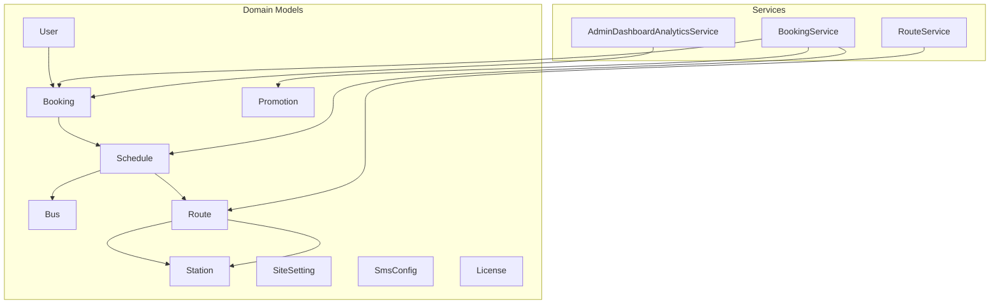
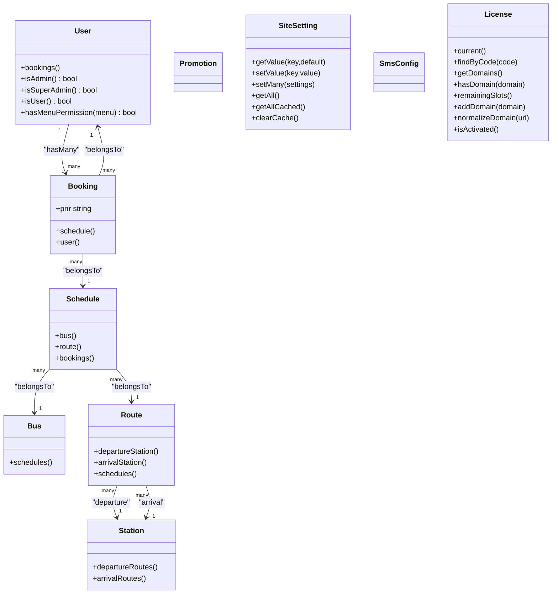
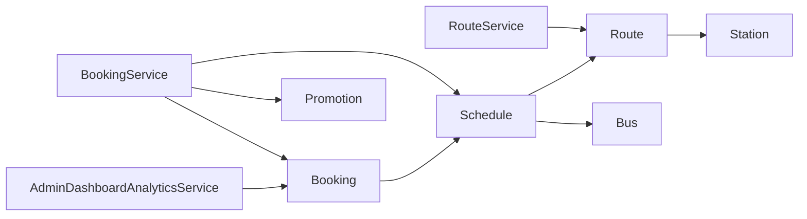

# Model Definitions

<cite>
**Referenced Files in This Document**
- [User.php](file://backend/app/Models/User.php)
- [Booking.php](file://backend/app/Models/Booking.php)
- [Bus.php](file://backend/app/Models/Bus.php)
- [Route.php](file://backend/app/Models/Route.php)
- [Schedule.php](file://backend/app/Models/Schedule.php)
- [Station.php](file://backend/app/Models/Station.php)
- [Promotion.php](file://backend/app/Models/Promotion.php)
- [SiteSetting.php](file://backend/app/Models/SiteSetting.php)
- [SmsConfig.php](file://backend/app/Models/SmsConfig.php)
- [License.php](file://backend/app/Models/License.php)
- [BookingService.php](file://backend/app/Services/BookingService.php)
- [RouteService.php](file://backend/app/Services/RouteService.php)
- [AdminDashboardAnalyticsService.php](file://backend/app/Services/AdminDashboardAnalyticsService.php)
</cite>

## Table of Contents
1. [Introduction](#introduction)
2. [Project Structure](#project-structure)
3. [Core Components](#core-components)
4. [Architecture Overview](#architecture-overview)
5. [Detailed Component Analysis](#detailed-component-analysis)
6. [Dependency Analysis](#dependency-analysis)
7. [Performance Considerations](#performance-considerations)
8. [Troubleshooting Guide](#troubleshooting-guide)
9. [Conclusion](#conclusion)

## Introduction
This document provides comprehensive documentation for all Eloquent model definitions in the SonyaBus application. It covers fillable fields, hidden attributes, type casting, relationships, accessors, mutators, and custom query scopes where applicable. It also explains business logic methods that operate on models, validation rules enforced by services, attribute transformations, computed properties, events/observers (if any), and practical examples for CRUD operations, relationship queries, advanced filtering, serialization, API resource transformation, and performance considerations for large datasets.

## Project Structure
The Eloquent models reside under backend/app/Models and represent core domain entities: User, Booking, Bus, Route, Schedule, Station, Promotion, SiteSetting, SmsConfig, and License. Services under backend/app/Services orchestrate complex workflows involving these models, including validation, persistence, and reporting.

**Diagram sources**
- [User.php:12-75](file://backend/app/Models/User.php#L12-L75)
- [Booking.php:8-48](file://backend/app/Models/Booking.php#L8-L48)
- [Bus.php:8-22](file://backend/app/Models/Bus.php#L8-L22)
- [Route.php:8-40](file://backend/app/Models/Route.php#L8-L40)
- [Schedule.php:8-34](file://backend/app/Models/Schedule.php#L8-L34)
- [Station.php:8-23](file://backend/app/Models/Station.php#L8-L23)
- [Promotion.php:8-17](file://backend/app/Models/Promotion.php#L8-L17)
- [SiteSetting.php:8-80](file://backend/app/Models/SiteSetting.php#L8-L80)
- [SmsConfig.php:7-22](file://backend/app/Models/SmsConfig.php#L7-L22)
- [License.php:13-125](file://backend/app/Models/License.php#L13-L125)
- [BookingService.php:14-335](file://backend/app/Services/BookingService.php#L14-L335)
- [RouteService.php:12-102](file://backend/app/Services/RouteService.php#L12-L102)
- [AdminDashboardAnalyticsService.php:9-228](file://backend/app/Services/AdminDashboardAnalyticsService.php#L9-L228)

**Section sources**
- [User.php:12-75](file://backend/app/Models/User.php#L12-L75)
- [Booking.php:8-48](file://backend/app/Models/Booking.php#L8-L48)
- [Bus.php:8-22](file://backend/app/Models/Bus.php#L8-L22)
- [Route.php:8-40](file://backend/app/Models/Route.php#L8-L40)
- [Schedule.php:8-34](file://backend/app/Models/Schedule.php#L8-L34)
- [Station.php:8-23](file://backend/app/Models/Station.php#L8-L23)
- [Promotion.php:8-17](file://backend/app/Models/Promotion.php#L8-L17)
- [SiteSetting.php:8-80](file://backend/app/Models/SiteSetting.php#L8-L80)
- [SmsConfig.php:7-22](file://backend/app/Models/SmsConfig.php#L7-L22)
- [License.php:13-125](file://backend/app/Models/License.php#L13-L125)
- [BookingService.php:14-335](file://backend/app/Services/BookingService.php#L14-L335)
- [RouteService.php:12-102](file://backend/app/Services/RouteService.php#L12-L102)
- [AdminDashboardAnalyticsService.php:9-228](file://backend/app/Services/AdminDashboardAnalyticsService.php#L9-L228)

## Core Components
This section summarizes each model’s configuration and behavior.

- User
  - Fillable: name, email, password, role, menu_permissions
  - Hidden: password, remember_token
  - Casts: email_verified_at as datetime, password as hashed, menu_permissions as array
  - Relationships: hasMany Booking
  - Business methods: isAdmin(), isSuperAdmin(), isUser(), hasMenuPermission(menu)
  - Notes: Uses HasApiTokens, HasFactory, Notifiable traits

- Booking
  - Fillable: user_id, schedule_id, passenger_name, passenger_phone, passenger_email, passenger_gender, boarding_point, dropping_point, seat_class, seat_numbers, total_fare, payment_method, payment_invoice_id, status
  - Casts: total_fare as decimal(2)
  - Relationships: belongsTo Schedule, belongsTo User
  - Accessor: pnr returns a formatted ticket reference based on id

- Bus
  - Fillable: operator_name, coach_number, coach_type, total_seats, seat_layout, seat_layout_grid, logo_url
  - Casts: seat_layout_grid as array
  - Relationships: hasMany Schedule

- Route
  - Fillable: departure_station_id, arrival_station_id, distance, duration, boarding_points, dropping_points
  - Casts: boarding_points as array, dropping_points as array
  - Relationships: belongsTo Station (departure and arrival), hasMany Schedule

- Schedule
  - Fillable: bus_id, route_id, departure_time, arrival_time, fare, blocked_seats
  - Casts: departure_time as datetime, arrival_time as datetime, fare as decimal(2)
  - Relationships: belongsTo Bus, belongsTo Route, hasMany Booking

- Station
  - Fillable: name
  - Relationships: hasMany Route (as departure and arrival)

- Promotion
  - Fillable: code, discount_amount, description
  - Casts: discount_amount as decimal(2)

- SiteSetting
  - Fillable: key, value
  - Static helpers: getValue(key, default), setValue(key, value), setMany(settings), getAll(), getAllCached(), clearCache()
  - Caching: uses Cache with TTL to store all settings keyed by key

- SmsConfig
  - Fillable: gateway_name, gateway_driver, api_url, api_key, sender_id, is_active, message_template
  - Casts: is_active as boolean

- License
  - Table: license
  - Fillable: purchase_code, envato_username, buyer_email, purchase_date, license_type, is_verified, verified_at, app_url, activated_domains
  - Casts: is_verified as boolean, verified_at as datetime, purchase_date as datetime, activated_domains as array
  - Constants: MAX_DOMAINS = 5
  - Finders: current(), findByCode(code)
  - Domain management: getDomains(), hasDomain(domain), remainingSlots(), addDomain(domain), normalizeDomain(url)
  - Status helper: isActivated()

**Section sources**
- [User.php:17-74](file://backend/app/Models/User.php#L17-L74)
- [Booking.php:12-47](file://backend/app/Models/Booking.php#L12-L47)
- [Bus.php:12-21](file://backend/app/Models/Bus.php#L12-L21)
- [Route.php:12-39](file://backend/app/Models/Route.php#L12-L39)
- [Schedule.php:12-33](file://backend/app/Models/Schedule.php#L12-L33)
- [Station.php:12-22](file://backend/app/Models/Station.php#L12-L22)
- [Promotion.php:12-16](file://backend/app/Models/Promotion.php#L12-L16)
- [SiteSetting.php:10-79](file://backend/app/Models/SiteSetting.php#L10-L79)
- [SmsConfig.php:9-21](file://backend/app/Models/SmsConfig.php#L9-L21)
- [License.php:20-125](file://backend/app/Models/License.php#L20-L125)

## Architecture Overview
The models form a cohesive domain graph centered around schedules and bookings. Users create or manage bookings; schedules define when and where buses run; routes connect stations; buses provide capacity and layout; promotions reduce fares; site settings and SMS configs support operational features; licenses govern installation activation.

**Diagram sources**
- [User.php:39-74](file://backend/app/Models/User.php#L39-L74)
- [Booking.php:33-47](file://backend/app/Models/Booking.php#L33-L47)
- [Schedule.php:20-33](file://backend/app/Models/Schedule.php#L20-L33)
- [Bus.php:18-21](file://backend/app/Models/Bus.php#L18-L21)
- [Route.php:26-39](file://backend/app/Models/Route.php#L26-L39)
- [Station.php:14-22](file://backend/app/Models/Station.php#L14-L22)
- [SiteSetting.php:21-79](file://backend/app/Models/SiteSetting.php#L21-L79)
- [License.php:42-125](file://backend/app/Models/License.php#L42-L125)

## Detailed Component Analysis

### User Model
- Properties and configuration
  - Fillable: name, email, password, role, menu_permissions
  - Hidden: password, remember_token
  - Casts: email_verified_at (datetime), password (hashed), menu_permissions (array)
- Relationships
  - bookings(): hasMany Booking
- Business methods
  - isAdmin(): true if role is admin or super_admin
  - isSuperAdmin(): true if role is super_admin
  - isUser(): true if role is user
  - hasMenuPermission(menu): grants access based on role and menu_permissions array
- Validation and security
  - Password stored via Laravel’s hashed cast
  - Role-based authorization helpers used across controllers/middleware
- Example usage patterns
  - Check permissions: $user->hasMenuPermission('reports')
  - Filter users by role: User::where('role', 'admin')->get()

**Section sources**
- [User.php:17-74](file://backend/app/Models/User.php#L17-L74)

### Booking Model
- Properties and configuration
  - Fillable: user_id, schedule_id, passenger_name, passenger_phone, passenger_email, passenger_gender, boarding_point, dropping_point, seat_class, seat_numbers, total_fare, payment_method, payment_invoice_id, status
  - Casts: total_fare (decimal:2)
- Relationships
  - schedule(): belongsTo Schedule
  - user(): belongsTo User
- Computed property
  - pnr: formatted ticket ID like SE followed by zero-padded booking id
- Validation and business rules
  - Seat selection and status transitions are enforced in BookingService
- Example usage patterns
  - Create booking: use BookingService::createForCustomer() or createForAdmin()
  - Access PNR: $booking->pnr
  - Query by schedule: Booking::where('schedule_id', $id)->get()

**Section sources**
- [Booking.php:12-47](file://backend/app/Models/Booking.php#L12-L47)
- [BookingService.php:28-131](file://backend/app/Services/BookingService.php#L28-L131)
- [BookingService.php:138-193](file://backend/app/Services/BookingService.php#L138-L193)

### Bus Model
- Properties and configuration
  - Fillable: operator_name, coach_number, coach_type, total_seats, seat_layout, seat_layout_grid, logo_url
  - Casts: seat_layout_grid (array)
- Relationships
  - schedules(): hasMany Schedule
- Example usage patterns
  - List schedules for a bus: $bus->schedules()->get()
  - Filter by coach type: Bus::where('coach_type', 'AC')->get()

**Section sources**
- [Bus.php:12-21](file://backend/app/Models/Bus.php#L12-L21)

### Route Model
- Properties and configuration
  - Fillable: departure_station_id, arrival_station_id, distance, duration, boarding_points, dropping_points
  - Casts: boarding_points (array), dropping_points (array)
- Relationships
  - departureStation(): belongsTo Station
  - arrivalStation(): belongsTo Station
  - schedules(): hasMany Schedule
- Validation
  - RouteService enforces required boarding/dropping points and validates JSON structure
- Example usage patterns
  - Validate from request: RouteService::validateFromRequest($request)
  - Duplicate check: RouteService::duplicateExists($fromId, $toId, $exceptId)

**Section sources**
- [Route.php:12-39](file://backend/app/Models/Route.php#L12-L39)
- [RouteService.php:14-64](file://backend/app/Services/RouteService.php#L14-L64)
- [RouteService.php:66-76](file://backend/app/Services/RouteService.php#L66-L76)

### Schedule Model
- Properties and configuration
  - Fillable: bus_id, route_id, departure_time, arrival_time, fare, blocked_seats
  - Casts: departure_time (datetime), arrival_time (datetime), fare (decimal:2)
- Relationships
  - bus(): belongsTo Bus
  - route(): belongsTo Route
  - bookings(): hasMany Booking
- Example usage patterns
  - Load related data: Schedule::with(['bus', 'route.departureStation', 'route.arrivalStation'])->find($id)
  - Query upcoming schedules: Schedule::where('departure_time', '>=', now())->get()

**Section sources**
- [Schedule.php:12-33](file://backend/app/Models/Schedule.php#L12-L33)

### Station Model
- Properties and configuration
  - Fillable: name
- Relationships
  - departureRoutes(): hasMany Route (via departure_station_id)
  - arrivalRoutes(): hasMany Route (via arrival_station_id)
- Example usage patterns
  - Get routes departing from station: $station->departureRoutes()->get()

**Section sources**
- [Station.php:12-22](file://backend/app/Models/Station.php#L12-L22)

### Promotion Model
- Properties and configuration
  - Fillable: code, discount_amount, description
  - Casts: discount_amount (decimal:2)
- Usage
  - Applied during fare calculation in BookingService

**Section sources**
- [Promotion.php:12-16](file://backend/app/Models/Promotion.php#L12-L16)
- [BookingService.php:304-318](file://backend/app/Services/BookingService.php#L304-L318)

### SiteSetting Model
- Properties and configuration
  - Fillable: key, value
- Static API
  - getValue(key, default): retrieves cached setting
  - setValue(key, value): creates/updates and clears cache
  - setMany(settings): bulk update and clears cache
  - getAll(): pluck key-value pairs
  - getAllCached(): returns cached map with TTL
  - clearCache(): forgets cache key
- Performance
  - Uses Cache::remember with TTL to avoid repeated DB reads

**Section sources**
- [SiteSetting.php:10-79](file://backend/app/Models/SiteSetting.php#L10-L79)

### SmsConfig Model
- Properties and configuration
  - Fillable: gateway_name, gateway_driver, api_url, api_key, sender_id, is_active, message_template
  - Casts: is_active (boolean)
- Usage
  - Referenced by SMS gateway service to send notifications

**Section sources**
- [SmsConfig.php:9-21](file://backend/app/Models/SmsConfig.php#L9-L21)

### License Model
- Properties and configuration
  - Table: license
  - Fillable: purchase_code, envato_username, buyer_email, purchase_date, license_type, is_verified, verified_at, app_url, activated_domains
  - Casts: is_verified (boolean), verified_at (datetime), purchase_date (datetime), activated_domains (array)
  - Constant: MAX_DOMAINS = 5
- Finders
  - current(): latest license row
  - findByCode(code): lookup by purchase code
- Domain management
  - getDomains(): normalized list of domains
  - hasDomain(domain): checks existence
  - remainingSlots(): available slots
  - addDomain(domain): adds domain if within limit
  - normalizeDomain(url): strips scheme/trailing slash and lowercases host
- Status helper
  - isActivated(): true if latest license is verified
- Example usage patterns
  - Check activation: License::isActivated()
  - Add domain: $license->addDomain($domain)

**Section sources**
- [License.php:20-125](file://backend/app/Models/License.php#L20-L125)

## Dependency Analysis
The following diagram highlights how services depend on models and how models relate to each other.

**Diagram sources**
- [BookingService.php:14-335](file://backend/app/Services/BookingService.php#L14-L335)
- [RouteService.php:12-102](file://backend/app/Services/RouteService.php#L12-L102)
- [AdminDashboardAnalyticsService.php:9-228](file://backend/app/Services/AdminDashboardAnalyticsService.php#L9-L228)
- [Booking.php:33-41](file://backend/app/Models/Booking.php#L33-L41)
- [Schedule.php:20-33](file://backend/app/Models/Schedule.php#L20-L33)
- [Bus.php:18-21](file://backend/app/Models/Bus.php#L18-L21)
- [Route.php:26-39](file://backend/app/Models/Route.php#L26-L39)
- [Station.php:14-22](file://backend/app/Models/Station.php#L14-L22)

**Section sources**
- [BookingService.php:14-335](file://backend/app/Services/BookingService.php#L14-L335)
- [RouteService.php:12-102](file://backend/app/Services/RouteService.php#L12-L102)
- [AdminDashboardAnalyticsService.php:9-228](file://backend/app/Services/AdminDashboardAnalyticsService.php#L9-L228)

## Performance Considerations
- Use eager loading to prevent N+1 queries when rendering schedules and routes:
  - Example: Schedule::with(['bus', 'route.departureStation', 'route.arrivalStation'])
- For large report datasets, prefer selective columns and aggregation:
  - Select only needed fields and group by date/status in memory after fetching minimal sets
- Leverage SiteSetting caching:
  - Use getAllCached() to avoid frequent DB hits for global settings
- Avoid heavy computations in loops:
  - Precompute derived values (e.g., pricing breakdown) once per request
- Indexing recommendations (conceptual):
  - Ensure indexes on foreign keys (user_id, schedule_id, bus_id, route_id) and frequently filtered columns (status, created_at, departure_time)

[No sources needed since this section provides general guidance]

## Troubleshooting Guide
- Booking creation issues
  - Seat not available: ensure requested seats are selectable; validate against active bookings using lockForUpdate pattern
  - Payment method mismatch: cash requires SOLD unless explicitly BOOKED; zinipay results in PENDING
  - SMS not sent: only sent for confirmed statuses (PAID, SOLD, BOOKED)
- Route validation errors
  - Missing boarding/dropping points: ensure at least one valid point per list
  - Invalid JSON: parse and sanitize before saving
- License activation problems
  - Domain limit reached: check remainingSlots() and existing domains
  - Normalization differences: use normalizeDomain() to compare domains consistently

**Section sources**
- [BookingService.php:28-131](file://backend/app/Services/BookingService.php#L28-L131)
- [BookingService.php:138-193](file://backend/app/Services/BookingService.php#L138-L193)
- [RouteService.php:14-64](file://backend/app/Services/RouteService.php#L14-L64)
- [License.php:76-105](file://backend/app/Models/License.php#L76-L105)

## Conclusion
The SonyaBus Eloquent models encapsulate the core domain with clear fillable fields, casts, relationships, and computed properties. Business logic is centralized in services that enforce validation, handle transactions, and coordinate external integrations. By leveraging eager loading, caching, and careful query construction, the application can scale efficiently while maintaining clean separation between data modeling and business processes.

[No sources needed since this section summarizes without analyzing specific files]