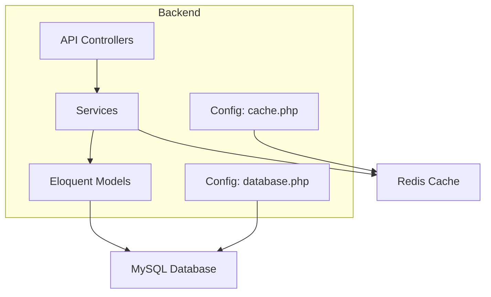
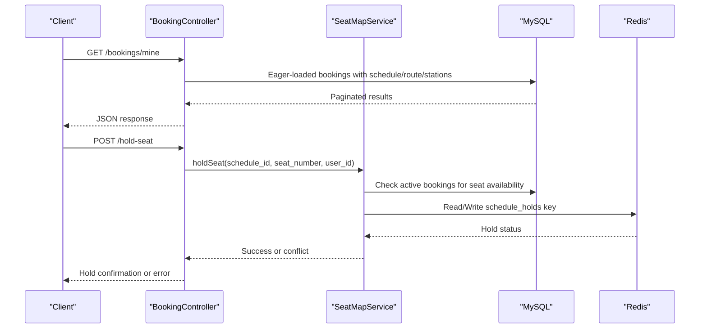
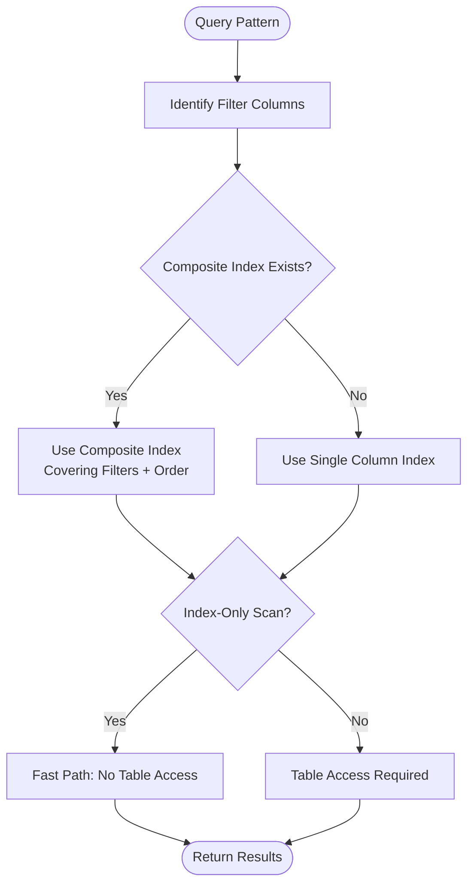
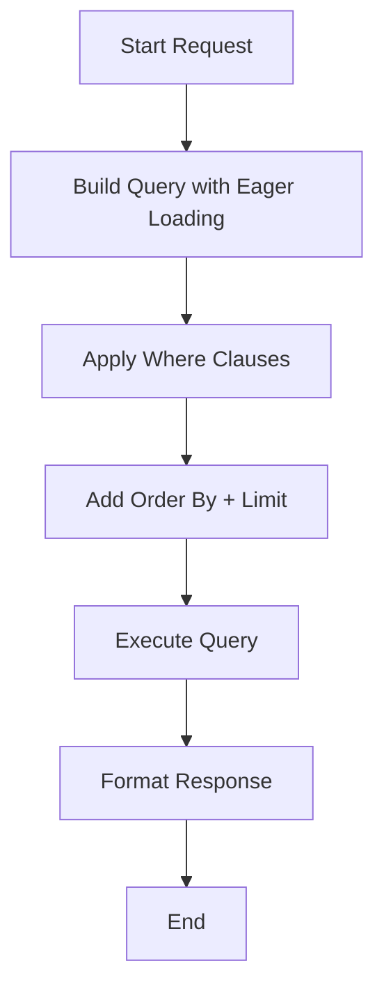
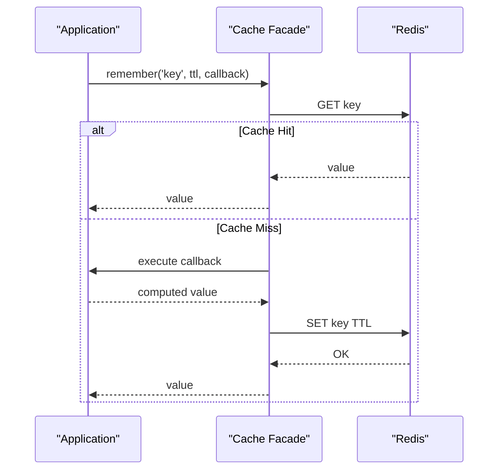
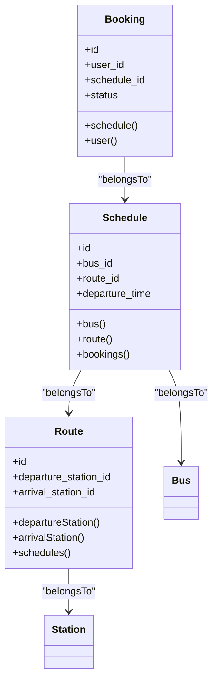
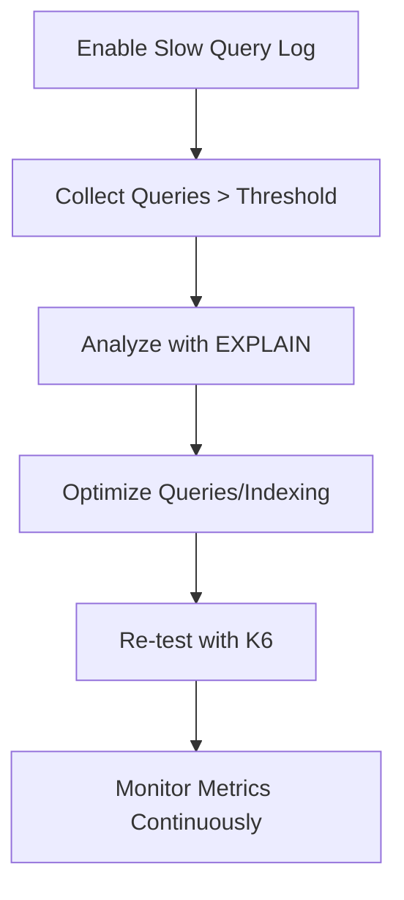
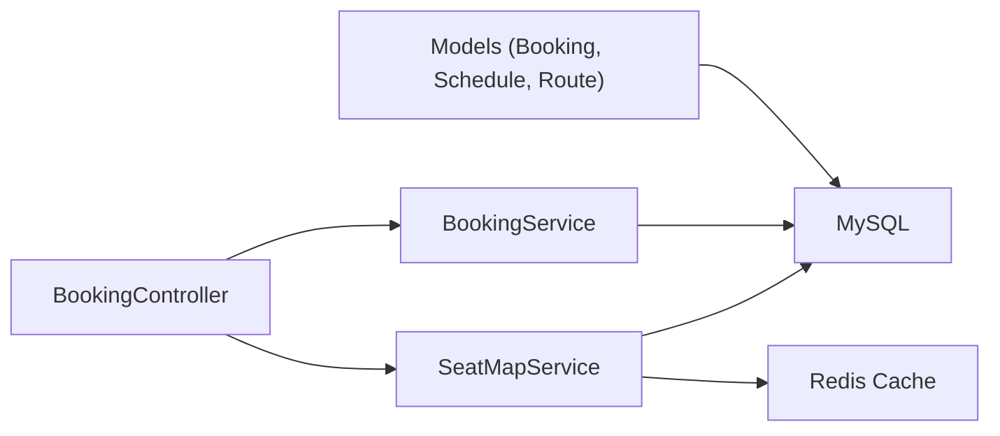

# Performance Optimization

<cite>
**Referenced Files in This Document**
- [DATABASE_OPTIMIZATION_GUIDE.md](file://DATABASE_OPTIMIZATION_GUIDE.md)
- [DATABASE_OPTIMIZATION_SUMMARY.md](file://DATABASE_OPTIMIZATION_SUMMARY.md)
- [README_DATABASE_OPTIMIZATION.md](file://README_DATABASE_OPTIMIZATION.md)
- [INDEX_STRATEGY_VISUAL_REFERENCE.md](file://INDEX_STRATEGY_VISUAL_REFERENCE.md)
- [QUERY_OPTIMIZATION_EXAMPLES.md](file://QUERY_OPTIMIZATION_EXAMPLES.md)
- [database.php](file://backend/config/database.php)
- [cache.php](file://backend/config/cache.php)
- [BookingController.php](file://backend/app/Http/Controllers/API/BookingController.php)
- [SeatMapService.php](file://backend/app/Services/SeatMapService.php)
- [Booking.php](file://backend/app/Models/Booking.php)
- [Schedule.php](file://backend/app/Models/Schedule.php)
- [Route.php](file://backend/app/Models/Route.php)
</cite>

## Table of Contents
1. Introduction
2. Project Structure
3. Core Components
4. Architecture Overview
5. Detailed Component Analysis
6. Dependency Analysis
7. Performance Considerations
8. Troubleshooting Guide
9. Conclusion
10. Appendices

## Introduction
This document provides a comprehensive performance optimization guide for SonyaBus, focusing on database indexing strategies, query optimization techniques, caching mechanisms, connection pooling, Redis integration patterns, N+1 prevention, eager loading best practices, transaction considerations, slow query identification, monitoring and profiling, scaling strategies (read/write splitting and sharding), benchmarking methodologies, capacity planning, and maintenance procedures. It synthesizes existing optimizations already present in the codebase with recommended enhancements to achieve high throughput and low latency under load.

## Project Structure
The backend is a Laravel application with:
- Controllers handling API endpoints
- Services encapsulating business logic and optimized queries
- Eloquent models defining relationships
- Configuration files for database and cache backends
- Documentation detailing index strategy, query examples, and visual references

**Diagram sources**
- [database.php:47-65](file://backend/config/database.php#L47-L65)
- [database.php:146-180](file://backend/config/database.php#L146-L180)
- [cache.php:18-79](file://backend/config/cache.php#L18-L79)
- [BookingController.php:19-59](file://backend/app/Http/Controllers/API/BookingController.php#L19-L59)
- [SeatMapService.php:194-244](file://backend/app/Services/SeatMapService.php#L194-L244)

**Section sources**
- [database.php:47-65](file://backend/config/database.php#L47-L65)
- [database.php:146-180](file://backend/config/database.php#L146-L180)
- [cache.php:18-79](file://backend/config/cache.php#L18-L79)

## Core Components
- Indexing Strategy: Comprehensive indexes across bookings, schedules, routes, buses, sms_configs, stations, tokens, users, promotions to accelerate common queries and reduce full table scans.
- Query Optimization: Eager loading to prevent N+1 queries; pagination and limits; selective column loading; efficient seat processing.
- Caching: Redis-backed cache store configured; temporary seat holds cached; potential for broader result caching.
- Connection Management: MySQL connection configuration; optional pool tuning guidance.
- Monitoring & Profiling: Slow query log enablement; EXPLAIN usage; K6-based load testing.

Key implementation touchpoints:
- BookingController uses eager loading and pagination for user booking history.
- SeatMapService selects minimal columns and caches temporary seat holds via Redis.
- Configurations define MySQL and Redis connections and cache stores.

**Section sources**
- [DATABASE_OPTIMIZATION_GUIDE.md:8-86](file://DATABASE_OPTIMIZATION_GUIDE.md#L8-L86)
- [DATABASE_OPTIMIZATION_GUIDE.md:90-180](file://DATABASE_OPTIMIZATION_GUIDE.md#L90-L180)
- [BookingController.php:42-59](file://backend/app/Http/Controllers/API/BookingController.php#L42-L59)
- [SeatMapService.php:16-47](file://backend/app/Services/SeatMapService.php#L16-L47)
- [SeatMapService.php:502-560](file://backend/app/Services/SeatMapService.php#L502-L560)
- [database.php:47-65](file://backend/config/database.php#L47-L65)
- [database.php:146-180](file://backend/config/database.php#L146-L180)
- [cache.php:18-79](file://backend/config/cache.php#L18-L79)

## Architecture Overview
The system leverages indexed MySQL queries and Redis caching to minimize database load and improve response times. Eager loading prevents N+1 query issues, while selective column selection reduces payload size. Temporary seat reservations are coordinated through Redis to avoid contention.

**Diagram sources**
- [BookingController.php:19-59](file://backend/app/Http/Controllers/API/BookingController.php#L19-L59)
- [BookingController.php:82-100](file://backend/app/Http/Controllers/API/BookingController.php#L82-L100)
- [SeatMapService.php:502-560](file://backend/app/Services/SeatMapService.php#L502-L560)
- [database.php:47-65](file://backend/config/database.php#L47-L65)
- [database.php:146-180](file://backend/config/database.php#L146-L180)
- [cache.php:18-79](file://backend/config/cache.php#L18-L79)

## Detailed Component Analysis

### Indexing Strategy
- Bookings: Single and composite indexes for user_id, schedule_id, status, passenger_email, passenger_phone, and combinations like (status, created_at), (user_id, created_at), (schedule_id, status), (status, payment_method). These optimize dashboard queries, user history, seat conflict checks, and revenue reports.
- Schedules: Indexes on route_id, departure_time, bus_id; composites (route_id, departure_time) and (bus_id, departure_time) for route availability and utilization.
- Routes: Indexes on departure_station_id, arrival_station_id; composite (departure_station_id, arrival_station_id) for specific route lookups.
- Buses: Index on coach_number.
- SMS_CONFIGS: Indexes on is_active and gateway_name.
- STATIONS: Full-text index on name for search.
- PERSONAL_ACCESS_TOKENS: Index on token.
- USERS/PROMOTIONS: Pre-existing unique indexes.

Performance impact includes significant reductions in query time and memory usage, enabling index-only scans where possible.

**Diagram sources**
- [DATABASE_OPTIMIZATION_GUIDE.md:8-86](file://DATABASE_OPTIMIZATION_GUIDE.md#L8-L86)
- [INDEX_STRATEGY_VISUAL_REFERENCE.md:101-163](file://INDEX_STRATEGY_VISUAL_REFERENCE.md#L101-L163)

**Section sources**
- [DATABASE_OPTIMIZATION_GUIDE.md:8-86](file://DATABASE_OPTIMIZATION_GUIDE.md#L8-L86)
- [INDEX_STRATEGY_VISUAL_REFERENCE.md:101-163](file://INDEX_STRATEGY_VISUAL_REFERENCE.md#L101-L163)

### Query Optimization Techniques
- Eager Loading: Prevents N+1 by preloading related entities (e.g., schedule.bus, route.departureStation, route.arrivalStation).
- Pagination & Limits: Reduces memory footprint and improves response times for large datasets.
- Selective Column Loading: Loads only necessary fields to reduce network and memory overhead.
- Efficient Seat Processing: Parses seat lists efficiently and avoids unnecessary computations.

Examples include dashboard queries and report generation that leverage eager loading and limits.

**Diagram sources**
- [DATABASE_OPTIMIZATION_GUIDE.md:90-180](file://DATABASE_OPTIMIZATION_GUIDE.md#L90-L180)
- [QUERY_OPTIMIZATION_EXAMPLES.md:196-365](file://QUERY_OPTIMIZATION_EXAMPLES.md#L196-L365)

**Section sources**
- [DATABASE_OPTIMIZATION_GUIDE.md:90-180](file://DATABASE_OPTIMIZATION_GUIDE.md#L90-L180)
- [QUERY_OPTIMIZATION_EXAMPLES.md:196-365](file://QUERY_OPTIMIZATION_EXAMPLES.md#L196-L365)

### Caching Mechanisms and Redis Integration
- Default Cache Store: Configured to use database driver by default, with Redis available as an alternative store.
- Redis Connections: Separate default and cache connections defined with retry/backoff settings.
- Seat Holds: Temporary seat reservations are stored in Redis with expiration to coordinate concurrent access and prevent double-booking.

Recommendations:
- Switch default cache to Redis for production to reduce database pressure.
- Cache frequently accessed reference data (stations, operators) using cache()->remember().
- Implement cache invalidation strategies when data changes.

**Diagram sources**
- [cache.php:18-79](file://backend/config/cache.php#L18-L79)
- [database.php:146-180](file://backend/config/database.php#L146-L180)
- [SeatMapService.php:502-560](file://backend/app/Services/SeatMapService.php#L502-L560)

**Section sources**
- [cache.php:18-79](file://backend/config/cache.php#L18-L79)
- [database.php:146-180](file://backend/config/database.php#L146-L180)
- [SeatMapService.php:502-560](file://backend/app/Services/SeatMapService.php#L502-L560)

### Database Connection Pooling
- Current Configuration: MySQL connection options include SSL CA attribute; no explicit pool settings are defined in the provided config.
- Optional Tuning: Guidance suggests adding pool parameters such as connections count and min idle for high-concurrency scenarios.

Best practices:
- Monitor connection usage and adjust pool sizes based on workload.
- Avoid persistent connections unless necessary; prefer short-lived pooled connections.
- Ensure proper timeout and retry policies to handle transient failures.

**Section sources**
- [database.php:47-65](file://backend/config/database.php#L47-L65)
- [DATABASE_OPTIMIZATION_GUIDE.md:305-321](file://DATABASE_OPTIMIZATION_GUIDE.md#L305-L321)

### N+1 Prevention and Eager Loading Best Practices
- Controllers and services consistently use eager loading to avoid N+1 queries.
- Example: User booking history loads schedule, bus, and route stations in a single query chain.
- Recommendation: Audit all list endpoints to ensure eager loading and pagination are applied.

**Diagram sources**
- [Booking.php:33-41](file://backend/app/Models/Booking.php#L33-L41)
- [Schedule.php:20-33](file://backend/app/Models/Schedule.php#L20-L33)
- [Route.php:26-39](file://backend/app/Models/Route.php#L26-L39)

**Section sources**
- [BookingController.php:42-59](file://backend/app/Http/Controllers/API/BookingController.php#L42-L59)
- [DATABASE_OPTIMIZATION_GUIDE.md:90-115](file://DATABASE_OPTIMIZATION_GUIDE.md#L90-L115)

### Database Transaction Optimization
- Transactions should wrap multi-step operations (e.g., seat hold validation, booking creation, payment invoice update) to ensure atomicity and consistency.
- Keep transactions short to minimize lock contention and deadlocks.
- Use appropriate isolation levels and retry logic for transient errors.

Guidance:
- Wrap critical sections in DB::transaction() blocks.
- Validate inputs before entering transactions.
- Log transaction boundaries for observability.

[No sources needed since this section provides general guidance]

### Slow Query Identification, Monitoring, and Profiling
- Enable MySQL slow query log to capture queries exceeding a threshold.
- Use EXPLAIN to analyze query plans and verify index usage.
- Leverage Laravel query logging in debug mode to inspect executed queries and bindings.
- Conduct load testing with K6 to validate performance under realistic traffic patterns.

**Diagram sources**
- [DATABASE_OPTIMIZATION_GUIDE.md:213-244](file://DATABASE_OPTIMIZATION_GUIDE.md#L213-L244)
- [DATABASE_OPTIMIZATION_GUIDE.md:344-354](file://DATABASE_OPTIMIZATION_GUIDE.md#L344-L354)

**Section sources**
- [DATABASE_OPTIMIZATION_GUIDE.md:213-244](file://DATABASE_OPTIMIZATION_GUIDE.md#L213-L244)
- [DATABASE_OPTIMIZATION_GUIDE.md:344-354](file://DATABASE_OPTIMIZATION_GUIDE.md#L344-L354)

### Scaling Strategies: Read/Write Splitting and Sharding
- Read/Write Splitting: Route read-heavy queries to replicas; write operations to primary. Implement middleware or service layer routing based on operation type.
- Sharding: Partition data horizontally by tenant or region to distribute load and storage. Ensure consistent hashing and rebalancing strategies.
- Caching Layer: Offload frequent reads to Redis to reduce database load.
- Queue Processing: Offload background tasks (SMS notifications, reports) to queues to decouple workloads.

[No sources needed since this section provides general guidance]

### Benchmarking Methodologies and Capacity Planning
- Benchmarking: Use K6 scenarios to simulate user flows (booking, search, admin dashboard) and measure latency, throughput, and error rates.
- Large Dataset Testing: Seed representative volumes and run load tests to identify bottlenecks.
- Capacity Planning: Track CPU, memory, I/O, and connection metrics; plan horizontal scaling and database upgrades based on observed growth trends.
- Maintenance: Regularly optimize tables, review unused indexes, and archive old data to maintain performance.

**Section sources**
- [DATABASE_OPTIMIZATION_GUIDE.md:239-244](file://DATABASE_OPTIMIZATION_GUIDE.md#L239-L244)
- [DATABASE_OPTIMIZATION_GUIDE.md:279-283](file://DATABASE_OPTIMIZATION_GUIDE.md#L279-L283)

## Dependency Analysis
The following diagram shows how controllers depend on services and models, which interact with the database and cache.

**Diagram sources**
- [BookingController.php:19-59](file://backend/app/Http/Controllers/API/BookingController.php#L19-L59)
- [SeatMapService.php:194-244](file://backend/app/Services/SeatMapService.php#L194-L244)
- [database.php:47-65](file://backend/config/database.php#L47-L65)
- [database.php:146-180](file://backend/config/database.php#L146-L180)

**Section sources**
- [BookingController.php:19-59](file://backend/app/Http/Controllers/API/BookingController.php#L19-L59)
- [SeatMapService.php:194-244](file://backend/app/Services/SeatMapService.php#L194-L244)

## Performance Considerations
- Prefer composite indexes for multi-column filters and ordering to maximize index coverage.
- Always apply pagination and limits to prevent memory exhaustion.
- Use selective column loading to reduce payload size.
- Cache immutable or infrequently changing data; implement cache invalidation on updates.
- Monitor connection pool usage and tune pool parameters for concurrency.
- Profile queries regularly and refactor to eliminate N+1 patterns.

[No sources needed since this section provides general guidance]

## Troubleshooting Guide
- Verify indexes exist and are used by running SHOW INDEXES and EXPLAIN on critical queries.
- Enable slow query log and review logs weekly to catch regressions.
- Inspect Laravel query logs in debug mode to detect unexpected queries.
- Validate Redis connectivity and cache hit ratios; ensure seat holds expire correctly.
- Roll back migrations if issues arise; confirm zero-downtime deployment practices.

**Section sources**
- [DATABASE_OPTIMIZATION_GUIDE.md:181-211](file://DATABASE_OPTIMIZATION_GUIDE.md#L181-L211)
- [DATABASE_OPTIMIZATION_GUIDE.md:213-244](file://DATABASE_OPTIMIZATION_GUIDE.md#L213-L244)
- [README_DATABASE_OPTIMIZATION.md:302-321](file://README_DATABASE_OPTIMIZATION.md#L302-L321)

## Conclusion
SonyaBus benefits from a robust indexing strategy, eager loading, selective column loading, and Redis-backed caching for temporary seat holds. With continued monitoring, profiling, and adherence to best practices—such as avoiding N+1 queries, applying pagination, and optimizing transactions—the system can sustain high throughput and low latency. Scaling via read/write splitting and sharding, combined with rigorous benchmarking and capacity planning, ensures long-term performance stability.

[No sources needed since this section summarizes without analyzing specific files]

## Appendices

### Key Reference Documents
- DATABASE_OPTIMIZATION_GUIDE.md: Comprehensive index strategy, query optimization, monitoring, and maintenance.
- DATABASE_OPTIMIZATION_SUMMARY.md: Executive summary, expected improvements, verification checklist.
- README_DATABASE_OPTIMIZATION.md: Quick start steps, success criteria, and important notes.
- INDEX_STRATEGY_VISUAL_REFERENCE.md: Visual execution flows and storage analysis.
- QUERY_OPTIMIZATION_EXAMPLES.md: Real-world code examples and performance comparisons.

**Section sources**
- [DATABASE_OPTIMIZATION_GUIDE.md:1-86](file://DATABASE_OPTIMIZATION_GUIDE.md#L1-L86)
- [DATABASE_OPTIMIZATION_SUMMARY.md:1-68](file://DATABASE_OPTIMIZATION_SUMMARY.md#L1-L68)
- [README_DATABASE_OPTIMIZATION.md:38-88](file://README_DATABASE_OPTIMIZATION.md#L38-L88)
- [INDEX_STRATEGY_VISUAL_REFERENCE.md:101-163](file://INDEX_STRATEGY_VISUAL_REFERENCE.md#L101-L163)
- [QUERY_OPTIMIZATION_EXAMPLES.md:196-365](file://QUERY_OPTIMIZATION_EXAMPLES.md#L196-L365)