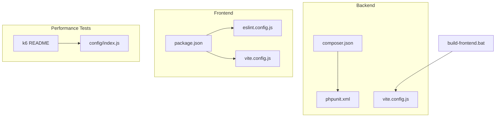
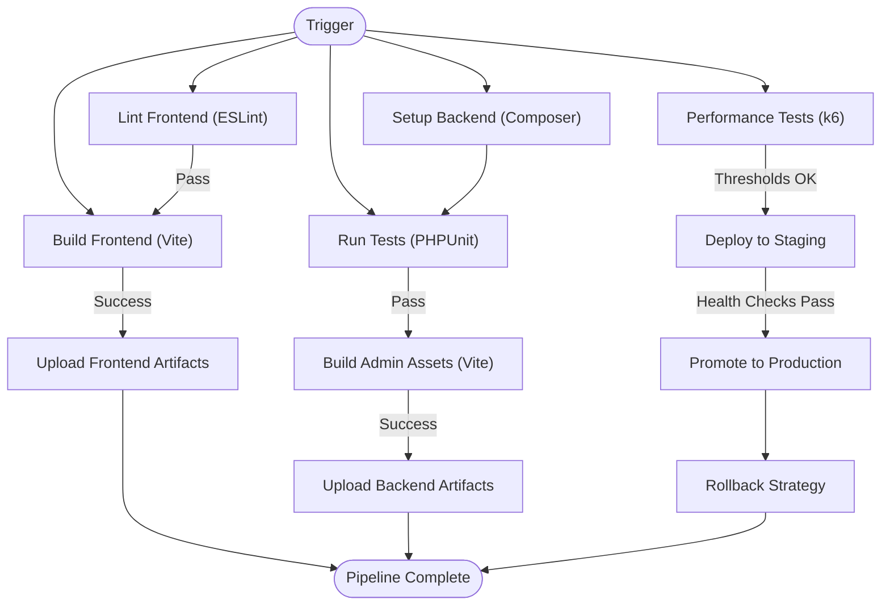
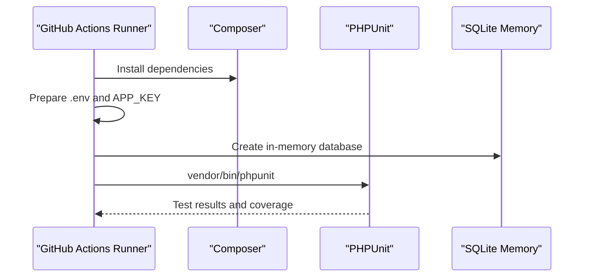
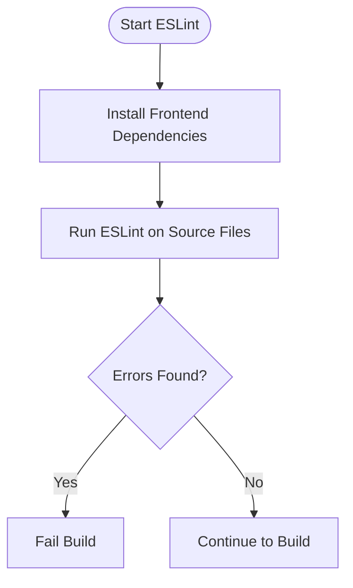
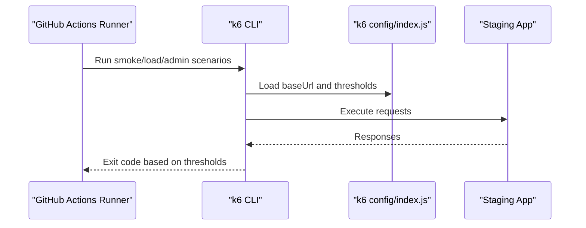
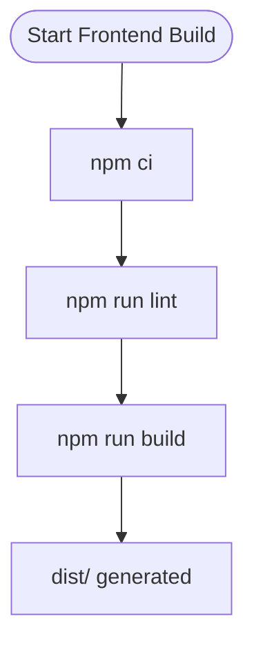
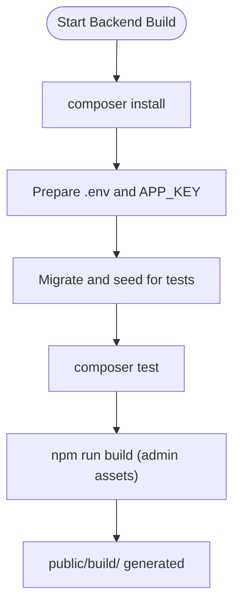
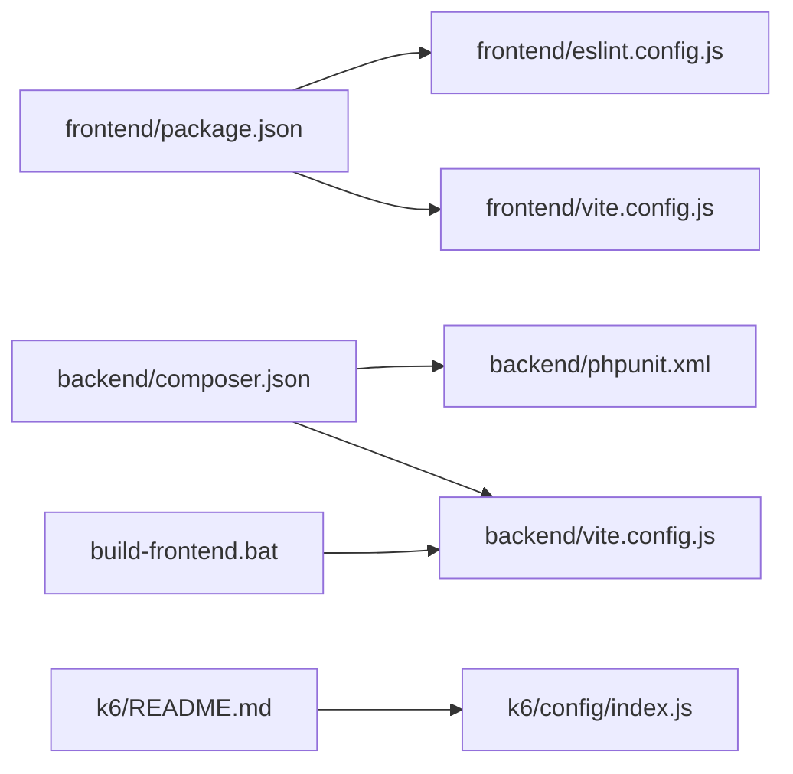

# CI/CD Pipeline

<cite>
**Referenced Files in This Document**   
- [backend/composer.json](file://backend/composer.json)
- [backend/phpunit.xml](file://backend/phpunit.xml)
- [backend/vite.config.js](file://backend/vite.config.js)
- [frontend/package.json](file://frontend/package.json)
- [frontend/eslint.config.js](file://frontend/eslint.config.js)
- [frontend/vite.config.js](file://frontend/vite.config.js)
- [k6/README.md](file://k6/README.md)
- [k6/config/index.js](file://k6/config/index.js)
- [build-frontend.bat](file://build-frontend.bat)
</cite>

## Table of Contents
1. [Introduction](#introduction)
2. [Project Structure](#project-structure)
3. [Core Components](#core-components)
4. [Architecture Overview](#architecture-overview)
5. [Detailed Component Analysis](#detailed-component-analysis)
6. [Dependency Analysis](#dependency-analysis)
7. [Performance Considerations](#performance-considerations)
8. [Troubleshooting Guide](#troubleshooting-guide)
9. [Conclusion](#conclusion)

## Introduction
This document defines the CI/CD pipeline for SonyaBus automation. It explains how to implement GitHub Actions workflows that run automated testing, build frontend and backend assets, execute code quality checks, perform performance tests with k6, manage artifacts, deploy to environment-specific targets, and support rollback strategies. It also provides debugging techniques for failed builds and example configurations for different deployment targets.

The project is a dual-stack application:
- Backend: Laravel (PHP 8.2+) with Vite for admin assets and PHPUnit for tests.
- Frontend: React + Vite with ESLint validation.
- Performance tests: k6 scenarios under the `k6` directory.

## Project Structure
At a high level, the repository contains:
- `backend/`: Laravel application, PHP dependencies, PHPUnit configuration, and Vite configuration for admin assets.
- `frontend/`: React application, Vite build configuration, ESLint configuration, and npm scripts.
- `k6/`: Performance test scenarios, shared configuration, flows, and helpers.
- Root-level helper scripts for local Windows builds.

**Diagram sources**
- [backend/composer.json:34-50](file://backend/composer.json#L34-L50)
- [backend/phpunit.xml:1-37](file://backend/phpunit.xml#L1-L37)
- [backend/vite.config.js:1-34](file://backend/vite.config.js#L1-L34)
- [frontend/package.json:6-10](file://frontend/package.json#L6-L10)
- [frontend/eslint.config.js:1-22](file://frontend/eslint.config.js#L1-L22)
- [frontend/vite.config.js:1-74](file://frontend/vite.config.js#L1-L74)
- [k6/README.md:1-135](file://k6/README.md#L1-L135)
- [k6/config/index.js:1-43](file://k6/config/index.js#L1-L43)
- [build-frontend.bat:1-34](file://build-frontend.bat#L1-L34)

**Section sources**
- [backend/composer.json:34-50](file://backend/composer.json#L34-L50)
- [backend/phpunit.xml:1-37](file://backend/phpunit.xml#L1-L37)
- [backend/vite.config.js:1-34](file://backend/vite.config.js#L1-L34)
- [frontend/package.json:6-10](file://frontend/package.json#L6-L10)
- [frontend/eslint.config.js:1-22](file://frontend/eslint.config.js#L1-L22)
- [frontend/vite.config.js:1-74](file://frontend/vite.config.js#L1-L74)
- [k6/README.md:1-135](file://k6/README.md#L1-L135)
- [k6/config/index.js:1-43](file://k6/config/index.js#L1-L43)
- [build-frontend.bat:1-34](file://build-frontend.bat#L1-L34)

## Core Components
This section outlines the core components that will be orchestrated by the CI/CD pipeline.

- Backend build and test:
  - Composer setup and dependency installation.
  - Environment preparation (`.env`, app key).
  - Database migrations and seeding for tests.
  - PHPUnit execution via composer script.
  - Admin asset build using Vite.

- Frontend build and lint:
  - npm install and Vite production build.
  - ESLint validation on source files.

- Performance testing:
  - k6 scenario execution against a target URL.
  - Thresholds defined in shared configuration.

- Artifacts:
  - Backend compiled assets (`public/build`).
  - Frontend build output (`dist`).
  - Test reports (PHPUnit XML, k6 JSON).

**Section sources**
- [backend/composer.json:34-50](file://backend/composer.json#L34-L50)
- [backend/phpunit.xml:1-37](file://backend/phpunit.xml#L1-L37)
- [backend/vite.config.js:1-34](file://backend/vite.config.js#L1-L34)
- [frontend/package.json:6-10](file://frontend/package.json#L6-L10)
- [frontend/eslint.config.js:1-22](file://frontend/eslint.config.js#L1-L22)
- [k6/README.md:38-65](file://k6/README.md#L38-L65)
- [k6/config/index.js:24-42](file://k6/config/index.js#L24-L42)

## Architecture Overview
The CI/CD pipeline consists of multiple jobs running in parallel where possible:

- Lint and Build Frontend:
  - Install dependencies.
  - Run ESLint.
  - Build production assets with Vite.

- Backend Test and Build:
  - Install PHP dependencies.
  - Prepare environment variables and database.
  - Run PHPUnit tests.
  - Build admin assets with Vite.

- Performance Testing:
  - Execute k6 scenarios against the deployed or staging endpoint.
  - Enforce thresholds from shared configuration.

- Artifact Management:
  - Upload build outputs and test reports.

- Deployment:
  - Deploy to staging or production based on branch and tags.
  - Rollback strategy using previous artifact versions.

[No sources needed since this diagram shows conceptual workflow, not actual code structure]

## Detailed Component Analysis

### GitHub Actions Workflow Setup
Recommended workflow structure:
- `.github/workflows/ci.yml`: Main CI job matrix for frontend and backend.
- `.github/workflows/deploy-staging.yml`: Deploys to staging on push to develop or feature branches.
- `.github/workflows/deploy-production.yml`: Deploys to production on tags or main branch.

Key steps:
- Set up Node.js and PHP environments.
- Cache dependencies (npm, Composer).
- Run ESLint and Vite build for frontend.
- Run PHPUnit and Vite build for backend admin assets.
- Execute k6 scenarios against a staging URL.
- Upload artifacts and publish test reports.

Example job stages:
- lint-and-build-frontend
- test-backend
- build-admin-assets
- performance-tests
- deploy-staging
- deploy-production

[No sources needed since this section provides general guidance]

### Integration of PHPUnit Tests
- PHPUnit is configured via `phpunit.xml` with Unit and Feature test suites.
- The backend composer script `test` clears config and runs tests.
- In CI, set environment variables for testing (database, cache, queue, mail).
- Use SQLite in-memory database as configured.

**Diagram sources**
- [backend/composer.json:47-50](file://backend/composer.json#L47-L50)
- [backend/phpunit.xml:1-37](file://backend/phpunit.xml#L1-L37)

**Section sources**
- [backend/composer.json:47-50](file://backend/composer.json#L47-L50)
- [backend/phpunit.xml:1-37](file://backend/phpunit.xml#L1-L37)

### Integration of ESLint Validation
- ESLint is configured in `frontend/eslint.config.js` with recommended rules for React hooks and refresh.
- The npm script `lint` runs ESLint across JS/JSX files.
- In CI, fail the build if ESLint reports errors.

**Diagram sources**
- [frontend/eslint.config.js:1-22](file://frontend/eslint.config.js#L1-L22)
- [frontend/package.json:6-10](file://frontend/package.json#L6-L10)

**Section sources**
- [frontend/eslint.config.js:1-22](file://frontend/eslint.config.js#L1-L22)
- [frontend/package.json:6-10](file://frontend/package.json#L6-L10)

### Integration of K6 Performance Tests
- k6 scenarios are documented in `k6/README.md`.
- Shared configuration includes base URL and thresholds.
- In CI, run selected scenarios against a staging URL and enforce thresholds.

**Diagram sources**
- [k6/README.md:38-65](file://k6/README.md#L38-L65)
- [k6/config/index.js:1-43](file://k6/config/index.js#L1-L43)

**Section sources**
- [k6/README.md:38-65](file://k6/README.md#L38-L65)
- [k6/config/index.js:1-43](file://k6/config/index.js#L1-L43)

### Build Processes for Frontend (Vite)
- Frontend uses Vite with React plugin.
- Scripts include dev, build, lint, preview.
- In CI, run `npm ci`, then `npm run build` to produce optimized static assets.

**Diagram sources**
- [frontend/package.json:6-10](file://frontend/package.json#L6-L10)
- [frontend/vite.config.js:1-74](file://frontend/vite.config.js#L1-L74)

**Section sources**
- [frontend/package.json:6-10](file://frontend/package.json#L6-L10)
- [frontend/vite.config.js:1-74](file://frontend/vite.config.js#L1-L74)

### Build Processes for Backend (Laravel + Vite)
- Backend installs Composer dependencies and prepares environment.
- Runs PHPUnit tests.
- Builds admin assets using Vite via `backend/vite.config.js`.

**Diagram sources**
- [backend/composer.json:34-50](file://backend/composer.json#L34-L50)
- [backend/phpunit.xml:1-37](file://backend/phpunit.xml#L1-L37)
- [backend/vite.config.js:1-34](file://backend/vite.config.js#L1-L34)

**Section sources**
- [backend/composer.json:34-50](file://backend/composer.json#L34-L50)
- [backend/phpunit.xml:1-37](file://backend/phpunit.xml#L1-L37)
- [backend/vite.config.js:1-34](file://backend/vite.config.js#L1-L34)

### Artifact Management
- Upload frontend build artifacts (`frontend/dist`) for deployment.
- Upload backend admin assets (`backend/public/build`) for deployment.
- Publish test reports:
  - PHPUnit XML report.
  - k6 JSON metrics.

Recommendations:
- Use GitHub Actions `actions/upload-artifact` and `actions/download-artifact`.
- Tag artifacts with commit SHA and branch name.
- Archive logs for failed jobs.

[No sources needed since this section provides general guidance]

### Environment-Specific Deployments
- Staging:
  - Triggered by pushes to develop or feature branches.
  - Deploys latest build artifacts.
  - Runs health checks and smoke tests.

- Production:
  - Triggered by tags or protected branches.
  - Requires manual approval.
  - Uses stable artifacts and enforces stricter thresholds.

Environment variables:
- API base URLs for frontend and k6.
- Database credentials and secrets.
- Deployment keys and tokens.

[No sources needed since this section provides general guidance]

### Rollback Strategies
- Keep previous successful artifacts tagged with version or commit SHA.
- On failure detection post-deploy, trigger rollback to last known good artifact.
- Automate rollback via workflow re-run or dedicated rollback job.

[No sources needed since this section provides general guidance]

### Example Pipeline Configurations for Different Targets
- Local Windows build helper:
  - `build-frontend.bat` demonstrates installing dependencies and building assets using a specific Node path.

- CI examples:
  - Matrix strategy for Node and PHP versions.
  - Separate jobs for lint, build, test, perf, deploy.
  - Conditional steps based on branch and tags.

[No sources needed since this section provides general guidance]

## Dependency Analysis
The following diagram maps key dependencies between components used in the CI/CD pipeline.

**Diagram sources**
- [frontend/package.json:6-10](file://frontend/package.json#L6-L10)
- [frontend/eslint.config.js:1-22](file://frontend/eslint.config.js#L1-L22)
- [frontend/vite.config.js:1-74](file://frontend/vite.config.js#L1-L74)
- [backend/composer.json:34-50](file://backend/composer.json#L34-L50)
- [backend/phpunit.xml:1-37](file://backend/phpunit.xml#L1-L37)
- [backend/vite.config.js:1-34](file://backend/vite.config.js#L1-L34)
- [k6/README.md:1-135](file://k6/README.md#L1-L135)
- [k6/config/index.js:1-43](file://k6/config/index.js#L1-L43)
- [build-frontend.bat:1-34](file://build-frontend.bat#L1-L34)

**Section sources**
- [frontend/package.json:6-10](file://frontend/package.json#L6-L10)
- [frontend/eslint.config.js:1-22](file://frontend/eslint.config.js#L1-L22)
- [frontend/vite.config.js:1-74](file://frontend/vite.config.js#L1-L74)
- [backend/composer.json:34-50](file://backend/composer.json#L34-L50)
- [backend/phpunit.xml:1-37](file://backend/phpunit.xml#L1-L37)
- [backend/vite.config.js:1-34](file://backend/vite.config.js#L1-L34)
- [k6/README.md:1-135](file://k6/README.md#L1-L135)
- [k6/config/index.js:1-43](file://k6/config/index.js#L1-L43)
- [build-frontend.bat:1-34](file://build-frontend.bat#L1-L34)

## Performance Considerations
- Cache dependencies:
  - npm cache for frontend.
  - Composer cache for backend.
- Parallelize independent jobs:
  - Lint frontend while setting up backend.
  - Run k6 after staging deploy.
- Optimize builds:
  - Use production flags for Vite.
  - Minimize test data size.
- Monitor resource usage:
  - Increase runner concurrency if necessary.
  - Split large test suites into smaller jobs.

[No sources needed since this section provides general guidance]

## Troubleshooting Guide
Common issues and resolutions:

- Frontend build fails due to ESLint:
  - Review ESLint configuration and fix reported issues.
  - Ensure Node version matches project requirements.

- Backend tests fail due to environment:
  - Verify `.env` variables and database connection.
  - Check PHPUnit configuration for correct test suite paths.

- k6 tests fail due to unreachable target:
  - Confirm BASE_URL points to a valid staging endpoint.
  - Validate thresholds and adjust if necessary.

- Asset build mismatches:
  - Ensure Vite builds both frontend and backend admin assets.
  - Compare built outputs with expected directories.

Debugging techniques:
- Enable verbose logging in CI jobs.
- Download artifacts from failed runs.
- Reproduce locally using provided scripts (e.g., `build-frontend.bat`).

**Section sources**
- [frontend/eslint.config.js:1-22](file://frontend/eslint.config.js#L1-L22)
- [backend/phpunit.xml:1-37](file://backend/phpunit.xml#L1-L37)
- [k6/README.md:38-65](file://k6/README.md#L38-L65)
- [build-frontend.bat:1-34](file://build-frontend.bat#L1-L34)

## Conclusion
This CI/CD pipeline documentation outlines how to automate testing, building, and deployment for SonyaBus. By integrating PHPUnit, ESLint, and k6 within GitHub Actions, you can ensure code quality, functional correctness, and performance stability across environments. Proper artifact management, environment-specific deployments, and rollback strategies provide reliability and safety for continuous delivery.

[No sources needed since this section summarizes without analyzing specific files]