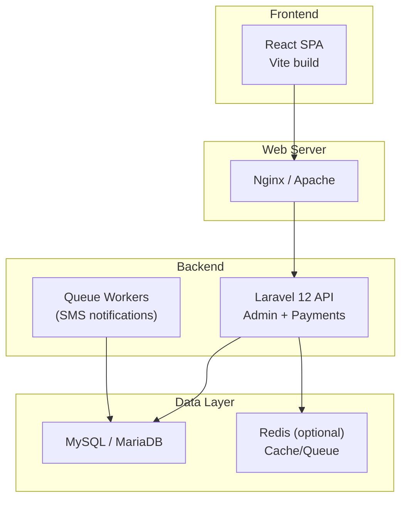
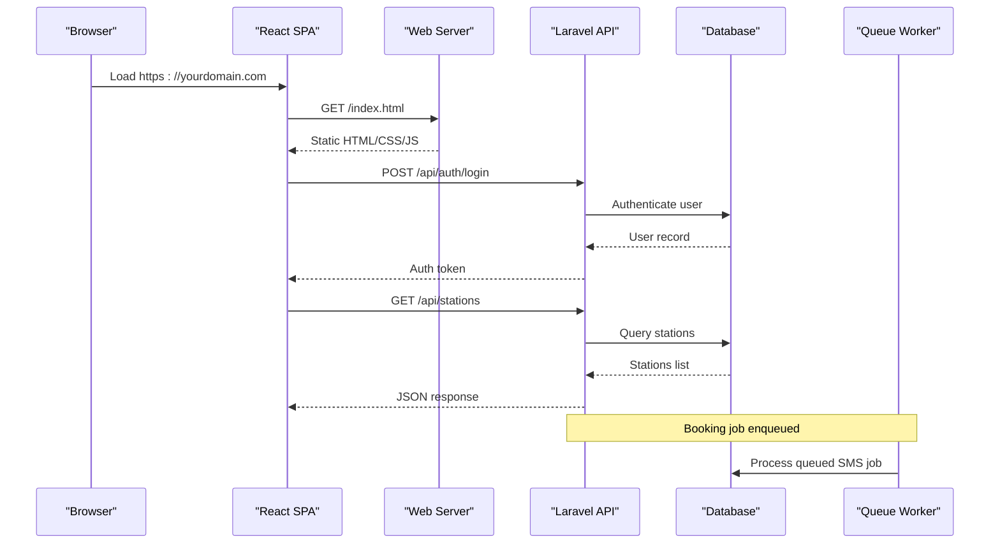
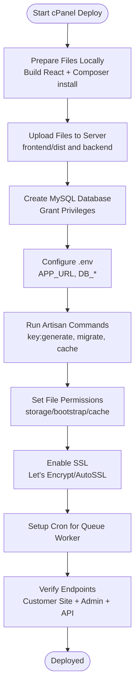
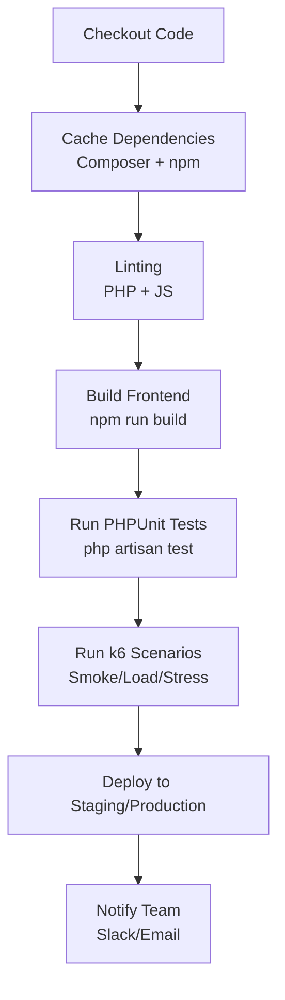
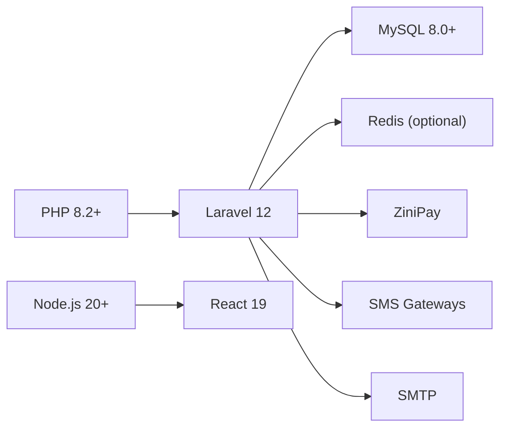

# Deployment & DevOps

<cite>
**Referenced Files in This Document**
- [README.md](file://README.md)
- [CPANEL_DEPLOYMENT_GUIDE.md](file://CPANEL_DEPLOYMENT_GUIDE.md)
- [documentation/index.html](file://documentation/index.html)
- [backend/config/app.php](file://backend/config/app.php)
- [backend/config/database.php](file://backend/config/database.php)
- [backend/config/queue.php](file://backend/config/queue.php)
- [backend/app/Services/EnvFileWriter.php](file://backend/app/Services/EnvFileWriter.php)
- [k6/README.md](file://k6/README.md)
- [k6/scenarios/homepage_load.js](file://k6/scenarios/homepage_load.js)
- [k6/scenarios/admin_dashboard.js](file://k6/scenarios/admin_dashboard.js)
- [SECURITY_IMPLEMENTATION_GUIDE.md](file://SECURITY_IMPLEMENTATION_GUIDE.md)
- [build-release.ps1](file://build-release.ps1)
- [CODECANYON_RELEASE_GUIDE.md](file://CODECANYON_RELEASE_GUIDE.md)
</cite>

## Update Summary
**Changes Made**
- Removed all references to legacy `sonyabus-codecanyon-v1.0.0` directory structure
- Updated build process documentation to reflect modern Node.js 20+ and Vite 8 requirements
- Enhanced security section with current EnvFileWriter path traversal protection
- Simplified repository structure documentation to match current layout
- Updated CodeCanyon release procedures to reflect current packaging script

## Table of Contents
1. [Introduction](#introduction)
2. [Project Structure](#project-structure)
3. [Core Components](#core-components)
4. [Architecture Overview](#architecture-overview)
5. [Detailed Component Analysis](#detailed-component-analysis)
6. [Dependency Analysis](#dependency-analysis)
7. [Performance Considerations](#performance-considerations)
8. [Troubleshooting Guide](#troubleshooting-guide)
9. [Conclusion](#conclusion)
10. [Appendices](#appendices)

## Introduction
This document provides production-grade deployment and DevOps guidance for SonyaBus, a Laravel 12 backend API with a React 19 customer SPA and an admin dashboard. It covers:
- Production deployment strategies for cPanel shared hosting, VPS servers, and cloud platforms
- CI/CD pipeline setup, automated testing integration, and build processes
- Environment configuration, SSL certificate setup, and web server configuration (Nginx/Apache)
- Monitoring solutions, backup strategies, disaster recovery procedures, and scaling considerations for high-traffic deployments

SonyaBus is designed to run on modern PHP and MySQL/MariaDB stacks, with optional Redis for caching and queues, and supports both Apache and Nginx.

## Project Structure
At a high level, the project consists of:
- Backend: Laravel 12 API, admin routes, payment callbacks, queue jobs, and services
- Frontend: React 19 SPA built with Vite, served as static files
- Documentation and guides for installation, environment variables, and web server configuration
- Performance tests using k6 scenarios for load, stress, soak, and smoke testing

**Diagram sources**
- [README.md:28-43](file://README.md#L28-L43)
- [documentation/index.html:738-778](file://documentation/index.html#L738-L778)

**Section sources**
- [README.md:28-43](file://README.md#L28-L43)
- [documentation/index.html:738-778](file://documentation/index.html#L738-L778)

## Core Components
Key runtime components that affect deployment and operations:
- Application configuration (app URL, frontend URL, maintenance mode)
- Database connections (MySQL/MariaDB, PostgreSQL, SQL Server, SQLite)
- Queue system (database-backed by default; supports Redis/SQS/Beanstalkd)
- Environment file writer with enhanced path traversal protection

Operational implications:
- APP_URL must match the backend domain used by the React app
- SESSION_DRIVER=database requires sessions table migration
- QUEUE_CONNECTION=database requires a worker process or cron-based polling
- ENVATO_SKIP_VERIFY can be set for local development but should remain false in production

**Section sources**
- [backend/config/app.php:42-62](file://backend/config/app.php#L42-L62)
- [backend/config/database.php:47-85](file://backend/config/database.php#L47-L85)
- [backend/config/queue.php:16-45](file://backend/config/queue.php#L16-L45)
- [backend/app/Services/EnvFileWriter.php:10-41](file://backend/app/Services/EnvFileWriter.php#L10-L41)

## Architecture Overview
The recommended production architecture separates the React SPA and Laravel API into distinct domains/subdomains:
- Customer site: React SPA served from frontend/dist
- Backend API: Laravel public directory handling API, admin, and payment endpoints
- Web server: Nginx or Apache configured to serve static assets and proxy PHP requests
- Data layer: MySQL/MariaDB primary database; Redis optionally for cache and queues
- Background processing: Queue workers for SMS notifications and other async tasks

**Diagram sources**
- [CPANEL_DEPLOYMENT_GUIDE.md:16-31](file://CPANEL_DEPLOYMENT_GUIDE.md#L16-L31)
- [documentation/index.html:738-778](file://documentation/index.html#L738-L778)
- [backend/config/queue.php:16-45](file://backend/config/queue.php#L16-L45)

## Detailed Component Analysis

### cPanel Hosting Deployment Strategy
Recommended layout:
- Main domain serves React SPA from frontend/dist
- Subdomain serves Laravel API from backend/public
- Two separate SSL certificates for each domain/subdomain
- Cron job to run queue worker for SMS notifications

Key steps:
- Build React locally and upload dist contents to main domain root
- Install Laravel dependencies and configure .env on server
- Create MySQL database and grant privileges
- Set PHP version and required extensions
- Generate application key, run migrations, and cache config/routes/views
- Configure storage link and permissions
- Enable SSL via Let's Encrypt or AutoSSL
- Set up queue worker via cron

**Diagram sources**
- [CPANEL_DEPLOYMENT_GUIDE.md:54-107](file://CPANEL_DEPLOYMENT_GUIDE.md#L54-L107)
- [CPANEL_DEPLOYMENT_GUIDE.md:109-179](file://CPANEL_DEPLOYMENT_GUIDE.md#L109-L179)
- [CPANEL_DEPLOYMENT_GUIDE.md:182-299](file://CPANEL_DEPLOYMENT_GUIDE.md#L182-L299)
- [CPANEL_DEPLOYMENT_GUIDE.md:301-345](file://CPANEL_DEPLOYMENT_GUIDE.md#L301-L345)

**Section sources**
- [CPANEL_DEPLOYMENT_GUIDE.md:16-31](file://CPANEL_DEPLOYMENT_GUIDE.md#L16-L31)
- [CPANEL_DEPLOYMENT_GUIDE.md:35-51](file://CPANEL_DEPLOYMENT_GUIDE.md#L35-L51)
- [CPANEL_DEPLOYMENT_GUIDE.md:54-107](file://CPANEL_DEPLOYMENT_GUIDE.md#L54-L107)
- [CPANEL_DEPLOYMENT_GUIDE.md:109-179](file://CPANEL_DEPLOYMENT_GUIDE.md#L109-L179)
- [CPANEL_DEPLOYMENT_GUIDE.md:182-299](file://CPANEL_DEPLOYMENT_GUIDE.md#L182-L299)
- [CPANEL_DEPLOYMENT_GUIDE.md:301-345](file://CPANEL_DEPLOYMENT_GUIDE.md#L301-L345)
- [CPANEL_DEPLOYMENT_GUIDE.md:349-368](file://CPANEL_DEPLOYMENT_GUIDE.md#L349-L368)
- [CPANEL_DEPLOYMENT_GUIDE.md:386-410](file://CPANEL_DEPLOYMENT_GUIDE.md#L386-L410)
- [CPANEL_DEPLOYMENT_GUIDE.md:413-451](file://CPANEL_DEPLOYMENT_GUIDE.md#L413-L451)
- [CPANEL_DEPLOYMENT_GUIDE.md:454-481](file://CPANEL_DEPLOYMENT_GUIDE.md#L454-L481)

### VPS and Cloud Platforms Deployment Strategy
For VPS/cloud servers (e.g., AWS EC2, DigitalOcean Droplet):
- Use Nginx or Apache with PHP-FPM
- Point backend domain to backend/public and frontend domain to frontend/dist
- Install and configure MySQL/MariaDB and optionally Redis
- Run queue workers as systemd services or supervisor-managed processes
- Use Certbot for SSL automation

Environment configuration highlights:
- APP_URL must match the backend domain
- APP_FRONTEND_URL points to the React SPA domain
- SESSION_DRIVER=database requires sessions table
- QUEUE_CONNECTION=database requires worker process or cron

Web server configuration references:
- Nginx server blocks for React SPA and Laravel API
- Apache .htaccess rules for Laravel routing

Security notes:
- Restrict SSH access to specific IPs
- Open only necessary ports (80, 443, 22)
- Use firewall rules to limit database access to localhost or RDS security group

**Section sources**
- [README.md:84-132](file://README.md#L84-L132)
- [documentation/index.html:738-778](file://documentation/index.html#L738-L778)
- [SECURITY_IMPLEMENTATION_GUIDE.md:763-819](file://SECURITY_IMPLEMENTATION_GUIDE.md#L763-L819)

### CI/CD Pipeline Setup and Automated Testing Integration
Recommended pipeline stages:
- Checkout code
- Cache dependencies (Composer and npm)
- Lint and static analysis (PHPStan/Psalm, ESLint)
- Build frontend (npm run build)
- Run PHPUnit tests (php artisan test)
- Run k6 performance tests against staging
- Deploy artifacts to production (blue/green or rolling updates)

Automated testing:
- Unit and feature tests via PHPUnit
- Performance tests via k6 scenarios (smoke, load, stress, soak, spike)

Build processes:
- Backend: composer install --no-dev --optimize-autoloader
- Frontend: npm install && npm run build

**Diagram sources**
- [README.md:193-209](file://README.md#L193-L209)
- [k6/README.md:46-93](file://k6/README.md#L46-L93)

**Section sources**
- [README.md:193-209](file://README.md#L193-L209)
- [k6/README.md:46-93](file://k6/README.md#L46-L93)

### Environment Configuration
Critical environment variables:
- APP_NAME, APP_ENV, APP_DEBUG, APP_URL, APP_FRONTEND_URL
- DB_* connection settings
- SESSION_DRIVER, CACHE_STORE, QUEUE_CONNECTION
- MAIL_* SMTP settings
- ZINIPAY_API_KEY, ZINIPAY_BASE_URL
- SMS gateway settings (via admin or .env)

Frontend environment variables:
- VITE_API_BASE_URL
- VITE_ZINIPAY_API_KEY

Security considerations:
- Never expose .env publicly
- Disable APP_DEBUG in production
- Validate environment keys and paths (EnvFileWriter protects against path traversal)

**Section sources**
- [documentation/index.html:703-735](file://documentation/index.html#L703-L735)
- [backend/config/app.php:42-62](file://backend/config/app.php#L42-L62)
- [backend/app/Services/EnvFileWriter.php:10-41](file://backend/app/Services/EnvFileWriter.php#L10-L41)

### SSL Certificate Setup
Options:
- cPanel Let's Encrypt/AutoSSL for shared hosting
- Certbot for VPS/cloud platforms
- Ensure HTTPS redirects are enforced for all domains/subdomains

Verification:
- Confirm SSL status for both customer domain and API subdomain
- Rebuild React app if it was built with HTTP URLs

**Section sources**
- [CPANEL_DEPLOYMENT_GUIDE.md:315-324](file://CPANEL_DEPLOYMENT_GUIDE.md#L315-L324)
- [SECURITY_IMPLEMENTATION_GUIDE.md:763-819](file://SECURITY_IMPLEMENTATION_GUIDE.md#L763-L819)

### Web Server Configuration (Nginx/Apache)
Nginx:
- Serve React SPA from frontend/dist with try_files fallback to index.html
- Proxy PHP requests to PHP-FPM for backend/public
- Deny access to hidden files except well-known

Apache:
- Ensure mod_rewrite is enabled
- AllowOverride All for document root
- Use Laravel's public/.htaccess for routing

**Section sources**
- [documentation/index.html:738-778](file://documentation/index.html#L738-L778)

### Monitoring Solutions
Recommendations:
- Centralized logging (ELK stack or cloud-native logging)
- Metrics collection (Prometheus + Grafana)
- Uptime monitoring (UptimeRobot, Pingdom)
- Error tracking (Sentry, Bugsnag)
- Queue monitoring (Laravel Horizon if using Redis)

[No sources needed since this section provides general guidance]

### Backup Strategies and Disaster Recovery
Backup strategy:
- Daily database backups (mysqldump or cloud snapshots)
- Periodic file backups (uploads, storage/app/public)
- Version control for code and configuration templates

Disaster recovery:
- Restore database from latest backup
- Rebuild application from version control
- Verify SSL certificates and DNS records
- Test critical flows (login, booking, payments)

[No sources needed since this section provides general guidance]

### Scaling Considerations for High-Traffic Deployments
Horizontal scaling:
- Multiple application servers behind a load balancer
- Stateless design with external session store (Redis)
- External cache (Redis) for sessions and application cache
- Queue workers scaled independently

Database scaling:
- Read replicas for reporting queries
- Connection pooling (ProxySQL, PgBouncer for PostgreSQL)
- Index optimization and query tuning

Frontend scaling:
- CDN for static assets
- Edge caching for public APIs where appropriate

[No sources needed since this section provides general guidance]

## Dependency Analysis
Runtime dependencies:
- PHP 8.2+ with required extensions
- MySQL 8.0+ or MariaDB 10.6+
- Node.js 20+ for frontend build (Vite 8 compatible)
- Composer 2.x for backend dependencies
- Optional Redis for cache and queues

External integrations:
- ZiniPay payment gateway
- SMS gateways (SMS.NET.BD, BulkSmsBD, custom)
- Email providers (SMTP)

**Diagram sources**
- [README.md:28-43](file://README.md#L28-L43)
- [CPANEL_DEPLOYMENT_GUIDE.md:35-51](file://CPANEL_DEPLOYMENT_GUIDE.md#L35-L51)

**Section sources**
- [README.md:28-43](file://README.md#L28-L43)
- [CPANEL_DEPLOYMENT_GUIDE.md:35-51](file://CPANEL_DEPLOYMENT_GUIDE.md#L35-L51)

## Performance Considerations
- Use database-backed sessions and cache for multi-node deployments
- Enable opcode caching (OPcache) and consider Redis for cache/queues
- Optimize database queries and add indexes where necessary
- Use CDN for static assets and consider edge caching for read-heavy APIs
- Monitor queue backlog and scale workers accordingly

[No sources needed since this section provides general guidance]

## Troubleshooting Guide
Common issues and resolutions:
- Blank page or 500 errors on Laravel: check logs, permissions, APP_KEY, PHP version/extensions
- Customer site shows UI but no data: verify VITE_API_BASE_URL and CORS settings
- React route refresh breaks: ensure .htaccess or Nginx try_files rule is present
- Admin login works locally but not on server: confirm SESSION_DRIVER=database and sessions table exists
- Database connection error: verify credentials and host (localhost vs 127.0.0.1)
- Payment callback fails: ensure HTTPS and correct callback URLs on API subdomain

**Section sources**
- [CPANEL_DEPLOYMENT_GUIDE.md:413-451](file://CPANEL_DEPLOYMENT_GUIDE.md#L413-L451)

## Conclusion
SonyaBus is designed for robust production deployments across shared hosting, VPS, and cloud platforms. By following the recommended architecture, environment configuration, and operational practices outlined in this document, teams can achieve reliable, secure, and scalable deployments. Integrating CI/CD pipelines, automated testing, and comprehensive monitoring ensures consistent delivery and rapid incident response.

[No sources needed since this section summarizes without analyzing specific files]

## Appendices

### Quick Reference URLs
- Customer booking: https://yourdomain.com
- Admin dashboard: https://api.yourdomain.com/admin
- API base: https://api.yourdomain.com/api
- Health check: https://api.yourdomain.com/up
- Payment callback: https://api.yourdomain.com/payment/callback

**Section sources**
- [CPANEL_DEPLOYMENT_GUIDE.md:484-493](file://CPANEL_DEPLOYMENT_GUIDE.md#L484-L493)

### Performance Testing Scenarios
- Smoke test: single full booking flow
- Load test: realistic customer traffic
- Stress test: ramp to higher concurrency
- Soak test: steady load over time
- Spike test: sudden surge in users

**Section sources**
- [k6/README.md:46-93](file://k6/README.md#L46-L93)
- [k6/scenarios/homepage_load.js:1-24](file://k6/scenarios/homepage_load.js#L1-L24)
- [k6/scenarios/admin_dashboard.js:1-13](file://k6/scenarios/admin_dashboard.js#L1-L13)

### Modern Build Processes
The current build system uses modern tooling:
- Node.js 20+ with Vite 8 for frontend builds
- PowerShell-based release packaging script
- Clean separation between development and production builds

Release packaging:
- Automated ZIP creation excluding sensitive files
- Proper exclusion of vendor/, node_modules/, and .env files
- Validation checklist for pre-submission

**Section sources**
- [build-release.ps1:1-150](file://build-release.ps1#L1-L150)
- [CODECANYON_RELEASE_GUIDE.md:218-270](file://CODECANYON_RELEASE_GUIDE.md#L218-L270)

### Security Enhancements
Enhanced security features include:
- Path traversal prevention in EnvFileWriter
- MIME-based file validation
- Rate limiting on authentication endpoints
- CSRF protection on state-changing routes
- License guard middleware for purchase verification

**Section sources**
- [backend/app/Services/EnvFileWriter.php:10-41](file://backend/app/Services/EnvFileWriter.php#L10-L41)
- [SECURITY_IMPLEMENTATION_GUIDE.md:763-819](file://SECURITY_IMPLEMENTATION_GUIDE.md#L763-L819)