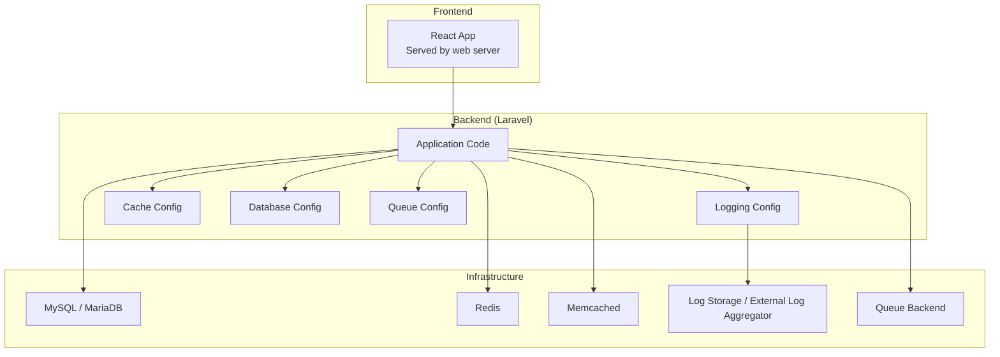
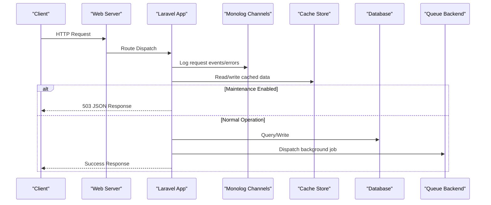
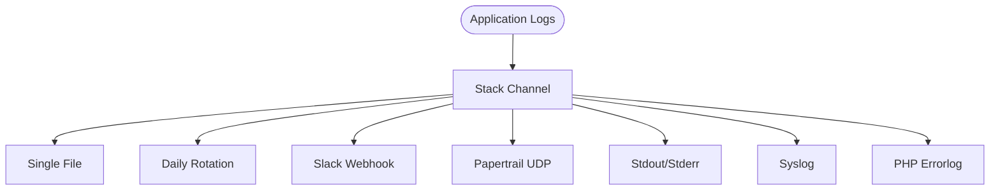
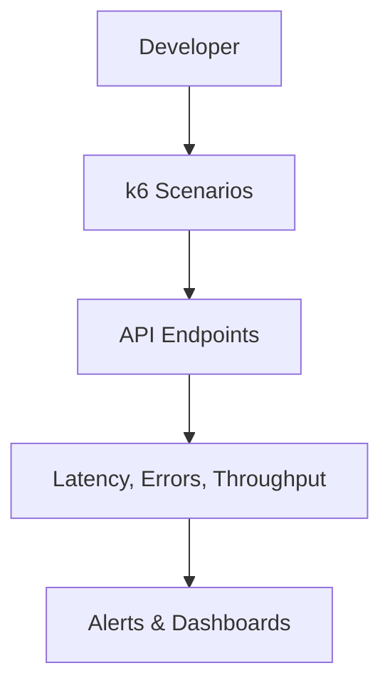
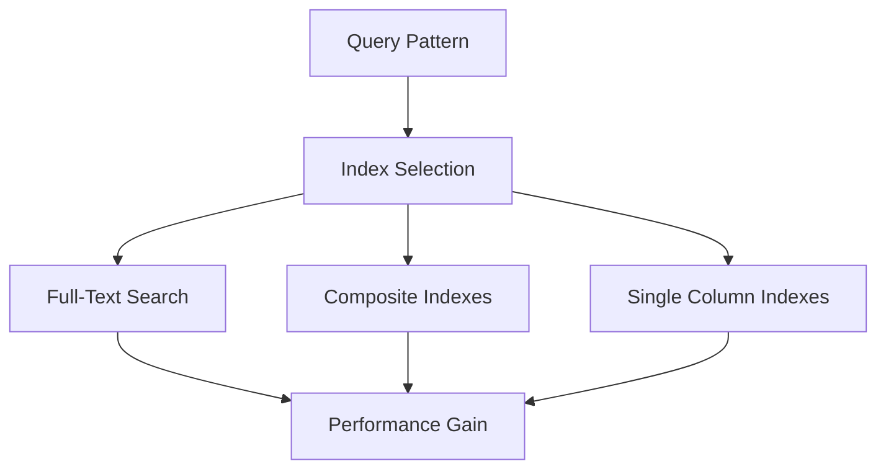
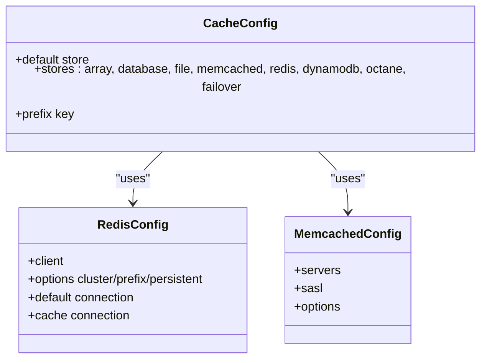
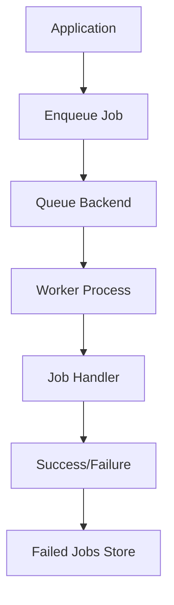
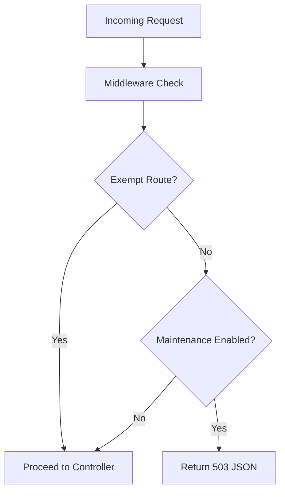
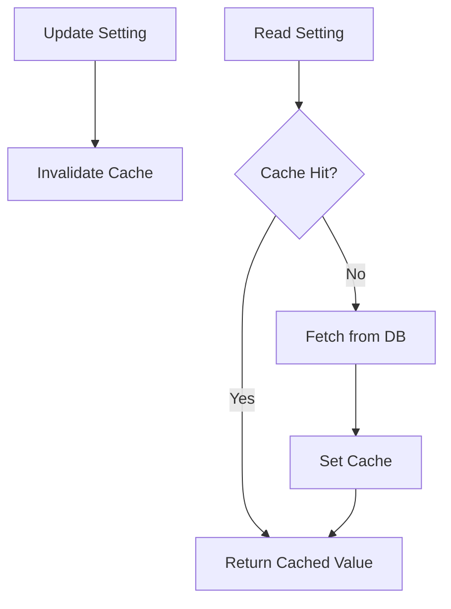
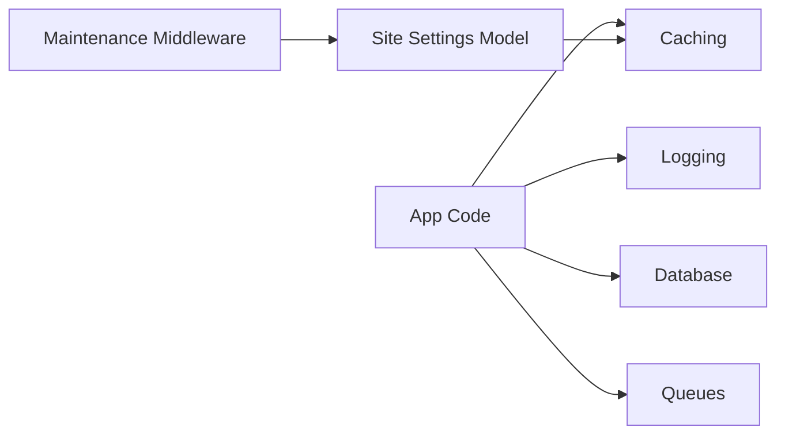

# Monitoring & Scaling

<cite>
**Referenced Files in This Document**
- [logging.php](file://backend/config/logging.php)
- [cache.php](file://backend/config/cache.php)
- [database.php](file://backend/config/database.php)
- [queue.php](file://backend/config/queue.php)
- [CheckMaintenanceMode.php](file://backend/app/Http/Middleware/CheckMaintenanceMode.php)
- [SiteSetting.php](file://backend/app/Models/SiteSetting.php)
- [admin_dashboard.js](file://k6/scenarios/admin_dashboard.js)
- [README_DATABASE_OPTIMIZATION.md](file://README_DATABASE_OPTIMIZATION.md)
- [INDEX_REFERENCE_GUIDE.md](file://INDEX_REFERENCE_GUIDE.md)
- [INDEX_STRATEGY_VISUAL_REFERENCE.md](file://INDEX_STRATEGY_VISUAL_REFERENCE.md)
- [CPANEL_DEPLOYMENT_GUIDE.md](file://CPANEL_DEPLOYMENT_GUIDE.md)
- [documentation/index.html](file://documentation/index.html)
</cite>

## Table of Contents
1. [Introduction](#introduction)
2. [Project Structure](#project-structure)
3. [Core Components](#core-components)
4. [Architecture Overview](#architecture-overview)
5. [Detailed Component Analysis](#detailed-component-analysis)
6. [Dependency Analysis](#dependency-analysis)
7. [Performance Considerations](#performance-considerations)
8. [Troubleshooting Guide](#troubleshooting-guide)
9. [Conclusion](#conclusion)
10. [Appendices](#appendices)

## Introduction
This document provides comprehensive monitoring and scaling guidance for SonyaBus, focusing on:
- Logging strategies using Laravel’s logging system
- Error tracking with third-party tools such as Sentry
- Performance monitoring and load testing
- Database query optimization and indexing strategy
- Caching strategies with Redis and Memcached
- Queue configuration for background processing
- Horizontal scaling approaches, database replication, and CDN integration
- Capacity planning, alerting rules, and disaster recovery procedures

The guidance references the actual application configuration files and operational documentation present in the repository to ensure accuracy and reproducibility.

## Project Structure
SonyaBus is a Laravel backend paired with a React frontend. The backend exposes an API and admin interface, while the frontend serves the customer portal. Operational concerns such as logging, caching, queues, and database connections are configured through Laravel configuration files under `backend/config`. Load testing scenarios are defined under `k6/scenarios`, and deployment/web server guidance is available in the project documentation.

**Diagram sources**
- [logging.php:53-129](file://backend/config/logging.php#L53-L129)
- [cache.php:35-100](file://backend/config/cache.php#L35-L100)
- [database.php:47-117](file://backend/config/database.php#L47-L117)
- [queue.php:32-90](file://backend/config/queue.php#L32-L90)

**Section sources**
- [documentation/index.html:735-778](file://documentation/index.html#L735-L778)
- [CPANEL_DEPLOYMENT_GUIDE.md:281-337](file://CPANEL_DEPLOYMENT_GUIDE.md#L281-L337)

## Core Components
- Logging: Monolog-based channels including file, daily rotation, Slack, Papertrail, stderr, syslog, errorlog, and stack aggregation.
- Caching: Multiple stores including database, file, memcached, redis, dynamodb, octane, and failover; key prefixing supported.
- Database: MySQL/MariaDB, PostgreSQL, SQL Server, SQLite drivers; Redis connections for cache and queue backends.
- Queues: Sync, database, Beanstalkd, SQS, Redis, deferred, background, and failover; failed job storage options.
- Maintenance Mode: Middleware that returns 503 responses when maintenance mode is enabled, with exceptions for site settings endpoints.
- Site Settings Cache: Model-level caching for global settings with TTL and cache invalidation on updates.

**Section sources**
- [logging.php:53-129](file://backend/config/logging.php#L53-L129)
- [cache.php:35-115](file://backend/config/cache.php#L35-L115)
- [database.php:47-180](file://backend/config/database.php#L47-L180)
- [queue.php:32-127](file://backend/config/queue.php#L32-L127)
- [CheckMaintenanceMode.php:10-47](file://backend/app/Http/Middleware/CheckMaintenanceMode.php#L10-L47)
- [SiteSetting.php:8-79](file://backend/app/Models/SiteSetting.php#L8-L79)

## Architecture Overview
At runtime, requests flow from the web server into the Laravel application, which uses configured logging, caching, queues, and database connections. Background jobs process asynchronously via the selected queue backend. Maintenance mode can be toggled at runtime and affects all non-exempt routes.

**Diagram sources**
- [logging.php:53-129](file://backend/config/logging.php#L53-L129)
- [cache.php:35-100](file://backend/config/cache.php#L35-L100)
- [database.php:47-180](file://backend/config/database.php#L47-L180)
- [queue.php:32-90](file://backend/config/queue.php#L32-L90)
- [CheckMaintenanceMode.php:22-47](file://backend/app/Http/Middleware/CheckMaintenanceMode.php#L22-L47)

## Detailed Component Analysis

### Logging Strategy
- Default channel and stack aggregation allow routing logs to multiple destinations.
- File-based logging supports single-file and daily rotation with configurable retention.
- Integration points include Slack webhook, Papertrail UDP handler, stderr stream, syslog, and PHP errorlog.
- Deprecations channel allows isolating deprecation warnings during upgrades.

Recommendations:
- Use daily rotation in production with appropriate retention days.
- Forward critical errors to Slack or an external log aggregator.
- In containerized environments, prefer stderr for centralized log collection.

**Diagram sources**
- [logging.php:53-129](file://backend/config/logging.php#L53-L129)

**Section sources**
- [logging.php:10-129](file://backend/config/logging.php#L10-L129)

### Error Tracking with Sentry
- The repository references Sentry as an error tracking tool in security-related documentation.
- To integrate Sentry:
  - Install the official SDK and configure it in your environment.
  - Initialize Sentry early in the application bootstrap.
  - Map environment variables for DSN and release version.
  - Ensure unhandled exceptions and queued job failures are captured.

Operational notes:
- Correlate Sentry events with log channels and queue failure tables.
- Use structured context (user, route, request ID) to accelerate triage.

**Section sources**
- [SECURITY_AUDIT_REPORT.md:729-729](file://SECURITY_AUDIT_REPORT.md#L729-L729)
- [SECURITY_SUMMARY.md:343-343](file://SECURITY_SUMMARY.md#L343-L343)

### Performance Monitoring and Load Testing
- k6 scenarios define performance tests for admin dashboards, login flows, booking flows, seat layout, spike/stress/soak patterns, and combined workloads.
- Scenarios use configurable VUs, durations, and thresholds to enforce SLOs.

Recommended practices:
- Run smoke tests on every deploy and periodic soak tests to detect memory leaks.
- Track p95/p99 latency, error rates, and resource utilization.
- Integrate k6 results into CI pipelines and alert on threshold breaches.

**Diagram sources**
- [admin_dashboard.js:1-13](file://k6/scenarios/admin_dashboard.js#L1-L13)

**Section sources**
- [admin_dashboard.js:1-13](file://k6/scenarios/admin_dashboard.js#L1-L13)

### Database Query Optimization and Indexing
- The repository includes extensive documentation on index strategy, query optimization examples, and performance monitoring queries.
- Key tables and indexes are documented with expected performance improvements.

Guidance:
- Follow the provided index strategy for high-cardinality and frequently filtered columns.
- Use composite indexes where queries filter on multiple columns.
- Monitor slow queries and table sizes regularly.

**Diagram sources**
- [INDEX_REFERENCE_GUIDE.md:93-156](file://INDEX_REFERENCE_GUIDE.md#L93-L156)
- [INDEX_STRATEGY_VISUAL_REFERENCE.md:1-96](file://INDEX_STRATEGY_VISUAL_REFERENCE.md#L1-L96)

**Section sources**
- [INDEX_REFERENCE_GUIDE.md:93-156](file://INDEX_REFERENCE_GUIDE.md#L93-L156)
- [INDEX_REFERENCE_GUIDE.md:361-415](file://INDEX_REFERENCE_GUIDE.md#L361-L415)
- [INDEX_STRATEGY_VISUAL_REFERENCE.md:1-96](file://INDEX_STRATEGY_VISUAL_REFERENCE.md#L1-L96)
- [README_DATABASE_OPTIMIZATION.md:368-406](file://README_DATABASE_OPTIMIZATION.md#L368-L406)

### Caching Strategies with Redis and Memcached
- Cache stores include database, file, memcached, redis, dynamodb, octane, and failover.
- Redis connections are also defined for cache and default usage, with retry/backoff parameters.
- Memcached servers can be configured with host, port, weight, and SASL credentials.
- Key prefixing helps avoid collisions across applications.

Best practices:
- Prefer Redis for distributed caching and session storage in multi-node deployments.
- Use Memcached for simple key-value caching where clustering is not required.
- Set appropriate TTLs and invalidate caches on writes.

**Diagram sources**
- [cache.php:35-115](file://backend/config/cache.php#L35-L115)
- [database.php:146-180](file://backend/config/database.php#L146-L180)

**Section sources**
- [cache.php:35-115](file://backend/config/cache.php#L35-L115)
- [database.php:146-180](file://backend/config/database.php#L146-L180)

### Queue Configuration for Background Processing
- Supported drivers include sync, database, beanstalkd, sqs, redis, deferred, background, and failover.
- Failed job storage supports database-uuids, dynamodb, file, and null.
- Job batching configuration is available for grouped tasks.

Recommendations:
- Use Redis or SQS for scalable, reliable queuing in production.
- Configure retry_after and monitor failed jobs.
- Run workers per CPU core and scale horizontally.

**Diagram sources**
- [queue.php:32-127](file://backend/config/queue.php#L32-L127)

**Section sources**
- [queue.php:32-127](file://backend/config/queue.php#L32-L127)

### Maintenance Mode and Operational Controls
- Maintenance mode middleware checks a database-backed setting and returns 503 JSON for affected routes.
- Exempted routes include site settings endpoints so the frontend can still fetch status.

Operational tips:
- Toggle maintenance mode via the site settings UI or API.
- Monitor 503 spikes and correlate with maintenance windows.

**Diagram sources**
- [CheckMaintenanceMode.php:10-47](file://backend/app/Http/Middleware/CheckMaintenanceMode.php#L10-L47)

**Section sources**
- [CheckMaintenanceMode.php:10-47](file://backend/app/Http/Middleware/CheckMaintenanceMode.php#L10-L47)

### Site Settings Caching
- Global settings are cached with a TTL and invalidated on updates.
- Provides fast reads for frequently accessed configuration values.

**Diagram sources**
- [SiteSetting.php:21-79](file://backend/app/Models/SiteSetting.php#L21-L79)

**Section sources**
- [SiteSetting.php:8-79](file://backend/app/Models/SiteSetting.php#L8-L79)

## Dependency Analysis
Key dependencies between components:
- Application code depends on logging, cache, database, and queue configurations.
- Maintenance mode middleware depends on site settings model and cache layer.
- Frontend relies on backend APIs and may serve static assets via CDN.

**Diagram sources**
- [logging.php:53-129](file://backend/config/logging.php#L53-L129)
- [cache.php:35-115](file://backend/config/cache.php#L35-L115)
- [database.php:47-180](file://backend/config/database.php#L47-L180)
- [queue.php:32-127](file://backend/config/queue.php#L32-L127)
- [CheckMaintenanceMode.php:10-47](file://backend/app/Http/Middleware/CheckMaintenanceMode.php#L10-L47)
- [SiteSetting.php:8-79](file://backend/app/Models/SiteSetting.php#L8-L79)

**Section sources**
- [logging.php:53-129](file://backend/config/logging.php#L53-L129)
- [cache.php:35-115](file://backend/config/cache.php#L35-L115)
- [database.php:47-180](file://backend/config/database.php#L47-L180)
- [queue.php:32-127](file://backend/config/queue.php#L32-L127)
- [CheckMaintenanceMode.php:10-47](file://backend/app/Http/Middleware/CheckMaintenanceMode.php#L10-L47)
- [SiteSetting.php:8-79](file://backend/app/Models/SiteSetting.php#L8-L79)

## Performance Considerations
- Enable daily log rotation and consider shipping logs to a centralized system to reduce disk pressure.
- Use Redis for caching and sessions in multi-instance deployments; set appropriate TTLs and eviction policies.
- Offload heavy operations to queues; tune worker concurrency based on CPU and I/O capacity.
- Apply recommended indexes and monitor slow queries; periodically analyze table sizes and index usage.
- Serve static assets via CDN and enable compression/caching headers at the web server.

[No sources needed since this section provides general guidance]

## Troubleshooting Guide
Common issues and mitigations:
- High error rates: Inspect log channels and Sentry events; correlate with queue failures.
- Slow queries: Review slow query logs and apply indexes per the index strategy guide.
- Cache misses or stale data: Validate cache store connectivity and TTLs; clear caches after config changes.
- Queue backlog: Check worker processes, retry_after settings, and failed jobs table.
- Maintenance mode unexpectedly active: Verify site settings and exempt routes.

Operational commands and references:
- Clear caches and views during deployments.
- Restart queue workers after configuration changes.
- Monitor cron entries for scheduler and queue workers.

**Section sources**
- [CPANEL_DEPLOYMENT_GUIDE.md:281-337](file://CPANEL_DEPLOYMENT_GUIDE.md#L281-L337)
- [documentation/index.html:1310-1327](file://documentation/index.html#L1310-L1327)

## Conclusion
SonyaBus provides robust configuration hooks for logging, caching, queues, and database access. By combining these with proper indexing, CDN delivery, horizontal scaling, and observability (logs, metrics, error tracking), you can build a resilient, high-performance platform. Use the included k6 scenarios to validate performance targets and continuously refine capacity plans and alerting rules.

[No sources needed since this section summarizes without analyzing specific files]

## Appendices

### Horizontal Scaling Approaches
- Scale out application instances behind a load balancer (Nginx/Apache/Cloud LB).
- Use stateless app servers; store sessions in Redis.
- Run multiple queue workers per instance and scale workers independently.
- Place Redis and Memcached in dedicated clusters with replication and persistence as needed.

[No sources needed since this section provides general guidance]

### Database Replication Setup
- Configure read replicas and direct write-heavy operations to the primary.
- Use connection pooling and separate read/write hosts in application configuration.
- Monitor replication lag and adjust routing accordingly.

[No sources needed since this section provides general guidance]

### CDN Integration for Static Assets
- Serve frontend assets from a CDN; configure origin pull from the web server.
- Set long-lived cache headers for immutable assets and use cache busting for changed files.
- Ensure CORS and security headers are correctly configured at the CDN and origin.

[No sources needed since this section provides general guidance]

### Capacity Planning Guidelines
- Baseline current throughput and latency using k6 scenarios.
- Plan headroom for traffic spikes and seasonal peaks.
- Size CPU, memory, and I/O based on observed utilization and growth projections.
- Regularly review index effectiveness and query performance.

[No sources needed since this section provides general guidance]

### Alerting Rules
- Alert on elevated error rates, latency SLO breaches, and queue backlog.
- Monitor cache hit ratios, Redis/Memcached memory, and disk usage.
- Alert on database replication lag and slow query spikes.

[No sources needed since this section provides general guidance]

### Disaster Recovery Procedures
- Schedule automated database backups and test restores regularly.
- Maintain runbooks for incident response and rollback procedures.
- Practice failover drills for database and cache layers.
- Keep environment configuration and secrets securely backed up.

[No sources needed since this section provides general guidance]