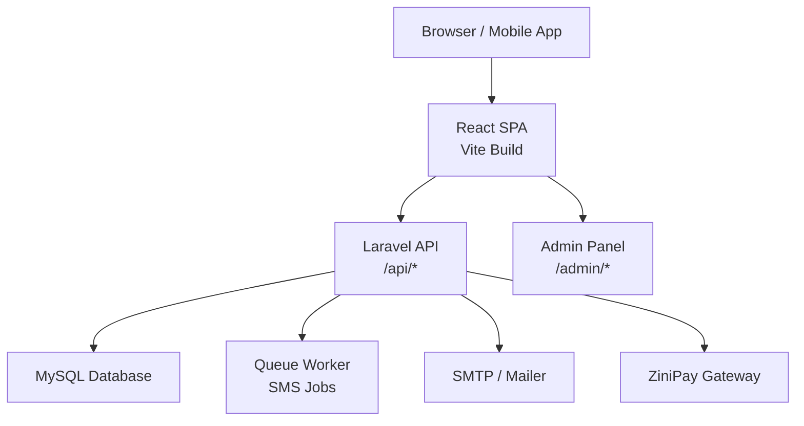
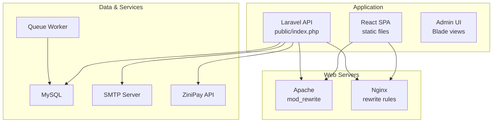
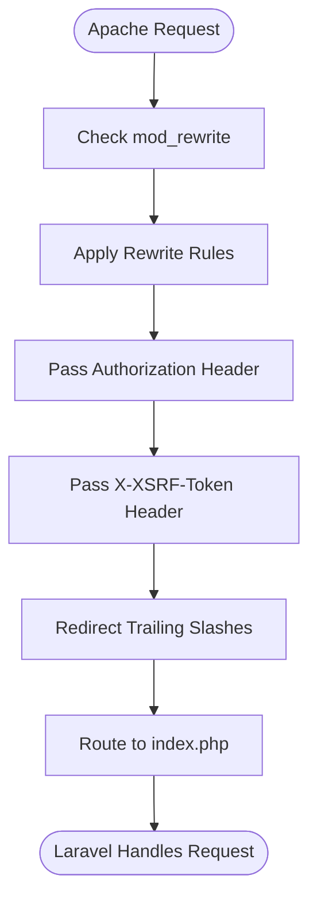
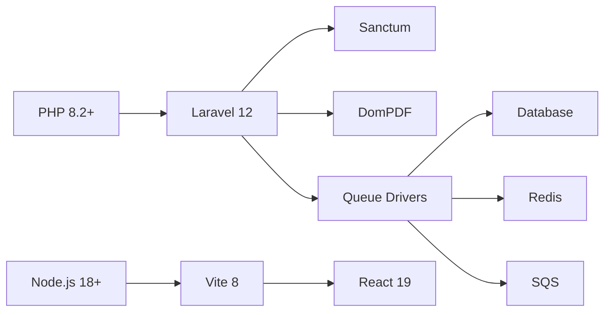

# Production Deployment

<cite>
**Referenced Files in This Document**
- [README.md](file://README.md)
- [CPANEL_DEPLOYMENT_GUIDE.md](file://CPANEL_DEPLOYMENT_GUIDE.md)
- [backend/composer.json](file://backend/composer.json)
- [frontend/package.json](file://frontend/package.json)
- [backend/public/.htaccess](file://backend/public/.htaccess)
- [backend/config/queue.php](file://backend/config/queue.php)
- [backend/app/Providers/AppServiceProvider.php](file://backend/app/Providers/AppServiceProvider.php)
- [backend/app/Services/ZinipayService.php](file://backend/app/Services/ZinipayService.php)
- [backend/resources/views/install/database.blade.php](file://backend/resources/views/install/database.blade.php)
</cite>

## Table of Contents
1. [Introduction](#introduction)
2. [Project Structure](#project-structure)
3. [Core Components](#core-components)
4. [Architecture Overview](#architecture-overview)
5. [Detailed Component Analysis](#detailed-component-analysis)
6. [Dependency Analysis](#dependency-analysis)
7. [Performance Considerations](#performance-considerations)
8. [Troubleshooting Guide](#troubleshooting-guide)
9. [Conclusion](#conclusion)
10. [Appendices](#appendices)

## Introduction
This document provides production deployment guidance for SonyaBus, a Laravel 12 backend API and React 19 customer-facing SPA. It covers server requirements, PHP extensions, database setup, web server configuration (Apache and Nginx), SSL installation, environment variables, file permissions, security hardening, troubleshooting, and performance optimization.

SonyaBus consists of:
- Backend: Laravel 12 REST API, admin panel, payments, and SMS queue processing.
- Frontend: React 19 SPA built with Vite, served as static files.

The recommended production layout uses two domains or subdomains:
- Customer site domain serves the React build.
- API domain serves the Laravel application from its public directory.

**Section sources**
- [README.md:1-271](file://README.md#L1-L271)
- [CPANEL_DEPLOYMENT_GUIDE.md:1-505](file://CPANEL_DEPLOYMENT_GUIDE.md#L1-L505)

## Project Structure
At a high level:
- backend/: Laravel application (API routes, admin routes, services, models, config).
- frontend/: React SPA source and build output.
- documentation/: User guide HTML.
- k6/: Load testing scenarios.

[No sources needed since this diagram shows conceptual workflow, not actual code structure]

**Section sources**
- [README.md:46-80](file://README.md#L46-L80)

## Core Components
- Backend runtime: PHP 8.2+ with Laravel 12.
- Frontend runtime: Node.js to build React; production serves static assets.
- Database: MySQL 8.0+ (or MariaDB 10.6+).
- Web Server: Apache with mod_rewrite or Nginx with proper rewrite rules.
- Queues: Database-backed queue for SMS notifications.
- Payments: ZiniPay integration via service layer.
- Email: SMTP mailer configured via .env and optionally overridden by site settings.

Key operational notes:
- The React app must be built locally and uploaded as static files.
- The Laravel app’s document root is backend/public.
- Environment variables control application behavior, database connectivity, mail, SMS, and payment integrations.

**Section sources**
- [README.md:84-132](file://README.md#L84-L132)
- [CPANEL_DEPLOYMENT_GUIDE.md:35-51](file://CPANEL_DEPLOYMENT_GUIDE.md#L35-L51)
- [CPANEL_DEPLOYMENT_GUIDE.md:131-179](file://CPANEL_DEPLOYMENT_GUIDE.md#L131-L179)

## Architecture Overview
Production architecture overview:
- Apache/Nginx forwards requests to Laravel’s public/index.php.
- React SPA is served directly from its dist folder.
- API endpoints are under /api.
- Admin panel is under /admin.
- Queue worker processes SMS jobs asynchronously.
- ZiniPay callbacks and webhooks hit the API domain over HTTPS.

**Diagram sources**
- [backend/public/.htaccess:1-27](file://backend/public/.htaccess#L1-L27)
- [backend/config/queue.php:1-129](file://backend/config/queue.php#L1-L129)
- [backend/app/Services/ZinipayService.php:1-44](file://backend/app/Services/ZinipayService.php#L1-L44)

**Section sources**
- [backend/public/.htaccess:1-27](file://backend/public/.htaccess#L1-L27)
- [backend/config/queue.php:1-129](file://backend/config/queue.php#L1-L129)

## Detailed Component Analysis

### cPanel Hosting Deployment
Recommended domain layout:
- Customer site domain serves React build.
- API subdomain serves Laravel from backend/public.

Steps:
1. Prepare files locally:
   - Build React with correct API base URL.
   - Install Laravel dependencies locally if Composer is unavailable on host.
2. Create MySQL database and user in cPanel.
3. Upload project files:
   - backend/ (not web-accessible except public/)
   - frontend/dist contents into main domain document root.
4. Configure subdomains in cPanel:
   - api.yourdomain.com → backend/public
   - yourdomain.com → React dist folder
5. Set PHP version and enable required extensions.
6. Configure .env for production (APP_KEY, APP_URL, DB_*, MAIL_*, SMS_*, ZINIPAY_*).
7. Run Laravel setup commands (key generation, migrations, cache).
8. Set file permissions for storage and bootstrap/cache.
9. Enable SSL for both domains/subdomains.
10. Configure queue worker cron job for SMS.
11. Configure third-party services (ZiniPay callbacks, SMS gateway, email).
12. Verify default logins and change passwords immediately.

Important details:
- Required PHP extensions include openssl, pdo, pdo_mysql, mbstring, tokenizer, xml, ctype, json, bcmath, fileinfo, curl.
- Session driver should be database for shared hosting reliability.
- Cache stores and queues can use database drivers.
- If SSH is unavailable, upload vendor/ and run migrations locally against remote DB.

**Section sources**
- [CPANEL_DEPLOYMENT_GUIDE.md:16-51](file://CPANEL_DEPLOYMENT_GUIDE.md#L16-L51)
- [CPANEL_DEPLOYMENT_GUIDE.md:54-107](file://CPANEL_DEPLOYMENT_GUIDE.md#L54-L107)
- [CPANEL_DEPLOYMENT_GUIDE.md:109-128](file://CPANEL_DEPLOYMENT_GUIDE.md#L109-L128)
- [CPANEL_DEPLOYMENT_GUIDE.md:131-179](file://CPANEL_DEPLOYMENT_GUIDE.md#L131-L179)
- [CPANEL_DEPLOYMENT_GUIDE.md:182-200](file://CPANEL_DEPLOYMENT_GUIDE.md#L182-L200)
- [CPANEL_DEPLOYMENT_GUIDE.md:202-256](file://CPANEL_DEPLOYMENT_GUIDE.md#L202-L256)
- [CPANEL_DEPLOYMENT_GUIDE.md:258-301](file://CPANEL_DEPLOYMENT_GUIDE.md#L258-L301)
- [CPANEL_DEPLOYMENT_GUIDE.md:304-315](file://CPANEL_DEPLOYMENT_GUIDE.md#L304-L315)
- [CPANEL_DEPLOYMENT_GUIDE.md:318-328](file://CPANEL_DEPLOYMENT_GUIDE.md#L318-L328)
- [CPANEL_DEPLOYMENT_GUIDE.md:331-349](file://CPANEL_DEPLOYMENT_GUIDE.md#L331-L349)
- [CPANEL_DEPLOYMENT_GUIDE.md:352-371](file://CPANEL_DEPLOYMENT_GUIDE.md#L352-L371)
- [CPANEL_DEPLOYMENT_GUIDE.md:374-385](file://CPANEL_DEPLOYMENT_GUIDE.md#L374-L385)

### VPS Servers (Ubuntu/CentOS)
High-level steps:
1. Install system packages:
   - PHP 8.2+ with required extensions.
   - MySQL 8.0+ (or MariaDB 10.6+).
   - Nginx or Apache.
   - Node.js 18+ (for building React).
   - Composer 2.x.
2. Clone or upload project files.
3. Install backend dependencies:
   - composer install --no-dev --optimize-autoloader
4. Copy and configure .env:
   - APP_ENV=production
   - APP_DEBUG=false
   - APP_URL=https://your-api-domain
   - DB_* credentials
   - MAIL_* SMTP settings
   - SMS_* gateway settings
   - ZINIPAY_* keys
5. Generate application key and run migrations.
6. Set file ownership and permissions:
   - storage and bootstrap/cache writable by web server user.
7. Build React frontend:
   - npm install && npm run build
8. Configure web server:
   - Point API domain to backend/public.
   - Point customer domain to frontend/dist.
9. Enable SSL certificates (Let’s Encrypt or provider CA).
10. Start queue worker:
   - Use systemd service or supervisor to run php artisan queue:work.
11. Harden server:
   - Disable unnecessary PHP functions.
   - Restrict file permissions.
   - Configure firewall and fail2ban.
   - Keep PHP, MySQL, and OS updated.

Security hardening checklist:
- Ensure .env is outside web root and not readable by web server.
- Disable directory listings and MultiViews.
- Enforce HTTPS and HSTS.
- Limit CORS origins to known domains.
- Use strong database passwords and least-privilege users.
- Rotate logs and monitor disk usage.

**Section sources**
- [README.md:84-132](file://README.md#L84-L132)
- [CPANEL_DEPLOYMENT_GUIDE.md:35-51](file://CPANEL_DEPLOYMENT_GUIDE.md#L35-L51)
- [CPANEL_DEPLOYMENT_GUIDE.md:202-256](file://CPANEL_DEPLOYMENT_GUIDE.md#L202-L256)
- [CPANEL_DEPLOYMENT_GUIDE.md:304-315](file://CPANEL_DEPLOYMENT_GUIDE.md#L304-L315)

### Cloud Platforms (AWS, DigitalOcean)
Deployment patterns:
- EC2/ECS or managed VMs running Ubuntu/CentOS.
- RDS or managed MySQL for database.
- S3 or object storage for uploads (optional).
- Load balancer with SSL termination.
- Auto-scaling groups for API workers.
- CI/CD pipelines to build React and deploy artifacts.

Key considerations:
- Use environment variables via secrets manager or parameter store.
- Store .env securely and inject at runtime.
- Use IAM roles for AWS services instead of long-lived credentials.
- Configure health checks and auto-restart for queue workers.
- Back up databases regularly and test restore procedures.
- Monitor performance metrics and set alerts.

**Section sources**
- [README.md:84-132](file://README.md#L84-L132)
- [CPANEL_DEPLOYMENT_GUIDE.md:202-256](file://CPANEL_DEPLOYMENT_GUIDE.md#L202-L256)

### Web Server Configuration

#### Apache
- Enable mod_rewrite.
- Set document roots:
  - API domain → backend/public
  - Customer domain → frontend/dist
- Use .htaccess for routing and headers:
  - Authorization header passthrough
  - XSRF token passthrough
  - Trailing slash redirects
  - Front controller routing to index.php

**Diagram sources**
- [backend/public/.htaccess:1-27](file://backend/public/.htaccess#L1-L27)

**Section sources**
- [backend/public/.htaccess:1-27](file://backend/public/.htaccess#L1-L27)

#### Nginx
- Configure server blocks for API and customer domains.
- Root directories:
  - API domain → backend/public
  - Customer domain → frontend/dist
- Rewrite rules:
  - Try files and fallback to index.php for API routes.
  - Serve React SPA index.html for client-side routes.
- Security headers:
  - HSTS, CSP, X-Frame-Options, X-Content-Type-Options.
- Gzip/Brotli compression for static assets.
- Proxy pass for WebSocket if needed.

[No sources needed since this section provides general guidance]

### SSL Certificate Installation
- cPanel:
  - Use Let’s Encrypt/AutoSSL for domains/subdomains.
  - Force HTTPS redirect.
- VPS/Cloud:
  - Use Certbot for Let’s Encrypt.
  - Configure renewal hooks.
  - Set up HSTS and secure cipher suites.

**Section sources**
- [CPANEL_DEPLOYMENT_GUIDE.md:318-328](file://CPANEL_DEPLOYMENT_GUIDE.md#L318-L328)

### Environment Variables
Core .env variables:
- Application:
  - APP_NAME, APP_ENV, APP_KEY, APP_URL, APP_LOCALE, APP_FALLBACK_LOCALE
- Logging:
  - LOG_CHANNEL, LOG_LEVEL
- Database:
  - DB_CONNECTION, DB_HOST, DB_PORT, DB_DATABASE, DB_USERNAME, DB_PASSWORD
- Sessions:
  - SESSION_DRIVER, SESSION_LIFETIME, SESSION_DOMAIN
- Cache and Queue:
  - CACHE_STORE, QUEUE_CONNECTION
- Mail:
  - MAIL_MAILER, MAIL_HOST, MAIL_PORT, MAIL_USERNAME, MAIL_PASSWORD, MAIL_ENCRYPTION, MAIL_FROM_ADDRESS, MAIL_FROM_NAME
- SMS:
  - SMS_GATEWAY_API_KEY, SMS_GATEWAY_SENDER_ID
- Payments:
  - ZINIPAY_API_KEY, ZINIPAY_BASE_URL

Frontend env variables:
- VITE_API_BASE_URL
- VITE_ZINIPAY_API_KEY

Runtime overrides:
- Site settings can override mail configuration dynamically.

**Section sources**
- [CPANEL_DEPLOYMENT_GUIDE.md:202-256](file://CPANEL_DEPLOYMENT_GUIDE.md#L202-L256)
- [backend/app/Providers/AppServiceProvider.php:40-69](file://backend/app/Providers/AppServiceProvider.php#L40-L69)

### File Permissions
- storage/ and bootstrap/cache/ must be writable by the web server process.
- Typical permissions:
  - Directories: 755 or 775 depending on host policy.
  - Files: 644.
- Ownership:
  - On Linux VPS, set ownership to www-data or appropriate user.

**Section sources**
- [CPANEL_DEPLOYMENT_GUIDE.md:304-315](file://CPANEL_DEPLOYMENT_GUIDE.md#L304-L315)
- [README.md:104-116](file://README.md#L104-L116)

### Security Hardening
- Disable APP_DEBUG in production.
- Restrict CORS origins to known domains.
- Enforce HTTPS and HSTS.
- Validate file uploads using MIME types.
- Protect environment files and restrict access.
- Use rate limiting on authentication endpoints.
- Apply CSRF protection on state-changing routes.
- Regularly update PHP, Laravel, and dependencies.
- Monitor logs and set up alerting.

**Section sources**
- [README.md:182-190](file://README.md#L182-L190)
- [CPANEL_DEPLOYMENT_GUIDE.md:251-256](file://CPANEL_DEPLOYMENT_GUIDE.md#L251-L256)

## Dependency Analysis
Backend dependencies:
- PHP 8.2+
- Laravel 12 framework
- Sanctum for API tokens
- DomPDF for PDF generation

Frontend dependencies:
- React 19
- Vite 8
- ESLint and related tooling

Queue configuration:
- Default connection is database.
- Supports SQS, Redis, Beanstalkd, and others.

**Diagram sources**
- [backend/composer.json:1-86](file://backend/composer.json#L1-L86)
- [frontend/package.json:1-28](file://frontend/package.json#L1-L28)
- [backend/config/queue.php:1-129](file://backend/config/queue.php#L1-L129)

**Section sources**
- [backend/composer.json:1-86](file://backend/composer.json#L1-L86)
- [frontend/package.json:1-28](file://frontend/package.json#L1-L28)
- [backend/config/queue.php:1-129](file://backend/config/queue.php#L1-L129)

## Performance Considerations
- Enable OPcache for PHP.
- Cache configuration, routes, and views after deployment.
- Use database-backed sessions and cache for shared hosting.
- Optimize database queries and add indexes where necessary.
- Compress static assets and enable CDN caching.
- Scale queue workers horizontally for high SMS volume.
- Monitor slow queries and optimize them.
- Use separate read replicas for reporting if needed.

[No sources needed since this section provides general guidance]

## Troubleshooting Guide
Common issues and resolutions:
- Blank page or 500 errors on Laravel:
  - Check storage/logs/laravel.log.
  - Verify permissions on storage and bootstrap/cache.
  - Confirm APP_KEY is set and PHP version/extensions are correct.
- Customer site shows UI but no data:
  - Ensure React was rebuilt with correct VITE_API_BASE_URL.
  - Check CORS and HTTPS settings.
- 404 on React routes:
  - Add client-side routing .htaccess for Apache.
- Admin login works locally but not on server:
  - Confirm session driver is database and sessions table exists.
  - Ensure APP_URL matches live domain.
- Database connection error:
  - Verify DB credentials and host.
- Composer/artisan not available:
  - Upload vendor/ and run migrations locally against remote DB.
- Payment callback fails:
  - Callback URLs must use HTTPS and the API domain.

Queue-related:
- SMS not sending:
  - Ensure queue worker is running via cron/systemd.
  - Check failed_jobs table for errors.

Mail-related:
- Password reset emails not sent:
  - Verify SMTP settings in .env and site settings overrides.

**Section sources**
- [CPANEL_DEPLOYMENT_GUIDE.md:416-454](file://CPANEL_DEPLOYMENT_GUIDE.md#L416-L454)
- [CPANEL_DEPLOYMENT_GUIDE.md:331-349](file://CPANEL_DEPLOYMENT_GUIDE.md#L331-L349)

## Conclusion
Deploying SonyaBus in production requires careful attention to environment configuration, file permissions, web server routing, SSL, and security hardening. Follow the platform-specific steps for cPanel, VPS, and cloud environments. Validate all integrations (database, mail, SMS, payments) and monitor performance and logs post-deployment.

[No sources needed since this section summarizes without analyzing specific files]

## Appendices

### Database Setup Notes
- Installer defaults:
  - Host: 127.0.0.1
  - Port: 3306
  - Database name: sonyabus
  - Username: root
  - Password: optional
- Ensure the database user has sufficient privileges.

**Section sources**
- [backend/resources/views/install/database.blade.php:38-67](file://backend/resources/views/install/database.blade.php#L38-L67)

### Payment Integration Notes
- ZiniPay service reads API key and base URL from configuration.
- Callback and webhook URLs are generated via Laravel routes.
- Ensure API keys are set in .env and frontend build variables.

**Section sources**
- [backend/app/Services/ZinipayService.php:1-44](file://backend/app/Services/ZinipayService.php#L1-L44)