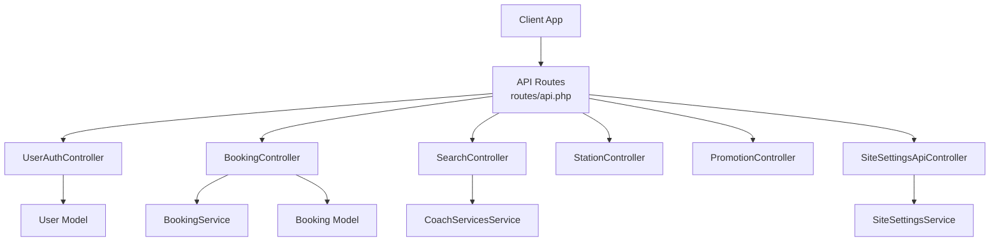
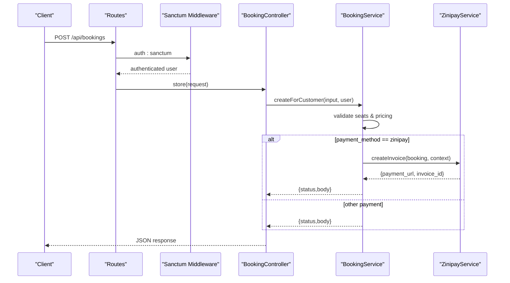
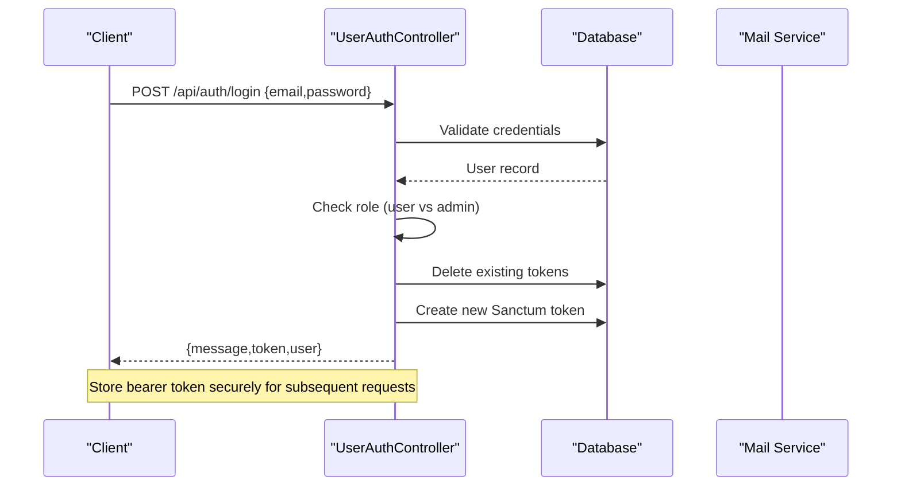
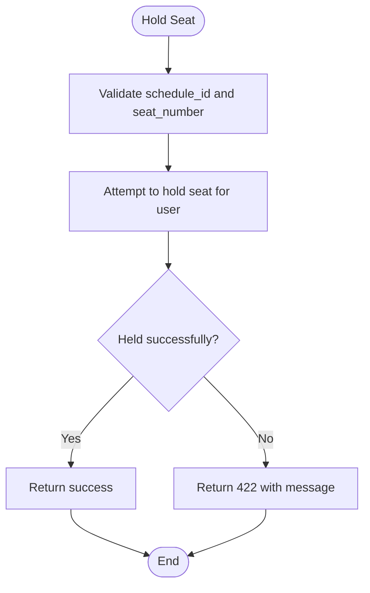
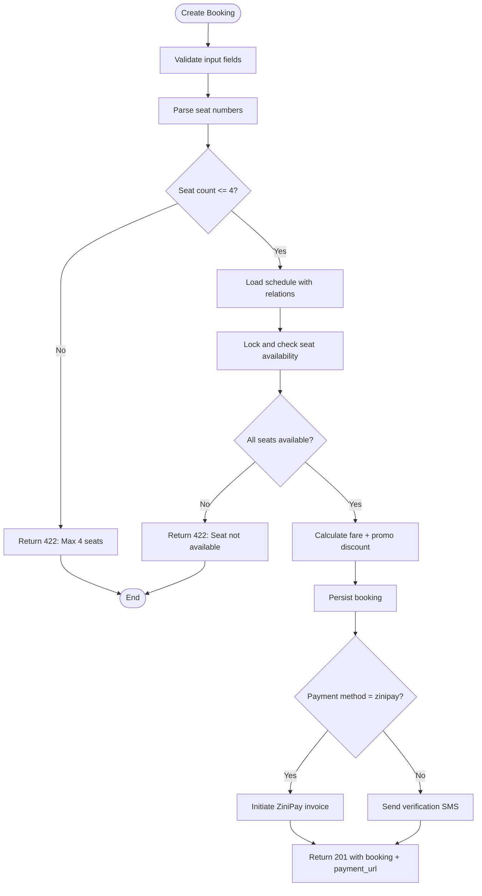
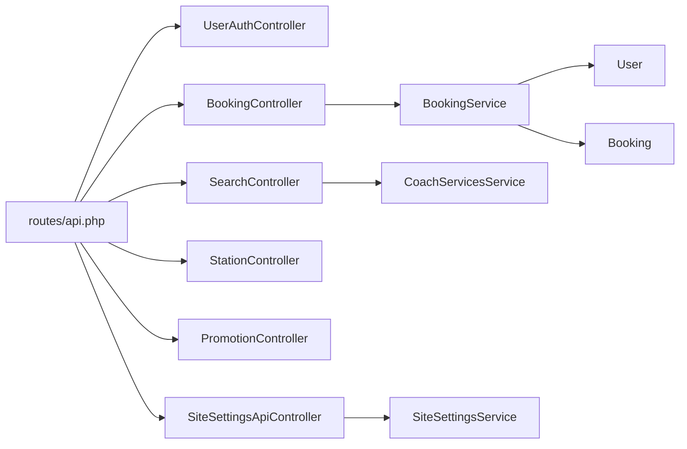

# API Reference Documentation

<cite>
**Referenced Files in This Document**
- [api.php](file://backend/routes/api.php)
- [BaseController.php](file://backend/app/Http/Controllers/API/BaseController.php)
- [UserAuthController.php](file://backend/app/Http/Controllers/API/UserAuthController.php)
- [BookingController.php](file://backend/app/Http/Controllers/API/BookingController.php)
- [SearchController.php](file://backend/app/Http/Controllers/API/SearchController.php)
- [StationController.php](file://backend/app/Http/Controllers/API/StationController.php)
- [PromotionController.php](file://backend/app/Http/Controllers/API/PromotionController.php)
- [SiteSettingsApiController.php](file://backend/app/Http/Controllers/API/SiteSettingsApiController.php)
- [BookingService.php](file://backend/app/Services/BookingService.php)
- [CoachServicesService.php](file://backend/app/Services/CoachServicesService.php)
- [SiteSettingsService.php](file://backend/app/Services/SiteSettingsService.php)
- [User.php](file://backend/app/Models/User.php)
- [Booking.php](file://backend/app/Models/Booking.php)
- [sanctum.php](file://backend/config/sanctum.php)
- [cors.php](file://backend/config/cors.php)
- [CheckMaintenanceMode.php](file://backend/app/Http/Middleware/CheckMaintenanceMode.php)
</cite>

## Table of Contents
1. [Introduction](#introduction)
2. [Project Structure](#project-structure)
3. [Core Components](#core-components)
4. [Architecture Overview](#architecture-overview)
5. [Detailed Component Analysis](#detailed-component-analysis)
6. [Dependency Analysis](#dependency-analysis)
7. [Performance Considerations](#performance-considerations)
8. [Troubleshooting Guide](#troubleshooting-guide)
9. [Conclusion](#conclusion)
10. [Appendices](#appendices)

## Introduction
This document provides a comprehensive API reference for SonyaBus RESTful endpoints. It covers authentication, booking management, search functionality, station data, promotions, and site settings. For each endpoint, you will find HTTP methods, URL patterns, request/response schemas, authentication requirements, validation rules, error responses, rate limiting, security considerations, versioning strategy, client implementation examples, common use cases, error handling patterns, debugging techniques, and token management best practices.

## Project Structure
The public API is defined under the routes file and implemented by controllers that delegate business logic to services. Authentication uses Laravel Sanctum with bearer tokens. A maintenance mode middleware protects most routes while keeping site settings accessible.

**Diagram sources**
- [api.php:18-75](file://backend/routes/api.php#L18-L75)
- [UserAuthController.php:15-218](file://backend/app/Http/Controllers/API/UserAuthController.php#L15-L218)
- [BookingController.php:10-148](file://backend/app/Http/Controllers/API/BookingController.php#L10-L148)
- [SearchController.php:8-31](file://backend/app/Http/Controllers/API/SearchController.php#L8-L31)
- [StationController.php:8-14](file://backend/app/Http/Controllers/API/StationController.php#L8-L14)
- [PromotionController.php:8-37](file://backend/app/Http/Controllers/API/PromotionController.php#L8-L37)
- [SiteSettingsApiController.php:7-16](file://backend/app/Http/Controllers/API/SiteSettingsApiController.php#L7-L16)
- [BookingService.php:14-335](file://backend/app/Services/BookingService.php#L14-L335)
- [CoachServicesService.php:10-190](file://backend/app/Services/CoachServicesService.php#L10-L190)
- [SiteSettingsService.php:11-182](file://backend/app/Services/SiteSettingsService.php#L11-L182)
- [User.php:12-76](file://backend/app/Models/User.php#L12-L76)
- [Booking.php:8-49](file://backend/app/Models/Booking.php#L8-L49)

**Section sources**
- [api.php:18-75](file://backend/routes/api.php#L18-L75)

## Core Components
- Authentication: Register, login, logout, profile, password change, forgot/reset password flows using Sanctum bearer tokens.
- Bookings: Create, list mine, cancel, pay (ZiniPay), seat hold/release.
- Search: Find schedules by origin, destination, date, and coach type; returns seat map and pricing.
- Stations: List all stations.
- Promotions: List promotions and validate promo codes.
- Site Settings: Public site configuration including maintenance status and branding.

**Section sources**
- [UserAuthController.php:17-218](file://backend/app/Http/Controllers/API/UserAuthController.php#L17-L218)
- [BookingController.php:19-148](file://backend/app/Http/Controllers/API/BookingController.php#L19-L148)
- [SearchController.php:14-31](file://backend/app/Http/Controllers/API/SearchController.php#L14-L31)
- [StationController.php:10-14](file://backend/app/Http/Controllers/API/StationController.php#L10-L14)
- [PromotionController.php:10-37](file://backend/app/Http/Controllers/API/PromotionController.php#L10-L37)
- [SiteSettingsApiController.php:13-16](file://backend/app/Http/Controllers/API/SiteSettingsApiController.php#L13-L16)

## Architecture Overview
The API follows a layered architecture:
- Controllers handle HTTP requests, validate inputs, and return JSON responses.
- Services encapsulate business logic (booking creation, search, site settings).
- Models represent domain entities (User, Booking).
- Middleware enforces maintenance mode and route-level protections.
- Sanctum provides stateless API authentication via bearer tokens.

**Diagram sources**
- [api.php:63-75](file://backend/routes/api.php#L63-L75)
- [BookingController.php:19-40](file://backend/app/Http/Controllers/API/BookingController.php#L19-L40)
- [BookingService.php:28-131](file://backend/app/Services/BookingService.php#L28-L131)

## Detailed Component Analysis

### Authentication Endpoints
All authentication endpoints are guest routes. Login/register attempts are rate-limited to 10 attempts per minute per IP.

- Register
  - Method: POST
  - URL: /api/auth/register
  - Auth: None
  - Request body:
    - name: string, required, max 100
    - email: string, required, valid email, unique
    - password: string, required, min 6, confirmed
  - Response 201:
    - message: string
    - token: string (bearer token)
    - user: object with id, name, email, role
  - Errors:
    - 422 Validation errors
    - 429 Rate limited

- Login
  - Method: POST
  - URL: /api/auth/login
  - Auth: None
  - Request body:
    - email: string, required, valid email
    - password: string, required
  - Response 200:
    - message: string
    - token: string
    - user: object
  - Errors:
    - 403 Admin accounts must sign in through admin portal
    - 422 Invalid credentials or validation errors
    - 429 Rate limited

- Logout
  - Method: POST
  - URL: /api/auth/logout
  - Auth: Required (Bearer token)
  - Response 200:
    - message: string

- Me
  - Method: GET
  - URL: /api/auth/me
  - Auth: Required (Bearer token)
  - Response 200:
    - user: object

- Update Password
  - Method: POST
  - URL: /api/auth/password
  - Auth: Required (Bearer token)
  - Request body:
    - current_password: string, required
    - password: string, required, min 6, confirmed
  - Response 200:
    - message: string
    - user: object
  - Errors:
    - 422 Current password incorrect or validation errors

- Forgot Password
  - Method: POST
  - URL: /api/auth/forgot-password
  - Auth: None
  - Request body:
    - email: string, required, valid email, max 100
  - Response 200:
    - message: string
    - code: string (only in local/testing environments)
  - Errors:
    - 422 Email not registered as customer or mail send failure

- Reset Password
  - Method: POST
  - URL: /api/auth/reset-password
  - Auth: None
  - Request body:
    - email: string, required, valid email, max 100
    - code: string, required
    - password: string, required, min 6, confirmed
  - Response 200:
    - message: string
  - Errors:
    - 422 Invalid/expired reset code or user not found

Authentication flow example:

**Diagram sources**
- [UserAuthController.php:41-69](file://backend/app/Http/Controllers/API/UserAuthController.php#L41-L69)
- [User.php:44-57](file://backend/app/Models/User.php#L44-L57)

Security and token management best practices:
- Send Authorization header: Authorization: Bearer <token>
- Store tokens in secure storage (e.g., httpOnly cookies for SPAs, secure keychain on mobile)
- Refresh tokens on login; do not reuse expired tokens
- Avoid logging tokens or sensitive payloads
- Use HTTPS everywhere

Rate limiting:
- Guest auth endpoints are throttled at 10 requests per minute per IP.

CORS and Sanctum configuration:
- CORS allows all origins/methods/headers for development; restrict in production.
- Sanctum stateful domains include localhost and local ports; configure SANCTUM_STATEFUL_DOMAINS for your frontend domain.

**Section sources**
- [api.php:41-46](file://backend/routes/api.php#L41-L46)
- [UserAuthController.php:17-218](file://backend/app/Http/Controllers/API/UserAuthController.php#L17-L218)
- [sanctum.php:21-26](file://backend/config/sanctum.php#L21-L26)
- [cors.php:18-32](file://backend/config/cors.php#L18-L32)

### Booking Management Endpoints
Authenticated endpoints require a valid Sanctum bearer token.

- Create Booking
  - Method: POST
  - URL: /api/bookings
  - Auth: Required
  - Request body:
    - schedule_id: integer, required, exists in schedules
    - passenger_name: string, required, max 100
    - passenger_phone: string, required, max 20
    - passenger_email: string, required, valid email, max 100
    - seat_numbers: string, required, comma-separated, max 255
    - payment_method: string, required, max 50
    - total_fare: number, optional, min 0
    - passenger_gender: string, optional, M or F
    - boarding_point: string, optional, max 150
    - dropping_point: string, optional, max 150
    - promo_code: string, optional
    - status: string, optional, one of PENDING, PAID, SOLD, BOOKED, CANCEL_REQUESTED, CANCELLED
  - Response 201:
    - message: string
    - booking: object
    - sms: object
  - Errors:
    - 403 Only admins can book cash/manual bookings
    - 422 Seat selection invalid or unavailable
    - 500 Internal error

- List My Bookings
  - Method: GET
  - URL: /api/bookings/mine?page=1&per_page=10
  - Auth: Required
  - Query parameters:
    - page: integer, optional, min 1
    - per_page: integer, optional, min 1, max 50
  - Response 200: Paginated list of bookings with schedule, bus, and route details

- Cancel Booking
  - Method: POST
  - URL: /api/bookings/{id}/cancel
  - Auth: Required
  - Path parameter:
    - id: integer
  - Response 200:
    - message: string
    - booking_id: integer
    - status: string
  - Errors:
    - 404 Booking not found
    - 400 Already cancelled or cancellation request already submitted

- Pay Booking (ZiniPay)
  - Method: POST
  - URL: /api/bookings/{id}/pay
  - Auth: Required
  - Path parameter:
    - id: integer
  - Response 200:
    - message: string
    - payment_url: string
    - invoice_id: string
    - booking: object
  - Errors:
    - 404 Booking not found
    - 403 Not authorized to pay this booking
    - 422 Invalid booking status or payment method
    - 500 Failed to initiate payment

- Hold Seat
  - Method: POST
  - URL: /api/seats/hold
  - Auth: Required
  - Request body:
    - schedule_id: integer, required, exists in schedules
    - seat_number: string, required
  - Response 200: Success result
  - Errors:
    - 422 Seat not available or invalid

- Release Seat
  - Method: POST
  - URL: /api/seats/release
  - Auth: Required
  - Request body:
    - schedule_id: integer, required, exists in schedules
    - seat_number: string, required
  - Response 200: Success result

Seat holding and release flow:

**Diagram sources**
- [BookingController.php:82-116](file://backend/app/Http/Controllers/API/BookingController.php#L82-L116)

Booking creation flow:

**Diagram sources**
- [BookingController.php:19-40](file://backend/app/Http/Controllers/API/BookingController.php#L19-L40)
- [BookingService.php:28-131](file://backend/app/Services/BookingService.php#L28-L131)

Response schema highlights:
- Booking object includes id, pnr, passenger details, seat_numbers, total_fare, payment_method, payment_invoice_id, status, created_at, and nested schedule.bus.route information.

**Section sources**
- [api.php:63-75](file://backend/routes/api.php#L63-L75)
- [BookingController.php:19-148](file://backend/app/Http/Controllers/API/BookingController.php#L19-L148)
- [BookingService.php:28-335](file://backend/app/Services/BookingService.php#L28-L335)
- [Booking.php:8-49](file://backend/app/Models/Booking.php#L8-L49)

### Search Functionality
Public search endpoint returns schedules with seat maps and pricing.

- Search Schedules
  - Method: GET
  - URL: /api/search?from={stationId}&to={stationId}&date={YYYY-MM-DD}&coach_type={type}
  - Auth: None
  - Query parameters:
    - from: integer, required, exists in stations
    - to: integer, required, exists in stations
    - date: string, required, format YYYY-MM-DD
    - coach_type: string, optional
  - Response 200: Array of schedule objects including bus, route, seat_map, booked_seats, boarding/dropping points, pricing, and available_seats_count
  - Errors:
    - 422 Validation errors

Search behavior:
- Filters schedules by route(s) derived from origin/destination.
- If no future schedules exist and no specific date requested, returns latest schedules up to 50.
- Optionally filters by coach type.

**Section sources**
- [api.php:26-32](file://backend/routes/api.php#L26-L32)
- [SearchController.php:14-31](file://backend/app/Http/Controllers/API/SearchController.php#L14-L31)
- [CoachServicesService.php:19-124](file://backend/app/Services/CoachServicesService.php#L19-L124)

### Station Data
Public endpoint to retrieve all stations.

- List Stations
  - Method: GET
  - URL: /api/stations
  - Auth: None
  - Response 200: Array of station objects sorted by name ascending

**Section sources**
- [api.php:26-32](file://backend/routes/api.php#L26-L32)
- [StationController.php:10-14](file://backend/app/Http/Controllers/API/StationController.php#L10-L14)

### Promotions
Public endpoints for promotions and promo code validation.

- List Promotions
  - Method: GET
  - URL: /api/promotions
  - Auth: None
  - Response 200: Array of promotion objects

- Check Promo Code
  - Method: GET
  - URL: /api/promotions/check?code={CODE}
  - Auth: None
  - Query parameter:
    - code: string, required
  - Response 200:
    - code: string
    - discount_amount: number
    - description: string
  - Errors:
    - 404 Invalid promo code

Note: The controller reads the code from query parameters even though the route path does not include a path parameter.

**Section sources**
- [api.php:26-32](file://backend/routes/api.php#L26-L32)
- [PromotionController.php:10-37](file://backend/app/Http/Controllers/API/PromotionController.php#L10-L37)

### Site Settings
Public endpoint always accessible, even during maintenance.

- Get Site Settings
  - Method: GET
  - URL: /api/site-settings
  - Auth: None
  - Response 200:
    - site_title: string
    - favicon_url: string
    - logo_url: string|null
    - logo_text: string|null
    - footer: object with company_name, copyright, links
    - maintenance: object with enabled (boolean), message
    - seo: object with meta_description, meta_keywords, og_title, og_description, og_image, google_analytics_id

**Section sources**
- [api.php:18-18](file://backend/routes/api.php#L18-L18)
- [SiteSettingsApiController.php:13-16](file://backend/app/Http/Controllers/API/SiteSettingsApiController.php#L13-L16)
- [SiteSettingsService.php:14-49](file://backend/app/Services/SiteSettingsService.php#L14-L49)

### Webhooks and Public Ticket View
- Payment Webhook
  - Method: POST
  - URL: /api/payment/webhook
  - Auth: None
  - Purpose: External payment provider callback

- Public Booking View
  - Method: GET
  - URL: /api/bookings/public/{id}
  - Auth: None
  - Path parameter:
    - id: integer
  - Response 200: Booking object formatted for API

**Section sources**
- [api.php:54-55](file://backend/routes/api.php#L54-L55)
- [BookingController.php:75-80](file://backend/app/Http/Controllers/API/BookingController.php#L75-L80)

## Dependency Analysis
Key dependencies between components:
- Controllers depend on services for business logic.
- Services depend on models and external integrations (e.g., ZinipayService).
- Maintenance middleware intercepts requests before reaching controllers.

**Diagram sources**
- [api.php:18-75](file://backend/routes/api.php#L18-L75)
- [UserAuthController.php:15-218](file://backend/app/Http/Controllers/API/UserAuthController.php#L15-L218)
- [BookingController.php:10-148](file://backend/app/Http/Controllers/API/BookingController.php#L10-L148)
- [SearchController.php:8-31](file://backend/app/Http/Controllers/API/SearchController.php#L8-L31)
- [StationController.php:8-14](file://backend/app/Http/Controllers/API/StationController.php#L8-L14)
- [PromotionController.php:8-37](file://backend/app/Http/Controllers/API/PromotionController.php#L8-L37)
- [SiteSettingsApiController.php:7-16](file://backend/app/Http/Controllers/API/SiteSettingsApiController.php#L7-L16)
- [BookingService.php:14-335](file://backend/app/Services/BookingService.php#L14-L335)
- [CoachServicesService.php:10-190](file://backend/app/Services/CoachServicesService.php#L10-L190)
- [SiteSettingsService.php:11-182](file://backend/app/Services/SiteSettingsService.php#L11-L182)
- [User.php:12-76](file://backend/app/Models/User.php#L12-L76)
- [Booking.php:8-49](file://backend/app/Models/Booking.php#L8-L49)

**Section sources**
- [api.php:18-75](file://backend/routes/api.php#L18-L75)

## Performance Considerations
- Pagination: Use per_page up to 50 for listing my bookings to avoid heavy payloads.
- Eager loading: Controllers and services load related data (bus, route, stations) to reduce N+1 queries.
- Seat locking: Database row-level locking is used during booking creation to prevent race conditions.
- Cache usage: Site settings are cached; consider caching frequently accessed read-only data like stations and promotions if traffic grows.
- Rate limiting: Apply additional rate limits on write-heavy endpoints (bookings, seats) if needed.

[No sources needed since this section provides general guidance]

## Troubleshooting Guide
Common issues and resolutions:
- 401 Unauthorized: Ensure Authorization header contains a valid bearer token.
- 403 Forbidden: Admin accounts cannot use customer API; non-admin users cannot book cash manually.
- 422 Unprocessable Entity: Input validation failed; check field types, formats, and constraints.
- 429 Too Many Requests: Auth endpoints are rate-limited; back off and retry.
- 503 Service Unavailable: Maintenance mode is active; check /api/site-settings for maintenance flag and message.

Debugging tips:
- Inspect request payloads and headers for missing or malformed fields.
- Verify Sanctum stateful domains and CORS settings when testing from SPAs.
- Enable application logs to trace service exceptions and external gateway failures.
- Use the public booking view endpoint to verify booking state without authentication.

**Section sources**
- [CheckMaintenanceMode.php:10-49](file://backend/app/Http/Middleware/CheckMaintenanceMode.php#L10-L49)
- [cors.php:18-32](file://backend/config/cors.php#L18-L32)
- [sanctum.php:21-26](file://backend/config/sanctum.php#L21-L26)

## Conclusion
SonyaBus exposes a clear, well-structured REST API covering authentication, bookings, search, stations, promotions, and site settings. Security is enforced via Sanctum bearer tokens and maintenance mode middleware. Clients should implement robust error handling, respect rate limits, and manage tokens securely. For scaling, consider caching read-heavy endpoints and adding stricter rate limits on mutation endpoints.

[No sources needed since this section summarizes without analyzing specific files]

## Appendices

### Versioning Strategy
- No explicit API version prefix is present in routes; maintain backward compatibility by avoiding breaking changes to request/response schemas.
- Introduce deprecation headers and versioned routes in future releases if needed.

[No sources needed since this section provides general guidance]

### Client Implementation Examples
- JavaScript (fetch):
  - Set Authorization header with bearer token for authenticated endpoints.
  - Handle 422 responses by displaying validation messages.
  - Redirect to payment_url returned by pay endpoint.

- Python (requests):
  - Include Authorization header for protected routes.
  - Parse pagination metadata from mine endpoint responses.
  - Retry with exponential backoff on 429 responses.

- cURL:
  - Use -H "Authorization: Bearer YOUR_TOKEN" for authenticated calls.
  - Use -G --data-urlencode for query parameters in search and promo checks.

[No sources needed since this section provides general guidance]