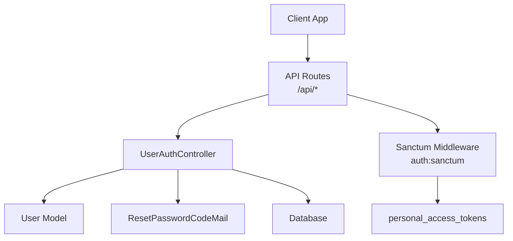
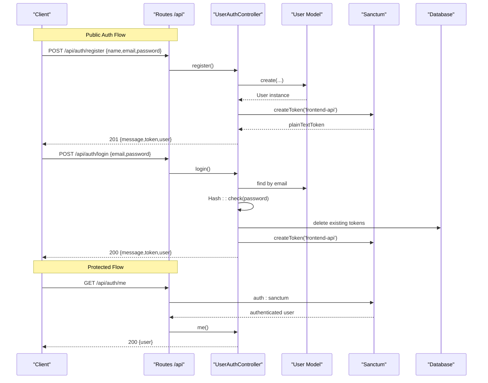
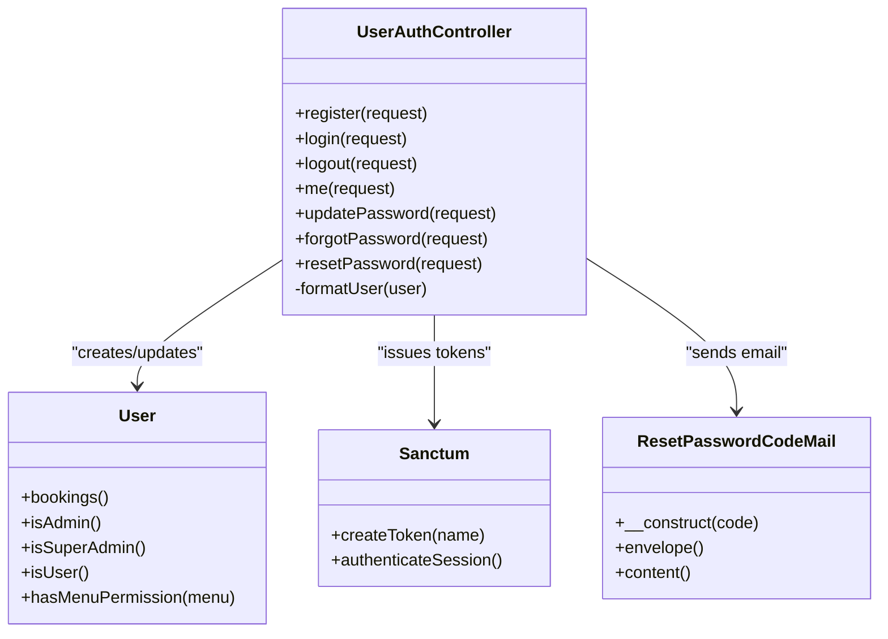

# Authentication API

<cite>
**Referenced Files in This Document**
- [UserAuthController.php](file://backend/app/Http/Controllers/API/UserAuthController.php)
- [api.php](file://backend/routes/api.php)
- [sanctum.php](file://backend/config/sanctum.php)
- [auth.php](file://backend/config/auth.php)
- [User.php](file://backend/app/Models/User.php)
- [ResetPasswordCodeMail.php](file://backend/app/Mail/ResetPasswordCodeMail.php)
- [2026_06_02_071612_create_personal_access_tokens_table.php](file://backend/database/migrations/2026_06_02_071612_create_personal_access_tokens_table.php)
</cite>

## Table of Contents
1. [Introduction](#introduction)
2. [Project Structure](#project-structure)
3. [Core Components](#core-components)
4. [Architecture Overview](#architecture-overview)
5. [Detailed Component Analysis](#detailed-component-analysis)
6. [Dependency Analysis](#dependency-analysis)
7. [Performance Considerations](#performance-considerations)
8. [Troubleshooting Guide](#troubleshooting-guide)
9. [Conclusion](#conclusion)

## Introduction
This document provides detailed API documentation for the authentication endpoints used by the customer-facing application. It covers user registration, login, logout, password reset (forgot and reset), and profile management. It also explains how Sanctum tokens are issued and validated, how CSRF protection works for stateful SPA flows, and how session management is configured. Rate limiting policies and account lockout mechanisms are documented based on the current implementation.

## Project Structure
The authentication endpoints are defined under the API routes and implemented in a dedicated controller. Sanctum configuration controls token behavior and middleware stack. The User model integrates Sanctum’s token support and role checks.

**Diagram sources**
- [api.php:41-75](file://backend/routes/api.php#L41-L75)
- [UserAuthController.php:17-218](file://backend/app/Http/Controllers/API/UserAuthController.php#L17-L218)
- [sanctum.php:21-85](file://backend/config/sanctum.php#L21-L85)
- [2026_06_02_071612_create_personal_access_tokens_table.php:14-23](file://backend/database/migrations/2026_06_02_071612_create_personal_access_tokens_table.php#L14-L23)

**Section sources**
- [api.php:1-77](file://backend/routes/api.php#L1-L77)
- [UserAuthController.php:1-220](file://backend/app/Http/Controllers/API/UserAuthController.php#L1-L220)
- [sanctum.php:1-88](file://backend/config/sanctum.php#L1-L88)
- [User.php:1-76](file://backend/app/Models/User.php#L1-L76)

## Core Components
- Authentication Controller: Implements register, login, logout, me, updatePassword, forgotPassword, and resetPassword.
- API Routes: Group public auth endpoints with rate limiting and protected endpoints with Sanctum.
- Sanctum Configuration: Defines stateful domains, guard, expiration, token prefix, and middleware stack.
- User Model: Provides HasApiTokens integration and role helpers used by the controller.
- Password Reset Email: Mailable class used to send reset codes.
- Personal Access Tokens Migration: Database schema for Sanctum tokens.

**Section sources**
- [UserAuthController.php:17-218](file://backend/app/Http/Controllers/API/UserAuthController.php#L17-L218)
- [api.php:41-75](file://backend/routes/api.php#L41-L75)
- [sanctum.php:21-85](file://backend/config/sanctum.php#L21-L85)
- [User.php:12-15](file://backend/app/Models/User.php#L12-L15)
- [ResetPasswordCodeMail.php:11-53](file://backend/app/Mail/ResetPasswordCodeMail.php#L11-L53)
- [2026_06_02_071612_create_personal_access_tokens_table.php:14-23](file://backend/database/migrations/2026_06_02_071612_create_personal_access_tokens_table.php#L14-L23)

## Architecture Overview
The authentication flow uses Laravel Sanctum for token-based API authentication. Public endpoints (register, login, forgot-password, reset-password) are rate-limited. Protected endpoints (logout, me, updatePassword) require a valid Sanctum bearer token or a stateful session cookie when the request originates from a configured domain.

**Diagram sources**
- [api.php:41-75](file://backend/routes/api.php#L41-L75)
- [UserAuthController.php:17-86](file://backend/app/Http/Controllers/API/UserAuthController.php#L17-L86)
- [sanctum.php:21-85](file://backend/config/sanctum.php#L21-L85)

## Detailed Component Analysis

### Endpoint: Register
- Method: POST
- Path: /api/auth/register
- Authentication: None
- Rate Limiting: 10 attempts per minute per IP
- Request Body Schema:
  - name: string, required, max 100
  - email: string, required, valid email, unique
  - password: string, required, min 6, confirmed
- Response Schema (201 Created):
  - message: string
  - token: string (plain text Sanctum token)
  - user: object
    - id: integer
    - name: string
    - email: string
    - role: string
- Error Responses:
  - 422 Unprocessable Entity: Validation errors (e.g., duplicate email, invalid format)
  - 429 Too Many Requests: Exceeded rate limit

Implementation notes:
- Creates a new user with default role.
- Issues a Sanctum token named frontend-api.
- Returns formatted user data.

**Section sources**
- [api.php:41-46](file://backend/routes/api.php#L41-L46)
- [UserAuthController.php:17-39](file://backend/app/Http/Controllers/API/UserAuthController.php#L17-L39)

### Endpoint: Login
- Method: POST
- Path: /api/auth/login
- Authentication: None
- Rate Limiting: 10 attempts per minute per IP
- Request Body Schema:
  - email: string, required, valid email
  - password: string, required
- Response Schema (200 OK):
  - message: string
  - token: string (plain text Sanctum token)
  - user: object (id, name, email, role)
- Error Responses:
  - 422 Unprocessable Entity: Invalid credentials
  - 403 Forbidden: Admin accounts must sign in through admin portal
  - 429 Too Many Requests: Exceeded rate limit

Implementation notes:
- Validates credentials using hashed password check.
- Revokes existing tokens before issuing a new one.
- Restricts access for non-user roles.

**Section sources**
- [api.php:41-46](file://backend/routes/api.php#L41-L46)
- [UserAuthController.php:41-70](file://backend/app/Http/Controllers/API/UserAuthController.php#L41-L70)
- [User.php:54-57](file://backend/app/Models/User.php#L54-L57)

### Endpoint: Logout
- Method: POST
- Path: /api/auth/logout
- Authentication: Required (Bearer token or stateful session)
- Request Body: None
- Response Schema (200 OK):
  - message: string
- Error Responses:
  - 401 Unauthorized: Missing or invalid token/session

Implementation notes:
- Deletes the current access token associated with the authenticated user.

**Section sources**
- [api.php:63-66](file://backend/routes/api.php#L63-L66)
- [UserAuthController.php:72-79](file://backend/app/Http/Controllers/API/UserAuthController.php#L72-L79)

### Endpoint: Get Current User (Profile Read)
- Method: GET
- Path: /api/auth/me
- Authentication: Required (Bearer token or stateful session)
- Response Schema (200 OK):
  - user: object (id, name, email, role)
- Error Responses:
  - 401 Unauthorized: Missing or invalid token/session

Implementation notes:
- Returns a sanitized user object via formatter.

**Section sources**
- [api.php:63-66](file://backend/routes/api.php#L63-L66)
- [UserAuthController.php:81-86](file://backend/app/Http/Controllers/API/UserAuthController.php#L81-L86)

### Endpoint: Update Password
- Method: POST
- Path: /api/auth/password
- Authentication: Required (Bearer token or stateful session)
- Request Body Schema:
  - current_password: string, required
  - password: string, required, min 6, confirmed
- Response Schema (200 OK):
  - message: string
  - user: object (id, name, email, role)
- Error Responses:
  - 422 Unprocessable Entity: Incorrect current password or validation error
  - 401 Unauthorized: Missing or invalid token/session

Implementation notes:
- Verifies current password before updating.
- Returns fresh user data after update.

**Section sources**
- [api.php:63-66](file://backend/routes/api.php#L63-L66)
- [UserAuthController.php:88-111](file://backend/app/Http/Controllers/API/UserAuthController.php#L88-L111)

### Endpoint: Forgot Password
- Method: POST
- Path: /api/auth/forgot-password
- Authentication: None
- Rate Limiting: 10 attempts per minute per IP
- Request Body Schema:
  - email: string, required, valid email, max 100
- Response Schema (200 OK):
  - message: string
  - code: string (only in local/testing environments)
- Error Responses:
  - 422 Unprocessable Entity: Email not registered as a customer or mail sending failure (non-local)
  - 429 Too Many Requests: Exceeded rate limit

Implementation notes:
- Generates a 6-digit random code.
- Stores hashed code in password_reset_tokens table with creation time.
- Sends email via ResetPasswordCodeMail.
- In local/testing environments, returns the code in response for convenience.

**Section sources**
- [api.php:41-46](file://backend/routes/api.php#L41-L46)
- [UserAuthController.php:113-164](file://backend/app/Http/Controllers/API/UserAuthController.php#L113-L164)
- [ResetPasswordCodeMail.php:11-53](file://backend/app/Mail/ResetPasswordCodeMail.php#L11-L53)
- [auth.php:95-101](file://backend/config/auth.php#L95-L101)

### Endpoint: Reset Password
- Method: POST
- Path: /api/auth/reset-password
- Authentication: None
- Rate Limiting: 10 attempts per minute per IP
- Request Body Schema:
  - email: string, required, valid email, max 100
  - code: string, required
  - password: string, required, min 6, confirmed
- Response Schema (200 OK):
  - message: string
- Error Responses:
  - 422 Unprocessable Entity: Invalid reset code, expired code, or user not found
  - 429 Too Many Requests: Exceeded rate limit

Implementation notes:
- Validates reset code against stored hash.
- Enforces a 60-minute expiry window for reset codes.
- Updates user password and deletes the reset token record upon success.

**Section sources**
- [api.php:41-46](file://backend/routes/api.php#L41-L46)
- [UserAuthController.php:166-208](file://backend/app/Http/Controllers/API/UserAuthController.php#L166-L208)

### Profile Management Notes
- There is no dedicated endpoint to update profile fields such as name or email. Only password updates are supported via /api/auth/password.
- Reading profile data is available via /api/auth/me.

**Section sources**
- [api.php:63-66](file://backend/routes/api.php#L63-L66)
- [UserAuthController.php:81-111](file://backend/app/Http/Controllers/API/UserAuthController.php#L81-L111)

## Dependency Analysis
- Controllers depend on:
  - User model for persistence and role checks.
  - Sanctum for token issuance and validation.
  - Mail service for password reset emails.
  - Database for storing users, tokens, and reset tokens.
- Routes group:
  - Public auth endpoints with throttle middleware.
  - Authenticated endpoints with auth:sanctum middleware.

**Diagram sources**
- [UserAuthController.php:17-218](file://backend/app/Http/Controllers/API/UserAuthController.php#L17-L218)
- [User.php:12-74](file://backend/app/Models/User.php#L12-L74)
- [sanctum.php:21-85](file://backend/config/sanctum.php#L21-L85)
- [ResetPasswordCodeMail.php:11-53](file://backend/app/Mail/ResetPasswordCodeMail.php#L11-L53)

**Section sources**
- [UserAuthController.php:1-220](file://backend/app/Http/Controllers/API/UserAuthController.php#L1-L220)
- [User.php:1-76](file://backend/app/Models/User.php#L1-L76)
- [sanctum.php:1-88](file://backend/config/sanctum.php#L1-L88)
- [ResetPasswordCodeMail.php:1-55](file://backend/app/Mail/ResetPasswordCodeMail.php#L1-L55)

## Performance Considerations
- Rate Limiting:
  - Public auth endpoints are limited to 10 requests per minute per IP.
  - This helps mitigate brute-force attacks on login and registration.
- Token Lifecycle:
  - On login, existing tokens are deleted before issuing a new token to reduce stale token accumulation.
- Password Reset:
  - Reset codes expire after 60 minutes and are deleted after successful use.
- Database Indexes:
  - personal_access_tokens includes an index on expires_at to aid cleanup and queries.

[No sources needed since this section provides general guidance]

## Troubleshooting Guide

Common issues and resolutions:
- Invalid Credentials on Login:
  - The endpoint throws a validation exception with a generic message for security.
  - Ensure the email exists and the password matches the stored hash.
- Admin Accounts Cannot Use Customer Login:
  - Admin or super-admin roles are blocked from the customer login endpoint.
  - Use the admin portal for administrative accounts.
- Password Reset Code Expired:
  - Codes are valid for 60 minutes; request a new code if expired.
- Mail Sending Failures:
  - In non-local environments, failures return a generic error without exposing details.
  - Check mail configuration and logs for delivery issues.
- Token Not Accepted:
  - Ensure the Authorization header contains Bearer <token>.
  - For SPA stateful sessions, ensure the request origin is included in SANCTUM_STATEFUL_DOMAINS.

Security best practices:
- Always use HTTPS in production to protect tokens and passwords in transit.
- Keep SANCTUM_STATEFUL_DOMAINS restricted to trusted origins.
- Avoid logging sensitive data such as reset codes or passwords.
- Rotate or revoke tokens on suspicious activity by deleting user tokens.

Rate limiting policy:
- Public auth endpoints: 10 attempts per minute per IP.
- No explicit per-endpoint throttling for protected endpoints beyond Sanctum’s own safeguards.

Account lockout mechanism:
- There is no built-in account lockout after failed login attempts.
- Mitigation relies on rate limiting and monitoring.

**Section sources**
- [UserAuthController.php:41-70](file://backend/app/Http/Controllers/API/UserAuthController.php#L41-L70)
- [UserAuthController.php:113-208](file://backend/app/Http/Controllers/API/UserAuthController.php#L113-L208)
- [api.php:41-46](file://backend/routes/api.php#L41-L46)
- [sanctum.php:21-26](file://backend/config/sanctum.php#L21-L26)

## Conclusion
The authentication API provides secure, rate-limited endpoints for user registration, login, logout, password reset, and basic profile operations. Sanctum handles token issuance and validation, while Sanctum’s stateful mode supports CSRF protection for SPA clients on configured domains. Administrators are isolated from customer endpoints, and password reset flows include token expiry and safe error handling. For enhanced security, consider adding explicit account lockout logic and stricter rate limits for sensitive endpoints.