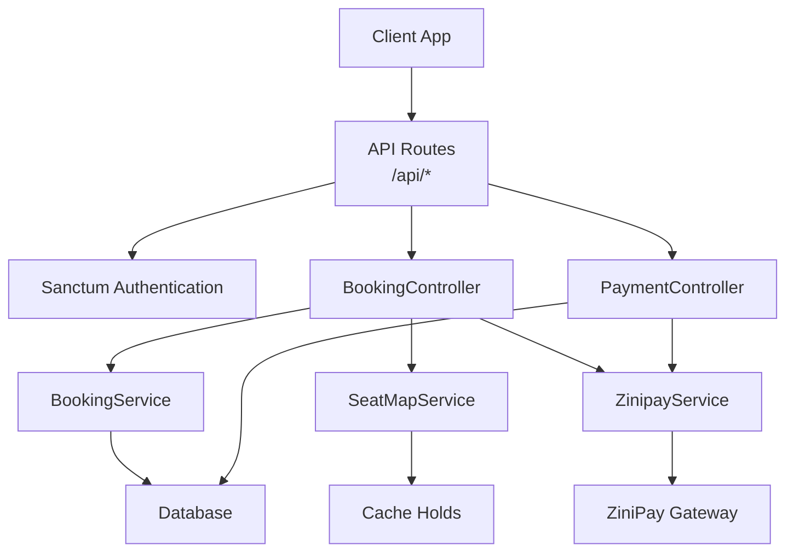
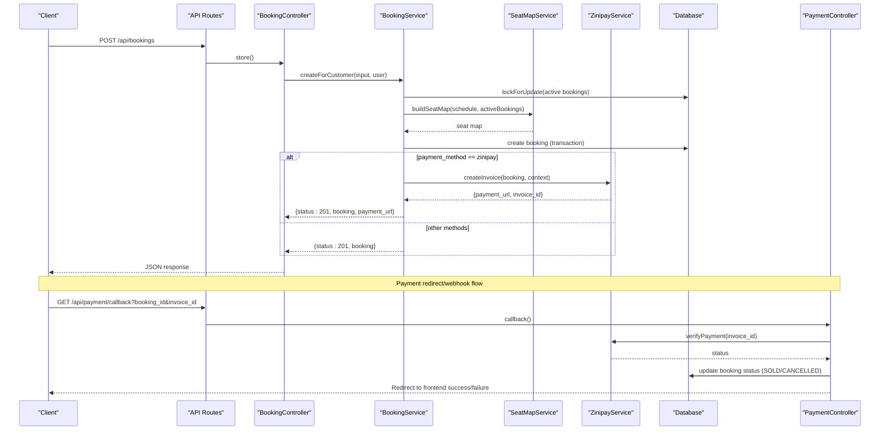
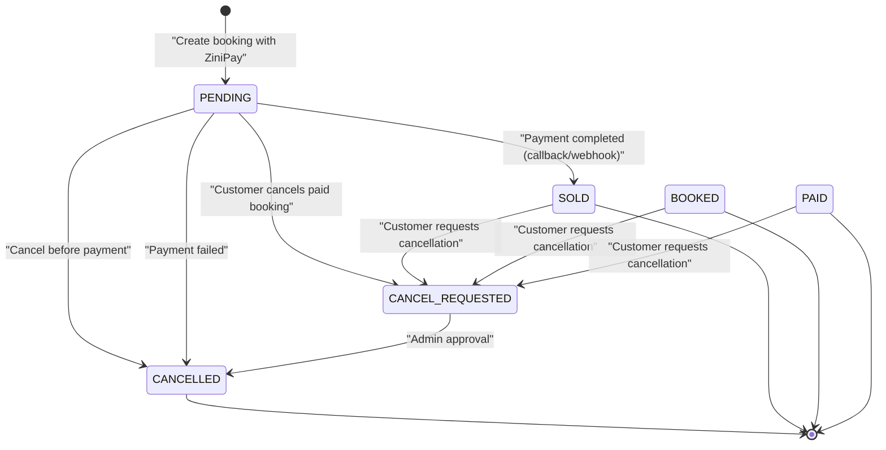
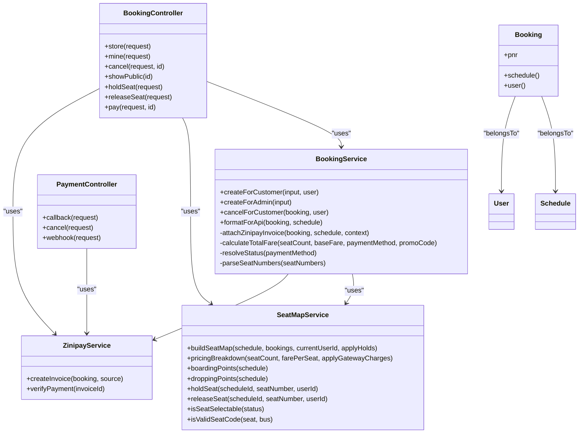

# Booking Management API

<cite>
**Referenced Files in This Document**   
- [BookingController.php](file://backend/app/Http/Controllers/API/BookingController.php)
- [PaymentController.php](file://backend/app/Http/Controllers/PaymentController.php)
- [BookingService.php](file://backend/app/Services/BookingService.php)
- [SeatMapService.php](file://backend/app/Services/SeatMapService.php)
- [ZinipayService.php](file://backend/app/Services/ZinipayService.php)
- [Booking.php](file://backend/app/Models/Booking.php)
- [api.php](file://backend/routes/api.php)
- [booking.php](file://backend/config/booking.php)
- [BookingFlowTest.php](file://backend/tests/Feature/BookingFlowTest.php)
</cite>

## Table of Contents
1. [Introduction](#introduction)
2. [Project Structure](#project-structure)
3. [Core Components](#core-components)
4. [Architecture Overview](#architecture-overview)
5. [Detailed Component Analysis](#detailed-component-analysis)
6. [Dependency Analysis](#dependency-analysis)
7. [Performance Considerations](#performance-considerations)
8. [Troubleshooting Guide](#troubleshooting-guide)
9. [Conclusion](#conclusion)
10. [Appendices](#appendices)

## Introduction
This document provides comprehensive API documentation for booking management endpoints in the bus application. It covers:
- Booking creation, retrieval, cancellation, and payment initiation
- Passenger information, seat selection, and pricing rules
- Booking lifecycle, state transitions, and business rules
- PNR generation, validation, and conflict handling
- Payment integration with ZiniPay, including webhooks and redirects
- Transaction rollback behavior and error responses

The API is implemented in Laravel, uses Sanctum authentication for authenticated customer routes, and exposes RESTful endpoints under `/api`.

## Project Structure
The booking feature spans controllers, services, models, configuration, routing, and tests:
- Controllers expose HTTP endpoints for customers and public access
- Services encapsulate business logic: booking creation, seat availability, pricing, and payment integration
- The model defines the booking entity and PNR generation
- Configuration defines seat rows, default seat class, and service/gateway charges
- Routes define public, authenticated, webhook, and callback endpoints
- Tests validate core flows such as status resolution, promo discounts, seat conflicts, cancel flow, and seat holds

**Diagram sources**
- [api.php:26-75](file://backend/routes/api.php#L26-L75)
- [BookingController.php:10-148](file://backend/app/Http/Controllers/API/BookingController.php#L10-L148)
- [PaymentController.php:11-162](file://backend/app/Http/Controllers/PaymentController.php#L11-L162)
- [BookingService.php:14-335](file://backend/app/Services/BookingService.php#L14-L335)
- [SeatMapService.php:9-593](file://backend/app/Services/SeatMapService.php#L9-L593)
- [ZinipayService.php:9-141](file://backend/app/Services/ZinipayService.php#L9-L141)

**Section sources**
- [api.php:26-75](file://backend/routes/api.php#L26-L75)
- [BookingController.php:10-148](file://backend/app/Http/Controllers/API/BookingController.php#L10-L148)
- [PaymentController.php:11-162](file://backend/app/Http/Controllers/PaymentController.php#L11-L162)

## Core Components
- BookingController: Exposes endpoints for creating bookings, listing user bookings, cancelling bookings, initiating payments, and holding/releasing seats.
- BookingService: Implements booking creation, admin booking creation, cancellation, fare calculation, status resolution, and formatting for API responses.
- SeatMapService: Builds seat maps, calculates pricing, manages boarding/dropping points, validates seat codes, and handles temporary seat holds via cache.
- ZinipayService: Integrates with ZiniPay to create invoices, verify payments, and handle timeouts/errors.
- PaymentController: Handles payment callbacks, cancellations, and asynchronous webhooks from ZiniPay.
- Booking Model: Defines booking attributes, relationships, and PNR generation.
- Configuration: Defines seat rows, default seat class, and charge/discount values used in pricing.

Key responsibilities:
- Validation and authorization at controller layer
- Business rules and transactional operations in service layer
- External integrations isolated in dedicated services
- Public endpoints for webhooks and ticket lookup

**Section sources**
- [BookingController.php:10-148](file://backend/app/Http/Controllers/API/BookingController.php#L10-L148)
- [BookingService.php:14-335](file://backend/app/Services/BookingService.php#L14-L335)
- [SeatMapService.php:9-593](file://backend/app/Services/SeatMapService.php#L9-L593)
- [ZinipayService.php:9-141](file://backend/app/Services/ZinipayService.php#L9-L141)
- [PaymentController.php:11-162](file://backend/app/Http/Controllers/PaymentController.php#L11-L162)
- [Booking.php:8-49](file://backend/app/Models/Booking.php#L8-L49)
- [booking.php:1-11](file://backend/config/booking.php#L1-L11)

## Architecture Overview
The booking architecture follows a layered approach:
- Routing layer groups public, authenticated, and webhook endpoints
- Controller layer validates input and delegates to services
- Service layer enforces business rules, performs database transactions, and coordinates external calls
- Model layer represents persistent entities and computed attributes (PNR)
- Configuration drives pricing and seat layout defaults

**Diagram sources**
- [api.php:54-75](file://backend/routes/api.php#L54-L75)
- [BookingController.php:19-148](file://backend/app/Http/Controllers/API/BookingController.php#L19-L148)
- [BookingService.php:28-131](file://backend/app/Services/BookingService.php#L28-L131)
- [SeatMapService.php:194-244](file://backend/app/Services/SeatMapService.php#L194-L244)
- [ZinipayService.php:27-97](file://backend/app/Services/ZinipayService.php#L27-L97)
- [PaymentController.php:21-66](file://backend/app/Http/Controllers/PaymentController.php#L21-L66)

## Detailed Component Analysis

### Endpoints Reference

#### Create Booking
- Method: POST
- Path: `/api/bookings`
- Authentication: Required (Sanctum)
- Request body fields:
  - schedule_id: integer, required
  - passenger_name: string, max 100
  - passenger_phone: string, max 20
  - passenger_email: string, email, max 100
  - seat_numbers: string, comma-separated, max 255
  - payment_method: string, max 50
  - total_fare: number, optional, min 0
  - passenger_gender: enum M/F, optional
  - boarding_point: string, optional
  - dropping_point: string, optional
  - promo_code: string, optional
  - status: enum PENDING/PAID/SOLD/BOOKED/CANCEL_REQUESTED/CANCELLED, sometimes allowed for admin clients
- Success response:
  - message: string
  - booking: object containing id, pnr, passenger details, seat_numbers, total_fare, payment_method, payment_invoice_id, status, created_at, and schedule details
  - payment_url: string (only when payment_method is zinipay)
  - invoice_id: string (only when payment_method is zinipay)
  - sms: object indicating SMS result
- Error responses:
  - 403: Non-admin attempting cash/manual booking
  - 422: Validation errors or unavailable seats
  - 500: Internal server error

**Section sources**
- [BookingController.php:19-40](file://backend/app/Http/Controllers/API/BookingController.php#L19-L40)
- [BookingService.php:28-131](file://backend/app/Services/BookingService.php#L28-L131)
- [api.php:63-75](file://backend/routes/api.php#L63-L75)

#### Retrieve My Bookings
- Method: GET
- Path: `/api/bookings/mine`
- Authentication: Required (Sanctum)
- Query parameters:
  - page: integer, optional, min 1
  - per_page: integer, optional, min 1, max 50
- Response: Paginated list of formatted bookings with schedule, bus, and route details.

**Section sources**
- [BookingController.php:42-60](file://backend/app/Http/Controllers/API/BookingController.php#L42-L60)
- [BookingService.php:242-281](file://backend/app/Services/BookingService.php#L242-L281)
- [api.php:63-75](file://backend/routes/api.php#L63-L75)

#### Cancel Booking
- Method: POST
- Path: `/api/bookings/{id}/cancel`
- Authentication: Required (Sanctum)
- Success responses:
  - 200: Cancellation immediate for PENDING; returns updated status CANCELLED
  - 200: Cancellation request submitted for paid bookings; returns status CANCEL_REQUESTED
- Error responses:
  - 400: Already cancelled or already requested
  - 403: Not authorized to cancel another user’s booking
  - 404: Booking not found

**Section sources**
- [BookingController.php:62-73](file://backend/app/Http/Controllers/API/BookingController.php#L62-L73)
- [BookingService.php:200-240](file://backend/app/Services/BookingService.php#L200-L240)
- [api.php:63-75](file://backend/routes/api.php#L63-L75)

#### Initiate Payment
- Method: POST
- Path: `/api/bookings/{id}/pay`
- Authentication: Required (Sanctum)
- Precondition checks:
  - Booking exists
  - User owns the booking
  - Booking status is PENDING
  - Payment method is zinipay
- Success response:
  - message: string
  - payment_url: string
  - invoice_id: string
  - booking: formatted booking object
- Error responses:
  - 404: Booking not found
  - 403: Unauthorized
  - 422: Invalid status or payment method
  - 500: Failed to initiate payment

**Section sources**
- [BookingController.php:118-148](file://backend/app/Http/Controllers/API/BookingController.php#L118-L148)
- [api.php:63-75](file://backend/routes/api.php#L63-L75)

#### Hold Seat
- Method: POST
- Path: `/api/seats/hold`
- Authentication: Required (Sanctum)
- Request body:
  - schedule_id: integer
  - seat_number: string
- Success response:
  - success: boolean
  - expires_at: ISO timestamp
- Error response:
  - 422: Seat not available or held by another user

**Section sources**
- [BookingController.php:82-100](file://backend/app/Http/Controllers/API/BookingController.php#L82-L100)
- [SeatMapService.php:502-561](file://backend/app/Services/SeatMapService.php#L502-L561)
- [api.php:63-75](file://backend/routes/api.php#L63-L75)

#### Release Seat
- Method: POST
- Path: `/api/seats/release`
- Authentication: Required (Sanctum)
- Request body:
  - schedule_id: integer
  - seat_number: string
- Success response:
  - success: boolean

**Section sources**
- [BookingController.php:102-116](file://backend/app/Http/Controllers/API/BookingController.php#L102-L116)
- [SeatMapService.php:563-582](file://backend/app/Services/SeatMapService.php#L563-L582)
- [api.php:63-75](file://backend/routes/api.php#L63-L75)

#### Public Booking Lookup
- Method: GET
- Path: `/api/bookings/public/{id}`
- Authentication: None
- Response: Formatted booking object with schedule, bus, and route details.

**Section sources**
- [BookingController.php:75-80](file://backend/app/Http/Controllers/API/BookingController.php#L75-L80)
- [api.php:54-55](file://backend/routes/api.php#L54-L55)

#### Payment Callback
- Method: GET
- Path: `/api/payment/callback`
- Query parameters:
  - booking_id: integer
  - source: string (frontend/admin)
  - invoice_id: string (optional)
- Behavior:
  - Verifies payment via ZiniPay
  - Updates booking status to SOLD on completion
  - Sends SMS verification
  - Redirects to frontend success or failure URL

**Section sources**
- [PaymentController.php:21-66](file://backend/app/Http/Controllers/PaymentController.php#L21-L66)
- [api.php:54-55](file://backend/routes/api.php#L54-L55)

#### Payment Cancel
- Method: GET
- Path: `/api/payment/cancel`
- Query parameters:
  - booking_id: integer
  - source: string (frontend/admin)
- Behavior:
  - Cancels pending bookings
  - Redirects to frontend or admin dashboard

**Section sources**
- [PaymentController.php:68-85](file://backend/app/Http/Controllers/PaymentController.php#L68-L85)
- [api.php:54-55](file://backend/routes/api.php#L54-L55)

#### Payment Webhook
- Method: POST
- Path: `/api/payment/webhook`
- Body:
  - invoice_id: string
  - status: string
- Behavior:
  - Logs payload
  - Verifies payment via ZiniPay
  - Updates booking status to SOLD or CANCELLED
  - Sends SMS verification on successful payment

**Section sources**
- [PaymentController.php:90-136](file://backend/app/Http/Controllers/PaymentController.php#L90-L136)
- [api.php:54-55](file://backend/routes/api.php#L54-L55)

### Data Models and Schemas

#### Booking Entity
- Attributes:
  - id: integer
  - user_id: integer
  - schedule_id: integer
  - passenger_name: string
  - passenger_phone: string
  - passenger_email: string
  - passenger_gender: enum M/F
  - boarding_point: string
  - dropping_point: string
  - seat_class: string
  - seat_numbers: string (comma-separated)
  - total_fare: decimal
  - payment_method: string
  - payment_invoice_id: string
  - status: enum PENDING/PAID/SOLD/BOOKED/CANCEL_REQUESTED/CANCELLED
  - created_at: timestamp
- Relationships:
  - schedule: belongs to Schedule
  - user: belongs to User
- Computed attribute:
  - pnr: string generated as SE followed by zero-padded booking id

**Section sources**
- [Booking.php:8-49](file://backend/app/Models/Booking.php#L8-L49)

#### Pricing Schema
- Inputs:
  - seatCount: integer
  - farePerSeat: float
  - applyGatewayCharges: boolean
- Output:
  - seat_fare: float
  - service_charge: float
  - gateway_charge: float
  - sc_discount: float
  - gc_discount: float
  - total: float

**Section sources**
- [SeatMapService.php:343-365](file://backend/app/Services/SeatMapService.php#L343-L365)
- [booking.php:1-11](file://backend/config/booking.php#L1-L11)

#### Seat Map Schema
- Output:
  - seat_map: object mapping seat code to status key (available, blocked, sold_M, sold_F, booked_M, booked_F)
  - booked_seats: array of seat codes
  - boarding_points: array of objects with id, name, label, value, reporting_time/departure_time
  - dropping_points: array of objects with id, name, label, value, arrival_time
  - seat_class: string
  - pricing: object from pricing schema

**Section sources**
- [SeatMapService.php:367-382](file://backend/app/Services/SeatMapService.php#L367-L382)
- [SeatMapService.php:246-323](file://backend/app/Services/SeatMapService.php#L246-L323)

### Booking Lifecycle and State Transitions

Business rules:
- Cash or manual booking requires admin/super-admin role; otherwise returns 403
- Non-ZiniPay payment methods set status to SOLD immediately
- ZiniPay sets status to PENDING until payment completes
- Customer can cancel PENDING bookings immediately to CANCELLED
- For paid bookings, customer cancellation creates CANCEL_REQUESTED
- Already cancelled or already requested cancellations return 400
- Payment callback/webhook updates status to SOLD on completion and sends SMS
- Payment failure sets status to CANCELLED

**Section sources**
- [BookingService.php:28-131](file://backend/app/Services/BookingService.php#L28-L131)
- [BookingService.php:200-240](file://backend/app/Services/BookingService.php#L200-L240)
- [PaymentController.php:21-66](file://backend/app/Http/Controllers/PaymentController.php#L21-L66)
- [PaymentController.php:90-136](file://backend/app/Http/Controllers/PaymentController.php#L90-L136)

### Complex Booking Scenarios

#### Multi-Passenger Booking with Promo Code
- Select up to 4 seats per booking
- Apply promo discount if valid
- Calculate total fare using pricing breakdown
- If payment_method is zinipay, create invoice and return payment_url
- Otherwise, mark as SOLD and send SMS verification

Validation and constraints:
- Maximum 4 seats enforced
- Promo code applied only if present and valid
- Total fare cannot be negative

**Section sources**
- [BookingService.php:39-83](file://backend/app/Services/BookingService.php#L39-L83)
- [BookingService.php:304-318](file://backend/app/Services/BookingService.php#L304-L318)
- [BookingFlowTest.php:192-237](file://backend/tests/Feature/BookingFlowTest.php#L192-L237)

#### Seat Conflict Handling
- Active bookings include PAID/SOLD/BOOKED and recent PENDING within 10 minutes
- Seat hold mechanism prevents double booking across users
- Blocked seats are excluded from availability
- Recent PENDING bookings block seat holds

Conflict outcomes:
- 422 for unavailable seats
- 422 for seats held by another user
- 422 for blocked seats

**Section sources**
- [SeatMapService.php:194-244](file://backend/app/Services/SeatMapService.php#L194-L244)
- [SeatMapService.php:502-561](file://backend/app/Services/SeatMapService.php#L502-L561)
- [BookingFlowTest.php:260-314](file://backend/tests/Feature/BookingFlowTest.php#L260-L314)
- [BookingFlowTest.php:419-516](file://backend/tests/Feature/BookingFlowTest.php#L419-L516)

#### Payment Integration Flow
- Create invoice via ZiniPay with redirect, cancel, and webhook URLs
- Store invoice_id in booking.payment_invoice_id
- On callback/webhook, verify payment and update status
- Send SMS verification upon successful payment

Error handling:
- Missing API key logs error and returns null
- Timeout and network errors logged
- Invalid invoice_id handled gracefully

**Section sources**
- [ZinipayService.php:27-97](file://backend/app/Services/ZinipayService.php#L27-L97)
- [PaymentController.php:21-66](file://backend/app/Http/Controllers/PaymentController.php#L21-L66)
- [PaymentController.php:90-136](file://backend/app/Http/Controllers/PaymentController.php#L90-L136)

### Transaction Rollback Mechanisms
- Booking creation wraps database operations in a transaction
- Locks active bookings for the schedule to prevent race conditions
- If any step fails (seat validation, invoice creation), the transaction rolls back
- Exceptions are caught and returned as 500 errors with message

Rollback triggers:
- Seat not available
- Invoice creation failure
- Database write failures

**Section sources**
- [BookingService.php:52-131](file://backend/app/Services/BookingService.php#L52-L131)

### PNR Generation and Validation
- PNR format: SE followed by five-digit zero-padded booking id
- Generated as an accessor on the Booking model
- Validated implicitly through test assertions

**Section sources**
- [Booking.php:43-47](file://backend/app/Models/Booking.php#L43-L47)
- [BookingFlowTest.php:579-596](file://backend/tests/Feature/BookingFlowTest.php#L579-L596)

## Dependency Analysis

**Diagram sources**
- [BookingController.php:10-148](file://backend/app/Http/Controllers/API/BookingController.php#L10-L148)
- [BookingService.php:14-335](file://backend/app/Services/BookingService.php#L14-L335)
- [SeatMapService.php:9-593](file://backend/app/Services/SeatMapService.php#L9-L593)
- [ZinipayService.php:9-141](file://backend/app/Services/ZinipayService.php#L9-L141)
- [PaymentController.php:11-162](file://backend/app/Http/Controllers/PaymentController.php#L11-L162)
- [Booking.php:8-49](file://backend/app/Models/Booking.php#L8-L49)

**Section sources**
- [BookingController.php:10-148](file://backend/app/Http/Controllers/API/BookingController.php#L10-L148)
- [BookingService.php:14-335](file://backend/app/Services/BookingService.php#L14-L335)
- [SeatMapService.php:9-593](file://backend/app/Services/SeatMapService.php#L9-L593)
- [ZinipayService.php:9-141](file://backend/app/Services/ZinipayService.php#L9-L141)
- [PaymentController.php:11-162](file://backend/app/Http/Controllers/PaymentController.php#L11-L162)
- [Booking.php:8-49](file://backend/app/Models/Booking.php#L8-L49)

## Performance Considerations
- Use lockForUpdate on active bookings during creation to avoid race conditions
- Limit selected columns for seat map queries to reduce payload size
- Cache-based seat holds expire quickly to minimize memory usage
- Avoid loading full booking rows where possible; use selective column lists
- Timeouts on external payment API calls prevent long-running requests
- Pagination for listing bookings improves client performance

[No sources needed since this section provides general guidance]

## Troubleshooting Guide
Common issues and resolutions:
- 403 Forbidden on booking creation:
  - Cause: Non-admin attempting cash/manual booking
  - Resolution: Ensure admin role or use supported payment methods
- 422 Unprocessable Entity:
  - Cause: Validation errors, unavailable seats, or invalid seat codes
  - Resolution: Validate inputs, check seat availability, ensure seat codes match bus layout
- 404 Not Found:
  - Cause: Booking does not exist
  - Resolution: Verify booking id and ownership
- 400 Bad Request:
  - Cause: Already cancelled or cancellation already requested
  - Resolution: Check current booking status before cancellation
- Payment initiation failures:
  - Cause: Missing API key, network errors, or invalid invoice response
  - Resolution: Configure API key, check logs, retry with exponential backoff
- Webhook not updating booking:
  - Cause: Missing invoice_id or incorrect status
  - Resolution: Verify webhook payload, confirm invoice_id matches booking.payment_invoice_id

Operational tips:
- Monitor logs for ZiniPay integration errors
- Validate environment variables for payment gateway configuration
- Test seat hold/release flows under concurrent load
- Ensure SMS gateway is configured for verification notifications

**Section sources**
- [BookingController.php:19-148](file://backend/app/Http/Controllers/API/BookingController.php#L19-L148)
- [BookingService.php:28-131](file://backend/app/Services/BookingService.php#L28-L131)
- [ZinipayService.php:27-97](file://backend/app/Services/ZinipayService.php#L27-L97)
- [PaymentController.php:21-136](file://backend/app/Http/Controllers/PaymentController.php#L21-L136)

## Conclusion
The Booking Management API provides a robust, secure, and extensible system for managing bus seat reservations. It enforces business rules around seat availability, pricing, and payment workflows while integrating with ZiniPay for secure transactions. The layered architecture ensures clear separation of concerns, making it easier to maintain and extend. Comprehensive tests validate critical flows, ensuring reliability under various scenarios including concurrency, promotions, and payment outcomes.

[No sources needed since this section summarizes without analyzing specific files]

## Appendices

### API Route Summary
- Public:
  - GET /api/site-settings
  - GET /api/stations
  - GET /api/search
  - GET /api/promotions
  - GET /api/promotions/check
  - POST /api/payment/webhook
  - GET /api/bookings/public/{id}
- Authenticated (Sanctum):
  - POST /api/auth/logout
  - GET /api/auth/me
  - POST /api/auth/password
  - POST /api/bookings
  - GET /api/bookings/mine
  - POST /api/bookings/{id}/cancel
  - POST /api/bookings/{id}/pay
  - POST /api/seats/hold
  - POST /api/seats/release

**Section sources**
- [api.php:18-75](file://backend/routes/api.php#L18-L75)