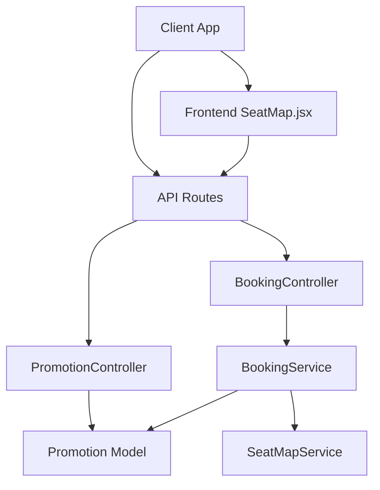
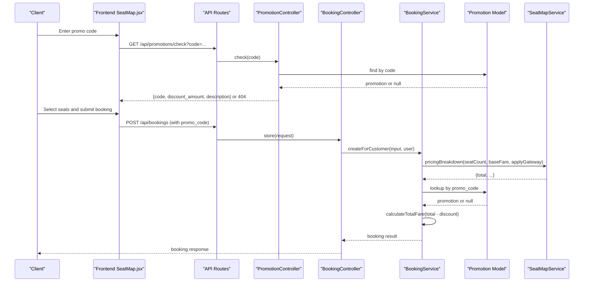
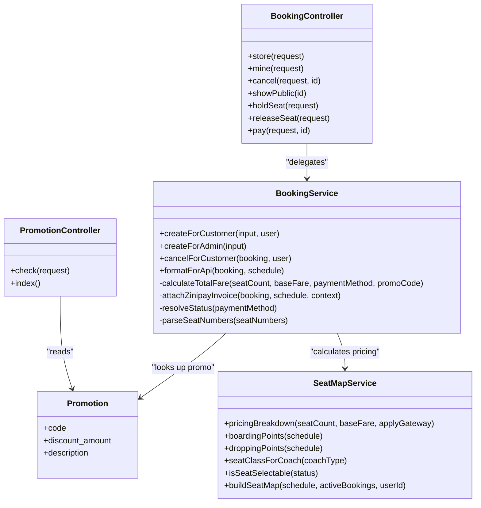

# Promotion & Discount API

<cite>
**Referenced Files in This Document**
- [PromotionController.php](file://backend/app/Http/Controllers/API/PromotionController.php)
- [BookingController.php](file://backend/app/Http/Controllers/API/BookingController.php)
- [BookingService.php](file://backend/app/Services/BookingService.php)
- [Promotion.php](file://backend/app/Models/Promotion.php)
- [2026_06_01_000060_create_promotions_table.php](file://backend/database/migrations/2026_06_01_000060_create_promotions_table.php)
- [api.php](file://backend/routes/api.php)
- [SeatMap.jsx](file://frontend/src/components/SeatMap.jsx)
</cite>

## Table of Contents
1. [Introduction](#introduction)
2. [Project Structure](#project-structure)
3. [Core Components](#core-components)
4. [Architecture Overview](#architecture-overview)
5. [Detailed Component Analysis](#detailed-component-analysis)
6. [Dependency Analysis](#dependency-analysis)
7. [Performance Considerations](#performance-considerations)
8. [Troubleshooting Guide](#troubleshooting-guide)
9. [Conclusion](#conclusion)

## Introduction
This document provides detailed API documentation for promotion and discount management within the bus booking system. It covers:
- Promotion code validation
- Discount application during booking
- Coupon code usage flow
- Promotional pricing calculations
- Request/response schemas for promotions, discounts, and pricing adjustments
- Eligibility criteria, usage limits, and conflict resolution rules
- Examples of promotional workflows and error handling
- Integration with booking calculations

The current implementation exposes public endpoints to list promotions and validate a promo code, and integrates promo codes into the customer booking flow to adjust the final payable amount.

## Project Structure
Promotion-related functionality is implemented across:
- Public API controller for promotions
- Booking controller and service for applying promo codes during booking
- Eloquent model and database migration for storing promotions
- Frontend component that collects and applies promo codes during seat selection

**Diagram sources**
- [api.php:26-32](file://backend/routes/api.php#L26-L32)
- [PromotionController.php:10-37](file://backend/app/Http/Controllers/API/PromotionController.php#L10-L37)
- [BookingController.php:19-39](file://backend/app/Http/Controllers/API/BookingController.php#L19-L39)
- [BookingService.php:78-83](file://backend/app/Services/BookingService.php#L78-L83)
- [SeatMap.jsx:513-534](file://frontend/src/components/SeatMap.jsx#L513-L534)

**Section sources**
- [api.php:26-32](file://backend/routes/api.php#L26-L32)
- [PromotionController.php:10-37](file://backend/app/Http/Controllers/API/PromotionController.php#L10-L37)
- [BookingController.php:19-39](file://backend/app/Http/Controllers/API/BookingController.php#L19-L39)
- [BookingService.php:78-83](file://backend/app/Services/BookingService.php#L78-L83)
- [SeatMap.jsx:513-534](file://frontend/src/components/SeatMap.jsx#L513-L534)

## Core Components
- PromotionController: Exposes public endpoints to list all promotions and validate a promo code by code.
- BookingController: Accepts bookings including an optional promo_code field and delegates creation to BookingService.
- BookingService: Calculates total fare using SeatMapService pricing breakdown and applies promo discount if provided.
- Promotion Model: Represents the promotions table with code, discount_amount, and description.
- Database Migration: Defines the promotions table schema.
- Frontend SeatMap.jsx: Collects promo code input and displays applied promo discount in the pricing summary.

Key responsibilities:
- Validation: The promotion check endpoint validates presence of a code parameter and returns either promotion details or an invalid code response.
- Application: During booking, the service calculates base pricing and subtracts the promo discount when present.
- Presentation: The frontend shows the applied promo discount line item and adjusts the total payable.

**Section sources**
- [PromotionController.php:10-37](file://backend/app/Http/Controllers/API/PromotionController.php#L10-L37)
- [BookingController.php:19-39](file://backend/app/Http/Controllers/API/BookingController.php#L19-L39)
- [BookingService.php:304-318](file://backend/app/Services/BookingService.php#L304-L318)
- [Promotion.php:12-16](file://backend/app/Models/Promotion.php#L12-L16)
- [2026_06_01_000060_create_promotions_table.php:14-20](file://backend/database/migrations/2026_06_01_000060_create_promotions_table.php#L14-L20)
- [SeatMap.jsx:513-534](file://frontend/src/components/SeatMap.jsx#L513-L534)

## Architecture Overview
The promotion and discount workflow spans public API routes, controllers, services, models, and the frontend UI.

**Diagram sources**
- [api.php:26-32](file://backend/routes/api.php#L26-L32)
- [PromotionController.php:10-31](file://backend/app/Http/Controllers/API/PromotionController.php#L10-L31)
- [BookingController.php:19-39](file://backend/app/Http/Controllers/API/BookingController.php#L19-L39)
- [BookingService.php:78-83](file://backend/app/Services/BookingService.php#L78-L83)
- [BookingService.php:304-318](file://backend/app/Services/BookingService.php#L304-L318)
- [SeatMap.jsx:513-534](file://frontend/src/components/SeatMap.jsx#L513-L534)

## Detailed Component Analysis

### Promotion Endpoints
- List Promotions
  - Method: GET
  - Path: /api/promotions
  - Description: Returns all promotions stored in the database.
  - Response: Array of promotion objects containing at least id, code, discount_amount, description, timestamps.

- Check Promotion Code
  - Method: GET
  - Path: /api/promotions/check
  - Query Parameters:
    - code: string, required
  - Description: Validates a promo code and returns its details if found; otherwise returns a 404 with an error message.
  - Success Response Schema:
    - code: string
    - discount_amount: number (decimal)
    - description: string
  - Error Response:
    - Status: 404
    - Body: { message: "Invalid promo code." }

Notes:
- The controller normalizes the code to uppercase before lookup.
- The index method returns all promotions without filtering or pagination.

**Section sources**
- [api.php:30-31](file://backend/routes/api.php#L30-L31)
- [PromotionController.php:10-37](file://backend/app/Http/Controllers/API/PromotionController.php#L10-L37)

### Booking Integration with Promo Codes
- Create Booking
  - Method: POST
  - Path: /api/bookings
  - Authentication: Required via Sanctum middleware for authenticated customers.
  - Request Fields:
    - schedule_id: integer, required
    - passenger_name: string, required
    - passenger_phone: string, required
    - passenger_email: string, required
    - seat_numbers: string, required (comma-separated)
    - payment_method: string, required
    - total_fare: number, optional (client may pass calculated total)
    - passenger_gender: string, optional (M/F)
    - boarding_point: string, optional
    - dropping_point: string, optional
    - promo_code: string, optional
  - Behavior:
    - The controller validates inputs and delegates to BookingService.createForCustomer.
    - The service calculates total fare using SeatMapService.pricingBreakdown and applies promo discount if promo_code is provided.
    - If promo_code exists in the promotions table, the discount_amount is subtracted from the total fare, ensuring it does not go below zero.

- Pricing Calculation Flow
  - Base pricing is computed by SeatMapService based on seat count, base fare, and whether gateway charges apply.
  - If promo_code is present, the service looks up the promotion by code (case-insensitive due to uppercase normalization).
  - The final total fare is max(0, base_total - discount_amount).

- Response:
  - On success: 201 with booking object and SMS status.
  - On errors: Various 4xx responses for validation failures, seat availability issues, authorization, etc.

**Section sources**
- [api.php:63-75](file://backend/routes/api.php#L63-L75)
- [BookingController.php:19-39](file://backend/app/Http/Controllers/API/BookingController.php#L19-L39)
- [BookingService.php:78-83](file://backend/app/Services/BookingService.php#L78-L83)
- [BookingService.php:304-318](file://backend/app/Services/BookingService.php#L304-L318)

### Promotion Data Model and Schema
- Model: Promotion
  - Fillable fields: code, discount_amount, description
  - Casting: discount_amount cast to decimal with two precision places

- Database Table: promotions
  - Columns:
    - id: auto-increment primary key
    - code: unique string
    - discount_amount: decimal(8,2)
    - description: string
    - timestamps: created_at, updated_at

Implications:
- Each promotion has a unique code.
- Discounts are monetary amounts subtracted from the total fare.
- No explicit validity period, usage limits, or eligibility constraints are modeled in the current schema.

**Section sources**
- [Promotion.php:12-16](file://backend/app/Models/Promotion.php#L12-L16)
- [2026_06_01_000060_create_promotions_table.php:14-20](file://backend/database/migrations/2026_06_01_000060_create_promotions_table.php#L14-L20)

### Frontend Promo Code Usage
- The SeatMap component includes a form to enter a promo code and an Apply button.
- When applied, the component displays the promo discount line item and updates the total payable accordingly.
- The frontend expects the backend to return discount_amount for valid codes.

Behavioral notes:
- The promo input is disabled until seats are selected.
- The applied promo discount is shown only when greater than zero.

**Section sources**
- [SeatMap.jsx:513-534](file://frontend/src/components/SeatMap.jsx#L513-L534)
- [SeatMap.jsx:595-604](file://frontend/src/components/SeatMap.jsx#L595-L604)

## Dependency Analysis
Promotion and discount logic depends on:
- API routing layer exposing public promotion endpoints and authenticated booking endpoints.
- Controllers handling request validation and delegating business logic.
- Services orchestrating pricing calculation and promo application.
- Models representing persistent data.
- Frontend components collecting user inputs and displaying results.

**Diagram sources**
- [PromotionController.php:10-37](file://backend/app/Http/Controllers/API/PromotionController.php#L10-L37)
- [BookingController.php:19-39](file://backend/app/Http/Controllers/API/BookingController.php#L19-L39)
- [BookingService.php:28-131](file://backend/app/Services/BookingService.php#L28-L131)
- [BookingService.php:304-318](file://backend/app/Services/BookingService.php#L304-L318)
- [Promotion.php:12-16](file://backend/app/Models/Promotion.php#L12-L16)

**Section sources**
- [PromotionController.php:10-37](file://backend/app/Http/Controllers/API/PromotionController.php#L10-L37)
- [BookingController.php:19-39](file://backend/app/Http/Controllers/API/BookingController.php#L19-L39)
- [BookingService.php:28-131](file://backend/app/Services/BookingService.php#L28-L131)
- [BookingService.php:304-318](file://backend/app/Services/BookingService.php#L304-L318)
- [Promotion.php:12-16](file://backend/app/Models/Promotion.php#L12-L16)

## Performance Considerations
- Promotion lookup is a simple query by unique code; ensure the code column remains indexed (unique constraint implies indexing).
- Listing all promotions via index may be inefficient for large datasets; consider pagination or caching strategies if needed.
- Booking creation uses database transactions and row-level locking to prevent race conditions on seat availability; promo lookup occurs within this transaction.
- Avoid excessive client-side recalculations; rely on server-side pricing and promo application for consistency.

[No sources needed since this section provides general guidance]

## Troubleshooting Guide
Common issues and resolutions:
- Invalid promo code
  - Symptom: GET /api/promotions/check returns 404 with message indicating invalid promo code.
  - Resolution: Verify the code exists in the promotions table and matches exactly (case-insensitive due to uppercase normalization).

- Promo discount not applied
  - Symptom: Booking total remains unchanged after providing promo_code.
  - Resolution: Ensure promo_code is included in the booking request payload and that the code exists in the promotions table. Confirm that the service’s calculateTotalFare path is executed (it subtracts discount_amount and floors at zero).

- Negative total fare prevented
  - Symptom: Total fare becomes negative with large discounts.
  - Resolution: The service enforces max(0, total - discount), so totals will never be negative. Adjust discount_amount accordingly.

- Frontend not showing promo discount
  - Symptom: Promo discount line item not visible in the pricing summary.
  - Resolution: Ensure the backend returns discount_amount > 0 for the given code and that the frontend receives and renders the appliedPromo object.

**Section sources**
- [PromotionController.php:18-30](file://backend/app/Http/Controllers/API/PromotionController.php#L18-L30)
- [BookingService.php:304-318](file://backend/app/Services/BookingService.php#L304-L318)
- [SeatMap.jsx:513-534](file://frontend/src/components/SeatMap.jsx#L513-L534)

## Conclusion
The promotion and discount system currently supports:
- Listing promotions
- Validating promo codes
- Applying fixed monetary discounts during booking
- Preventing negative totals after discount application

Limitations include:
- No built-in validity periods, usage limits, or eligibility filters in the model or service
- No conflict resolution between multiple promotions (only one promo code is supported per booking)
- No percentage-based discounts or tiered rules

Recommendations for future enhancements:
- Add validity windows and usage counters to the Promotion model
- Introduce promotion types (percentage vs. fixed amount)
- Implement promotion precedence and conflict resolution rules
- Add promotion eligibility criteria (e.g., route-specific, user-specific)
- Provide admin endpoints to manage promotions securely

[No sources needed since this section summarizes without analyzing specific files]