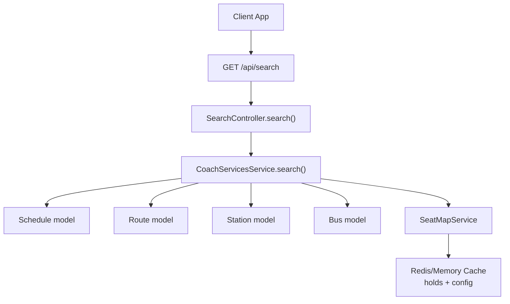
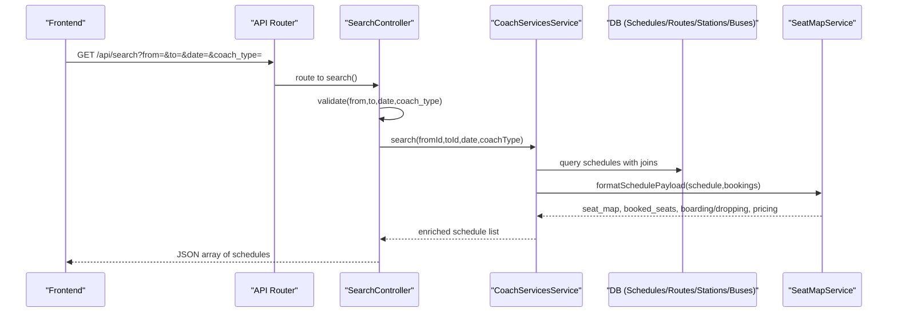
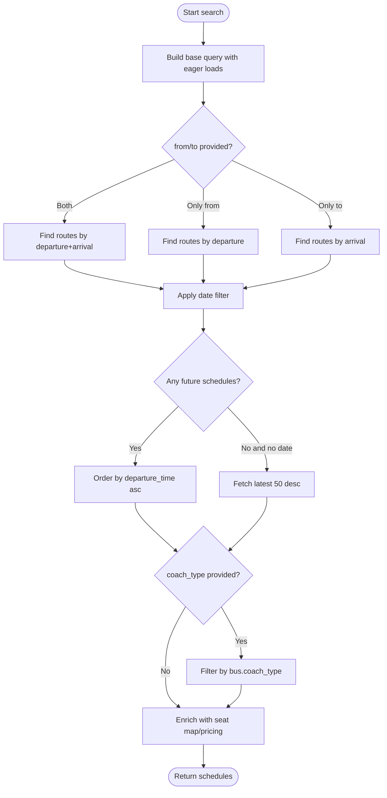
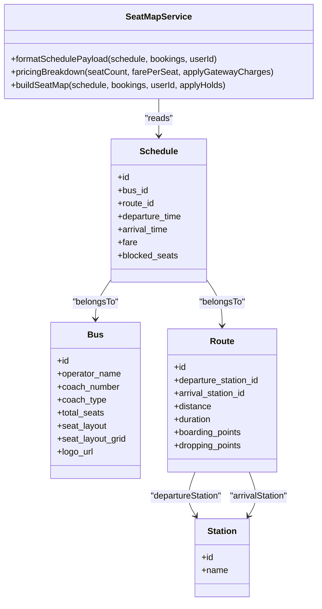
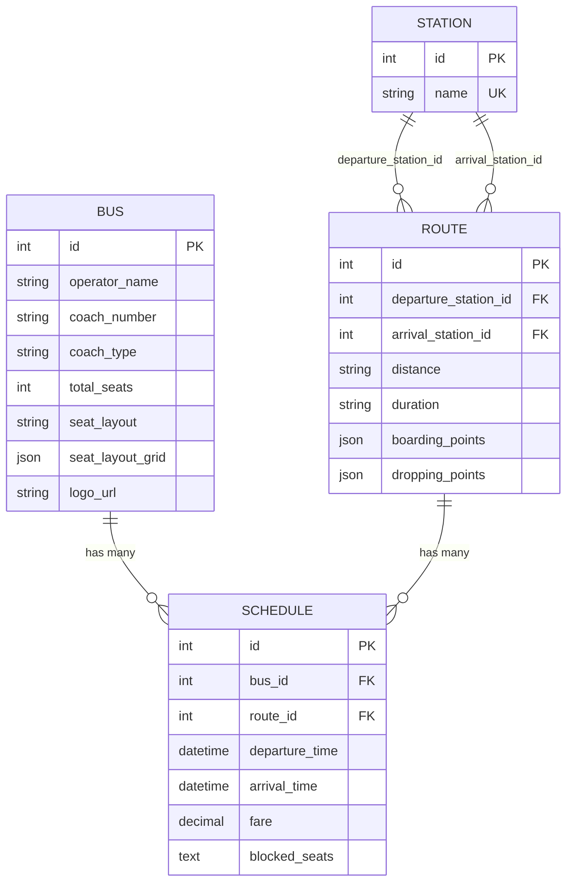
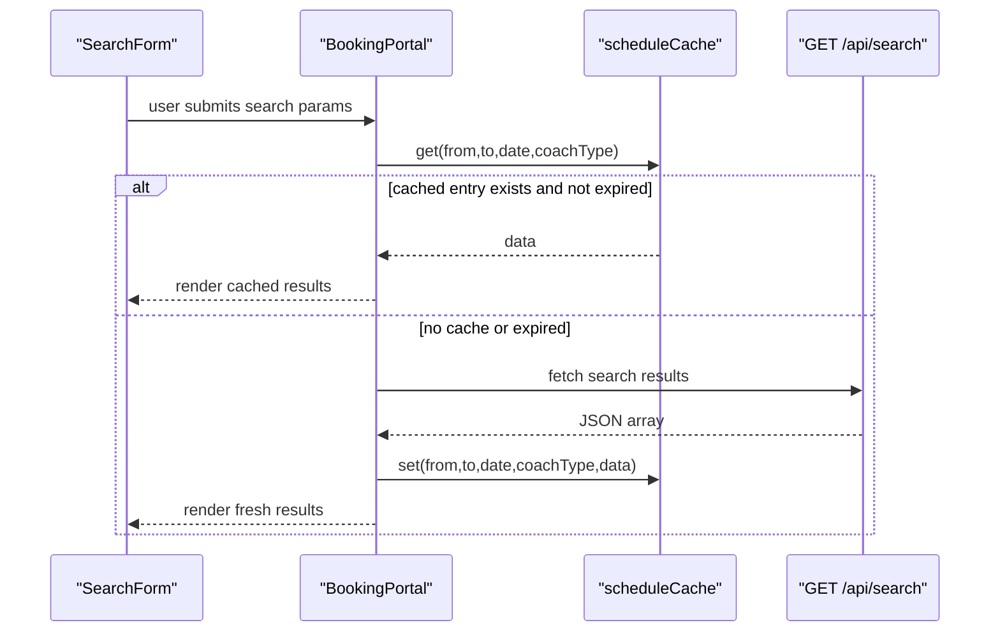
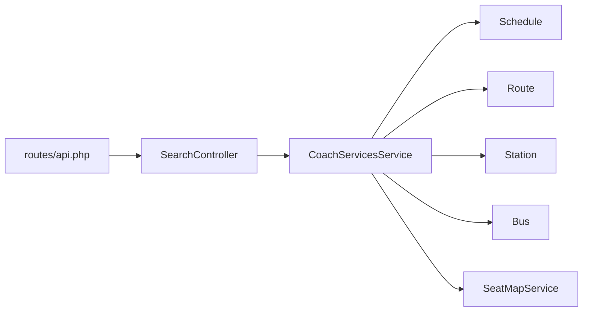

# Search & Discovery API

<cite>
**Referenced Files in This Document**
- [api.php](file://backend/routes/api.php)
- [SearchController.php](file://backend/app/Http/Controllers/API/SearchController.php)
- [CoachServicesService.php](file://backend/app/Services/CoachServicesService.php)
- [SeatMapService.php](file://backend/app/Services/SeatMapService.php)
- [Schedule.php](file://backend/app/Models/Schedule.php)
- [Route.php](file://backend/app/Models/Route.php)
- [Station.php](file://backend/app/Models/Station.php)
- [Bus.php](file://backend/app/Models/Bus.php)
- [2026_06_01_000010_create_stations_table.php](file://backend/database/migrations/2026_06_01_000010_create_stations_table.php)
- [2026_06_01_000030_create_routes_table.php](file://backend/database/migrations/2026_06_01_000030_create_routes_table.php)
- [2026_06_01_000040_create_schedules_table.php](file://backend/database/migrations/2026_06_01_000040_create_schedules_table.php)
- [SearchForm.jsx](file://frontend/src/components/SearchForm.jsx)
- [BookingPortal.jsx](file://frontend/src/components/BookingPortal.jsx)
- [scheduleCache.js](file://frontend/src/scheduleCache.js)
- [customer-api.js](file://k6/lib/customer-api.js)
</cite>

## Table of Contents
1. [Introduction](#introduction)
2. [Project Structure](#project-structure)
3. [Core Components](#core-components)
4. [Architecture Overview](#architecture-overview)
5. [Detailed Component Analysis](#detailed-component-analysis)
6. [Dependency Analysis](#dependency-analysis)
7. [Performance Considerations](#performance-considerations)
8. [Troubleshooting Guide](#troubleshooting-guide)
9. [Conclusion](#conclusion)

## Introduction
This document describes the Search & Discovery API for bus schedules, focusing on route search, schedule filtering, price comparison, and availability checking. It covers request parameters (origin/destination, date ranges, coach type), search algorithms, result sorting, pagination behavior, example queries, performance optimization techniques, and caching strategies used by both frontend and backend.

## Project Structure
The search feature spans a small set of backend routes/controllers/services and models, plus a frontend search form and cache layer:
- Public API route exposes GET /api/search.
- Controller validates inputs and delegates to CoachServicesService.
- Service queries Schedule with related Bus, Route, Stations, and paid bookings; builds seat maps and pricing.
- Models define relationships between Station, Route, Bus, and Schedule.
- Frontend provides a search form and caches results client-side.

**Diagram sources**
- [api.php:26-32](file://backend/routes/api.php#L26-L32)
- [SearchController.php:14-31](file://backend/app/Http/Controllers/API/SearchController.php#L14-L31)
- [CoachServicesService.php:19-124](file://backend/app/Services/CoachServicesService.php#L19-L124)
- [SeatMapService.php:367-382](file://backend/app/Services/SeatMapService.php#L367-L382)

**Section sources**
- [api.php:26-32](file://backend/routes/api.php#L26-L32)
- [SearchController.php:14-31](file://backend/app/Http/Controllers/API/SearchController.php#L14-L31)

## Core Components
- Public endpoint: GET /api/search under maintenance-mode middleware.
- Controller: Validates from/to/date/coach_type and returns JSON.
- Service: Filters schedules by route(s), date window, optional coach type; enriches with seat map, pricing, boarding/dropping points; sorts by departure_time ascending.
- Seat Map Service: Builds seat status map, computes pricing breakdown, formats boarding/dropping points.

Key responsibilities:
- Validation and routing: [SearchController.php:14-31](file://backend/app/Http/Controllers/API/SearchController.php#L14-L31), [api.php:26-32](file://backend/routes/api.php#L26-L32)
- Search algorithm and enrichment: [CoachServicesService.php:19-124](file://backend/app/Services/CoachServicesService.php#L19-L124)
- Seat map and pricing: [SeatMapService.php:367-382](file://backend/app/Services/SeatMapService.php#L367-L382)

**Section sources**
- [SearchController.php:14-31](file://backend/app/Http/Controllers/API/SearchController.php#L14-L31)
- [CoachServicesService.php:19-124](file://backend/app/Services/CoachServicesService.php#L19-L124)
- [SeatMapService.php:367-382](file://backend/app/Services/SeatMapService.php#L367-L382)

## Architecture Overview
End-to-end flow for a search request:

**Diagram sources**
- [api.php:26-32](file://backend/routes/api.php#L26-L32)
- [SearchController.php:14-31](file://backend/app/Http/Controllers/API/SearchController.php#L14-L31)
- [CoachServicesService.php:19-124](file://backend/app/Services/CoachServicesService.php#L19-L124)
- [SeatMapService.php:367-382](file://backend/app/Services/SeatMapService.php#L367-L382)

## Detailed Component Analysis

### Endpoint: GET /api/search
- Path: /api/search
- Method: GET
- Authentication: None (public)
- Maintenance mode: Protected by CheckMaintenanceMode middleware group

Request parameters:
- from (required): station id (integer). Validated against stations table.
- to (required): station id (integer). Validated against stations table.
- date (required): journey date in YYYY-MM-DD.
- coach_type (optional): filter by bus coach type (e.g., AC or Non AC).

Response:
- Array of schedule objects including:
  - id, departure_time, arrival_time, fare
  - bus details (operator_name, coach_number, coach_type, total_seats, seat_layout, seat_layout_grid, logo_url)
  - route details (distance, duration, from, to)
  - seat_map, booked_seats, boarding_points, dropping_points
  - seat_class, pricing (per-seat breakdown)
  - available_seats_count
  - seat_bookings (only when includeSeatBookings is true internally; not exposed via this endpoint)

Sorting:
- Results are sorted by departure_time ascending.

Pagination:
- No server-side pagination is implemented for this endpoint. The service may return all matching schedules. A fallback path returns up to 50 most recent schedules when no future schedules exist and no specific date is requested.

Example requests:
- Basic route search: GET /api/search?from=1&to=2&date=2026-01-01
- Filter by coach type: GET /api/search?from=1&to=2&date=2026-01-01&coach_type=AC

Complex queries:
- Combine origin/destination with coach type and exact date to narrow results.
- Use multiple sequential searches with different dates to compare prices across days.

Error handling:
- Validation errors for missing or invalid from/to/date will be returned by Laravel’s validator.
- If no routes match the provided stations, an empty array is returned.

**Section sources**
- [api.php:26-32](file://backend/routes/api.php#L26-L32)
- [SearchController.php:14-31](file://backend/app/Http/Controllers/API/SearchController.php#L14-L31)
- [CoachServicesService.php:19-124](file://backend/app/Services/CoachServicesService.php#L19-L124)

### Search Algorithm and Filtering Logic
The search algorithm performs:
- Route identification:
  - If both from and to are provided, find routes where departure_station_id = from and arrival_station_id = to.
  - If only from is provided, find routes departing from that station.
  - If only to is provided, find routes arriving at that station.
- Date filtering:
  - If date is provided, filter schedules where departure_time falls within the start/end of that day.
  - If date is omitted, default to today and select schedules with departure_time >= start of today.
- Fallback behavior:
  - If no future schedules exist and no specific date was requested, fetch up to 50 latest schedules ordered by departure_time descending.
- Coach type filtering:
  - If coach_type is provided and not “All”, filter schedules by bus.coach_type case-insensitively.
- Enrichment:
  - For each schedule, build seat map, compute pricing, and assemble boarding/dropping points.

**Diagram sources**
- [CoachServicesService.php:19-124](file://backend/app/Services/CoachServicesService.php#L19-L124)

**Section sources**
- [CoachServicesService.php:19-124](file://backend/app/Services/CoachServicesService.php#L19-L124)

### Price Comparison and Availability Checking
- Fare per schedule is included in the response.
- Pricing breakdown per seat is computed by SeatMapService.pricingBreakdown using configuration values for service charge, gateway charge, and discounts.
- Availability:
  - seat_map indicates per-seat status (available, blocked, sold_* or booked_* based on gender).
  - booked_seats lists occupied seats.
  - available_seats_count counts seats marked available.
  - Holds from other users are reflected in seat_map unless explicitly disabled during certain operations.

**Diagram sources**
- [Schedule.php:8-34](file://backend/app/Models/Schedule.php#L8-L34)
- [Bus.php:8-22](file://backend/app/Models/Bus.php#L8-L22)
- [Route.php:8-40](file://backend/app/Models/Route.php#L8-L40)
- [Station.php:8-23](file://backend/app/Models/Station.php#L8-L23)
- [SeatMapService.php:367-382](file://backend/app/Services/SeatMapService.php#L367-L382)

**Section sources**
- [SeatMapService.php:343-382](file://backend/app/Services/SeatMapService.php#L343-L382)
- [SeatMapService.php:194-244](file://backend/app/Services/SeatMapService.php#L194-L244)

### Data Model Relationships Relevant to Search
- Station has many routes as departure and arrival endpoints.
- Route connects departure and arrival stations and has many schedules.
- Bus has many schedules.
- Schedule belongs to Bus and Route and has many bookings.

**Diagram sources**
- [2026_06_01_000010_create_stations_table.php:11-15](file://backend/database/migrations/2026_06_01_000010_create_stations_table.php#L11-L15)
- [2026_06_01_000030_create_routes_table.php:14-28](file://backend/database/migrations/2026_06_01_000030_create_routes_table.php#L14-L28)
- [2026_06_01_000040_create_schedules_table.php:14-30](file://backend/database/migrations/2026_06_01_000040_create_schedules_table.php#L14-L30)
- [Bus.php:8-22](file://backend/app/Models/Bus.php#L8-L22)
- [Route.php:8-40](file://backend/app/Models/Route.php#L8-L40)
- [Schedule.php:8-34](file://backend/app/Models/Schedule.php#L8-L34)

**Section sources**
- [2026_06_01_000010_create_stations_table.php:11-15](file://backend/database/migrations/2026_06_01_000010_create_stations_table.php#L11-L15)
- [2026_06_01_000030_create_routes_table.php:14-28](file://backend/database/migrations/2026_06_01_000030_create_routes_table.php#L14-L28)
- [2026_06_01_000040_create_schedules_table.php:14-30](file://backend/database/migrations/2026_06_01_000040_create_schedules_table.php#L14-L30)

### Frontend Integration and Caching Strategy
- SearchForm collects from, to, date, and coach_type.
- BookingPortal calls GET /api/search with these parameters and updates local state.
- scheduleCache stores results keyed by from, to, date, coach_type with TTL-based expiration.

**Diagram sources**
- [SearchForm.jsx:1-109](file://frontend/src/components/SearchForm.jsx#L1-L109)
- [BookingPortal.jsx:349-379](file://frontend/src/components/BookingPortal.jsx#L349-L379)
- [scheduleCache.js:1-64](file://frontend/src/scheduleCache.js#L1-L64)

**Section sources**
- [SearchForm.jsx:1-109](file://frontend/src/components/SearchForm.jsx#L1-L109)
- [BookingPortal.jsx:349-379](file://frontend/src/components/BookingPortal.jsx#L349-L379)
- [scheduleCache.js:1-64](file://frontend/src/scheduleCache.js#L1-L64)

## Dependency Analysis
- Route registration depends on api.php grouping public routes under maintenance-mode middleware.
- SearchController depends on CoachServicesService for business logic.
- CoachServicesService depends on Eloquent models (Schedule, Route, Station, Bus) and SeatMapService for enrichment.
- SeatMapService uses application cache for holds and configuration for pricing.

**Diagram sources**
- [api.php:26-32](file://backend/routes/api.php#L26-L32)
- [SearchController.php:14-31](file://backend/app/Http/Controllers/API/SearchController.php#L14-L31)
- [CoachServicesService.php:19-124](file://backend/app/Services/CoachServicesService.php#L19-L124)

**Section sources**
- [api.php:26-32](file://backend/routes/api.php#L26-L32)
- [SearchController.php:14-31](file://backend/app/Http/Controllers/API/SearchController.php#L14-L31)
- [CoachServicesService.php:19-124](file://backend/app/Services/CoachServicesService.php#L19-L124)

## Performance Considerations
- Database indexes:
  - routes: departure_station_id, arrival_station_id, composite (departure_station_id, arrival_station_id).
  - schedules: bus_id, route_id, departure_time, composite (route_id, departure_time), composite (bus_id, departure_time).
- Query efficiency:
  - Eager loading of bus, route.departureStation, route.arrivalStation, and bookings avoids N+1 queries.
  - Paid bookings scope selects only necessary columns to reduce payload size.
- Sorting and fallback:
  - Ascending sort by departure_time ensures chronological ordering.
  - Fallback fetch of latest 50 schedules prevents long waits when no future schedules exist.
- Frontend caching:
  - scheduleCache reduces repeated network calls with TTL-based entries.
- Load testing:
  - k6 scenario for coach search demonstrates high-volume lookups.

Recommendations:
- Keep date filters precise to limit time-range scans.
- Prefer specifying both from and to to leverage composite indexes on routes.
- Avoid unnecessary includes of seat_bookings unless required by admin flows.
- Tune cache TTL in scheduleCache to balance freshness vs. performance.

**Section sources**
- [2026_06_01_000030_create_routes_table.php:24-28](file://backend/database/migrations/2026_06_01_000030_create_routes_table.php#L24-L28)
- [2026_06_01_000040_create_schedules_table.php:24-30](file://backend/database/migrations/2026_06_01_000040_create_schedules_table.php#L24-L30)
- [CoachServicesService.php:21-72](file://backend/app/Services/CoachServicesService.php#L21-L72)
- [SeatMapService.php:38-47](file://backend/app/Services/SeatMapService.php#L38-L47)
- [scheduleCache.js:1-64](file://frontend/src/scheduleCache.js#L1-L64)
- [coach_search.js](file://k6/scenarios/coach_search.js)

## Troubleshooting Guide
Common issues and resolutions:
- Validation failures:
  - Missing or invalid from/to/date triggers validation errors. Ensure station ids exist and date matches YYYY-MM-DD.
- Empty results:
  - No routes match the provided stations or no schedules fall within the date window. Verify station ids and date range.
- Stale cache:
  - Frontend may show outdated results if cache TTL is too long. Clear or invalidate cache entries for the specific query.
- Seat availability discrepancies:
  - Holds from other users can mark seats as blocked. Refresh the seat map or wait for hold expiration.

Operational checks:
- Confirm routes exist for given stations.
- Validate schedule departure times relative to current time.
- Inspect cache keys and TTLs in scheduleCache.

**Section sources**
- [SearchController.php:16-21](file://backend/app/Http/Controllers/API/SearchController.php#L16-L21)
- [CoachServicesService.php:28-72](file://backend/app/Services/CoachServicesService.php#L28-L72)
- [scheduleCache.js:1-64](file://frontend/src/scheduleCache.js#L1-L64)

## Conclusion
The Search & Discovery API provides a focused, efficient interface for finding bus schedules by route and date, with optional coach type filtering. Results are enriched with seat availability and pricing information, enabling robust frontends to display real-time availability and perform price comparisons. Proper indexing, eager loading, and client-side caching ensure good performance under load. For advanced needs like pagination or multi-date batch queries, consider extending the service layer while preserving the existing validation and enrichment patterns.