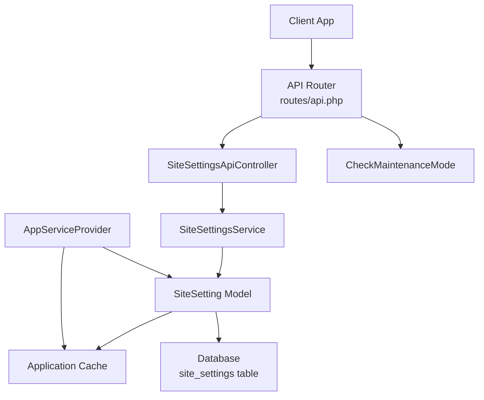
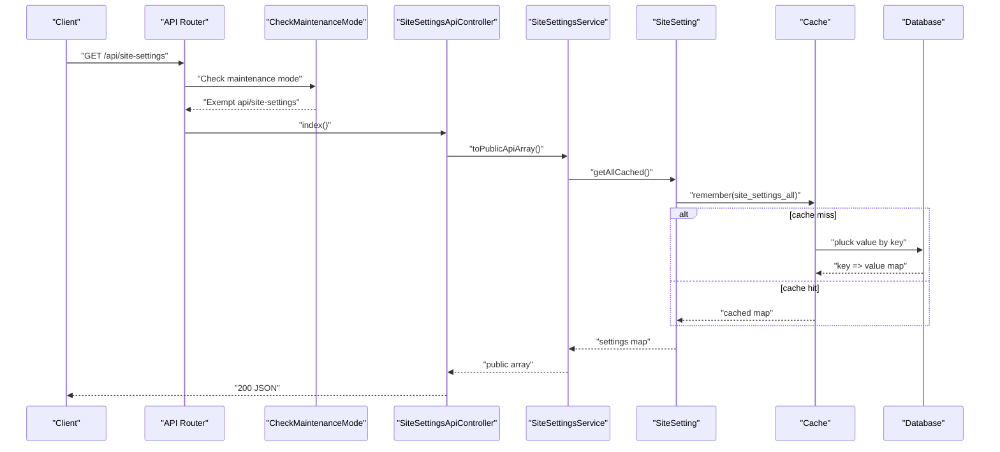
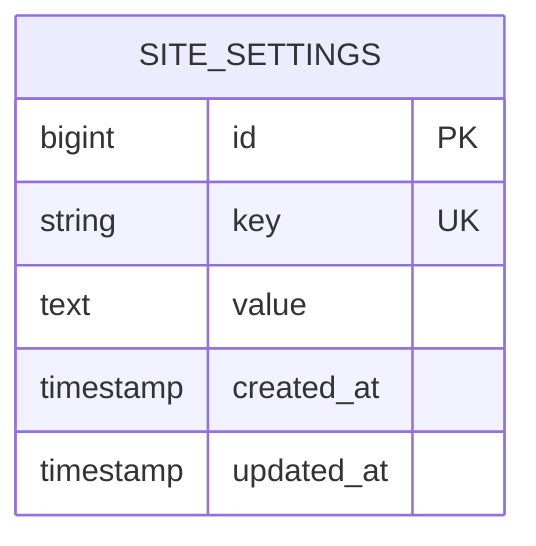
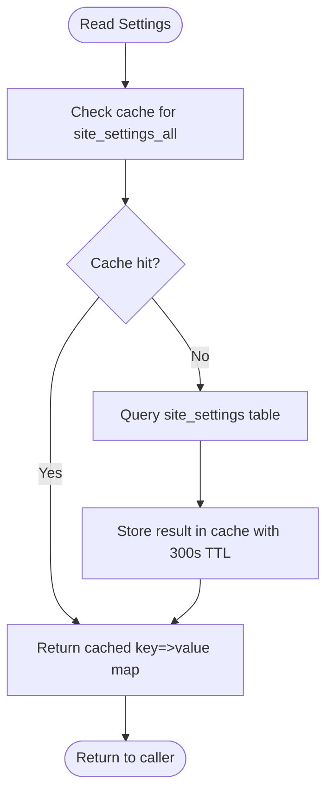
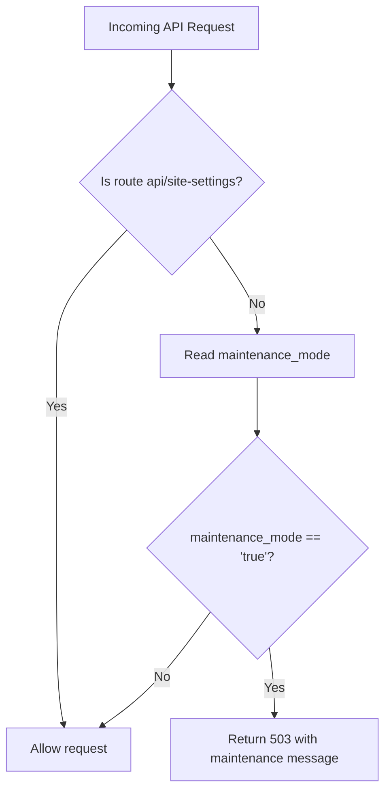
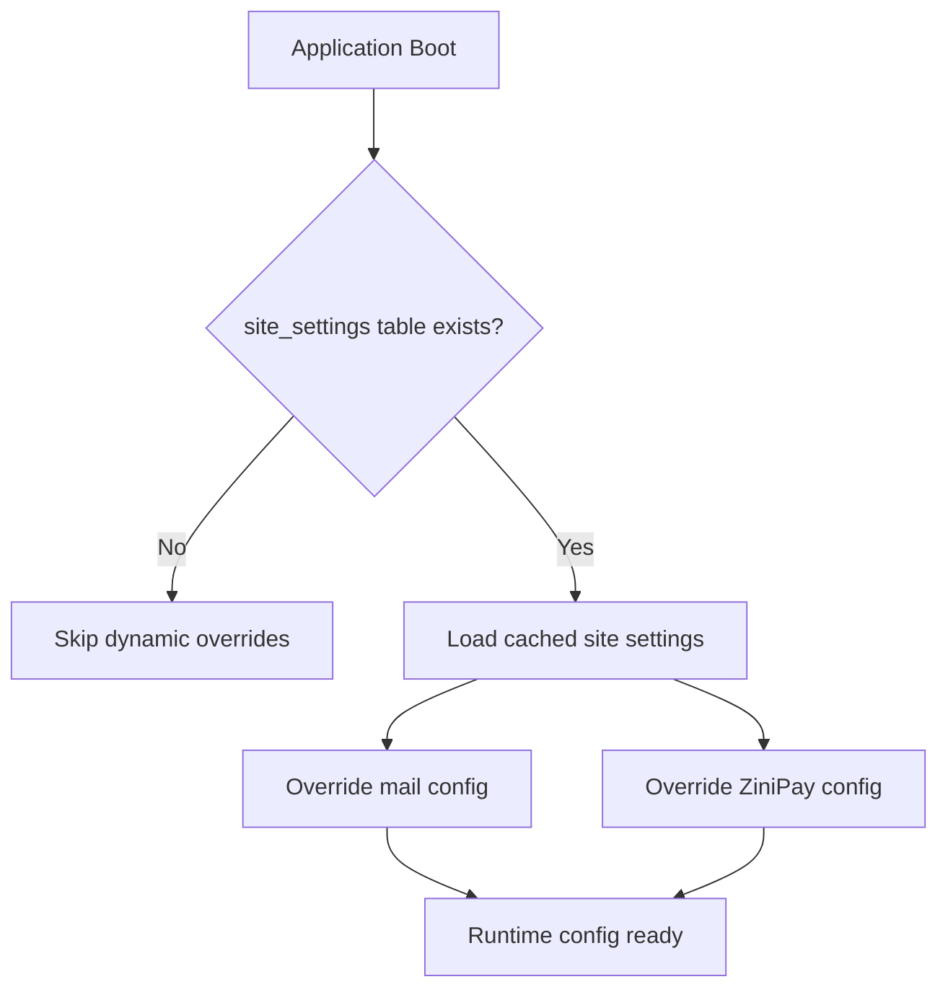
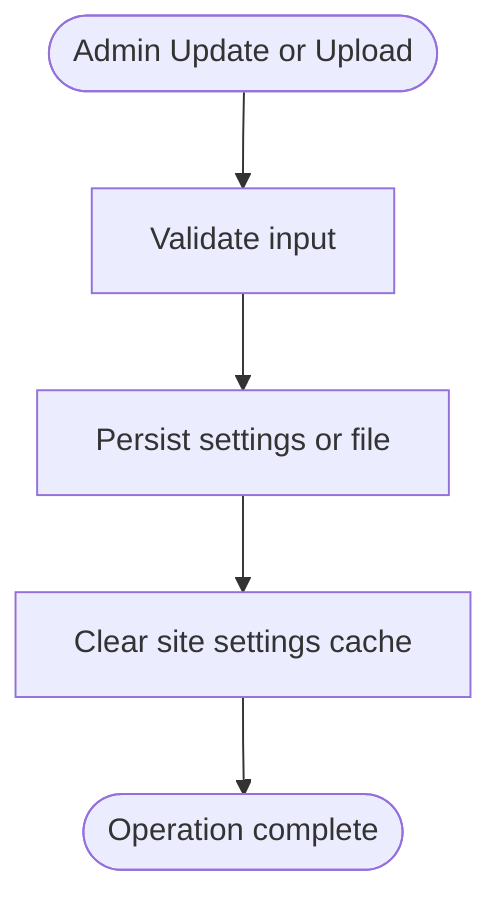
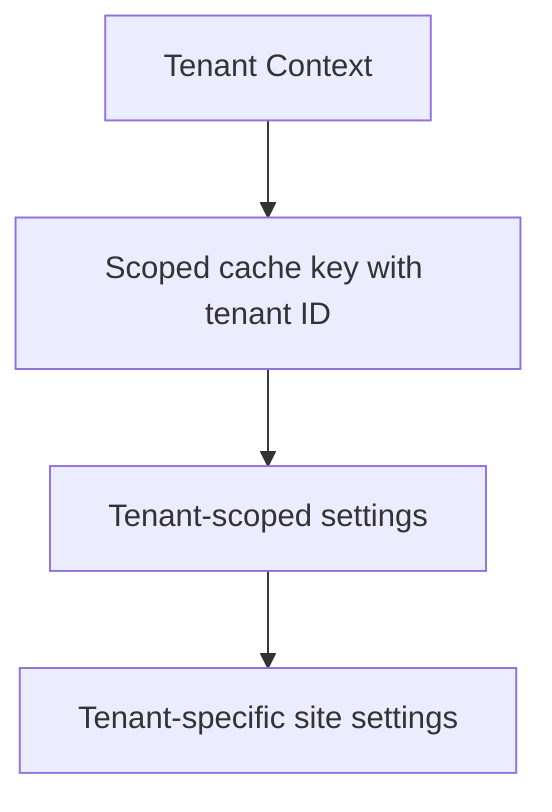
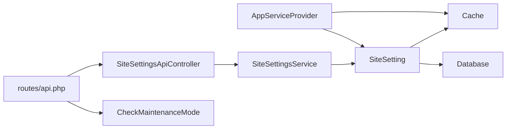

# Site Settings API

<cite>
**Referenced Files in This Document**
- [SiteSettingsApiController.php](file://backend/app/Http/Controllers/API/SiteSettingsApiController.php)
- [SiteSettingsService.php](file://backend/app/Services/SiteSettingsService.php)
- [SiteSetting.php](file://backend/app/Models/SiteSetting.php)
- [api.php](file://backend/routes/api.php)
- [CheckMaintenanceMode.php](file://backend/app/Http/Middleware/CheckMaintenanceMode.php)
- [AppServiceProvider.php](file://backend/app/Providers/AppServiceProvider.php)
- [2026_06_11_000000_create_site_settings_table.php](file://backend/database/migrations/2026_06_11_000000_create_site_settings_table.php)
- [MaintenanceModeTest.php](file://backend/tests/Feature/MaintenanceModeTest.php)
</cite>

## Table of Contents
1. [Introduction](#introduction)
2. [Project Structure](#project-structure)
3. [Core Components](#core-components)
4. [Architecture Overview](#architecture-overview)
5. [Detailed Component Analysis](#detailed-component-analysis)
6. [Dependency Analysis](#dependency-analysis)
7. [Performance Considerations](#performance-considerations)
8. [Troubleshooting Guide](#troubleshooting-guide)
9. [Conclusion](#conclusion)

## Introduction
This document describes the Site Settings API used to retrieve system configuration, dynamic site metadata, theme-related assets, and operational settings such as maintenance mode. The endpoint is intentionally public and remains available even when the application is under maintenance, so frontends can always determine whether to show a maintenance page or normal UI.

The current implementation exposes one read-only public endpoint for site settings. Administrative write operations are implemented in the service layer but are not exposed through the public API routes in this repository; they are intended for internal admin workflows.

## Project Structure
The Site Settings feature spans controllers, services, models, middleware, providers, routes, database migrations, and tests:

- Controller: returns the public site settings payload.
- Service: builds the public response, validates administrative updates, and handles logo/favicon uploads.
- Model: persists key-value settings with caching.
- Middleware: blocks most public APIs during maintenance while exempting the site-settings endpoint.
- Provider: shares cached settings with views and dynamically overrides mail and payment gateway configuration.
- Routes: register the public GET endpoint.
- Migration: defines the `site_settings` table and seeds default values.
- Tests: verify maintenance behavior and endpoint exemptions.



**Diagram sources**
- [api.php:18-18](file://backend/routes/api.php#L18-L18)
- [SiteSettingsApiController.php:7-16](file://backend/app/Http/Controllers/API/SiteSettingsApiController.php#L7-L16)
- [SiteSettingsService.php:14-49](file://backend/app/Services/SiteSettingsService.php#L14-L49)
- [SiteSetting.php:8-80](file://backend/app/Models/SiteSetting.php#L8-L80)
- [CheckMaintenanceMode.php:10-47](file://backend/app/Http/Middleware/CheckMaintenanceMode.php#L10-L47)
- [AppServiceProvider.php:40-81](file://backend/app/Providers/AppServiceProvider.php#L40-L81)

**Section sources**
- [api.php:12-18](file://backend/routes/api.php#L12-L18)
- [SiteSettingsApiController.php:1-18](file://backend/app/Http/Controllers/API/SiteSettingsApiController.php#L1-L18)
- [SiteSettingsService.php:1-182](file://backend/app/Services/SiteSettingsService.php#L1-L182)
- [SiteSetting.php:1-81](file://backend/app/Models/SiteSetting.php#L1-L81)
- [CheckMaintenanceMode.php:1-49](file://backend/app/Http/Middleware/CheckMaintenanceMode.php#L1-L49)
- [AppServiceProvider.php:1-106](file://backend/app/Providers/AppServiceProvider.php#L1-L106)
- [2026_06_11_000000_create_site_settings_table.php:1-57](file://backend/database/migrations/2026_06_11_000000_create_site_settings_table.php#L1-L57)

## Core Components
- Public endpoint: GET `/api/site-settings`.
- Response shape: site metadata, footer configuration, maintenance state, and SEO fields.
- Storage: key-value pairs in the `site_settings` database table.
- Caching: all settings are loaded through a cached lookup with a five-minute TTL.
- Maintenance exemption: the endpoint bypasses the maintenance-mode block so clients can always fetch status.

Key responsibilities:
- `SiteSettingsApiController`: thin controller returning the public array from the service.
- `SiteSettingsService`: transforms raw settings into a structured public response and provides administrative update/upload helpers.
- `SiteSetting`: model providing `getValue`, `setValue`, `setMany`, `getAll`, `getAllCached`, and `clearCache`.
- `CheckMaintenanceMode`: returns 503 for most routes when maintenance is enabled, except for `/api/site-settings`.
- `AppServiceProvider`: shares settings with admin views and dynamically overrides mail and ZiniPay configuration at runtime.

**Section sources**
- [SiteSettingsApiController.php:7-16](file://backend/app/Http/Controllers/API/SiteSettingsApiController.php#L7-L16)
- [SiteSettingsService.php:14-49](file://backend/app/Services/SiteSettingsService.php#L14-L49)
- [SiteSetting.php:21-79](file://backend/app/Models/SiteSetting.php#L21-L79)
- [CheckMaintenanceMode.php:17-43](file://backend/app/Http/Middleware/CheckMaintenanceMode.php#L17-L43)
- [AppServiceProvider.php:40-81](file://backend/app/Providers/AppServiceProvider.php#L40-L81)

## Architecture Overview
The public site settings flow reads cached settings and returns a normalized JSON object. During maintenance, the middleware intercepts other public endpoints but allows the site-settings request to pass through.



**Diagram sources**
- [api.php:18-18](file://backend/routes/api.php#L18-L18)
- [CheckMaintenanceMode.php:17-43](file://backend/app/Http/Middleware/CheckMaintenanceMode.php#L17-L43)
- [SiteSettingsApiController.php:13-16](file://backend/app/Http/Controllers/API/SiteSettingsApiController.php#L13-L16)
- [SiteSettingsService.php:14-49](file://backend/app/Services/SiteSettingsService.php#L14-L49)
- [SiteSetting.php:58-79](file://backend/app/Models/SiteSetting.php#L58-L79)

## Detailed Component Analysis

### Public Endpoint: GET `/api/site-settings`
- Method: GET
- Path: `/api/site-settings`
- Authentication: none
- Maintenance behavior: explicitly exempted; returns 200 even when maintenance mode is enabled.
- Purpose: provide frontend-facing site metadata, theme assets, footer links, maintenance state, and SEO configuration.

Response schema:
- `site_title`: string. Default fallback exists if missing.
- `favicon_url`: string. Default fallback exists if missing.
- `logo_url`: string or null.
- `logo_text`: string or null.
- `footer`: object
  - `company_name`: string. Default fallback exists if missing.
  - `copyright`: string. Default fallback exists if missing.
  - `links`: array of link objects. Parsed from stored JSON.
- `maintenance`: object
  - `enabled`: boolean derived from stored string flag.
  - `message`: string. Empty when not configured.
- `seo`: object
  - `meta_description`: string.
  - `meta_keywords`: string.
  - `og_title`: string.
  - `og_description`: string.
  - `og_image`: string.
  - `google_analytics_id`: string.

Example response structure:
```json
{
  "site_title": "...",
  "favicon_url": "...",
  "logo_url": "...",
  "logo_text": "...",
  "footer": {
    "company_name": "...",
    "copyright": "...",
    "links": []
  },
  "maintenance": {
    "enabled": false,
    "message": ""
  },
  "seo": {
    "meta_description": "...",
    "meta_keywords": "...",
    "og_title": "...",
    "og_description": "...",
    "og_image": "...",
    "google_analytics_id": "..."
  }
}
```

Status codes:
- `200`: success.
- Other HTTP errors may occur due to infrastructure issues, but the endpoint itself does not return business error codes.

**Section sources**
- [api.php:18-18](file://backend/routes/api.php#L18-L18)
- [SiteSettingsApiController.php:13-16](file://backend/app/Http/Controllers/API/SiteSettingsApiController.php#L13-L16)
- [SiteSettingsService.php:14-49](file://backend/app/Services/SiteSettingsService.php#L14-L49)
- [CheckMaintenanceMode.php:17-20](file://backend/app/Http/Middleware/CheckMaintenanceMode.php#L17-L20)

### Setting Categories and Data Model
The system stores site settings as key-value rows. The migration defines defaults for common categories:

| Category | Example Keys | Purpose |
|---|---|---|
| Branding | `site_title`, `favicon_url`, `logo_url`, `logo_text` | Controls site identity and theme assets. |
| Footer | `footer_company_name`, `footer_copyright`, `footer_links` | Controls footer text and navigation links. |
| Operational | `maintenance_mode`, `maintenance_message` | Enables maintenance mode and displays a message. |
| SEO | `seo_meta_description`, `seo_meta_keywords`, `seo_og_title`, `seo_og_description`, `seo_og_image`, `seo_google_analytics_id` | Controls search engine and social sharing metadata. |
| Runtime Overrides | `mail_*`, `zinipay_*` | Dynamically override mail and payment gateway configuration at runtime. |

Data model:
- Table: `site_settings`
- Columns:
  - `id`: auto-increment primary key.
  - `key`: unique setting identifier.
  - `value`: text payload; JSON strings are supported for complex values like footer links.
  - `created_at`, `updated_at`: timestamps.

Default seed includes branding, footer, maintenance, and SEO keys.



**Diagram sources**
- [2026_06_11_000000_create_site_settings_table.php:12-17](file://backend/database/migrations/2026_06_11_000000_create_site_settings_table.php#L12-L17)

**Section sources**
- [2026_06_11_000000_create_site_settings_table.php:19-49](file://backend/database/migrations/2026_06_11_000000_create_site_settings_table.php#L19-L49)
- [SiteSetting.php:8-16](file://backend/app/Models/SiteSetting.php#L8-L16)

### Caching Strategy
- Cache key: `site_settings_all`.
- TTL: 300 seconds.
- Read path: `SiteSetting::getAllCached()` uses Laravel cache with a closure that queries the database only on cache miss.
- Write path: `setValue` and `setMany` invalidate the cache using `Cache::forget`.
- Upload paths: favicon and logo upload methods also clear the cache after persisting new asset URLs.



**Diagram sources**
- [SiteSetting.php:12-16](file://backend/app/Models/SiteSetting.php#L12-L16)
- [SiteSetting.php:58-79](file://backend/app/Models/SiteSetting.php#L58-L79)

**Section sources**
- [SiteSetting.php:12-16](file://backend/app/Models/SiteSetting.php#L12-L16)
- [SiteSetting.php:30-53](file://backend/app/Models/SiteSetting.php#L30-L53)
- [SiteSetting.php:58-79](file://backend/app/Models/SiteSetting.php#L58-L79)
- [SiteSettingsService.php:101-103](file://backend/app/Services/SiteSettingsService.php#L101-L103)
- [SiteSettingsService.php:122-123](file://backend/app/Services/SiteSettingsService.php#L122-L123)
- [SiteSettingsService.php:137-138](file://backend/app/Services/SiteSettingsService.php#L137-L138)

### Maintenance Mode Behavior
When maintenance mode is enabled:
- Most public API routes return `503` with a JSON body containing `maintenance: true` and a message.
- The `/api/site-settings` route is explicitly excluded from the maintenance check.
- Frontends should use the site-settings response to decide whether to render a maintenance page.



**Diagram sources**
- [CheckMaintenanceMode.php:17-43](file://backend/app/Http/Middleware/CheckMaintenanceMode.php#L17-L43)

**Section sources**
- [CheckMaintenanceMode.php:17-43](file://backend/app/Http/Middleware/CheckMaintenanceMode.php#L17-L43)
- [MaintenanceModeTest.php:51-60](file://backend/tests/Feature/MaintenanceModeTest.php#L51-L60)

### Dynamic Configuration Overrides
At application boot, the provider reads cached site settings and overrides runtime configuration:
- Mail configuration: default mailer, SMTP host, port, username, password, encryption scheme, sender address, and sender name.
- Payment gateway: ZiniPay API key and base URL.

This enables administrators to change operational behavior without editing environment files.



**Diagram sources**
- [AppServiceProvider.php:40-81](file://backend/app/Providers/AppServiceProvider.php#L40-L81)

**Section sources**
- [AppServiceProvider.php:40-81](file://backend/app/Providers/AppServiceProvider.php#L40-L81)

### Administrative Update and Upload Methods
Although not exposed as public API routes in this repository, the service implements:
- Bulk update method: validates and persists multiple settings at once.
- Favicon upload: validates MIME type, derives safe extension, writes file to public uploads, persists URL, clears cache.
- Logo upload: same safety checks as favicon.
- Logo deletion: removes uploaded logo file if present and clears cache.

These methods demonstrate how dynamic content and runtime settings can be managed programmatically.



**Diagram sources**
- [SiteSettingsService.php:51-84](file://backend/app/Services/SiteSettingsService.php#L51-L84)
- [SiteSettingsService.php:86-106](file://backend/app/Services/SiteSettingsService.php#L86-L106)
- [SiteSettingsService.php:108-126](file://backend/app/Services/SiteSettingsService.php#L108-L126)
- [SiteSettingsService.php:128-139](file://backend/app/Services/SiteSettingsService.php#L128-L139)

**Section sources**
- [SiteSettingsService.php:51-84](file://backend/app/Services/SiteSettingsService.php#L51-L84)
- [SiteSettingsService.php:86-106](file://backend/app/Services/SiteSettingsService.php#L86-L106)
- [SiteSettingsService.php:108-126](file://backend/app/Services/SiteSettingsService.php#L108-L126)
- [SiteSettingsService.php:128-139](file://backend/app/Services/SiteSettingsService.php#L128-L139)

### Permission Requirements
- Public endpoint: no authentication required.
- Maintenance exemption: the endpoint is allowed even when maintenance mode is active.
- Administrative write methods: exist in the service layer but are not routed publicly here; any future admin routes would need appropriate authorization middleware.

**Section sources**
- [api.php:18-18](file://backend/routes/api.php#L18-L18)
- [CheckMaintenanceMode.php:17-20](file://backend/app/Http/Middleware/CheckMaintenanceMode.php#L17-L20)
- [SiteSettingsService.php:51-84](file://backend/app/Services/SiteSettingsService.php#L51-L84)

### Multi-Tenant Support Patterns
The current implementation is single-tenant by default:
- Settings are global key-value pairs.
- No tenant identifier is included in the model or API response.
- To support multi-tenancy, you would extend the model and cache strategy with a tenant scope, such as adding a tenant ID column and including it in the cache key.

Conceptual pattern:


[No sources needed since this section explains conceptual multi-tenant patterns not present in the code]

## Dependency Analysis
The following diagram shows how components depend on each other for the Site Settings API.



**Diagram sources**
- [api.php:18-18](file://backend/routes/api.php#L18-L18)
- [SiteSettingsApiController.php:7-16](file://backend/app/Http/Controllers/API/SiteSettingsApiController.php#L7-L16)
- [SiteSettingsService.php:14-49](file://backend/app/Services/SiteSettingsService.php#L14-L49)
- [SiteSetting.php:58-79](file://backend/app/Models/SiteSetting.php#L58-L79)
- [CheckMaintenanceMode.php:17-43](file://backend/app/Http/Middleware/CheckMaintenanceMode.php#L17-L43)
- [AppServiceProvider.php:40-81](file://backend/app/Providers/AppServiceProvider.php#L40-L81)

**Section sources**
- [api.php:18-18](file://backend/routes/api.php#L18-L18)
- [SiteSettingsApiController.php:7-16](file://backend/app/Http/Controllers/API/SiteSettingsApiController.php#L7-L16)
- [SiteSettingsService.php:14-49](file://backend/app/Services/SiteSettingsService.php#L14-L49)
- [SiteSetting.php:58-79](file://backend/app/Models/SiteSetting.php#L58-L79)
- [CheckMaintenanceMode.php:17-43](file://backend/app/Http/Middleware/CheckMaintenanceMode.php#L17-L43)
- [AppServiceProvider.php:40-81](file://backend/app/Providers/AppServiceProvider.php#L40-L81)

## Performance Considerations
- Use the public endpoint for read-heavy scenarios because responses are built from cached settings.
- Avoid frequent writes to settings; each write invalidates the cache and triggers database persistence.
- Prefer bulk updates via the service’s bulk setter when updating multiple keys together.
- Keep uploaded assets small to reduce storage and bandwidth overhead.
- Monitor cache backend performance; the cache TTL is short enough to keep settings fresh while reducing database load.

[No sources needed since this section provides general guidance]

## Troubleshooting Guide
Common issues and resolutions:

- Frontend cannot detect maintenance mode:
  - Ensure the client calls `/api/site-settings`.
  - Verify the response contains `maintenance.enabled`.
  - Confirm the endpoint is not blocked by custom proxies or firewalls.

- Public endpoints return 503 unexpectedly:
  - Only `/api/site-settings` is exempt from maintenance mode.
  - Other public endpoints will return 503 when maintenance is enabled.

- Settings do not appear updated immediately:
  - Writes clear the cache, but local development caches or reverse proxies may still serve stale data.
  - Clear application cache and browser cache if necessary.

- Logo or favicon not displaying:
  - Verify the uploaded file was saved under the public uploads directory.
  - Confirm the persisted URL starts with `/uploads/`.
  - Check web server permissions for the uploads directory.

- Runtime configuration overrides not applied:
  - Ensure the application has booted after changing settings.
  - Verify the `site_settings` table exists and contains expected keys.
  - Check that the provider successfully loads cached settings.

**Section sources**
- [MaintenanceModeTest.php:51-60](file://backend/tests/Feature/MaintenanceModeTest.php#L51-L60)
- [SiteSettingsService.php:86-106](file://backend/app/Services/SiteSettingsService.php#L86-L106)
- [SiteSettingsService.php:108-126](file://backend/app/Services/SiteSettingsService.php#L108-L126)
- [AppServiceProvider.php:40-81](file://backend/app/Providers/AppServiceProvider.php#L40-L81)

## Conclusion
The Site Settings API provides a simple, reliable way for clients to retrieve site metadata, theme assets, footer configuration, SEO settings, and maintenance state. It is designed to remain accessible during maintenance so frontends can consistently control user experience. The underlying model and service layer support dynamic runtime configuration and administrative updates, making the system suitable for evolving site requirements. For multi-tenant deployments, extend the model and cache strategy to scope settings per tenant.

[No sources needed since this section summarizes without analyzing specific files]