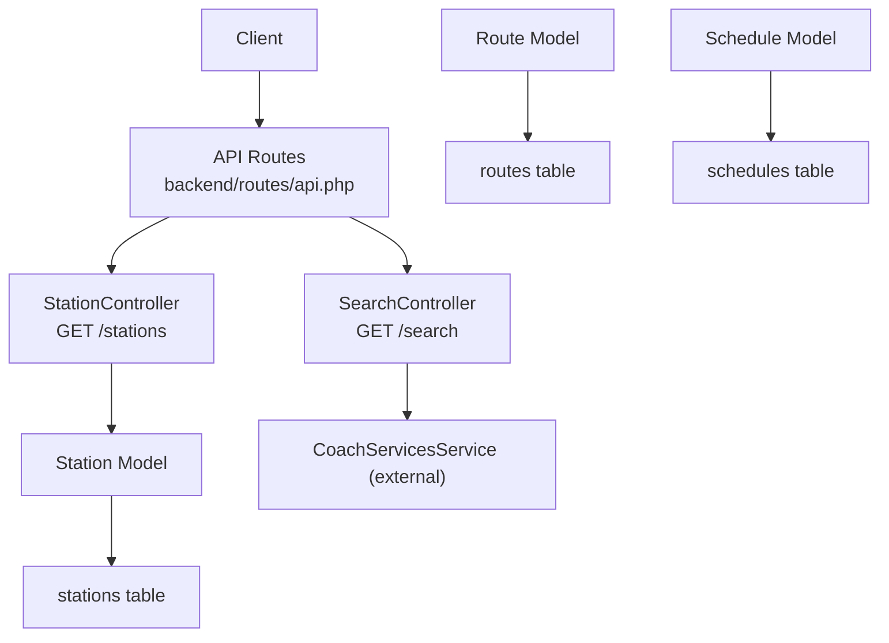
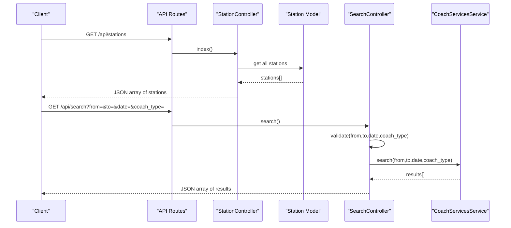
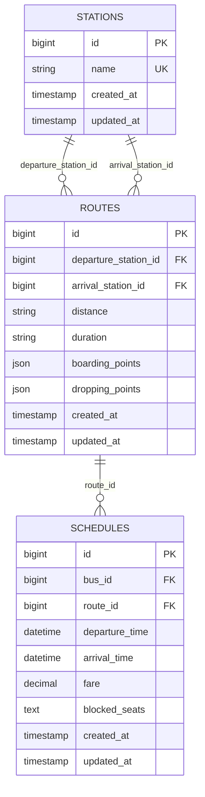
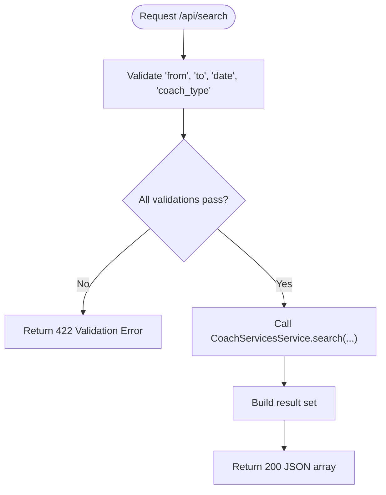
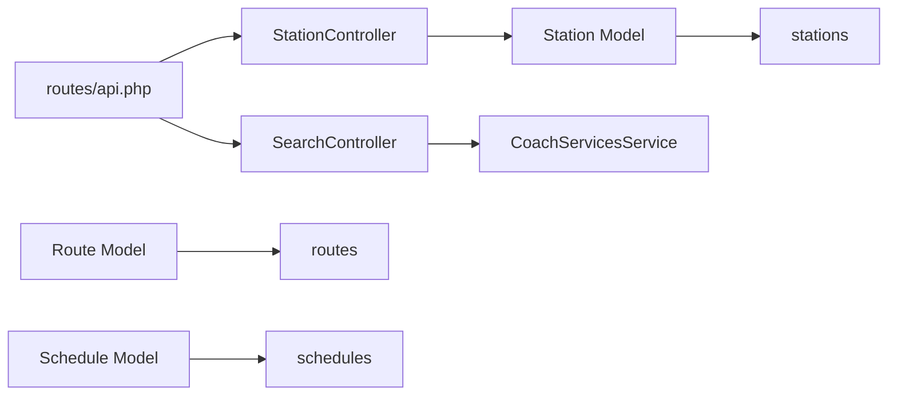

# Station & Route API

<cite>
**Referenced Files in This Document**   
- [api.php](file://backend/routes/api.php)
- [StationController.php](file://backend/app/Http/Controllers/API/StationController.php)
- [SearchController.php](file://backend/app/Http/Controllers/API/SearchController.php)
- [Station.php](file://backend/app/Models/Station.php)
- [Route.php](file://backend/app/Models/Route.php)
- [Schedule.php](file://backend/app/Models/Schedule.php)
- [2026_06_01_000010_create_stations_table.php](file://backend/database/migrations/2026_06_01_000010_create_stations_table.php)
- [2026_06_01_000030_create_routes_table.php](file://backend/database/migrations/2026_06_01_000030_create_routes_table.php)
- [2026_06_01_000040_create_schedules_table.php](file://backend/database/migrations/2026_06_01_000040_create_schedules_table.php)
</cite>

## Table of Contents
1. [Introduction](#introduction)
2. [Project Structure](#project-structure)
3. [Core Components](#core-components)
4. [Architecture Overview](#architecture-overview)
5. [Detailed Component Analysis](#detailed-component-analysis)
6. [Dependency Analysis](#dependency-analysis)
7. [Performance Considerations](#performance-considerations)
8. [Troubleshooting Guide](#troubleshooting-guide)
9. [Conclusion](#conclusion)

## Introduction
This document describes the public API endpoints for station and route management, including station listing, route discovery through search, and related data models. It explains how stations and routes relate to each other, what fields are available, and how to construct queries for route planning. Geographic coordinates are not currently exposed by the API; distance is stored as a string on routes.

## Project Structure
The relevant backend components for this documentation are:
- Public API routes under `routes/api.php`
- API controllers for stations and search
- Eloquent models for stations, routes, and schedules
- Database migrations defining the schema

**Diagram sources**
- [api.php:26-32](file://backend/routes/api.php#L26-L32)
- [StationController.php:10-14](file://backend/app/Http/Controllers/API/StationController.php#L10-L14)
- [SearchController.php:14-30](file://backend/app/Http/Controllers/API/SearchController.php#L14-L30)
- [Station.php:14-22](file://backend/app/Models/Station.php#L14-L22)
- [Route.php:26-39](file://backend/app/Models/Route.php#L26-L39)
- [Schedule.php:20-33](file://backend/app/Models/Schedule.php#L20-L33)

**Section sources**
- [api.php:26-32](file://backend/routes/api.php#L26-L32)

## Core Components
- Station listing endpoint returns all stations sorted by name.
- Search endpoint discovers schedules based on departure station, arrival station, date, and optional coach type.
- Data model relationships connect stations to routes and routes to schedules.

Key responsibilities:
- StationController: list stations
- SearchController: validate inputs and delegate search logic
- Models: define relationships and casts
- Migrations: define tables, indexes, and constraints

**Section sources**
- [StationController.php:10-14](file://backend/app/Http/Controllers/API/StationController.php#L10-L14)
- [SearchController.php:14-30](file://backend/app/Http/Controllers/API/SearchController.php#L14-L30)
- [Station.php:14-22](file://backend/app/Models/Station.php#L14-L22)
- [Route.php:26-39](file://backend/app/Models/Route.php#L26-L39)
- [Schedule.php:20-33](file://backend/app/Models/Schedule.php#L20-L33)

## Architecture Overview
The public customer API is protected by maintenance mode checks. The two primary endpoints for this documentation are:
- GET /api/stations
- GET /api/search

**Diagram sources**
- [api.php:26-32](file://backend/routes/api.php#L26-L32)
- [StationController.php:10-14](file://backend/app/Http/Controllers/API/StationController.php#L10-L14)
- [SearchController.php:14-30](file://backend/app/Http/Controllers/API/SearchController.php#L14-L30)

## Detailed Component Analysis

### Endpoint: List Stations
- Method: GET
- Path: /api/stations
- Authentication: None (public)
- Maintenance mode: Enabled via middleware group
- Query parameters: None
- Response: Array of station objects

Response schema (station object):
- id: integer
- name: string (unique)
- created_at: timestamp
- updated_at: timestamp

Notes:
- Stations are returned ordered by name ascending.
- No geographic coordinates are included.

Example request:
- GET /api/stations

Example response:
- 200 OK with JSON array of station objects

**Section sources**
- [api.php:26-32](file://backend/routes/api.php#L26-L32)
- [StationController.php:10-14](file://backend/app/Http/Controllers/API/StationController.php#L10-L14)
- [2026_06_01_000010_create_stations_table.php:11-15](file://backend/database/migrations/2026_06_01_000010_create_stations_table.php#L11-L15)

### Endpoint: Search Routes and Schedules
- Method: GET
- Path: /api/search
- Authentication: None (public)
- Maintenance mode: Enabled via middleware group
- Query parameters:
  - from: required, integer, must exist in stations.id
  - to: required, integer, must exist in stations.id
  - date: required, string, format YYYY-MM-DD
  - coach_type: optional, string
- Response: Array of schedule/route results (exact shape depends on CoachServicesService)

Validation rules:
- from and to must be valid station IDs
- date must be a valid date in YYYY-MM-DD format
- coach_type is optional

Error responses:
- 422 Unprocessable Entity when validation fails

Example request:
- GET /api/search?from=1&to=2&date=2026-07-01&coach_type=standard

Example response:
- 200 OK with JSON array of search results

**Section sources**
- [api.php:26-32](file://backend/routes/api.php#L26-L32)
- [SearchController.php:14-30](file://backend/app/Http/Controllers/API/SearchController.php#L14-L30)

### Data Model Relationships
Stations and routes are connected through foreign keys:
- A route has a departure_station_id and an arrival_station_id referencing stations.id
- A schedule references a route_id and a bus_id

**Diagram sources**
- [2026_06_01_000010_create_stations_table.php:11-15](file://backend/database/migrations/2026_06_01_000010_create_stations_table.php#L11-L15)
- [2026_06_01_000030_create_routes_table.php:14-28](file://backend/database/migrations/2026_06_01_000030_create_routes_table.php#L14-L28)
- [2026_06_01_000040_create_schedules_table.php:14-30](file://backend/database/migrations/2026_06_01_000040_create_schedules_table.php#L14-L30)

**Section sources**
- [Station.php:14-22](file://backend/app/Models/Station.php#L14-L22)
- [Route.php:12-39](file://backend/app/Models/Route.php#L12-L39)
- [Schedule.php:12-33](file://backend/app/Models/Schedule.php#L12-L33)
- [2026_06_01_000030_create_routes_table.php:14-28](file://backend/database/migrations/2026_06_01_000030_create_routes_table.php#L14-L28)
- [2026_06_01_000040_create_schedules_table.php:14-30](file://backend/database/migrations/2026_06_01_000040_create_schedules_table.php#L14-L30)

### Route Discovery Flow
The search endpoint validates inputs and delegates to a service that returns matching schedules and related route information.

**Diagram sources**
- [SearchController.php:14-30](file://backend/app/Http/Controllers/API/SearchController.php#L14-L30)

**Section sources**
- [SearchController.php:14-30](file://backend/app/Http/Controllers/API/SearchController.php#L14-L30)

### Geographic Data and Distance
- Geographic coordinates are not present in the current schema or API responses.
- Distance is stored as a string field on routes and is not computed by the API.
- There is no location-based filtering endpoint; filtering is done by station IDs.

Recommendations if you need geospatial features:
- Add latitude and longitude columns to stations
- Implement geospatial queries using database functions
- Expose new endpoints for proximity searches

[No sources needed since this section provides general guidance]

### Station Hierarchy Navigation
- The current schema does not define a hierarchy among stations.
- To navigate a hierarchy, add parent_station_id to stations and expose endpoints to list children and ancestors.

[No sources needed since this section provides general guidance]

### Route Planning Examples
- Find schedules from station 1 to station 2 on 2026-07-01:
  - GET /api/search?from=1&to=2&date=2026-07-01
- Filter by coach type:
  - GET /api/search?from=1&to=2&date=2026-07-01&coach_type=standard

Expected behavior:
- Returns schedules associated with routes between the specified stations on the requested date
- Optional coach_type filters results at the service layer

**Section sources**
- [SearchController.php:14-30](file://backend/app/Http/Controllers/API/SearchController.php#L14-L30)

## Dependency Analysis
High-level dependencies:
- API routes depend on controllers
- Controllers depend on models and services
- Models depend on database tables defined by migrations

**Diagram sources**
- [api.php:26-32](file://backend/routes/api.php#L26-L32)
- [StationController.php:10-14](file://backend/app/Http/Controllers/API/StationController.php#L10-L14)
- [SearchController.php:14-30](file://backend/app/Http/Controllers/API/SearchController.php#L14-L30)
- [Station.php:14-22](file://backend/app/Models/Station.php#L14-L22)
- [Route.php:26-39](file://backend/app/Models/Route.php#L26-L39)
- [Schedule.php:20-33](file://backend/app/Models/Schedule.php#L20-L33)

**Section sources**
- [api.php:26-32](file://backend/routes/api.php#L26-L32)

## Performance Considerations
- Indexes:
  - routes.departure_station_id
  - routes.arrival_station_id
  - composite index on (departure_station_id, arrival_station_id)
  - schedules.route_id, schedules.bus_id, schedules.departure_time, and composite indexes
- These indexes support efficient lookups for route and schedule queries.
- Avoid loading unnecessary relations when returning lists to reduce payload size.

[No sources needed since this section provides general guidance]

## Troubleshooting Guide
Common issues:
- 422 Validation errors on /api/search:
  - Ensure from and to are valid station IDs
  - Ensure date is in YYYY-MM-DD format
- Empty results:
  - Verify that routes and schedules exist for the selected stations and date
- Maintenance mode:
  - If the site is under maintenance, public endpoints may be disabled

Operational tips:
- Use the stations endpoint to discover valid station IDs before searching
- Log validation failures to identify incorrect query parameters

**Section sources**
- [SearchController.php:14-30](file://backend/app/Http/Controllers/API/SearchController.php#L14-L30)
- [api.php:26-32](file://backend/routes/api.php#L26-L32)

## Conclusion
The current API exposes a simple station listing and a search endpoint for discovering schedules between stations. Routes store distance as a string without geographic coordinates. For advanced use cases such as geospatial queries or station hierarchies, extend the schema and introduce dedicated endpoints.