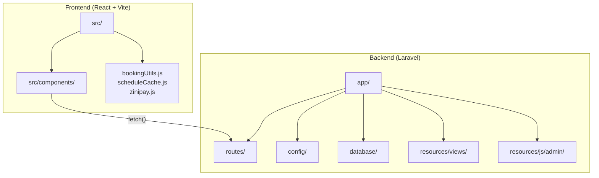
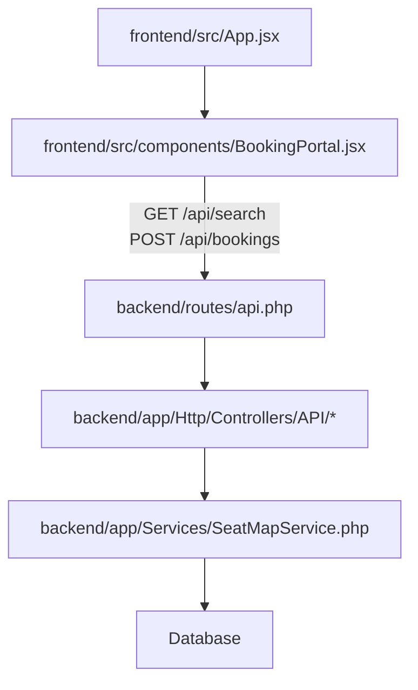
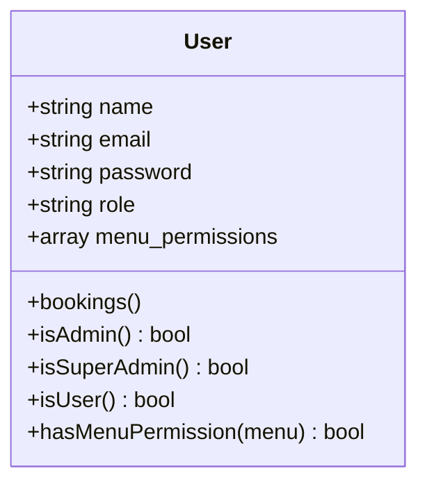
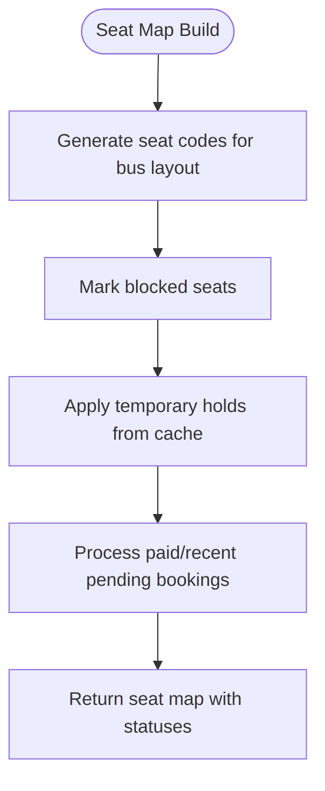
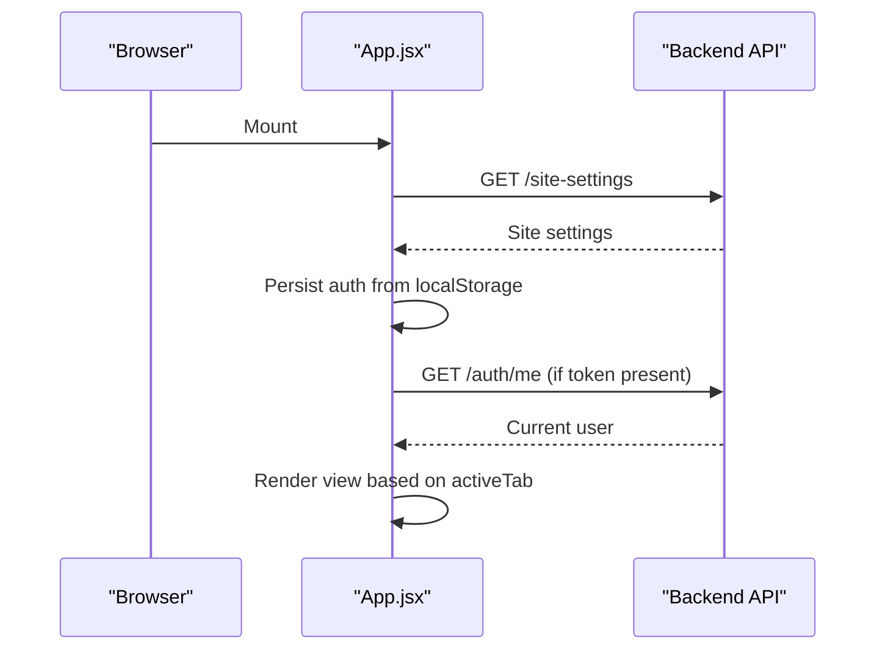
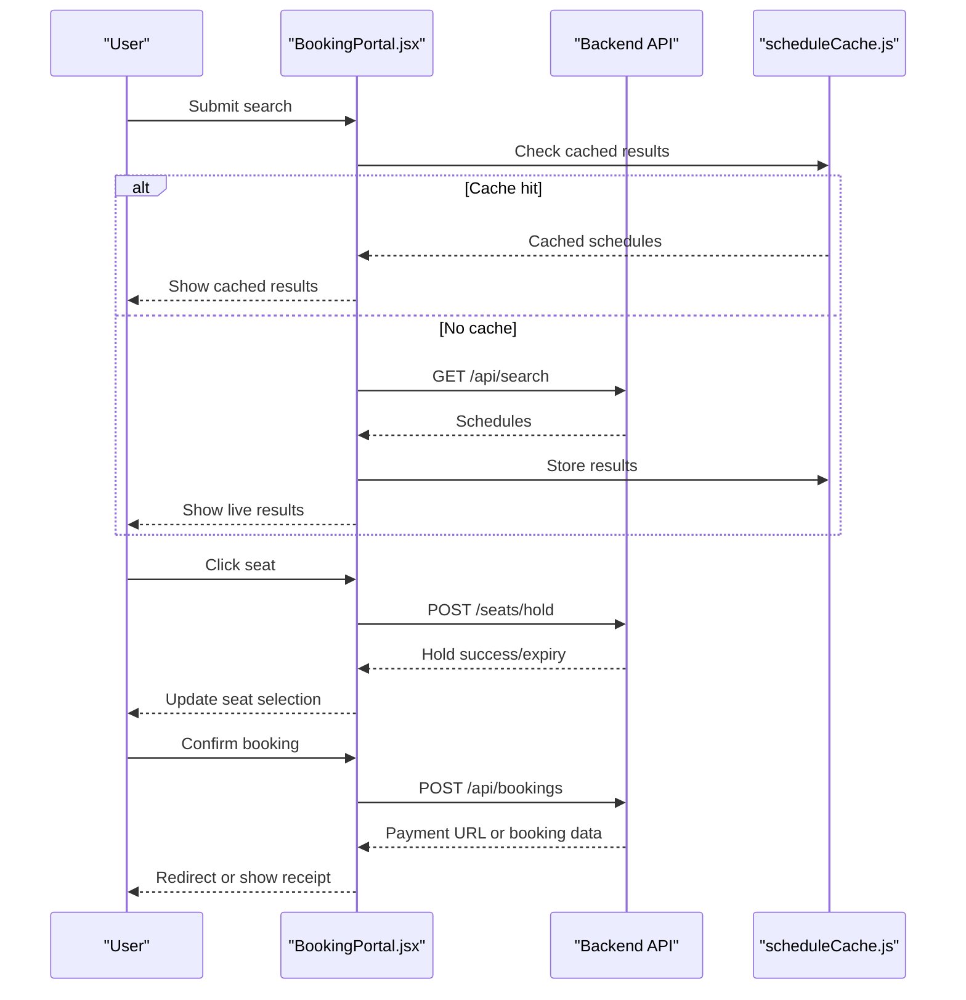
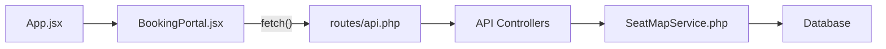

# Coding Standards & Conventions

<cite>
**Referenced Files in This Document**   
- [BACKEND_CODING_GUIDE.md](file://backend/BACKEND_CODING_GUIDE.md)
- [FRONTEND_CODING_GUIDE.md](file://frontend/FRONTEND_CODING_GUIDE.md)
- [.editorconfig](file://backend/.editorconfig)
- [eslint.config.js](file://frontend/eslint.config.js)
- [BaseController.php](file://backend/app/Http/Controllers/API/BaseController.php)
- [User.php](file://backend/app/Models/User.php)
- [SeatMapService.php](file://backend/app/Services/SeatMapService.php)
- [App.jsx](file://frontend/src/App.jsx)
- [BookingPortal.jsx](file://frontend/src/components/BookingPortal.jsx)
</cite>

## Table of Contents
1. [Introduction](#introduction)
2. [Project Structure](#project-structure)
3. [Backend Coding Standards](#backend-coding-standards)
4. [Frontend Coding Standards](#frontend-coding-standards)
5. [Architecture Overview](#architecture-overview)
6. [Detailed Component Analysis](#detailed-component-analysis)
7. [Dependency Analysis](#dependency-analysis)
8. [Performance Considerations](#performance-considerations)
9. [Troubleshooting Guide](#troubleshooting-guide)
10. [Conclusion](#conclusion)

## Introduction
This document defines the coding standards and conventions for SonyaBus development across both backend and frontend layers. It consolidates naming patterns, file organization, architectural principles, formatting rules, comment standards, and practical examples derived from the actual codebase. The goal is to help developers write consistent, maintainable PHP/Laravel backend code and React/JavaScript frontend code while following established domain-specific workflows such as seat selection, booking, authentication, and payment handling.

## Project Structure
SonyaBus is a split repository:
- Backend: Laravel application under `backend/` with controllers, models, services, migrations, routes, Blade views, and admin JavaScript.
- Frontend: React application under `frontend/` built with Vite, using direct fetch calls to the Laravel API.

**Diagram sources**
- [BACKEND_CODING_GUIDE.md:16-27](file://backend/BACKEND_CODING_GUIDE.md#L16-L27)
- [FRONTEND_CODING_GUIDE.md:17-24](file://frontend/FRONTEND_CODING_GUIDE.md#L17-L24)

**Section sources**
- [BACKEND_CODING_GUIDE.md:16-27](file://backend/BACKEND_CODING_GUIDE.md#L16-L27)
- [FRONTEND_CODING_GUIDE.md:17-24](file://frontend/FRONTEND_CODING_GUIDE.md#L17-L24)

## Backend Coding Standards

### Naming Patterns
- Controllers:
  - Admin controllers live under `app/Http/Controllers/Admin/`.
  - Public API controllers live under `app/Http/Controllers/API/`.
  - Shared base controller exists at `app/Http/Controllers/API/BaseController.php`.
- Models:
  - Eloquent models are singular nouns under `app/Models`, such as `User`, `Booking`, `Schedule`, `Route`, `Bus`, `Station`, `Promotion`, `SiteSetting`, `SmsConfig`, `License`.
- Services:
  - Business logic is extracted into `app/Services`, e.g., `SeatMapService`, `ZinipayService`, `SmsGatewayService`, `ReportDataService`, `ExcelExportService`.
- Middleware:
  - Request guards and maintenance checks are under `app/Http/Middleware`, e.g., `EnsureUserIsAdmin`, `CheckMaintenanceMode`.
- Routes:
  - Web routes for admin and session-based flows are in `routes/web.php`.
  - REST API routes for public and authenticated endpoints are in `routes/api.php`.

**Section sources**
- [BACKEND_CODING_GUIDE.md:16-27](file://backend/BACKEND_CODING_GUIDE.md#L16-L27)
- [BaseController.php:1-8](file://backend/app/Http/Controllers/API/BaseController.php#L1-L8)

### File Organization Principles
- Domain-driven separation:
  - Data models encapsulate relationships and casts.
  - Controllers handle HTTP concerns and request validation.
  - Services encapsulate reusable business rules like seat map generation, pricing breakdown, and SMS sending.
- Admin vs public boundaries:
  - Admin web routes use session-based authentication and Blade views.
  - Public API routes serve the React frontend and admin API consumers.
- Configuration:
  - Application settings, database, cache, mail, queue, Sanctum, and SMS configuration live under `config/`.

**Section sources**
- [BACKEND_CODING_GUIDE.md:30-95](file://backend/BACKEND_CODING_GUIDE.md#L30-L95)
- [BACKEND_CODING_GUIDE.md:212-232](file://backend/BACKEND_CODING_GUIDE.md#L212-L232)
- [BACKEND_CODING_GUIDE.md:255-269](file://backend/BACKEND_CODING_GUIDE.md#L255-L269)

### Architectural Principles
- Service layer for complex logic:
  - Seat availability, seat codes, blocked seats, boarding/dropping points, pricing breakdown, and seat holds are centralized in `SeatMapService`.
- Middleware-based authorization:
  - Admin access is enforced by role and menu permissions.
  - Maintenance mode blocks API routes except site settings.
- Eloquent relationships:
  - Models define relationships such as `User.bookings`, `Route.departureStation`, `Route.arrivalStation`, `Schedule.bus`, `Schedule.route`.
- Validation inside controllers:
  - Request validation is performed in controllers before persisting data or invoking services.

**Section sources**
- [BACKEND_CODING_GUIDE.md:98-121](file://backend/BACKEND_CODING_GUIDE.md#L98-L121)
- [BACKEND_CODING_GUIDE.md:235-253](file://backend/BACKEND_CODING_GUIDE.md#L235-L253)
- [User.php:39-74](file://backend/app/Models/User.php#L39-L74)

### Code Formatting Rules
- EditorConfig enforces:
  - UTF-8 charset.
  - LF line endings.
  - 4-space indentation for general files.
  - Final newline insertion.
  - Trailing whitespace trimming, except Markdown files.
  - YAML files use 2-space indentation; `compose.yaml` uses 4-space indentation.

**Section sources**
- [.editorconfig:1-19](file://backend/.editorconfig#L1-L19)

### Comment Standards and Documentation Requirements
- Backend documentation:
  - The backend guide describes architecture, directory structure, schema, models, controllers, services, middleware, routes, booking flow, and useful files.
- Model-level documentation:
  - Fields, relationships, casts, and helper methods are documented in the guide and model classes.
- Service-level documentation:
  - Complex operations like seat map building, pricing breakdown, and seat holding are implemented with clear method responsibilities.

**Section sources**
- [BACKEND_CODING_GUIDE.md:1-14](file://backend/BACKEND_CODING_GUIDE.md#L1-L14)
- [BACKEND_CODING_GUIDE.md:30-95](file://backend/BACKEND_CODING_GUIDE.md#L30-L95)
- [SeatMapService.php:11-47](file://backend/app/Services/SeatMapService.php#L11-L47)

### Examples of Correct and Incorrect Implementations

#### Correct: Centralized seat logic in a service
- Use `SeatMapService` for seat code generation, seat map construction, pricing breakdown, and seat hold/release.
- Reference path: [SeatMapService.php:49-189](file://backend/app/Services/SeatMapService.php#L49-L189), [SeatMapService.php:343-365](file://backend/app/Services/SeatMapService.php#L343-L365), [SeatMapService.php:502-582](file://backend/app/Services/SeatMapService.php#L502-L582).

#### Incorrect: Mixing seat logic into controllers
- Avoid implementing seat availability or pricing calculations directly in controllers; delegate to services instead.
- Reference path: [BACKEND_CODING_GUIDE.md:293-300](file://backend/BACKEND_CODING_GUIDE.md#L293-L300).

#### Correct: Role-based authorization via middleware and model helpers
- Use `EnsureUserIsAdmin`, `EnsureUserHasMenuPermission`, and `User::isAdmin()` / `hasMenuPermission()` for access control.
- Reference path: [BACKEND_CODING_GUIDE.md:235-253](file://backend/BACKEND_CODING_GUIDE.md#L235-L253), [User.php:44-74](file://backend/app/Models/User.php#L44-L74).

#### Incorrect: Bypassing maintenance mode
- Do not expose sensitive API routes during maintenance without explicit exceptions.
- Reference path: [BACKEND_CODING_GUIDE.md:249-252](file://backend/BACKEND_CODING_GUIDE.md#L249-L252).

## Frontend Coding Standards

### Naming Patterns
- Components:
  - PascalCase component filenames under `frontend/src/components/`, e.g., `BookingPortal.jsx`, `AuthModal.jsx`, `SeatMap.jsx`, `MyTickets.jsx`.
- Utilities:
  - Lowercase kebab or camel case utility files, e.g., `bookingUtils.js`, `scheduleCache.js`, `zinipay.js`.
- State variables:
  - Descriptive camelCase names, e.g., `searchParams`, `selectedSeats`, `passengerDetails`, `authUser`, `authToken`.

**Section sources**
- [FRONTEND_CODING_GUIDE.md:17-36](file://frontend/FRONTEND_CODING_GUIDE.md#L17-L36)

### Component Structure
- Container components manage workflow state and API calls:
  - `App.jsx` owns global state, auth persistence, site settings, and routing between tabs.
  - `BookingPortal.jsx` orchestrates search, selection, promo handling, and booking submission.
- Presentational components render UI:
  - `Navbar`, `Footer`, `OffersList`, `UserProfile`, `MyTickets`, `VerificationStatus`, `BookingSuccess`.

**Section sources**
- [FRONTEND_CODING_GUIDE.md:91-118](file://frontend/FRONTEND_CODING_GUIDE.md#L91-L118)
- [FRONTEND_CODING_GUIDE.md:149-185](file://frontend/FRONTEND_CODING_GUIDE.md#L149-L185)

### State Management Patterns
- Local component state:
  - Search parameters, selected schedule, selected seats, passenger details, promo input.
- Global app state:
  - Auth user/token, toast notifications, verification status, payment failure, site settings, active tab.
- Client-side cache:
  - Schedule search results cached for 60 seconds to reduce backend load.

**Section sources**
- [BookingPortal.jsx:24-54](file://frontend/src/components/BookingPortal.jsx#L24-L54)
- [App.jsx:94-133](file://frontend/src/App.jsx#L94-L133)
- [FRONTEND_CODING_GUIDE.md:297-310](file://frontend/FRONTEND_CODING_GUIDE.md#L297-L310)

### API Integration Guidelines
- Direct `fetch()` usage:
  - Public endpoints for site settings, stations, search, promotions.
  - Authenticated endpoints for registration, login, profile, bookings.
  - Payment-related endpoints for ZiniPay redirect handling and webhook verification.
- Headers:
  - `Accept: application/json`.
  - Authorization header when authenticated.

**Section sources**
- [FRONTEND_CODING_GUIDE.md:120-147](file://frontend/FRONTEND_CODING_GUIDE.md#L120-L147)
- [App.jsx:153-159](file://frontend/src/App.jsx#L153-L159)

### Code Formatting Rules
- ESLint configuration:
  - Extends recommended rules for JavaScript and React Hooks.
  - Enables React Refresh for Vite.
  - Applies browser globals and JSX parsing.

**Section sources**
- [eslint.config.js:1-22](file://frontend/eslint.config.js#L1-L22)

### Comment Standards and Documentation Requirements
- Frontend documentation:
  - The frontend guide explains project structure, data relationships, global state, API integration, booking portal logic, seat map utilities, authentication flow, payment flow, auxiliary components, client-side cache, styling patterns, and important coding notes.
- Inline comments:
  - Utility functions and critical flows should be commented to explain behavior, especially around seat selection, caching, and payment redirects.

**Section sources**
- [FRONTEND_CODING_GUIDE.md:1-15](file://frontend/FRONTEND_CODING_GUIDE.md#L1-L15)
- [FRONTEND_CODING_GUIDE.md:323-330](file://frontend/FRONTEND_CODING_GUIDE.md#L323-L330)

### Examples of Correct and Incorrect Implementations

#### Correct: Optimistic seat selection with server confirmation
- Update UI immediately on seat click, then call `/seats/hold`; roll back if server rejects.
- Reference path: [BookingPortal.jsx:209-289](file://frontend/src/components/BookingPortal.jsx#L209-L289).

#### Incorrect: Selecting more than allowed seats without validation
- Enforce maximum seat limit before optimistic selection.
- Reference path: [BookingPortal.jsx:242-246](file://frontend/src/components/BookingPortal.jsx#L242-L246).

#### Correct: Cache-aware search with refresh capability
- Check local cache first; if missing, fetch from backend and update cache; support forced refresh.
- Reference path: [BookingPortal.jsx:291-380](file://frontend/src/components/BookingPortal.jsx#L291-L380).

#### Incorrect: Ignoring network errors during booking submission
- Always handle non-ok responses and display meaningful error messages.
- Reference path: [BookingPortal.jsx:517-575](file://frontend/src/components/BookingPortal.jsx#L517-L575).

## Architecture Overview
The SonyaBus architecture separates concerns between Laravel backend and React frontend:
- Backend provides REST APIs for search, authentication, bookings, promotions, and payment callbacks.
- Frontend manages UI state, form validation, seat selection, and integrates with ZiniPay redirects.
- Services encapsulate complex business logic like seat mapping, pricing, and SMS notifications.

**Diagram sources**
- [App.jsx:94-133](file://frontend/src/App.jsx#L94-L133)
- [BookingPortal.jsx:291-380](file://frontend/src/components/BookingPortal.jsx#L291-L380)
- [BACKEND_CODING_GUIDE.md:255-269](file://backend/BACKEND_CODING_GUIDE.md#L255-L269)
- [SeatMapService.php:194-244](file://backend/app/Services/SeatMapService.php#L194-L244)

## Detailed Component Analysis

### Backend: User Model and Authorization
The `User` model defines fillable fields, hidden attributes, casts, relationships, and role helpers used throughout admin authorization.

**Diagram sources**
- [User.php:17-74](file://backend/app/Models/User.php#L17-L74)

**Section sources**
- [User.php:17-74](file://backend/app/Models/User.php#L17-L74)

### Backend: Seat Map Service
`SeatMapService` centralizes seat code generation, seat map building, pricing breakdown, boarding/dropping point formatting, and seat hold/release logic.

**Diagram sources**
- [SeatMapService.php:49-189](file://backend/app/Services/SeatMapService.php#L49-L189)
- [SeatMapService.php:194-244](file://backend/app/Services/SeatMapService.php#L194-L244)

**Section sources**
- [SeatMapService.php:49-189](file://backend/app/Services/SeatMapService.php#L49-L189)
- [SeatMapService.php:194-244](file://backend/app/Services/SeatMapService.php#L194-L244)
- [SeatMapService.php:343-365](file://backend/app/Services/SeatMapService.php#L343-L365)
- [SeatMapService.php:502-582](file://backend/app/Services/SeatMapService.php#L502-L582)

### Frontend: App Global State
`App.jsx` manages global state including navigation tabs, toast notifications, auth context, site settings, API base probing, and dynamic document metadata.

**Diagram sources**
- [App.jsx:293-325](file://frontend/src/App.jsx#L293-L325)
- [App.jsx:329-378](file://frontend/src/App.jsx#L329-L378)
- [App.jsx:414-427](file://frontend/src/App.jsx#L414-L427)

**Section sources**
- [App.jsx:94-133](file://frontend/src/App.jsx#L94-L133)
- [App.jsx:293-325](file://frontend/src/App.jsx#L293-L325)
- [App.jsx:329-378](file://frontend/src/App.jsx#L329-L378)
- [App.jsx:414-427](file://frontend/src/App.jsx#L414-L427)

### Frontend: Booking Portal Flow
`BookingPortal.jsx` drives the search, seat selection, promo application, and booking submission workflow.

**Diagram sources**
- [BookingPortal.jsx:291-380](file://frontend/src/components/BookingPortal.jsx#L291-L380)
- [BookingPortal.jsx:209-289](file://frontend/src/components/BookingPortal.jsx#L209-L289)
- [BookingPortal.jsx:469-575](file://frontend/src/components/BookingPortal.jsx#L469-L575)

**Section sources**
- [BookingPortal.jsx:24-54](file://frontend/src/components/BookingPortal.jsx#L24-L54)
- [BookingPortal.jsx:209-289](file://frontend/src/components/BookingPortal.jsx#L209-L289)
- [BookingPortal.jsx:291-380](file://frontend/src/components/BookingPortal.jsx#L291-L380)
- [BookingPortal.jsx:469-575](file://frontend/src/components/BookingPortal.jsx#L469-L575)

## Dependency Analysis
Key dependencies and relationships:
- Frontend depends on backend API endpoints for search, auth, bookings, promotions, and payment verification.
- Backend controllers depend on services for complex business logic.
- Models define relationships that influence query performance and data shaping.

**Diagram sources**
- [App.jsx:94-133](file://frontend/src/App.jsx#L94-L133)
- [BookingPortal.jsx:291-380](file://frontend/src/components/BookingPortal.jsx#L291-L380)
- [BACKEND_CODING_GUIDE.md:255-269](file://backend/BACKEND_CODING_GUIDE.md#L255-L269)
- [SeatMapService.php:194-244](file://backend/app/Services/SeatMapService.php#L194-L244)

**Section sources**
- [BACKEND_CODING_GUIDE.md:255-269](file://backend/BACKEND_CODING_GUIDE.md#L255-L269)
- [FRONTEND_CODING_GUIDE.md:120-147](file://frontend/FRONTEND_CODING_GUIDE.md#L120-L147)

## Performance Considerations
- Backend:
  - Use Eloquent eager loading for nested relationships to avoid N+1 queries.
  - Limit selected columns for seat map payloads to reduce payload size.
  - Leverage caching for site settings and temporary seat holds.
- Frontend:
  - Use client-side cache for schedule searches to reduce repeated requests.
  - Debounce or throttle frequent updates where appropriate.
  - Prefer minimal state updates and avoid unnecessary re-renders.

[No sources needed since this section provides general guidance]

## Troubleshooting Guide
Common issues and resolutions:
- Backend offline detection:
  - Frontend probes multiple candidate API bases and displays an offline state if none respond.
  - Retry mechanism allows users to reconnect after backend becomes available.
- Installation not complete:
  - If backend returns installation-gated responses, frontend shows a call-to-action to complete the install wizard.
- Maintenance mode:
  - Frontend renders a maintenance page when backend indicates maintenance enabled.
- Authentication failures:
  - Clear persisted auth and prompt login when receiving unauthorized responses.
- Seat hold conflicts:
  - Handle server rejection of seat holds by rolling back optimistic UI changes and showing error messages.

**Section sources**
- [App.jsx:502-524](file://frontend/src/App.jsx#L502-L524)
- [App.jsx:565-678](file://frontend/src/App.jsx#L565-L678)
- [App.jsx:680-694](file://frontend/src/App.jsx#L680-L694)
- [BookingPortal.jsx:209-289](file://frontend/src/components/BookingPortal.jsx#L209-L289)

## Conclusion
SonyaBus follows clear conventions for both backend and frontend development:
- Backend: Laravel structure with controllers, models, services, middleware, and routes; centralized business logic in services; strict authorization and maintenance controls.
- Frontend: React components with local and global state; direct fetch-based API integration; client-side caching for performance; robust error handling and user feedback.
Adhering to these standards ensures consistency, maintainability, and scalability across the SonyaBus platform.