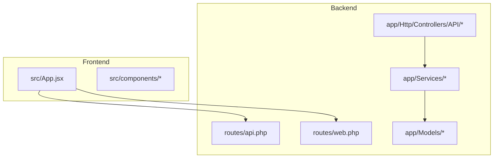
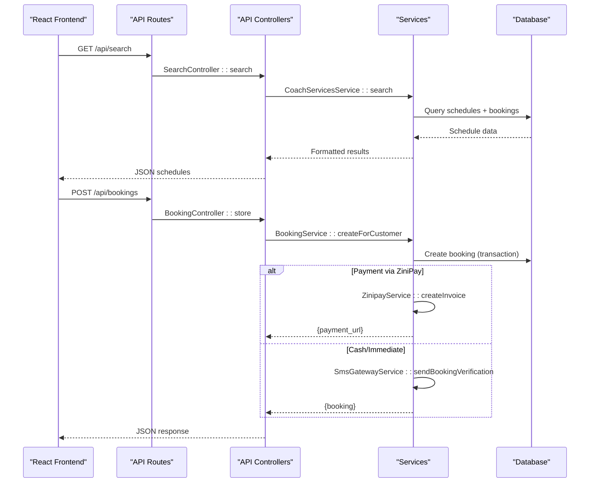
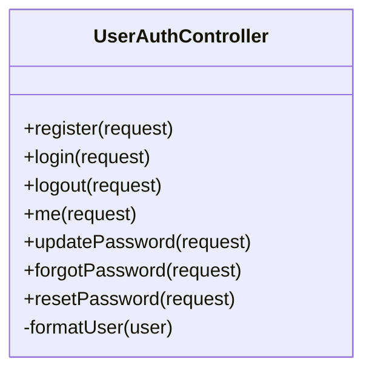
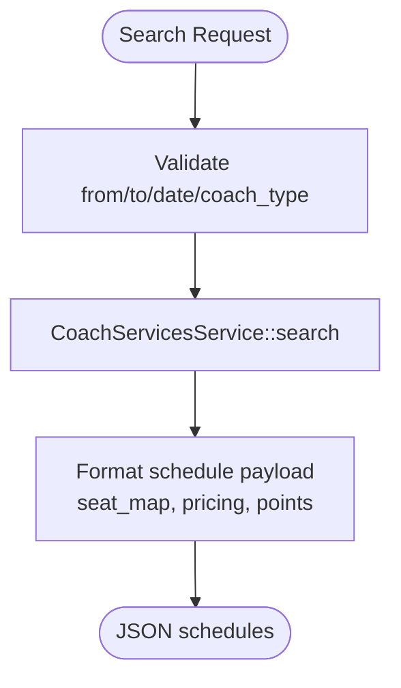
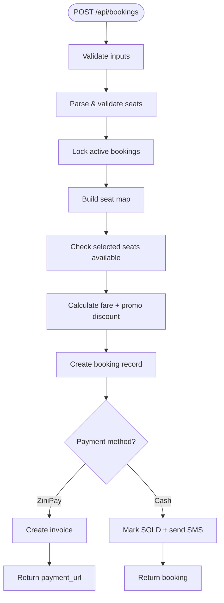
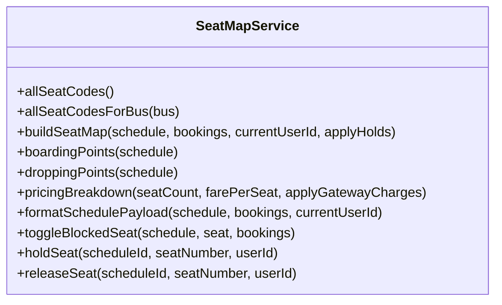
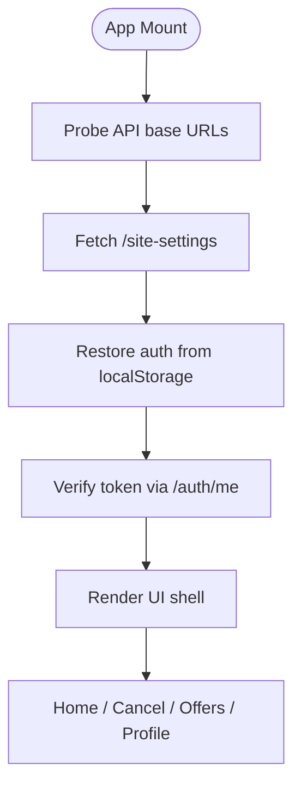
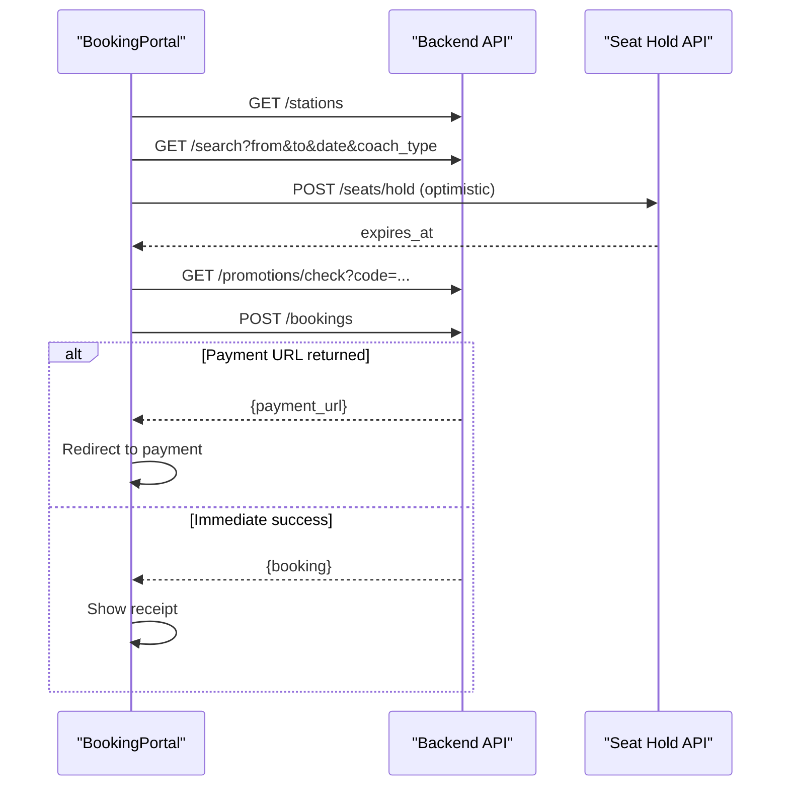
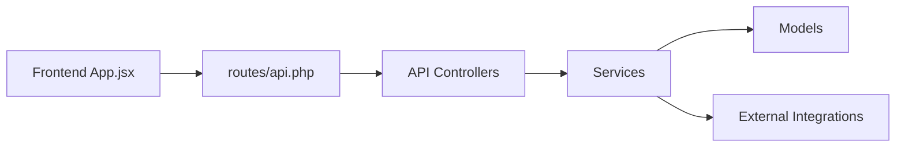

# Developer Reference

<cite>
**Referenced Files in This Document**
- [README.md](file://README.md)
- [ARCHITECTURE.md](file://backend/ARCHITECTURE.md)
- [BACKEND_CODING_GUIDE.md](file://backend/BACKEND_CODING_GUIDE.md)
- [FRONTEND_CODING_GUIDE.md](file://frontend/FRONTEND_CODING_GUIDE.md)
- [api.php](file://backend/routes/api.php)
- [web.php](file://backend/routes/web.php)
- [BaseController.php](file://backend/app/Http/Controllers/API/BaseController.php)
- [UserAuthController.php](file://backend/app/Http/Controllers/API/UserAuthController.php)
- [SearchController.php](file://backend/app/Http/Controllers/API/SearchController.php)
- [BookingController.php](file://backend/app/Http/Controllers/API/BookingController.php)
- [PromotionController.php](file://backend/app/Http/Controllers/API/PromotionController.php)
- [StationController.php](file://backend/app/Http/Controllers/API/StationController.php)
- [BookingService.php](file://backend/app\Services\BookingService.php)
- [SeatMapService.php](file://backend/app\Services\SeatMapService.php)
- [CoachServicesService.php](file://backend/app\Services\CoachServicesService.php)
- [User.php](file://backend/app/Models\User.php)
- [App.jsx](file://frontend/src/App.jsx)
- [BookingPortal.jsx](file://frontend/src/components/BookingPortal.jsx)
</cite>

## Table of Contents
1. Introduction
2. Project Structure
3. Core Components
4. Architecture Overview
5. Detailed Component Analysis
6. Dependency Analysis
7. Performance Considerations
8. Troubleshooting Guide
9. Conclusion
10. Appendices

## Introduction
SonyaBus is a full-stack bus ticket booking system with a Laravel 12 backend API and a React 19 customer-facing SPA, plus an admin dashboard for operations, reporting, and configuration. The system supports interactive seat maps, ZiniPay payments, SMS notifications, promo codes, role-based access control, maintenance mode, and theme toggling.

This developer reference documents coding standards, naming conventions, file organization, extension mechanisms, plugin architecture, third-party integration patterns, API specifications, contribution guidelines, environment setup, code review practices, customization points, theme development, and module extension strategies.

**Section sources**
- [README.md:1-271](file://README.md#L1-L271)

## Project Structure
The repository contains:
- Backend: Laravel application under `backend/`
- Frontend: React SPA under `frontend/`
- Documentation: HTML user guide under `documentation/`
- Load testing: k6 scenarios under `k6/`
- Release and deployment guides at the repository root

Backend entry points:
- Customer API routes: `backend/routes/api.php`
- Admin web routes and payment callbacks: `backend/routes/web.php`

Frontend entry point:
- Main application container: `frontend/src/App.jsx`

**Diagram sources**
- [api.php:1-77](file://backend/routes/api.php#L1-L77)
- [web.php:1-293](file://backend/routes/web.php#L1-L293)
- [App.jsx:1-805](file://frontend/src/App.jsx#L1-L805)

**Section sources**
- [ARCHITECTURE.md:1-118](file://backend/ARCHITECTURE.md#L1-L118)
- [BACKEND_CODING_GUIDE.md:1-320](file://backend/BACKEND_CODING_GUIDE.md#L1-L320)
- [FRONTEND_CODING_GUIDE.md:1-358](file://frontend/FRONTEND_CODING_GUIDE.md#L1-L358)

## Core Components
Key backend components:
- API controllers under `app/Http/Controllers/API/`
- Services under `app/Services/`
- Models under `app/Models/`
- Middleware for auth, permissions, and maintenance
- Sanctum-based API authentication
- Session-based admin dashboard

Key frontend components:
- App state and API base detection in `App.jsx`
- Booking portal flow in `BookingPortal.jsx`
- Seat map, schedule list, auth modal, offers, tickets, profile, verification status

Coding standards and naming conventions:
- Controllers validate input and return HTTP responses; services encapsulate business logic.
- Public API endpoints are grouped under `/api/*`.
- Admin routes use session authentication and Blade views.
- Frontend uses direct fetch calls and local storage for tokens.

Extension and customization points:
- Add new API endpoints via `routes/api.php`, controller, and service.
- Add admin actions via `routes/web.php`, admin controller, and service.
- Extend seat layout and pricing through `SeatMapService` and model casts.
- Customize site settings and branding via admin panel and `SiteSettingsService`.

Third-party integrations:
- ZiniPay payment gateway via `ZinipayService` and public webhook/callback routes.
- SMS gateways via `SmsGatewayService`.
- Envato license verification during installation.

**Section sources**
- [BACKEND_CODING_GUIDE.md:16-320](file://backend/BACKEND_CODING_GUIDE.md#L16-L320)
- [FRONTEND_CODING_GUIDE.md:17-358](file://frontend/FRONTEND_CODING_GUIDE.md#L17-L358)

## Architecture Overview
Two primary surfaces:
- Customer React app communicates with `/api/*` using Sanctum tokens.
- Admin dashboard uses Blade views, session cookies, and `/admin/*` routes.

Request flows:
- Customer search: React → GET `/api/search` → SearchController → CoachServicesService → SeatMapService.
- Customer booking: React → POST `/api/bookings` → BookingController → BookingService → ZinipayService or SMS.
- Admin AJAX: Blade JS → GET/POST `/admin/api/*` → Admin controllers → Services.

**Diagram sources**
- [api.php:26-75](file://backend/routes/api.php#L26-L75)
- [SearchController.php:14-31](file://backend/app/Http/Controllers/API/SearchController.php#L14-L31)
- [BookingController.php:19-40](file://backend/app/Http/Controllers/API/BookingController.php#L19-L40)
- [BookingService.php:28-131](file://backend/app\Services\BookingService.php#L28-L131)

**Section sources**
- [ARCHITECTURE.md:5-81](file://backend/ARCHITECTURE.md#L5-L81)

## Detailed Component Analysis

### API Authentication Controller
Responsibilities:
- Register, login, logout, password reset, and profile management.
- Sanctum token issuance and deletion on login/logout.
- Password reset code generation, hashing, expiration handling, and email delivery.

Data contracts:
- Login/register responses include message, token, and formatted user object.
- Me endpoint returns current authenticated user.

Security notes:
- Rate limiting applied to auth endpoints.
- Admin accounts cannot authenticate via customer API.

**Diagram sources**
- [UserAuthController.php:17-218](file://backend/app/Http/Controllers/API/UserAuthController.php#L17-L218)

**Section sources**
- [UserAuthController.php:17-218](file://backend/app/Http/Controllers/API/UserAuthController.php#L17-L218)

### Search Controller and Coach Services
Responsibilities:
- Validate search parameters (from, to, date, coach_type).
- Delegate query to CoachServicesService.
- Return schedules with seat map, pricing, boarding/dropping points, and availability counts.

Performance considerations:
- Uses eager loading and scoped paid bookings for seat map construction.
- Filters by route IDs derived from station pairs.

**Diagram sources**
- [SearchController.php:14-31](file://backend/app/Http/Controllers/API/SearchController.php#L14-L31)
- [CoachServicesService.php:19-124](file://backend/app\Services\CoachServicesService.php#L19-L124)

**Section sources**
- [SearchController.php:14-31](file://backend/app/Http/Controllers/API/SearchController.php#L14-L31)
- [CoachServicesService.php:19-190](file://backend/app\Services\CoachServicesService.php#L19-L190)

### Booking Controller and Booking Service
Responsibilities:
- Create customer bookings with seat validation, pricing, promotions, and payment routing.
- Manage cancellation requests and statuses.
- Provide public booking receipt retrieval.
- Handle seat hold/release for concurrent seat selection.

Business rules:
- Maximum 4 seats per booking.
- Cash/manual booking restricted to admins unless explicitly allowed.
- ZiniPay creates pending invoices; cash becomes sold immediately.
- Promotions reduce total fare after gateway/service charges.

Concurrency and locking:
- Transactional booking creation with lock-for-update on active bookings.
- Cache-based seat holds with expiry to prevent double booking.

**Diagram sources**
- [BookingController.php:19-40](file://backend/app/Http/Controllers/API/BookingController.php#L19-L40)
- [BookingService.php:28-131](file://backend/app\Services\BookingService.php#L28-L131)

**Section sources**
- [BookingController.php:19-149](file://backend/app/Http/Controllers/API/BookingController.php#L19-L149)
- [BookingService.php:28-335](file://backend/app\Services\BookingService.php#L28-L335)

### Seat Map Service
Responsibilities:
- Generate seat codes based on bus layout or custom grid.
- Build seat map statuses from blocked seats, active bookings, and cache holds.
- Compute pricing breakdowns and format schedule payloads.
- Toggle seat blocking for admin operations.
- Hold/release seats with expiry and ownership checks.

Complexity highlights:
- O(n) seat enumeration per bus layout.
- Efficient column selection for paid bookings to avoid heavy loads.
- Cache-based holds with TTL cleanup.

**Diagram sources**
- [SeatMapService.php:49-593](file://backend/app\Services\SeatMapService.php#L49-L593)

**Section sources**
- [SeatMapService.php:49-593](file://backend/app\Services\SeatMapService.php#L49-L593)

### Promotion Controller
Responsibilities:
- Normalize promo codes to uppercase.
- Validate promo codes and return discount details.
- List all promotions.

**Section sources**
- [PromotionController.php:10-37](file://backend/app/Http/Controllers/API/PromotionController.php#L10-L37)

### Station Controller
Responsibilities:
- Return ordered station list for frontend filters.

**Section sources**
- [StationController.php:10-14](file://backend/app/Http/Controllers/API/StationController.php#L10-L14)

### Base Controller
Responsibilities:
- Abstract base for API controllers.

**Section sources**
- [BaseController.php:5-7](file://backend/app/Http/Controllers/API/BaseController.php#L5-L7)

### User Model
Responsibilities:
- Sanctum tokens, fillable fields, casts.
- Role helpers: isAdmin, isSuperAdmin, isUser.
- Menu permission checks for admin tabs.

**Section sources**
- [User.php:17-74](file://backend/app/Models\User.php#L17-L74)

### Frontend Application Container
Responsibilities:
- Detect backend API base URL with fallback candidates.
- Fetch site settings and handle install-not-complete states.
- Persist and restore auth tokens and user data.
- Render main UI shell and route between tabs.

**Diagram sources**
- [App.jsx:40-92](file://frontend/src/App.jsx#L40-L92)
- [App.jsx:295-427](file://frontend/src/App.jsx#L295-L427)
- [App.jsx:696-800](file://frontend/src/App.jsx#L696-L800)

**Section sources**
- [App.jsx:40-92](file://frontend/src/App.jsx#L40-L92)
- [App.jsx:295-427](file://frontend/src/App.jsx#L295-L427)
- [App.jsx:696-800](file://frontend/src/App.jsx#L696-L800)

### Booking Portal Flow
Responsibilities:
- Search form validation and caching.
- Schedule selection and periodic seat map refresh.
- Seat hold/release with optimistic UI and server confirmation.
- Promo code validation and application.
- Booking submission with payment redirect or immediate confirmation.

**Diagram sources**
- [BookingPortal.jsx:291-380](file://frontend/src/components/BookingPortal.jsx#L291-L380)
- [BookingPortal.jsx:445-575](file://frontend/src/components/BookingPortal.jsx#L445-L575)

**Section sources**
- [BookingPortal.jsx:291-380](file://frontend/src/components/BookingPortal.jsx#L291-L380)
- [BookingPortal.jsx:445-575](file://frontend/src/components/BookingPortal.jsx#L445-L575)

## Dependency Analysis
Component relationships:
- API controllers depend on services for business logic.
- Services depend on models and external integrations (ZiniPay, SMS).
- Frontend depends on API routes and environment variables.

**Diagram sources**
- [api.php:1-77](file://backend/routes/api.php#L1-L77)
- [BookingController.php:12-16](file://backend/app/Http/Controllers/API/BookingController.php#L12-L16)
- [BookingService.php:16-21](file://backend/app\Services\BookingService.php#L16-L21)

**Section sources**
- [ARCHITECTURE.md:15-37](file://backend/ARCHITECTURE.md#L15-L37)

## Performance Considerations
- Use eager loading for nested relationships (e.g., schedule.bus, route.departureStation).
- Limit columns loaded for seat map calculations via dedicated column lists.
- Cache seat holds with short TTL to reduce contention.
- Client-side schedule cache reduces repeated search queries.
- Periodic seat map refresh balances freshness and load.

[No sources needed since this section provides general guidance]

## Troubleshooting Guide
Common issues:
- Backend offline: Frontend probes multiple candidate bases and shows offline state if none respond.
- Install not complete: Frontend detects installed=false and directs users to `/install`.
- Maintenance mode: Frontend renders maintenance page when enabled.
- Auth failures: Clear token and prompt login; verify Sanctum token validity.
- Seat conflicts: Re-check availability and release holds on errors.

Operational tips:
- Verify `.env` values for APP_URL, APP_FRONTEND_URL, DB_*, ENVATO_ITEM_ID.
- Ensure queue worker is running for SMS dispatch.
- Test ZiniPay webhook and callback endpoints.

**Section sources**
- [App.jsx:295-427](file://frontend/src/App.jsx#L295-L427)
- [BACKEND_CODING_GUIDE.md:235-269](file://backend/BACKEND_CODING_GUIDE.md#L235-L269)

## Conclusion
SonyaBus follows clear separation of concerns: controllers handle HTTP concerns, services encapsulate business logic, and models represent domain entities. The frontend manages state, caching, and user interactions while delegating data operations to the backend API. Extension points are explicit and documented, enabling safe customization of seat layouts, pricing, themes, and integrations.

[No sources needed since this section summarizes without analyzing specific files]

## Appendices

### Coding Standards and Naming Conventions
- Backend:
  - Controllers: PascalCase, single responsibility, input validation, HTTP responses.
  - Services: PascalCase, reusable business logic, pure functions where possible.
  - Models: Eloquent models with casts and relationships.
  - Middleware: Guards for auth, permissions, maintenance.
- Frontend:
  - Components: PascalCase JSX files under `src/components/`.
  - Utilities: camelCase helpers in dedicated modules.
  - State: Local component state and global app state in `App.jsx`.

**Section sources**
- [BACKEND_CODING_GUIDE.md:16-320](file://backend/BACKEND_CODING_GUIDE.md#L16-L320)
- [FRONTEND_CODING_GUIDE.md:17-358](file://frontend/FRONTEND_CODING_GUIDE.md#L17-L358)

### File Organization Principles
- Backend:
  - `routes/api.php`: Customer API endpoints.
  - `routes/web.php`: Admin dashboard and payment callbacks.
  - `app/Http/Controllers/API/`: Public API controllers.
  - `app/Http/Controllers/Admin/`: Admin controllers.
  - `app/Services/`: Business logic services.
  - `app/Models/`: Domain models.
- Frontend:
  - `src/App.jsx`: Global state and routing shell.
  - `src/components/`: Feature components.
  - `src/bookingUtils.js`, `zinipay.js`, `scheduleCache.js`: Utilities.

**Section sources**
- [ARCHITECTURE.md:15-37](file://backend/ARCHITECTURE.md#L15-L37)
- [FRONTEND_CODING_GUIDE.md:17-358](file://frontend/FRONTEND_CODING_GUIDE.md#L17-L358)

### Extension Mechanisms and Plugin Architecture
- New API endpoints:
  - Add route in `routes/api.php`.
  - Implement controller in `app/Http/Controllers/API/`.
  - Encapsulate logic in `app/Services/`.
- New admin features:
  - Add route in `routes/web.php`.
  - Implement controller in `app/Http/Controllers/Admin/`.
  - Add Blade view under `resources/views/admin/`.
- Seat layout and pricing:
  - Extend `SeatMapService` methods for custom layouts and pricing rules.
- Site settings and branding:
  - Update via admin panel; frontend reads `/api/site-settings`.

**Section sources**
- [BACKEND_CODING_GUIDE.md:293-320](file://backend/BACKEND_CODING_GUIDE.md#L293-L320)
- [ARCHITECTURE.md:98-107](file://backend/ARCHITECTURE.md#L98-L107)

### Third-Party Integration Patterns
- ZiniPay:
  - Invoice creation via `ZinipayService`.
  - Webhook and callback routes for payment verification.
- SMS Gateways:
  - Dispatch via `SmsGatewayService` after confirmed bookings.
- Envato License:
  - Installation wizard verifies purchase code and personal token.

**Section sources**
- [BACKEND_CODING_GUIDE.md:222-228](file://backend/BACKEND_CODING_GUIDE.md#L222-L228)
- [README.md:147-163](file://README.md#L147-L163)

### API Documentation Reference

#### Authentication Endpoints
- POST `/api/auth/register`
  - Body: name, email, password, password_confirmation
  - Response: message, token, user
- POST `/api/auth/login`
  - Body: email, password
  - Response: message, token, user
- POST `/api/auth/forgot-password`
  - Body: email
  - Response: message (and code in local/testing)
- POST `/api/auth/reset-password`
  - Body: email, code, password, password_confirmation
  - Response: message
- POST `/api/auth/logout`
  - Headers: Authorization Bearer token
  - Response: message
- GET `/api/auth/me`
  - Headers: Authorization Bearer token
  - Response: user
- POST `/api/auth/password`
  - Headers: Authorization Bearer token
  - Body: current_password, password, password_confirmation
  - Response: message, user

**Section sources**
- [api.php:41-75](file://backend/routes/api.php#L41-L75)
- [UserAuthController.php:17-218](file://backend/app/Http/Controllers/API/UserAuthController.php#L17-L218)

#### Public Endpoints
- GET `/api/site-settings`
  - Response: site metadata, maintenance config, SEO values
- GET `/api/stations`
  - Response: array of stations
- GET `/api/search`
  - Query: from, to, date, coach_type
  - Response: array of schedules with seat_map, pricing, points
- GET `/api/promotions`
  - Response: array of promotions
- GET `/api/promotions/check`
  - Query: code
  - Response: code, discount_amount, description or error
- GET `/api/bookings/public/{id}`
  - Response: booking detail

**Section sources**
- [api.php:18-32](file://backend/routes/api.php#L18-L32)
- [api.php:54-55](file://backend/routes/api.php#L54-L55)
- [StationController.php:10-14](file://backend/app/Http/Controllers/API/StationController.php#L10-L14)
- [SearchController.php:14-31](file://backend/app/Http/Controllers/API/SearchController.php#L14-L31)
- [PromotionController.php:10-37](file://backend/app/Http/Controllers/API/PromotionController.php#L10-L37)
- [BookingController.php:75-80](file://backend/app/Http/Controllers/API/BookingController.php#L75-L80)

#### Authenticated Customer Endpoints
- POST `/api/bookings`
  - Headers: Authorization Bearer token
  - Body: schedule_id, passenger_name, passenger_phone, passenger_email, seat_numbers, payment_method, total_fare (optional), passenger_gender (optional), boarding_point (optional), dropping_point (optional), promo_code (optional), status (sometimes)
  - Response: booking or payment_url
- GET `/api/bookings/mine`
  - Headers: Authorization Bearer token
  - Query: page (optional), per_page (optional)
  - Response: paginated bookings
- POST `/api/bookings/{id}/cancel`
  - Headers: Authorization Bearer token
  - Response: cancellation result
- POST `/api/bookings/{id}/pay`
  - Headers: Authorization Bearer token
  - Response: payment_url or error
- POST `/api/seats/hold`
  - Headers: Authorization Bearer token
  - Body: schedule_id, seat_number
  - Response: success, expires_at
- POST `/api/seats/release`
  - Headers: Authorization Bearer token
  - Body: schedule_id, seat_number
  - Response: success

**Section sources**
- [api.php:63-75](file://backend/routes/api.php#L63-L75)
- [BookingController.php:19-149](file://backend/app/Http/Controllers/API/BookingController.php#L19-L149)

#### Payment Webhooks and Callbacks
- POST `/api/payment/webhook`
  - Purpose: Async payment event updates
- GET `/payment/callback`
  - Purpose: ZiniPay redirect result
- GET `/payment/cancel`
  - Purpose: Cancel pending payment bookings

**Section sources**
- [api.php:54-55](file://backend/routes/api.php#L54-L55)
- [web.php:58-59](file://backend/routes/web.php#L58-L59)

### Contribution Guidelines
- Follow established naming conventions and folder structure.
- Keep controllers thin; move business logic into services.
- Write tests for new features and edge cases.
- Use environment variables for secrets; never hardcode credentials.
- Respect rate limits and maintain security best practices.

**Section sources**
- [BACKEND_CODING_GUIDE.md:293-320](file://backend/BACKEND_CODING_GUIDE.md#L293-L320)
- [README.md:182-190](file://README.md#L182-L190)

### Development Environment Setup
- Backend:
  - Install dependencies, generate key, configure `.env`, set permissions.
- Frontend:
  - Install dependencies, configure `.env`, build assets.
- Web Server:
  - Point backend to `backend/public/`, frontend to `frontend/dist/`.
- License Activation:
  - Complete installation wizard steps.

**Section sources**
- [README.md:84-143](file://README.md#L84-L143)

### Code Review Processes
- Validate input and output contracts.
- Ensure services encapsulate business rules.
- Check middleware usage for auth and permissions.
- Review performance implications (N+1 queries, heavy payloads).
- Confirm error handling and logging practices.

[No sources needed since this section provides general guidance]

### Customization Points, Theme Development, and Module Extensions
- Theme development:
  - Admin dashboard supports dark/light theme toggle.
  - Frontend dynamic title, favicon, and SEO meta tags driven by site settings.
- Module extensions:
  - Add new admin tabs and menu permissions via User model and middleware.
  - Extend report types and exports via ReportController and services.
- Seat layout customization:
  - Use `seat_layout_grid` for complex layouts; extend `SeatMapService` for generation logic.

**Section sources**
- [README.md:23-24](file://README.md#L23-L24)
- [App.jsx:429-500](file://frontend/src/App.jsx#L429-L500)
- [SeatMapService.php:61-189](file://backend/app\Services\SeatMapService.php#L61-L189)