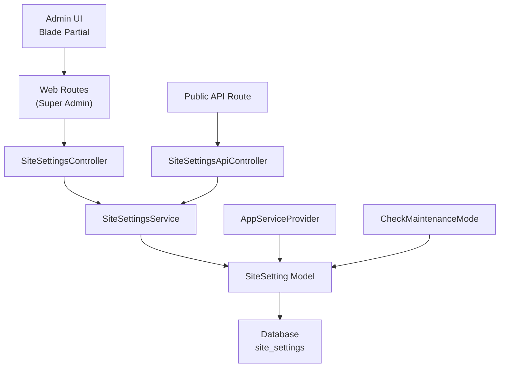
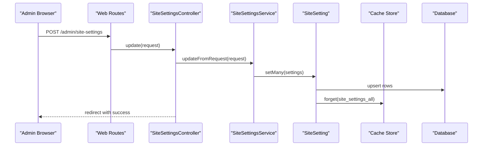
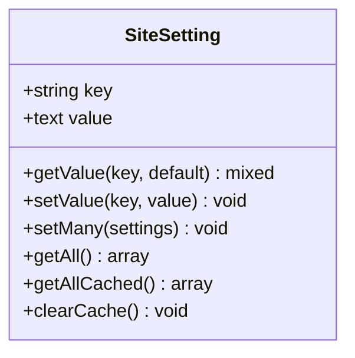
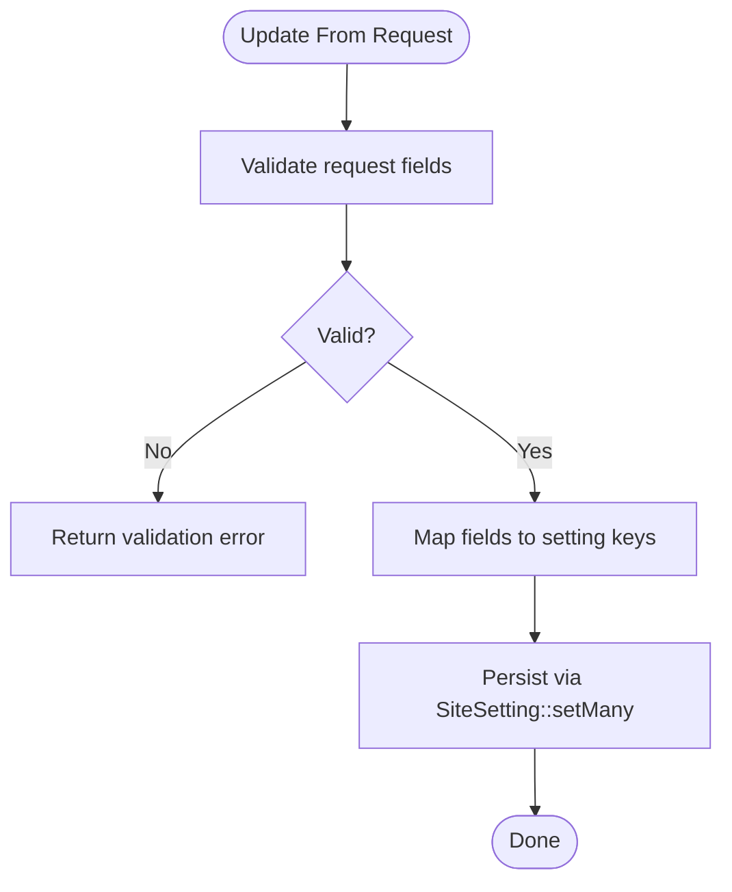
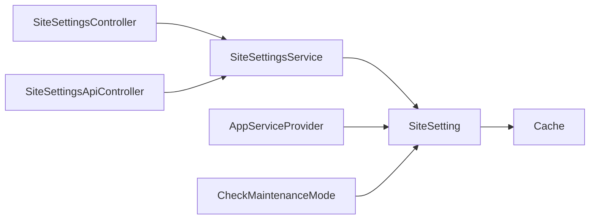

# Configuration Management & Environment Customization

<cite>
**Referenced Files in This Document**   
- [SiteSetting.php](file://backend/app/Models/SiteSetting.php)
- [SiteSettingsService.php](file://backend/app/Services/SiteSettingsService.php)
- [SiteSettingsController.php](file://backend/app/Http/Controllers/Admin/SiteSettingsController.php)
- [SiteSettingsApiController.php](file://backend/app/Http/Controllers/API/SiteSettingsApiController.php)
- [2026_06_11_000000_create_site_settings_table.php](file://backend/database/migrations/2026_06_11_000000_create_site_settings_table.php)
- [site-settings.blade.php](file://backend/resources/views/admin/partials/site-settings.blade.php)
- [site-settings.js](file://backend/resources/js/admin/site-settings.js)
- [web.php](file://backend/routes/web.php)
- [api.php](file://backend/routes/api.php)
- [AppServiceProvider.php](file://backend/app/Providers/AppServiceProvider.php)
- [CheckMaintenanceMode.php](file://backend/app/Http/Middleware/CheckMaintenanceMode.php)
</cite>

## Table of Contents
1. [Introduction](#introduction)
2. [Project Structure](#project-structure)
3. [Core Components](#core-components)
4. [Architecture Overview](#architecture-overview)
5. [Detailed Component Analysis](#detailed-component-analysis)
6. [Dependency Analysis](#dependency-analysis)
7. [Performance Considerations](#performance-considerations)
8. [Troubleshooting Guide](#troubleshooting-guide)
9. [Conclusion](#conclusion)
10. [Appendices](#appendices)

## Introduction
This document explains SonyaBus’s database-driven configuration system centered on the SiteSettings model and environment-based customization patterns. It covers how site-wide settings are stored, validated, updated through the admin interface, cached for performance, and consumed by both the admin UI and public API. It also provides guidance for extending configuration fields, securing sensitive values, organizing environment variables, migrating configuration schema changes, backing up runtime settings, and deploying across multiple environments.

## Project Structure
The configuration management feature spans several layers:

- Data layer: `site_settings` table created by a migration.
- Model layer: `SiteSetting` Eloquent model with caching helpers.
- Service layer: `SiteSettingsService` for validation, persistence, file uploads, and public API shaping.
- Controller layer: Admin controller for form submissions; API controller for public read access.
- Routing layer: Web routes protected by super-admin middleware; public API route always accessible.
- View layer: Blade partial for the admin settings panel; small JavaScript helper for maintenance toggle UX.
- Application bootstrap: Service provider shares settings with views and can override mail/payment service configuration from the database.
- Middleware: Maintenance mode check reads runtime settings to block non-excluded requests.

**Diagram sources**
- [web.php:269-281](file://backend/routes/web.php#L269-L281)
- [api.php:12-18](file://backend/routes/api.php#L12-L18)
- [SiteSettingsController.php:1-49](file://backend/app/Http/Controllers/Admin/SiteSettingsController.php#L1-L49)
- [SiteSettingsApiController.php:1-18](file://backend/app/Http/Controllers/API/SiteSettingsApiController.php#L1-L18)
- [SiteSettingsService.php:1-182](file://backend/app/Services/SiteSettingsService.php#L1-L182)
- [SiteSetting.php:1-81](file://backend/app/Models/SiteSetting.php#L1-L81)
- [AppServiceProvider.php:40-102](file://backend/app/Providers/AppServiceProvider.php#L40-L102)
- [CheckMaintenanceMode.php:10-47](file://backend/app/Http/Middleware/CheckMaintenanceMode.php#L10-L47)

**Section sources**
- [web.php:269-281](file://backend/routes/web.php#L269-L281)
- [api.php:12-18](file://backend/routes/api.php#L12-L18)
- [SiteSettingsController.php:1-49](file://backend/app/Http/Controllers/Admin/SiteSettingsController.php#L1-L49)
- [SiteSettingsApiController.php:1-18](file://backend/app/Http/Controllers/API/SiteSettingsApiController.php#L1-L18)
- [SiteSettingsService.php:1-182](file://backend/app/Services/SiteSettingsService.php#L1-L182)
- [SiteSetting.php:1-81](file://backend/app/Models/SiteSetting.php#L1-L81)
- [AppServiceProvider.php:40-102](file://backend/app/Providers/AppServiceProvider.php#L40-L102)
- [CheckMaintenanceMode.php:10-47](file://backend/app/Http/Middleware/CheckMaintenanceMode.php#L10-L47)

## Core Components
- SiteSetting model: Provides key-value storage, bulk updates, and cache-aware retrieval.
- SiteSettingsService: Validates incoming admin requests, persists settings, handles secure file uploads, and shapes public API output.
- Admin SiteSettingsController: Exposes HTTP endpoints for updating settings and uploading assets.
- Public SiteSettingsApiController: Returns a normalized public configuration object.
- Migration: Creates the `site_settings` table and seeds default values.
- Blade partial: Renders the admin settings form with sections for identity, footer, maintenance, and SEO.
- JavaScript helper: Updates maintenance status label dynamically before saving.
- AppServiceProvider: Shares settings with views and optionally overrides mail/payment service configuration from the database.
- CheckMaintenanceMode middleware: Blocks non-excluded requests when maintenance mode is enabled.

**Section sources**
- [SiteSetting.php:1-81](file://backend/app/Models/SiteSetting.php#L1-L81)
- [SiteSettingsService.php:1-182](file://backend/app/Services/SiteSettingsService.php#L1-L182)
- [SiteSettingsController.php:1-49](file://backend/app/Http/Controllers/Admin/SiteSettingsController.php#L1-L49)
- [SiteSettingsApiController.php:1-18](file://backend/app/Http/Controllers/API/SiteSettingsApiController.php#L1-L18)
- [2026_06_11_000000_create_site_settings_table.php:1-57](file://backend/database/migrations/2026_06_11_000000_create_site_settings_table.php#L1-L57)
- [site-settings.blade.php:1-430](file://backend/resources/views/admin/partials/site-settings.blade.php#L1-L430)
- [site-settings.js:1-20](file://backend/resources/js/admin/site-settings.js#L1-L20)
- [AppServiceProvider.php:40-102](file://backend/app/Providers/AppServiceProvider.php#L40-L102)
- [CheckMaintenanceMode.php:10-47](file://backend/app/Http/Middleware/CheckMaintenanceMode.php#L10-L47)

## Architecture Overview
SonyaBus uses a layered approach:

- Admin writes settings via Blade forms.
- Requests are validated and persisted by the service layer.
- The model caches all settings to reduce database load.
- Views consume shared settings for branding and maintenance behavior.
- Public API returns a sanitized subset of settings.
- Middleware enforces maintenance mode based on runtime configuration.

**Diagram sources**
- [web.php:269-281](file://backend/routes/web.php#L269-L281)
- [SiteSettingsController.php:14-21](file://backend/app/Http/Controllers/Admin/SiteSettingsController.php#L14-L21)
- [SiteSettingsService.php:51-84](file://backend/app/Services/SiteSettingsService.php#L51-L84)
- [SiteSetting.php:43-53](file://backend/app/Models/SiteSetting.php#L43-L53)

## Detailed Component Analysis

### SiteSetting Model
Responsibilities:
- Key-value persistence using `key` (unique) and `value`.
- Single value getter with default fallback.
- Bulk setter that upserts rows and clears the settings cache.
- Cached retrieval of all settings with TTL.
- Explicit cache clearing utility.

Complexity considerations:
- `getAll()` performs a single pluck operation returning an associative array.
- `getAllCached()` adds a short-lived cache to avoid repeated queries.
- `setMany()` iterates over provided keys and calls `updateOrCreate`, then invalidates cache once.

**Diagram sources**
- [SiteSetting.php:1-81](file://backend/app/Models/SiteSetting.php#L1-L81)

**Section sources**
- [SiteSetting.php:1-81](file://backend/app/Models/SiteSetting.php#L1-L81)

### SiteSettingsService
Responsibilities:
- Normalize settings into a public API structure with sensible defaults.
- Validate and persist admin form data.
- Securely upload favicon and logo files, derive safe extensions from MIME types, and store URLs in settings.
- Delete uploaded logo files and reset related settings.

Validation rules:
- Required string fields for site title and footer content.
- Optional text fields for SEO and analytics identifiers.
- File validations for favicon and logo with strict MIME and size constraints.

Security notes:
- Extension derivation is based on MIME mapping and allowed list to prevent extension spoofing.
- Uploaded files are moved under a dedicated public directory.

**Diagram sources**
- [SiteSettingsService.php:51-84](file://backend/app/Services/SiteSettingsService.php#L51-L84)

**Section sources**
- [SiteSettingsService.php:1-182](file://backend/app/Services/SiteSettingsService.php#L1-L182)

### Admin SiteSettingsController
Responsibilities:
- Handle form submission to update site settings.
- Handle favicon/logo upload endpoints.
- Redirect back to dashboard with success messages and preserve active tab.

Routing integration:
- Endpoints are grouped under super-admin protection.

**Section sources**
- [SiteSettingsController.php:1-49](file://backend/app/Http/Controllers/Admin/SiteSettingsController.php#L1-L49)
- [web.php:269-281](file://backend/routes/web.php#L269-L281)

### Public SiteSettingsApiController
Responsibilities:
- Return a normalized JSON object containing branding, footer, maintenance flags, and SEO metadata.
- Use service layer to ensure consistent defaults and formatting.

Routing integration:
- Public GET endpoint available even during maintenance.

**Section sources**
- [SiteSettingsApiController.php:1-18](file://backend/app/Http/Controllers/API/SiteSettingsApiController.php#L1-L18)
- [api.php:12-18](file://backend/routes/api.php#L12-L18)

### Database Schema and Defaults
Schema:
- `id`: primary key.
- `key`: unique string identifier.
- `value`: nullable text payload.
- Timestamps for auditability.

Defaults:
- Default values include site title, favicon URL, footer company name and copyright, footer links JSON, maintenance mode flag and message, and SEO/Open Graph fields.

Migration strategy:
- Use migrations to add new keys or alter columns.
- Seeders or migration logic can initialize defaults for new environments.

**Section sources**
- [2026_06_11_000000_create_site_settings_table.php:1-57](file://backend/database/migrations/2026_06_11_000000_create_site_settings_table.php#L1-L57)

### Admin UI and Client-Side Behavior
Blade partial:
- Organizes settings into sections: Website Identity, Footer Management, Maintenance Mode, SEO Settings.
- Separate multipart forms for favicon and logo uploads due to different payloads.
- Displays current logo/favicon previews and allows deletion of the logo.

JavaScript helper:
- Listens for maintenance toggle changes and updates the status label without submitting the form.

Best practices:
- Keep large binary assets out of the database; store paths in settings.
- Provide clear user feedback and validation hints in the UI.

**Section sources**
- [site-settings.blade.php:1-430](file://backend/resources/views/admin/partials/site-settings.blade.php#L1-L430)
- [site-settings.js:1-20](file://backend/resources/js/admin/site-settings.js#L1-L20)

### Application Bootstrap and Runtime Overrides
AppServiceProvider:
- Skips database-dependent boot logic during installation.
- Optionally overrides mail and payment service configuration from database settings at runtime.
- Shares site settings with the admin layout view.

Implications:
- Dynamic configuration can affect application behavior beyond UI branding.
- Graceful error handling ensures startup does not fail if tables are missing.

**Section sources**
- [AppServiceProvider.php:20-102](file://backend/app/Providers/AppServiceProvider.php#L20-L102)

### Maintenance Mode Enforcement
Middleware:
- Excludes public site-settings API from maintenance checks so clients can still fetch configuration.
- Reads maintenance flag and message from settings and returns 503 JSON when enabled.

Usage:
- Applied to public API groups to protect customer-facing endpoints while allowing configuration discovery.

**Section sources**
- [CheckMaintenanceMode.php:10-47](file://backend/app/Http/Middleware/CheckMaintenanceMode.php#L10-L47)
- [api.php:26-32](file://backend/routes/api.php#L26-L32)

## Dependency Analysis
Key relationships:
- Controllers depend on the service layer for business logic and validation.
- Service layer depends on the model for persistence and cache operations.
- Model depends on Laravel cache facade for performance.
- Service provider shares settings with views and may override service configuration.
- Middleware depends on model to enforce maintenance mode.

**Diagram sources**
- [SiteSettingsController.php:1-49](file://backend/app/Http/Controllers/Admin/SiteSettingsController.php#L1-L49)
- [SiteSettingsApiController.php:1-18](file://backend/app/Http/Controllers/API/SiteSettingsApiController.php#L1-L18)
- [SiteSettingsService.php:1-182](file://backend/app/Services/SiteSettingsService.php#L1-L182)
- [SiteSetting.php:1-81](file://backend/app/Models/SiteSetting.php#L1-L81)
- [AppServiceProvider.php:40-102](file://backend/app/Providers/AppServiceProvider.php#L40-L102)
- [CheckMaintenanceMode.php:10-47](file://backend/app/Http/Middleware/CheckMaintenanceMode.php#L10-L47)

**Section sources**
- [SiteSettingsController.php:1-49](file://backend/app/Http/Controllers/Admin/SiteSettingsController.php#L1-L49)
- [SiteSettingsApiController.php:1-18](file://backend/app/Http/Controllers/API/SiteSettingsApiController.php#L1-L18)
- [SiteSettingsService.php:1-182](file://backend/app/Services/SiteSettingsService.php#L1-L182)
- [SiteSetting.php:1-81](file://backend/app/Models/SiteSetting.php#L1-L81)
- [AppServiceProvider.php:40-102](file://backend/app/Providers/AppServiceProvider.php#L40-L102)
- [CheckMaintenanceMode.php:10-47](file://backend/app/Http/Middleware/CheckMaintenanceMode.php#L10-L47)

## Performance Considerations
- Use `getAllCached()` for frequent reads to minimize database queries.
- Invalidate cache after write operations (`setValue`, `setMany`, `clearCache`).
- Avoid storing large binary data in the database; store file paths and keep files in the public uploads directory.
- Keep the settings cache TTL reasonable to balance freshness and performance.
- Prefer bulk updates (`setMany`) over many individual writes.

[No sources needed since this section provides general guidance]

## Troubleshooting Guide
Common issues and resolutions:
- Settings not appearing in UI:
  - Ensure the admin layout receives shared settings from the service provider.
  - Verify the `site_settings` table exists and contains expected keys.
- Maintenance mode blocking API unexpectedly:
  - Confirm the public site-settings endpoint is excluded from maintenance checks.
  - Check the maintenance flag value and message in the database.
- Logo/favicon not updating:
  - Verify file upload validation and MIME-to-extension mapping.
  - Ensure the public uploads directory exists and is writable.
  - Clear the settings cache after upload.
- Validation errors on save:
  - Review required fields and length limits in the service validation rules.
  - Ensure frontend sends correct field names and formats (e.g., JSON for footer links).

Operational tips:
- Use the admin success messages to confirm successful updates.
- Inspect the public API response shape to verify normalization and defaults.

**Section sources**
- [AppServiceProvider.php:83-102](file://backend/app/Providers/AppServiceProvider.php#L83-L102)
- [CheckMaintenanceMode.php:17-47](file://backend/app/Http/Middleware/CheckMaintenanceMode.php#L17-L47)
- [SiteSettingsService.php:86-139](file://backend/app/Services/SiteSettingsService.php#L86-L139)
- [SiteSettingsService.php:51-84](file://backend/app/Services/SiteSettingsService.php#L51-L84)

## Conclusion
SonyaBus’s configuration system combines a simple key-value database model with a robust service layer, caching, and clear separation between admin and public interfaces. The design supports runtime customization through the admin UI, secure asset handling, and controlled exposure of settings via API. By following the recommended patterns for adding fields, validating inputs, organizing environment variables, and planning migrations and backups, teams can extend and operate the configuration system safely across multiple environments.

[No sources needed since this section summarizes without analyzing specific files]

## Appendices

### Adding a New Configuration Field
Recommended steps:
- Extend the migration to seed a default value for the new key.
- Add validation rules in the service’s update method.
- Include the field in the Blade form and map it to the setting key.
- Update the public API shape if the field should be exposed publicly.
- Clear the settings cache after initial seeding or first update.

Reference locations:
- Migration defaults: [2026_06_11_000000_create_site_settings_table.php:19-49](file://backend/database/migrations/2026_06_11_000000_create_site_settings_table.php#L19-L49)
- Service validation and persistence: [SiteSettingsService.php:51-84](file://backend/app/Services/SiteSettingsService.php#L51-L84)
- Blade form fields: [site-settings.blade.php:123-296](file://backend/resources/views/admin/partials/site-settings.blade.php#L123-L296)
- Public API shape: [SiteSettingsService.php:14-49](file://backend/app/Services/SiteSettingsService.php#L14-L49)

**Section sources**
- [2026_06_11_000000_create_site_settings_table.php:19-49](file://backend/database/migrations/2026_06_11_000000_create_site_settings_table.php#L19-L49)
- [SiteSettingsService.php:14-84](file://backend/app/Services/SiteSettingsService.php#L14-L84)
- [site-settings.blade.php:123-296](file://backend/resources/views/admin/partials/site-settings.blade.php#L123-L296)

### Creating Admin UI Forms for Settings Management
Guidelines:
- Group related fields into logical sections with clear headings and descriptions.
- Use separate multipart forms for file uploads to avoid conflicts.
- Provide previews for uploaded assets and options to remove them.
- Preserve the active admin tab after redirects.

Reference locations:
- Favicon and logo forms: [site-settings.blade.php:12-116](file://backend/resources/views/admin/partials/site-settings.blade.php#L12-L116)
- Main settings form: [site-settings.blade.php:118-304](file://backend/resources/views/admin/partials/site-settings.blade.php#L118-L304)
- Controller redirects: [SiteSettingsController.php:14-48](file://backend/app/Http/Controllers/Admin/SiteSettingsController.php#L14-L48)

**Section sources**
- [site-settings.blade.php:12-304](file://backend/resources/views/admin/partials/site-settings.blade.php#L12-L304)
- [SiteSettingsController.php:14-48](file://backend/app/Http/Controllers/Admin/SiteSettingsController.php#L14-L48)

### Implementing Configuration Validation
Recommendations:
- Centralize validation rules in the service layer.
- Enforce type, length, and format constraints appropriate to each setting.
- For complex structures like footer links, validate JSON syntax and expected keys.
- Provide user-friendly error messages and inline hints in the UI.

Reference locations:
- Validation rules: [SiteSettingsService.php:51-67](file://backend/app/Services/SiteSettingsService.php#L51-L67)
- Footer links usage: [site-settings.blade.php:174-182](file://backend/resources/views/admin/partials/site-settings.blade.php#L174-L182)

**Section sources**
- [SiteSettingsService.php:51-67](file://backend/app/Services/SiteSettingsService.php#L51-L67)
- [site-settings.blade.php:174-182](file://backend/resources/views/admin/partials/site-settings.blade.php#L174-L182)

### Best Practices for Environment Variables and Configuration Files
- Use environment variables for deployment-specific secrets (database credentials, API keys, encryption keys).
- Keep runtime business configuration in the database when it needs to change without redeployments.
- Do not store secrets in the database unless absolutely necessary; prefer environment variables for sensitive values.
- Organize configuration files per domain (mail, services, queue, session) and reference them from the app.
- When overriding service configuration from the database, ensure graceful fallbacks and logging.

Reference locations:
- Service provider dynamic overrides: [AppServiceProvider.php:40-78](file://backend/app/Providers/AppServiceProvider.php#L40-L78)

**Section sources**
- [AppServiceProvider.php:40-78](file://backend/app/Providers/AppServiceProvider.php#L40-L78)

### Secure Handling of Sensitive Settings
- Validate and sanitize all inputs before persistence.
- Restrict admin-only endpoints behind strong authentication and authorization.
- Avoid logging sensitive values.
- Use HTTPS for all admin and API endpoints.
- For file uploads, validate MIME types and restrict allowed extensions.

Reference locations:
- File upload validation and safe extension mapping: [SiteSettingsService.php:86-169](file://backend/app/Services/SiteSettingsService.php#L86-L169)
- Super-admin route protection: [web.php:269-281](file://backend/routes/web.php#L269-L281)

**Section sources**
- [SiteSettingsService.php:86-169](file://backend/app/Services/SiteSettingsService.php#L86-L169)
- [web.php:269-281](file://backend/routes/web.php#L269-L281)

### Configuration Migration Strategies
- Add new settings via migrations and seed defaults.
- Use idempotent logic to avoid duplicate entries.
- Test migrations locally and in staging before production.
- Back up the database before running migrations.
- Rollback plan: define down actions and test restoration procedures.

Reference locations:
- Migration creation and defaults: [2026_06_11_000000_create_site_settings_table.php:10-55](file://backend/database/migrations/2026_06_11_000000_create_site_settings_table.php#L10-L55)

**Section sources**
- [2026_06_11_000000_create_site_settings_table.php:10-55](file://backend/database/migrations/2026_06_11_000000_create_site_settings_table.php#L10-L55)

### Backup Procedures for Runtime Settings
- Include the `site_settings` table in regular database backups.
- Version-control migrations but not runtime values.
- Export settings periodically for audit and recovery.
- Restore settings in disaster recovery scenarios using backups.

[No sources needed since this section provides general guidance]

### Multi-Environment Deployment Considerations
- Use environment variables for environment-specific configuration.
- Keep runtime business settings in the database to allow per-environment customization without code changes.
- Seed default settings in migrations for new environments.
- Ensure cache stores are properly configured per environment.
- Protect admin endpoints with strong authentication and IP restrictions where possible.

[No sources needed since this section provides general guidance]