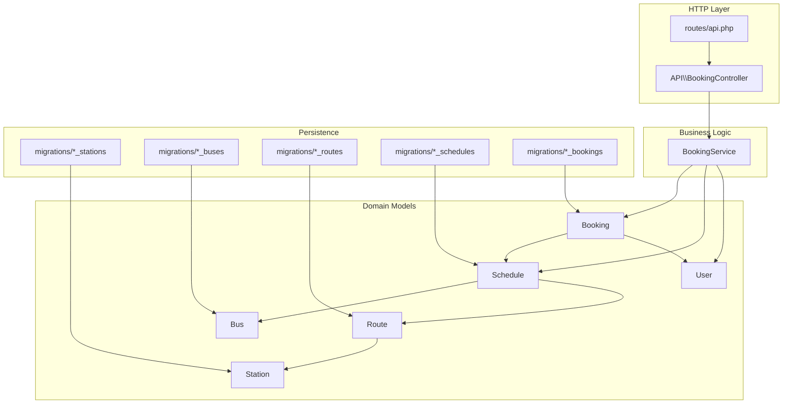
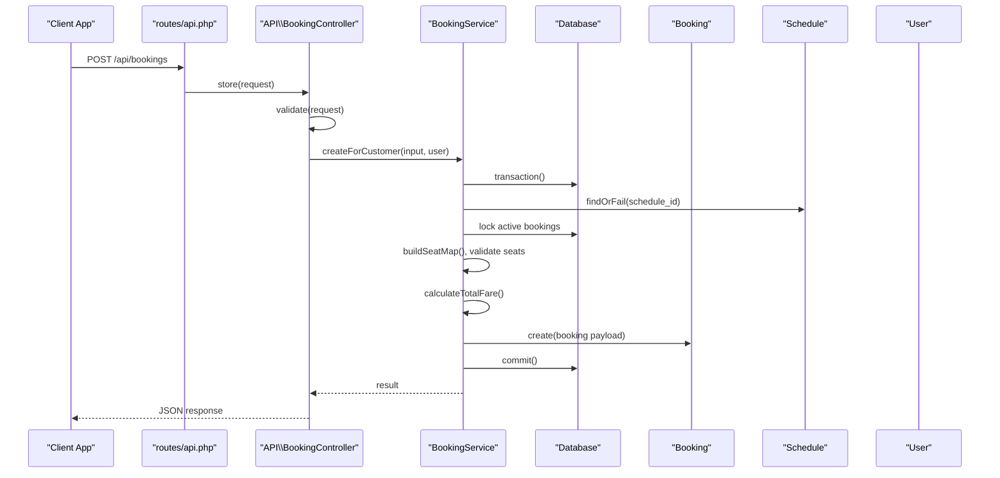
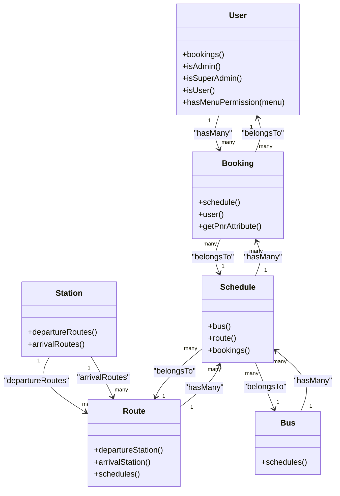
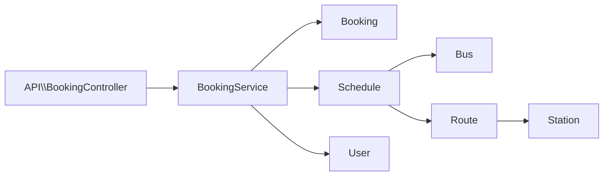

# Custom Business Entities & Domain Models

<cite>
**Referenced Files in This Document**
- [User.php](file://backend/app/Models/User.php)
- [Bus.php](file://backend/app/Models/Bus.php)
- [Booking.php](file://backend/app/Models/Booking.php)
- [Schedule.php](file://backend/app/Models/Schedule.php)
- [Route.php](file://backend/app/Models/Route.php)
- [Station.php](file://backend/app/Models/Station.php)
- [2026_06_01_000010_create_stations_table.php](file://backend/database/migrations/2026_06_01_000010_create_stations_table.php)
- [2026_06_01_000020_create_buses_table.php](file://backend/database/migrations/2026_06_01_000020_create_buses_table.php)
- [2026_06_01_000030_create_routes_table.php](file://backend/database/migrations/2026_06_01_000030_create_routes_table.php)
- [2026_06_01_000040_create_schedules_table.php](file://backend/database/migrations/2026_06_01_000040_create_schedules_table.php)
- [2026_06_01_000050_create_bookings_table.php](file://backend/database/migrations/2026_06_01_000050_create_bookings_table.php)
- [api.php](file://backend/routes/api.php)
- [BaseController.php](file://backend/app/Http/Controllers/API/BaseController.php)
- [BookingController.php](file://backend/app/Http/Controllers/API/BookingController.php)
- [BookingService.php](file://backend/app/Services/BookingService.php)
- [DatabaseSeeder.php](file://backend/database/seeders/DatabaseSeeder.php)
</cite>

## Table of Contents
1. Introduction
2. Project Structure
3. Core Components
4. Architecture Overview
5. Detailed Component Analysis
6. Dependency Analysis
7. Performance Considerations
8. Troubleshooting Guide
9. Conclusion
10. Appendices

## Introduction
This document explains how to extend SonyaBus with custom business entities and domain models using Laravel’s Eloquent ORM. It covers model relationships, accessors, mutators, casts, scopes, migrations, versioning strategies, data transformation techniques, validation rules, API endpoints, testing strategies, seeders, and advanced topics such as polymorphic relationships, soft deletes, and audit logging. The guidance is grounded in the existing patterns used by User, Bus, Booking, Schedule, Route, and Station.

## Project Structure
The backend follows a layered structure:
- Models define domain entities and relationships.
- Migrations define database schema and indexes.
- Controllers handle HTTP requests and delegate to services.
- Services encapsulate business logic and orchestrate transactions.
- Routes expose public and authenticated APIs.
- Seeders populate initial data for development and testing.

**Diagram sources**
- [api.php:1-77](file://backend/routes/api.php#L1-L77)
- [BookingController.php:1-150](file://backend/app/Http/Controllers/API/BookingController.php#L1-L150)
- [BookingService.php:1-335](file://backend/app/Services/BookingService.php#L1-L335)
- [User.php:1-76](file://backend/app/Models/User.php#L1-L76)
- [Bus.php:1-23](file://backend/app/Models/Bus.php#L1-L23)
- [Schedule.php:1-35](file://backend/app/Models/Schedule.php#L1-L35)
- [Route.php:1-41](file://backend/app/Models/Route.php#L1-L41)
- [Station.php:1-24](file://backend/app/Models/Station.php#L1-L24)
- [Booking.php:1-49](file://backend/app/Models/Booking.php#L1-L49)
- [2026_06_01_000010_create_stations_table.php:1-23](file://backend/database/migrations/2026_06_01_000010_create_stations_table.php#L1-L23)
- [2026_06_01_000020_create_buses_table.php:1-39](file://backend/database/migrations/2026_06_01_000020_create_buses_table.php#L1-L39)
- [2026_06_01_000030_create_routes_table.php:1-39](file://backend/database/migrations/2026_06_01_000030_create_routes_table.php#L1-L39)
- [2026_06_01_000040_create_schedules_table.php:1-41](file://backend/database/migrations/2026_06_01_000040_create_schedules_table.php#L1-L41)
- [2026_06_01_000050_create_bookings_table.php:1-53](file://backend/database/migrations/2026_06_01_000050_create_bookings_table.php#L1-L53)

**Section sources**
- [api.php:1-77](file://backend/routes/api.php#L1-L77)
- [BookingController.php:1-150](file://backend/app/Http/Controllers/API/BookingController.php#L1-L150)
- [BookingService.php:1-335](file://backend/app/Services/BookingService.php#L1-L335)

## Core Components
This section summarizes the core domain models and their responsibilities.

- User
  - Authentication, roles, menu permissions, and relationship to bookings.
  - Uses casts for arrays and datetime fields.
- Bus
  - Coach metadata, seat layout configuration, and relationship to schedules.
- Schedule
  - Time-bound trip instance linking bus and route; holds fare and blocked seats.
- Route
  - Connection between departure and arrival stations; stores boarding/dropping points.
- Station
  - Geographic locations referenced by routes.
- Booking
  - Passenger ticket linked to user and schedule; includes PNR accessor.

Key Eloquent patterns observed:
- Relationships: hasMany, belongsTo with explicit foreign keys.
- Casts: arrays, decimals, datetimes.
- Accessors: computed attributes (e.g., PNR).
- Fillable fields for mass assignment.
- Indexes on frequently queried columns in migrations.

**Section sources**
- [User.php:1-76](file://backend/app/Models/User.php#L1-L76)
- [Bus.php:1-23](file://backend/app/Models/Bus.php#L1-L23)
- [Schedule.php:1-35](file://backend/app/Models/Schedule.php#L1-L35)
- [Route.php:1-41](file://backend/app/Models/Route.php#L1-L41)
- [Station.php:1-24](file://backend/app/Models/Station.php#L1-L24)
- [Booking.php:1-49](file://backend/app/Models/Booking.php#L1-L49)

## Architecture Overview
The booking flow demonstrates how controllers, services, models, and migrations collaborate.

**Diagram sources**
- [api.php:63-75](file://backend/routes/api.php#L63-L75)
- [BookingController.php:19-40](file://backend/app/Http/Controllers/API/BookingController.php#L19-L40)
- [BookingService.php:28-131](file://backend/app/Services/BookingService.php#L28-L131)
- [Booking.php:1-49](file://backend/app/Models/Booking.php#L1-L49)
- [Schedule.php:1-35](file://backend/app/Models/Schedule.php#L1-L35)
- [User.php:1-76](file://backend/app/Models/User.php#L1-L76)

## Detailed Component Analysis

### Eloquent ORM Patterns Across Models
- Relationships
  - User has many Bookings.
  - Schedule belongs to Bus and Route; has many Bookings.
  - Route belongs to two Stations (departure and arrival).
  - Booking belongs to Schedule and User.
- Casts
  - Arrays: menu_permissions, seat_layout_grid, boarding_points, dropping_points.
  - Decimal: total_fare, fare.
  - Datetime: email_verified_at, departure_time, arrival_time.
- Accessors
  - Booking exposes a readable PNR attribute derived from its id.
- Fillable
  - All models declare fillable arrays for safe mass assignment.

**Diagram sources**
- [User.php:39-74](file://backend/app/Models/User.php#L39-L74)
- [Bus.php:18-21](file://backend/app/Models/Bus.php#L18-L21)
- [Route.php:26-39](file://backend/app/Models/Route.php#L26-L39)
- [Station.php:14-22](file://backend/app/Models/Station.php#L14-L22)
- [Schedule.php:20-33](file://backend/app/Models/Schedule.php#L20-L33)
- [Booking.php:33-47](file://backend/app/Models/Booking.php#L33-L47)

**Section sources**
- [User.php:1-76](file://backend/app/Models/User.php#L1-L76)
- [Bus.php:1-23](file://backend/app/Models/Bus.php#L1-L23)
- [Schedule.php:1-35](file://backend/app/Models/Schedule.php#L1-L35)
- [Route.php:1-41](file://backend/app/Models/Route.php#L1-L41)
- [Station.php:1-24](file://backend/app/Models/Station.php#L1-L24)
- [Booking.php:1-49](file://backend/app/Models/Booking.php#L1-L49)

### Migration System and Versioning Strategy
- Naming convention
  - Timestamp-prefixed migration files ensure deterministic ordering.
- Schema design
  - Foreign keys constrain related tables and define cascade behaviors.
  - Indexes optimize common queries (single-column and composite).
- Data types
  - Enumerations for coach_type and status.
  - JSON for flexible lists like boarding/dropping points.
  - Decimals for monetary values.
- Reversibility
  - Each migration defines down() to drop tables safely.

Recommended practices when adding new entities:
- Create a migration with a unique timestamp prefix.
- Define all columns, defaults, nullable constraints, and indexes.
- Use foreign keys to enforce referential integrity.
- Provide a down() method to reverse changes.

Examples in this codebase:
- Stations, Buses, Routes, Schedules, and Bookings are defined with appropriate types, constraints, and indexes.

**Section sources**
- [2026_06_01_000010_create_stations_table.php:1-23](file://backend/database/migrations/2026_06_01_000010_create_stations_table.php#L1-L23)
- [2026_06_01_000020_create_buses_table.php:1-39](file://backend/database/migrations/2026_06_01_000020_create_buses_table.php#L1-L39)
- [2026_06_01_000030_create_routes_table.php:1-39](file://backend/database/migrations/2026_06_01_000030_create_routes_table.php#L1-L39)
- [2026_06_01_000040_create_schedules_table.php:1-41](file://backend/database/migrations/2026_06_01_000040_create_schedules_table.php#L1-L41)
- [2026_06_01_000050_create_bookings_table.php:1-53](file://backend/database/migrations/2026_06_01_000050_create_bookings_table.php#L1-L53)

### Creating New Business Entities: Step-by-Step Guide
Follow these steps to add a new entity consistent with existing patterns:

1. Define the table in a migration
   - Choose a descriptive table name.
   - Add columns with appropriate types and constraints.
   - Add foreign keys where applicable.
   - Add single and composite indexes for query performance.
   - Implement up() and down().

2. Create the Eloquent model
   - Extend Illuminate\Database\Eloquent\Model.
   - Declare fillable fields.
   - Define casts for arrays, decimals, and datetimes.
   - Add relationships to other models.
   - Add accessors or mutators if you need computed or transformed attributes.
   - Optionally add scopes for reusable query filters.

3. Add validation rules
   - In the controller, validate incoming request data before calling the service.
   - Keep business rules in the service layer.

4. Wire API endpoints
   - Register routes under api.php with appropriate middleware (public vs authenticated).
   - Return standardized JSON responses.

5. Integrate with services
   - Encapsulate complex operations in services.
   - Use transactions for multi-step writes.
   - Handle external integrations (payments, SMS) within services.

6. Seed test data
   - Add a seeder to populate realistic data for development and tests.
   - Call your new seeder from DatabaseSeeder.

7. Test the implementation
   - Write unit tests for model behavior and service logic.
   - Write feature tests for API endpoints.

Example references:
- Migration pattern: see station, bus, route, schedule, and booking migrations.
- Model pattern: see Bus, Schedule, Route, Station, Booking.
- Controller pattern: see BookingController store and mine methods.
- Service pattern: see BookingService createForCustomer and cancelForCustomer.
- Seeder pattern: see DatabaseSeeder orchestrating modular seeders.

**Section sources**
- [2026_06_01_000010_create_stations_table.php:1-23](file://backend/database/migrations/2026_06_01_000010_create_stations_table.php#L1-L23)
- [2026_06_01_000020_create_buses_table.php:1-39](file://backend/database/migrations/2026_06_01_000020_create_buses_table.php#L1-L39)
- [2026_06_01_000030_create_routes_table.php:1-39](file://backend/database/migrations/2026_06_01_000030_create_routes_table.php#L1-L39)
- [2026_06_01_000040_create_schedules_table.php:1-41](file://backend/database/migrations/2026_06_01_000040_create_schedules_table.php#L1-L41)
- [2026_06_01_000050_create_bookings_table.php:1-53](file://backend/database/migrations/2026_06_01_000050_create_bookings_table.php#L1-L53)
- [Bus.php:1-23](file://backend/app/Models/Bus.php#L1-L23)
- [Schedule.php:1-35](file://backend/app/Models/Schedule.php#L1-L35)
- [Route.php:1-41](file://backend/app/Models/Route.php#L1-L41)
- [Station.php:1-24](file://backend/app/Models/Station.php#L1-L24)
- [Booking.php:1-49](file://backend/app/Models/Booking.php#L1-L49)
- [BookingController.php:19-40](file://backend/app/Http/Controllers/API/BookingController.php#L19-L40)
- [BookingService.php:28-131](file://backend/app/Services/BookingService.php#L28-L131)
- [DatabaseSeeder.php:1-56](file://backend/database/seeders/DatabaseSeeder.php#L1-L56)

### Validation Rules and API Endpoints
- Validation
  - Controllers validate inputs using Laravel’s validator rules.
  - Examples include required fields, enums, numeric ranges, and existence checks.
- Endpoints
  - Public endpoints: stations, search, promotions.
  - Authenticated endpoints: auth management, bookings CRUD-like operations, seat hold/release.
  - Webhooks: payment callbacks.

Best practices:
- Validate at the controller boundary.
- Enforce authorization in controllers or middleware.
- Delegate business logic to services.
- Return consistent JSON structures.

**Section sources**
- [BookingController.php:19-40](file://backend/app/Http/Controllers/API/BookingController.php#L19-L40)
- [BookingController.php:42-60](file://backend/app/Http/Controllers/API/BookingController.php#L42-L60)
- [api.php:18-75](file://backend/routes/api.php#L18-L75)

### Advanced Topics

#### Polymorphic Relationships
Use polymorphic relationships when an entity can belong to multiple types. For example, a Notification could belong to either a Booking or a Promotion. To implement:
- Add type and ID columns to the polymorphic table.
- Define morphTo on the child model and morphMany on parent models.
- Update migrations accordingly.

[No sources needed since this section provides conceptual guidance]

#### Soft Deletes
Soft deletes allow logical deletion while retaining records. To apply:
- Add deleted_at column via migration.
- Use SoftDeletes trait in the model.
- Query with or without trashed records using withTrashed and onlyTrashed.

[No sources needed since this section provides conceptual guidance]

#### Audit Logging
To track who changed what and when:
- Add audit columns (auditor_id, action, old_values, new_values).
- Use model events (updated, created, deleted) to record changes.
- Alternatively, use a dedicated audit package integrated with Eloquent observers.

[No sources needed since this section provides conceptual guidance]

## Dependency Analysis
The booking subsystem exhibits clear separation of concerns:
- Controllers depend on services and models.
- Services depend on models and external services (payment, SMS).
- Models depend on each other through relationships.
- Migrations define the schema that models rely on.

**Diagram sources**
- [BookingController.php:1-150](file://backend/app/Http/Controllers/API/BookingController.php#L1-L150)
- [BookingService.php:1-335](file://backend/app/Services/BookingService.php#L1-L335)
- [Booking.php:1-49](file://backend/app/Models/Booking.php#L1-L49)
- [Schedule.php:1-35](file://backend/app/Models/Schedule.php#L1-L35)
- [User.php:1-76](file://backend/app/Models/User.php#L1-L76)
- [Bus.php:1-23](file://backend/app/Models/Bus.php#L1-L23)
- [Route.php:1-41](file://backend/app/Models/Route.php#L1-L41)
- [Station.php:1-24](file://backend/app/Models/Station.php#L1-L24)

**Section sources**
- [BookingController.php:1-150](file://backend/app/Http/Controllers/API/BookingController.php#L1-L150)
- [BookingService.php:1-335](file://backend/app/Services/BookingService.php#L1-L335)

## Performance Considerations
- Indexing
  - Use single and composite indexes on foreign keys and frequently filtered columns.
  - Avoid over-indexing write-heavy tables.
- Eager Loading
  - Load related entities to prevent N+1 queries.
- Transactions and Locking
  - Wrap critical sections in transactions.
  - Use row-level locking for concurrency-sensitive operations like seat selection.
- Caching
  - Cache read-heavy data (e.g., stations, routes) appropriately.
- Pagination
  - Paginate large result sets to reduce memory usage.

[No sources needed since this section provides general guidance]

## Troubleshooting Guide
Common issues and resolutions:
- Validation failures
  - Ensure controller validation rules match expected payloads.
  - Check enum values and allowed strings.
- Authorization errors
  - Verify Sanctum authentication and user roles.
- Concurrency conflicts
  - Seat availability must be validated under locks and transactions.
- Payment integration failures
  - Inspect invoice creation and callback handling in services.
- Missing relationships
  - Confirm foreign key constraints and relationship definitions.

Operational tips:
- Log service-layer exceptions and return user-friendly messages.
- Use structured JSON responses for consistent error handling.

**Section sources**
- [BookingController.php:62-73](file://backend/app/Http/Controllers/API/BookingController.php#L62-L73)
- [BookingController.php:118-148](file://backend/app/Http/Controllers/API/BookingController.php#L118-L148)
- [BookingService.php:28-131](file://backend/app/Services/BookingService.php#L28-L131)
- [BookingService.php:200-240](file://backend/app/Services/BookingService.php#L200-L240)

## Conclusion
Extending SonyaBus with custom entities requires adherence to established patterns: well-structured migrations, expressive Eloquent models, robust validation, service-oriented business logic, and clear API contracts. By following the examples provided by User, Bus, Booking, Schedule, Route, and Station, you can introduce new domain concepts safely and consistently. Apply advanced features like polymorphism, soft deletes, and audit logging judiciously based on domain needs.

[No sources needed since this section summarizes without analyzing specific files]

## Appendices

### API Endpoints Reference
- Public
  - GET /api/stations
  - GET /api/search
  - GET /api/promotions
  - GET /api/promotions/check
  - POST /api/payment/webhook
  - GET /api/bookings/public/{id}
- Authenticated (Sanctum)
  - POST /api/auth/logout
  - GET /api/auth/me
  - POST /api/auth/password
  - POST /api/bookings
  - GET /api/bookings/mine
  - POST /api/bookings/{id}/cancel
  - POST /api/bookings/{id}/pay
  - POST /api/seats/hold
  - POST /api/seats/release

**Section sources**
- [api.php:18-75](file://backend/routes/api.php#L18-L75)

### Seeder Orchestration
- DatabaseSeeder calls modular seeders in a defined order to ensure dependencies are satisfied.
- Add your own seeder and register it in the call stack.

**Section sources**
- [DatabaseSeeder.php:1-56](file://backend/database/seeders/DatabaseSeeder.php#L1-L56)