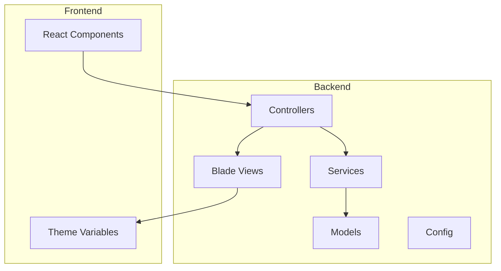
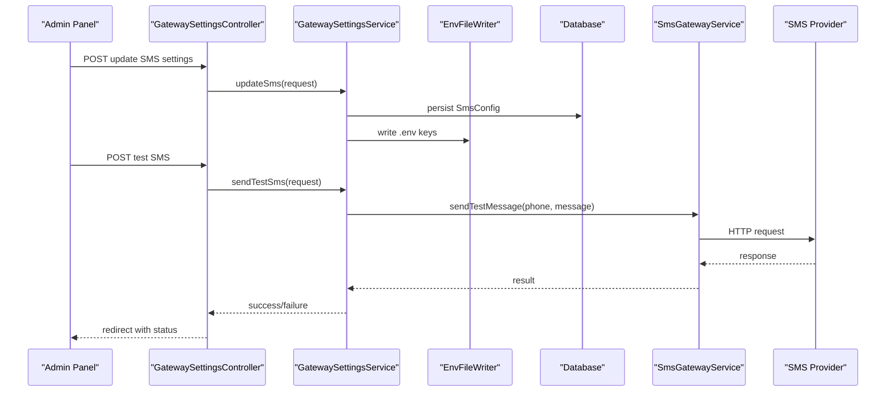
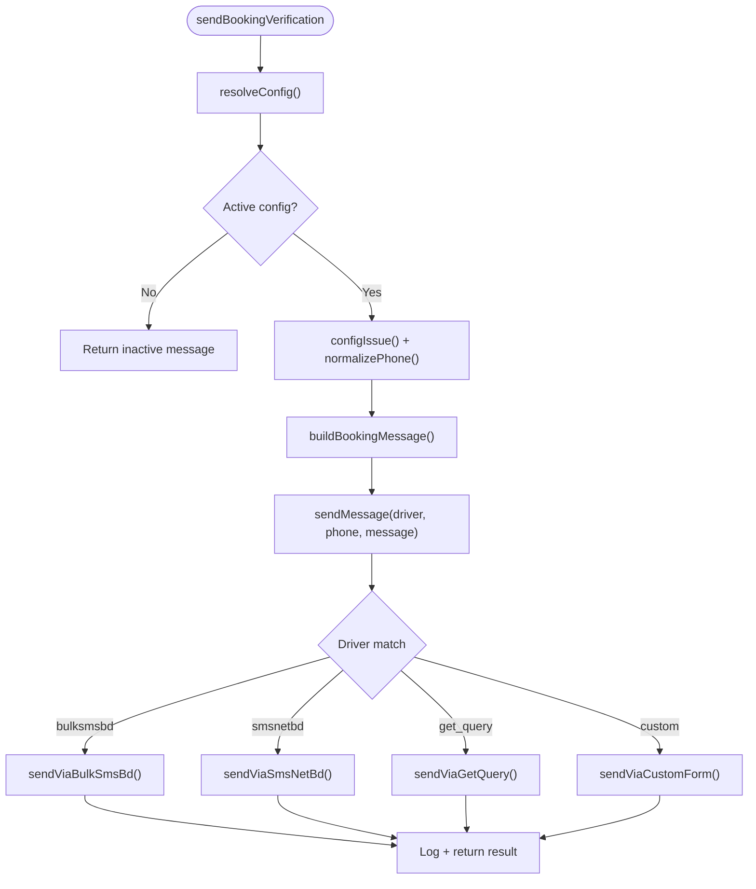
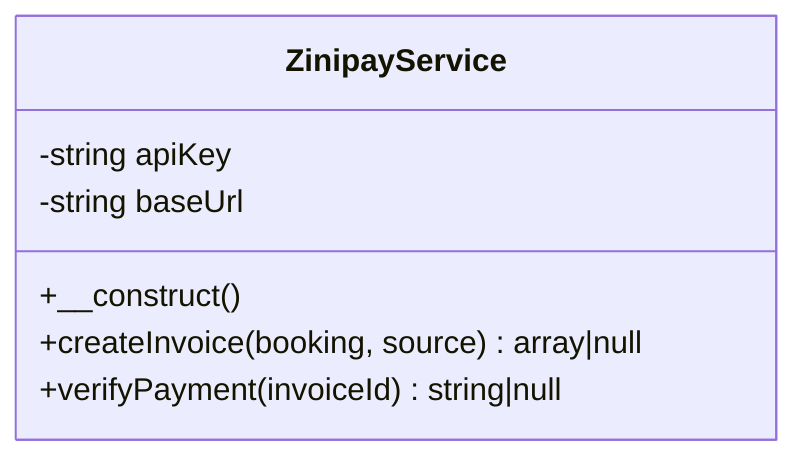
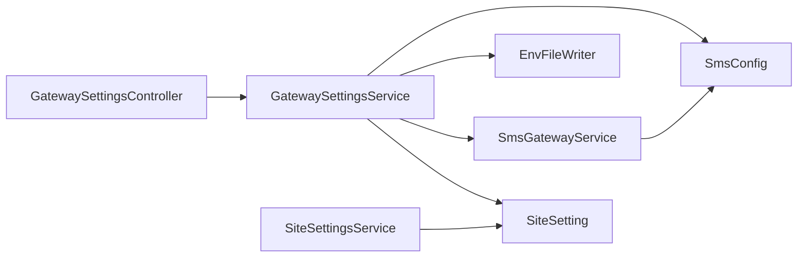

# Extension & Customization Guide

<cite>
**Referenced Files in This Document**
- [SmsGatewayService.php](file://backend/app/Services/SmsGatewayService.php)
- [ZinipayService.php](file://backend/app/Services/ZinipayService.php)
- [SiteSetting.php](file://backend/app/Models/SiteSetting.php)
- [SiteSettingsService.php](file://backend/app/Services/SiteSettingsService.php)
- [GatewaySettingsService.php](file://backend/app/Services/GatewaySettingsService.php)
- [GatewaySettingsController.php](file://backend/app/Http/Controllers/Admin/GatewaySettingsController.php)
- [SmsConfig.php](file://backend/app/Models/SmsConfig.php)
- [sms.blade.php](file://backend/resources/views/admin/partials/gateway-settings/sms.blade.php)
- [gateway-settings.blade.php](file://backend/resources/views/admin/partials/gateway-settings.blade.php)
- [zinipay.blade.php](file://backend/resources/views/admin/partials/gateway-settings/zinipay.blade.php)
- [theme-variables.blade.php](file://backend/resources/views/admin/partials/theme-variables.blade.php)
- [theme-variables.css](file://frontend/src/theme-variables.css)
- [sms.php](file://backend/config/sms.php)
- [booking.php](file://backend/config/booking.php)
- [UserAuthController.php](file://backend/app/Http/Controllers/API/UserAuthController.php)
</cite>

## Table of Contents
1. [Introduction](#introduction)
2. [Project Structure](#project-structure)
3. [Core Components](#core-components)
4. [Architecture Overview](#architecture-overview)
5. [Detailed Component Analysis](#detailed-component-analysis)
6. [Dependency Analysis](#dependency-analysis)
7. [Performance Considerations](#performance-considerations)
8. [Troubleshooting Guide](#troubleshooting-guide)
9. [Conclusion](#conclusion)
10. [Appendices](#appendices)

## Introduction
This guide explains how to extend and customize SonyaBus. It focuses on:
- Plugin-style extension points for SMS gateways, payment providers, and notifications
- Service layer patterns used by the application
- Middleware customization options
- Theme customization through CSS variables and Blade templates
- Configuration management using SiteSettings and environment-based settings
- Step-by-step guides for extending core functionality, creating reports, adding business entities, and integrating third-party services

The goal is to help you add new features safely while keeping upgrades simple.

## Project Structure
SonyaBus follows a layered Laravel backend with a separate React frontend:
- Backend: Controllers, Services, Models, Config, Views (Blade), Jobs, Mail
- Frontend: React components, theme variables, and build configuration
- Admin panel: Blade views for configuration, reporting, and operations
- Public API: JSON endpoints for authentication and booking flows

[No sources needed since this diagram shows conceptual structure]

## Core Components
This section introduces the main extension points:
- SMS gateway service: pluggable drivers and template-driven messages
- Payment provider service: ZiniPay integration with configurable base URL and API key
- Site settings model and service: runtime site-wide configuration with caching
- Gateway settings controller and service: admin UI for configuring SMS, mail, and payments
- Theme variables: CSS custom properties for light/dark themes across admin and frontend

Key responsibilities:
- SmsGatewayService: resolves active SMS config, validates phone numbers, builds messages, dispatches via driver-specific HTTP calls
- ZinipayService: creates invoices, verifies payments, handles local/testing redirect normalization
- SiteSetting: cached key-value store for site settings
- SiteSettingsService: public API mapping, validation, file uploads, and setting persistence
- GatewaySettingsController: routes admin requests to GatewaySettingsService
- GatewaySettingsService: persists SMS/mail/payment settings to database and .env, provides test helpers
- SmsConfig: Eloquent model for SMS gateway configuration
- Blade partials: admin forms for SMS and ZiniPay configuration
- Theme variables: CSS variables for consistent theming

**Section sources**
- [SmsGatewayService.php:11-255](file://backend/app/Services/SmsGatewayService.php#L11-L255)
- [ZinipayService.php:9-141](file://backend/app/Services/ZinipayService.php#L9-L141)
- [SiteSetting.php:8-81](file://backend/app/Models/SiteSetting.php#L8-L81)
- [SiteSettingsService.php:11-182](file://backend/app/Services/SiteSettingsService.php#L11-L182)
- [GatewaySettingsController.php:8-68](file://backend/app/Http/Controllers/Admin/GatewaySettingsController.php#L8-L68)
- [GatewaySettingsService.php:14-155](file://backend/app/Services/GatewaySettingsService.php#L14-L155)
- [SmsConfig.php:7-23](file://backend/app/Models/SmsConfig.php#L7-L23)
- [sms.blade.php:1-80](file://backend/resources/views/admin/partials/gateway-settings/sms.blade.php#L1-L80)
- [gateway-settings.blade.php:1-27](file://backend/resources/views/admin/partials/gateway-settings.blade.php#L1-L27)
- [zinipay.blade.php:1-38](file://backend/resources/views/admin/partials/gateway-settings/zinipay.blade.php#L1-L38)
- [theme-variables.blade.php:1-133](file://backend/resources/views/admin/partials/theme-variables.blade.php#L1-L133)
- [theme-variables.css:1-153](file://frontend/src/theme-variables.css#L1-L153)

## Architecture Overview
The extension architecture centers around:
- Driver-based dispatchers (SMS drivers)
- Service classes encapsulating external integrations
- Admin controllers and services for configuration persistence
- Environment and database-backed settings
- Theme variables for visual customization

**Diagram sources**
- [GatewaySettingsController.php:14-46](file://backend/app/Http/Controllers/Admin/GatewaySettingsController.php#L14-L46)
- [GatewaySettingsService.php:24-57](file://backend/app/Services/GatewaySettingsService.php#L24-L57)
- [GatewaySettingsService.php:115-126](file://backend/app/Services/GatewaySettingsService.php#L115-L126)
- [SmsGatewayService.php:53-73](file://backend/app/Services/SmsGatewayService.php#L53-L73)

## Detailed Component Analysis

### SMS Gateway Extension Points
You can extend SMS behavior by:
- Adding a new driver in the dispatcher
- Creating a dedicated method for the driver’s HTTP contract
- Supporting additional fields in SmsConfig if required
- Updating admin form fields and validation

Current driver selection and dispatch:
- Drivers supported: bulksmsbd, smsnetbd, get_query, custom
- Dispatch uses a match expression based on gateway_driver
- Each driver has a dedicated method that posts or queries the provider

**Diagram sources**
- [SmsGatewayService.php:16-48](file://backend/app/Services/SmsGatewayService.php#L16-L48)
- [SmsGatewayService.php:75-107](file://backend/app/Services/SmsGatewayService.php#L75-L107)
- [SmsGatewayService.php:109-150](file://backend/app/Services/SmsGatewayService.php#L109-L150)
- [SmsGatewayService.php:156-202](file://backend/app/Services/SmsGatewayService.php#L156-L202)
- [SmsGatewayService.php:204-253](file://backend/app/Services/SmsGatewayService.php#L204-L253)

How to add a new SMS driver:
1. Add a new driver string to the match expression in sendMessage
2. Implement a protected method for your provider’s HTTP contract
3. Update SmsConfig fillable fields if you need extra parameters
4. Extend the admin form and validation in GatewaySettingsService.updateSms
5. Add corresponding Blade fields in sms.blade.php

Validation and requirements:
- api_url, api_key are required; sender_id may be optional depending on driver
- Phone normalization ensures valid Bangladesh mobile numbers

Configuration storage:
- SmsConfig stores provider credentials and template
- .env keys are updated by EnvFileWriter for runtime access

**Section sources**
- [SmsGatewayService.php:156-253](file://backend/app/Services/SmsGatewayService.php#L156-L253)
- [SmsConfig.php:9-21](file://backend/app/Models/SmsConfig.php#L9-L21)
- [GatewaySettingsService.php:24-57](file://backend/app/Services/GatewaySettingsService.php#L24-L57)
- [sms.blade.php:12-59](file://backend/resources/views/admin/partials/gateway-settings/sms.blade.php#L12-L59)

### Payment Provider Extension Points
ZiniPay is implemented as a service class:
- Constructor reads API key and base URL from config/services
- createInvoice returns payment_url and invoice_id
- verifyPayment returns status string
- Local/testing environments rewrite URLs to 127.0.0.1 for sandbox compatibility

**Diagram sources**
- [ZinipayService.php:11-18](file://backend/app/Services/ZinipayService.php#L11-L18)
- [ZinipayService.php:27-97](file://backend/app/Services/ZinipayService.php#L27-L97)
- [ZinipayService.php:105-139](file://backend/app/Services/ZinipayService.php#L105-L139)

How to add a new payment provider:
1. Create a new service class following ZinipayService pattern
2. Read credentials from config/services or SiteSettings
3. Implement invoice creation and verification methods
4. Expose an admin endpoint via a controller and service to persist credentials
5. Store credentials in SiteSettings and/or .env using EnvFileWriter
6. Integrate into booking flow by calling the new service where ZinipayService is used

Admin configuration:
- ZiniPay settings are persisted via GatewaySettingsService.updateZinipay
- The admin form is defined in zinipay.blade.php

**Section sources**
- [ZinipayService.php:9-141](file://backend/app/Services/ZinipayService.php#L9-L141)
- [GatewaySettingsService.php:97-113](file://backend/app/Services/GatewaySettingsService.php#L97-L113)
- [zinipay.blade.php:12-35](file://backend/resources/views/admin/partials/gateway-settings/zinipay.blade.php#L12-L35)

### Notification Services Extension Points
Notifications include SMS and email:
- SMS: handled by SmsGatewayService and configured via SmsConfig
- Email: tested via SystemTestMail dispatched by GatewaySettingsService.sendTestEmail

To add a new notification channel:
1. Create a service class similar to SmsGatewayService
2. Define a driver selection mechanism
3. Persist configuration in SmsConfig or a new table
4. Provide admin UI and validation in a controller/service
5. Integrate into relevant jobs or controllers

**Section sources**
- [GatewaySettingsService.php:128-148](file://backend/app/Services/GatewaySettingsService.php#L128-L148)
- [SmsGatewayService.php:16-48](file://backend/app/Services/SmsGatewayService.php#L16-L48)

### Middleware Customization Options
Existing middleware includes:
- CheckMaintenanceMode
- EnsureLicenseIsActivated
- EnsureUserHasMenuPermission
- EnsureUserIsAdmin
- EnsureUserIsSuperAdmin

To add custom middleware:
1. Create a new middleware class under Http/Middleware
2. Register it in the application bootstrap or route groups
3. Apply it to routes requiring specific checks
4. Use it to enforce license activation, feature flags, or tenant isolation

Example use cases:
- Enforce maintenance mode globally
- Restrict admin-only routes
- Validate license domains before processing requests

**Section sources**
- [UserAuthController.php:113-164](file://backend/app/Http/Controllers/API/UserAuthController.php#L113-L164)

### Theme Customization Through CSS Variables
Theme variables are defined for both admin and frontend:
- Admin theme variables: backend/resources/views/admin/partials/theme-variables.blade.php
- Frontend theme variables: frontend/src/theme-variables.css

Variables cover backgrounds, borders, primary/accent colors, text colors, shadows, radii, and component-specific tokens.

How to customize:
- Override CSS variables in your theme files to change colors, fonts, spacing, and effects
- Maintain both light and dark theme blocks
- Test changes in both themes to ensure contrast and readability

Best practices:
- Keep variable names consistent between admin and frontend
- Avoid hardcoding colors in components; reference variables
- Validate accessibility contrast ratios after changes

**Section sources**
- [theme-variables.blade.php:1-133](file://backend/resources/views/admin/partials/theme-variables.blade.php#L1-L133)
- [theme-variables.css:1-153](file://frontend/src/theme-variables.css#L1-L153)

### Blade Template Overrides
Admin Blade templates provide extensible sections:
- gateway-settings.blade.php includes SMS, mail, ZiniPay, and diagnostics partials
- sms.blade.php and zinipay.blade.php define forms for configuration

To override:
- Copy the partial into your theme directory and adjust markup or behavior
- Keep form actions and CSRF tokens intact
- Preserve field names expected by GatewaySettingsService

For example, to extend SMS fields:
- Add new inputs in sms.blade.php
- Update validation and persistence in GatewaySettingsService.updateSms
- Map new fields to SmsConfig or SiteSettings as appropriate

**Section sources**
- [gateway-settings.blade.php:1-27](file://backend/resources/views/admin/partials/gateway-settings.blade.php#L1-L27)
- [sms.blade.php:12-78](file://backend/resources/views/admin/partials/gateway-settings/sms.blade.php#L12-L78)
- [zinipay.blade.php:12-35](file://backend/resources/views/admin/partials/gateway-settings/zinipay.blade.php#L12-L35)

### Configuration Management With SiteSettings and Environment
SiteSettings provides:
- Cached key-value storage for site-wide settings
- Methods to get/set single or multiple values
- Cache invalidation on updates

Environment-based configuration:
- sms.php reads SMS gateway settings from .env
- booking.php reads booking-related settings from .env

How to extend:
- Add new keys to SiteSettings via SiteSettingsService
- Persist values to .env using EnvFileWriter when necessary
- Read values in services via config() or SiteSetting::getValue

Examples:
- SMS gateway settings are written to .env and SmsConfig
- ZiniPay settings are stored in SiteSettings and .env

**Section sources**
- [SiteSetting.php:21-79](file://backend/app/Models/SiteSetting.php#L21-L79)
- [SiteSettingsService.php:51-84](file://backend/app/Services/SiteSettingsService.php#L51-L84)
- [GatewaySettingsService.php:48-56](file://backend/app/Services/GatewaySettingsService.php#L48-L56)
- [GatewaySettingsService.php:109-112](file://backend/app/Services/GatewaySettingsService.php#L109-L112)
- [sms.php:1-15](file://backend/config/sms.php#L1-L15)
- [booking.php:1-11](file://backend/config/booking.php#L1-L11)

### Step-by-Step Guides

#### Extending Core Functionality
1. Identify the service responsible for the feature
2. Add new methods or driver support in the service
3. Update models if new data is required
4. Add admin UI and validation
5. Persist configuration to SiteSettings or .env
6. Test via admin endpoints and logs

#### Creating Custom Reports
1. Add a new report view under resources/views/admin/reports/pages
2. Add a corresponding PDF view under resources/views/admin/reports/pdf
3. Wire up ReportController and ReportDataService to render data
4. Use ReportFilterService for filtering logic
5. Expose the report in the admin navigation

#### Adding New Business Entities
1. Create a migration for the new table
2. Define an Eloquent model with fillable and casts
3. Add a controller and service for CRUD operations
4. Create admin Blade views and JavaScript helpers
5. Seed sample data with seeders
6. Add API endpoints if needed

#### Implementing Third-Party Integrations
1. Create a service class for the provider
2. Configure credentials via SiteSettings and/or .env
3. Implement request/response handling and error logging
4. Add admin UI for configuration
5. Integrate into existing flows (e.g., booking, notifications)

**Section sources**
- [SiteSettingsService.php:14-49](file://backend/app/Services/SiteSettingsService.php#L14-L49)
- [GatewaySettingsService.php:24-113](file://backend/app/Services/GatewaySettingsService.php#L24-L113)

## Dependency Analysis
The following diagram maps key dependencies among services, models, and controllers involved in extensions:

**Diagram sources**
- [GatewaySettingsController.php:8-68](file://backend/app/Http/Controllers/Admin/GatewaySettingsController.php#L8-L68)
- [GatewaySettingsService.php:14-155](file://backend/app/Services/GatewaySettingsService.php#L14-L155)
- [SmsGatewayService.php:11-255](file://backend/app/Services/SmsGatewayService.php#L11-L255)
- [SiteSetting.php:8-81](file://backend/app/Models/SiteSetting.php#L8-L81)
- [SmsConfig.php:7-23](file://backend/app/Models/SmsConfig.php#L7-L23)

**Section sources**
- [GatewaySettingsController.php:8-68](file://backend/app/Http/Controllers/Admin/GatewaySettingsController.php#L8-L68)
- [GatewaySettingsService.php:14-155](file://backend/app/Services/GatewaySettingsService.php#L14-L155)
- [SmsGatewayService.php:11-255](file://backend/app/Services/SmsGatewayService.php#L11-L255)
- [SiteSetting.php:8-81](file://backend/app/Models/SiteSetting.php#L8-L81)
- [SmsConfig.php:7-23](file://backend/app/Models/SmsConfig.php#L7-L23)

## Performance Considerations
- Use SiteSettings caching for frequently accessed settings
- Avoid heavy computations in controllers; delegate to services
- Prefer batched updates for settings to reduce cache invalidations
- Log errors and warnings for external API failures to aid debugging
- Keep HTTP timeouts reasonable and handle exceptions gracefully

[No sources needed since this section provides general guidance]

## Troubleshooting Guide
Common issues and resolutions:
- SMS not sending: check active config, required fields, phone normalization, and provider response
- Email test failing: validate SMTP settings and network connectivity
- Payment invoice creation fails: verify API key, base URL, and environment-specific URL rewriting
- Settings not applied: clear SiteSettings cache and ensure .env keys are written correctly

Relevant code paths:
- SMS validation and dispatch: SmsGatewayService
- Email testing: GatewaySettingsService.sendTestEmail
- Payment invoice creation: ZinipayService.createInvoice
- Settings persistence: GatewaySettingsService and EnvFileWriter

**Section sources**
- [SmsGatewayService.php:16-48](file://backend/app/Services/SmsGatewayService.php#L16-L48)
- [GatewaySettingsService.php:128-148](file://backend/app/Services/GatewaySettingsService.php#L128-L148)
- [ZinipayService.php:27-97](file://backend/app/Services/ZinipayService.php#L27-L97)

## Conclusion
SonyaBus provides clear extension points for SMS gateways, payment providers, and notifications through service classes and driver dispatchers. Configuration is managed via SiteSettings and environment variables, with admin UI for safe updates. Theme customization is achieved through CSS variables and Blade overrides. By following the patterns shown here, you can extend core functionality, create custom reports, add business entities, and integrate third-party services while maintaining a clean upgrade path.

[No sources needed since this section summarizes without analyzing specific files]

## Appendices

### Templates and Examples

#### Custom SMS Driver Template
- Add a new driver string in the match expression
- Implement a dedicated method for HTTP requests
- Update SmsConfig fillable fields if needed
- Extend admin form and validation

References:
- [SmsGatewayService.php:156-253](file://backend/app/Services/SmsGatewayService.php#L156-L253)
- [GatewaySettingsService.php:24-57](file://backend/app/Services/GatewaySettingsService.php#L24-L57)
- [sms.blade.php:12-59](file://backend/resources/views/admin/partials/gateway-settings/sms.blade.php#L12-L59)

#### Custom Payment Provider Template
- Create a service class like ZinipayService
- Read credentials from config/services or SiteSettings
- Implement invoice creation and verification
- Add admin UI and persistence

References:
- [ZinipayService.php:9-141](file://backend/app/Services/ZinipayService.php#L9-L141)
- [GatewaySettingsService.php:97-113](file://backend/app/Services/GatewaySettingsService.php#L97-L113)
- [zinipay.blade.php:12-35](file://backend/resources/views/admin/partials/gateway-settings/zinipay.blade.php#L12-L35)

#### Theme Customization Checklist
- Override CSS variables in theme files
- Maintain light and dark theme blocks
- Test contrast and accessibility
- Keep variable naming consistent

References:
- [theme-variables.blade.php:1-133](file://backend/resources/views/admin/partials/theme-variables.blade.php#L1-L133)
- [theme-variables.css:1-153](file://frontend/src/theme-variables.css#L1-L153)