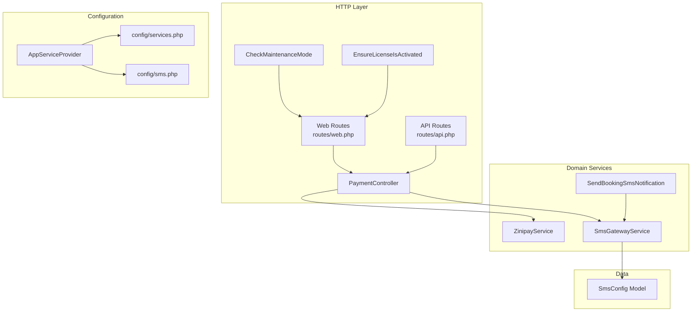
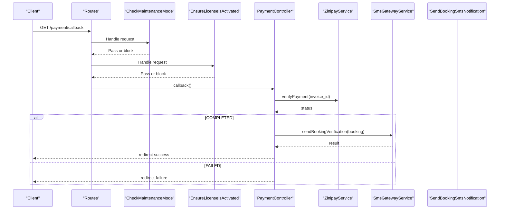
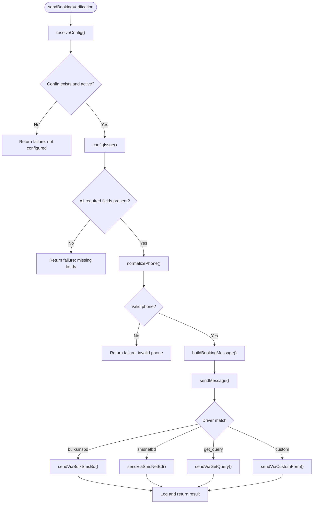
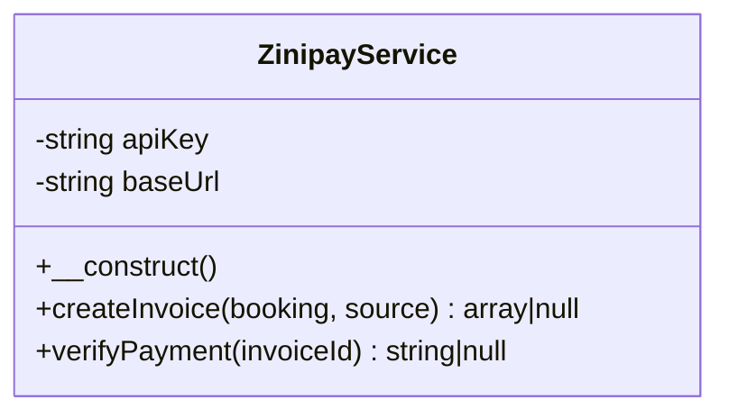
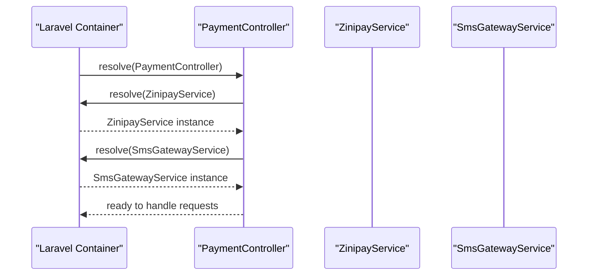
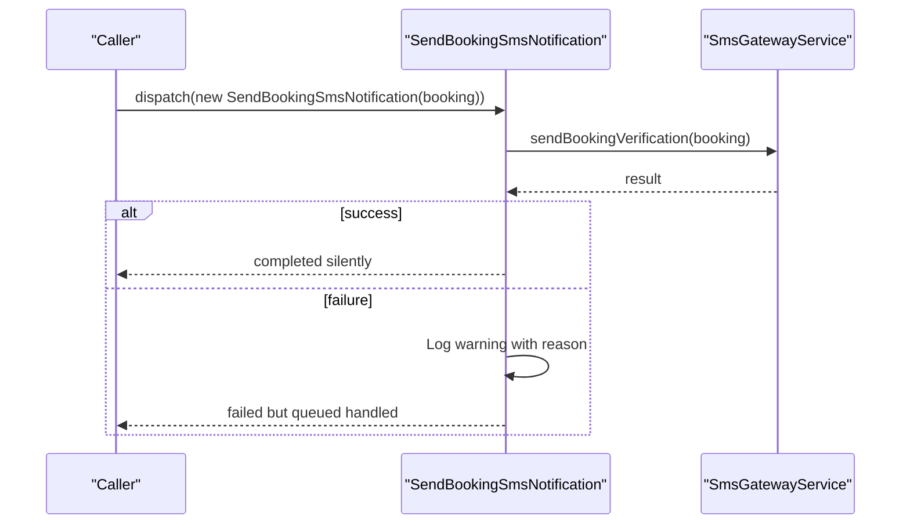
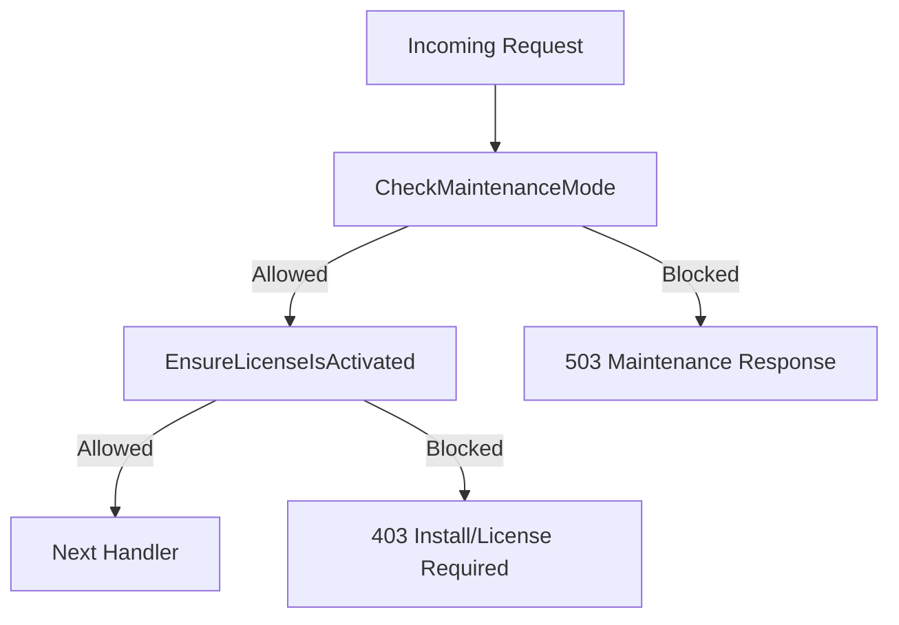
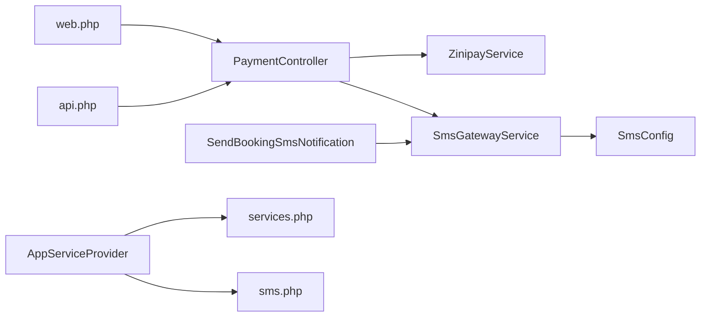

# Plugin Architecture & Service Extension Points

<cite>
**Referenced Files in This Document**
- [SmsGatewayService.php](file://backend/app/Services/SmsGatewayService.php)
- [ZinipayService.php](file://backend/app/Services/ZinipayService.php)
- [AppServiceProvider.php](file://backend/app/Providers/AppServiceProvider.php)
- [PaymentController.php](file://backend/app/Http/Controllers/PaymentController.php)
- [SendBookingSmsNotification.php](file://backend/app/Jobs/SendBookingSmsNotification.php)
- [SmsConfig.php](file://backend/app/Models/SmsConfig.php)
- [sms.php](file://backend/config/sms.php)
- [services.php](file://backend/config/services.php)
- [web.php](file://backend/routes/web.php)
- [api.php](file://backend/routes/api.php)
- [CheckMaintenanceMode.php](file://backend/app/Http/Middleware/CheckMaintenanceMode.php)
- [EnsureLicenseIsActivated.php](file://backend/app/Http/Middleware/EnsureLicenseIsActivated.php)
- [providers.php](file://backend/bootstrap/providers.php)
</cite>

## Table of Contents
1. [Introduction](#introduction)
2. [Project Structure](#project-structure)
3. [Core Components](#core-components)
4. [Architecture Overview](#architecture-overview)
5. [Detailed Component Analysis](#detailed-component-analysis)
6. [Dependency Analysis](#dependency-analysis)
7. [Performance Considerations](#performance-considerations)
8. [Troubleshooting Guide](#troubleshooting-guide)
9. [Conclusion](#conclusion)
10. [Appendices](#appendices)

## Introduction
This document explains the SonyaBus plugin architecture and service extension points with a focus on the service-oriented design used across the application. It shows how to extend core services such as SMS gateways, payment processing, and notification systems by following established patterns. You will learn:

- How services are structured and resolved through dependency injection.
- The interface contracts and configuration patterns that enable plugin development.
- Step-by-step guides for creating custom SMS providers, new payment gateways, and middleware components.
- Best practices for error handling, configuration loading, lifecycle management, and testing.

The goal is to make it straightforward to add new integrations while keeping the system modular, testable, and maintainable.

## Project Structure
SonyaBus follows a layered structure:

- Controllers handle HTTP requests and orchestrate business logic.
- Services encapsulate domain operations and third-party integrations.
- Jobs perform background tasks using queues.
- Providers configure application-wide behavior and share data with views.
- Middleware intercepts requests for cross-cutting concerns like maintenance mode and license checks.
- Configuration files define defaults and environment-driven settings.

**Diagram sources**
- [web.php:58-59](file://backend/routes/web.php#L58-L59)
- [api.php:1-32](file://backend/routes/api.php#L1-L32)
- [PaymentController.php:1-162](file://backend/app/Http/Controllers/PaymentController.php#L1-L162)
- [ZinipayService.php:1-141](file://backend/app/Services/ZinipayService.php#L1-L141)
- [SmsGatewayService.php:1-255](file://backend/app/Services/SmsGatewayService.php#L1-L255)
- [SendBookingSmsNotification.php:1-37](file://backend/app/Jobs/SendBookingSmsNotification.php#L1-L37)
- [AppServiceProvider.php:1-106](file://backend/app/Providers/AppServiceProvider.php#L1-L106)
- [services.php:38-41](file://backend/config/services.php#L38-L41)
- [sms.php:1-15](file://backend/config/sms.php#L1-L15)
- [SmsConfig.php:1-23](file://backend/app/Models/SmsConfig.php#L1-L23)
- [CheckMaintenanceMode.php:1-49](file://backend/app/Http/Middleware/CheckMaintenanceMode.php#L1-L49)
- [EnsureLicenseIsActivated.php:1-169](file://backend/app/Http/Middleware/EnsureLicenseIsActivated.php#L1-L169)

**Section sources**
- [web.php:58-59](file://backend/routes/web.php#L58-L59)
- [api.php:1-32](file://backend/routes/api.php#L1-L32)
- [AppServiceProvider.php:20-103](file://backend/app/Providers/AppServiceProvider.php#L20-L103)
- [providers.php:1-7](file://backend/bootstrap/providers.php#L1-L7)

## Core Components
This section outlines the key extensibility points:

- SMS Gateway Service: Encapsulates provider selection, phone normalization, message templating, and outbound delivery.
- Payment Service: Implements payment invoice creation and verification for a specific gateway.
- Provider Bootstrapping: Loads dynamic configuration from the database and shares it with views.
- Middleware: Enforces maintenance mode and licensing rules at the request boundary.
- Jobs: Offload non-critical work (e.g., sending SMS) to queues.

Key responsibilities:

- SmsGatewayService: Resolves active SMS configuration, validates inputs, builds messages, dispatches via driver-specific handlers, and logs outcomes.
- ZinipayService: Reads API credentials from configuration, creates invoices, verifies payments, and handles errors gracefully.
- AppServiceProvider: Overrides mail and payment service configuration from site settings and shares runtime settings with admin views.
- CheckMaintenanceMode: Blocks most API calls when maintenance is enabled, except allowed endpoints.
- EnsureLicenseIsActivated: Gates installation and licensing flows and allows public read endpoints.

**Section sources**
- [SmsGatewayService.php:11-255](file://backend/app/Services/SmsGatewayService.php#L11-L255)
- [ZinipayService.php:9-141](file://backend/app/Services/ZinipayService.php#L9-L141)
- [AppServiceProvider.php:20-103](file://backend/app/Providers/AppServiceProvider.php#L20-L103)
- [CheckMaintenanceMode.php:10-49](file://backend/app/Http/Middleware/CheckMaintenanceMode.php#L10-L49)
- [EnsureLicenseIsActivated.php:22-169](file://backend/app/Http/Middleware/EnsureLicenseIsActivated.php#L22-L169)

## Architecture Overview
The application uses a service-oriented architecture where controllers delegate to services, and services interact with external APIs or internal models. Configuration is centralized and can be overridden at runtime. Middleware protects routes based on maintenance state and license activation. Background jobs ensure reliability and performance.

**Diagram sources**
- [web.php:58-59](file://backend/routes/web.php#L58-L59)
- [api.php:1-32](file://backend/routes/api.php#L1-L32)
- [CheckMaintenanceMode.php:22-49](file://backend/app/Http/Middleware/CheckMaintenanceMode.php#L22-L49)
- [EnsureLicenseIsActivated.php:86-169](file://backend/app/Http/Middleware/EnsureLicenseIsActivated.php#L86-L169)
- [PaymentController.php:21-66](file://backend/app/Http/Controllers/PaymentController.php#L21-L66)
- [ZinipayService.php:105-139](file://backend/app/Services/ZinipayService.php#L105-L139)
- [SmsGatewayService.php:16-48](file://backend/app/Services/SmsGatewayService.php#L16-L48)

## Detailed Component Analysis

### SMS Gateway Service Pattern
The SMS gateway service provides a consistent interface for sending booking verification messages and test messages. It resolves the active SMS configuration, validates required fields, normalizes phone numbers, builds templated messages, and dispatches via driver-specific methods. Errors are logged and returned as structured results.

**Diagram sources**
- [SmsGatewayService.php:16-48](file://backend/app/Services/SmsGatewayService.php#L16-L48)
- [SmsGatewayService.php:75-107](file://backend/app/Services/SmsGatewayService.php#L75-L107)
- [SmsGatewayService.php:109-134](file://backend/app/Services/SmsGatewayService.php#L109-L134)
- [SmsGatewayService.php:136-150](file://backend/app/Services/SmsGatewayService.php#L136-L150)
- [SmsGatewayService.php:156-253](file://backend/app/Services/SmsGatewayService.php#L156-L253)

Implementation highlights:

- Configuration resolution: Returns null if the table does not exist or no active configuration is found.
- Validation: Ensures API URL, API key, and sender ID (except for specific drivers) are present.
- Phone normalization: Converts various local formats into a canonical international format.
- Message building: Supports template placeholders and falls back to a default message.
- Dispatching: Uses a driver-based switch to call provider-specific HTTP clients with timeouts.
- Error handling: Catches exceptions, logs details, and returns user-friendly failure messages.

Extending SMS providers:

- Add a new driver method under the service class.
- Update the driver switch to include your new driver name.
- Provide configuration fields in the SMS configuration model and UI.
- Use the same contract: return an HTTP response object and rely on the central sendMessage logic.

**Section sources**
- [SmsGatewayService.php:16-253](file://backend/app/Services/SmsGatewayService.php#L16-L253)
- [SmsConfig.php:7-22](file://backend/app/Models/SmsConfig.php#L7-L22)
- [sms.php:1-15](file://backend/config/sms.php#L1-L15)

### Payment Gateway Template Using ZinipayService
ZinipayService demonstrates how to implement a payment gateway integration:

- Constructor reads API key and base URL from configuration.
- createInvoice builds a payload with customer details, amount, metadata, and URLs for redirect, cancel, and webhook.
- verifyPayment queries the gateway to confirm payment status.
- All external calls use timeouts and structured logging.
- Environment-aware URL rewriting ensures local/testing environments bypass sandbox domain restrictions.

**Diagram sources**
- [ZinipayService.php:9-18](file://backend/app/Services/ZinipayService.php#L9-L18)
- [ZinipayService.php:27-97](file://backend/app/Services/ZinipayService.php#L27-L97)
- [ZinipayService.php:105-139](file://backend/app/Services/ZinipayService.php#L105-L139)

Adding a new payment gateway:

- Create a service class similar to ZinipayService.
- Read credentials from config/services.php or override them via AppServiceProvider.
- Implement invoice creation and verification methods.
- Integrate with PaymentController by injecting your service and handling callbacks/webhooks.

**Section sources**
- [ZinipayService.php:9-141](file://backend/app/Services/ZinipayService.php#L9-L141)
- [services.php:38-41](file://backend/config/services.php#L38-L41)
- [AppServiceProvider.php:71-77](file://backend/app/Providers/AppServiceProvider.php#L71-L77)

### Dependency Injection and Service Registration
Controllers receive services via constructor injection. For example, PaymentController depends on ZinipayService and SmsGatewayService. Laravel’s container resolves these automatically because they are concrete classes without special registration requirements.

**Diagram sources**
- [PaymentController.php:13-16](file://backend/app/Http/Controllers/PaymentController.php#L13-L16)

Service registration guidance:

- Concrete services do not require explicit binding; inject them directly.
- If you need to swap implementations behind an interface, register bindings in AppServiceProvider::register.
- Share runtime configuration with views in AppServiceProvider::boot.

**Section sources**
- [PaymentController.php:13-16](file://backend/app/Http/Controllers/PaymentController.php#L13-L16)
- [AppServiceProvider.php:15-18](file://backend/app/Providers/AppServiceProvider.php#L15-L18)
- [AppServiceProvider.php:20-103](file://backend/app/Providers/AppServiceProvider.php#L20-L103)

### Notification System and Queue Integration
Sending SMS notifications is offloaded to a queue job to avoid blocking request cycles. The job receives a Booking and delegates to SmsGatewayService. Failures are logged for later inspection.

**Diagram sources**
- [SendBookingSmsNotification.php:11-35](file://backend/app/Jobs/SendBookingSmsNotification.php#L11-L35)
- [SmsGatewayService.php:16-48](file://backend/app/Services/SmsGatewayService.php#L16-L48)

**Section sources**
- [SendBookingSmsNotification.php:11-35](file://backend/app/Jobs/SendBookingSmsNotification.php#L11-L35)
- [SmsGatewayService.php:16-48](file://backend/app/Services/SmsGatewayService.php#L16-L48)

### Middleware Patterns
Two middleware examples illustrate common extension points:

- CheckMaintenanceMode: Allows specific API endpoints even when maintenance is enabled and returns a JSON maintenance response otherwise.
- EnsureLicenseIsActivated: Enforces installation completion and license activation, allowing public read endpoints and payment-related routes to pass through.

**Diagram sources**
- [CheckMaintenanceMode.php:22-49](file://backend/app/Http/Middleware/CheckMaintenanceMode.php#L22-L49)
- [EnsureLicenseIsActivated.php:86-169](file://backend/app/Http/Middleware/EnsureLicenseIsActivated.php#L86-L169)

**Section sources**
- [CheckMaintenanceMode.php:10-49](file://backend/app/Http/Middleware/CheckMaintenanceMode.php#L10-L49)
- [EnsureLicenseIsActivated.php:22-169](file://backend/app/Http/Middleware/EnsureLicenseIsActivated.php#L22-L169)

## Dependency Analysis
The following diagram maps dependencies between controllers, services, models, and configuration.

**Diagram sources**
- [PaymentController.php:1-162](file://backend/app/Http/Controllers/PaymentController.php#L1-L162)
- [ZinipayService.php:1-141](file://backend/app/Services/ZinipayService.php#L1-L141)
- [SmsGatewayService.php:1-255](file://backend/app/Services/SmsGatewayService.php#L1-L255)
- [SendBookingSmsNotification.php:1-37](file://backend/app/Jobs/SendBookingSmsNotification.php#L1-L37)
- [SmsConfig.php:1-23](file://backend/app/Models/SmsConfig.php#L1-L23)
- [AppServiceProvider.php:1-106](file://backend/app/Providers/AppServiceProvider.php#L1-L106)
- [services.php:38-41](file://backend/config/services.php#L38-L41)
- [sms.php:1-15](file://backend/config/sms.php#L1-L15)
- [web.php:58-59](file://backend/routes/web.php#L58-L59)
- [api.php:1-32](file://backend/routes/api.php#L1-L32)

Coupling and cohesion:

- PaymentController depends on two services, which keeps controller logic focused on orchestration.
- SmsGatewayService encapsulates all SMS-related logic, improving cohesion.
- Configuration is centralized and can be overridden at runtime, reducing hard-coded dependencies.
- Middleware isolates cross-cutting concerns, maintaining clean separation of responsibilities.

Potential circular dependencies:

- None observed among the analyzed components.
- Services depend on configuration and models, not on controllers.

External dependencies:

- HTTP client calls to SMS and payment gateways.
- Database access for SMS configuration and site settings.

**Section sources**
- [PaymentController.php:1-162](file://backend/app/Http/Controllers/PaymentController.php#L1-L162)
- [SmsGatewayService.php:1-255](file://backend/app/Services/SmsGatewayService.php#L1-L255)
- [ZinipayService.php:1-141](file://backend/app/Services/ZinipayService.php#L1-L141)
- [AppServiceProvider.php:1-106](file://backend/app/Providers/AppServiceProvider.php#L1-L106)

## Performance Considerations
- Timeouts: External HTTP calls use timeouts to prevent slow responses from blocking requests.
- Queues: Non-critical tasks like SMS sending are queued to reduce request latency.
- Configuration caching: Site settings and SMS configuration are accessed efficiently; consider caching strategies for high-traffic scenarios.
- Logging: Structured logs help diagnose issues without impacting performance significantly.

Recommendations:

- Prefer queue jobs for any operation that can be deferred.
- Cache frequently accessed configuration where appropriate.
- Monitor external API latency and set sensible timeouts.
- Avoid heavy computations inside request handlers; move them to services or jobs.

[No sources needed since this section provides general guidance]

## Troubleshooting Guide
Common issues and resolutions:

- SMS not sent:
  - Verify active SMS configuration exists and is enabled.
  - Ensure required fields (API URL, API key, sender ID) are present.
  - Check passenger phone number normalization and validity.
  - Review logs for gateway rejections or network errors.

- Payment callback fails:
  - Confirm invoice ID is present and matches the booking.
  - Verify ZinipayService credentials and base URL.
  - Inspect logs for API failures or unexpected response structures.

- Maintenance mode blocks API:
  - Check maintenance mode setting and allowed endpoints.
  - Ensure site-settings endpoint remains accessible.

- License activation gating:
  - Complete installation and license verification.
  - Confirm public read endpoints are allowed.

Operational tips:

- Use test endpoints for SMS and email to validate configurations.
- Enable detailed logging during development and limit verbosity in production.
- Validate environment variables and configuration overrides.

**Section sources**
- [SmsGatewayService.php:75-107](file://backend/app/Services/SmsGatewayService.php#L75-L107)
- [SmsGatewayService.php:156-253](file://backend/app/Services/SmsGatewayService.php#L156-L253)
- [ZinipayService.php:27-97](file://backend/app/Services/ZinipayService.php#L27-L97)
- [CheckMaintenanceMode.php:22-49](file://backend/app/Http/Middleware/CheckMaintenanceMode.php#L22-L49)
- [EnsureLicenseIsActivated.php:86-169](file://backend/app/Http/Middleware/EnsureLicenseIsActivated.php#L86-L169)

## Conclusion
SonyaBus employs a clear service-oriented architecture that makes extending core functionality straightforward. By following the patterns demonstrated in SmsGatewayService and ZinipayService, you can add new SMS providers, payment gateways, and middleware components with minimal friction. Centralized configuration, dependency injection, and queue-backed jobs ensure scalability and reliability. Use the provided diagrams and guidelines to plan your extensions, manage lifecycle concerns, and implement robust error handling.

[No sources needed since this section summarizes without analyzing specific files]

## Appendices

### Step-by-Step Guides

#### Creating a Custom SMS Provider
1. Extend SmsGatewayService:
   - Add a new driver method for your provider.
   - Update the driver switch to route to your method.
2. Configure your provider:
   - Add fields to SmsConfig model and UI if needed.
   - Set gateway_driver and related values in configuration or database.
3. Test:
   - Use the test message endpoint to validate connectivity.
   - Review logs for successful sends or errors.

**Section sources**
- [SmsGatewayService.php:156-253](file://backend/app/Services/SmsGatewayService.php#L156-L253)
- [SmsConfig.php:7-22](file://backend/app/Models/SmsConfig.php#L7-L22)

#### Implementing a New Payment Gateway
1. Create a service class modeled after ZinipayService:
   - Read credentials from config/services.php or override via AppServiceProvider.
   - Implement invoice creation and verification methods.
2. Integrate with PaymentController:
   - Inject your service alongside existing services.
   - Handle callbacks and webhooks consistently.
3. Test:
   - Validate invoice creation and verification flows.
   - Ensure environment-specific URL handling works as expected.

**Section sources**
- [ZinipayService.php:9-141](file://backend/app/Services/ZinipayService.php#L9-L141)
- [services.php:38-41](file://backend/config/services.php#L38-L41)
- [AppServiceProvider.php:71-77](file://backend/app/Providers/AppServiceProvider.php#L71-L77)
- [PaymentController.php:13-16](file://backend/app/Http/Controllers/PaymentController.php#L13-L16)

#### Developing Custom Middleware
1. Create a middleware class:
   - Define handle(request, next) logic.
   - Register allowed paths or conditions as needed.
2. Apply middleware:
   - Attach to routes or route groups.
   - Ensure critical endpoints remain accessible when necessary.
3. Test:
   - Verify allowed and blocked paths behave correctly.
   - Confirm responses match expectations (JSON vs redirects).

**Section sources**
- [CheckMaintenanceMode.php:10-49](file://backend/app/Http/Middleware/CheckMaintenanceMode.php#L10-L49)
- [EnsureLicenseIsActivated.php:22-169](file://backend/app/Http/Middleware/EnsureLicenseIsActivated.php#L22-L169)

### Service Lifecycle Management
- Provider boot:
  - Load dynamic configuration from site settings.
  - Override mail and payment service configuration.
  - Share settings with admin views.
- Request lifecycle:
  - Middleware gates access based on maintenance and license state.
  - Controllers orchestrate services and jobs.
- Background lifecycle:
  - Jobs run asynchronously and log outcomes.

**Section sources**
- [AppServiceProvider.php:20-103](file://backend/app/Providers/AppServiceProvider.php#L20-L103)
- [CheckMaintenanceMode.php:22-49](file://backend/app/Http/Middleware/CheckMaintenanceMode.php#L22-L49)
- [EnsureLicenseIsActivated.php:86-169](file://backend/app/Http/Middleware/EnsureLicenseIsActivated.php#L86-L169)
- [SendBookingSmsNotification.php:25-35](file://backend/app/Jobs/SendBookingSmsNotification.php#L25-L35)

### Configuration Loading
- Default configuration:
  - sms.php defines SMS gateway defaults.
  - services.php defines third-party service defaults.
- Runtime overrides:
  - AppServiceProvider updates config from site settings.
- Environment variables:
  - Credentials and base URLs are loaded from environment variables.

**Section sources**
- [sms.php:1-15](file://backend/config/sms.php#L1-L15)
- [services.php:38-41](file://backend/config/services.php#L38-L41)
- [AppServiceProvider.php:40-77](file://backend/app/Providers/AppServiceProvider.php#L40-L77)

### Testing Strategies for Custom Plugins
- Unit tests:
  - Mock external HTTP calls for SMS and payment gateways.
  - Validate configuration resolution and validation logic.
- Feature tests:
  - Exercise full flows such as payment callback and SMS sending.
  - Assert redirects, status changes, and logs.
- Queue tests:
  - Dispatch jobs and assert they process successfully.
  - Verify error logging paths.

[No sources needed since this section provides general guidance]