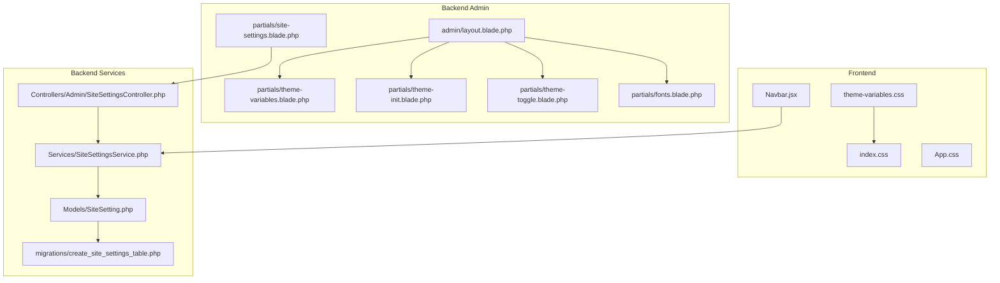
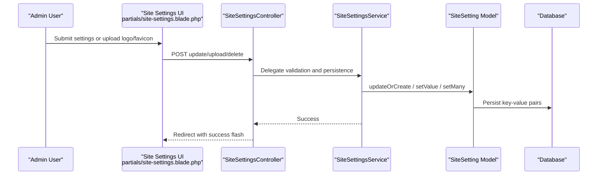
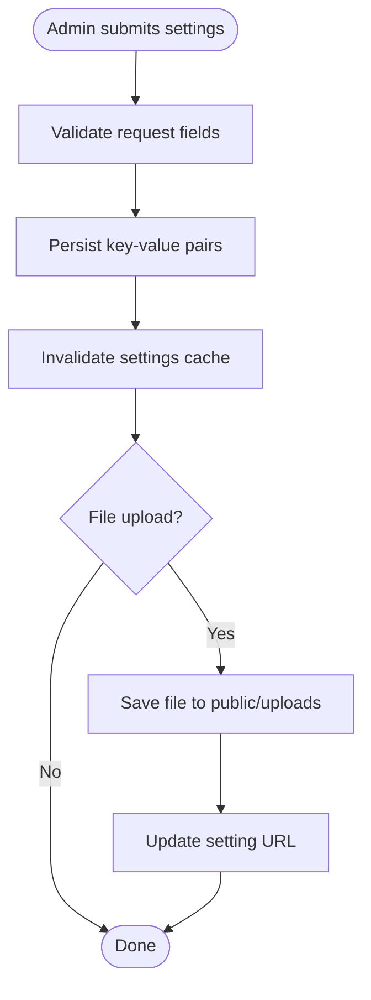
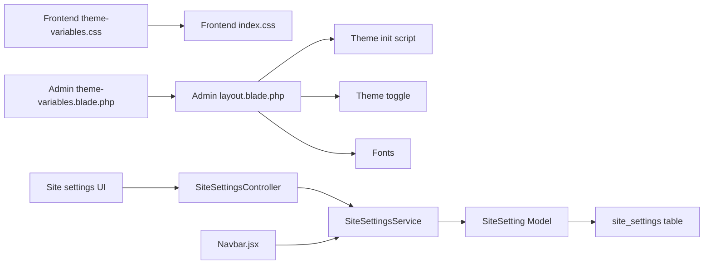

# Theme Customization & UI Extensibility

<cite>
**Referenced Files in This Document**
- [theme-variables.css](file://frontend/src/theme-variables.css)
- [index.css](file://frontend/src/index.css)
- [App.css](file://frontend/src/App.css)
- [Navbar.jsx](file://frontend/src/components/Navbar.jsx)
- [layout.blade.php](file://backend/resources/views/admin/layout.blade.php)
- [theme-variables.blade.php](file://backend/resources/views/admin/partials/theme-variables.blade.php)
- [theme-init.blade.php](file://backend/resources/views/admin/partials/theme-init.blade.php)
- [theme-toggle.blade.php](file://backend/resources/views/admin/partials/theme-toggle.blade.php)
- [fonts.blade.php](file://backend/resources/views/admin/partials/fonts.blade.php)
- [site-settings.blade.php](file://backend/resources/views/admin/partials/site-settings.blade.php)
- [SiteSetting.php](file://backend/app/Models/SiteSetting.php)
- [SiteSettingsService.php](file://backend/app/Services/SiteSettingsService.php)
- [SiteSettingsController.php](file://backend/app/Http/Controllers/Admin/SiteSettingsController.php)
- [2026_06_11_000000_create_site_settings_table.php](file://backend/database/migrations/2026_06_11_000000_create_site_settings_table.php)
</cite>

## Table of Contents
1. [Introduction](#introduction)
2. [Project Structure](#project-structure)
3. [Core Components](#core-components)
4. [Architecture Overview](#architecture-overview)
5. [Detailed Component Analysis](#detailed-component-analysis)
6. [Dependency Analysis](#dependency-analysis)
7. [Performance Considerations](#performance-considerations)
8. [Troubleshooting Guide](#troubleshooting-guide)
9. [Conclusion](#conclusion)

## Introduction
This document explains how to customize the SonyaBus theme across both the customer-facing frontend and the admin backend. It covers:
- The CSS custom properties system for colors, typography, spacing, shadows, and layout tokens.
- Blade template override mechanisms for the admin panel, including partial structure and naming conventions.
- The site settings system that allows runtime configuration of branding, favicon, footer, maintenance mode, and SEO.
- Practical examples for creating custom themes, modifying component styles, implementing responsive patterns, handling dark mode, optimizing performance, and managing fonts, logos, and branding.

## Project Structure
The theme system is split between two layers:
- Frontend React application: global CSS variables, component styles, and dynamic logo rendering from site settings.
- Backend Blade templates: admin shell, theme initialization, theme toggle, font loading, and the site settings administration interface.

**Diagram sources**
- [theme-variables.css:1-153](file://frontend/src/theme-variables.css#L1-L153)
- [index.css:1-800](file://frontend/src/index.css#L1-L800)
- [App.css:1-2](file://frontend/src/App.css#L1-L2)
- [Navbar.jsx:1-151](file://frontend/src/components/Navbar.jsx#L1-L151)
- [layout.blade.php:1-800](file://backend/resources/views/admin/layout.blade.php#L1-L800)
- [theme-variables.blade.php:1-133](file://backend/resources/views/admin/partials/theme-variables.blade.php#L1-L133)
- [theme-init.blade.php:1-31](file://backend/resources/views/admin/partials/theme-init.blade.php#L1-L31)
- [theme-toggle.blade.php:1-10](file://backend/resources/views/admin/partials/theme-toggle.blade.php#L1-L10)
- [fonts.blade.php:1-2](file://backend/resources/views/admin/partials/fonts.blade.php#L1-L2)
- [site-settings.blade.php:1-430](file://backend/resources/views/admin/partials/site-settings.blade.php#L1-L430)
- [SiteSetting.php:1-81](file://backend/app/Models/SiteSetting.php#L1-L81)
- [SiteSettingsService.php:1-182](file://backend/app/Services/SiteSettingsService.php#L1-L182)
- [SiteSettingsController.php:1-50](file://backend/app/Http/Controllers/Admin/SiteSettingsController.php#L1-L50)
- [2026_06_11_000000_create_site_settings_table.php:1-57](file://backend/database/migrations/2026_06_11_000000_create_site_settings_table.php#L1-L57)

**Section sources**
- [theme-variables.css:1-153](file://frontend/src/theme-variables.css#L1-L153)
- [index.css:1-800](file://frontend/src/index.css#L1-L800)
- [layout.blade.php:1-800](file://backend/resources/views/admin/layout.blade.php#L1-L800)

## Core Components
- Frontend theme variables: a single file defining light and dark color palettes, typography, spacing, shadows, gradients, and transition tokens.
- Frontend base styles: global resets, typography, layout utilities, header, search banner, bus results, seat map, and ticket booking panel styles using the variables.
- Admin theme variables: a Blade-partialized CSS variable set mirroring the frontend palette with admin-specific tokens (sidebar, charts, designer canvas).
- Admin shell: Blade layout injecting theme variables, fonts, theme initialization script, and theme toggle button.
- Site settings: database-backed key-value store with caching, service layer for validation and uploads, and admin UI for editing identity, footer, maintenance, and SEO.

Key responsibilities:
- Variables define the design system.
- Styles consume variables for consistent theming.
- Admin layout wires theme switching and fonts.
- Site settings provide runtime branding and content configuration.

**Section sources**
- [theme-variables.css:1-153](file://frontend/src/theme-variables.css#L1-L153)
- [index.css:1-800](file://frontend/src/index.css#L1-L800)
- [theme-variables.blade.php:1-133](file://backend/resources/views/admin/partials/theme-variables.blade.php#L1-L133)
- [layout.blade.php:1-800](file://backend/resources/views/admin/layout.blade.php#L1-L800)
- [SiteSetting.php:1-81](file://backend/app/Models/SiteSetting.php#L1-L81)
- [SiteSettingsService.php:1-182](file://backend/app/Services/SiteSettingsService.php#L1-L182)

## Architecture Overview
The theme architecture uses CSS custom properties as the single source of truth for visual tokens. Both frontend and backend share similar token names so components can be styled consistently. Runtime branding is provided by site settings, which are persisted to the database and exposed to the frontend via API.

**Diagram sources**
- [site-settings.blade.php:1-430](file://backend/resources/views/admin/partials/site-settings.blade.php#L1-L430)
- [SiteSettingsController.php:1-50](file://backend/app/Http/Controllers/Admin/SiteSettingsController.php#L1-L50)
- [SiteSettingsService.php:1-182](file://backend/app/Services/SiteSettingsService.php#L1-L182)
- [SiteSetting.php:1-81](file://backend/app/Models/SiteSetting.php#L1-L81)

## Detailed Component Analysis

### Frontend CSS Custom Properties System
The frontend theme defines:
- Color schemes: primary, accent, gold, text, backgrounds, borders, glows, and semantic colors.
- Typography: sans and display font families.
- Layout tokens: border radius, transitions, shadows, and spacing-related variables used by components.
- Dark mode: a separate block under a data-theme attribute overrides all tokens for a dark palette.

How it works:
- Global variables are declared on :root and [data-theme="light"].
- A [data-theme="dark"] block redefines the same variables for dark mode.
- Components reference these variables instead of hard-coded values.

Practical customization steps:
- Change brand colors by overriding --primary, --accent, and related glow variables.
- Adjust typography by changing --font-sans and --font-display.
- Modify spacing and roundness through --border-radius and shadow variables.
- Extend the palette by adding new variables and consuming them in component styles.

Responsive behavior:
- Media queries in index.css adjust grid layouts for search forms, bus result cards, and seat selection panels.
- Use CSS variables to keep responsive breakpoints consistent across components.

Dark mode support:
- Ensure any new component style references variables rather than literal colors.
- Test both light and dark modes after changes.

Font customization:
- Fonts are loaded via Google Fonts link in the frontend index.css and admin fonts partial.
- Update --font-sans and --font-display to switch typefaces.

Logo replacement:
- Navbar.jsx renders an uploaded logo image if available; otherwise, it falls back to a text logo derived from site settings.

**Section sources**
- [theme-variables.css:1-153](file://frontend/src/theme-variables.css#L1-L153)
- [index.css:1-800](file://frontend/src/index.css#L1-L800)
- [Navbar.jsx:1-151](file://frontend/src/components/Navbar.jsx#L1-L151)

### Admin Blade Template Override Mechanisms
The admin panel is built with Blade templates:
- The main layout includes theme variables, fonts, and theme initialization logic.
- Theme variables are injected via @include('admin.partials.theme-variables').
- Theme initialization sets the initial theme from localStorage and preloads active tabs.
- Theme toggle provides a button to switch between light and dark themes.
- Fonts are included via a dedicated partial.

Partial structure and naming conventions:
- Partial files live under resources/views/admin/partials/.
- Naming follows feature areas: theme-variables, theme-init, theme-toggle, fonts, site-settings.
- Each partial encapsulates a specific concern: styling tokens, runtime behavior, UI controls, or domain-specific forms.

Extending the admin UI:
- Create new partials under admin/partials/ and include them from the layout or page views.
- Follow existing naming patterns to maintain consistency.
- Use the same CSS variable names as the frontend to ensure visual consistency.

**Section sources**
- [layout.blade.php:1-800](file://backend/resources/views/admin/layout.blade.php#L1-L800)
- [theme-variables.blade.php:1-133](file://backend/resources/views/admin/partials/theme-variables.blade.php#L1-L133)
- [theme-init.blade.php:1-31](file://backend/resources/views/admin/partials/theme-init.blade.php#L1-L31)
- [theme-toggle.blade.php:1-10](file://backend/resources/views/admin/partials/theme-toggle.blade.php#L1-L10)
- [fonts.blade.php:1-2](file://backend/resources/views/admin/partials/fonts.blade.php#L1-L2)

### Site Settings System for Runtime Theme Configuration
The site settings system enables administrators to configure branding and presentation at runtime:
- Identity: site title and text logo label.
- Brand assets: favicon and logo images stored under public/uploads.
- Footer: company name, copyright, and JSON-based links.
- Maintenance mode: enable/disable and message.
- SEO: meta description, keywords, Open Graph fields, and Google Analytics ID.

Data model and storage:
- A simple key-value table stores settings.
- Default values are seeded during migration.
- The model caches all settings for fast reads and invalidates cache on writes.

Service layer:
- Validates incoming requests.
- Persists settings using bulk operations.
- Handles secure file uploads with MIME-based extension mapping.
- Exposes a normalized array for the public API.

Admin interface:
- Provides sections for favicon, logo, identity, footer, maintenance, and SEO.
- Shows previews and status indicators.
- Uses themed inputs and buttons consistent with the admin design system.

Public API consumption:
- The frontend consumes site settings to render the logo, title, SEO tags, and analytics.

**Diagram sources**
- [SiteSettingsService.php:51-182](file://backend/app/Services/SiteSettingsService.php#L51-L182)
- [SiteSetting.php:21-81](file://backend/app/Models/SiteSetting.php#L21-L81)
- [2026_06_11_000000_create_site_settings_table.php:10-49](file://backend/database/migrations/2026_06_11_000000_create_site_settings_table.php#L10-L49)

**Section sources**
- [SiteSetting.php:1-81](file://backend/app/Models/SiteSetting.php#L1-L81)
- [SiteSettingsService.php:1-182](file://backend/app/Services/SiteSettingsService.php#L1-L182)
- [SiteSettingsController.php:1-50](file://backend/app/Http/Controllers/Admin/SiteSettingsController.php#L1-L50)
- [site-settings.blade.php:1-430](file://backend/resources/views/admin/partials/site-settings.blade.php#L1-L430)
- [2026_06_11_000000_create_site_settings_table.php:1-57](file://backend/database/migrations/2026_06_11_000000_create_site_settings_table.php#L1-L57)

### Practical Examples

#### Creating a Custom Theme
- Define your brand palette by overriding --primary, --accent, and related variables in the frontend theme file.
- Mirror those tokens in the admin theme variables partial to keep admin and customer interfaces consistent.
- Update --font-sans and --font-display to apply your chosen typefaces.
- Adjust shadows and border radii to match your brand’s visual language.

#### Modifying Component Styles
- Prefer referencing CSS variables over hard-coded colors.
- For complex components like the seat map or ticket booking panel, extend existing classes in index.css and use variables for colors, borders, and backgrounds.
- Keep responsive rules near the component styles to avoid scattering breakpoints.

#### Implementing Responsive Design Patterns
- Use media queries to adapt grids and layouts for smaller screens.
- Maintain consistent spacing and typography scales across breakpoints.
- Test interactive elements such as the seat map and search form on mobile devices.

#### Handling Dark Mode Support
- Add dark-mode overrides for any new variables you introduce.
- Verify contrast ratios for text and interactive elements in both modes.
- Use the admin theme toggle to validate theme switching behavior.

#### Font Customization
- Replace the Google Fonts link in the frontend index.css and admin fonts partial with your preferred font provider.
- Update --font-sans and --font-display accordingly.
- Ensure fallback stacks remain accessible.

#### Logo Replacement and Branding
- Upload a logo via the admin site settings panel.
- The frontend navbar will render the uploaded logo when present; otherwise, it falls back to a text logo based on site settings.
- In the admin layout, the logo area also respects the uploaded image or text fallback.

**Section sources**
- [theme-variables.css:1-153](file://frontend/src/theme-variables.css#L1-L153)
- [theme-variables.blade.php:1-133](file://backend/resources/views/admin/partials/theme-variables.blade.php#L1-L133)
- [index.css:1-800](file://frontend/src/index.css#L1-L800)
- [Navbar.jsx:1-151](file://frontend/src/components/Navbar.jsx#L1-L151)
- [site-settings.blade.php:1-430](file://backend/resources/views/admin/partials/site-settings.blade.php#L1-L430)

## Dependency Analysis
The theme system has clear separation of concerns:
- CSS variables are consumed by both frontend and backend styles.
- Admin layout depends on theme partials for variables, fonts, and theme control.
- Site settings flow from controller to service to model to database.
- Frontend components depend on site settings for branding and SEO.

**Diagram sources**
- [theme-variables.css:1-153](file://frontend/src/theme-variables.css#L1-L153)
- [index.css:1-800](file://frontend/src/index.css#L1-L800)
- [theme-variables.blade.php:1-133](file://backend/resources/views/admin/partials/theme-variables.blade.php#L1-L133)
- [layout.blade.php:1-800](file://backend/resources/views/admin/layout.blade.php#L1-L800)
- [theme-init.blade.php:1-31](file://backend/resources/views/admin/partials/theme-init.blade.php#L1-L31)
- [theme-toggle.blade.php:1-10](file://backend/resources/views/admin/partials/theme-toggle.blade.php#L1-L10)
- [fonts.blade.php:1-2](file://backend/resources/views/admin/partials/fonts.blade.php#L1-L2)
- [site-settings.blade.php:1-430](file://backend/resources/views/admin/partials/site-settings.blade.php#L1-L430)
- [SiteSettingsController.php:1-50](file://backend/app/Http/Controllers/Admin/SiteSettingsController.php#L1-L50)
- [SiteSettingsService.php:1-182](file://backend/app/Services/SiteSettingsService.php#L1-L182)
- [SiteSetting.php:1-81](file://backend/app/Models/SiteSetting.php#L1-L81)

**Section sources**
- [layout.blade.php:1-800](file://backend/resources/views/admin/layout.blade.php#L1-L800)
- [SiteSettingsService.php:1-182](file://backend/app/Services/SiteSettingsService.php#L1-L182)

## Performance Considerations
- Prefer CSS variables to reduce repeated color declarations and simplify theme updates.
- Avoid heavy inline styles in Blade templates; move reusable styles into CSS files.
- Limit the number of external font requests; consider self-hosting fonts if needed.
- Use efficient selectors and avoid deep nesting to minimize repaint costs.
- Leverage the settings cache to prevent frequent database reads for branding data.
- Compress and optimize uploaded logos and favicons to reduce payload size.

[No sources needed since this section provides general guidance]

## Troubleshooting Guide
Common issues and resolutions:
- Colors not updating in dark mode:
  - Ensure every new style uses CSS variables and that dark-mode overrides exist.
- Admin theme does not persist:
  - Verify the theme initialization script runs and localStorage contains the expected value.
- Logo not displaying:
  - Confirm the logo was uploaded successfully and the path points to public/uploads.
  - Check that the frontend constructs absolute URLs correctly when served from a different origin.
- Settings not saving:
  - Validate request payloads against the service layer rules.
  - Ensure the site_settings table exists and default rows are seeded.
- SEO tags not applied:
  - Confirm the frontend applies meta tags from the site settings response.

**Section sources**
- [theme-init.blade.php:1-31](file://backend/resources/views/admin/partials/theme-init.blade.php#L1-L31)
- [SiteSettingsService.php:51-182](file://backend/app/Services/SiteSettingsService.php#L51-L182)
- [2026_06_11_000000_create_site_settings_table.php:10-49](file://backend/database/migrations/2026_06_11_000000_create_site_settings_table.php#L10-L49)

## Conclusion
SonyaBus provides a robust, variable-driven theme system for both the customer-facing frontend and the admin backend. By centralizing design tokens in CSS custom properties, maintaining consistent naming across layers, and exposing runtime branding through site settings, you can create cohesive, customizable themes. Use the admin interface to manage logos, favicons, footer content, maintenance mode, and SEO. Follow the guidelines here to implement responsive designs, support dark mode, optimize performance, and maintain consistency across the entire application.