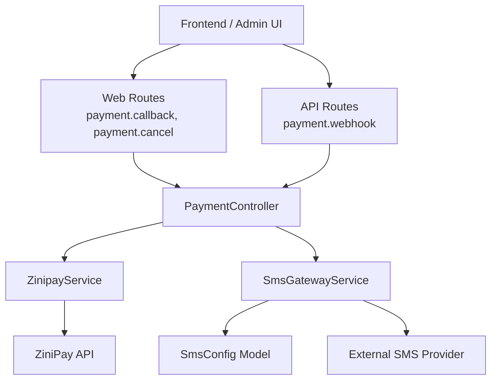
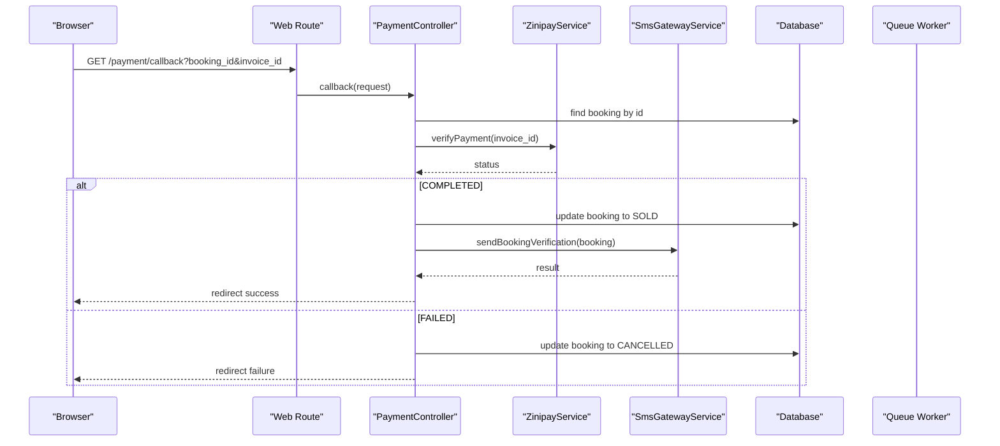
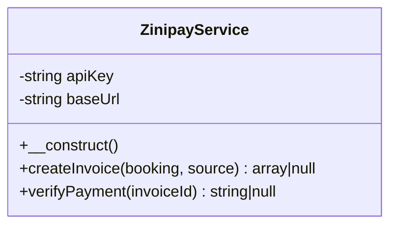
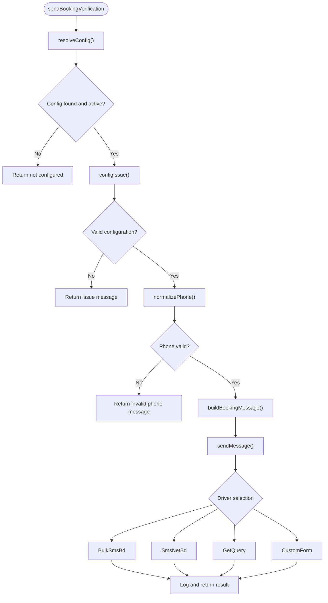
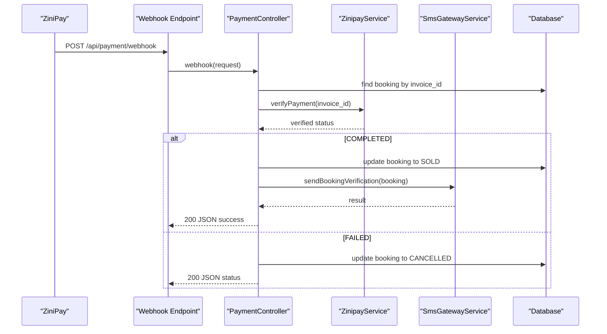
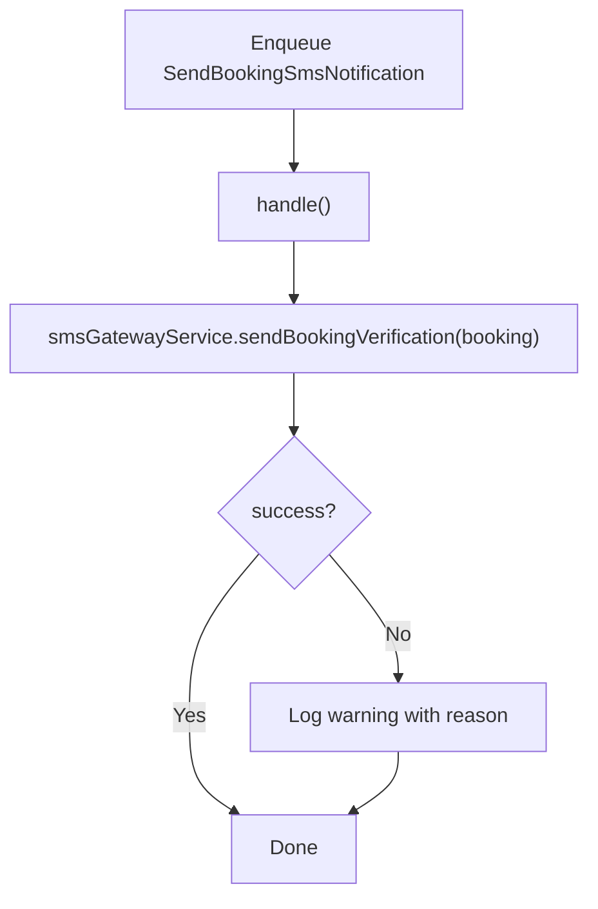
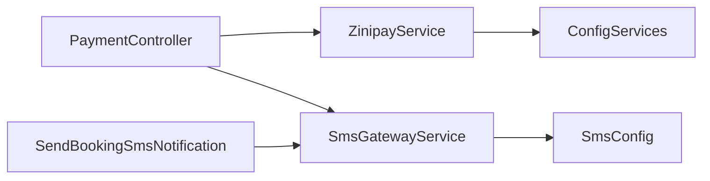

# Third-Party Integrations & External Services

<cite>
**Referenced Files in This Document**   
- [ZinipayService.php](file://backend/app/Services/ZinipayService.php)
- [SmsGatewayService.php](file://backend/app/Services/SmsGatewayService.php)
- [PaymentController.php](file://backend/app/Http/Controllers/PaymentController.php)
- [SendBookingSmsNotification.php](file://backend/app/Jobs/SendBookingSmsNotification.php)
- [web.php](file://backend/routes/web.php)
- [api.php](file://backend/routes/api.php)
- [services.php](file://backend/config/services.php)
- [sms.php](file://backend/config/sms.php)
- [SmsConfig.php](file://backend/app/Models/SmsConfig.php)
- [2026_06_02_090000_create_sms_configs_table.php](file://backend/database/migrations/2026_06_02_090000_create_sms_configs_table.php)
- [ZinipayPaymentTest.php](file://backend/tests/Feature/ZinipayPaymentTest.php)
</cite>

## Table of Contents
1. [Introduction](#introduction)
2. [Project Structure](#project-structure)
3. [Core Components](#core-components)
4. [Architecture Overview](#architecture-overview)
5. [Detailed Component Analysis](#detailed-component-analysis)
6. [Dependency Analysis](#dependency-analysis)
7. [Performance Considerations](#performance-considerations)
8. [Security Considerations](#security-considerations)
9. [Testing Strategies](#testing-strategies)
10. [Step-by-Step Integration Guides](#step-by-step-integration-guides)
11. [Troubleshooting Guide](#troubleshooting-guide)
12. [Conclusion](#conclusion)

## Introduction
This document explains how SonyaBus implements third-party integrations, focusing on the service abstraction pattern used for external API communication. It uses two concrete implementations as templates:

- **ZinipayService**: payment gateway integration for creating invoices and verifying payments.
- **SmsGatewayService**: SMS provider integration with multiple driver support and dynamic configuration.

The goal is to help you implement new integrations such as additional payment gateways, SMS providers, email services, or any other external APIs while following consistent patterns for authentication, request/response handling, error management, retry logic, webhooks, asynchronous processing, data synchronization, security, rate limiting, timeouts, logging, and testing.

## Project Structure
Third-party integrations in SonyaBus are organized around:

- **Service classes** under `app/Services` that encapsulate external API calls.
- **Controllers** that orchestrate user-facing flows and delegate to services.
- **Configuration files** under `config` for static credentials and defaults.
- **Database models and migrations** for runtime configuration storage.
- **Jobs** under `app/Jobs` for asynchronous background work.
- **Routes** under `routes/web.php` and `routes/api.php` for public endpoints and webhooks.
- **Tests** under `tests/Feature` for mocking external dependencies.

**Diagram sources**
- [web.php:58-59](file://backend/routes/web.php#L58-L59)
- [api.php:54-54](file://backend/routes/api.php#L54-L54)
- [PaymentController.php:11-16](file://backend/app/Http/Controllers/PaymentController.php#L11-L16)
- [ZinipayService.php:9-18](file://backend/app/Services/ZinipayService.php#L9-L18)
- [SmsGatewayService.php:11-12](file://backend/app/Services/SmsGatewayService.php#L11-L12)
- [SmsConfig.php:7-22](file://backend/app/Models/SmsConfig.php#L7-L22)

**Section sources**
- [web.php:58-59](file://backend/routes/web.php#L58-L59)
- [api.php:54-54](file://backend/routes/api.php#L54-L54)
- [PaymentController.php:11-16](file://backend/app/Http/Controllers/PaymentController.php#L11-L16)
- [ZinipayService.php:9-18](file://backend/app/Services/ZinipayService.php#L9-L18)
- [SmsGatewayService.php:11-12](file://backend/app/Services/SmsGatewayService.php#L11-L12)
- [SmsConfig.php:7-22](file://backend/app/Models/SmsConfig.php#L7-L22)

## Core Components
SonyaBus uses a clear separation between controllers and service abstractions:

- **ZinipayService** handles invoice creation and payment verification against ZiniPay.
- **SmsGatewayService** resolves active SMS configuration, validates inputs, builds messages, and dispatches requests through pluggable drivers.
- **PaymentController** coordinates payment callback, cancellation, and webhook handling, updating booking state and triggering SMS notifications.
- **SendBookingSmsNotification** is a queue job for sending SMS asynchronously.

Key responsibilities:

| Component | Responsibility | External Dependency |
|---|---|---|
| ZinipayService | Create payment invoice, verify payment status | ZiniPay REST API |
| SmsGatewayService | Resolve config, normalize phone, build message, send via driver | SMS provider API |
| PaymentController | Handle redirect/callback, cancel flow, webhook processing | ZiniPay, SMS provider |
| SendBookingSmsNotification | Queue-based SMS delivery | SMS provider |

**Section sources**
- [ZinipayService.php:20-97](file://backend/app/Services/ZinipayService.php#L20-L97)
- [ZinipayService.php:99-139](file://backend/app/Services/ZinipayService.php#L99-L139)
- [SmsGatewayService.php:13-48](file://backend/app/Services/SmsGatewayService.php#L13-L48)
- [SmsGatewayService.php:50-73](file://backend/app/Services/SmsGatewayService.php#L50-L73)
- [SmsGatewayService.php:75-107](file://backend/app/Services/SmsGatewayService.php#L75-L107)
- [SmsGatewayService.php:152-202](file://backend/app/Services/SmsGatewayService.php#L152-L202)
- [PaymentController.php:18-66](file://backend/app/Http/Controllers/PaymentController.php#L18-L66)
- [PaymentController.php:87-136](file://backend/app/Http/Controllers/PaymentController.php#L87-L136)
- [SendBookingSmsNotification.php:11-35](file://backend/app/Jobs/SendBookingSmsNotification.php#L11-L35)

## Architecture Overview
The integration architecture follows a layered approach:

1. **Routing layer** exposes public endpoints for payment callbacks, cancellations, and webhooks.
2. **Controller layer** validates input, updates business entities, and delegates to services.
3. **Service layer** abstracts external API calls, handles authentication headers, timeouts, and logging.
4. **Data layer** stores runtime configuration (SMS) and domain entities (bookings).
5. **Queue layer** processes non-critical tasks like SMS notifications asynchronously.

**Diagram sources**
- [web.php:58-59](file://backend/routes/web.php#L58-L59)
- [PaymentController.php:21-66](file://backend/app/Http/Controllers/PaymentController.php#L21-L66)
- [ZinipayService.php:105-139](file://backend/app/Services/ZinipayService.php#L105-L139)
- [SmsGatewayService.php:16-48](file://backend/app/Services/SmsGatewayService.php#L16-L48)

## Detailed Component Analysis

### ZinipayService
ZinipayService encapsulates all interactions with the ZiniPay payment gateway. It reads configuration from `config/services.php`, constructs URLs, sets authentication headers, and logs errors.

Key behaviors:

- **Invoice creation**: Builds redirect, cancel, and webhook URLs; adapts hostnames in local/testing environments; posts to create invoice endpoint; returns payment URL and invoice ID.
- **Payment verification**: Posts to verify endpoint; returns status string or null on failure.
- **Error handling**: Logs missing API keys, unsuccessful responses, and exceptions.
- **Timeouts**: Uses HTTP client timeout for resilience.

**Diagram sources**
- [ZinipayService.php:9-18](file://backend/app/Services/ZinipayService.php#L9-L18)
- [ZinipayService.php:20-97](file://backend/app/Services/ZinipayService.php#L20-L97)
- [ZinipayService.php:99-139](file://backend/app/Services/ZinipayService.php#L99-L139)

**Section sources**
- [ZinipayService.php:14-18](file://backend/app/Services/ZinipayService.php#L14-L18)
- [ZinipayService.php:27-97](file://backend/app/Services/ZinipayService.php#L27-L97)
- [ZinipayService.php:105-139](file://backend/app/Services/ZinipayService.php#L105-L139)
- [services.php:38-41](file://backend/config/services.php#L38-L41)

### SmsGatewayService
SmsGatewayService provides a flexible SMS abstraction supporting multiple drivers and runtime configuration stored in the database.

Key behaviors:

- **Configuration resolution**: Loads the latest active SMS configuration; checks table existence; validates required fields per driver.
- **Phone normalization**: Converts various formats into a standardized international format.
- **Message building**: Supports custom templates with placeholders and falls back to a default message.
- **Driver dispatching**: Uses a match expression to select driver-specific implementation.
- **Logging and error handling**: Logs successful sends, rejected requests, and exceptions.

**Diagram sources**
- [SmsGatewayService.php:16-48](file://backend/app/Services/SmsGatewayService.php#L16-L48)
- [SmsGatewayService.php:75-107](file://backend/app/Services/SmsGatewayService.php#L75-L107)
- [SmsGatewayService.php:109-134](file://backend/app/Services/SmsGatewayService.php#L109-L134)
- [SmsGatewayService.php:136-150](file://backend/app/Services/SmsGatewayService.php#L136-L150)
- [SmsGatewayService.php:156-202](file://backend/app/Services/SmsGatewayService.php#L156-L202)
- [SmsGatewayService.php:204-253](file://backend/app/Services/SmsGatewayService.php#L204-L253)

**Section sources**
- [SmsGatewayService.php:16-48](file://backend/app/Services/SmsGatewayService.php#L16-L48)
- [SmsGatewayService.php:50-73](file://backend/app/Services/SmsGatewayService.php#L50-L73)
- [SmsGatewayService.php:75-107](file://backend/app/Services/SmsGatewayService.php#L75-L107)
- [SmsGatewayService.php:109-134](file://backend/app/Services/SmsGatewayService.php#L109-L134)
- [SmsGatewayService.php:136-150](file://backend/app/Services/SmsGatewayService.php#L136-L150)
- [SmsGatewayService.php:156-202](file://backend/app/Services/SmsGatewayService.php#L156-L202)
- [SmsGatewayService.php:204-253](file://backend/app/Services/SmsGatewayService.php#L204-L253)
- [SmsConfig.php:9-21](file://backend/app/Models/SmsConfig.php#L9-L21)
- [2026_06_02_090000_create_sms_configs_table.php:14-28](file://backend/database/migrations/2026_06_02_090000_create_sms_configs_table.php#L14-L28)
- [sms.php:3-14](file://backend/config/sms.php#L3-L14)

### PaymentController
PaymentController orchestrates payment-related flows:

- **Callback handler**: Verifies payment status, updates booking state, and triggers SMS notification.
- **Cancel handler**: Marks pending bookings as cancelled and redirects appropriately.
- **Webhook handler**: Processes asynchronous payment notifications, verifies status securely, updates booking state, and sends SMS.

**Diagram sources**
- [api.php:54-54](file://backend/routes/api.php#L54-L54)
- [PaymentController.php:87-136](file://backend/app/Http/Controllers/PaymentController.php#L87-L136)
- [ZinipayService.php:105-139](file://backend/app/Services/ZinipayService.php#L105-L139)
- [SmsGatewayService.php:16-48](file://backend/app/Services/SmsGatewayService.php#L16-L48)

**Section sources**
- [PaymentController.php:18-66](file://backend/app/Http/Controllers/PaymentController.php#L18-L66)
- [PaymentController.php:68-85](file://backend/app/Http/Controllers/PaymentController.php#L68-L85)
- [PaymentController.php:87-136](file://backend/app/Http/Controllers/PaymentController.php#L87-L136)
- [web.php:58-59](file://backend/routes/web.php#L58-L59)
- [api.php:54-54](file://backend/routes/api.php#L54-L54)

### SendBookingSmsNotification Job
The job encapsulates asynchronous SMS delivery using the queue system. It logs failures without blocking the main request flow.

**Diagram sources**
- [SendBookingSmsNotification.php:11-35](file://backend/app/Jobs/SendBookingSmsNotification.php#L11-L35)
- [SmsGatewayService.php:16-48](file://backend/app/Services/SmsGatewayService.php#L16-L48)

**Section sources**
- [SendBookingSmsNotification.php:11-35](file://backend/app/Jobs/SendBookingSmsNotification.php#L11-L35)

## Dependency Analysis
The integration components have clear dependency relationships:

- Controllers depend on services.
- Services depend on configuration and external APIs.
- SMS service depends on database model for runtime configuration.
- Jobs depend on services and queue infrastructure.

**Diagram sources**
- [PaymentController.php:11-16](file://backend/app/Http/Controllers/PaymentController.php#L11-L16)
- [ZinipayService.php:9-18](file://backend/app/Services/ZinipayService.php#L9-L18)
- [SmsGatewayService.php:11-12](file://backend/app/Services/SmsGatewayService.php#L11-L12)
- [SmsConfig.php:7-22](file://backend/app/Models/SmsConfig.php#L7-L22)
- [services.php:38-41](file://backend/config/services.php#L38-L41)
- [SendBookingSmsNotification.php:11-35](file://backend/app/Jobs/SendBookingSmsNotification.php#L11-L35)

**Section sources**
- [PaymentController.php:11-16](file://backend/app/Http/Controllers/PaymentController.php#L11-L16)
- [ZinipayService.php:9-18](file://backend/app/Services/ZinipayService.php#L9-L18)
- [SmsGatewayService.php:11-12](file://backend/app/Services/SmsGatewayService.php#L11-L12)
- [SmsConfig.php:7-22](file://backend/app/Models/SmsConfig.php#L7-L22)
- [services.php:38-41](file://backend/config/services.php#L38-L41)
- [SendBookingSmsNotification.php:11-35](file://backend/app/Jobs/SendBookingSmsNotification.php#L11-L35)

## Performance Considerations
- **Timeouts**: Both ZinipayService and SmsGatewayService use HTTP client timeouts to avoid hanging requests.
- **Asynchronous processing**: SMS notifications can be offloaded to jobs to reduce response latency.
- **Minimal external calls**: Callback and webhook handlers perform only necessary verification and updates.
- **Configuration caching**: SMS configuration lookup is lightweight but should be monitored if the number of configurations grows.

Recommendations:
- Add exponential backoff retries for transient network failures.
- Use connection pooling where supported by the HTTP client.
- Cache frequently accessed external metadata when safe.
- Monitor queue backlog for SMS jobs.

[No sources needed since this section provides general guidance]

## Security Considerations
- **API key storage**: ZiniPay API key is read from environment-backed configuration; SMS credentials are stored in the database model.
- **Input validation**: Callback and webhook handlers validate presence of required parameters before processing.
- **Secure verification**: Webhook handler verifies payment status directly with the provider rather than trusting payload alone.
- **Environment-specific behavior**: Local/testing environments adjust redirect/webhook hostnames for development convenience.
- **Logging sensitive data**: Avoid logging full payloads containing secrets; current logs include structured context without exposing credentials.

Best practices:
- Rotate API keys regularly.
- Restrict webhook endpoints to trusted IPs at the firewall or reverse proxy level.
- Validate and sanitize all incoming webhook data.
- Use HTTPS for all external communications.
- Implement rate limiting for webhook endpoints.

**Section sources**
- [ZinipayService.php:14-18](file://backend/app/Services/ZinipayService.php#L14-L18)
- [ZinipayService.php:27-51](file://backend/app/Services/ZinipayService.php#L27-L51)
- [PaymentController.php:90-136](file://backend/app/Http/Controllers/PaymentController.php#L90-L136)
- [SmsConfig.php:9-21](file://backend/app/Models/SmsConfig.php#L9-L21)

## Testing Strategies
SonyaBus demonstrates robust testing patterns for external dependencies:

- **Mocking services**: Tests mock ZinipayService to simulate payment verification outcomes.
- **State assertions**: Tests assert booking state transitions after callback and webhook flows.
- **Redirect assertions**: Tests verify redirect locations for success and failure paths.
- **Seed data**: Tests seed schedules and users to provide realistic context.

Recommended additions:
- Mock SmsGatewayService for SMS-related tests.
- Add unit tests for phone normalization and message template rendering.
- Add integration tests for webhook signature verification if supported by the provider.
- Add performance tests for high-volume webhook processing.

**Section sources**
- [ZinipayPaymentTest.php:44-76](file://backend/tests/Feature/ZinipayPaymentTest.php#L44-L76)
- [ZinipayPaymentTest.php:78-112](file://backend/tests/Feature/ZinipayPaymentTest.php#L78-L112)
- [ZinipayPaymentTest.php:114-137](file://backend/tests/Feature/ZinipayPaymentTest.php#L114-L137)
- [ZinipayPaymentTest.php:191-221](file://backend/tests/Feature/ZinipayPaymentTest.php#L191-L221)
- [ZinipayPaymentTest.php:223-256](file://backend/tests/Feature/ZinipayPaymentTest.php#L223-L256)
- [ZinipayPaymentTest.php:258-302](file://backend/tests/Feature/ZinipayPaymentTest.php#L258-L302)

## Step-by-Step Integration Guides

### Adding a New Payment Gateway
1. **Create a service class** under `app/Services` similar to ZinipayService.
2. **Read configuration** from `config/services.php` or environment variables.
3. **Implement invoice creation** with proper headers, timeouts, and error logging.
4. **Implement status verification** to reconcile payment state securely.
5. **Update PaymentController** to use the new service for callback and webhook flows.
6. **Add routes** for callback, cancel, and webhook endpoints if needed.
7. **Write tests** mocking the new service and asserting state changes.

Reference patterns:
- Service structure and HTTP client usage: [ZinipayService.php:20-97](file://backend/app/Services/ZinipayService.php#L20-L97), [ZinipayService.php:99-139](file://backend/app/Services/ZinipayService.php#L99-L139)
- Controller orchestration: [PaymentController.php:18-66](file://backend/app/Http/Controllers/PaymentController.php#L18-L66), [PaymentController.php:87-136](file://backend/app/Http/Controllers/PaymentController.php#L87-L136)
- Configuration location: [services.php:38-41](file://backend/config/services.php#L38-L41)

### Adding a New SMS Provider
1. **Extend SmsGatewayService** with a new driver method.
2. **Update driver selection** in the message sending method.
3. **Validate required fields** in the configuration validation method.
4. **Support driver-specific parameters** such as sender ID or API key placement.
5. **Add tests** for normalization, template rendering, and driver dispatch.

Reference patterns:
- Driver dispatch and methods: [SmsGatewayService.php:156-202](file://backend/app/Services/SmsGatewayService.php#L156-L202), [SmsGatewayService.php:204-253](file://backend/app/Services/SmsGatewayService.php#L204-L253)
- Configuration validation: [SmsGatewayService.php:89-107](file://backend/app/Services/SmsGatewayService.php#L89-L107)
- Database schema: [2026_06_02_090000_create_sms_configs_table.php:14-28](file://backend/database/migrations/2026_06_02_090000_create_sms_configs_table.php#L14-L28)

### Adding an Email Service
Follow the same service abstraction pattern:

1. Create an `EmailService` class.
2. Read mail configuration from `config/mail.php` or environment variables.
3. Implement sending methods for different providers (SMTP, SES, Postmark, Resend).
4. Integrate with controllers or jobs for transactional emails.
5. Add logging, retries, and error handling similar to existing services.

Conceptual reference:
- Existing mail configuration entries: [services.php:17-29](file://backend/config/services.php#L17-L29)

### Handling Webhooks
Use the webhook pattern demonstrated by the payment controller:

1. Define a dedicated route for the webhook endpoint.
2. Validate required payload fields.
3. Verify identity/signature if supported by the provider.
4. Reconcile state by calling the provider’s verification API.
5. Update internal records and trigger downstream actions (e.g., SMS).
6. Return appropriate HTTP status codes.

Reference patterns:
- Webhook route: [api.php:54-54](file://backend/routes/api.php#L54-L54)
- Webhook handler: [PaymentController.php:87-136](file://backend/app/Http/Controllers/PaymentController.php#L87-L136)

### Asynchronous Job Processing
Offload non-critical operations to queues:

1. Create a job class implementing `ShouldQueue`.
2. Inject dependencies such as services.
3. Dispatch the job from controllers or services after initiating primary operations.
4. Monitor queue workers and handle failures gracefully.

Reference patterns:
- Job definition: [SendBookingSmsNotification.php:11-35](file://backend/app/Jobs/SendBookingSmsNotification.php#L11-L35)

### Data Synchronization Patterns
For external systems requiring periodic synchronization:

1. Use scheduled commands or background jobs.
2. Fetch remote data via service abstractions.
3. Upsert local records based on unique identifiers.
4. Log sync results and errors.
5. Implement idempotency to handle duplicate events.

Conceptual guidance:
- Follow the service abstraction pattern used by ZinipayService and SmsGatewayService.

[No sources needed since this section provides general guidance]

## Troubleshooting Guide
Common issues and resolutions:

- **Missing API key**: Ensure environment variables are set and loaded into configuration.
- **Invalid phone number**: Normalize input and validate format before sending SMS.
- **Gateway not configured**: Check active SMS configuration and required fields.
- **Webhook not received**: Verify route registration and external provider configuration.
- **Payment verification fails**: Inspect logs for HTTP status and response body.
- **SMS delivery failures**: Check driver-specific parameters and provider status.

Diagnostic steps:
- Review Laravel logs for error and warning entries.
- Validate environment variables and database configuration.
- Test driver-specific endpoints manually.
- Use feature tests to isolate failures.

**Section sources**
- [ZinipayService.php:27-32](file://backend/app/Services/ZinipayService.php#L27-L32)
- [ZinipayService.php:84-94](file://backend/app/Services/ZinipayService.php#L84-L94)
- [SmsGatewayService.php:19-31](file://backend/app/Services/SmsGatewayService.php#L19-L31)
- [SmsGatewayService.php:178-201](file://backend/app/Services/SmsGatewayService.php#L178-L201)
- [PaymentController.php:90-136](file://backend/app/Http/Controllers/PaymentController.php#L90-L136)

## Conclusion
SonyaBus implements third-party integrations through clear service abstractions, secure configuration handling, robust error logging, and testable controller flows. ZinipayService and SmsGatewayService serve as strong templates for adding new payment gateways, SMS providers, email services, and other external APIs. By following the patterns documented here—separating concerns, validating inputs, verifying external state, using timeouts, logging interactions, and writing mocks—you can extend SonyaBus safely and maintainably.

[No sources needed since this section summarizes without analyzing specific files]