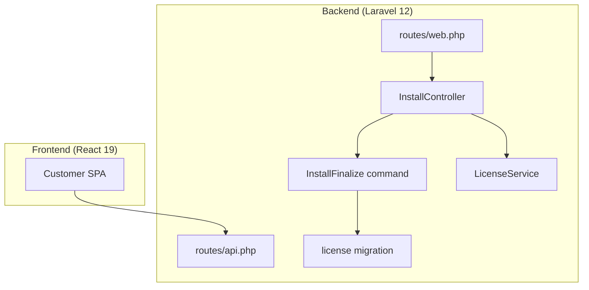
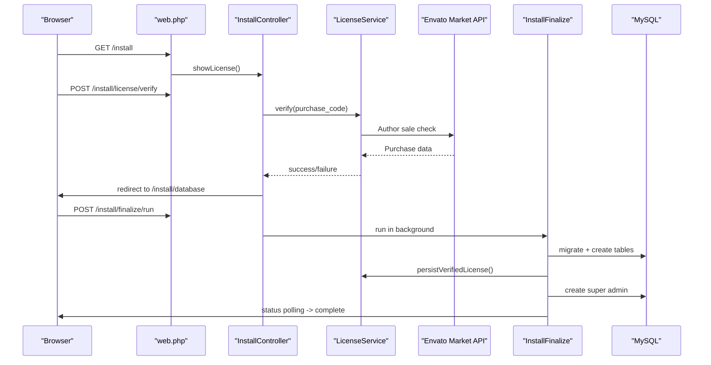
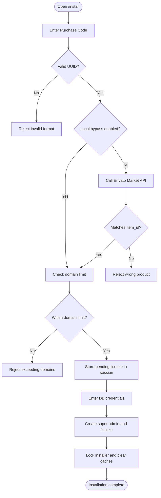
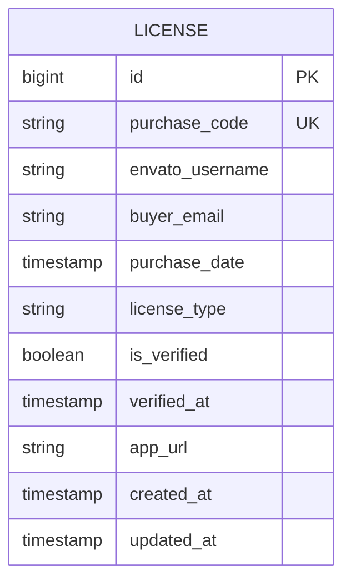
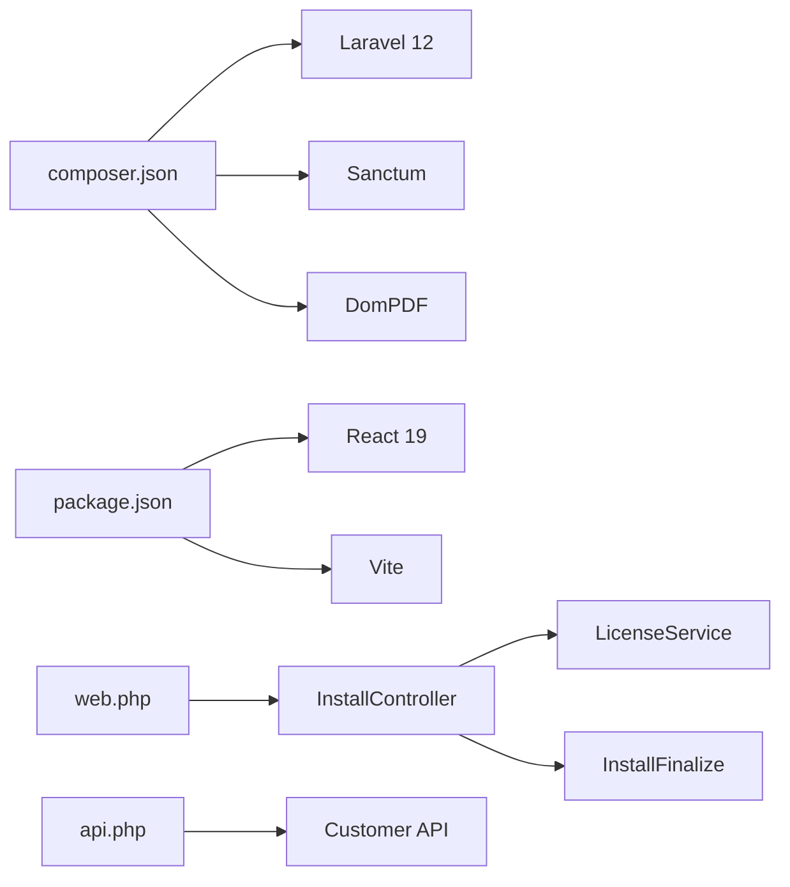

# Getting Started

<cite>
**Referenced Files in This Document**
- [README.md](file://README.md)
- [backend/composer.json](file://backend/composer.json)
- [frontend/package.json](file://frontend/package.json)
- [backend/app/Http/Controllers/Install/InstallController.php](file://backend/app/Http/Controllers/Install/InstallController.php)
- [backend/app/Console/Commands/InstallFinalize.php](file://backend/app/Console/Commands/InstallFinalize.php)
- [backend/app/Services/LicenseService.php](file://backend/app/Services/LicenseService.php)
- [backend/config/envato.php](file://backend/config/envato.php)
- [backend/database/migrations/2026_10_08_100000_create_license_table.php](file://backend/database/migrations/2026_10_08_100000_create_license_table.php)
- [backend/routes/web.php](file://backend/routes/web.php)
- [backend/routes/api.php](file://backend/routes/api.php)
</cite>

## Table of Contents
1. [Introduction](#introduction)
2. [Project Structure](#project-structure)
3. [Core Components](#core-components)
4. [Architecture Overview](#architecture-overview)
5. [Detailed Component Analysis](#detailed-component-analysis)
6. [Dependency Analysis](#dependency-analysis)
7. [Performance Considerations](#performance-considerations)
8. [Troubleshooting Guide](#troubleshooting-guide)
9. [Conclusion](#conclusion)

## Introduction
SonyaBus is a full-stack bus ticket booking system with a Laravel 12 backend API and a React 19 customer-facing SPA, plus an admin dashboard for managing routes, schedules, bookings, promotions, reports, and system settings. The system includes Envato license verification, interactive seat maps, online payments via ZiniPay, SMS notifications, role-based access control, maintenance mode, and security hardening.

This guide helps you install the backend and frontend, configure environment variables, activate your Envato license, set up the database, and get the application running quickly.

**Section sources**
- [README.md:1-271](file://README.md#L1-L271)

## Project Structure
The repository contains:
- Backend (Laravel 12): API endpoints, admin web routes, installation wizard, services, models, migrations, seeders, and Blade views.
- Frontend (React 19 + Vite): Customer SPA that calls the backend API.
- Documentation and deployment guides.

**Diagram sources**
- [backend/routes/web.php:27-42](file://backend/routes/web.php#L27-L42)
- [backend/routes/api.php:18-75](file://backend/routes/api.php#L18-L75)
- [backend/app/Http/Controllers/Install/InstallController.php:1-287](file://backend/app/Http/Controllers/Install/InstallController.php#L1-L287)
- [backend/app/Console/Commands/InstallFinalize.php:1-268](file://backend/app/Console/Commands/InstallFinalize.php#L1-L268)
- [backend/app/Services/LicenseService.php:1-408](file://backend/app/Services/LicenseService.php#L1-L408)
- [backend/database/migrations/2026_10_08_100000_create_license_table.php:1-30](file://backend/database/migrations/2026_10_08_100000_create_license_table.php#L1-L30)

**Section sources**
- [README.md:46-80](file://README.md#L46-L80)

## Core Components
- Installation Wizard: Guides you through license verification, database connection, admin account creation, and finalization.
- License Verification: Validates Envato purchase codes against the Envato Market API and enforces domain limits.
- Database Setup: Runs migrations or imports SQL files during installation.
- Admin and Customer APIs: Provide endpoints for admin operations and customer booking flows.

Key responsibilities:
- InstallController orchestrates the multi-step installation flow.
- InstallFinalize runs background tasks to migrate, persist license, create super admin, and lock installer.
- LicenseService handles Envato API calls, caching, domain limit checks, and .env updates.
- Routes define public API endpoints and admin routes.

**Section sources**
- [backend/app/Http/Controllers/Install/InstallController.php:1-287](file://backend/app/Http/Controllers/Install/InstallController.php#L1-L287)
- [backend/app/Console/Commands/InstallFinalize.php:1-268](file://backend/app/Console/Commands/InstallFinalize.php#L1-L268)
- [backend/app/Services/LicenseService.php:1-408](file://backend/app/Services/LicenseService.php#L1-L408)
- [backend/routes/web.php:27-42](file://backend/routes/web.php#L27-L42)
- [backend/routes/api.php:18-75](file://backend/routes/api.php#L18-L75)

## Architecture Overview
At a high level:
- The React SPA calls the Laravel API for stations, search, promotions, authentication, bookings, and seat holds.
- The installation wizard is accessible at /install until the system is installed and licensed.
- After installation, the system uses Sanctum for authenticated API requests and enforces license activation.

**Diagram sources**
- [backend/routes/web.php:27-42](file://backend/routes/web.php#L27-L42)
- [backend/app/Http/Controllers/Install/InstallController.php:46-209](file://backend/app/Http/Controllers/Install/InstallController.php#L46-L209)
- [backend/app/Services/LicenseService.php:56-158](file://backend/app/Services/LicenseService.php#L56-L158)
- [backend/app/Console/Commands/InstallFinalize.php:51-259](file://backend/app/Console/Commands/InstallFinalize.php#L51-L259)

## Detailed Component Analysis

### System Requirements
- PHP 8.2+
- MySQL 8.0+
- Node.js 18+
- Composer 2.x
- Web server: Nginx or Apache with mod_rewrite
- Required PHP extensions: BCMath, Ctype, cURL, DOM, Fileinfo, JSON, Mbstring, OpenSSL, PCRE, PDO, Tokenizer, XML, GD

These requirements are documented in the project README and enforced by the backend dependencies.

**Section sources**
- [README.md:86-94](file://README.md#L86-L94)
- [backend/composer.json:8-13](file://backend/composer.json#L8-L13)

### Installation Steps

#### Backend Setup
1. Navigate to the backend directory.
2. Install dependencies:
   - composer install --no-dev --optimize-autoloader
3. Copy environment file:
   - cp .env.example .env
4. Generate application key:
   - php artisan key:generate
5. Edit .env with required values:
   - APP_URL
   - APP_FRONTEND_URL
   - DB_* (host, port, database, username, password)
   - ENVATO_ITEM_ID
6. Set file permissions:
   - chmod -R 775 storage bootstrap/cache
   - chown -R www-data:www-data storage bootstrap/cache

Notes:
- The backend requires PHP 8.2+ and Laravel 12 dependencies.
- The installation wizard will write some keys to .env during setup.

**Section sources**
- [README.md:104-116](file://README.md#L104-L116)
- [backend/composer.json:8-13](file://backend/composer.json#L8-L13)

#### Frontend Setup
1. Navigate to the frontend directory.
2. Copy environment file:
   - cp .env.example .env
3. Edit .env with required values:
   - VITE_API_BASE_URL
   - VITE_ZINIPAY_API_KEY
4. Install dependencies:
   - npm install
5. Build production assets:
   - npm run build
6. Serve frontend/dist/ via your web server.

Notes:
- The frontend uses React 19 and Vite.
- Ensure Node.js 18+ is installed.

**Section sources**
- [README.md:118-127](file://README.md#L118-L127)
- [frontend/package.json:12-26](file://frontend/package.json#L12-L26)

#### Web Server Configuration
- Point backend domain to backend/public/.
- Point frontend domain to frontend/dist/.
- Enable rewrite rules for Laravel routing.

See the documentation index for full Nginx/Apache configurations.

**Section sources**
- [README.md:129-132](file://README.md#L129-L132)

### Environment Configuration (.env)

Backend .env essentials:
- APP_URL: Base URL of the backend.
- APP_FRONTEND_URL: Base URL of the React SPA.
- DB_HOST, DB_PORT, DB_DATABASE, DB_USERNAME, DB_PASSWORD: Database credentials.
- ENVATO_ITEM_ID: Numeric ID from your CodeCanyon item URL.
- Optional: ENVATO_PERSONAL_TOKEN (for seller-side verification), ENVATO_SKIP_VERIFY (local dev bypass).

Frontend .env essentials:
- VITE_API_BASE_URL: Backend API base URL.
- VITE_ZINIPAY_API_KEY: Payment gateway key.

Important:
- Do not commit secrets; use .env.example as a template.
- The installation wizard may update certain keys like APP_INSTALLED and APP_LICENSED.

**Section sources**
- [README.md:112-113](file://README.md#L112-L113)
- [README.md:122-123](file://README.md#L122-L123)
- [backend/config/envato.php:18-39](file://backend/config/envato.php#L18-L39)

### License Activation Process

Overview:
- Open your backend URL in a browser; you will be redirected to /install.
- Step 1: Enter your Envato purchase code.
- Step 2: Enter MySQL credentials and optionally import a SQL file.
- Step 3: Create a super-admin account and finalize installation.
- After activation, the installer is locked and inaccessible.

What you need:
- Envato Purchase Code from CodeCanyon Downloads.
- Personal Token generated at build.envato.com/create-token with Verify Purchases permission.
- Item ID set as ENVATO_ITEM_ID in .env.

How it works:
- InstallController verifies the purchase code using LicenseService.
- LicenseService validates format, performs local bypass if enabled, checks Envato API responses, ensures the code belongs to this product, and enforces domain limits.
- On successful finalization, InstallFinalize persists the license record, creates the super admin, and locks the installer.

**Diagram sources**
- [backend/app/Http/Controllers/Install/InstallController.php:54-79](file://backend/app/Http/Controllers/Install/InstallController.php#L54-L79)
- [backend/app/Services/LicenseService.php:56-158](file://backend/app/Services/LicenseService.php#L56-L158)
- [backend/app/Console/Commands/InstallFinalize.php:175-228](file://backend/app/Console/Commands/InstallFinalize.php#L175-L228)

**Section sources**
- [README.md:134-143](file://README.md#L134-L143)
- [README.md:147-163](file://README.md#L147-L163)
- [backend/app/Http/Controllers/Install/InstallController.php:46-79](file://backend/app/Http/Controllers/Install/InstallController.php#L46-L79)
- [backend/app/Services/LicenseService.php:56-158](file://backend/app/Services/LicenseService.php#L56-L158)
- [backend/app/Console/Commands/InstallFinalize.php:175-228](file://backend/app/Console/Commands/InstallFinalize.php#L175-L228)

### Initial Database Setup
During installation:
- You can provide MySQL credentials directly in the wizard.
- Optionally upload a SQL file to pre-seed the database before migrations.
- If no SQL file is provided, migrations run automatically during finalization.

Database schema highlights:
- A license table stores purchase metadata and activation state.
- Other core tables include users, buses, routes, schedules, bookings, promotions, stations, and site settings.

**Diagram sources**
- [backend/database/migrations/2026_10_08_100000_create_license_table.php:11-22](file://backend/database/migrations/2026_10_08_100000_create_license_table.php#L11-L22)

**Section sources**
- [backend/app/Http/Controllers/Install/InstallController.php:90-144](file://backend/app/Http/Controllers/Install/InstallController.php#L90-L144)
- [backend/app/Console/Commands/InstallFinalize.php:66-167](file://backend/app/Console/Commands/InstallFinalize.php#L66-L167)
- [backend/database/migrations/2026_10_08_100000_create_license_table.php:1-30](file://backend/database/migrations/2026_10_08_100000_create_license_table.php#L1-L30)

### Quick Start Commands
Backend:
- cd backend
- composer install --no-dev --optimize-autoloader
- cp .env.example .env
- php artisan key:generate
- Edit .env (APP_URL, APP_FRONTEND_URL, DB_*, ENVATO_ITEM_ID)
- chmod -R 775 storage bootstrap/cache
- chown -R www-data:www-data storage bootstrap/cache

Frontend:
- cd frontend
- cp .env.example .env
- Edit .env (VITE_API_BASE_URL, VITE_ZINIPAY_API_KEY)
- npm install
- npm run build

Serve:
- Point backend domain to backend/public/
- Point frontend domain to frontend/dist/

**Section sources**
- [README.md:104-132](file://README.md#L104-L132)

## Dependency Analysis
- Backend depends on Laravel 12, Sanctum, DomPDF, and other packages defined in composer.json.
- Frontend depends on React 19 and Vite as defined in package.json.
- Installation flow depends on InstallController, LicenseService, and InstallFinalize command.
- Routes define public API endpoints and admin routes.

**Diagram sources**
- [backend/composer.json:8-13](file://backend/composer.json#L8-L13)
- [frontend/package.json:12-26](file://frontend/package.json#L12-L26)
- [backend/routes/web.php:27-42](file://backend/routes/web.php#L27-L42)
- [backend/routes/api.php:18-75](file://backend/routes/api.php#L18-L75)
- [backend/app/Http/Controllers/Install/InstallController.php:1-287](file://backend/app/Http/Controllers/Install/InstallController.php#L1-L287)
- [backend/app/Services/LicenseService.php:1-408](file://backend/app/Services/LicenseService.php#L1-L408)
- [backend/app/Console/Commands/InstallFinalize.php:1-268](file://backend/app/Console/Commands/InstallFinalize.php#L1-L268)

**Section sources**
- [backend/composer.json:8-13](file://backend/composer.json#L8-L13)
- [frontend/package.json:12-26](file://frontend/package.json#L12-L26)
- [backend/routes/web.php:27-42](file://backend/routes/web.php#L27-L42)
- [backend/routes/api.php:18-75](file://backend/routes/api.php#L18-L75)

## Performance Considerations
- Use production builds for the frontend (npm run build) and serve static assets via your web server.
- Ensure proper PHP extensions are enabled for optimal performance.
- Keep cache directories writable and owned by the web server user.
- Avoid running development commands in production.

[No sources needed since this section provides general guidance]

## Troubleshooting Guide

Common issues and resolutions:
- License verification fails:
  - Ensure ENVATO_ITEM_ID is set correctly in .env.
  - Verify your Envato Personal Token has the correct permissions.
  - Confirm the purchase code matches the SonyaBus product.
- Installer remains accessible after installation:
  - The installer locks itself when APP_INSTALLED=true and the installed marker file exists.
  - Clear caches and ensure storage/framework/installed exists.
- Database connection errors:
  - Double-check DB_* values in .env.
  - Test connectivity manually and ensure the MySQL user has privileges.
- Frontend cannot reach the API:
  - Verify VITE_API_BASE_URL points to the correct backend URL.
  - Ensure CORS and maintenance mode allow requests.
- Permission errors:
  - Ensure storage and bootstrap/cache are writable by the web server user.
  - Set ownership to www-data:www-data where applicable.

Relevant implementation details:
- InstallController validates inputs, tests DB connections via raw PDO, writes credentials to .env, and triggers background finalization.
- InstallFinalize manages migrations, license persistence, super admin creation, and installer locking.
- LicenseService enforces domain limits and interacts with Envato API.

**Section sources**
- [backend/app/Http/Controllers/Install/InstallController.php:90-144](file://backend/app/Http/Controllers/Install/InstallController.php#L90-L144)
- [backend/app/Console/Commands/InstallFinalize.php:66-228](file://backend/app/Console/Commands/InstallFinalize.php#L66-L228)
- [backend/app/Services/LicenseService.php:56-158](file://backend/app/Services/LicenseService.php#L56-L158)
- [backend/config/envato.php:18-39](file://backend/config/envato.php#L18-L39)

## Conclusion
You now have the essential steps to install and configure SonyaBus, including backend and frontend setup, environment configuration, Envato license activation, and initial database setup. For detailed server configurations and advanced topics, consult the documentation index and the specific guides referenced throughout this document.

[No sources needed since this section summarizes without analyzing specific files]