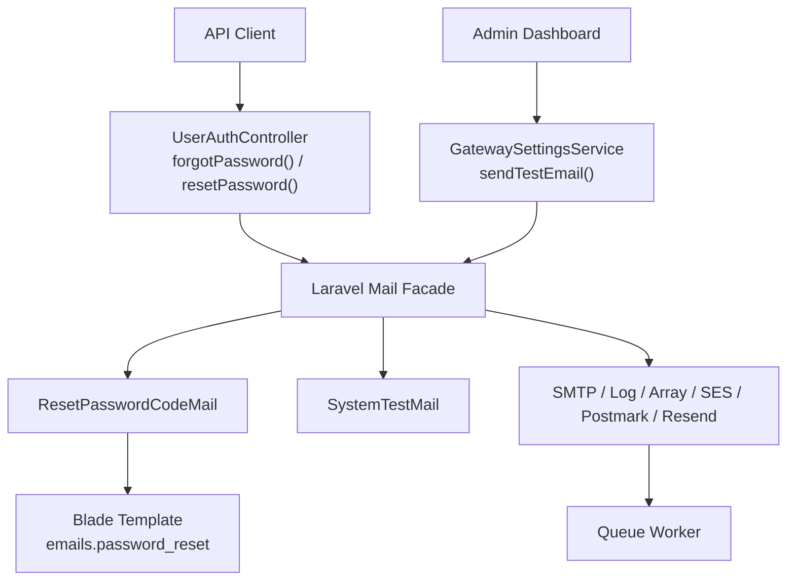
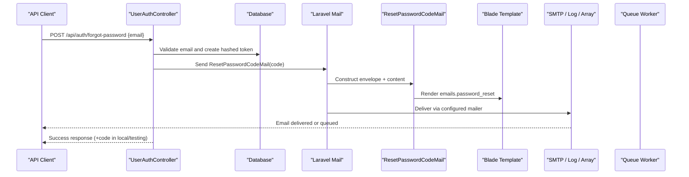
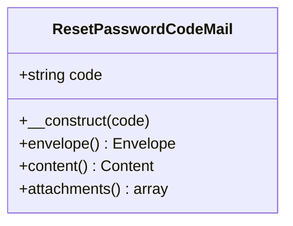
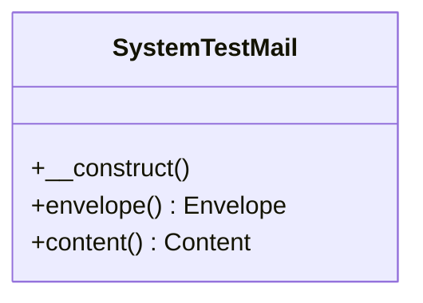
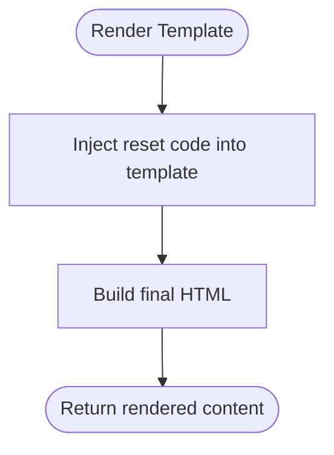
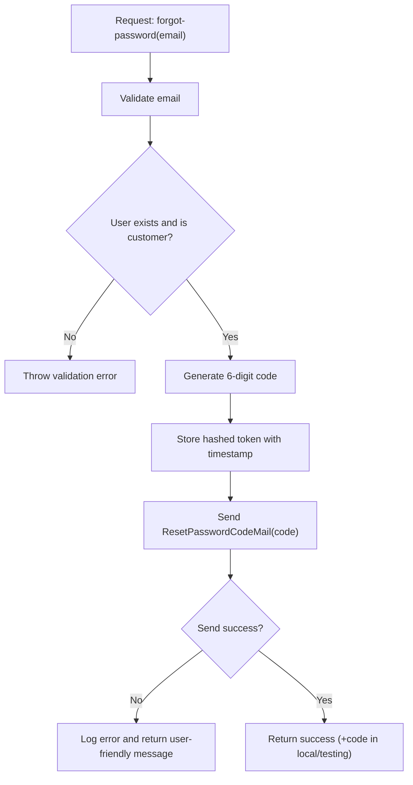
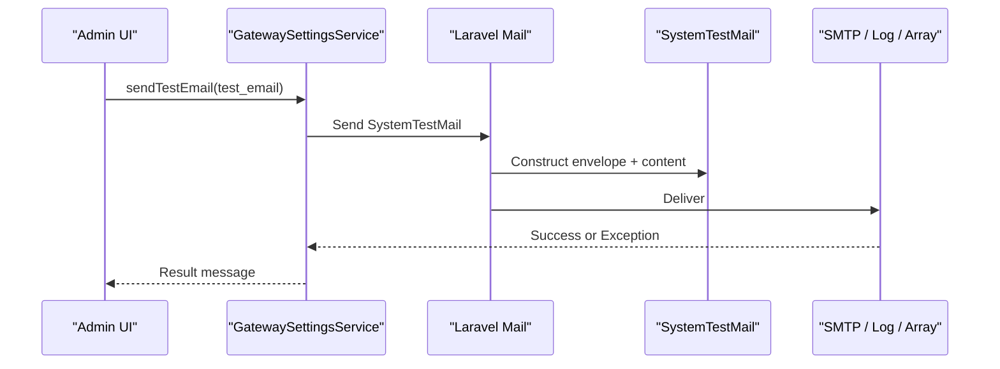
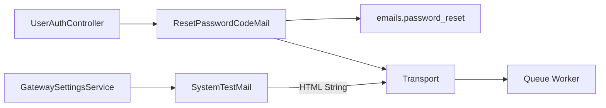

# Email Notifications

<cite>
**Referenced Files in This Document**
- [ResetPasswordCodeMail.php](file://backend/app/Mail/ResetPasswordCodeMail.php)
- [SystemTestMail.php](file://backend/app/Mail/SystemTestMail.php)
- [password_reset.blade.php](file://backend/resources/views/emails/password_reset.blade.php)
- [mail.php](file://backend/config/mail.php)
- [queue.php](file://backend/config/queue.php)
- [UserAuthController.php](file://backend/app/Http/Controllers/API/UserAuthController.php)
- [GatewaySettingsService.php](file://backend/app/Services/GatewaySettingsService.php)
- [ForgotResetPasswordTest.php](file://backend/tests/Feature/ForgotResetPasswordTest.php)
</cite>

## Table of Contents
1. [Introduction](#introduction)
2. [Project Structure](#project-structure)
3. [Core Components](#core-components)
4. [Architecture Overview](#architecture-overview)
5. [Detailed Component Analysis](#detailed-component-analysis)
6. [Dependency Analysis](#dependency-analysis)
7. [Performance Considerations](#performance-considerations)
8. [Troubleshooting Guide](#troubleshooting-guide)
9. [Conclusion](#conclusion)
10. [Appendices](#appendices)

## Introduction
This document explains the email notification system used by the application, focusing on Laravel Mail integration, password reset workflows, Blade templates, SMTP configuration, queue processing, and operational best practices. It covers:
- The `ResetPasswordCodeMail` and `SystemTestMail` classes
- The password reset email template
- Email configuration via `mail.php` and environment-driven settings
- Queue-based background delivery
- Custom email creation patterns
- Security, spam prevention, and testing strategies

## Project Structure
The email system is implemented using standard Laravel conventions:
- Mailable classes under `app/Mail`
- Blade email templates under `resources/views/emails`
- API controller logic that triggers password reset emails
- Admin-facing service for mail configuration and test sending
- Centralized mail and queue configuration files

**Diagram sources**
- [UserAuthController.php:113-163](file://backend/app/Http/Controllers/API/UserAuthController.php#L113-L163)
- [ResetPasswordCodeMail.php:11-54](file://backend/app/Mail/ResetPasswordCodeMail.php#L11-L54)
- [SystemTestMail.php:11-42](file://backend/app/Mail/SystemTestMail.php#L11-L42)
- [GatewaySettingsService.php:128-148](file://backend/app/Services/GatewaySettingsService.php#L128-L148)
- [mail.php:17-116](file://backend/config/mail.php#L17-L116)
- [queue.php:16-92](file://backend/config/queue.php#L16-L92)

**Section sources**
- [ResetPasswordCodeMail.php:1-55](file://backend/app/Mail/ResetPasswordCodeMail.php#L1-L55)
- [SystemTestMail.php:1-43](file://backend/app/Mail/SystemTestMail.php#L1-L43)
- [password_reset.blade.php:1-132](file://backend/resources/views/emails/password_reset.blade.php#L1-L132)
- [mail.php:1-119](file://backend/config/mail.php#L1-L119)
- [queue.php:1-130](file://backend/config/queue.php#L1-L130)
- [UserAuthController.php:113-208](file://backend/app/Http/Controllers/API/UserAuthController.php#L113-L208)
- [GatewaySettingsService.php:59-148](file://backend/app/Services/GatewaySettingsService.php#L59-L148)

## Core Components
- ResetPasswordCodeMail: A mailable class that composes a password reset email with a subject and a Blade view. It accepts a reset code and serializes models for queue compatibility.
- SystemTestMail: A simple mailable used to verify SMTP configuration from the admin dashboard. It sends an HTML string without attachments.
- Password Reset Blade Template: A responsive, dark-themed email template displaying the reset code and expiry notice.
- UserAuthController: Orchestrates password reset flows, generates secure codes, stores hashed tokens, and dispatches emails.
- GatewaySettingsService: Provides admin functionality to update mail settings and send a test email.

Key responsibilities:
- Mailables encapsulate message structure (subject, content, attachments).
- Controllers handle business logic and error handling around email dispatch.
- Configuration centralizes transport and global sender identity.
- Templates render user-facing content.

**Section sources**
- [ResetPasswordCodeMail.php:11-54](file://backend/app/Mail/ResetPasswordCodeMail.php#L11-L54)
- [SystemTestMail.php:11-42](file://backend/app/Mail/SystemTestMail.php#L11-L42)
- [password_reset.blade.php:1-132](file://backend/resources/views/emails/password_reset.blade.php#L1-L132)
- [UserAuthController.php:113-208](file://backend/app/Http/Controllers/API/UserAuthController.php#L113-L208)
- [GatewaySettingsService.php:59-148](file://backend/app/Services/GatewaySettingsService.php#L59-L148)

## Architecture Overview
The password reset workflow uses Laravel’s Mail facade to send a mailable backed by a Blade template. In development/testing, the response may include the generated code for convenience. In production, errors during email sending are logged and surfaced as validation errors to avoid leaking sensitive details.

**Diagram sources**
- [UserAuthController.php:113-163](file://backend/app/Http/Controllers/API/UserAuthController.php#L113-L163)
- [ResetPasswordCodeMail.php:28-43](file://backend/app/Mail/ResetPasswordCodeMail.php#L28-L43)
- [password_reset.blade.php:115-118](file://backend/resources/views/emails/password_reset.blade.php#L115-L118)
- [mail.php:17-116](file://backend/config/mail.php#L17-L116)
- [queue.php:16-92](file://backend/config/queue.php#L16-L92)

## Detailed Component Analysis

### ResetPasswordCodeMail
Purpose:
- Define the email envelope (subject) and content (Blade view).
- Accept a reset code and pass it to the template.
- Support queueing through Laravel’s queueable traits.

Design highlights:
- Uses `Queueable` and `SerializesModels` for safe serialization when queued.
- Separates metadata (`envelope`) from body (`content`).
- No attachments in this flow.

**Diagram sources**
- [ResetPasswordCodeMail.php:11-54](file://backend/app/Mail/ResetPasswordCodeMail.php#L11-L54)

**Section sources**
- [ResetPasswordCodeMail.php:11-54](file://backend/app/Mail/ResetPasswordCodeMail.php#L11-L54)

### SystemTestMail
Purpose:
- Provide a minimal test email to validate SMTP configuration from the admin panel.

Design highlights:
- Sends an inline HTML string rather than a Blade view.
- No attachments; suitable for quick connectivity checks.

**Diagram sources**
- [SystemTestMail.php:11-42](file://backend/app/Mail/SystemTestMail.php#L11-L42)

**Section sources**
- [SystemTestMail.php:11-42](file://backend/app/Mail/SystemTestMail.php#L11-L42)

### Password Reset Blade Template
Purpose:
- Render a visually consistent, responsive email containing the reset code and expiry guidance.

Key aspects:
- Responsive layout with a centered container and readable typography.
- Displays the reset code prominently and indicates expiration.
- Includes branding and footer information.

**Diagram sources**
- [password_reset.blade.php:115-118](file://backend/resources/views/emails/password_reset.blade.php#L115-L118)

**Section sources**
- [password_reset.blade.php:1-132](file://backend/resources/views/emails/password_reset.blade.php#L1-L132)

### Password Reset Workflow in UserAuthController
Responsibilities:
- Validate input.
- Generate a secure random code and store a hashed version.
- Dispatch the password reset email.
- Handle exceptions and environment-specific behavior.
- Provide the code in local/testing responses for developer convenience.

**Diagram sources**
- [UserAuthController.php:113-163](file://backend/app/Http/Controllers/API/UserAuthController.php#L113-L163)

**Section sources**
- [UserAuthController.php:113-163](file://backend/app/Http/Controllers/API/UserAuthController.php#L113-L163)

### Test Email Flow in GatewaySettingsService
Responsibilities:
- Validate target email address.
- Send `SystemTestMail`.
- Return success or failure messages based on exception handling.

**Diagram sources**
- [GatewaySettingsService.php:128-148](file://backend/app/Services/GatewaySettingsService.php#L128-L148)
- [SystemTestMail.php:26-40](file://backend/app/Mail/SystemTestMail.php#L26-L40)

**Section sources**
- [GatewaySettingsService.php:128-148](file://backend/app/Services/GatewaySettingsService.php#L128-L148)

## Dependency Analysis
High-level dependencies:
- Controllers depend on Mailables to compose messages.
- Mailables depend on Blade views for rendering.
- Mail facade depends on configured transports and optional queue workers.
- Admin services depend on Mailables for test messaging.

**Diagram sources**
- [UserAuthController.php:113-163](file://backend/app/Http/Controllers/API/UserAuthController.php#L113-L163)
- [GatewaySettingsService.php:128-148](file://backend/app/Services/GatewaySettingsService.php#L128-L148)
- [ResetPasswordCodeMail.php:28-43](file://backend/app/Mail/ResetPasswordCodeMail.php#L28-L43)
- [SystemTestMail.php:26-40](file://backend/app/Mail/SystemTestMail.php#L26-L40)
- [queue.php:16-92](file://backend/config/queue.php#L16-L92)

**Section sources**
- [UserAuthController.php:113-208](file://backend/app/Http/Controllers/API/UserAuthController.php#L113-L208)
- [GatewaySettingsService.php:59-148](file://backend/app/Services/GatewaySettingsService.php#L59-L148)
- [ResetPasswordCodeMail.php:11-54](file://backend/app/Mail/ResetPasswordCodeMail.php#L11-L54)
- [SystemTestMail.php:11-42](file://backend/app/Mail/SystemTestMail.php#L11-L42)
- [queue.php:16-92](file://backend/config/queue.php#L16-L92)

## Performance Considerations
- Use queues for background delivery to avoid blocking HTTP requests.
- Prefer dedicated transports (e.g., SES, Postmark) for high-volume environments.
- Keep templates lightweight and avoid heavy assets.
- Monitor failed jobs and adjust retry policies per environment.

[No sources needed since this section provides general guidance]

## Troubleshooting Guide

Common issues and resolutions:
- SMTP misconfiguration:
  - Verify host, port, username, password, encryption, and from address.
  - Use the admin “Send Test Email” feature to validate connectivity.
- Emails not sent in production:
  - Ensure queue worker is running if using a queue driver.
  - Check logs for transport exceptions.
- Development convenience:
  - In local/testing, the API returns the reset code in the response payload.
- Validation and security:
  - Invalid or expired reset codes are rejected.
  - Sensitive data (reset codes) are never logged.

Operational tips:
- For local development, consider using the log or array mailers to inspect messages without external SMTP.
- For production, configure a reliable transport and run queue workers continuously.

**Section sources**
- [GatewaySettingsService.php:128-148](file://backend/app/Services/GatewaySettingsService.php#L128-L148)
- [UserAuthController.php:139-163](file://backend/app/Http/Controllers/API/UserAuthController.php#L139-L163)
- [ForgotResetPasswordTest.php:39-54](file://backend/tests/Feature/ForgotResetPasswordTest.php#L39-L54)

## Conclusion
The email system follows Laravel best practices:
- Mailables encapsulate message composition.
- Blade templates provide flexible, maintainable designs.
- Configuration centralizes transport and sender identity.
- Queues enable scalable, non-blocking delivery.
- Tests and admin tools support reliable verification and troubleshooting.

Adopting these patterns ensures a secure, maintainable, and extensible email notification system.

[No sources needed since this section summarizes without analyzing specific files]

## Appendices

### Email Configuration Reference (mail.php)
- Default mailer: configurable via environment.
- Supported transports: SMTP, SES, Postmark, Resend, Sendmail, Log, Array, Failover, Roundrobin.
- Global sender address and name are defined centrally.

Configuration keys commonly used:
- MAIL_MAILER
- MAIL_HOST
- MAIL_PORT
- MAIL_USERNAME
- MAIL_PASSWORD
- MAIL_ENCRYPTION
- MAIL_FROM_ADDRESS
- MAIL_FROM_NAME

**Section sources**
- [mail.php:17-116](file://backend/config/mail.php#L17-L116)

### Queue Processing Reference (queue.php)
- Default connection: configurable via environment.
- Drivers: sync, database, beanstalkd, sqs, redis, deferred, background, failover.
- Failed job storage: file or database-backed options.

Recommended setup:
- Use a persistent backend (database, Redis, SQS) in production.
- Run queue workers and monitor failed jobs.

**Section sources**
- [queue.php:16-92](file://backend/config/queue.php#L16-L92)

### Creating a Custom Email Notification
Steps:
1. Create a new Mailable class under `app/Mail`.
2. Define envelope (subject) and content (Blade view or HTML string).
3. Pass required data via constructor.
4. Dispatch via `Mail::to(...)->send(new YourMail(...))`.
5. Optionally queue the mailable for background delivery.

Best practices:
- Keep templates modular and responsive.
- Avoid logging sensitive payloads.
- Use environment variables for transport configuration.

[No sources needed since this section provides general guidance]

### Designing Responsive Email Templates
Guidelines:
- Use table-based layouts for maximum client compatibility.
- Include viewport meta tags and fluid containers.
- Limit CSS to inline styles where possible.
- Provide clear calls-to-action and fallback text.

Reference template:
- See the password reset template for a complete example.

**Section sources**
- [password_reset.blade.php:1-132](file://backend/resources/views/emails/password_reset.blade.php#L1-L132)

### Handling Email Delivery Failures
Patterns:
- Wrap mail dispatch in try/catch blocks.
- Log detailed errors internally while returning safe messages to users.
- Surface failures in admin test endpoints for diagnostics.

Examples in codebase:
- Password reset flow logs failures and returns user-friendly errors in production.
- Admin test endpoint returns explicit success/failure messages.

**Section sources**
- [UserAuthController.php:142-151](file://backend/app/Http/Controllers/API/UserAuthController.php#L142-L151)
- [GatewaySettingsService.php:135-147](file://backend/app/Services/GatewaySettingsService.php#L135-L147)

### Email Security and Spam Prevention
Recommendations:
- Never log reset codes or sensitive payloads.
- Hash stored reset tokens and enforce short lifetimes.
- Use rate limiting on password reset endpoints.
- Configure proper SPF/DKIM/DMARC records at the domain level.
- Use reputable transactional email providers.

Security notes in codebase:
- Reset codes are hashed before storage.
- Reset codes are not logged.
- Expiration checks prevent reuse after time limits.

**Section sources**
- [UserAuthController.php:127-140](file://backend/app/Http/Controllers/API/UserAuthController.php#L127-L140)
- [UserAuthController.php:184-190](file://backend/app/Http/Controllers/API/UserAuthController.php#L184-L190)

### Testing Email Functionality
Development:
- Use log or array mailers to capture messages locally.
- Leverage environment-specific response behavior that includes the reset code.

Production:
- Use the admin “Send Test Email” feature to validate SMTP.
- Run queue workers and monitor failed jobs.

Integration tests:
- Feature tests assert API behavior for password reset flows and token persistence.

**Section sources**
- [ForgotResetPasswordTest.php:39-54](file://backend/tests/Feature/ForgotResetPasswordTest.php#L39-L54)
- [GatewaySettingsService.php:128-148](file://backend/app/Services/GatewaySettingsService.php#L128-L148)