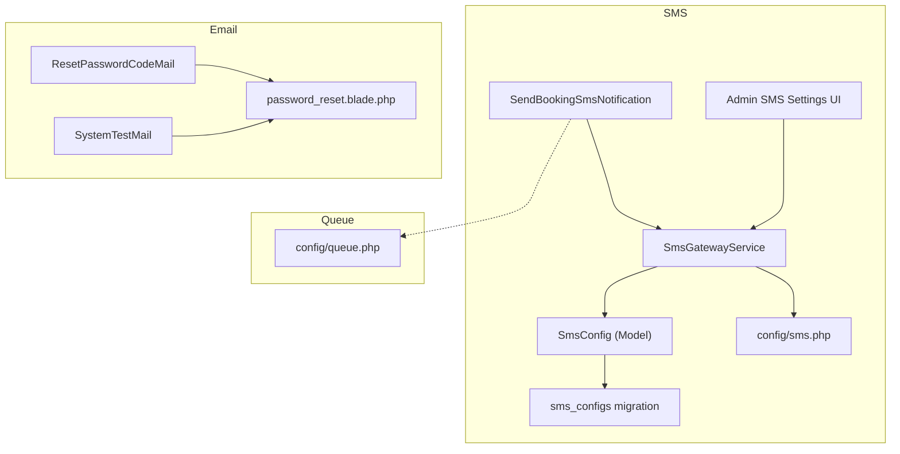
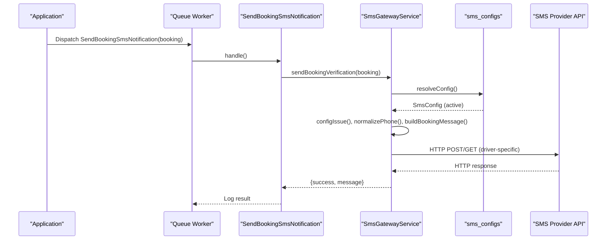
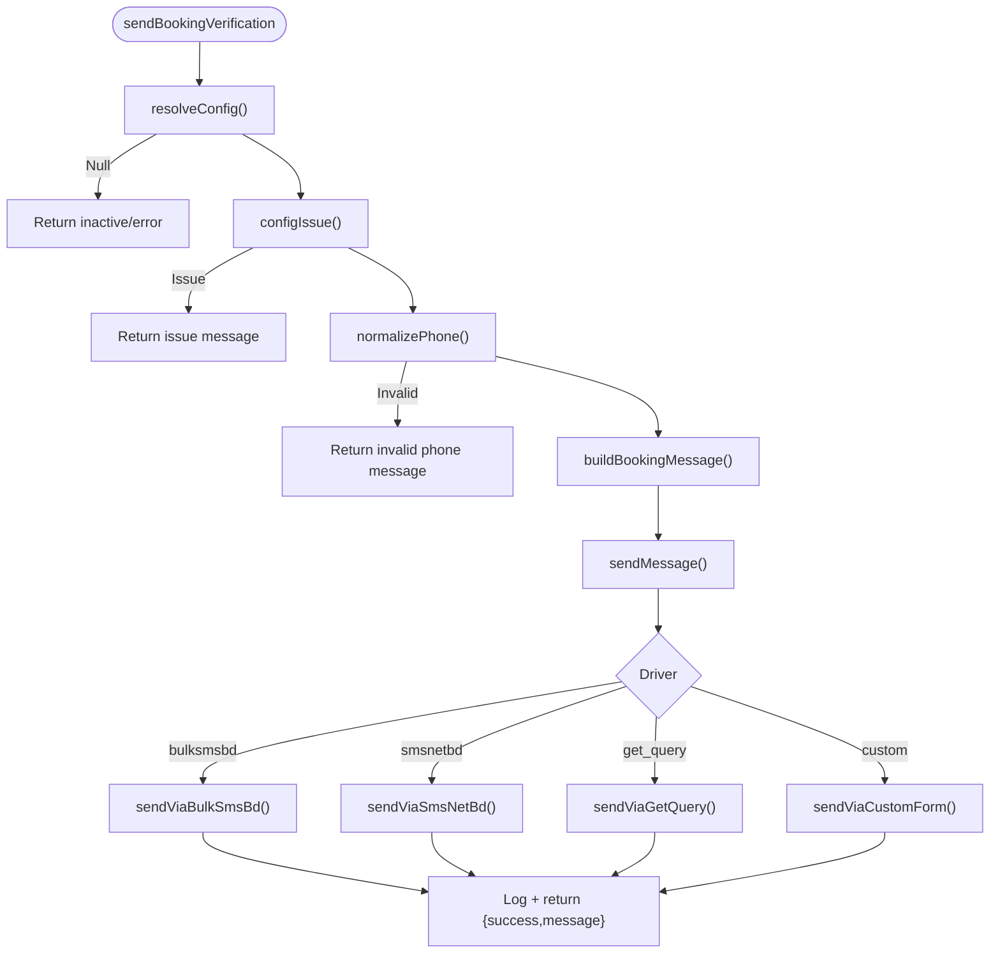
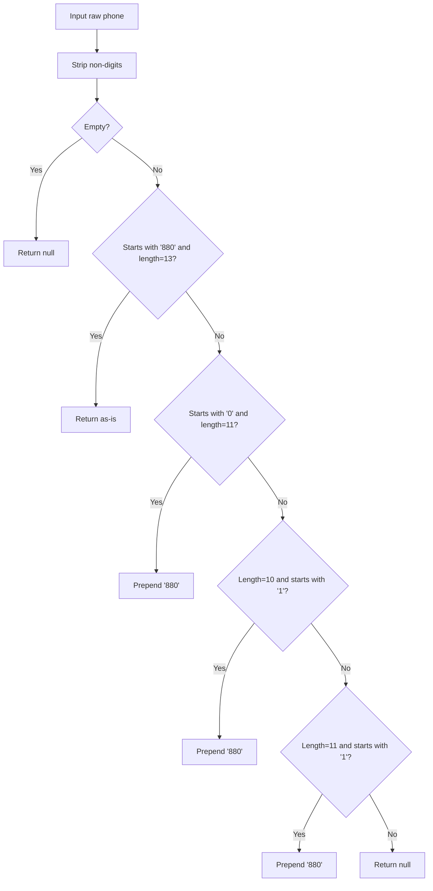
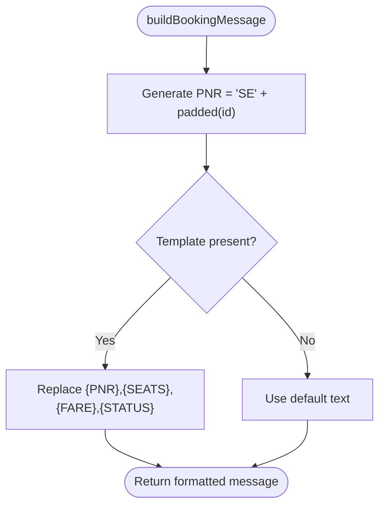
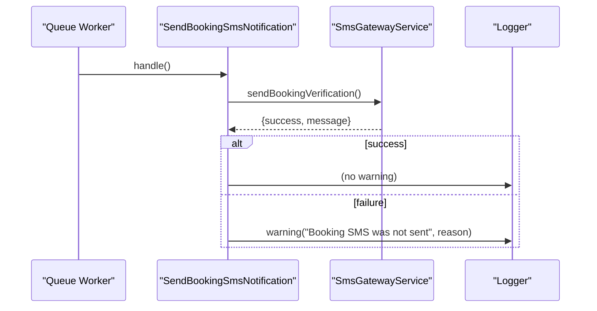
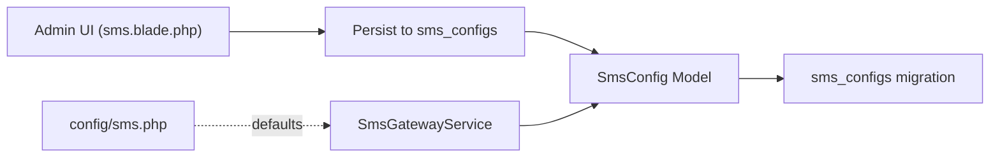
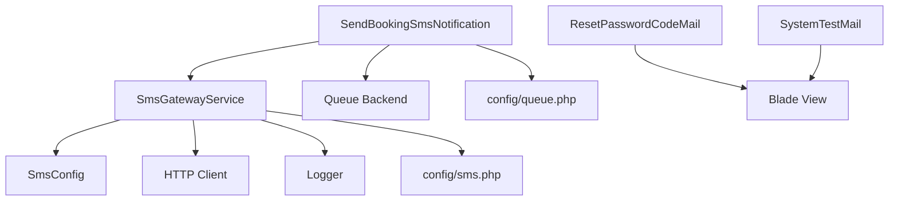

# Notification System

<cite>
**Referenced Files in This Document**
- [SmsGatewayService.php](file://backend/app/Services/SmsGatewayService.php)
- [SendBookingSmsNotification.php](file://backend/app/Jobs/SendBookingSmsNotification.php)
- [sms.php](file://backend/config/sms.php)
- [queue.php](file://backend/config/queue.php)
- [ResetPasswordCodeMail.php](file://backend/app/Mail/ResetPasswordCodeMail.php)
- [SystemTestMail.php](file://backend/app/Mail/SystemTestMail.php)
- [password_reset.blade.php](file://backend/resources/views/emails/password_reset.blade.php)
- [2026_06_02_090000_create_sms_configs_table.php](file://backend/database/migrations/2026_06_02_090000_create_sms_configs_table.php)
- [SmsConfig.php](file://backend/app/Models/SmsConfig.php)
- [sms.blade.php](file://backend/resources/views/admin/partials/gateway-settings/sms.blade.php)
</cite>

## Table of Contents
1. [Introduction](#introduction)
2. [Project Structure](#project-structure)
3. [Core Components](#core-components)
4. [Architecture Overview](#architecture-overview)
5. [Detailed Component Analysis](#detailed-component-analysis)
6. [Dependency Analysis](#dependency-analysis)
7. [Performance Considerations](#performance-considerations)
8. [Troubleshooting Guide](#troubleshooting-guide)
9. [Conclusion](#conclusion)

## Introduction
This document explains the multi-provider notification system for SonyaBus, covering:
- SMS gateway abstraction supporting BulkSmsBD, SMS.NET.BD, and custom providers
- Message templating and phone number normalization
- Delivery tracking via logging and queue job outcomes
- Email notifications for password resets and system tests
- Queue processing, retry behavior, and failure handling
- Provider configuration, message formatting, and monitoring delivery status

## Project Structure
The notification system spans services, jobs, mail classes, configuration, database schema, and admin UI partials.



**Diagram sources**
- [SmsGatewayService.php:11-254](file://backend/app/Services/SmsGatewayService.php#L11-L254)
- [SendBookingSmsNotification.php:11-36](file://backend/app/Jobs/SendBookingSmsNotification.php#L11-L36)
- [SmsConfig.php:7-22](file://backend/app/Models/SmsConfig.php#L7-L22)
- [2026_06_02_090000_create_sms_configs_table.php:14-28](file://backend/database/migrations/2026_06_02_090000_create_sms_configs_table.php#L14-L28)
- [sms.php:3-14](file://backend/config/sms.php#L3-L14)
- [queue.php:16-45](file://backend/config/queue.php#L16-L45)
- [ResetPasswordCodeMail.php:11-54](file://backend/app/Mail/ResetPasswordCodeMail.php#L11-L54)
- [SystemTestMail.php:11-42](file://backend/app/Mail/SystemTestMail.php#L11-L42)
- [password_reset.blade.php:1-132](file://backend/resources/views/emails/password_reset.blade.php#L1-L132)
- [sms.blade.php:1-80](file://backend/resources/views/admin/partials/gateway-settings/sms.blade.php#L1-L80)

**Section sources**
- [SmsGatewayService.php:11-254](file://backend/app/Services/SmsGatewayService.php#L11-L254)
- [SendBookingSmsNotification.php:11-36](file://backend/app/Jobs/SendBookingSmsNotification.php#L11-L36)
- [sms.php:3-14](file://backend/config/sms.php#L3-L14)
- [queue.php:16-45](file://backend/config/queue.php#L16-L45)
- [ResetPasswordCodeMail.php:11-54](file://backend/app/Mail/ResetPasswordCodeMail.php#L11-L54)
- [SystemTestMail.php:11-42](file://backend/app/Mail/SystemTestMail.php#L11-L42)
- [password_reset.blade.php:1-132](file://backend/resources/views/emails/password_reset.blade.php#L1-L132)
- [2026_06_02_090000_create_sms_configs_table.php:14-28](file://backend/database/migrations/2026_06_02_090000_create_sms_configs_table.php#L14-L28)
- [SmsConfig.php:7-22](file://backend/app/Models/SmsConfig.php#L7-L22)
- [sms.blade.php:1-80](file://backend/resources/views/admin/partials/gateway-settings/sms.blade.php#L1-L80)

## Core Components
- SMS Gateway Abstraction: Centralizes provider selection, validation, normalization, templating, and HTTP dispatch.
- Queue Job: Offloads SMS sending to background workers with logging on success or failure.
- Email Mails: Password reset code email and a simple system test email.
- Configuration: Environment-backed defaults and runtime SMS settings stored in the database.
- Database Schema: Stores active SMS provider credentials and templates.
- Admin UI: Allows configuring provider driver, API URL, keys, sender ID, template, and activation.

Key responsibilities:
- SmsGatewayService: resolveConfig, configIssue, normalizePhone, buildBookingMessage, sendMessage, provider-specific senders.
- SendBookingSmsNotification: enqueueable job that invokes SmsGatewayService and logs failures.
- ResetPasswordCodeMail / SystemTestMail: define envelope, content view or HTML string, and attachments.
- SmsConfig model and sms_configs table: persistence for provider settings.
- config/sms.php and config/queue.php: application-wide defaults and queue backend configuration.

**Section sources**
- [SmsGatewayService.php:11-254](file://backend/app/Services/SmsGatewayService.php#L11-L254)
- [SendBookingSmsNotification.php:11-36](file://backend/app/Jobs/SendBookingSmsNotification.php#L11-L36)
- [ResetPasswordCodeMail.php:11-54](file://backend/app/Mail/ResetPasswordCodeMail.php#L11-L54)
- [SystemTestMail.php:11-42](file://backend/app/Mail/SystemTestMail.php#L11-L42)
- [SmsConfig.php:7-22](file://backend/app/Models/SmsConfig.php#L7-L22)
- [2026_06_02_090000_create_sms_configs_table.php:14-28](file://backend/database/migrations/2026_06_02_090000_create_sms_configs_table.php#L14-L28)
- [sms.php:3-14](file://backend/config/sms.php#L3-L14)
- [queue.php:16-45](file://backend/config/queue.php#L16-L45)
- [sms.blade.php:1-80](file://backend/resources/views/admin/partials/gateway-settings/sms.blade.php#L1-L80)

## Architecture Overview
The system uses Laravel queues to decouple booking-related SMS from request handling. The service layer abstracts multiple SMS providers behind a single interface. Emails are sent using Laravel’s mailer with Blade views.



**Diagram sources**
- [SendBookingSmsNotification.php:25-35](file://backend/app/Jobs/SendBookingSmsNotification.php#L25-L35)
- [SmsGatewayService.php:16-48](file://backend/app/Services/SmsGatewayService.php#L16-L48)
- [SmsGatewayService.php:75-107](file://backend/app/Services/SmsGatewayService.php#L75-L107)
- [SmsGatewayService.php:109-150](file://backend/app/Services/SmsGatewayService.php#L109-L150)
- [SmsGatewayService.php:156-202](file://backend/app/Services/SmsGatewayService.php#L156-L202)
- [2026_06_02_090000_create_sms_configs_table.php:14-28](file://backend/database/migrations/2026_06_02_090000_create_sms_configs_table.php#L14-L28)

## Detailed Component Analysis

### SMS Gateway Abstraction
Responsibilities:
- Resolve active provider configuration from the database.
- Validate required fields per driver.
- Normalize phone numbers to international format.
- Build templated messages.
- Dispatch requests to provider APIs with timeouts and error handling.

Supported drivers:
- bulksmsbd: Form POST with api_key, type, number, senderid, message.
- smsnetbd: Form POST with api_key, msg, to; sender_id not required.
- get_query: GET with query parameters.
- custom: Form POST with api_key, sender_id, mobile, message.



**Diagram sources**
- [SmsGatewayService.php:16-48](file://backend/app/Services/SmsGatewayService.php#L16-L48)
- [SmsGatewayService.php:75-107](file://backend/app/Services/SmsGatewayService.php#L75-L107)
- [SmsGatewayService.php:109-150](file://backend/app/Services/SmsGatewayService.php#L109-L150)
- [SmsGatewayService.php:156-202](file://backend/app/Services/SmsGatewayService.php#L156-L202)
- [SmsGatewayService.php:204-253](file://backend/app/Services/SmsGatewayService.php#L204-L253)

**Section sources**
- [SmsGatewayService.php:16-48](file://backend/app/Services/SmsGatewayService.php#L16-L48)
- [SmsGatewayService.php:75-107](file://backend/app/Services/SmsGatewayService.php#L75-L107)
- [SmsGatewayService.php:109-150](file://backend/app/Services/SmsGatewayService.php#L109-L150)
- [SmsGatewayService.php:156-202](file://backend/app/Services/SmsGatewayService.php#L156-L202)
- [SmsGatewayService.php:204-253](file://backend/app/Services/SmsGatewayService.php#L204-L253)

### Phone Number Normalization
Rules:
- Strip non-digits.
- Accept and preserve 13-digit E.164 starting with 880.
- Convert leading 0 with 11 digits to 880 prefix.
- Accept 10-digit numbers starting with 1 by prepending 880.
- Accept 11-digit numbers starting with 1 by prepending 880.
- Otherwise, reject.



**Diagram sources**
- [SmsGatewayService.php:109-134](file://backend/app/Services/SmsGatewayService.php#L109-L134)

**Section sources**
- [SmsGatewayService.php:109-134](file://backend/app/Services/SmsGatewayService.php#L109-L134)

### Message Templating
- If a custom template exists in SmsConfig, replace placeholders: {PNR}, {SEATS}, {FARE}, {STATUS}.
- PNR is generated as SE followed by zero-padded booking id.
- If no template is set, a default confirmation message is used.



**Diagram sources**
- [SmsGatewayService.php:136-150](file://backend/app/Services/SmsGatewayService.php#L136-L150)

**Section sources**
- [SmsGatewayService.php:136-150](file://backend/app/Services/SmsGatewayService.php#L136-L150)

### Provider-Specific Sending
- bulkSmsBD: POST form with api_key, type=text, number, senderid, message.
- smsnetBD: POST form with api_key, msg, to; sender_id not required.
- get_query: GET with query params including api_key, sender_id, mobile, message.
- custom: POST form with api_key, sender_id, mobile, message.
All requests use a 15-second timeout. Responses are logged with context and mapped to a standardized result object.

**Section sources**
- [SmsGatewayService.php:156-202](file://backend/app/Services/SmsGatewayService.php#L156-L202)
- [SmsGatewayService.php:204-253](file://backend/app/Services/SmsGatewayService.php#L204-L253)

### Queue Processing and Retry Behavior
- SendBookingSmsNotification implements ShouldQueue and serializes the Booking model.
- On execution, it calls SmsGatewayService and logs warnings when sending fails.
- Queue backend defaults to database; retry_after is configurable per connection.
- Failed jobs are persisted according to queue failed configuration.



**Diagram sources**
- [SendBookingSmsNotification.php:25-35](file://backend/app/Jobs/SendBookingSmsNotification.php#L25-L35)
- [SmsGatewayService.php:16-48](file://backend/app/Services/SmsGatewayService.php#L16-L48)

**Section sources**
- [SendBookingSmsNotification.php:11-36](file://backend/app/Jobs/SendBookingSmsNotification.php#L11-L36)
- [queue.php:16-45](file://backend/config/queue.php#L16-L45)
- [queue.php:123-127](file://backend/config/queue.php#L123-L127)

### Email Notifications
- ResetPasswordCodeMail: Mailable with queued support, envelope subject, and Blade view emails.password_reset.
- SystemTestMail: Mailable with queued support, envelope subject, and inline HTML content for SMTP testing.
- password_reset.blade.php: Styled HTML email displaying the reset code and expiry notice.

```mermaid
classDiagram
class ResetPasswordCodeMail {
+string code
+envelope() Envelope
+content() Content
+attachments() array
}
class SystemTestMail {
+envelope() Envelope
+content() Content
+attachments() array
}
ResetPasswordCodeMail --> "uses" "Blade View : emails.password_reset"
SystemTestMail --> "renders" "HTML String"
```

**Diagram sources**
- [ResetPasswordCodeMail.php:11-54](file://backend/app/Mail/ResetPasswordCodeMail.php#L11-L54)
- [SystemTestMail.php:11-42](file://backend/app/Mail/SystemTestMail.php#L11-L42)
- [password_reset.blade.php:1-132](file://backend/resources/views/emails/password_reset.blade.php#L1-L132)

**Section sources**
- [ResetPasswordCodeMail.php:11-54](file://backend/app/Mail/ResetPasswordCodeMail.php#L11-L54)
- [SystemTestMail.php:11-42](file://backend/app/Mail/SystemTestMail.php#L11-L42)
- [password_reset.blade.php:1-132](file://backend/resources/views/emails/password_reset.blade.php#L1-L132)

### Provider Configuration and Admin UI
- Runtime SMS settings are stored in the sms_configs table and selected by SmsGatewayService::resolveConfig().
- Admin UI partial allows setting gateway_name, gateway_driver, api_url, api_key, sender_id, message_template, and is_active toggle.
- Default environment values exist in config/sms.php for convenience.



**Diagram sources**
- [sms.blade.php:12-78](file://backend/resources/views/admin/partials/gateway-settings/sms.blade.php#L12-L78)
- [SmsConfig.php:7-22](file://backend/app/Models/SmsConfig.php#L7-L22)
- [2026_06_02_090000_create_sms_configs_table.php:14-28](file://backend/database/migrations/2026_06_02_090000_create_sms_configs_table.php#L14-L28)
- [SmsGatewayService.php:75-87](file://backend/app/Services/SmsGatewayService.php#L75-L87)
- [sms.php:3-14](file://backend/config/sms.php#L3-L14)

**Section sources**
- [sms.blade.php:12-78](file://backend/resources/views/admin/partials/gateway-settings/sms.blade.php#L12-L78)
- [SmsConfig.php:7-22](file://backend/app/Models/SmsConfig.php#L7-L22)
- [2026_06_02_090000_create_sms_configs_table.php:14-28](file://backend/database/migrations/2026_06_02_090000_create_sms_configs_table.php#L14-L28)
- [SmsGatewayService.php:75-87](file://backend/app/Services/SmsGatewayService.php#L75-L87)
- [sms.php:3-14](file://backend/config/sms.php#L3-L14)

## Dependency Analysis
- SmsGatewayService depends on:
  - SmsConfig model and sms_configs table for runtime provider settings.
  - Laravel Http client for outbound requests.
  - Logger for success/failure events.
- SendBookingSmsNotification depends on:
  - SmsGatewayService for sending logic.
  - Queue infrastructure for background execution.
- Email components depend on:
  - Laravel Mailer and Blade engine.
- Configuration:
  - config/sms.php provides defaults.
  - config/queue.php defines queue backends and retry behavior.



**Diagram sources**
- [SendBookingSmsNotification.php:11-36](file://backend/app/Jobs/SendBookingSmsNotification.php#L11-L36)
- [SmsGatewayService.php:11-254](file://backend/app/Services/SmsGatewayService.php#L11-L254)
- [SmsConfig.php:7-22](file://backend/app/Models/SmsConfig.php#L7-L22)
- [ResetPasswordCodeMail.php:11-54](file://backend/app/Mail/ResetPasswordCodeMail.php#L11-L54)
- [SystemTestMail.php:11-42](file://backend/app/Mail/SystemTestMail.php#L11-L42)
- [sms.php:3-14](file://backend/config/sms.php#L3-L14)
- [queue.php:16-45](file://backend/config/queue.php#L16-L45)

**Section sources**
- [SendBookingSmsNotification.php:11-36](file://backend/app/Jobs/SendBookingSmsNotification.php#L11-L36)
- [SmsGatewayService.php:11-254](file://backend/app/Services/SmsGatewayService.php#L11-L254)
- [SmsConfig.php:7-22](file://backend/app/Models/SmsConfig.php#L7-L22)
- [ResetPasswordCodeMail.php:11-54](file://backend/app/Mail/ResetPasswordCodeMail.php#L11-L54)
- [SystemTestMail.php:11-42](file://backend/app/Mail/SystemTestMail.php#L11-L42)
- [sms.php:3-14](file://backend/config/sms.php#L3-L14)
- [queue.php:16-45](file://backend/config/queue.php#L16-L45)

## Performance Considerations
- Use a persistent queue backend (database, Redis, SQS) to avoid blocking HTTP requests during peak booking times.
- Tune retry_after based on expected provider latency to prevent premature retries.
- Keep SMS provider HTTP timeouts reasonable (already set to 15 seconds).
- Monitor queue worker concurrency and memory usage to sustain throughput.
- Avoid heavy operations inside mailable constructors; keep them lightweight for serialization.

[No sources needed since this section provides general guidance]

## Troubleshooting Guide
Common issues and resolutions:
- SMS not configured or inactive:
  - Ensure an active row exists in sms_configs and is_active is true.
- Missing required fields:
  - Verify api_url, api_key, and sender_id (except smsnetbd where sender_id is optional).
- Invalid phone number:
  - Ensure input matches supported Bangladesh formats; normalization will fail otherwise.
- Provider errors:
  - Inspect logs for HTTP status and response body; adjust credentials or endpoint accordingly.
- Queue not processing:
  - Confirm QUEUE_CONNECTION and worker processes are running.
  - Check retry_after and failed_jobs tables if jobs are failing repeatedly.
- Email not received:
  - Validate SMTP settings and test with SystemTestMail.
  - Render password_reset.blade.php to verify variable injection.

Operational checks:
- Use the admin SMS settings UI to save and activate a provider configuration.
- Use the test message capability to validate connectivity.
- Review Laravel logs for SMS success/warning/error entries.

**Section sources**
- [SmsGatewayService.php:75-107](file://backend/app/Services/SmsGatewayService.php#L75-L107)
- [SmsGatewayService.php:109-134](file://backend/app/Services/SmsGatewayService.php#L109-L134)
- [SmsGatewayService.php:156-202](file://backend/app/Services/SmsGatewayService.php#L156-L202)
- [queue.php:16-45](file://backend/config/queue.php#L16-L45)
- [queue.php:123-127](file://backend/config/queue.php#L123-L127)
- [sms.blade.php:12-78](file://backend/resources/views/admin/partials/gateway-settings/sms.blade.php#L12-L78)
- [SystemTestMail.php:11-42](file://backend/app/Mail/SystemTestMail.php#L11-L42)

## Conclusion
The notification system provides a robust, extensible foundation for SMS and email communications:
- SMS abstraction supports multiple providers with clear configuration and templating.
- Phone normalization ensures consistent formatting for Bangladesh mobile numbers.
- Queue-based delivery improves responsiveness and reliability.
- Logging and queue failure storage provide visibility into delivery outcomes.
- Email mailables cover password resets and system diagnostics with styled templates.

[No sources needed since this section summarizes without analyzing specific files]