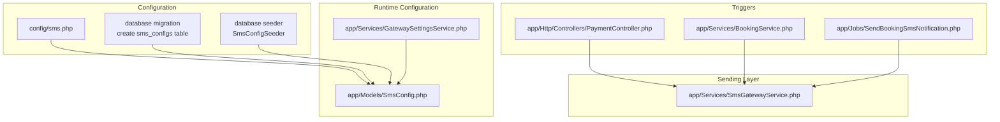
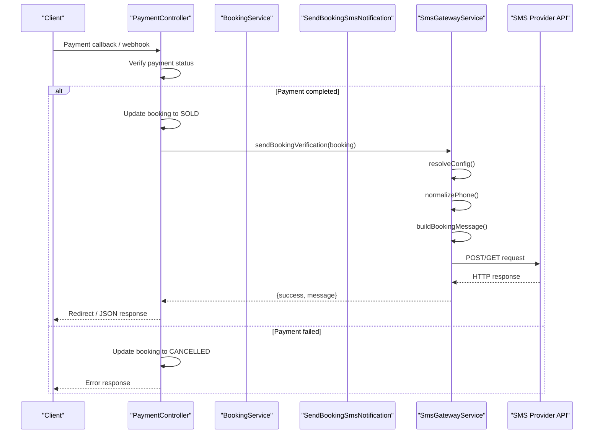
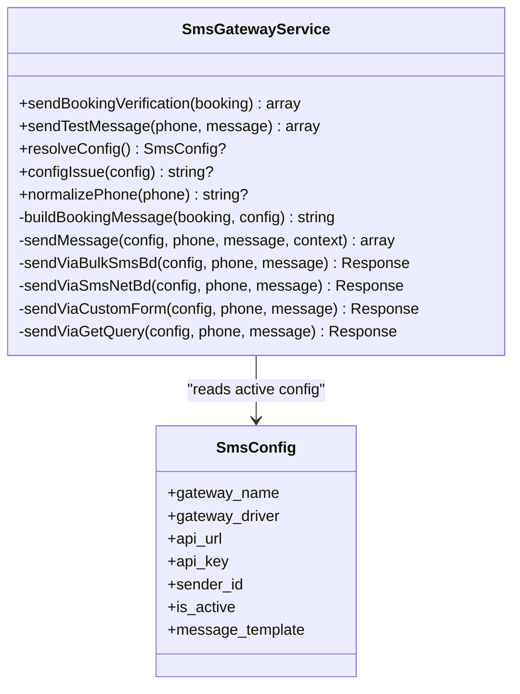
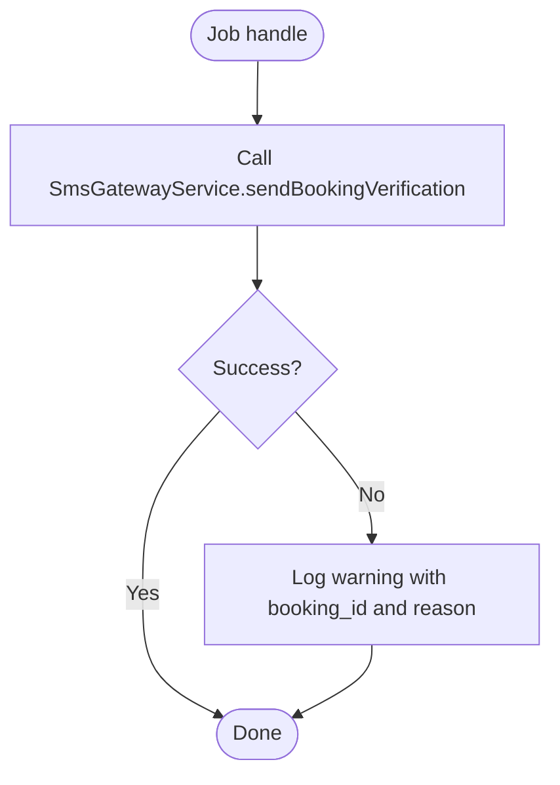
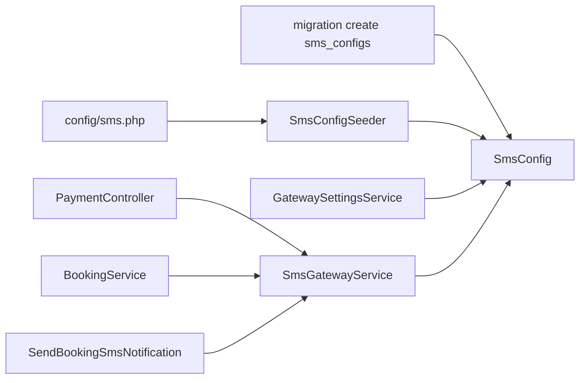

# SMS Gateway Integration

<cite>
**Referenced Files in This Document**
- [SmsGatewayService.php](file://backend/app/Services/SmsGatewayService.php)
- [SendBookingSmsNotification.php](file://backend/app/Jobs/SendBookingSmsNotification.php)
- [sms.php](file://backend/config/sms.php)
- [SmsConfig.php](file://backend/app/Models/SmsConfig.php)
- [2026_06_02_090000_create_sms_configs_table.php](file://backend/database/migrations/2026_06_02_090000_create_sms_configs_table.php)
- [SmsConfigSeeder.php](file://backend/database/seeders/SmsConfigSeeder.php)
- [PaymentController.php](file://backend/app/Http/Controllers/PaymentController.php)
- [BookingService.php](file://backend/app/services/BookingService.php)
- [GatewaySettingsService.php](file://backend/app/Services/GatewaySettingsService.php)
</cite>

## Table of Contents
1. [Introduction](#introduction)
2. [Project Structure](#project-structure)
3. [Core Components](#core-components)
4. [Architecture Overview](#architecture-overview)
5. [Detailed Component Analysis](#detailed-component-analysis)
6. [Dependency Analysis](#dependency-analysis)
7. [Performance Considerations](#performance-considerations)
8. [Troubleshooting Guide](#troubleshooting-guide)
9. [Conclusion](#conclusion)

## Introduction
This document explains the SMS gateway integration used by the booking system. It covers the multi-provider architecture, configuration management, phone normalization, message templating, queue-based job processing, retry and failure handling, delivery status tracking, and operational guidance for administrators.

The system supports:
- BulkSMSBD
- SMS.NET.BD
- Custom providers via form or query-string endpoints
- A configurable driver selection through environment variables and runtime database configuration

## Project Structure
The SMS integration spans services, jobs, models, migrations, seeders, controllers, and admin settings.

**Diagram sources**
- [sms.php:1-15](file://backend/config/sms.php#L1-L15)
- [2026_06_02_090000_create_sms_configs_table.php:12-28](file://backend/database/migrations/2026_06_02_090000_create_sms_configs_table.php#L12-L28)
- [SmsConfigSeeder.php:13-25](file://backend/database/seeders/SmsConfigSeeder.php#L13-L25)
- [SmsConfig.php:9-21](file://backend/app/Models/SmsConfig.php#L9-L21)
- [GatewaySettingsService.php:24-56](file://backend/app/Services/GatewaySettingsService.php#L24-L56)
- [SmsGatewayService.php:11-255](file://backend/app/Services/SmsGatewayService.php#L11-L255)
- [PaymentController.php:47-52](file://backend/app/Http/Controllers/PaymentController.php#L47-L52)
- [BookingService.php:113-126](file://backend/app/Services/BookingService.php#L113-L126)
- [SendBookingSmsNotification.php:11-36](file://backend/app/Jobs/SendBookingSmsNotification.php#L11-L36)

**Section sources**
- [sms.php:1-15](file://backend/config/sms.php#L1-L15)
- [2026_06_02_090000_create_sms_configs_table.php:12-28](file://backend/database/migrations/2026_06_02_090000_create_sms_configs_table.php#L12-L28)
- [SmsConfigSeeder.php:13-25](file://backend/database/seeders/SmsConfigSeeder.php#L13-L25)
- [SmsConfig.php:9-21](file://backend/app/Models/SmsConfig.php#L9-L21)
- [GatewaySettingsService.php:24-56](file://backend/app/Services/GatewaySettingsService.php#L24-L56)
- [SmsGatewayService.php:11-255](file://backend/app/Services/SmsGatewayService.php#L11-L255)
- [PaymentController.php:47-52](file://backend/app/Http/Controllers/PaymentController.php#L47-L52)
- [BookingService.php:113-126](file://backend/app/Services/BookingService.php#L113-L126)
- [SendBookingSmsNotification.php:11-36](file://backend/app/Jobs/SendBookingSmsNotification.php#L11-L36)

## Core Components
- SmsGatewayService: Central abstraction for sending SMS to multiple providers, normalizing phone numbers, building messages from templates, and dispatching HTTP requests with timeouts and logging.
- SendBookingSmsNotification: Queueable job that invokes SmsGatewayService for asynchronous SMS delivery.
- SmsConfig model and sms_configs table: Runtime storage for provider credentials, driver selection, active flag, and message template.
- config/sms.php: Default environment-driven configuration values used during seeding and as fallbacks.
- GatewaySettingsService: Admin-facing service to update SMS configuration and send test messages.
- PaymentController and BookingService: Triggers where SMS is sent after successful payment or confirmed bookings.

Key responsibilities:
- Provider routing based on gateway_driver
- Phone number normalization to Bangladesh international format
- Template substitution for PNR, seats, fare, and status
- HTTP request dispatch with timeout and structured logging
- Graceful error handling and non-blocking job execution

**Section sources**
- [SmsGatewayService.php:11-255](file://backend/app/Services/SmsGatewayService.php#L11-L255)
- [SendBookingSmsNotification.php:11-36](file://backend/app/Jobs/SendBookingSmsNotification.php#L11-L36)
- [SmsConfig.php:9-21](file://backend/app/Models/SmsConfig.php#L9-L21)
- [sms.php:1-15](file://backend/config/sms.php#L1-L15)
- [GatewaySettingsService.php:24-56](file://backend/app/Services/GatewaySettingsService.php#L24-L56)
- [PaymentController.php:47-52](file://backend/app/Http/Controllers/PaymentController.php#L47-L52)
- [BookingService.php:113-126](file://backend/app/Services/BookingService.php#L113-L126)

## Architecture Overview
The SMS flow is designed to be resilient and extensible:
- Configuration can be set via environment variables (config/sms.php) and persisted into the database (sms_configs).
- The active configuration is resolved at runtime; if missing or inactive, SMS is skipped safely.
- Phone numbers are normalized before sending.
- Messages are built using a template with placeholders.
- The appropriate provider driver is selected and invoked over HTTP with a timeout.
- Success and failure paths are logged for observability.
- Asynchronous delivery is supported via a queue job.

**Diagram sources**
- [PaymentController.php:47-52](file://backend/app/Http/Controllers/PaymentController.php#L47-L52)
- [PaymentController.php:115-119](file://backend/app/Http/Controllers/PaymentController.php#L115-L119)
- [SmsGatewayService.php:16-48](file://backend/app/Services/SmsGatewayService.php#L16-L48)
- [SmsGatewayService.php:75-107](file://backend/app/Services/SmsGatewayService.php#L75-L107)
- [SmsGatewayService.php:109-134](file://backend/app/Services/SmsGatewayService.php#L109-L134)
- [SmsGatewayService.php:136-150](file://backend/app/Services/SmsGatewayService.php#L136-L150)
- [SmsGatewayService.php:156-202](file://backend/app/Services/SmsGatewayService.php#L156-L202)

## Detailed Component Analysis

### SmsGatewayService
Responsibilities:
- Resolve active SMS configuration from the database.
- Validate required fields per driver.
- Normalize passenger phone numbers to 880 format.
- Build booking confirmation messages using templates.
- Dispatch HTTP requests to provider APIs with timeouts.
- Log success and failure details.

Supported drivers:
- bulksmsbd: Form POST with api_key, type, number, senderid, message.
- smsnetbd: Form POST with api_key, msg, to.
- get_query: GET request with query parameters.
- custom: Form POST with api_key, sender_id, mobile, message.

**Diagram sources**
- [SmsGatewayService.php:11-255](file://backend/app/Services/SmsGatewayService.php#L11-L255)
- [SmsConfig.php:9-21](file://backend/app/Models/SmsConfig.php#L9-L21)

Key implementation notes:
- Configuration resolution checks table existence and active row.
- Driver-specific validation allows smsnetbd to skip sender_id.
- Phone normalization accepts multiple local formats and converts to 880.
- Message template supports placeholders: {PNR}, {SEATS}, {FARE}, {STATUS}.
- HTTP calls use a 15-second timeout and structured logging.

**Section sources**
- [SmsGatewayService.php:16-48](file://backend/app/Services/SmsGatewayService.php#L16-L48)
- [SmsGatewayService.php:75-107](file://backend/app/Services/SmsGatewayService.php#L75-L107)
- [SmsGatewayService.php:109-134](file://backend/app/Services/SmsGatewayService.php#L109-L134)
- [SmsGatewayService.php:136-150](file://backend/app/Services/SmsGatewayService.php#L136-L150)
- [SmsGatewayService.php:156-202](file://backend/app/Services/SmsGatewayService.php#L156-L202)
- [SmsGatewayService.php:204-253](file://backend/app/Services/SmsGatewayService.php#L204-L253)

### SendBookingSmsNotification Job
Responsibilities:
- Decouple SMS sending from synchronous request flows.
- Invoke SmsGatewayService and log failures without blocking user operations.

Queue behavior:
- Implements ShouldQueue for background processing.
- Uses Laravel’s default retry mechanism unless configured otherwise.
- Logs warnings when SMS fails, including reason from the service.

**Diagram sources**
- [SendBookingSmsNotification.php:11-36](file://backend/app/Jobs/SendBookingSmsNotification.php#L11-L36)
- [SmsGatewayService.php:16-48](file://backend/app/Services/SmsGatewayService.php#L16-L48)

**Section sources**
- [SendBookingSmsNotification.php:11-36](file://backend/app/Jobs/SendBookingSmsNotification.php#L11-L36)

### Configuration Management

#### Environment Configuration (config/sms.php)
Provides defaults for:
- Gateway name
- Driver selection
- API URL
- API key (with fallback to provider-specific env variable)
- Sender ID
- Active flag
- Message template

These values are primarily used by the seeder to initialize the database record.

**Section sources**
- [sms.php:1-15](file://backend/config/sms.php#L1-L15)

#### Database Configuration (sms_configs)
Stores runtime configuration:
- gateway_name
- gateway_driver
- api_url
- api_key
- sender_id
- is_active
- message_template

Indexes optimize queries for active configurations and lookups by name.

**Section sources**
- [2026_06_02_090000_create_sms_configs_table.php:12-28](file://backend/database/migrations/2026_06_02_090000_create_sms_configs_table.php#L12-L28)
- [SmsConfig.php:9-21](file://backend/app/Models/SmsConfig.php#L9-L21)

#### Seeder
Creates or updates the active SMS configuration using values from config/sms.php.

**Section sources**
- [SmsConfigSeeder.php:13-25](file://backend/database/seeders/SmsConfigSeeder.php#L13-L25)

#### Admin Settings
GatewaySettingsService:
- Validates and persists SMS settings to the database.
- Writes corresponding environment variables for consistency.
- Provides a test SMS endpoint backed by SmsGatewayService.

**Section sources**
- [GatewaySettingsService.php:24-56](file://backend/app/Services/GatewaySettingsService.php#L24-L56)
- [GatewaySettingsService.php:115-126](file://backend/app/Services/GatewaySettingsService.php#L115-L126)

### Phone Number Normalization
Rules:
- Strip non-digits.
- Accept 880-prefixed 13-digit numbers.
- Convert leading 0 followed by 10 digits to 880 format.
- Accept 10-digit numbers starting with 1 and convert to 880.
- Accept 11-digit numbers starting with 1 and convert to 880.
- Return null for invalid inputs.

This ensures consistent formatting for all providers.

**Section sources**
- [SmsGatewayService.php:109-134](file://backend/app/Services/SmsGatewayService.php#L109-L134)

### Message Templating
Template variables:
- {PNR}: Generated as SE padded booking id.
- {SEATS}: Seat numbers from booking.
- {FARE}: Total fare formatted to two decimals.
- {STATUS}: Booking status.

If no template is provided, a default confirmation message is used.

**Section sources**
- [SmsGatewayService.php:136-150](file://backend/app/Services/SmsGatewayService.php#L136-L150)

### Provider-Specific Sending Logic
Drivers and payloads:
- bulksmsbd: POST form with api_key, type=text, number, senderid, message.
- smsnetbd: POST form with api_key, msg, to.
- get_query: GET with query parameters api_key, sender_id, mobile, message.
- custom: POST form with api_key, sender_id, mobile, message.

All requests use a 15-second timeout and return structured results with logs.

**Section sources**
- [SmsGatewayService.php:156-202](file://backend/app/Services/SmsGatewayService.php#L156-L202)
- [SmsGatewayService.php:204-253](file://backend/app/Services/SmsGatewayService.php#L204-L253)

### Trigger Points and Flow

#### PaymentController
- On successful payment verification, updates booking status to SOLD and sends SMS.
- On webhook completion, also updates status and sends SMS.

**Section sources**
- [PaymentController.php:47-52](file://backend/app/Http/Controllers/PaymentController.php#L47-L52)
- [PaymentController.php:115-119](file://backend/app/Http/Controllers/PaymentController.php#L115-L119)

#### BookingService
- For customer bookings with non-ZiniPay methods, sends SMS immediately after creation.
- For admin bookings, sends SMS only when status indicates confirmation (PAID, SOLD, BOOKED).

**Section sources**
- [BookingService.php:113-126](file://backend/app/Services/BookingService.php#L113-L126)
- [BookingService.php:183-186](file://backend/app/Services/BookingService.php#L183-L186)

## Dependency Analysis

**Diagram sources**
- [sms.php:1-15](file://backend/config/sms.php#L1-L15)
- [2026_06_02_090000_create_sms_configs_table.php:12-28](file://backend/database/migrations/2026_06_02_090000_create_sms_configs_table.php#L12-L28)
- [SmsConfigSeeder.php:13-25](file://backend/database/seeders/SmsConfigSeeder.php#L13-L25)
- [SmsConfig.php:9-21](file://backend/app/Models/SmsConfig.php#L9-L21)
- [GatewaySettingsService.php:24-56](file://backend/app/Services/GatewaySettingsService.php#L24-L56)
- [PaymentController.php:47-52](file://backend/app/Http/Controllers/PaymentController.php#L47-L52)
- [BookingService.php:113-126](file://backend/app/Services/BookingService.php#L113-L126)
- [SendBookingSmsNotification.php:11-36](file://backend/app/Jobs/SendBookingSmsNotification.php#L11-L36)
- [SmsGatewayService.php:16-48](file://backend/app/Services/SmsGatewayService.php#L16-L48)

Coupling and cohesion:
- SmsGatewayService encapsulates all provider logic, improving cohesion.
- Controllers and services depend only on the SmsGatewayService interface, reducing coupling.
- Configuration is centralized in SmsConfig and accessed via the service.

Potential circular dependencies:
- None observed between core components.

External integrations:
- SMS provider HTTP APIs via Laravel Http client with timeouts.

**Section sources**
- [SmsGatewayService.php:156-202](file://backend/app/Services/SmsGatewayService.php#L156-L202)
- [PaymentController.php:47-52](file://backend/app/Http/Controllers/PaymentController.php#L47-L52)
- [BookingService.php:113-126](file://backend/app/Services/BookingService.php#L113-L126)

## Performance Considerations
- HTTP timeout: All provider requests use a 15-second timeout to avoid hanging.
- Queueing: Use SendBookingSmsNotification to offload SMS sending to background workers.
- Logging: Structured logs help identify slow or failing providers.
- Rate limiting: Providers may enforce rate limits; consider throttling or batching if needed.
- Database indexing: sms_configs indexes support fast lookup of active configuration.

[No sources needed since this section provides general guidance]

## Troubleshooting Guide

Common issues and resolutions:
- SMS not sending:
  - Ensure an active SMS configuration exists in sms_configs.
  - Verify the driver, API URL, API key, and sender_id requirements.
  - Confirm the passenger phone number is valid and normalized.
  - Check application logs for warnings or errors related to SMS.

- Invalid API key or unauthorized:
  - Re-validate credentials with the provider.
  - Update the active configuration via admin panel or seeder.

- Connection timeout:
  - Verify network connectivity and firewall rules.
  - Confirm the provider API URL is reachable.

- Rate limit exceeded:
  - Reduce sending frequency or implement backoff strategies.
  - Monitor provider responses and adjust queue worker concurrency.

Operational checks:
- Test SMS via admin panel or GatewaySettingsService.
- Inspect laravel.log for SMS-related entries.
- Query sms_configs to verify active settings.

**Section sources**
- [SmsGatewayService.php:16-48](file://backend/app/Services/SmsGatewayService.php#L16-L48)
- [SmsGatewayService.php:156-202](file://backend/app/Services/SmsGatewayService.php#L156-L202)
- [GatewaySettingsService.php:115-126](file://backend/app/Services/GatewaySettingsService.php#L115-L126)

## Conclusion
The SMS gateway integration provides a robust, extensible foundation for sending booking confirmations across multiple providers. With environment-driven defaults, runtime database configuration, phone normalization, templated messages, and queue-backed delivery, the system balances reliability and flexibility. Administrators can configure providers, test connectivity, and monitor delivery through structured logs. Future enhancements can include richer delivery status tracking, provider-specific retries, and advanced rate-limit controls.

[No sources needed since this section summarizes without analyzing specific files]