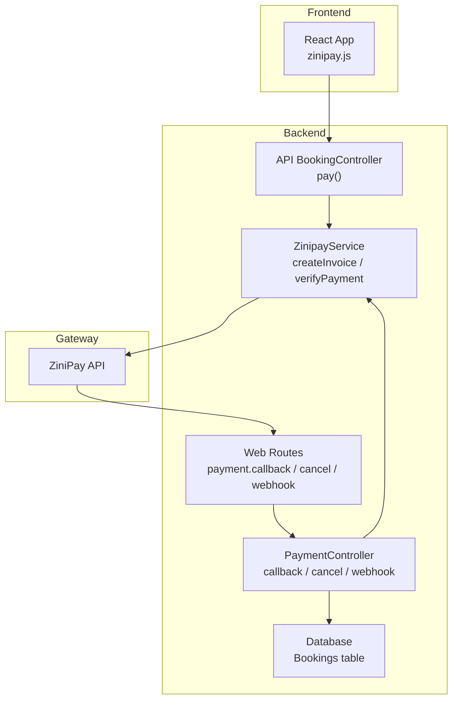
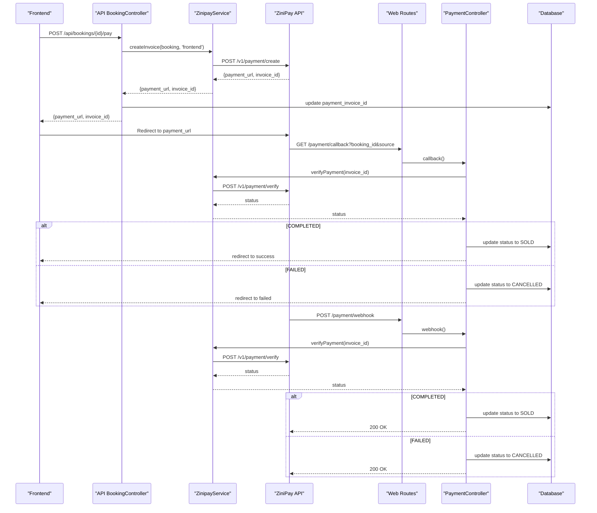
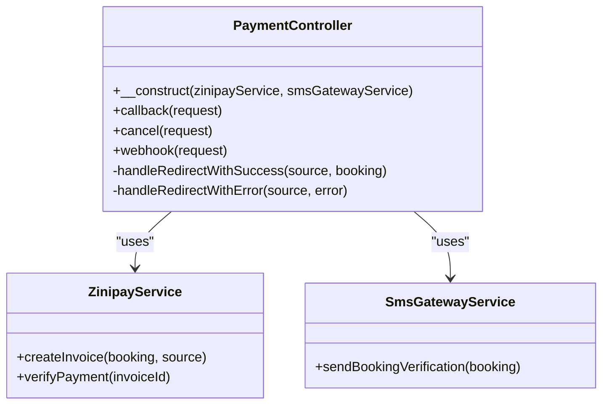
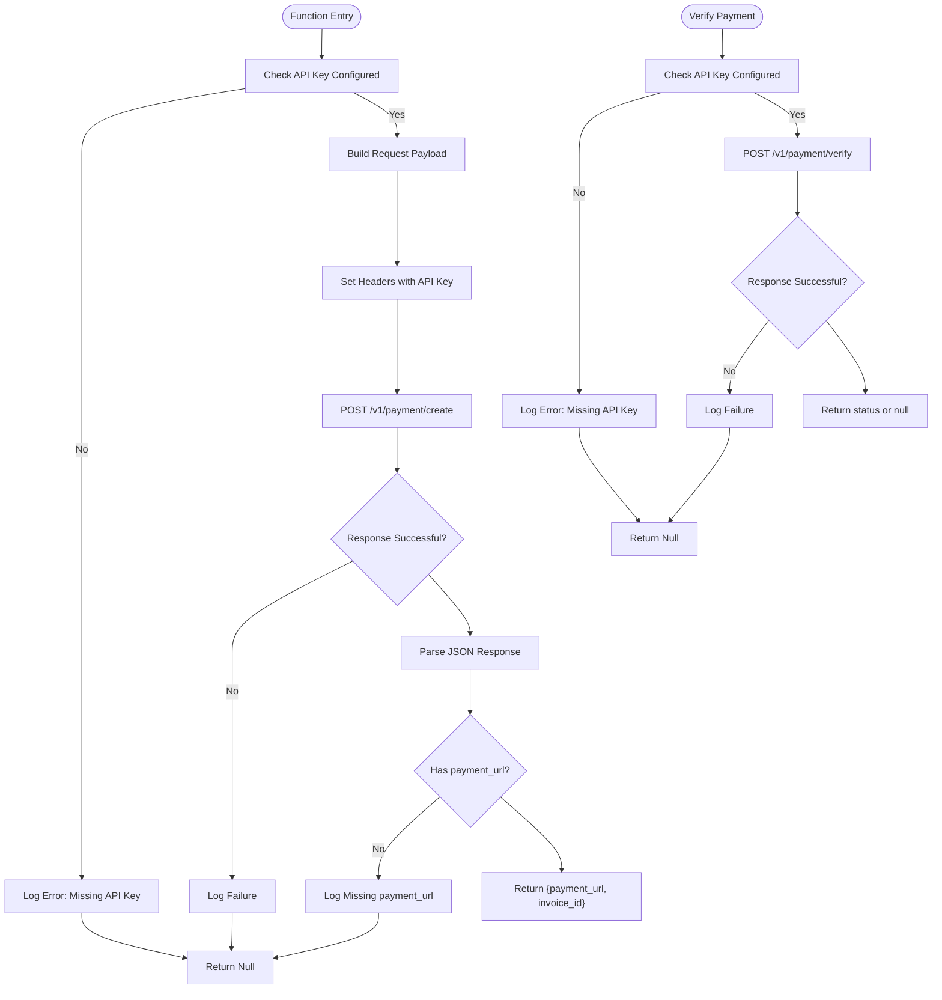
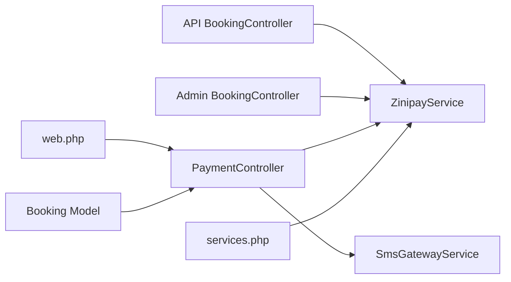

# Backend Payment Processing

<cite>
**Referenced Files in This Document**
- [PaymentController.php](file://backend/app/Http/Controllers/PaymentController.php)
- [ZinipayService.php](file://backend/app/Services/ZinipayService.php)
- [BookingController (API).php](file://backend/app/Http/Controllers/API/BookingController.php)
- [BookingController (Admin).php](file://backend/app/Http/Controllers/Admin/BookingController.php)
- [web.php](file://backend/routes/web.php)
- [services.php](file://backend/config/services.php)
- [Booking.php](file://backend/app/Models/Booking.php)
- [zinipay.js](file://frontend/src/zinipay.js)
- [ZinipayPaymentTest.php](file://backend/tests/Feature/ZinipayPaymentTest.php)
</cite>

## Table of Contents
1. [Introduction](#introduction)
2. [Project Structure](#project-structure)
3. [Core Components](#core-components)
4. [Architecture Overview](#architecture-overview)
5. [Detailed Component Analysis](#detailed-component-analysis)
6. [Dependency Analysis](#dependency-analysis)
7. [Performance Considerations](#performance-considerations)
8. [Troubleshooting Guide](#troubleshooting-guide)
9. [Conclusion](#conclusion)

## Introduction
This document explains the backend payment processing system for bus bookings using ZiniPay. It focuses on:
- The PaymentController implementation for callback, cancel, and webhook handling
- The ZinipayService architecture for invoice creation and payment verification
- End-to-end payment flow orchestration between frontend, backend, and ZiniPay
- Webhook security, transaction validation, and state management
- Security measures, PCI compliance considerations, and error handling strategies
- Configuration and environment setup
- Troubleshooting common payment issues

## Project Structure
The payment-related backend code is organized around controllers, services, routes, configuration, and models:
- Controllers handle HTTP entry points for payment initiation, redirection, cancellation, and webhooks
- Services encapsulate third-party gateway integration logic
- Routes define public endpoints for callbacks and webhooks
- Configuration centralizes gateway credentials
- Models represent booking data including payment references

**Diagram sources**
- [BookingController (API).php:118-148](file://backend/app/Http/Controllers/API/BookingController.php#L118-L148)
- [PaymentController.php:21-66](file://backend/app/Http/Controllers/PaymentController.php#L21-L66)
- [PaymentController.php:90-136](file://backend/app/Http/Controllers/PaymentController.php#L90-L136)
- [ZinipayService.php:27-97](file://backend/app/Services/ZinipayService.php#L27-L97)
- [ZinipayService.php:105-139](file://backend/app/Services/ZinipayService.php#L105-L139)
- [web.php:58-59](file://backend/routes/web.php#L58-L59)

**Section sources**
- [BookingController (API).php:118-148](file://backend/app/Http/Controllers/API/BookingController.php#L118-L148)
- [PaymentController.php:21-66](file://backend/app/Http/Controllers/PaymentController.php#L21-L66)
- [PaymentController.php:90-136](file://backend/app/Http/Controllers/PaymentController.php#L90-L136)
- [ZinipayService.php:27-97](file://backend/app/Services/ZinipayService.php#L27-L97)
- [ZinipayService.php:105-139](file://backend/app/Services/ZinipayService.php#L105-L139)
- [web.php:58-59](file://backend/routes/web.php#L58-L59)

## Core Components
- PaymentController: Handles user redirection after payment attempts, cancellation flows, and asynchronous webhook notifications from ZiniPay. It validates incoming requests, verifies payment status via ZinipayService, updates booking state, and sends SMS notifications upon successful payment.
- ZinipayService: Encapsulates communication with ZiniPay to create invoices and verify payment status. It reads configuration values, constructs secure HTTP requests, handles timeouts, and logs errors.
- API BookingController.pay(): Initiates a ZiniPay invoice for a customer’s pending booking, stores the invoice ID, and returns a payment URL to the frontend.
- Admin BookingController.payAdmin(): Initiates a ZiniPay invoice for an admin-initiated booking and redirects to the payment page.
- Routes: Define public endpoints for payment callback, cancellation, and webhook.
- Configuration: Stores ZiniPay API key and base URL.
- Booking Model: Holds booking details and the payment reference field used to correlate transactions.

**Section sources**
- [PaymentController.php:11-160](file://backend/app/Http/Controllers/PaymentController.php#L11-L160)
- [ZinipayService.php:9-141](file://backend/app/Services/ZinipayService.php#L9-L141)
- [BookingController (API).php:118-148](file://backend/app/Http/Controllers/API/BookingController.php#L118-L148)
- [BookingController (Admin).php:120-135](file://backend/app/Http/Controllers/Admin/BookingController.php#L120-L135)
- [web.php:58-59](file://backend/routes/web.php#L58-L59)
- [services.php:38-41](file://backend/config/services.php#L38-L41)
- [Booking.php:12-27](file://backend/app/Models/Booking.php#L12-L27)

## Architecture Overview
The payment flow involves multiple actors and systems:
- Frontend initiates payment by calling the backend API
- Backend creates a ZiniPay invoice and returns a payment URL
- User completes payment on ZiniPay
- ZiniPay redirects to the backend callback or sends a webhook
- Backend verifies the payment and updates the booking state
- Backend notifies the user via SMS and redirects to success/failure pages

**Diagram sources**
- [BookingController (API).php:118-148](file://backend/app/Http/Controllers/API/BookingController.php#L118-L148)
- [ZinipayService.php:27-97](file://backend/app/Services/ZinipayService.php#L27-L97)
- [ZinipayService.php:105-139](file://backend/app/Services/ZinipayService.php#L105-L139)
- [PaymentController.php:21-66](file://backend/app/Http/Controllers/PaymentController.php#L21-L66)
- [PaymentController.php:90-136](file://backend/app/Http/Controllers/PaymentController.php#L90-L136)
- [web.php:58-59](file://backend/routes/web.php#L58-L59)

## Detailed Component Analysis

### PaymentController Implementation
Responsibilities:
- Callback handler: Validates booking existence, resolves invoice ID, verifies payment status, updates booking state, sends SMS, and redirects appropriately based on source (admin vs frontend)
- Cancel handler: Marks pending bookings as cancelled and redirects to appropriate destination
- Webhook handler: Accepts asynchronous notifications, validates invoice presence, prevents duplicate processing, verifies status directly with ZiniPay, updates booking state, sends SMS, and responds with JSON

Key behaviors:
- Uses ZinipayService.verifyPayment to trust the gateway’s authoritative status rather than trusting webhook payload alone
- Logs warnings when verification does not result in completion
- Differentiates admin and frontend redirects using a source parameter

Error handling:
- Returns clear messages for missing booking or missing invoice reference
- Updates booking status to CANCELLED on failure
- Logs non-completed statuses for investigation

Security considerations:
- Verifies payment status via API call before updating database
- Avoids relying solely on webhook-provided status

**Section sources**
- [PaymentController.php:21-66](file://backend/app/Http/Controllers/PaymentController.php#L21-L66)
- [PaymentController.php:68-85](file://backend/app/Http/Controllers/PaymentController.php#L68-L85)
- [PaymentController.php:90-136](file://backend/app/Http/Controllers/PaymentController.php#L90-L136)
- [PaymentController.php:138-160](file://backend/app/Http/Controllers/PaymentController.php#L138-L160)

#### PaymentController Class Diagram

**Diagram sources**
- [PaymentController.php:11-160](file://backend/app/Http/Controllers/PaymentController.php#L11-L160)
- [ZinipayService.php:27-139](file://backend/app/Services/ZinipayService.php#L27-L139)

### ZinipayService Architecture
Responsibilities:
- Create invoice: Builds request payload with passenger details, amount, metadata, and URLs; sets headers including API key; posts to gateway; parses response; handles local/testing environment URL adjustments
- Verify payment: Posts verification request with invoice ID; returns status string or null on error; logs failures and exceptions

Configuration:
- Reads API key and base URL from service configuration
- Uses Laravel HTTP client with timeout and headers

Error handling:
- Logs configuration errors, HTTP failures, and exceptions
- Returns null on failure to signal upstream handlers

Local/testing behavior:
- Forces localhost hostnames for redirect/cancel/webhook URLs to bypass sandbox domain checks during development

**Section sources**
- [ZinipayService.php:14-18](file://backend/app/Services/ZinipayService.php#L14-L18)
- [ZinipayService.php:27-97](file://backend/app/Services/ZinipayService.php#L27-L97)
- [ZinipayService.php:105-139](file://backend/app/Services/ZinipayService.php#L105-L139)

#### ZinipayService Flowchart

**Diagram sources**
- [ZinipayService.php:27-97](file://backend/app/Services/ZinipayService.php#L27-L97)
- [ZinipayService.php:105-139](file://backend/app/Services/ZinipayService.php#L105-L139)

### Payment Initiation Flow
Customer-facing initiation:
- API endpoint validates booking ownership and eligibility
- Calls ZinipayService.createInvoice with source 'frontend'
- Stores invoice ID in booking record
- Returns payment URL and invoice ID to frontend

Admin-facing initiation:
- Admin endpoint validates booking eligibility
- Calls ZinipayService.createInvoice with source 'admin'
- Stores invoice ID in booking record
- Redirects admin to payment URL

Frontend interaction:
- Frontend uses backend API to initiate payment
- Displays payment page via returned URL
- Optionally verifies payment status and calls backend webhook endpoint to update database securely

**Section sources**
- [BookingController (API).php:118-148](file://backend/app/Http/Controllers/API/BookingController.php#L118-L148)
- [BookingController (Admin).php:120-135](file://backend/app/Http/Controllers/Admin/BookingController.php#L120-L135)
- [zinipay.js:1-34](file://frontend/src/zinipay.js#L1-L34)
- [zinipay.js:36-44](file://frontend/src/zinipay.js#L36-L44)

### Webhook Handling and Async Confirmation
Webhook endpoint:
- Accepts POST with invoice_id and optional status
- Logs payload for diagnostics
- Validates presence of invoice_id
- Finds booking by payment_invoice_id
- Prevents reprocessing already completed bookings
- Verifies status via ZiniPay API to ensure integrity
- Updates booking status to SOLD or CANCELLED accordingly
- Sends SMS notification on successful completion
- Responds with JSON indicating outcome

Callback endpoint:
- Handles GET redirect from ZiniPay
- Resolves invoice ID from query or stored value
- Verifies payment status
- Updates booking state and sends SMS on success
- Redirects to success or failure based on outcome

Idempotency and safety:
- Already processed bookings return early without changes
- Verification against gateway ensures trusted state transitions

**Section sources**
- [PaymentController.php:21-66](file://backend/app/Http/Controllers/PaymentController.php#L21-L66)
- [PaymentController.php:90-136](file://backend/app/Http/Controllers/PaymentController.php#L90-L136)

### Transaction Validation and State Management
Validation rules:
- Booking must exist
- Invoice ID must be present either in query or stored in booking
- Status transitions are guarded:
  - PENDING -> SOLD on successful verification
  - PENDING -> CANCELLED on failure
  - PAID/SOLD treated as already processed

State model:
- Booking.status reflects lifecycle: PENDING, PAID, SOLD, CANCEL_REQUESTED, CANCELLED
- payment_invoice_id links booking to gateway transaction

SMS notifications:
- Sent upon successful payment confirmation via callback or webhook

**Section sources**
- [PaymentController.php:21-66](file://backend/app/Http/Controllers/PaymentController.php#L21-L66)
- [PaymentController.php:90-136](file://backend/app/Http/Controllers/PaymentController.php#L90-L136)
- [Booking.php:12-27](file://backend/app/Models/Booking.php#L12-L27)

### Refund Processing and Cancellation
Cancellation:
- Customer can request cancellation through admin workflows
- Admin approves cancellation requests
- Direct cancellation endpoint marks pending bookings as CANCELLED
- Refunds are handled according to operator policy and external gateway capabilities

Refund processing:
- No explicit refund API method is implemented in the analyzed controllers
- Refund operations would typically involve calling gateway refund endpoints outside the current scope
- Current system focuses on payment initiation, verification, and cancellation

**Section sources**
- [BookingController (Admin).php:88-118](file://backend/app/Http/Controllers/Admin/BookingController.php#L88-L118)
- [PaymentController.php:68-85](file://backend/app/Http/Controllers/PaymentController.php#L68-L85)

## Dependency Analysis
Component relationships:
- PaymentController depends on ZinipayService for gateway operations and SmsGatewayService for notifications
- API and Admin BookingControllers depend on ZinipayService to create invoices
- Routes expose public endpoints consumed by ZiniPay and frontend
- Configuration provides gateway credentials
- Booking model stores payment references and status

**Diagram sources**
- [BookingController (API).php:118-148](file://backend/app/Http/Controllers/API/BookingController.php#L118-L148)
- [BookingController (Admin).php:120-135](file://backend/app/Http/Controllers/Admin/BookingController.php#L120-L135)
- [PaymentController.php:11-160](file://backend/app/Http/Controllers/PaymentController.php#L11-L160)
- [web.php:58-59](file://backend/routes/web.php#L58-L59)
- [services.php:38-41](file://backend/config/services.php#L38-L41)

**Section sources**
- [BookingController (API).php:118-148](file://backend/app/Http/Controllers/API/BookingController.php#L118-L148)
- [BookingController (Admin).php:120-135](file://backend/app/Http/Controllers/Admin/BookingController.php#L120-L135)
- [PaymentController.php:11-160](file://backend/app/Http/Controllers/PaymentController.php#L11-L160)
- [web.php:58-59](file://backend/routes/web.php#L58-L59)
- [services.php:38-41](file://backend/config/services.php#L38-L41)

## Performance Considerations
- HTTP timeouts: Gateway calls use a 15-second timeout to avoid long-running requests
- Logging: Errors and failures are logged for observability and debugging
- Idempotent updates: Webhook handler avoids redundant state changes
- Minimal database writes: Only necessary updates are performed upon verified status changes

[No sources needed since this section provides general guidance]

## Troubleshooting Guide
Common issues and resolutions:
- Missing API key: Ensure ZINIPAY_API_KEY is set in environment and accessible via services configuration
- Invalid invoice ID: Verify that payment_invoice_id is stored and matches gateway response
- Webhook not received: Confirm webhook URL is publicly reachable and configured in gateway dashboard
- Localhost domain issues: In local/testing environments, URLs are forced to localhost to bypass sandbox restrictions
- Payment not completing: Check logs for gateway errors and verify status via verification endpoint
- Frontend verification mismatch: Ensure frontend calls backend webhook to update database securely after verifying payment status

Configuration checklist:
- Backend .env:
  - ZINIPAY_API_KEY
  - ZINIPAY_BASE_URL (optional; defaults to gateway base URL)
- Frontend .env:
  - VITE_ZINIPAY_API_KEY
- Gateway dashboard:
  - Redirect URL: https://your-backend.com/payment/callback
  - Webhook URL: https://your-backend.com/payment/webhook

Testing references:
- Feature tests cover callback success, webhook verification, cancellation, and payment initiation

**Section sources**
- [services.php:38-41](file://backend/config/services.php#L38-L41)
- [ZinipayService.php:14-18](file://backend/app/Services/ZinipayService.php#L14-L18)
- [ZinipayService.php:46-51](file://backend/app/Services/ZinipayService.php#L46-L51)
- [ZinipayPaymentTest.php:44-76](file://backend/tests/Feature/ZinipayPaymentTest.php#L44-L76)
- [ZinipayPaymentTest.php:78-112](file://backend/tests/Feature/ZinipayPaymentTest.php#L78-L112)
- [ZinipayPaymentTest.php:114-137](file://backend/tests/Feature/ZinipayPaymentTest.php#L114-L137)
- [ZinipayPaymentTest.php:258-302](file://backend/tests/Feature/ZinipayPaymentTest.php#L258-L302)

## Conclusion
The backend payment processing system integrates ZiniPay through a clean separation of concerns:
- Controllers manage HTTP interactions and orchestrate flows
- Service layer encapsulates gateway communication and error handling
- Routes expose secure endpoints for callbacks and webhooks
- Configuration centralizes credentials
- Tests validate critical paths

Security best practices include verifying payment status via the gateway, avoiding reliance on untrusted webhook payloads, logging errors, and using timeouts. For PCI compliance, sensitive card data never touches the application server; all payment handling occurs within ZiniPay’s hosted environment. Refund functionality is not implemented in the analyzed components and would require additional integration with the gateway’s refund APIs.

[No sources needed since this section summarizes without analyzing specific files]