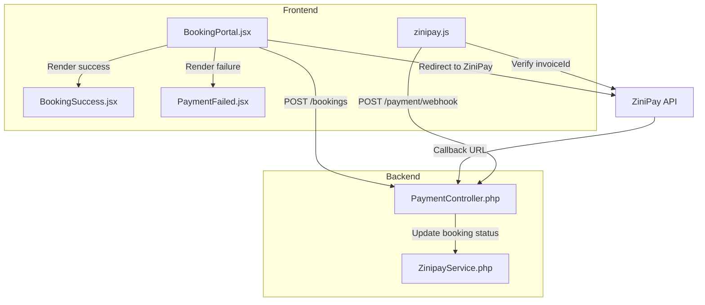
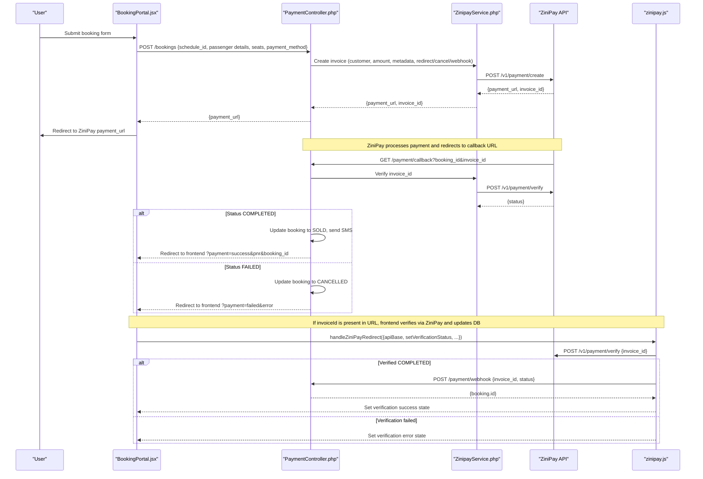
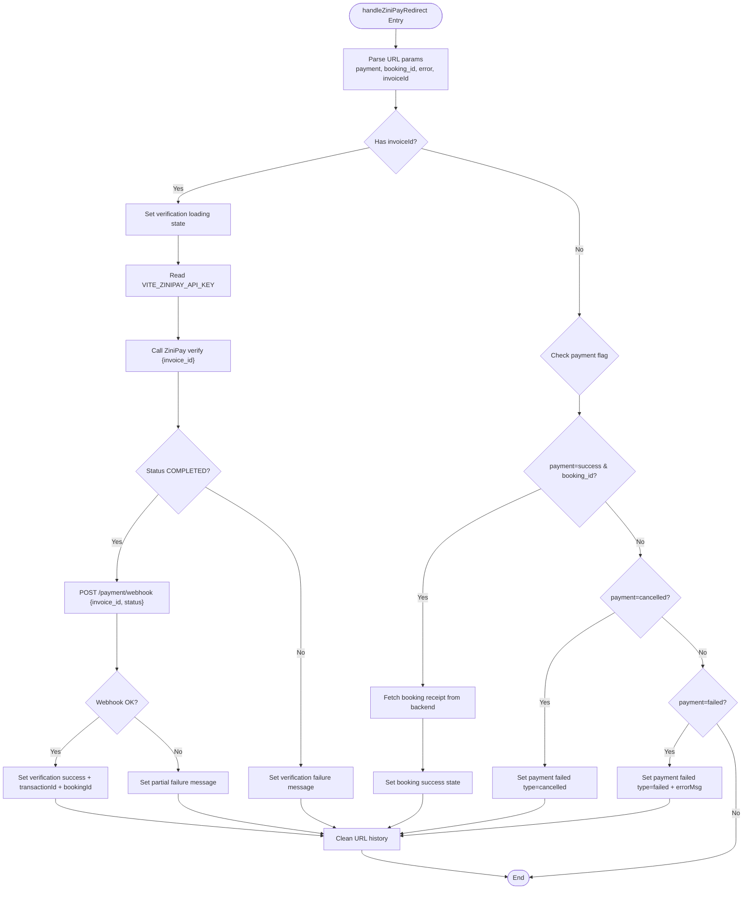
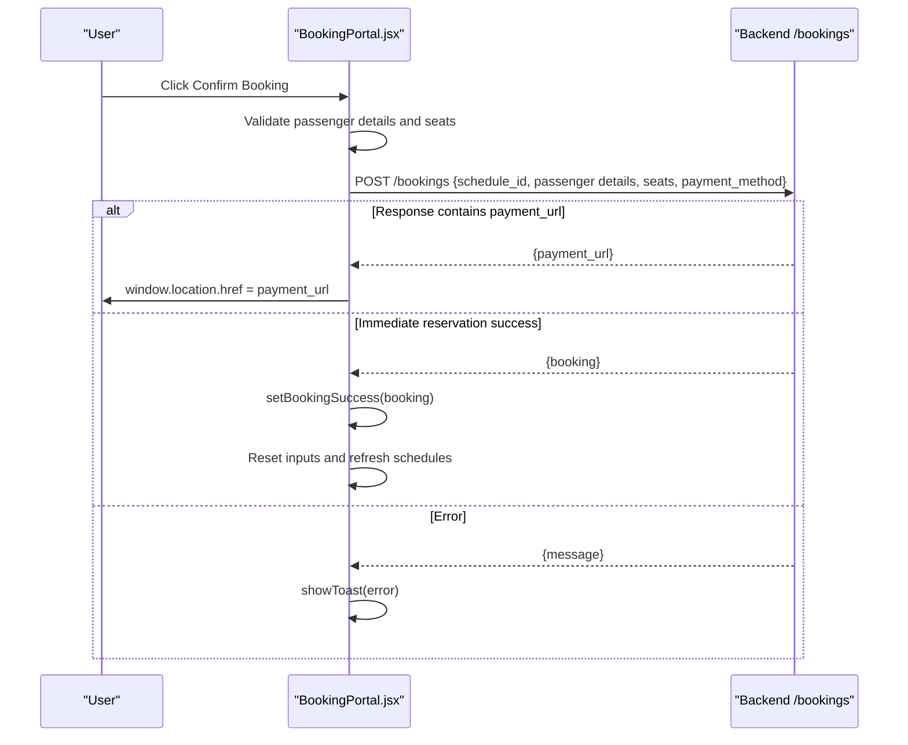
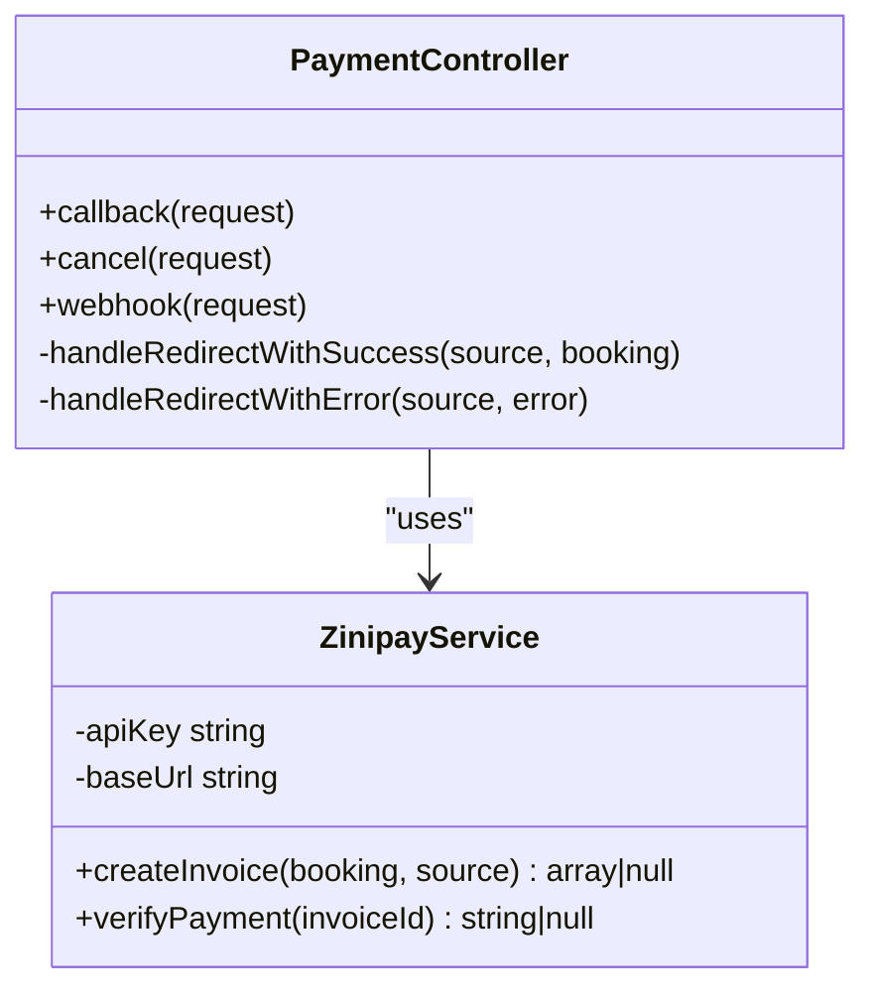
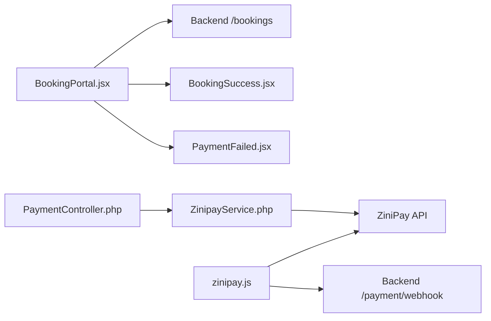

# Frontend Payment Integration

<cite>
**Referenced Files in This Document**
- [zinipay.js](file://frontend/src/zinipay.js)
- [BookingPortal.jsx](file://frontend/src/components/BookingPortal.jsx)
- [BookingSuccess.jsx](file://frontend/src/components/BookingSuccess.jsx)
- [PaymentFailed.jsx](file://frontend/src/components/PaymentFailed.jsx)
- [ZinipayService.php](file://backend/app/Services/ZinipayService.php)
- [PaymentController.php](file://backend/app/Http/Controllers/PaymentController.php)
</cite>

## Table of Contents
1. [Introduction](#introduction)
2. [Project Structure](#project-structure)
3. [Core Components](#core-components)
4. [Architecture Overview](#architecture-overview)
5. [Detailed Component Analysis](#detailed-component-analysis)
6. [Dependency Analysis](#dependency-analysis)
7. [Performance Considerations](#performance-considerations)
8. [Troubleshooting Guide](#troubleshooting-guide)
9. [Conclusion](#conclusion)

## Introduction
This document explains the frontend payment integration with ZiniPay for the bus booking application. It focuses on how the React frontend initiates payments, handles redirects from ZiniPay, verifies payment status, and manages user feedback across success, failure, and cancellation flows. The documentation also covers the BookingPortal component’s payment workflow, error handling, and state management, as well as the integration between React components and the backend payment endpoints.

## Project Structure
The payment integration spans both frontend and backend:

- Frontend
  - `frontend/src/zinipay.js`: Utilities for calling ZiniPay APIs and processing redirect callbacks.
  - `frontend/src/components/BookingPortal.jsx`: Main booking UI that triggers payment creation and redirects to ZiniPay.
  - `frontend/src/components/BookingSuccess.jsx`: Displays a boarding pass after successful payment.
  - `frontend/src/components/PaymentFailed.jsx`: Displays an error or cancellation message when payment fails.

- Backend
  - `backend/app/Services/ZinipayService.php`: Service layer for creating invoices and verifying payment status with ZiniPay.
  - `backend/app/Http/Controllers/PaymentController.php`: Handles payment callback, cancel, and webhook endpoints.

**Diagram sources**
- [BookingPortal.jsx:470-575](file://frontend/src/components/BookingPortal.jsx#L470-L575)
- [zinipay.js:64-177](file://frontend/src/zinipay.js#L64-L177)
- [PaymentController.php:21-160](file://backend/app/Http/Controllers/PaymentController.php#L21-L160)
- [ZinipayService.php:27-97](file://backend/app/Services/ZinipayService.php#L27-L97)

**Section sources**
- [BookingPortal.jsx:1-654](file://frontend/src/components/BookingPortal.jsx#L1-L654)
- [zinipay.js:1-179](file://frontend/src/zinipay.js#L1-L179)
- [PaymentController.php:1-162](file://backend/app/Http/Controllers/PaymentController.php#L1-L162)
- [ZinipayService.php:1-141](file://backend/app/Services/ZinipayService.php#L1-L141)

## Core Components
- zinipay.js
  - Provides functions to create payments and verify invoice status directly against ZiniPay.
  - Processes redirect parameters to determine verification, success, cancellation, or failure states.
  - Calls backend `/payment/webhook` to securely update booking status after verification.

- BookingPortal.jsx
  - Orchestrates seat selection, passenger details, promo validation, and booking submission.
  - On successful booking response containing a payment URL, redirects the user to ZiniPay.
  - Renders success or failure screens based on state updates.

- BookingSuccess.jsx
  - Presents a boarding pass with PNR, route details, seats, fare summary, and print action.

- PaymentFailed.jsx
  - Shows a clear message for cancelled or failed payments and provides a return-home action.

- ZinipayService.php
  - Creates invoices with customer info, amount, metadata, and redirect/cancel/webhook URLs.
  - Verifies payment status by invoice ID.

- PaymentController.php
  - Handles callback (post-payment), cancel, and webhook endpoints.
  - Updates booking status to SOLD or CANCELLED and sends SMS notifications upon completion.
  - Redirects back to the frontend with query flags indicating success or failure.

**Section sources**
- [zinipay.js:1-179](file://frontend/src/zinipay.js#L1-L179)
- [BookingPortal.jsx:470-575](file://frontend/src/components/BookingPortal.jsx#L470-L575)
- [BookingSuccess.jsx:1-146](file://frontend/src/components/BookingSuccess.jsx#L1-L146)
- [PaymentFailed.jsx:1-47](file://frontend/src/components/PaymentFailed.jsx#L1-L47)
- [ZinipayService.php:27-97](file://backend/app/Services/ZinipayService.php#L27-L97)
- [PaymentController.php:21-160](file://backend/app/Http/Controllers/PaymentController.php#L21-L160)

## Architecture Overview
The payment flow integrates React components, backend controllers, and the external ZiniPay gateway:

**Diagram sources**
- [BookingPortal.jsx:470-575](file://frontend/src/components/BookingPortal.jsx#L470-L575)
- [PaymentController.php:21-160](file://backend/app/Http/Controllers/PaymentController.php#L21-L160)
- [ZinipayService.php:27-97](file://backend/app/Services/ZinipayService.php#L27-L97)
- [zinipay.js:64-177](file://frontend/src/zinipay.js#L64-L177)

## Detailed Component Analysis

### zinipay.js Module
Responsibilities:
- Create payment requests to ZiniPay with mapped fields and headers.
- Verify payment status using invoice ID.
- Process redirect parameters to manage verification, success, cancellation, and failure states.
- Call backend webhook endpoint to securely update booking status after verification.

Key behaviors:
- Uses environment variable `VITE_ZINIPAY_API_KEY` for direct ZiniPay calls.
- When `invoiceId` is present in URL, sets verification loading state, verifies with ZiniPay, then calls backend `/payment/webhook`.
- For `payment=success`, fetches booking receipt from backend and sets success state.
- For `payment=cancelled` or `payment=failed`, sets appropriate failure state and cleans URL.

Error handling:
- Throws errors if API key is missing or network responses are not OK.
- Sets verification error state and shows toast messages for failures.

**Diagram sources**
- [zinipay.js:64-177](file://frontend/src/zinipay.js#L64-L177)

**Section sources**
- [zinipay.js:1-179](file://frontend/src/zinipay.js#L1-L179)

### BookingPortal.jsx Payment Workflow
Responsibilities:
- Validates passenger details and selected seats before booking.
- Submits booking request to backend `/bookings`.
- If response includes `payment_url`, redirects user to ZiniPay.
- If no payment URL, treats it as immediate reservation success and renders success screen.
- Manages seat holds, expirations, and background schedule refresh.

Payment initiation:
- On confirmation, validates inputs and submits booking payload including `payment_method: 'ZiniPay'`.
- On success with `data.payment_url`, performs client-side redirect to ZiniPay.

State management:
- Sets `isBooking` during submission to prevent duplicate submissions.
- Resets UI state after success and refreshes schedule data in background.

Error handling:
- Shows toast messages for validation errors, network issues, and booking failures.
- Handles authentication errors by clearing auth and opening login modal.

**Diagram sources**
- [BookingPortal.jsx:470-575](file://frontend/src/components/BookingPortal.jsx#L470-L575)

**Section sources**
- [BookingPortal.jsx:470-575](file://frontend/src/components/BookingPortal.jsx#L470-L575)

### BookingSuccess.jsx
Responsibilities:
- Displays boarding pass with PNR, passenger info, route, bus details, departure time, coach type, reserved seats, duration, payment method, status, and fare summary.
- Provides actions to print ticket and book another ticket.

User experience:
- Clear visual badge and structured layout for quick scanning.
- Print-friendly interface for physical tickets.

**Section sources**
- [BookingSuccess.jsx:1-146](file://frontend/src/components/BookingSuccess.jsx#L1-L146)

### PaymentFailed.jsx
Responsibilities:
- Differentiates between cancelled and failed payments.
- Shows contextual message and offers a return-home action.

User experience:
- Simple card layout with clear messaging and navigation.

**Section sources**
- [PaymentFailed.jsx:1-47](file://frontend/src/components/PaymentFailed.jsx#L1-L47)

### Backend Payment Controller and Service
PaymentController responsibilities:
- Callback handler verifies invoice status and updates booking to SOLD or CANCELLED.
- Sends SMS notification upon successful payment.
- Redirects frontend with success or failure flags.
- Webhook handler receives asynchronous notifications, verifies status, updates booking, and returns booking info.

ZinipayService responsibilities:
- Creates invoice with customer name/email, amount, metadata, and redirect/cancel/webhook URLs.
- Verifies payment status by invoice ID.

**Diagram sources**
- [PaymentController.php:21-160](file://backend/app/Http/Controllers/PaymentController.php#L21-L160)
- [ZinipayService.php:27-97](file://backend/app/Services/ZinipayService.php#L27-L97)

**Section sources**
- [PaymentController.php:21-160](file://backend/app/Http/Controllers/PaymentController.php#L21-L160)
- [ZinipayService.php:27-97](file://backend/app/Services/ZinipayService.php#L27-L97)

## Dependency Analysis
- Frontend dependencies:
  - `BookingPortal.jsx` depends on backend `/bookings` endpoint and renders `BookingSuccess.jsx` or `PaymentFailed.jsx` based on state.
  - `zinipay.js` depends on ZiniPay API and backend `/payment/webhook`.

- Backend dependencies:
  - `PaymentController.php` depends on `ZinipayService.php` for invoice creation and verification.
  - `ZinipayService.php` depends on ZiniPay API and configuration values.

**Diagram sources**
- [BookingPortal.jsx:470-575](file://frontend/src/components/BookingPortal.jsx#L470-L575)
- [zinipay.js:64-177](file://frontend/src/zinipay.js#L64-L177)
- [PaymentController.php:21-160](file://backend/app/Http/Controllers/PaymentController.php#L21-L160)
- [ZinipayService.php:27-97](file://backend/app/Services/ZinipayService.php#L27-L97)

**Section sources**
- [BookingPortal.jsx:470-575](file://frontend/src/components/BookingPortal.jsx#L470-L575)
- [zinipay.js:64-177](file://frontend/src/zinipay.js#L64-L177)
- [PaymentController.php:21-160](file://backend/app/Http/Controllers/PaymentController.php#L21-L160)
- [ZinipayService.php:27-97](file://backend/app/Services/ZinipayService.php#L27-L97)

## Performance Considerations
- Avoid unnecessary re-renders by keeping payment-related state minimal and localized within `BookingPortal.jsx`.
- Use optimistic UI updates for seat selection while validating server responses asynchronously.
- Debounce or throttle background schedule refresh to reduce API load.
- Ensure ZiniPay API calls are only made when required (e.g., when `invoiceId` is present).
- Prefer backend verification for critical state changes; frontend verification should be used for UX enhancement only.

[No sources needed since this section provides general guidance]

## Troubleshooting Guide
Common issues and resolutions:
- Missing API key
  - Symptom: Frontend throws error about `VITE_ZINIPAY_API_KEY` not configured.
  - Resolution: Ensure `.env` file includes `VITE_ZINIPAY_API_KEY` and rebuild the frontend.

- Payment callback not updating booking
  - Symptom: User redirected to success but booking remains pending.
  - Resolution: Verify backend `/payment/callback` logic and ensure `invoice_id` is passed correctly. Check logs for verification failures.

- Webhook not updating database
  - Symptom: Frontend verification succeeds but local DB not updated.
  - Resolution: Inspect `/payment/webhook` response and ensure backend service updates booking status. Check CORS and network connectivity.

- Seats not released after cancellation
  - Symptom: Held seats remain reserved after payment cancellation.
  - Resolution: Confirm backend cancel endpoint updates booking status and seat release logic is triggered.

- Network errors during booking
  - Symptom: Toast messages indicate connection errors.
  - Resolution: Verify backend availability and network settings. Retry logic can be added to retry failed requests.

**Section sources**
- [zinipay.js:87-91](file://frontend/src/zinipay.js#L87-L91)
- [PaymentController.php:21-160](file://backend/app/Http/Controllers/PaymentController.php#L21-L160)

## Conclusion
The frontend payment integration with ZiniPay combines React components and backend services to provide a seamless booking and payment experience. The `zinipay.js` module handles direct interactions with ZiniPay and processes redirect callbacks, while `BookingPortal.jsx` orchestrates the overall workflow, including seat selection, passenger details, and payment redirection. The backend ensures secure verification and state synchronization through `PaymentController.php` and `ZinipayService.php`. Proper error handling, user feedback, and state management contribute to a robust and user-friendly payment flow.

[No sources needed since this section summarizes without analyzing specific files]