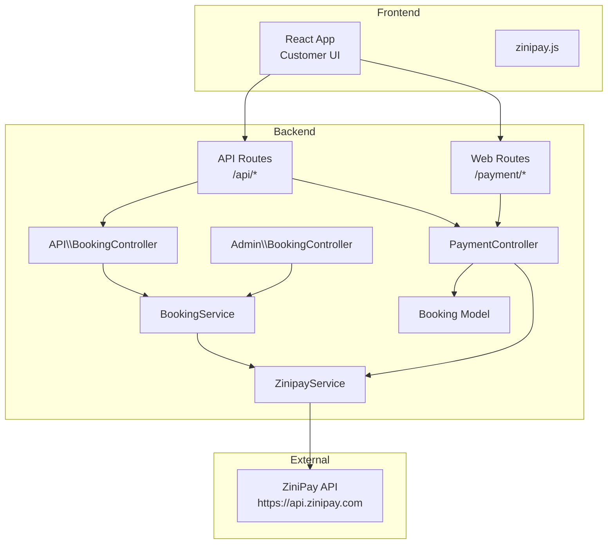
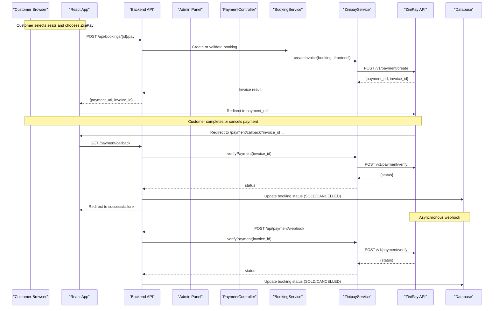
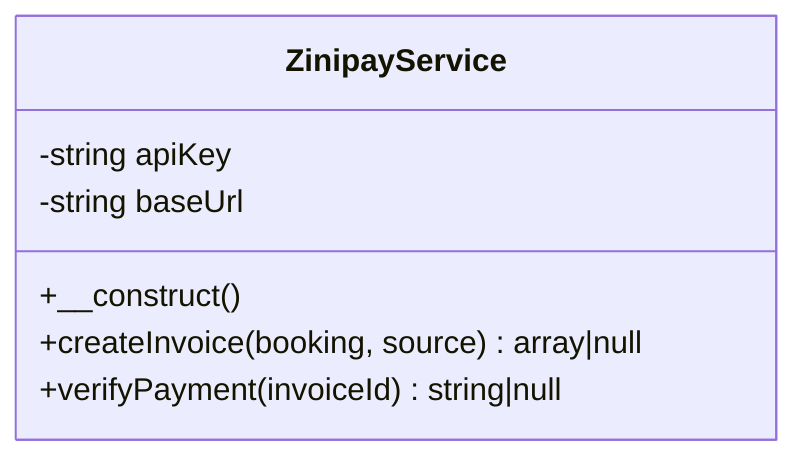
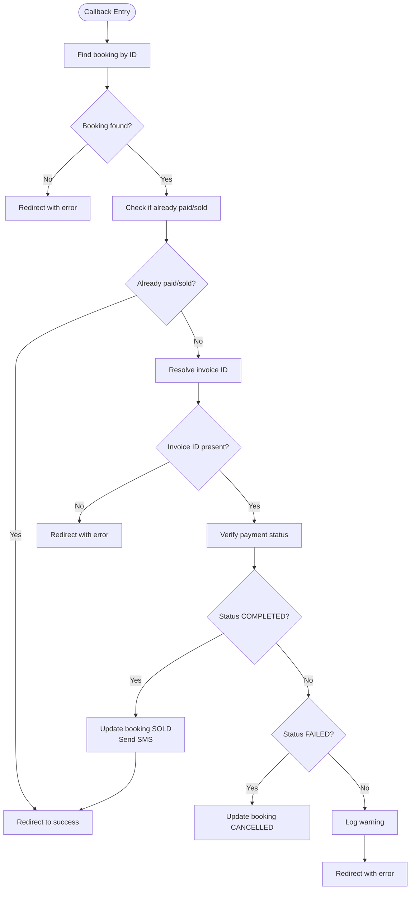
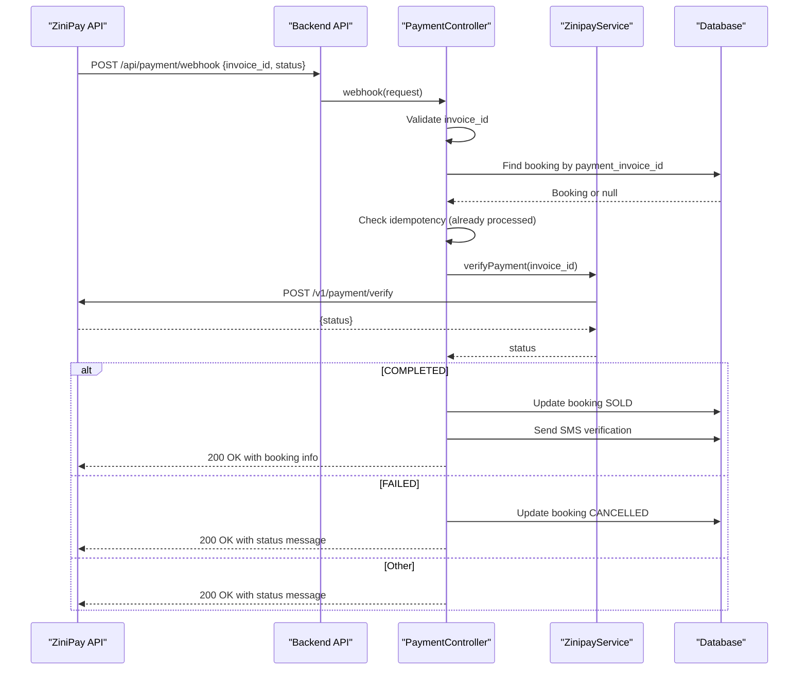
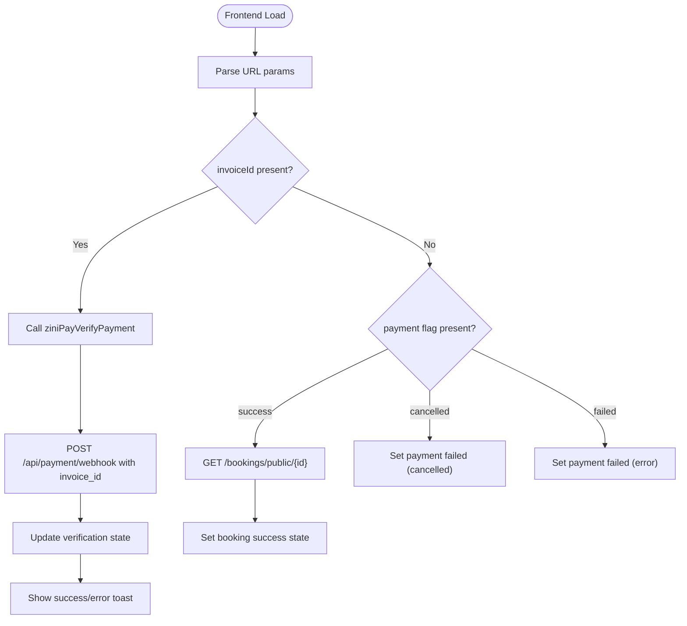
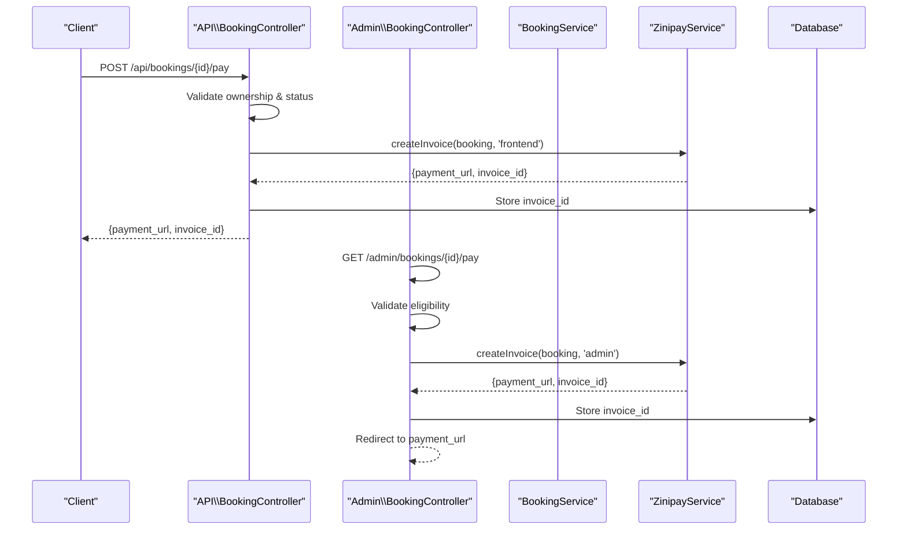
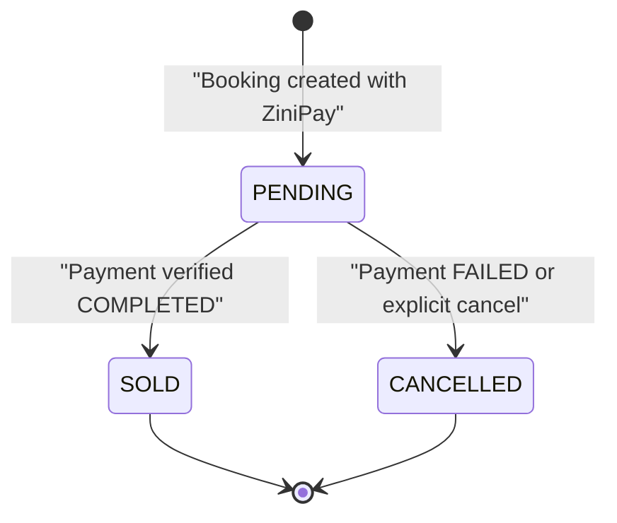
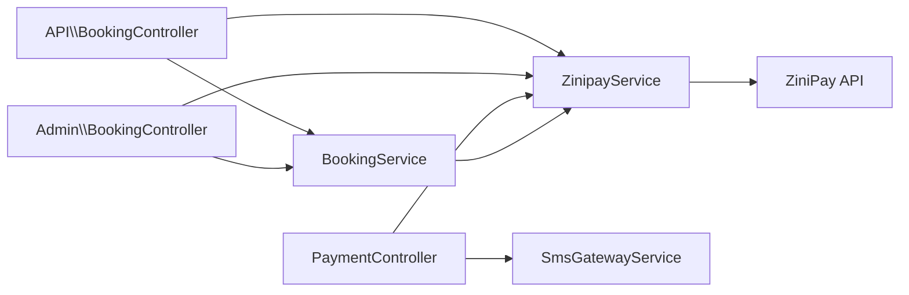

# Payment Integration

<cite>
**Referenced Files in This Document**
- [ZinipayService.php](file://backend/app/Services/ZinipayService.php)
- [PaymentController.php](file://backend/app/Http/Controllers/PaymentController.php)
- [BookingController.php (API)](file://backend/app/Http/Controllers/API/BookingController.php)
- [BookingController.php (Admin)](file://backend/app/Http/Controllers/Admin/BookingController.php)
- [BookingService.php](file://backend/app/Services/BookingService.php)
- [web.php](file://backend/routes/web.php)
- [api.php](file://backend/routes/api.php)
- [Booking.php](file://backend/app/Models/Booking.php)
- [zinipay.js](file://frontend/src/zinipay.js)
</cite>

## Table of Contents
1. [Introduction](#introduction)
2. [Project Structure](#project-structure)
3. [Core Components](#core-components)
4. [Architecture Overview](#architecture-overview)
5. [Detailed Component Analysis](#detailed-component-analysis)
6. [Dependency Analysis](#dependency-analysis)
7. [Performance Considerations](#performance-considerations)
8. [Troubleshooting Guide](#troubleshooting-guide)
9. [Conclusion](#conclusion)

## Introduction
This document explains the ZiniPay payment gateway integration for the bus booking application. It covers the complete flow from customer checkout through payment processing, redirect handling, and asynchronous webhook updates. It also documents the backend service implementation, validation and security practices, frontend integration, status tracking, error handling, and operational considerations such as refunds and audit logging.

## Project Structure
The ZiniPay integration spans both backend and frontend:

- Backend
  - Service layer: `ZinipayService` encapsulates API calls to ZiniPay.
  - Controllers: `PaymentController` handles redirects and webhooks; `API\BookingController` and `Admin\BookingController` initiate payments.
  - Routing: Web routes handle user-facing callbacks; API routes expose the webhook endpoint.
  - Domain model: `Booking` stores invoice references and ticket state.
  - Shared logic: `BookingService` orchestrates booking creation and ZiniPay invoice attachment.

- Frontend
  - Utility module: `zinipay.js` provides helpers for creating payments, verifying status, and handling redirect flows.

**Diagram sources**
- [web.php:58-59](file://backend/routes/web.php#L58-L59)
- [api.php:54-55](file://backend/routes/api.php#L54-L55)
- [BookingController.php (API):118-148](file://backend/app/Http/Controllers/API/BookingController.php#L118-L148)
- [BookingController.php (Admin):120-135](file://backend/app/Http/Controllers/Admin/BookingController.php#L120-L135)
- [PaymentController.php:21-136](file://backend/app/Http/Controllers/PaymentController.php#L21-L136)
- [ZinipayService.php:27-97](file://backend/app/Services/ZinipayService.php#L27-L97)
- [BookingService.php:113-115](file://backend/app/Services/BookingService.php#L113-L115)
- [BookingService.php:175-181](file://backend/app/Services/BookingService.php#L175-L181)
- [BookingService.php:283-302](file://backend/app/Services/BookingService.php#L283-L302)
- [zinipay.js:1-179](file://frontend/src/zinipay.js#L1-L179)

**Section sources**
- [web.php:58-59](file://backend/routes/web.php#L58-L59)
- [api.php:54-55](file://backend/routes/api.php#L54-L55)
- [BookingController.php (API):118-148](file://backend/app/Http/Controllers/API/BookingController.php#L118-L148)
- [BookingController.php (Admin):120-135](file://backend/app/Http/Controllers/Admin/BookingController.php#L120-L135)
- [PaymentController.php:21-136](file://backend/app/Http/Controllers/PaymentController.php#L21-L136)
- [ZinipayService.php:27-97](file://backend/app/Services/ZinipayService.php#L27-L97)
- [BookingService.php:113-115](file://backend/app/Services/BookingService.php#L113-L115)
- [BookingService.php:175-181](file://backend/app/Services/BookingService.php#L175-L181)
- [BookingService.php:283-302](file://backend/app/Services/BookingService.php#L283-L302)
- [zinipay.js:1-179](file://frontend/src/zinipay.js#L1-L179)

## Core Components
- ZiniPay service abstraction
  - Encapsulates API key and base URL configuration.
  - Creates invoices with metadata, redirect URLs, cancel URLs, and webhook URLs.
  - Verifies payment status by calling the provider’s verification endpoint.
  - Uses timeouts and structured logging for failures and exceptions.

- Payment controller
  - Handles user callback after payment attempt.
  - Handles cancellation flow.
  - Processes asynchronous webhook notifications securely by re-verifying status with the provider.

- Booking controllers
  - Customer API controller initiates payment for a pending booking using ZiniPay.
  - Admin controller allows admin-initiated payment for pending bookings.

- Booking service
  - Orchestrates booking creation and attaches ZiniPay invoice when the selected payment method is ZiniPay.
  - Ensures consistent status resolution and SMS notifications upon successful confirmation.

- Frontend utilities
  - Provides functions to create payments directly against the provider (for specific flows), verify payment status, and process redirect parameters.
  - Calls backend webhook to update local database when verification succeeds.

**Section sources**
- [ZinipayService.php:14-18](file://backend/app/Services/ZinipayService.php#L14-L18)
- [ZinipayService.php:27-97](file://backend/app/Services/ZinipayService.php#L27-L97)
- [ZinipayService.php:105-139](file://backend/app/Services/ZinipayService.php#L105-L139)
- [PaymentController.php:21-66](file://backend/app/Http/Controllers/PaymentController.php#L21-L66)
- [PaymentController.php:68-85](file://backend/app/Http/Controllers/PaymentController.php#L68-L85)
- [PaymentController.php:90-136](file://backend/app/Http/Controllers/PaymentController.php#L90-L136)
- [BookingController.php (API):118-148](file://backend/app/Http/Controllers/API/BookingController.php#L118-L148)
- [BookingController.php (Admin):120-135](file://backend/app/Http/Controllers/Admin/BookingController.php#L120-L135)
- [BookingService.php:113-115](file://backend/app/Services/BookingService.php#L113-L115)
- [BookingService.php:175-181](file://backend/app/Services/BookingService.php#L175-L181)
- [BookingService.php:283-302](file://backend/app/Services/BookingService.php#L283-L302)
- [zinipay.js:1-179](file://frontend/src/zinipay.js#L1-L179)

## Architecture Overview
The payment architecture separates concerns between frontend, backend orchestration, and external payment provider interactions.

**Diagram sources**
- [BookingController.php (API):118-148](file://backend/app/Http/Controllers/API/BookingController.php#L118-L148)
- [BookingService.php:113-115](file://backend/app/Services/BookingService.php#L113-L115)
- [ZinipayService.php:27-97](file://backend/app/Services/ZinipayService.php#L27-L97)
- [PaymentController.php:21-66](file://backend/app/Http/Controllers/PaymentController.php#L21-L66)
- [PaymentController.php:90-136](file://backend/app/Http/Controllers/PaymentController.php#L90-L136)
- [api.php:54-55](file://backend/routes/api.php#L54-L55)
- [web.php:58-59](file://backend/routes/web.php#L58-L59)

## Detailed Component Analysis

### ZinipayService Implementation
Responsibilities:
- Configuration: Reads API key and base URL from configuration.
- Invoice creation: Builds payload including passenger details, amount, metadata, redirect/cancel/webhook URLs, and sends it to ZiniPay.
- Payment verification: Queries provider for current invoice status.
- Error handling: Logs errors and returns null on failure.

Key behaviors:
- In local/testing environments, redirect and webhook URLs are rewritten to localhost for sandbox compatibility.
- HTTP requests use timeouts and structured headers.
- Successful responses require a `payment_url`; otherwise, an error is logged.

**Diagram sources**
- [ZinipayService.php:14-18](file://backend/app/Services/ZinipayService.php#L14-L18)
- [ZinipayService.php:27-97](file://backend/app/Services/ZinipayService.php#L27-L97)
- [ZinipayService.php:105-139](file://backend/app/Services/ZinipayService.php#L105-L139)

**Section sources**
- [ZinipayService.php:14-18](file://backend/app/Services/ZinipayService.php#L14-L18)
- [ZinipayService.php:27-97](file://backend/app/Services/ZinipayService.php#L27-L97)
- [ZinipayService.php:105-139](file://backend/app/Services/ZinipayService.php#L105-L139)

### Payment Controller Flow
Responsibilities:
- Callback handler: Validates booking existence, verifies payment status via ZiniPay, updates booking status, and sends SMS notification upon success.
- Cancel handler: Marks pending bookings as cancelled and redirects appropriately.
- Webhook handler: Securely processes asynchronous notifications by re-verifying status with the provider before updating records.

Security and validation:
- Always re-verifies status with the provider in webhook path.
- Idempotency: Already processed bookings return early.
- Logging: All webhook payloads and verification outcomes are logged.

**Diagram sources**
- [PaymentController.php:21-66](file://backend/app/Http/Controllers/PaymentController.php#L21-L66)

**Section sources**
- [PaymentController.php:21-66](file://backend/app/Http/Controllers/PaymentController.php#L21-L66)
- [PaymentController.php:68-85](file://backend/app/Http/Controllers/PaymentController.php#L68-L85)
- [PaymentController.php:90-136](file://backend/app/Http/Controllers/PaymentController.php#L90-L136)

### Webhook Processing
Responsibilities:
- Accepts asynchronous notifications from ZiniPay.
- Validates presence of invoice ID.
- Finds booking by invoice reference.
- Re-verifies status with provider to ensure integrity.
- Updates booking status and sends SMS upon completion.

**Diagram sources**
- [PaymentController.php:90-136](file://backend/app/Http/Controllers/PaymentController.php#L90-L136)
- [ZinipayService.php:105-139](file://backend/app/Services/ZinipayService.php#L105-L139)
- [api.php:54](file://backend/routes/api.php#L54)

**Section sources**
- [PaymentController.php:90-136](file://backend/app/Http/Controllers/PaymentController.php#L90-L136)
- [api.php:54](file://backend/routes/api.php#L54)

### Frontend Payment Integration
Responsibilities:
- Create payment helper: Maps frontend payload to ZiniPay schema and calls provider directly.
- Verify payment helper: Calls provider to check invoice status.
- Redirect handler: Parses URL parameters, verifies payment, updates backend via webhook, and displays success or failure states.

Important notes:
- The frontend uses an environment variable for the provider API key.
- On successful verification, it calls the backend webhook to update the local database.
- It supports multiple redirect scenarios: success, cancelled, failed, and direct invoice verification.

**Diagram sources**
- [zinipay.js:1-179](file://frontend/src/zinipay.js#L1-L179)

**Section sources**
- [zinipay.js:1-179](file://frontend/src/zinipay.js#L1-L179)

### Payment Initiation Paths
- Customer API path:
  - Validates booking ownership and status.
  - Creates invoice via `ZinipayService`.
  - Stores invoice ID and returns payment URL.

- Admin path:
  - Validates booking eligibility.
  - Creates invoice via `ZinipayService`.
  - Redirects admin to payment URL.

**Diagram sources**
- [BookingController.php (API):118-148](file://backend/app/Http/Controllers/API/BookingController.php#L118-L148)
- [BookingController.php (Admin):120-135](file://backend/app/Http/Controllers/Admin/BookingController.php#L120-L135)
- [BookingService.php:283-302](file://backend/app/Services/BookingService.php#L283-L302)

**Section sources**
- [BookingController.php (API):118-148](file://backend/app/Http/Controllers/API/BookingController.php#L118-L148)
- [BookingController.php (Admin):120-135](file://backend/app/Http/Controllers/Admin/BookingController.php#L120-L135)
- [BookingService.php:283-302](file://backend/app/Services/BookingService.php#L283-L302)

### Data Model and Status Tracking
The `Booking` model includes fields for payment method, invoice reference, and status. Status transitions relevant to ZiniPay:
- PENDING: Created but not yet paid.
- SOLD: Payment confirmed.
- CANCELLED: Payment failed or explicitly cancelled.

**Diagram sources**
- [Booking.php:12-27](file://backend/app/Models/Booking.php#L12-L27)
- [PaymentController.php:47-58](file://backend/app/Http/Controllers/PaymentController.php#L47-L58)
- [PaymentController.php:115-133](file://backend/app/Http/Controllers/PaymentController.php#L115-L133)

**Section sources**
- [Booking.php:12-27](file://backend/app/Models/Booking.php#L12-L27)
- [PaymentController.php:47-58](file://backend/app/Http/Controllers/PaymentController.php#L47-L58)
- [PaymentController.php:115-133](file://backend/app/Http/Controllers/PaymentController.php#L115-L133)

## Dependency Analysis
Key dependencies and relationships:

- Controllers depend on services:
  - `API\BookingController` depends on `BookingService` and `ZinipayService`.
  - `Admin\BookingController` depends on `BookingService` and `ZinipayService`.
  - `PaymentController` depends on `ZinipayService` and `SmsGatewayService`.

- Services coordinate domain logic:
  - `BookingService` integrates seat map, SMS, and ZiniPay invoice creation.
  - `ZinipayService` abstracts provider communication.

- Routing exposes endpoints:
  - Web routes for user callbacks and cancellations.
  - API route for webhooks and public booking retrieval.

**Diagram sources**
- [BookingController.php (API):12-16](file://backend/app/Http/Controllers/API/BookingController.php#L12-L16)
- [BookingController.php (Admin):13-17](file://backend/app/Http/Controllers/Admin/BookingController.php#L13-L17)
- [PaymentController.php:13-16](file://backend/app/Http/Controllers/PaymentController.php#L13-L16)
- [BookingService.php:16-21](file://backend/app/Services/BookingService.php#L16-L21)
- [ZinipayService.php:14-18](file://backend/app/Services/ZinipayService.php#L14-L18)

**Section sources**
- [BookingController.php (API):12-16](file://backend/app/Http/Controllers/API/BookingController.php#L12-L16)
- [BookingController.php (Admin):13-17](file://backend/app/Http/Controllers/Admin/BookingController.php#L13-L17)
- [PaymentController.php:13-16](file://backend/app/Http/Controllers/PaymentController.php#L13-L16)
- [BookingService.php:16-21](file://backend/app/Services/BookingService.php#L16-L21)
- [ZinipayService.php:14-18](file://backend/app/Services/ZinipayService.php#L14-L18)

## Performance Considerations
- HTTP timeouts: Both invoice creation and verification enforce timeouts to avoid hanging requests.
- Idempotent webhook processing: Already processed bookings return early, reducing redundant work.
- Minimal data transfer: Only necessary fields are sent to the provider and returned to clients.
- Localhost rewriting: Simplifies local development without impacting production performance.

[No sources needed since this section provides general guidance]

## Troubleshooting Guide
Common issues and resolutions:

- Missing API key
  - Symptom: Invoice creation fails immediately.
  - Action: Ensure API key is configured and accessible to `ZinipayService`.

- Invalid or missing invoice ID
  - Symptom: Callback or webhook cannot locate booking.
  - Action: Confirm that `payment_invoice_id` is stored and passed correctly.

- Provider response missing expected fields
  - Symptom: Successful HTTP response but no `payment_url` or `status`.
  - Action: Inspect logs for provider response body and adjust payload mapping.

- Webhook not received
  - Symptom: Booking remains PENDING after payment.
  - Action: Verify webhook URL is reachable and matches environment; check server firewall and DNS.

- Frontend verification fails
  - Symptom: Verification status shows error or network failure.
  - Action: Check environment variable for provider API key and CORS settings.

- Refund handling
  - Current implementation does not include refund endpoints.
  - Recommendation: Extend `ZinipayService` with a refund method and add corresponding admin UI and audit logging.

- Audit logging
  - Webhook payloads and verification outcomes are logged.
  - Recommendation: Add structured audit entries for payment lifecycle events (initiated, verified, completed, failed, refunded).

**Section sources**
- [ZinipayService.php:29-32](file://backend/app/Services/ZinipayService.php#L29-L32)
- [ZinipayService.php:81-96](file://backend/app/Services/ZinipayService.php#L81-L96)
- [PaymentController.php:92-106](file://backend/app/Http/Controllers/PaymentController.php#L92-L106)
- [PaymentController.php:112-136](file://backend/app/Http/Controllers/PaymentController.php#L112-L136)
- [zinipay.js:87-91](file://frontend/src/zinipay.js#L87-L91)

## Conclusion
The ZiniPay integration follows a clear separation of concerns: frontend handles user interaction and redirect parsing, backend orchestrates booking and payment initiation, and a dedicated service abstracts provider communication. Security is reinforced by re-verifying payment status on both callback and webhook paths. Status tracking is centralized in the `Booking` model, with transitions driven by provider responses. While refunds are not implemented, the architecture supports extension. Operational robustness is supported by timeouts, logging, and idempotent webhook processing. For PCI compliance, sensitive card data never touches the application; all payment processing occurs within ZiniPay’s hosted environment.

[No sources needed since this section summarizes without analyzing specific files]