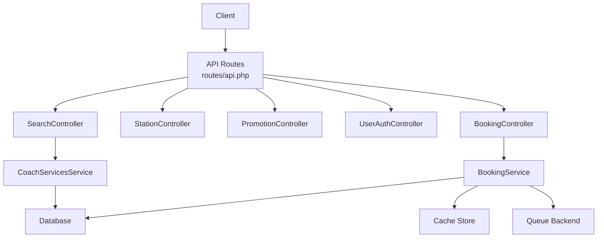
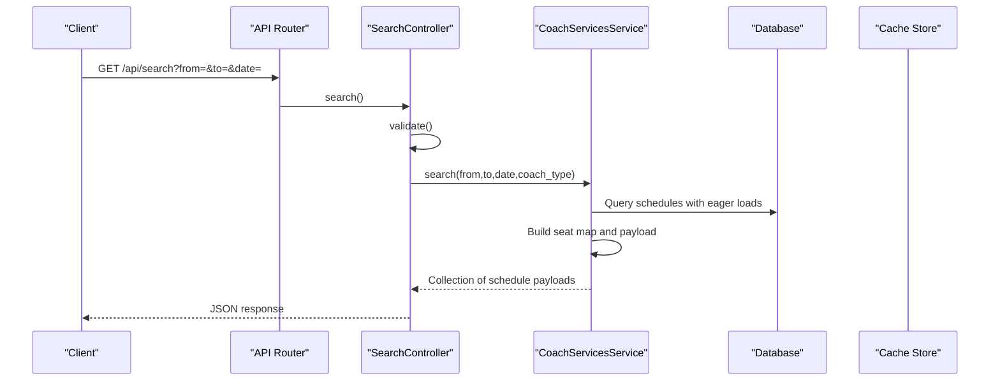
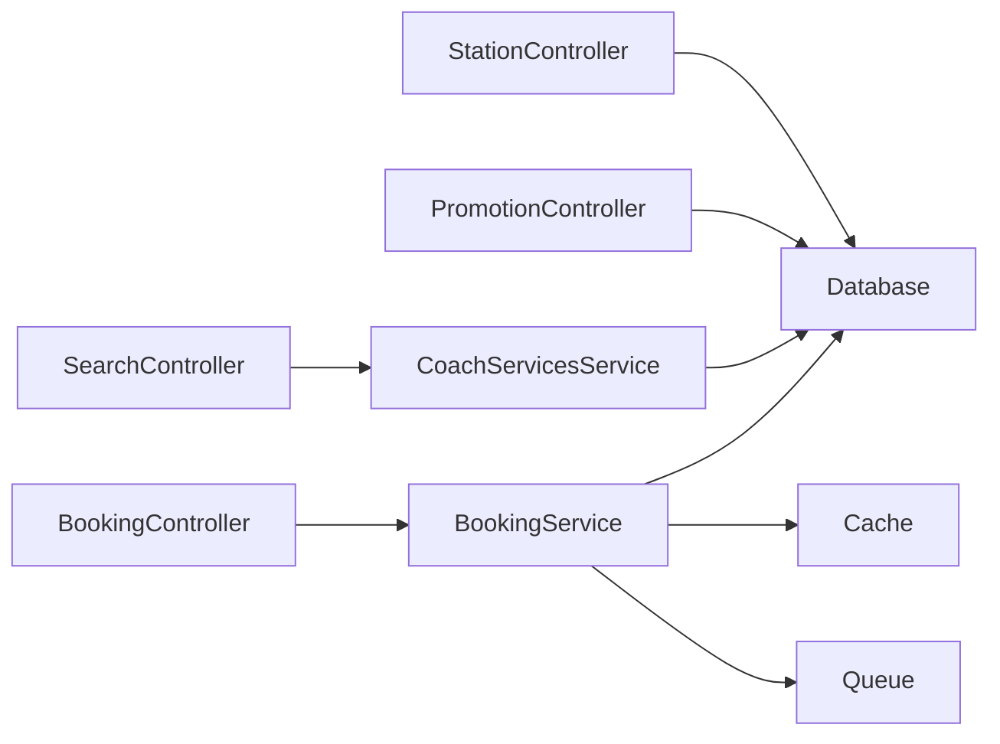

# API Performance

<cite>
**Referenced Files in This Document**
- [api.php](file://backend/routes/api.php)
- [cache.php](file://backend/config/cache.php)
- [database.php](file://backend/config/database.php)
- [queue.php](file://backend/config/queue.php)
- [SearchController.php](file://backend/app/Http/Controllers/API/SearchController.php)
- [StationController.php](file://backend/app/Http/Controllers/API/StationController.php)
- [PromotionController.php](file://backend/app/Http/Controllers/API/PromotionController.php)
- [BookingService.php](file://backend/app/Services/BookingService.php)
- [CoachServicesService.php](file://backend/app/Services/CoachServicesService.php)
- [client.js](file://k6/lib/client.js)
- [http.js](file://k6/lib/http.js)
- [customer.js](file://k6/flows/customer.js)
</cite>

## Table of Contents
1. [Introduction](#introduction)
2. [Project Structure](#project-structure)
3. [Core Components](#core-components)
4. [Architecture Overview](#architecture-overview)
5. [Detailed Component Analysis](#detailed-component-analysis)
6. [Dependency Analysis](#dependency-analysis)
7. [Performance Considerations](#performance-considerations)
8. [Troubleshooting Guide](#troubleshooting-guide)
9. [Conclusion](#conclusion)
10. [Appendices](#appendices)

## Introduction
This document provides a comprehensive performance optimization guide for the SonyaBus backend API. It focuses on reducing response times through database query optimization, service layer efficiency, and payload reduction. It also covers caching strategies using Laravel’s cache system, HTTP caching headers, conditional requests, rate limiting, request validation optimization, efficient error handling, load testing with K6, benchmarking approaches, bottleneck identification, horizontal scaling considerations, database connection pooling, and queue processing optimization. Concrete examples reference actual controllers, services, configuration files, and K6 scripts present in the repository.

## Project Structure
The backend is a Laravel application exposing REST endpoints under /api. Controllers delegate to services that perform domain logic and data access. Configuration files define cache stores, database connections, and queue backends. K6 scenarios and helpers provide load testing utilities.

**Diagram sources**
- [api.php:18-75](file://backend/routes/api.php#L18-L75)
- [SearchController.php:14-31](file://backend/app/Http/Controllers/API/SearchController.php#L14-L31)
- [StationController.php:10-14](file://backend/app/Http/Controllers/API/StationController.php#L10-L14)
- [PromotionController.php:10-37](file://backend/app/Http/Controllers/API/PromotionController.php#L10-L37)
- [CoachServicesService.php:19-124](file://backend/app/Services/CoachServicesService.php#L19-L124)
- [BookingService.php:28-131](file://backend/app/Services/BookingService.php#L28-L131)

**Section sources**
- [api.php:18-75](file://backend/routes/api.php#L18-L75)

## Core Components
- API routes group public, authenticated, and webhook endpoints; authentication uses Sanctum; rate limiting is applied to sensitive endpoints.
- Search and station endpoints are read-heavy and good candidates for caching and payload shaping.
- Booking flows use transactions, seat locking, and external payment/SMS integrations; these must be optimized for throughput and latency.
- Services encapsulate complex logic (search, pricing, seat map, booking creation), enabling reuse and testability.

Key responsibilities:
- Routing and middleware: route grouping, maintenance mode, Sanctum auth, throttling.
- Controllers: input validation, delegation to services, JSON responses.
- Services: query building, eager loading, seat availability, pricing, integration calls.
- Config: cache stores, database connections, Redis, queues.

**Section sources**
- [api.php:18-75](file://backend/routes/api.php#L18-L75)
- [SearchController.php:14-31](file://backend/app/Http/Controllers/API/SearchController.php#L14-L31)
- [StationController.php:10-14](file://backend/app/Http/Controllers/API/StationController.php#L10-L14)
- [PromotionController.php:10-37](file://backend/app/Http/Controllers/API/PromotionController.php#L10-L37)
- [CoachServicesService.php:19-124](file://backend/app/Services/CoachServicesService.php#L19-L124)
- [BookingService.php:28-131](file://backend/app/Services/BookingService.php#L28-L131)

## Architecture Overview
The API follows a layered architecture:
- Layer 1: HTTP entry via Laravel router and controllers.
- Layer 2: Service layer for business logic and orchestration.
- Layer 3: Data access via Eloquent models and database.
- Cross-cutting: Cache, queues, and external integrations.

**Diagram sources**
- [api.php:26-32](file://backend/routes/api.php#L26-L32)
- [SearchController.php:14-31](file://backend/app/Http/Controllers/API/SearchController.php#L14-L31)
- [CoachServicesService.php:19-124](file://backend/app/Services/CoachServicesService.php#L19-L124)

## Detailed Component Analysis

### Database Query Optimization
- Use eager loading to prevent N+1 queries when loading related entities such as bus, route, stations, and bookings.
- Apply selective column selection where possible to reduce memory and serialization overhead.
- Prefer database-side filtering and ordering; avoid heavy client-side filtering.
- Use pagination or limits for large result sets.

Examples in code:
- Coach search uses eager loading for bus, route stations, and bookings scoped to paid bookings for seat maps.
- Booking formatting selectively loads only required relations before serializing.

Optimization techniques:
- Eager loading relationships once per request.
- Scope queries to relevant statuses and time windows.
- Limit results and paginate where applicable.
- Avoid fetching unnecessary fields in responses.

**Section sources**
- [CoachServicesService.php:21-26](file://backend/app/Services/CoachServicesService.php#L21-L26)
- [CoachServicesService.php:80-123](file://backend/app/Services/CoachServicesService.php#L80-L123)
- [BookingService.php:242-281](file://backend/app/Services/BookingService.php#L242-L281)

### Service Layer Efficiency
- Centralize complex logic in services to keep controllers thin and focused on I/O.
- Reuse shared logic across customer and admin flows.
- Minimize redundant computations by precomputing derived values (e.g., pricing breakdown).
- Defer expensive operations (SMS, payments) to asynchronous jobs where appropriate.

Current patterns:
- CoachServicesService orchestrates search, filters, and payload construction.
- BookingService encapsulates seat locking, transactional booking creation, and payment/SMS coordination.

Recommendations:
- Extract SMS sending into queued jobs to avoid blocking request threads.
- Cache frequently accessed reference data (stations, promotions) at the service layer.
- Introduce idempotency keys for write endpoints to support retries without side effects.

**Section sources**
- [CoachServicesService.php:19-124](file://backend/app/Services/CoachServicesService.php#L19-L124)
- [BookingService.php:28-131](file://backend/app/Services/BookingService.php#L28-L131)

### Response Payload Reduction
- Shape responses to include only necessary fields.
- Avoid returning full model objects; return DTOs or arrays tailored for the client.
- Exclude internal identifiers and metadata not needed by clients.

Evidence:
- BookingService::formatForApi constructs a compact structure with only required fields for schedule, bus, and route.
- CoachServicesService builds a structured payload including seat_map, booked_seats, and pricing while omitting unrelated attributes.

Best practices:
- Define explicit response schemas per endpoint.
- Use resource transformers or dedicated formatters.
- Validate payload size budgets and monitor growth over time.

**Section sources**
- [BookingService.php:242-281](file://backend/app/Services/BookingService.php#L242-L281)
- [CoachServicesService.php:80-123](file://backend/app/Services/CoachServicesService.php#L80-L123)

### Caching Strategies at API Level
Laravel cache configuration supports multiple stores (database, file, memcached, redis, octane, failover). The default store can be configured via environment variables.

Recommended strategy:
- Use Redis for high-throughput caching in production.
- Cache read-heavy endpoints:
  - Stations list
  - Promotions index
  - Search results keyed by from/to/date/coach_type
- Implement cache invalidation on writes (e.g., after booking updates or promotion changes).
- Set appropriate TTLs based on data volatility.

Configuration highlights:
- Default cache store and prefix are configurable.
- Redis connections are defined for both general and cache usage.

Operational tips:
- Monitor cache hit rates and eviction policies.
- Use cache tags or namespacing to scope invalidation.
- Combine with CDN caching for static assets and read-only endpoints.

**Section sources**
- [cache.php:18-115](file://backend/config/cache.php#L18-L115)
- [database.php:146-180](file://backend/config/database.php#L146-L180)

### HTTP Caching Headers and Conditional Requests
To leverage browser and proxy caches:
- Add Cache-Control headers for immutable or short-lived resources.
- Use ETag or Last-Modified headers to enable conditional requests (If-None-Match, If-Modified-Since).
- For search endpoints, consider long cache durations with versioned keys to balance freshness and performance.

Implementation guidance:
- Wrap controller responses with framework-level caching middleware or custom response modifiers.
- Ensure cache keys incorporate all query parameters affecting output.

[No sources needed since this section provides general guidance]

### Rate Limiting Implementation
Rate limiting protects sensitive endpoints against brute-force attacks. In the current routes, authentication endpoints are grouped under a throttle middleware.

Current behavior:
- Auth endpoints are limited to a fixed number of attempts per minute per IP.

Recommendations:
- Apply stricter limits to password change and registration endpoints.
- Use named rate limiters for different sensitivity levels.
- Return standardized 429 responses with retry-after hints.

**Section sources**
- [api.php:41-46](file://backend/routes/api.php#L41-L46)

### Request Validation Optimization
- Validate early in controllers to fail fast and reduce downstream work.
- Use specific rules to minimize parsing overhead.
- Consider request-specific validation classes for complex endpoints.

Current patterns:
- SearchController validates inputs like from, to, date, and coach_type.
- PromotionController validates promo codes.

Enhancements:
- Introduce FormRequest classes to centralize validation logic.
- Cache validation rule definitions if reused extensively.

**Section sources**
- [SearchController.php:16-21](file://backend/app/Http/Controllers/API/SearchController.php#L16-L21)
- [PromotionController.php:12-14](file://backend/app/Http/Controllers/API/PromotionController.php#L12-L14)

### Error Handling Efficiency
- Return consistent error structures with meaningful messages.
- Avoid leaking stack traces in production.
- Log errors with contextual information (user ID, schedule ID, etc.).

Current patterns:
- BookingService returns structured status/body pairs for success and failure paths.
- Exceptions during booking creation are caught and converted to error responses.

Improvements:
- Centralize exception handling via global handler to standardize responses.
- Add metrics and tracing around critical paths.

**Section sources**
- [BookingService.php:28-131](file://backend/app/Services/BookingService.php#L28-L131)

### Load Testing Methodologies Using K6 Scripts
K6 provides reusable helpers and flows to simulate realistic user journeys.

Key components:
- Unified ApiClient abstracts customer and admin APIs.
- HTTP helpers parse JSON, set headers, and run checks.
- Customer flow exercises registration, login, search, booking, and cancellation.

Execution approach:
- Run smoke tests to validate core flows.
- Conduct throughput tests to measure RPS and latency under load.
- Perform spike and stress tests to identify breaking points.

**Section sources**
- [client.js:1-41](file://k6/lib/client.js#L1-L41)
- [http.js:1-56](file://k6/lib/http.js#L1-L56)
- [customer.js:130-172](file://k6/flows/customer.js#L130-L172)

### Performance Benchmarking Approaches
- Establish baseline metrics for key endpoints (search, bookings, auth).
- Measure p50/p95/p99 latencies and error rates.
- Track resource utilization (CPU, memory, DB connections, cache hit ratio).
- Compare results before and after optimizations.

Tools:
- K6 for load and stress testing.
- Application logs and APM tools for profiling.
- Database slow query logs and EXPLAIN plans.

[No sources needed since this section provides general guidance]

### Bottleneck Identification Techniques
- Profile end-to-end request lifecycle to locate hotspots.
- Inspect database query execution plans and slow queries.
- Monitor cache miss spikes and queue backlog.
- Correlate latency increases with external service calls (payment, SMS).

Practical steps:
- Enable query logging in development/staging.
- Use distributed tracing across services.
- Instrument service methods with timing metrics.

[No sources needed since this section provides general guidance]

### Horizontal Scaling Considerations
- Stateless application servers behind a load balancer.
- Shared state via Redis for cache and sessions.
- Database read replicas for read-heavy endpoints (stations, search).
- Auto-scaling policies based on CPU, memory, and request latency.

[No sources needed since this section provides general guidance]

### Database Connection Pooling
- Tune connection pool sizes according to workload and server capacity.
- Use persistent connections where supported.
- Monitor active connections and timeouts.

Configuration references:
- Database connections and options are defined centrally.
- Redis connections include retry/backoff settings.

**Section sources**
- [database.php:47-117](file://backend/config/database.php#L47-L117)
- [database.php:146-180](file://backend/config/database.php#L146-L180)

### Queue Processing Optimization
Queues offload background tasks such as notifications and payment callbacks.

Current configuration:
- Default queue driver is configurable (database, redis, sqs, etc.).
- Retry and failure handling are configurable.

Recommendations:
- Use Redis queue for higher throughput and lower latency.
- Scale workers horizontally based on queue depth.
- Monitor failed jobs and implement dead-letter handling.

**Section sources**
- [queue.php:16-92](file://backend/config/queue.php#L16-L92)
- [queue.php:123-127](file://backend/config/queue.php#L123-L127)

### Concrete Examples of API Endpoint Optimizations

#### Search Endpoint (/api/search)
- Optimize query with eager loading and scoped bookings.
- Cache results by normalized parameters.
- Reduce payload by excluding unnecessary fields.

References:
- Route definition and middleware grouping.
- Controller validation and service call.
- Service query building and payload mapping.

**Section sources**
- [api.php:26-32](file://backend/routes/api.php#L26-L32)
- [SearchController.php:14-31](file://backend/app/Http/Controllers/API/SearchController.php#L14-L31)
- [CoachServicesService.php:19-124](file://backend/app/Services/CoachServicesService.php#L19-L124)

#### Stations Endpoint (/api/stations)
- Cache the entire list with a long TTL.
- Serve from cache unless explicitly refreshed.

References:
- Controller returns ordered list of stations.

**Section sources**
- [api.php:27-27](file://backend/routes/api.php#L27-L27)
- [StationController.php:10-14](file://backend/app/Http/Controllers/API/StationController.php#L10-L14)

#### Promotions Endpoints (/api/promotions, /api/promotions/check)
- Cache promotions index and individual lookups.
- Normalize promo codes and add ETags.

References:
- Controller methods for listing and checking promotions.

**Section sources**
- [api.php:30-32](file://backend/routes/api.php#L30-L32)
- [PromotionController.php:10-37](file://backend/app/Http/Controllers/API/PromotionController.php#L10-L37)

#### Booking Endpoints (/api/bookings, /api/bookings/{id}/cancel, /api/seats/hold, /api/seats/release)
- Use transactions and row-level locks to prevent race conditions.
- Offload SMS and payment integrations to queues where feasible.
- Return minimal booking details shaped by formatForApi.

References:
- Route definitions under Sanctum middleware.
- BookingService transactional creation and formatting.

**Section sources**
- [api.php:63-75](file://backend/routes/api.php#L63-L75)
- [BookingService.php:28-131](file://backend/app/Services/BookingService.php#L28-L131)
- [BookingService.php:242-281](file://backend/app/Services/BookingService.php#L242-L281)

## Dependency Analysis
The following diagram shows how controllers depend on services and how services interact with database, cache, and queue layers.

**Diagram sources**
- [SearchController.php:14-31](file://backend/app/Http/Controllers/API/SearchController.php#L14-L31)
- [StationController.php:10-14](file://backend/app/Http/Controllers/API/StationController.php#L10-L14)
- [PromotionController.php:10-37](file://backend/app/Http/Controllers/API/PromotionController.php#L10-L37)
- [CoachServicesService.php:19-124](file://backend/app/Services/CoachServicesService.php#L19-L124)
- [BookingService.php:28-131](file://backend/app/Services/BookingService.php#L28-L131)

**Section sources**
- [SearchController.php:14-31](file://backend/app/Http/Controllers/API/SearchController.php#L14-L31)
- [StationController.php:10-14](file://backend/app/Http/Controllers/API/StationController.php#L10-L14)
- [PromotionController.php:10-37](file://backend/app/Http/Controllers/API/PromotionController.php#L10-L37)
- [CoachServicesService.php:19-124](file://backend/app/Services/CoachServicesService.php#L19-L124)
- [BookingService.php:28-131](file://backend/app/Services/BookingService.php#L28-L131)

## Performance Considerations
- Prioritize caching for read-heavy endpoints to reduce database load.
- Enforce strict validation to fail fast and avoid unnecessary processing.
- Shape responses to minimize payload size and serialization cost.
- Use queues to decouple slow operations (SMS, payments).
- Monitor and tune database indexes and query plans.
- Employ Redis for cache and queues to improve throughput.
- Implement robust error handling and observability.

[No sources needed since this section provides general guidance]

## Troubleshooting Guide
Common issues and resolutions:
- High latency on search: verify eager loading and cache hits; check DB indexes.
- Throttling errors: adjust rate limiter thresholds for sensitive endpoints.
- Cache misses: ensure proper key normalization and TTL management.
- Queue backlogs: scale workers and inspect failed jobs.
- Booking concurrency conflicts: confirm lock-for-update usage and transaction boundaries.

Actionable checks:
- Review route throttling configuration.
- Inspect cache store connectivity and performance.
- Validate queue driver and worker counts.
- Analyze slow query logs and EXPLAIN outputs.

**Section sources**
- [api.php:41-46](file://backend/routes/api.php#L41-L46)
- [cache.php:18-115](file://backend/config/cache.php#L18-L115)
- [queue.php:16-92](file://backend/config/queue.php#L16-L92)

## Conclusion
By optimizing database queries, streamlining service logic, reducing response payloads, implementing effective caching, applying rate limits, and leveraging queues, the SonyaBus backend can achieve significant improvements in response time and throughput. Continuous monitoring, load testing with K6, and iterative tuning will sustain performance as the system scales horizontally and handles increased load.

[No sources needed since this section summarizes without analyzing specific files]

## Appendices

### K6 Usage Notes
- Use ApiClient to wrap customer and admin API calls consistently.
- Leverage http helpers for JSON parsing, header setup, and assertions.
- Execute flows to simulate realistic journeys and capture metrics.

**Section sources**
- [client.js:1-41](file://k6/lib/client.js#L1-L41)
- [http.js:1-56](file://k6/lib/http.js#L1-L56)
- [customer.js:130-172](file://k6/flows/customer.js#L130-L172)