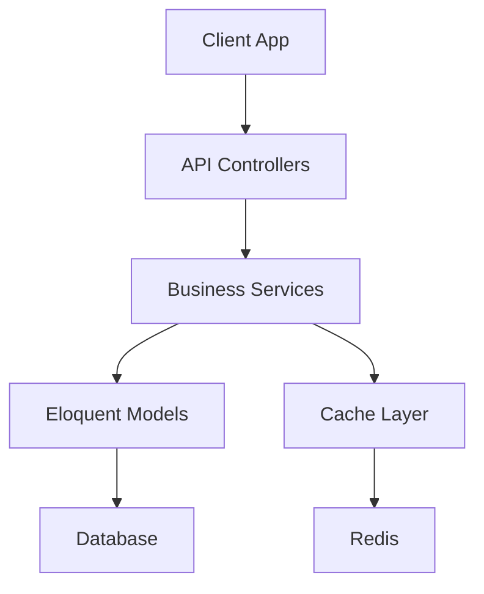
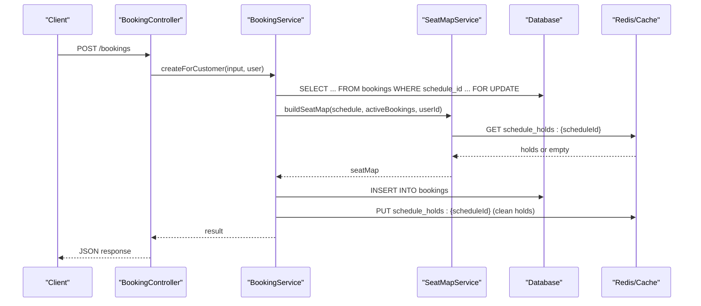
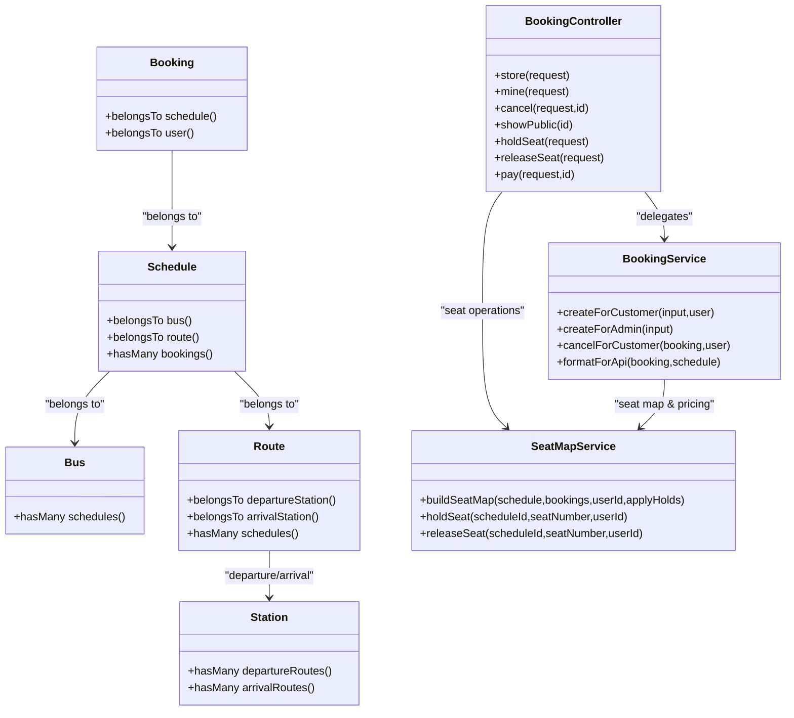

# Database Optimization

<cite>
**Referenced Files in This Document**
- [database.php](file://backend/config/database.php)
- [cache.php](file://backend/config/cache.php)
- [BookingController.php](file://backend/app/Http/Controllers/API/BookingController.php)
- [SearchController.php](file://backend/app/Http/Controllers/API/SearchController.php)
- [BookingService.php](file://backend/app/Services/BookingService.php)
- [SeatMapService.php](file://backend/app/Services/SeatMapService.php)
- [Booking.php](file://backend/app/Models/Booking.php)
- [Schedule.php](file://backend/app/Models/Schedule.php)
- [Bus.php](file://backend/app/Models/Bus.php)
- [Route.php](file://backend/app/Models/Route.php)
- [Station.php](file://backend/app/Models/Station.php)
- [2026_06_01_000050_create_bookings_table.php](file://backend/database/migrations/2026_06_01_000050_create_bookings_table.php)
- [2026_06_01_000040_create_schedules_table.php](file://backend/database/migrations/2026_06_01_000040_create_schedules_table.php)
- [2026_06_01_000030_create_routes_table.php](file://backend/database/migrations/2026_06_01_000030_create_routes_table.php)
- [2026_06_01_000020_create_buses_table.php](file://backend/database/migrations/2026_06_01_000020_create_buses_table.php)
- [2026_06_01_000010_create_stations_table.php](file://backend/database/migrations/2026_06_01_000010_create_stations_table.php)
</cite>

## Table of Contents
1. [Introduction](#introduction)
2. [Project Structure](#project-structure)
3. [Core Components](#core-components)
4. [Architecture Overview](#architecture-overview)
5. [Detailed Component Analysis](#detailed-component-analysis)
6. [Dependency Analysis](#dependency-analysis)
7. [Performance Considerations](#performance-considerations)
8. [Troubleshooting Guide](#troubleshooting-guide)
9. [Conclusion](#conclusion)

## Introduction
This document provides a comprehensive database optimization guide for SonyaBus, focusing on query optimization, indexing strategy, caching patterns, schema design, and performance monitoring. It is grounded in the actual codebase and migrations to ensure practical applicability for booking searches, schedule queries, seat availability lookups, and concurrent booking workflows.

## Project Structure
SonyaBus uses a Laravel backend with:
- API controllers handling HTTP requests
- Services encapsulating business logic and data access
- Eloquent models defining relationships
- Migrations defining tables and indexes
- Configuration files for database and cache backends

**Diagram sources**
- [BookingController.php:19-40](file://backend/app/Http/Controllers/API/BookingController.php#L19-L40)
- [SearchController.php:14-31](file://backend/app/Http/Controllers/API/SearchController.php#L14-L31)
- [BookingService.php:28-131](file://backend/app/Services/BookingService.php#L28-L131)
- [SeatMapService.php:194-244](file://backend/app/Services/SeatMapService.php#L194-L244)
- [database.php:146-180](file://backend/config/database.php#L146-L180)
- [cache.php:18-79](file://backend/config/cache.php#L18-L79)

**Section sources**
- [BookingController.php:19-40](file://backend/app/Http/Controllers/API/BookingController.php#L19-L40)
- [SearchController.php:14-31](file://backend/app/Http/Controllers/API/SearchController.php#L14-L31)
- [database.php:146-180](file://backend/config/database.php#L146-L180)
- [cache.php:18-79](file://backend/config/cache.php#L18-L79)

## Core Components
- BookingController: Validates input, delegates to services, returns JSON responses.
- SearchController: Delegates search to CoachServicesService (not analyzed here).
- BookingService: Encapsulates booking creation, cancellation, fare calculation, and transactional seat locking.
- SeatMapService: Builds seat maps, computes pricing, formats payloads, manages temporary seat holds via cache.
- Models: Booking, Schedule, Bus, Route, Station define relationships and casts.
- Migrations: Define core tables and indexes for schedules, bookings, routes, buses, stations.

Key optimization highlights present in the code:
- Eager loading to avoid N+1 queries when formatting API responses.
- Selective column projection for paid bookings to reduce payload size.
- Transactional lockForUpdate for concurrency control during booking.
- Cache-backed temporary seat holds for short-lived reservations.

**Section sources**
- [BookingController.php:19-40](file://backend/app/Http/Controllers/API/BookingController.php#L19-L40)
- [BookingService.php:28-131](file://backend/app/Services/BookingService.php#L28-L131)
- [SeatMapService.php:16-47](file://backend/app/Services/SeatMapService.php#L16-L47)
- [SeatMapService.php:194-244](file://backend/app/Services/SeatMapService.php#L194-L244)
- [Booking.php:33-41](file://backend/app/Models/Booking.php#L33-L41)
- [Schedule.php:20-33](file://backend/app/Models/Schedule.php#L20-L33)
- [Bus.php:18-21](file://backend/app/Models/Bus.php#L18-L21)
- [Route.php:26-39](file://backend/app/Models/Route.php#L26-L39)
- [Station.php:14-22](file://backend/app/Models/Station.php#L14-L22)

## Architecture Overview
The booking flow demonstrates optimized database interactions:
- Controller validates and delegates to service.
- Service loads related entities eagerly, locks rows under a transaction, builds seat map, persists booking, updates cache, and returns formatted response.

**Diagram sources**
- [BookingController.php:19-40](file://backend/app/Http/Controllers/API/BookingController.php#L19-L40)
- [BookingService.php:49-127](file://backend/app/Services/BookingService.php#L49-L127)
- [SeatMapService.php:194-244](file://backend/app/Services/SeatMapService.php#L194-L244)
- [SeatMapService.php:502-560](file://backend/app/Services/SeatMapService.php#L502-L560)
- [database.php:146-180](file://backend/config/database.php#L146-L180)
- [cache.php:18-79](file://backend/config/cache.php#L18-L79)

## Detailed Component Analysis

### Query Optimization Techniques

#### N+1 Prevention and Eager Loading
- The “my bookings” endpoint eagerly loads nested relations to prevent N+1 queries when rendering booking details.
- API formatting methods also use eager loading to attach schedule, bus, and route station information.

Optimized pattern examples:
- Eager load in controller listing:
  - [BookingController.php:49-57](file://backend/app/Http/Controllers/API/BookingController.php#L49-L57)
- Eager load in formatter:
  - [BookingService.php:244-248](file://backend/app/Services/BookingService.php#L244-L248)

Recommendation:
- Prefer explicit eager loading for all deeply nested relations in list endpoints.
- Avoid lazy loading in high-throughput paths; prefer preloading or selective projections.

#### Complex Join Optimizations
- The booking listing joins through schedule -> bus and route -> stations. Eager loading ensures these are resolved efficiently.
- For heavy reporting queries, consider raw SQL or query builder joins with explicit select columns to minimize memory usage.

Example reference:
- [BookingController.php:49-57](file://backend/app/Http/Controllers/API/BookingController.php#L49-L57)

#### Column Projection and Payload Minimization
- Paid bookings for seat map selection project only necessary columns to reduce I/O and serialization overhead.

Reference:
- [SeatMapService.php:16-47](file://backend/app/Services/SeatMapService.php#L16-L47)

#### Concurrency Control and Locking
- Customer booking uses a transaction with row-level locking to prevent double-booking seats.

Reference:
- [BookingService.php:52-64](file://backend/app/Services/BookingService.php#L52-L64)

### Indexing Strategy

#### Schedules Table
Indexes support:
- Filtering by bus and route
- Range scans on departure_time
- Composite filters for route + time and bus + time

Reference:
- [2026_06_01_000040_create_schedules_table.php:24-29](file://backend/database/migrations/2026_06_01_000040_create_schedules_table.php#L24-L29)

#### Bookings Table
Indexes support:
- User lookup and pagination
- Schedule-based queries
- Status filtering and recent pending window
- Email/phone lookups
- Composite indexes for status + created_at and schedule_id + status

Reference:
- [2026_06_01_000050_create_bookings_table.php:32-41](file://backend/database/migrations/2026_06_01_000050_create_bookings_table.php#L32-L41)

#### Routes Table
Indexes support:
- Departure and arrival station lookups
- Combined departure + arrival station queries

Reference:
- [2026_06_01_000030_create_routes_table.php:24-27](file://backend/database/migrations/2026_06_01_000030_create_routes_table.php#L24-L27)

#### Buses and Stations Tables
- Buses indexed by coach_number for quick identification.
- Stations have unique name constraint ensuring fast lookups.

References:
- [2026_06_01_000020_create_buses_table.php:26-27](file://backend/database/migrations/2026_06_01_000020_create_buses_table.php#L26-L27)
- [2026_06_01_000010_create_stations_table.php:11-14](file://backend/database/migrations/2026_06_01_000010_create_stations_table.php#L11-L14)

Index recommendations:
- Keep composite indexes aligned with frequent query predicates (e.g., status + created_at).
- Monitor index cardinality and avoid over-indexing low-selectivity columns.
- Use covering indexes where possible to avoid table lookups.

### Caching Implementation Patterns

#### Cache Store Configuration
- Default store is database; Redis is available for high-performance caching.
- Redis connection includes retry/backoff settings and separate cache database.

References:
- [cache.php:18-79](file://backend/config/cache.php#L18-L79)
- [database.php:146-180](file://backend/config/database.php#L146-L180)

#### Temporary Seat Holds
- Short-lived seat reservations are stored in cache keyed by schedule ID.
- Holds include expiration timestamps and user IDs to prevent conflicts.

References:
- [SeatMapService.php:208-221](file://backend/app/Services/SeatMapService.php#L208-L221)
- [SeatMapService.php:502-560](file://backend/app/Services/SeatMapService.php#L502-L560)
- [SeatMapService.php:563-582](file://backend/app/Services/SeatMapService.php#L563-L582)

Query result caching suggestions:
- Cache search results by normalized keys (from_station_id, to_station_id, date, coach_type).
- Use cache tags or namespaced keys to invalidate on schedule changes.
- Set appropriate TTLs based on update frequency.

### Schema Optimization

#### Data Types and Constraints
- Decimal types used for monetary values to avoid floating-point errors.
- Enumerations for status fields to constrain valid values.
- JSON columns for flexible boarding/dropping points.

References:
- [2026_06_01_000050_create_bookings_table.php:24-29](file://backend/database/migrations/2026_06_01_000050_create_bookings_table.php#L24-L29)
- [2026_06_01_000030_create_routes_table.php:20-21](file://backend/database/migrations/2026_06_01_000030_create_routes_table.php#L20-L21)

#### Partitioning Strategies
- For large datasets (bookings, schedules), partition by time ranges (monthly or quarterly) to improve query performance and maintenance operations.
- Ensure partition key aligns with common query filters (e.g., created_at, departure_time).

Note: Partitioning is not implemented in current migrations; apply via additional migration scripts tailored to your RDBMS.

#### Connection Pooling
- Configure persistent connections and pool sizes per environment.
- Tune PDO options and driver-specific parameters for MySQL/MariaDB.

References:
- [database.php:47-65](file://backend/config/database.php#L47-L65)
- [database.php:67-85](file://backend/config/database.php#L67-L85)

### Performance Monitoring and Profiling

- Enable slow query logging at the database level to capture expensive queries.
- Use Laravel’s query log in development to inspect executed queries and detect N+1 patterns.
- Profile Redis operations to monitor cache hit rates and latency.
- Monitor transaction contention and lock waits during peak booking times.

[No sources needed since this section provides general guidance]

## Dependency Analysis

**Diagram sources**
- [Booking.php:33-41](file://backend/app/Models/Booking.php#L33-L41)
- [Schedule.php:20-33](file://backend/app/Models/Schedule.php#L20-L33)
- [Bus.php:18-21](file://backend/app/Models/Bus.php#L18-L21)
- [Route.php:26-39](file://backend/app/Models/Route.php#L26-L39)
- [Station.php:14-22](file://backend/app/Models/Station.php#L14-L22)
- [BookingController.php:19-149](file://backend/app/Http/Controllers/API/BookingController.php#L19-L149)
- [BookingService.php:28-335](file://backend/app/Services/BookingService.php#L28-L335)
- [SeatMapService.php:194-560](file://backend/app/Services/SeatMapService.php#L194-L560)

**Section sources**
- [BookingController.php:19-149](file://backend/app/Http/Controllers/API/BookingController.php#L19-L149)
- [BookingService.php:28-335](file://backend/app/Services/BookingService.php#L28-L335)
- [SeatMapService.php:194-560](file://backend/app/Services/SeatMapService.php#L194-L560)
- [Booking.php:33-41](file://backend/app/Models/Booking.php#L33-L41)
- [Schedule.php:20-33](file://backend/app/Models/Schedule.php#L20-L33)
- [Bus.php:18-21](file://backend/app/Models/Bus.php#L18-L21)
- [Route.php:26-39](file://backend/app/Models/Route.php#L26-L39)
- [Station.php:14-22](file://backend/app/Models/Station.php#L14-L22)

## Performance Considerations

- Prefer eager loading for nested relations in list endpoints to eliminate N+1 queries.
- Use selective column projection for read-heavy endpoints to reduce payload size and memory usage.
- Apply transactions with row-level locking for critical sections like seat reservation to prevent race conditions.
- Leverage Redis for short-lived state such as seat holds to reduce database contention.
- Align indexes with query patterns; maintain composite indexes for frequent filter combinations.
- Consider partitioning large tables by time to improve query performance and maintenance tasks.
- Tune connection pooling and driver options for production workloads.

[No sources needed since this section provides general guidance]

## Troubleshooting Guide

Common issues and resolutions:
- Double-booking seats: Ensure lockForUpdate is applied within a transaction around availability checks.
  - Reference: [BookingService.php:52-64](file://backend/app/Services/BookingService.php#L52-L64)
- Stale seat availability due to cache misses: Validate both DB state and cache holds before reserving seats.
  - References: [SeatMapService.php:208-221](file://backend/app/Services/SeatMapService.php#L208-L221), [SeatMapService.php:502-560](file://backend/app/Services/SeatMapService.php#L502-L560)
- Slow queries on bookings: Verify composite indexes on status and created_at, and ensure proper filtering.
  - Reference: [2026_06_01_000050_create_bookings_table.php:32-41](file://backend/database/migrations/2026_06_01_000050_create_bookings_table.php#L32-L41)
- N+1 query spikes: Confirm eager loading in list endpoints and formatters.
  - References: [BookingController.php:49-57](file://backend/app/Http/Controllers/API/BookingController.php#L49-L57), [BookingService.php:244-248](file://backend/app/Services/BookingService.php#L244-L248)

**Section sources**
- [BookingService.php:52-64](file://backend/app/Services/BookingService.php#L52-L64)
- [SeatMapService.php:208-221](file://backend/app/Services/SeatMapService.php#L208-L221)
- [SeatMapService.php:502-560](file://backend/app/Services/SeatMapService.php#L502-L560)
- [2026_06_01_000050_create_bookings_table.php:32-41](file://backend/database/migrations/2026_06_01_000050_create_bookings_table.php#L32-L41)
- [BookingController.php:49-57](file://backend/app/Http/Controllers/API/BookingController.php#L49-L57)
- [BookingService.php:244-248](file://backend/app/Services/BookingService.php#L244-L248)

## Conclusion
SonyaBus implements several strong database optimization practices: eager loading to prevent N+1 queries, selective column projection for reduced payload size, transactional locking for concurrency safety, and cache-backed temporary seat holds. The schema includes well-chosen indexes aligned with common query patterns. To further improve performance, adopt Redis as the default cache store, implement query result caching for search endpoints, and consider partitioning large tables by time. Continuous monitoring of slow queries and cache metrics will help maintain optimal performance under load.

[No sources needed since this section summarizes without analyzing specific files]