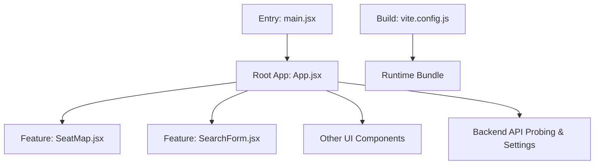
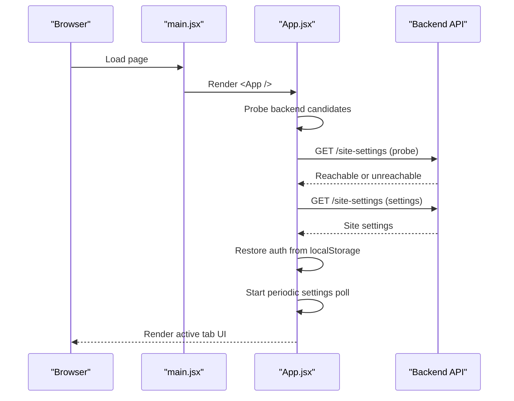
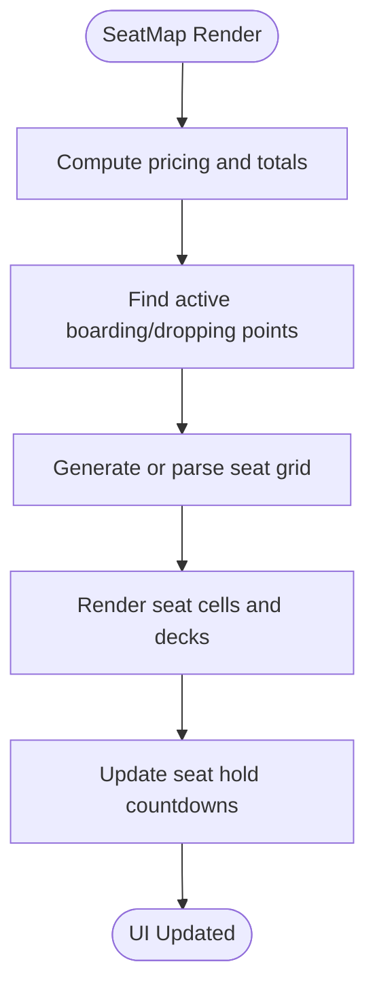
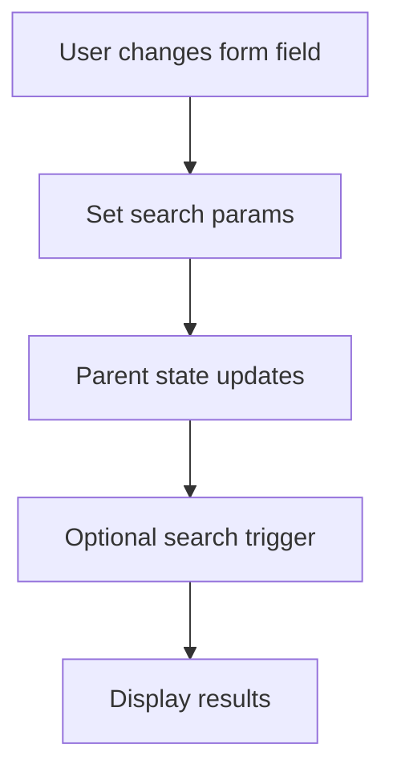
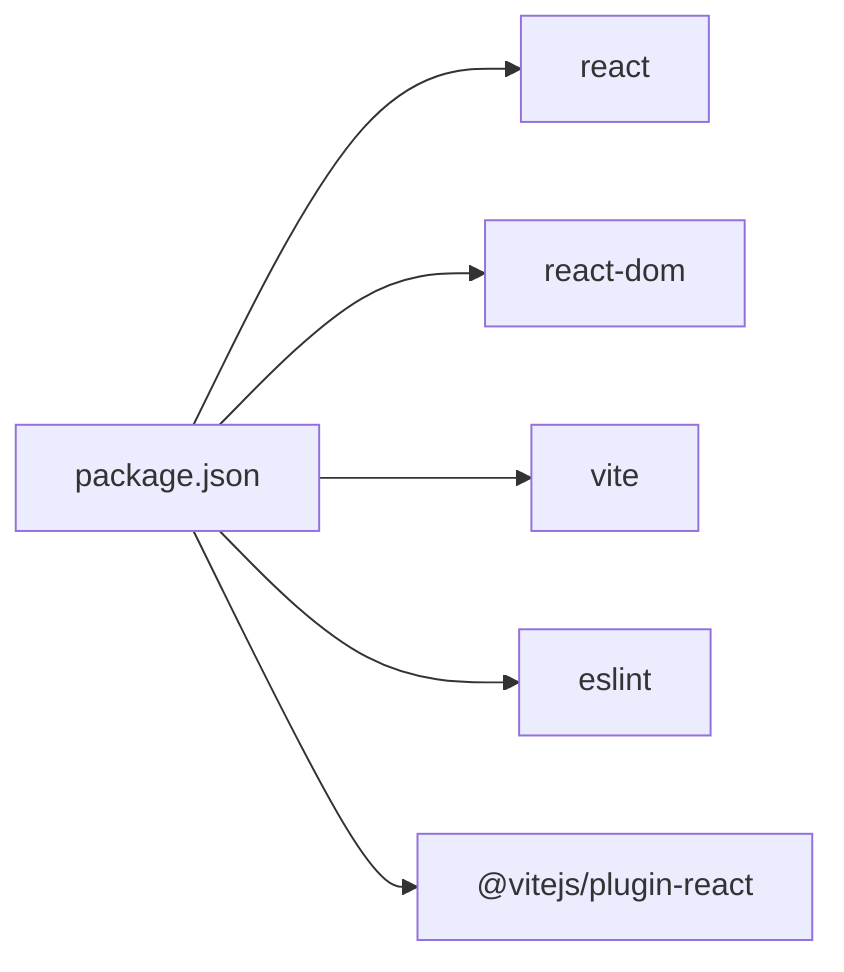

# Frontend Performance

<cite>
**Referenced Files in This Document**
- [vite.config.js](file://frontend/vite.config.js)
- [package.json](file://frontend/package.json)
- [main.jsx](file://frontend/src/main.jsx)
- [App.jsx](file://frontend/src/App.jsx)
- [SeatMap.jsx](file://frontend/src/components/SeatMap.jsx)
- [SearchForm.jsx](file://frontend/src/components/SearchForm.jsx)
</cite>

## Table of Contents
1. [Introduction](#introduction)
2. [Project Structure](#project-structure)
3. [Core Components](#core-components)
4. [Architecture Overview](#architecture-overview)
5. [Detailed Component Analysis](#detailed-component-analysis)
6. [Dependency Analysis](#dependency-analysis)
7. [Performance Considerations](#performance-considerations)
8. [Troubleshooting Guide](#troubleshooting-guide)
9. [Conclusion](#conclusion)

## Introduction
This document provides a focused frontend performance optimization guide for the SonyaBus React application. It explains how the current Vite build configuration, component structure, and runtime behavior affect bundle size, rendering cost, memory usage, and mobile experience. It also proposes concrete optimizations for bundle splitting, lazy loading, component-level memoization, image and asset handling, event cleanup, state management, and progressive web app readiness. Where relevant, it references actual implementation points in `SeatMap` and `SearchForm`.

## Project Structure
The frontend is a minimal React 19 application built with Vite. The entry point mounts React in StrictMode and renders the root `App` component. Most business logic, routing-like tab switching, API probing, and UI composition live in `App.jsx`, while feature components such as `SeatMap` and `SearchForm` are placed under `src/components`.

**Diagram sources**
- [main.jsx:1-12](file://frontend/src/main.jsx#L1-L12)
- [App.jsx:1-18](file://frontend/src/App.jsx#L1-L18)
- [SeatMap.jsx:1-30](file://frontend/src/components/SeatMap.jsx#L1-L30)
- [SearchForm.jsx:1-10](file://frontend/src/components/SearchForm.jsx#L1-L10)
- [vite.config.js:1-20](file://frontend/vite.config.js#L1-L20)

**Section sources**
- [main.jsx:1-12](file://frontend/src/main.jsx#L1-L12)
- [App.jsx:1-18](file://frontend/src/App.jsx#L1-L18)
- [package.json:1-28](file://frontend/package.json#L1-L28)

## Core Components
- **Vite Configuration**: The current `vite.config.js` enables the React plugin and configures development server proxying for `/api` and `/uploads`, plus Laragon-style fallback routes. There is no explicit production build optimization configuration such as chunk splitting or asset compression settings.
- **Application Root**: `App.jsx` manages backend connectivity probing, site settings, authentication state, navigation tabs, and dynamic SEO metadata. It conditionally renders major features like `BookingPortal`, `MyTickets`, `OffersList`, and `UserProfile`.
- **SeatMap**: A complex interactive seat selection component that renders bus layouts, pricing, passenger details, promo codes, and booking actions. It uses a per-second tick timer to refresh countdowns.
- **SearchForm**: A simple search form with station selectors, date input, coach type filter, and submit button.

**Section sources**
- [vite.config.js:1-74](file://frontend/vite.config.js#L1-L74)
- [App.jsx:94-151](file://frontend/src/App.jsx#L94-L151)
- [SeatMap.jsx:10-46](file://frontend/src/components/SeatMap.jsx#L10-L46)
- [SearchForm.jsx:1-109](file://frontend/src/components/SearchForm.jsx#L1-L109)

## Architecture Overview
At runtime, the frontend starts by mounting React and then runs `App`. During initialization, `App` probes backend availability using an ordered list of candidate URLs, caches the working base URL, fetches site settings, restores authentication from local storage, and sets up periodic polling for branding updates. Once ready, it renders the active tab content and shared UI elements.

**Diagram sources**
- [main.jsx:7-11](file://frontend/src/main.jsx#L7-L11)
- [App.jsx:69-92](file://frontend/src/App.jsx#L69-L92)
- [App.jsx:329-412](file://frontend/src/App.jsx#L329-L412)

## Detailed Component Analysis

### Bundle Size Optimization Using Vite
Current state:
- The project uses Vite with the React plugin.
- No custom `build` options are configured in `vite.config.js`.
- Dependencies are minimal: only React and ReactDOM in production.

Recommended optimizations:
- Enable production build optimizations:
  - Configure `build.minify` to use a fast minifier.
  - Enable `build.cssCodeSplit` to split CSS by route/component when code splitting is introduced.
  - Configure `build.rollupOptions.output.manualChunks` to split vendor chunks (for example, separate React, UI libraries, and app code).
- Add code-splitting plugins if needed:
  - Use `@vitejs/plugin-react-swc` for faster builds and better tree-shaking.
  - Introduce `React.lazy` and `Suspense` for route-level or feature-level lazy loading.
- Optimize assets:
  - Configure `build.assetsInlineLimit` to inline small images/icons as data URIs.
  - Compress images at build time using a Vite asset pipeline or pre-processing step.
  - Serve static assets through a CDN and configure cache headers on the hosting layer.

Impact:
- Smaller initial JavaScript payload improves Time to Interactive.
- Splitting large third-party libraries reduces first paint latency.
- Asset compression and CDN caching reduce bandwidth and improve repeat visits.

**Section sources**
- [vite.config.js:1-74](file://frontend/vite.config.js#L1-L74)
- [package.json:12-26](file://frontend/package.json#L12-L26)

### Code Splitting Strategies
Current state:
- All major components are statically imported into `App.jsx`.
- There is no `React.lazy` or dynamic import pattern visible in the analyzed files.

Recommended strategies:
- Lazy-load heavy pages:
  - Wrap `BookingPortal`, `MyTickets`, `OffersList`, and `UserProfile` with `React.lazy` and `Suspense`.
  - Show a lightweight skeleton or spinner while the chunk loads.
- Route-based splitting:
  - If routing is added later, split by route to avoid loading unused code.
- Feature-based splitting:
  - Move large utilities or optional features into separate modules and load them on demand.

Expected benefits:
- Reduced initial bundle size.
- Faster first meaningful paint.
- Better perceived performance on slow networks.

**Section sources**
- [App.jsx:5-17](file://frontend/src/App.jsx#L5-L17)

### Lazy Loading Implementations
Current state:
- No lazy loading patterns are present in the analyzed source files.

Implementation guidance:
- Replace direct imports of heavy components with dynamic imports wrapped in `React.lazy`.
- Provide user-friendly fallback UI during chunk loading.
- Avoid lazy-loading critical above-the-fold UI unless necessary; prefer lazy-loading secondary features.

[No sources needed since this section provides conceptual guidance]

### Component-Level Optimizations

#### SeatMap Optimization Opportunities
Current observations:
- The component defines several internal functions such as `formatRemainingTime`, `generateDefaultGrid`, `renderSeatCell`, and `renderSeatMapLayout`.
- It uses a per-second interval to update a tick counter for countdown display.
- Large JSX trees are rendered for seat grids, legends, and booking sidebar.
- Props include many state setters and data objects.

Optimization recommendations:
- Wrap the component with `React.memo` to prevent re-renders when props have not changed.
- Memoize expensive computations:
  - Cache derived values such as pricing, selected seat class, and boarding/dropping point lookups using `useMemo`.
  - Memoize grid generation or layout computation if inputs change infrequently.
- Stabilize callbacks:
  - Wrap handlers like `handleSeatClick`, `handleApplyPromo`, and `handleConfirmBooking` with `useCallback` to keep referential stability for child components.
- Reduce render scope:
  - Extract seat cells or deck rows into smaller memoized components to limit re-render scope.
- Optimize timers:
  - Ensure the interval is cleared on unmount.
  - Consider debouncing or throttling frequent updates if seat expiration changes often.

**Diagram sources**
- [SeatMap.jsx:39-46](file://frontend/src/components/SeatMap.jsx#L39-L46)
- [SeatMap.jsx:48-190](file://frontend/src/components/SeatMap.jsx#L48-L190)
- [SeatMap.jsx:386-391](file://frontend/src/components/SeatMap.jsx#L386-L391)

**Section sources**
- [SeatMap.jsx:31-46](file://frontend/src/components/SeatMap.jsx#L31-L46)
- [SeatMap.jsx:192-384](file://frontend/src/components/SeatMap.jsx#L192-L384)
- [SeatMap.jsx:386-611](file://frontend/src/components/SeatMap.jsx#L386-L611)

#### SearchForm Optimization Opportunities
Current observations:
- The component renders a form with multiple controlled inputs.
- Each input calls `setSearchParams` with a new object spread, which can create new prop references frequently.

Optimization recommendations:
- Wrap the component with `React.memo` if it receives stable parent props.
- Debounce or throttle search triggers if the parent performs network requests on every field change.
- Consider memoizing station lists if they are large or computed.
- Keep handler functions stable using `useCallback` where appropriate.

**Diagram sources**
- [SearchForm.jsx:20-92](file://frontend/src/components/SearchForm.jsx#L20-L92)

**Section sources**
- [SearchForm.jsx:1-109](file://frontend/src/components/SearchForm.jsx#L1-L109)

### Image Optimization, Asset Compression, and CDN Configuration
Current state:
- The application dynamically injects favicon links and meta tags based on backend site settings.
- Static assets are not explicitly optimized in the analyzed build configuration.

Recommendations:
- Preprocess images:
  - Convert large raster images to WebP or AVIF.
  - Use responsive images with `srcset` where applicable.
- Inline small icons:
  - Inline SVGs or small PNGs as data URIs to reduce HTTP requests.
- Compress assets:
  - Enable gzip or Brotli compression on the server or CDN.
- CDN strategy:
  - Serve static assets from a CDN with long-lived cache headers.
  - Use cache-busting filenames for versioned builds.

[No sources needed since this section provides general guidance]

### Memory Management Techniques and Event Listener Cleanup
Current state:
- `App.jsx` clears toast timeouts on unmount.
- `SeatMap.jsx` creates a per-second interval and clears it on unmount.
- `App.jsx` sets up a periodic settings poll and clears it when dependencies change.

Best practices already present:
- Interval cleanup prevents memory leaks after component unmount.
- Timeout cleanup avoids stale notifications.

Additional recommendations:
- Avoid global event listeners without cleanup.
- Use refs for mutable values that should not trigger re-renders.
- Clear AbortControllers for network requests when components unmount.

**Section sources**
- [App.jsx:136-151](file://frontend/src/App.jsx#L136-L151)
- [SeatMap.jsx:31-37](file://frontend/src/components/SeatMap.jsx#L31-L37)
- [App.jsx:382-412](file://frontend/src/App.jsx#L382-L412)

### State Management Optimization
Current state:
- Authentication state is persisted to `localStorage`.
- Site settings are polled periodically.
- Backend connectivity is probed with a timeout and candidate list.

Recommendations:
- Normalize frequently accessed data to avoid repeated parsing.
- Use stable keys and identifiers for lists to minimize re-renders.
- Consider a lightweight state store or context for deeply nested state if component prop drilling becomes costly.
- Debounce rapid state changes such as typing in search fields.

**Section sources**
- [App.jsx:161-173](file://frontend/src/App.jsx#L161-L173)
- [App.jsx:329-412](file://frontend/src/App.jsx#L329-L412)

### Mobile Performance Considerations and Touch Interaction Optimization
Recommendations:
- Minimize layout thrashing by avoiding forced synchronous layouts inside frequent update loops.
- Use CSS transforms instead of animating layout properties.
- Reduce repaint-heavy styles in hot paths such as seat selection.
- Ensure touch targets are appropriately sized and avoid unnecessary re-renders on touch events.
- Prefer passive event listeners for scroll and touch handlers where possible.

[No sources needed since this section provides general guidance]

### Progressive Web App Features
Recommendations:
- Add a service worker for offline caching of static assets.
- Provide a web app manifest for installability.
- Implement background sync for non-critical operations.
- Use push notifications for booking confirmations where supported.

[No sources needed since this section provides general guidance]

## Dependency Analysis
The frontend has a minimal dependency graph:
- React and ReactDOM are the only production dependencies.
- Development dependencies include ESLint, React hooks rules, and Vite tooling.
- The build system is Vite with the React plugin.

**Diagram sources**
- [package.json:12-26](file://frontend/package.json#L12-L26)

**Section sources**
- [package.json:1-28](file://frontend/package.json#L1-L28)

## Performance Considerations
Key areas to prioritize:
- Bundle size: introduce code splitting and optimize build configuration.
- Rendering cost: apply `React.memo`, `useMemo`, and `useCallback` strategically.
- Network efficiency: cache API responses, debounce searches, and use efficient polling intervals.
- Memory hygiene: ensure all timers and listeners are cleaned up.
- Asset delivery: compress images, inline small assets, and serve via CDN.
- Mobile UX: reduce layout shifts, optimize touch interactions, and keep animations smooth.

[No sources needed since this section provides general guidance]

## Troubleshooting Guide
Common issues and resolutions:
- Backend connectivity failures:
  - The app probes multiple backend URLs and shows an offline state when none respond.
  - Retry mechanisms allow users to re-probe after fixing the backend.
- Stale or missing site settings:
  - Periodic polling ensures branding updates propagate.
- Timer-related memory leaks:
  - Verify that intervals and timeouts are cleared on unmount.
- Excessive re-renders:
  - Identify components with heavy JSX or frequent prop changes and apply memoization techniques.

**Section sources**
- [App.jsx:69-92](file://frontend/src/App.jsx#L69-L92)
- [App.jsx:502-524](file://frontend/src/App.jsx#L502-L524)
- [App.jsx:382-412](file://frontend/src/App.jsx#L382-L412)
- [SeatMap.jsx:31-37](file://frontend/src/components/SeatMap.jsx#L31-L37)

## Conclusion
The SonyaBus frontend currently relies on a clean React + Vite setup with minimal dependencies. To achieve strong performance, focus on bundle splitting, lazy loading, component-level memoization, asset optimization, and careful state and timer management. Applying these techniques will reduce initial load times, improve interactivity, and deliver a smoother experience on mobile devices.

[No sources needed since this section summarizes without analyzing specific files]