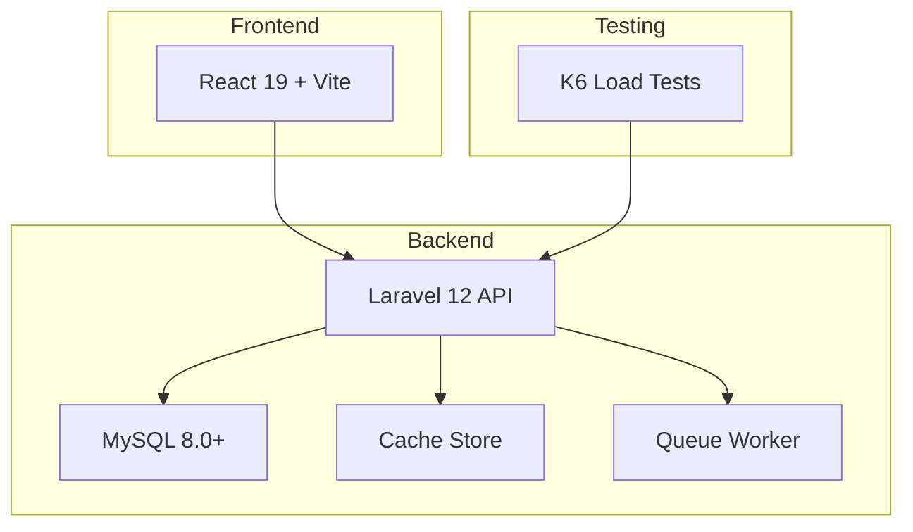
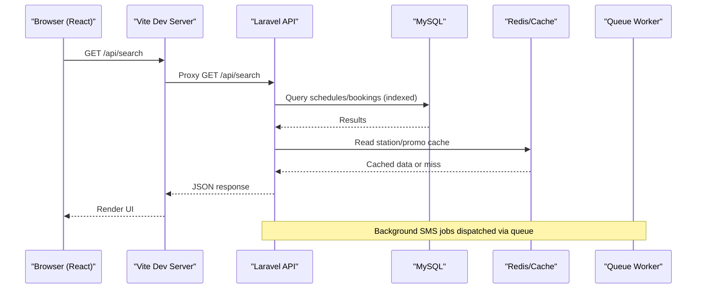
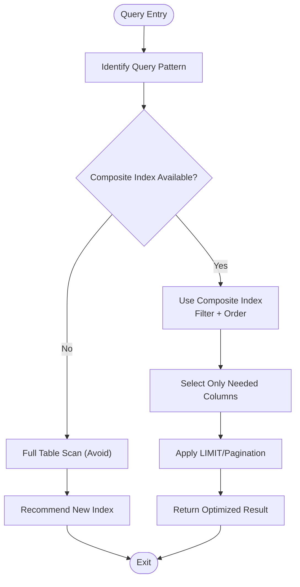
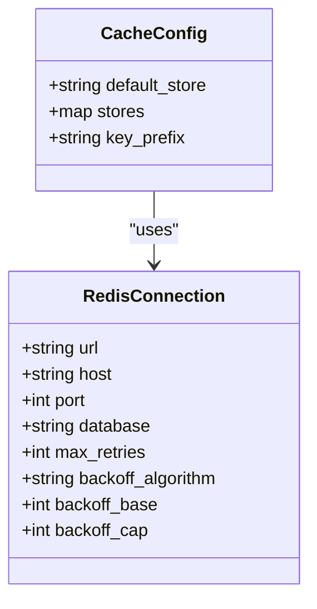
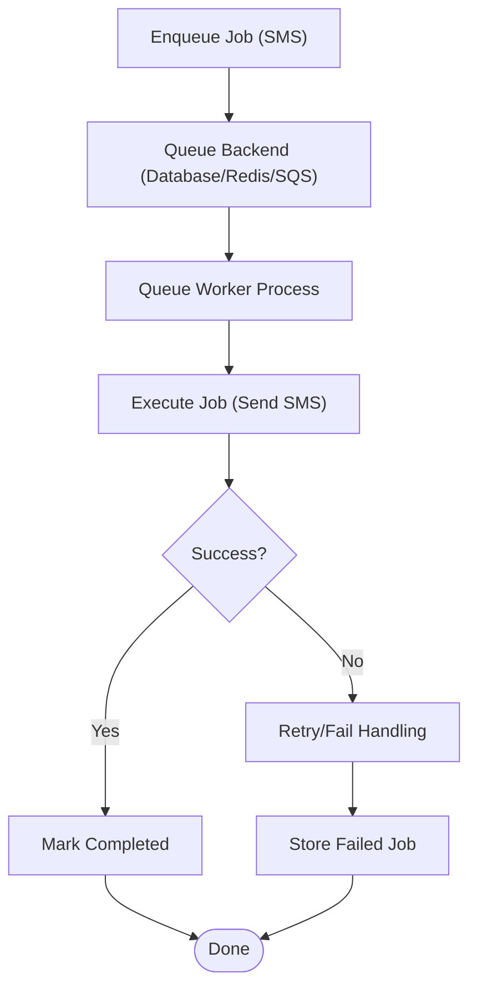
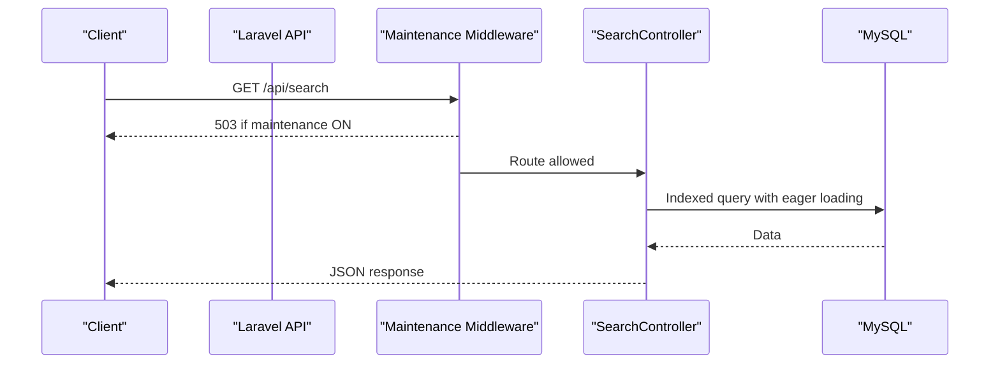
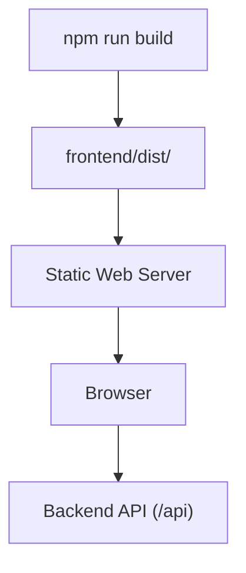
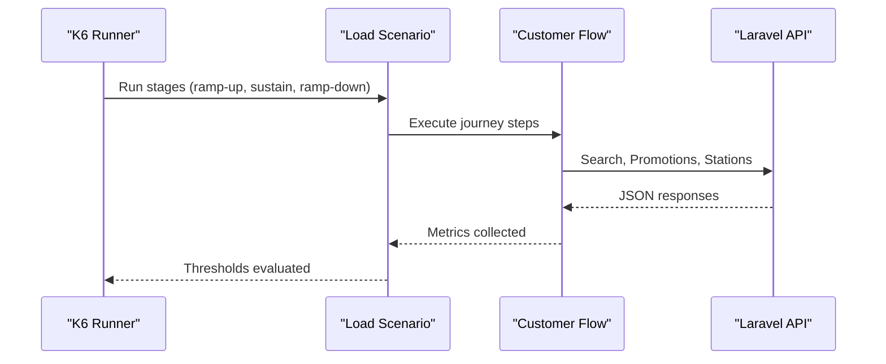
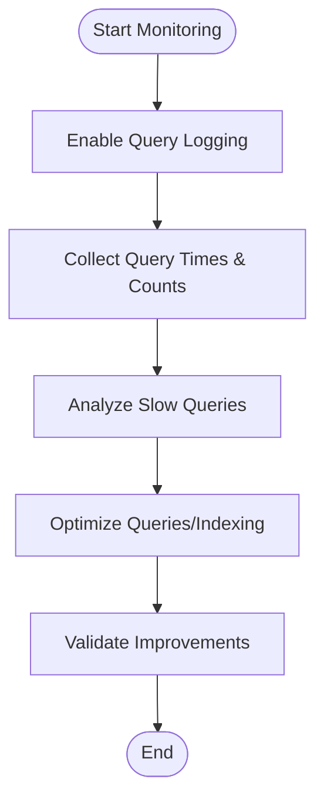
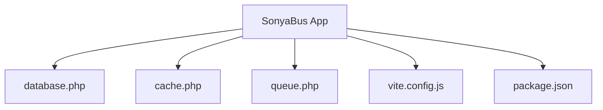

# Performance Optimization

<cite>
**Referenced Files in This Document**
- [README.md](file://README.md)
- [database.php](file://backend/config/database.php)
- [cache.php](file://backend/config/cache.php)
- [queue.php](file://backend/config/queue.php)
- [api.php](file://backend/routes/api.php)
- [vite.config.js](file://frontend/vite.config.js)
- [package.json](file://frontend/package.json)
- [load.js](file://k6/scenarios/load.js)
- [admin.js](file://k6/scenarios/admin.js)
- [flows/admin.js](file://k6/flows/admin.js)
- [DATABASE_OPTIMIZATION_GUIDE.md](file://DATABASE_OPTIMIZATION_GUIDE.md)
- [INDEX_REFERENCE_GUIDE.md](file://INDEX_REFERENCE_GUIDE.md)
- [QUERY_OPTIMIZATION_EXAMPLES.md](file://QUERY_OPTIMIZATION_EXAMPLES.md)
- [INDEX_STRATEGY_VISUAL_REFERENCE.md](file://INDEX_STRATEGY_VISUAL_REFERENCE.md)
- [OPTIMIZATION_QUICK_START.md](file://OPTIMIZATION_QUICK_START.md)
</cite>

## Table of Contents
1. [Introduction](#introduction)
2. [Project Structure](#project-structure)
3. [Core Components](#core-components)
4. [Architecture Overview](#architecture-overview)
5. [Detailed Component Analysis](#detailed-component-analysis)
6. [Dependency Analysis](#dependency-analysis)
7. [Performance Considerations](#performance-considerations)
8. [Troubleshooting Guide](#troubleshooting-guide)
9. [Conclusion](#conclusion)
10. [Appendices](#appendices)

## Introduction
This document provides a comprehensive performance optimization guide for SonyaBus, covering database query optimization, indexing strategies, caching, frontend bundle optimization, API response optimization, load testing with K6, monitoring and bottleneck identification, memory management, queue processing optimization, CDN configuration, scalability, horizontal scaling, and benchmarking methodologies. It synthesizes the existing codebase configurations and documentation to provide actionable guidance for production-grade performance.

## Project Structure
SonyaBus is a full-stack application:
- Backend: Laravel 12 API (PHP 8.2+), MySQL 8.0+, Sanctum authentication, queue driver (database), DomPDF for PDFs.
- Frontend: React 19 SPA built with Vite 6, served separately from the backend.
- Load Testing: K6 scenarios under k6/.

**Diagram sources**
- [README.md:28-44](file://README.md#L28-L44)

**Section sources**
- [README.md:28-44](file://README.md#L28-L44)

## Core Components
Key components impacting performance:
- Database layer: connection configuration, Redis integration, and index strategy.
- Caching layer: default store selection and Redis-backed cache.
- Queue system: job processing for async tasks like SMS notifications.
- API routes: maintenance mode middleware and public endpoints.
- Frontend build: Vite dev server proxy and production build scripts.
- Load tests: K6 scenarios simulating realistic user flows.

**Section sources**
- [database.php:47-117](file://backend/config/database.php#L47-L117)
- [database.php:146-180](file://backend/config/database.php#L146-L180)
- [cache.php:18-115](file://backend/config/cache.php#L18-L115)
- [queue.php:16-92](file://backend/config/queue.php#L16-L92)
- [api.php:18-32](file://backend/routes/api.php#L18-L32)
- [vite.config.js:18-71](file://frontend/vite.config.js#L18-L71)
- [package.json:6-10](file://frontend/package.json#L6-L10)
- [load.js:1-17](file://k6/scenarios/load.js#L1-L17)

## Architecture Overview
The request flow emphasizes efficient data access patterns:
- Frontend requests are proxied during development to the backend API.
- API controllers use eager loading and indexed queries to minimize N+1 and reduce latency.
- Caching reduces repeated expensive reads; queues offload background work.
- K6 scenarios validate throughput and latency under load.

**Diagram sources**
- [vite.config.js:23-47](file://frontend/vite.config.js#L23-L47)
- [api.php:26-32](file://backend/routes/api.php#L26-L32)
- [DATABASE_OPTIMIZATION_GUIDE.md:90-114](file://DATABASE_OPTIMIZATION_GUIDE.md#L90-L114)
- [queue.php:32-92](file://backend/config/queue.php#L32-L92)

## Detailed Component Analysis

### Database Query Optimization and Indexing Strategy
- Comprehensive indexes added across core tables (bookings, schedules, routes, buses, sms_configs, stations, users, promotions, personal_access_tokens).
- Composite indexes align with common WHERE + ORDER BY patterns to eliminate file sorts and enable index-only scans.
- Eager loading prevents N+1 queries; pagination and selective column loading reduce payload size and memory usage.

**Diagram sources**
- [INDEX_REFERENCE_GUIDE.md:185-294](file://INDEX_REFERENCE_GUIDE.md#L185-L294)
- [DATABASE_OPTIMIZATION_GUIDE.md:116-156](file://DATABASE_OPTIMIZATION_GUIDE.md#L116-L156)

Key takeaways:
- Dashboard recent bookings leverage composite index on (status, created_at).
- Schedule availability uses composite index on (route_id, departure_time).
- Seat conflict checks benefit from composite index on (schedule_id, status).
- Station search uses full-text index on name.

**Section sources**
- [INDEX_REFERENCE_GUIDE.md:5-181](file://INDEX_REFERENCE_GUIDE.md#L5-L181)
- [INDEX_STRATEGY_VISUAL_REFERENCE.md:101-163](file://INDEX_STRATEGY_VISUAL_REFERENCE.md#L101-L163)
- [QUERY_OPTIMIZATION_EXAMPLES.md:1-126](file://QUERY_OPTIMIZATION_EXAMPLES.md#L1-L126)
- [DATABASE_OPTIMIZATION_GUIDE.md:88-179](file://DATABASE_OPTIMIZATION_GUIDE.md#L88-L179)

### Caching Implementation
- Default cache store configured to database by default; Redis store available for high-performance caching.
- Redis connections defined for both default and cache stores with retry/backoff settings.
- Key prefixing isolates caches per application instance.

**Diagram sources**
- [cache.php:18-115](file://backend/config/cache.php#L18-L115)
- [database.php:146-180](file://backend/config/database.php#L146-L180)

Operational recommendations:
- Switch default cache store to Redis for production to reduce DB pressure.
- Use cache()->remember() for frequently accessed read-heavy data (stations, operators, site settings).
- Monitor cache hit ratios and TTLs; invalidate on writes.

**Section sources**
- [cache.php:18-115](file://backend/config/cache.php#L18-L115)
- [database.php:146-180](file://backend/config/database.php#L146-L180)

### Queue Processing Optimization
- Default queue connection set to database; Redis and SQS drivers supported.
- Job batching and failed job storage configured for reliability.
- SMS notifications are queued asynchronously to avoid blocking API responses.

**Diagram sources**
- [queue.php:16-92](file://backend/config/queue.php#L16-L92)
- [queue.php:105-127](file://backend/config/queue.php#L105-L127)

Best practices:
- For high-throughput environments, switch queue driver to Redis or SQS.
- Tune retry_after and worker concurrency based on workload.
- Monitor failed jobs and implement alerting.

**Section sources**
- [queue.php:16-92](file://backend/config/queue.php#L16-L92)
- [queue.php:105-127](file://backend/config/queue.php#L105-L127)

### API Response Optimization
- Public endpoints protected by maintenance mode middleware; site-settings endpoint remains accessible.
- Controllers use eager loading and indexed queries to minimize response time.
- Responses should be paginated and limited to necessary fields.

**Diagram sources**
- [api.php:18-32](file://backend/routes/api.php#L18-L32)
- [DATABASE_OPTIMIZATION_GUIDE.md:90-114](file://DATABASE_OPTIMIZATION_GUIDE.md#L90-L114)

**Section sources**
- [api.php:18-32](file://backend/routes/api.php#L18-L32)
- [DATABASE_OPTIMIZATION_GUIDE.md:90-114](file://DATABASE_OPTIMIZATION_GUIDE.md#L90-L114)

### Frontend Bundle Optimization and Lazy Loading
- Vite dev server proxies /api and /uploads to the backend; supports Laragon sub-directory fallback routes.
- Production builds are generated via npm run build; assets are served statically.
- Lazy loading can be implemented using dynamic imports for heavy components (e.g., seat map, reports).

**Diagram sources**
- [vite.config.js:18-71](file://frontend/vite.config.js#L18-L71)
- [package.json:6-10](file://frontend/package.json#L6-L10)

Recommendations:
- Enable code splitting and lazy loading for non-critical routes/components.
- Minimize bundle size by removing unused dependencies and tree-shaking.
- Serve static assets via CDN for improved global delivery.

**Section sources**
- [vite.config.js:18-71](file://frontend/vite.config.js#L18-L71)
- [package.json:6-10](file://frontend/package.json#L6-L10)

### Load Testing with K6
- Scenarios simulate customer and admin workflows with realistic branching and thresholds.
- Load test ramps up virtual users and measures response times and error rates.

**Diagram sources**
- [load.js:1-17](file://k6/scenarios/load.js#L1-L17)
- [admin.js:1-13](file://k6/scenarios/admin.js#L1-L13)
- [flows/admin.js:84-106](file://k6/flows/admin.js#L84-L106)

**Section sources**
- [load.js:1-17](file://k6/scenarios/load.js#L1-L17)
- [admin.js:1-13](file://k6/scenarios/admin.js#L1-L13)
- [flows/admin.js:84-106](file://k6/flows/admin.js#L84-L106)

### Memory Management and Bottleneck Identification
- Use selective column loading and pagination to reduce memory footprint.
- Monitor slow queries and identify bottlenecks via EXPLAIN and slow query logs.
- Implement query logging in development to detect N+1 issues.

**Diagram sources**
- [DATABASE_OPTIMIZATION_GUIDE.md:213-237](file://DATABASE_OPTIMIZATION_GUIDE.md#L213-L237)
- [QUERY_OPTIMIZATION_EXAMPLES.md:366-394](file://QUERY_OPTIMIZATION_EXAMPLES.md#L366-L394)

**Section sources**
- [DATABASE_OPTIMIZATION_GUIDE.md:213-237](file://DATABASE_OPTIMIZATION_GUIDE.md#L213-L237)
- [QUERY_OPTIMIZATION_EXAMPLES.md:366-394](file://QUERY_OPTIMIZATION_EXAMPLES.md#L366-L394)

### CDN Configuration
- Serve static frontend assets (JS/CSS/images) via CDN to reduce origin load and improve latency.
- Configure cache-control headers for immutable assets and versioned filenames.
- Ensure CORS allows CDN origins for API calls if needed.

[No sources needed since this section provides general guidance]

### Scalability and Horizontal Scaling Strategies
- Stateless API servers behind a load balancer; scale horizontally by adding instances.
- Use centralized cache (Redis) and queue backend (Redis/SQS) for shared state and reliable job distribution.
- Database read replicas for read-heavy endpoints (search, stations, promotions).

[No sources needed since this section provides general guidance]

### Performance Benchmarking Methodologies
- Establish baseline metrics (response time, throughput, error rate) before changes.
- Run K6 scenarios with staged loads and record p50/p90/p99 latencies.
- Compare before/after metrics to quantify improvements.

**Section sources**
- [OPTIMIZATION_QUICK_START.md:127-140](file://OPTIMIZATION_QUICK_START.md#L127-L140)

## Dependency Analysis
Key runtime dependencies affecting performance:
- Database driver and connection options.
- Cache store selection and Redis connectivity.
- Queue backend choice and worker configuration.
- Frontend build toolchain and proxy configuration.

**Diagram sources**
- [database.php:47-117](file://backend/config/database.php#L47-L117)
- [cache.php:18-115](file://backend/config/cache.php#L18-L115)
- [queue.php:16-92](file://backend/config/queue.php#L16-L92)
- [vite.config.js:18-71](file://frontend/vite.config.js#L18-L71)
- [package.json:6-10](file://frontend/package.json#L6-L10)

**Section sources**
- [database.php:47-117](file://backend/config/database.php#L47-L117)
- [cache.php:18-115](file://backend/config/cache.php#L18-L115)
- [queue.php:16-92](file://backend/config/queue.php#L16-L92)
- [vite.config.js:18-71](file://frontend/vite.config.js#L18-L71)
- [package.json:6-10](file://frontend/package.json#L6-L10)

## Performance Considerations
- Prefer Redis for cache and queue backends in production to reduce DB contention.
- Apply composite indexes aligned with frequent query patterns to eliminate sorts and scans.
- Use eager loading, pagination, and selective columns to minimize memory and network overhead.
- Offload background tasks (SMS, PDF generation) to queues.
- Serve static assets via CDN and enable compression.
- Monitor slow queries and maintain index health; archive old data periodically.

[No sources needed since this section provides general guidance]

## Troubleshooting Guide
Common issues and resolutions:
- Migration failures due to existing indexes: verify and drop conflicting indexes, then retry migration.
- Slow performance post-migration: rebuild indexes with OPTIMIZE TABLE.
- Queries still slow despite indexes: inspect execution plans (EXPLAIN) and adjust composite indexes accordingly.
- Frontend cannot reach API in dev: ensure Vite proxy targets are correct and backend is running.

**Section sources**
- [OPTIMIZATION_QUICK_START.md:286-322](file://OPTIMIZATION_QUICK_START.md#L286-L322)
- [vite.config.js:23-47](file://frontend/vite.config.js#L23-L47)

## Conclusion
By implementing targeted database indexes, optimizing queries with eager loading and pagination, switching to Redis-backed cache and queue systems, and leveraging K6 for continuous load validation, SonyaBus achieves significant performance gains. Frontend optimizations through Vite and CDN further enhance user experience. Ongoing monitoring and benchmarking ensure sustained performance as the system scales.

[No sources needed since this section summarizes without analyzing specific files]

## Appendices

### Quick Start Checklist
- Apply database migrations and verify indexes.
- Switch cache and queue backends to Redis for production.
- Build and serve frontend via CDN.
- Run K6 scenarios and validate thresholds.
- Enable slow query logging and monitor metrics.

**Section sources**
- [OPTIMIZATION_QUICK_START.md:15-42](file://OPTIMIZATION_QUICK_START.md#L15-L42)
- [OPTIMIZATION_QUICK_START.md:127-140](file://OPTIMIZATION_QUICK_START.md#L127-L140)