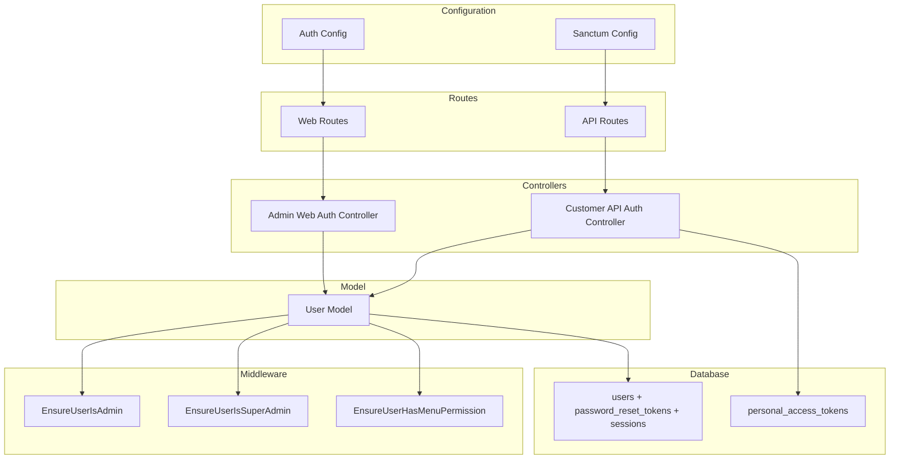
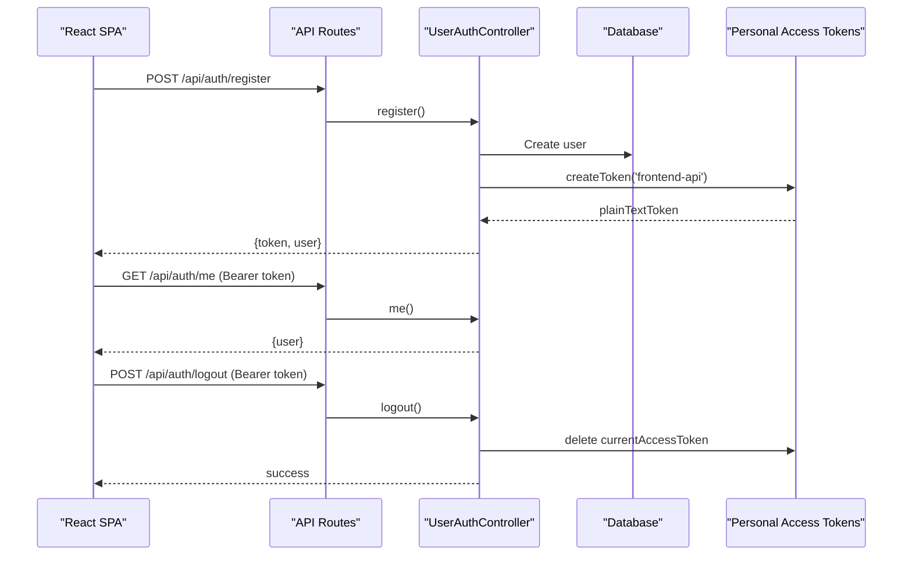
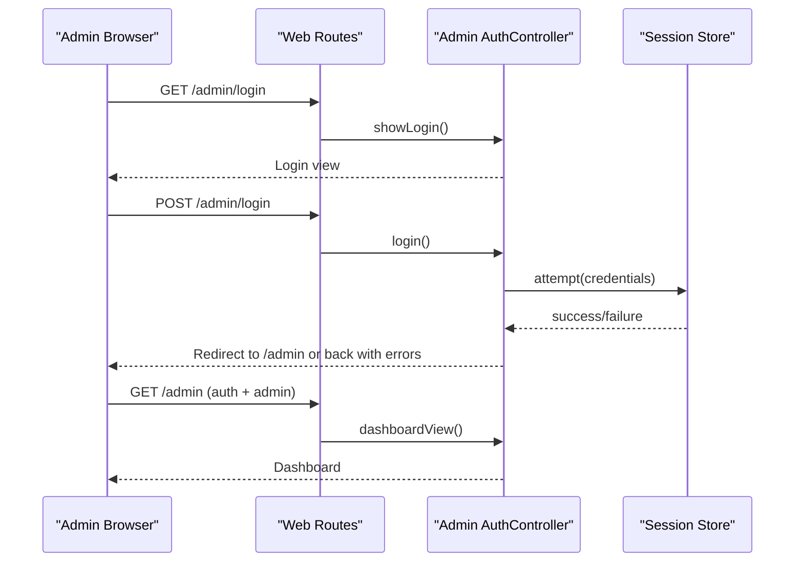
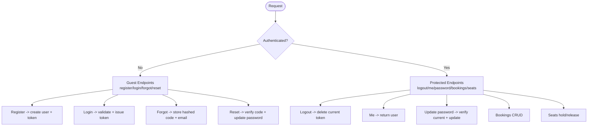
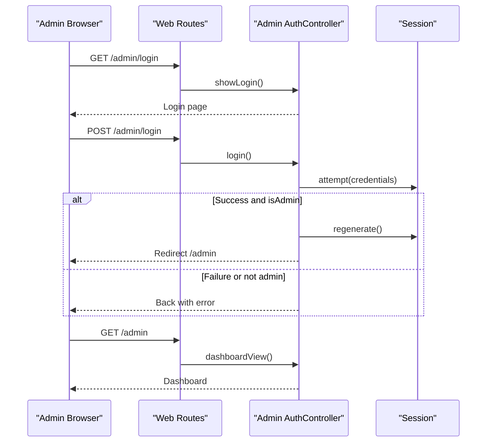
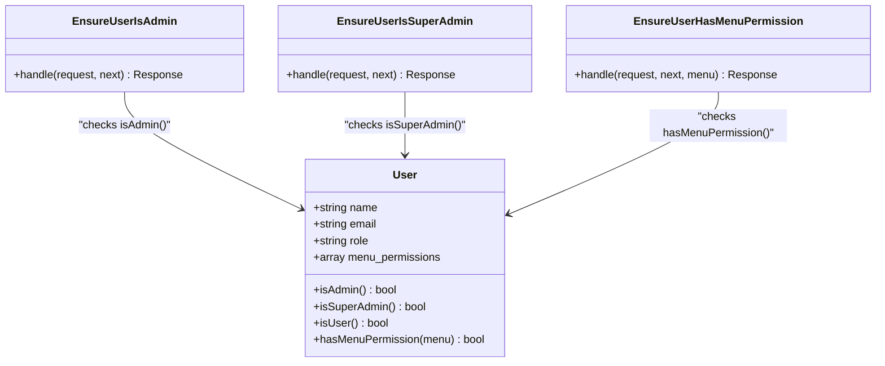
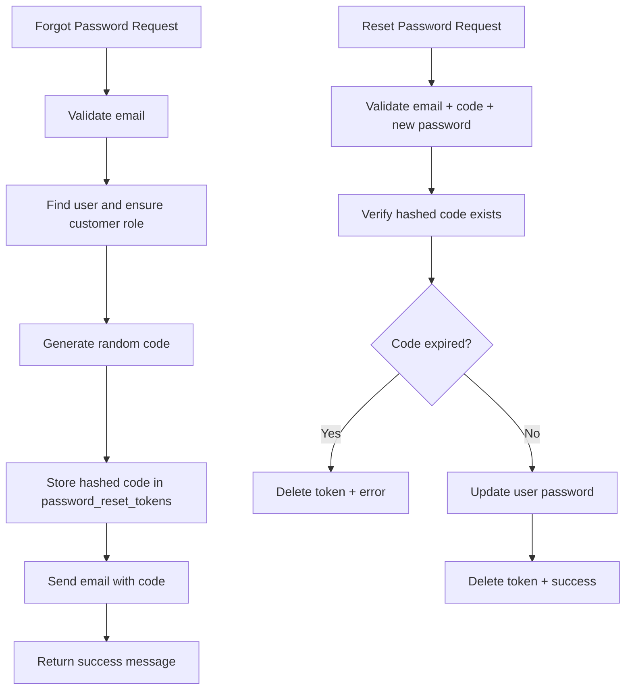
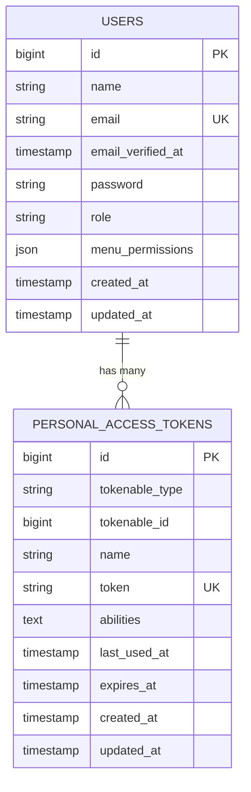
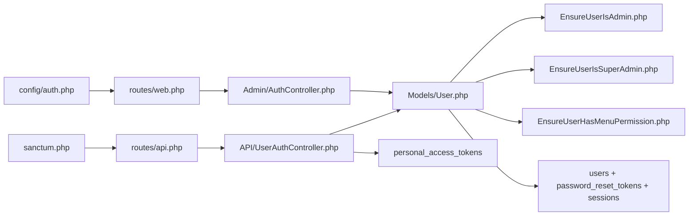

# Authentication & Authorization

<cite>
**Referenced Files in This Document**
- [sanctum.php](file://backend/config/sanctum.php)
- [auth.php](file://backend/config/auth.php)
- [api.php](file://backend/routes/api.php)
- [web.php](file://backend/routes/web.php)
- [UserAuthController.php](file://backend/app/Http/Controllers/API/UserAuthController.php)
- [AuthController.php](file://backend/app/Http/Controllers/Admin/AuthController.php)
- [User.php](file://backend/app/Models/User.php)
- [EnsureUserIsAdmin.php](file://backend/app/Http/Middleware/EnsureUserIsAdmin.php)
- [EnsureUserIsSuperAdmin.php](file://backend/app/Http/Middleware/EnsureUserIsSuperAdmin.php)
- [EnsureUserHasMenuPermission.php](file://backend/app/Http/Middleware/EnsureUserHasMenuPermission.php)
- [0001_01_01_000000_create_users_table.php](file://backend/database/migrations/0001_01_01_000000_create_users_table.php)
- [2026_06_02_071612_create_personal_access_tokens_table.php](file://backend/database/migrations/2026_06_02_071612_create_personal_access_tokens_table.php)
</cite>

## Table of Contents
1. [Introduction](#introduction)
2. [Project Structure](#project-structure)
3. [Core Components](#core-components)
4. [Architecture Overview](#architecture-overview)
5. [Detailed Component Analysis](#detailed-component-analysis)
6. [Dependency Analysis](#dependency-analysis)
7. [Performance Considerations](#performance-considerations)
8. [Troubleshooting Guide](#troubleshooting-guide)
9. [Conclusion](#conclusion)

## Introduction
This document explains SonyaBus authentication and authorization. It covers:
- Laravel Sanctum for API token-based authentication
- Session-based admin authentication with CSRF protection
- Role-based access control (RBAC) for User, Admin, and SuperAdmin roles
- Middleware for route protection, permission checks, and menu access control
- Customer registration, login/logout, password reset, and account verification fields
- API personal access tokens and client-side handling guidance
- Examples of protected routes, custom middleware usage, and permission-based UI rendering

## Project Structure
Authentication and authorization are implemented across configuration, routes, controllers, models, middleware, and database migrations:
- Configuration: Sanctum and Auth guards
- Routes: Public customer API, authenticated customer API, and admin web routes
- Controllers: Customer API auth controller and admin session auth controller
- Model: User model with role helpers and menu permissions
- Middleware: Admin role, super admin role, and menu permission checks
- Database: Users table, password reset tokens, sessions, and personal access tokens

**Diagram sources**
- [sanctum.php:1-88](file://backend/config/sanctum.php#L1-L88)
- [auth.php:1-118](file://backend/config/auth.php#L1-L118)
- [api.php:1-77](file://backend/routes/api.php#L1-L77)
- [web.php:1-293](file://backend/routes/web.php#L1-L293)
- [UserAuthController.php:1-220](file://backend/app/Http/Controllers/API/UserAuthController.php#L1-L220)
- [AuthController.php:1-83](file://backend/app/Http/Controllers/Admin/AuthController.php#L1-L83)
- [User.php:1-76](file://backend/app/Models/User.php#L1-L76)
- [EnsureUserIsAdmin.php:1-41](file://backend/app/Http/Middleware/EnsureUserIsAdmin.php#L1-L41)
- [EnsureUserIsSuperAdmin.php:1-38](file://backend/app/Http/Middleware/EnsureUserIsSuperAdmin.php#L1-L38)
- [EnsureUserHasMenuPermission.php:1-41](file://backend/app/Http/Middleware/EnsureUserHasMenuPermission.php#L1-L41)
- [0001_01_01_000000_create_users_table.php:1-52](file://backend/database/migrations/0001_01_01_000000_create_users_table.php#L1-L52)
- [2026_06_02_071612_create_personal_access_tokens_table.php:1-34](file://backend/database/migrations/2026_06_02_071612_create_personal_access_tokens_table.php#L1-L34)

**Section sources**
- [sanctum.php:1-88](file://backend/config/sanctum.php#L1-L88)
- [auth.php:1-118](file://backend/config/auth.php#L1-L118)
- [api.php:1-77](file://backend/routes/api.php#L1-L77)
- [web.php:1-293](file://backend/routes/web.php#L1-L293)

## Core Components
- Sanctum configuration defines stateful domains, guard, expiration, token prefix, and middleware stack for SPA cookie handling and CSRF validation.
- Auth configuration defines the default web guard using session driver and Eloquent user provider.
- API routes expose public endpoints, guest-only auth endpoints, and Sanctum-protected customer endpoints.
- Web routes define admin login/logout and protect admin console routes with session auth and RBAC middleware.
- User model provides role helpers and menu permission checks.
- Custom middleware enforce admin, super admin, and menu permissions.

**Section sources**
- [sanctum.php:10-85](file://backend/config/sanctum.php#L10-L85)
- [auth.php:18-74](file://backend/config/auth.php#L18-L74)
- [api.php:26-75](file://backend/routes/api.php#L26-L75)
- [web.php:68-292](file://backend/routes/web.php#L68-L292)
- [User.php:44-74](file://backend/app/Models/User.php#L44-L74)
- [EnsureUserIsAdmin.php:12-39](file://backend/app/Http/Middleware/EnsureUserIsAdmin.php#L12-L39)
- [EnsureUserIsSuperAdmin.php:12-36](file://backend/app/Http/Middleware/EnsureUserIsSuperAdmin.php#L12-L36)
- [EnsureUserHasMenuPermission.php:15-39](file://backend/app/Http/Middleware/EnsureUserHasMenuPermission.php#L15-L39)

## Architecture Overview
The system supports two primary flows:
- Customer API flow: Token-based authentication via Laravel Sanctum for SPA clients.
- Admin web flow: Session-based authentication with CSRF protection for Blade dashboard.

**Diagram sources**
- [api.php:41-75](file://backend/routes/api.php#L41-L75)
- [UserAuthController.php:17-79](file://backend/app/Http/Controllers/API/UserAuthController.php#L17-L79)
- [2026_06_02_071612_create_personal_access_tokens_table.php:12-23](file://backend/database/migrations/2026_06_02_071612_create_personal_access_tokens_table.php#L12-L23)

**Diagram sources**
- [web.php:68-80](file://backend/routes/web.php#L68-L80)
- [AuthController.php:11-47](file://backend/app/Http/Controllers/Admin/AuthController.php#L11-L47)
- [0001_01_01_000000_create_users_table.php:32-39](file://backend/database/migrations/0001_01_01_000000_create_users_table.php#L32-L39)

## Detailed Component Analysis

### Sanctum Configuration and Stateful SPA Authentication
- Stateful domains are configured to allow cookies from SPA origins.
- The Sanctum guard uses the web guard by default.
- Expiration can be set globally; otherwise, per-token behavior applies.
- Token prefixing is supported for secret scanning.
- Middleware stack includes session authentication, cookie encryption, and CSRF validation for first-party SPAs.

Key behaviors:
- Requests from configured domains receive stateful cookies.
- Bearer tokens are used for non-stateful API requests.
- CSRF protection is applied through Sanctum’s middleware stack when stateful.

**Section sources**
- [sanctum.php:10-85](file://backend/config/sanctum.php#L10-L85)

### API Authentication Flow (Customer)
Endpoints:
- Guest routes: register, login, forgot-password, reset-password
- Authenticated routes: logout, me, update password, bookings, seats hold/release

Flow highlights:
- Registration creates a user with role user and returns a Sanctum token.
- Login validates credentials, ensures the account is a customer, revokes existing tokens, and issues a new token.
- Logout deletes the current access token.
- Me returns formatted user data.
- Password update requires current password and enforces confirmation.
- Forgot/reset password uses a hashed code stored in password_reset_tokens with a 60-minute expiry.

**Diagram sources**
- [api.php:41-75](file://backend/routes/api.php#L41-L75)
- [UserAuthController.php:17-208](file://backend/app/Http/Controllers/API/UserAuthController.php#L17-L208)

**Section sources**
- [api.php:41-75](file://backend/routes/api.php#L41-L75)
- [UserAuthController.php:17-208](file://backend/app/Http/Controllers/API/UserAuthController.php#L17-L208)

### Admin Web Authentication Flow
- Admin login shows a login view if not already authenticated as an admin.
- Login attempts authenticate via session and ensure the user has admin privileges.
- Successful login regenerates the session and redirects to the admin dashboard.
- Logout invalidates the session and regenerates the CSRF token.
- Admin password update validates current password and updates it.

**Diagram sources**
- [web.php:68-80](file://backend/routes/web.php#L68-L80)
- [AuthController.php:11-47](file://backend/app/Http/Controllers/Admin/AuthController.php#L11-L47)

**Section sources**
- [web.php:68-80](file://backend/routes/web.php#L68-L80)
- [AuthController.php:11-83](file://backend/app/Http/Controllers/Admin/AuthController.php#L11-L83)

### Role-Based Access Control (RBAC)
Roles:
- User: Customer accounts that use the API.
- Admin: Administrative users who can access the admin panel.
- SuperAdmin: Highest privilege level for license and site settings management.

Role checks:
- User model methods determine roles and menu permissions.
- SuperAdmin bypasses menu permission checks.
- Non-admin users cannot access admin menus.

**Diagram sources**
- [User.php:44-74](file://backend/app/Models/User.php#L44-L74)
- [EnsureUserIsAdmin.php:12-39](file://backend/app/Http/Middleware/EnsureUserIsAdmin.php#L12-L39)
- [EnsureUserIsSuperAdmin.php:12-36](file://backend/app/Http/Middleware/EnsureUserIsSuperAdmin.php#L12-L36)
- [EnsureUserHasMenuPermission.php:15-39](file://backend/app/Http/Middleware/EnsureUserHasMenuPermission.php#L15-L39)

**Section sources**
- [User.php:44-74](file://backend/app/Models/User.php#L44-L74)
- [EnsureUserIsAdmin.php:12-39](file://backend/app/Http/Middleware/EnsureUserIsAdmin.php#L12-L39)
- [EnsureUserIsSuperAdmin.php:12-36](file://backend/app/Http/Middleware/EnsureUserIsSuperAdmin.php#L12-L36)
- [EnsureUserHasMenuPermission.php:15-39](file://backend/app/Http/Middleware/EnsureUserHasMenuPermission.php#L15-L39)

### Middleware Implementation for Route Protection
- EnsureUserIsAdmin: Enforces admin role on web and API/admin API routes. Returns JSON for API and redirects for web.
- EnsureUserIsSuperAdmin: Enforces super admin role on sensitive admin routes. Returns JSON for API and redirects for web.
- EnsureUserHasMenuPermission: Checks per-menu permissions for admin routes. Supports granular access control.

Usage patterns:
- Protect entire route groups with `auth` and `admin`.
- Apply `menu_permission:<menu>` to restrict specific features.
- Use `super_admin` middleware for license and site settings.

**Section sources**
- [web.php:80-292](file://backend/routes/web.php#L80-L292)
- [EnsureUserIsAdmin.php:12-39](file://backend/app/Http/Middleware/EnsureUserIsAdmin.php#L12-L39)
- [EnsureUserIsSuperAdmin.php:12-36](file://backend/app/Http/Middleware/EnsureUserIsSuperAdmin.php#L12-L36)
- [EnsureUserHasMenuPermission.php:15-39](file://backend/app/Http/Middleware/EnsureUserHasMenuPermission.php#L15-L39)

### Password Reset and Account Verification
Password reset:
- Forgot password generates a random code, stores a hashed version in password_reset_tokens, and sends an email.
- Reset password verifies the code, checks expiry (60 minutes), updates the user password, and clears the token.

Account verification:
- The users table includes an email_verified_at field.
- The User model casts this field to datetime.
- No explicit verification endpoint is present in the provided API routes; verification status can be checked server-side or via the me endpoint.

**Diagram sources**
- [UserAuthController.php:113-208](file://backend/app/Http/Controllers/API/UserAuthController.php#L113-L208)
- [0001_01_01_000000_create_users_table.php:26-30](file://backend/database/migrations/0001_01_01_000000_create_users_table.php#L26-L30)

**Section sources**
- [UserAuthController.php:113-208](file://backend/app/Http/Controllers/API/UserAuthController.php#L113-L208)
- [0001_01_01_000000_create_users_table.php:14-23](file://backend/database/migrations/0001_01_01_000000_create_users_table.php#L14-L23)

### API Token Management and Personal Access Tokens
- Personal access tokens are created via Sanctum’s HasApiTokens trait.
- Tokens are named (for example, frontend-api) and returned as plain text to the client.
- Clients should store the token securely and include it as a Bearer token in subsequent requests.
- Logout deletes the current access token.

Data model:
- personal_access_tokens table includes tokenable polymorphic relation, name, unique token, abilities, last_used_at, expires_at, and timestamps.

**Diagram sources**
- [0001_01_01_000000_create_users_table.php:14-23](file://backend/database/migrations/0001_01_01_000000_create_users_table.php#L14-L23)
- [2026_06_02_071612_create_personal_access_tokens_table.php:12-23](file://backend/database/migrations/2026_06_02_071612_create_personal_access_tokens_table.php#L12-L23)

**Section sources**
- [UserAuthController.php:17-38](file://backend/app/Http/Controllers/API/UserAuthController.php#L17-L38)
- [UserAuthController.php:72-79](file://backend/app/Http/Controllers/API/UserAuthController.php#L72-L79)
- [2026_06_02_071612_create_personal_access_tokens_table.php:12-23](file://backend/database/migrations/2026_06_02_071612_create_personal_access_tokens_table.php#L12-L23)

### Client-Side Authentication Handling
Recommended practices:
- After successful registration or login, store the returned token securely (for example, in memory or secure storage).
- Include the token as a Bearer token in the Authorization header for all authenticated API calls.
- On logout, call the logout endpoint to invalidate the token on the server.
- For SPA stateful cookies, ensure requests originate from configured stateful domains so Sanctum sets cookies correctly.

[No sources needed since this section provides general guidance]

### Examples of Protected Routes and Permission-Based UI Rendering
Protected routes:
- Admin web routes are grouped under `auth` and `admin` middleware.
- Specific features are further restricted using `menu_permission:<menu>`.
- License and site settings are restricted to `super_admin`.

Permission-based UI rendering:
- Frontend components can request the current user profile via `/api/auth/me` and conditionally render menus based on role and menu_permissions.
- Alternatively, backend responses can include computed visibility flags for menus.

**Section sources**
- [web.php:80-292](file://backend/routes/web.php#L80-L292)
- [UserAuthController.php:81-86](file://backend/app/Http/Controllers/API/UserAuthController.php#L81-L86)
- [User.php:59-74](file://backend/app/Models/User.php#L59-L74)

## Dependency Analysis
The following diagram maps core dependencies between configuration, routes, controllers, model, middleware, and database tables.

**Diagram sources**
- [sanctum.php:1-88](file://backend/config/sanctum.php#L1-L88)
- [auth.php:1-118](file://backend/config/auth.php#L1-L118)
- [api.php:1-77](file://backend/routes/api.php#L1-L77)
- [web.php:1-293](file://backend/routes/web.php#L1-L293)
- [UserAuthController.php:1-220](file://backend/app/Http/Controllers/API/UserAuthController.php#L1-L220)
- [AuthController.php:1-83](file://backend/app/Http/Controllers/Admin/AuthController.php#L1-L83)
- [User.php:1-76](file://backend/app/Models/User.php#L1-L76)
- [EnsureUserIsAdmin.php:1-41](file://backend/app/Http/Middleware/EnsureUserIsAdmin.php#L1-L41)
- [EnsureUserIsSuperAdmin.php:1-38](file://backend/app/Http/Middleware/EnsureUserIsSuperAdmin.php#L1-L38)
- [EnsureUserHasMenuPermission.php:1-41](file://backend/app/Http/Middleware/EnsureUserHasMenuPermission.php#L1-L41)
- [0001_01_01_000000_create_users_table.php:1-52](file://backend/database/migrations/0001_01_01_000000_create_users_table.php#L1-L52)
- [2026_06_02_071612_create_personal_access_tokens_table.php:1-34](file://backend/database/migrations/2026_06_02_071612_create_personal_access_tokens_table.php#L1-L34)

**Section sources**
- [sanctum.php:1-88](file://backend/config/sanctum.php#L1-L88)
- [auth.php:1-118](file://backend/config/auth.php#L1-L118)
- [api.php:1-77](file://backend/routes/api.php#L1-L77)
- [web.php:1-293](file://backend/routes/web.php#L1-L293)
- [UserAuthController.php:1-220](file://backend/app/Http/Controllers/API/UserAuthController.php#L1-L220)
- [AuthController.php:1-83](file://backend/app/Http/Controllers/Admin/AuthController.php#L1-L83)
- [User.php:1-76](file://backend/app/Models/User.php#L1-L76)
- [EnsureUserIsAdmin.php:1-41](file://backend/app/Http/Middleware/EnsureUserIsAdmin.php#L1-L41)
- [EnsureUserIsSuperAdmin.php:1-38](file://backend/app/Http/Middleware/EnsureUserIsSuperAdmin.php#L1-L38)
- [EnsureUserHasMenuPermission.php:1-41](file://backend/app/Http/Middleware/EnsureUserHasMenuPermission.php#L1-L41)
- [0001_01_01_000000_create_users_table.php:1-52](file://backend/database/migrations/0001_01_01_000000_create_users_table.php#L1-L52)
- [2026_06_02_071612_create_personal_access_tokens_table.php:1-34](file://backend/database/migrations/2026_06_02_071612_create_personal_access_tokens_table.php#L1-L34)

## Performance Considerations
- Rate limiting is applied to guest authentication endpoints to mitigate brute-force attacks.
- Token creation and deletion are lightweight operations; ensure proper cleanup on logout.
- Menu permission checks are simple array lookups; keep menu_permissions arrays small and well-structured.
- Avoid unnecessary re-authentication by caching user profiles on the client side after fetching `/api/auth/me`.

[No sources needed since this section provides general guidance]

## Troubleshooting Guide
Common issues and resolutions:
- Unauthenticated API responses:
  - Ensure the Bearer token is included in the Authorization header.
  - Verify the token was issued successfully and not deleted.
- Access denied for admin routes:
  - Confirm the user role is admin or super_admin.
  - Check that the correct middleware (`admin`, `super_admin`, `menu_permission`) is applied.
- CSRF errors in SPA stateful requests:
  - Ensure the SPA origin is listed in Sanctum stateful domains.
  - Verify cookies are being sent with requests.
- Password reset failures:
  - Validate that the code matches the hashed value in password_reset_tokens.
  - Check for token expiry (60 minutes).

**Section sources**
- [api.php:41-75](file://backend/routes/api.php#L41-L75)
- [UserAuthController.php:113-208](file://backend/app/Http/Controllers/API/UserAuthController.php#L113-L208)
- [EnsureUserIsAdmin.php:12-39](file://backend/app/Http/Middleware/EnsureUserIsAdmin.php#L12-L39)
- [EnsureUserIsSuperAdmin.php:12-36](file://backend/app/Http/Middleware/EnsureUserIsSuperAdmin.php#L12-L36)
- [EnsureUserHasMenuPermission.php:15-39](file://backend/app/Http/Middleware/EnsureUserHasMenuPermission.php#L15-L39)
- [sanctum.php:21-26](file://backend/config/sanctum.php#L21-L26)

## Conclusion
SonyaBus implements a robust authentication and authorization system combining Laravel Sanctum for API token-based authentication and session-based admin authentication with CSRF protection. Roles (User, Admin, SuperAdmin) and menu permissions provide fine-grained access control. The middleware layer enforces these policies consistently across web and API routes. By following the documented flows and best practices, developers can implement secure, scalable authentication and authorization for both customer-facing APIs and the admin dashboard.