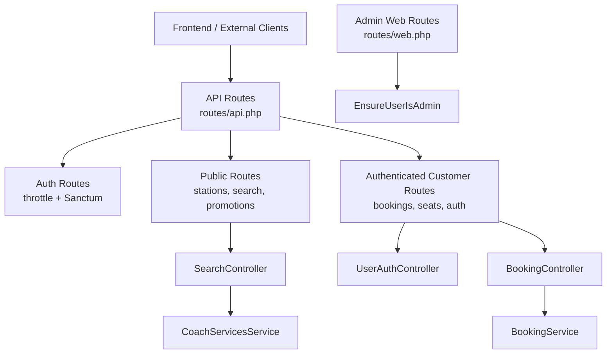
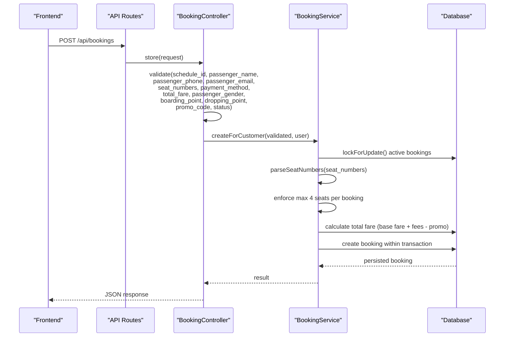
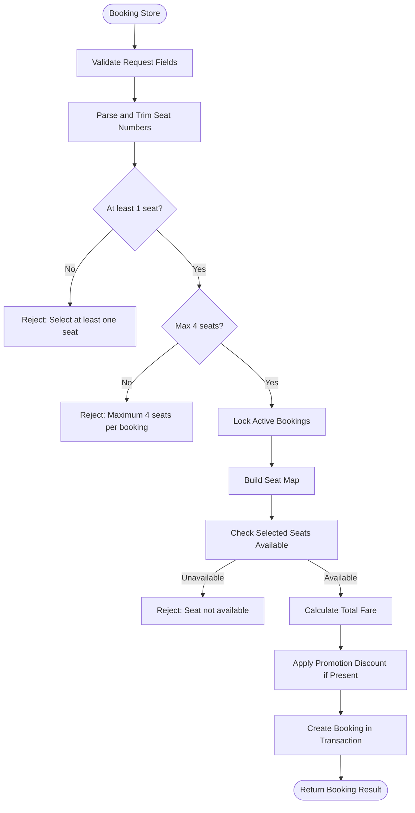
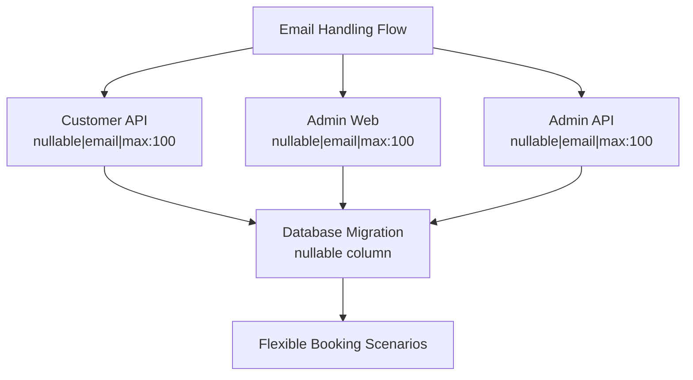
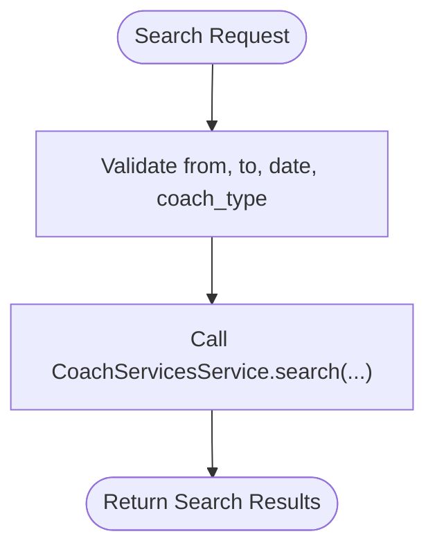
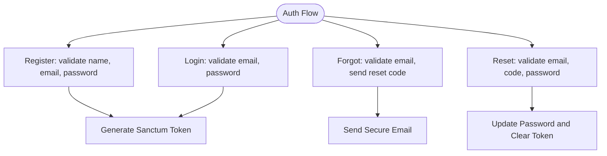
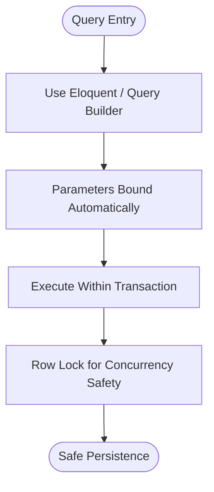
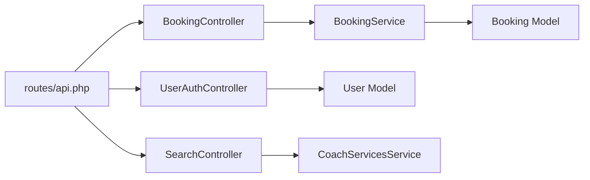

# Input Validation & Sanitization

<cite>
**Referenced Files in This Document**
- [BookingController.php](file://backend/app/Http/Controllers/API/BookingController.php)
- [AdminBookingController.php](file://backend/app/Http/Controllers/Admin/BookingController.php)
- [BookingApiController.php](file://backend/app/Http/Controllers/API/Admin/BookingApiController.php)
- [UserAuthController.php](file://backend/app/Http/Controllers/API/UserAuthController.php)
- [SearchController.php](file://backend/app/Http/Controllers/API/SearchController.php)
- [BookingService.php](file://backend/app/Services/BookingService.php)
- [api.php](file://backend/routes/api.php)
- [web.php](file://backend/routes/web.php)
- [app.php](file://backend/config/app.php)
- [cors.php](file://backend/config/cors.php)
- [session.php](file://backend/config/session.php)
- [database.php](file://backend/config/database.php)
- [EnsureUserIsAdmin.php](file://backend/app/Http/Middleware/EnsureUserIsAdmin.php)
- [User.php](file://backend/app/Models/User.php)
- [Booking.php](file://backend/app/Models/Booking.php)
- [2026_11_16_000000_make_passenger_email_nullable_on_bookings_table.php](file://backend/database/migrations/2026_11_16_000000_make_passenger_email_nullable_on_bookings_table.php)
</cite>

## Update Summary
**Changes Made**
- Updated passenger_email validation rules from required to optional across all booking endpoints
- Added documentation for the database migration supporting nullable email addresses
- Updated booking request validation examples to reflect optional email support
- Enhanced admin booking flow documentation to support both API and admin scenarios without mandatory emails

## Table of Contents
1. [Introduction](#introduction)
2. [Project Structure](#project-structure)
3. [Core Components](#core-components)
4. [Architecture Overview](#architecture-overview)
5. [Detailed Component Analysis](#detailed-component-analysis)
6. [Dependency Analysis](#dependency-analysis)
7. [Performance Considerations](#performance-considerations)
8. [Troubleshooting Guide](#troubleshooting-guide)
9. [Conclusion](#conclusion)

## Introduction
This document explains how SonyaBus validates and sanitizes input, protects against common web vulnerabilities, and secures data flows for bus ticket booking operations. It focuses on Laravel request validation rules used across API controllers and services, CSRF protection via Sanctum and session configuration, XSS prevention through safe rendering practices, SQL injection mitigation using parameterized queries, and secure handling of sensitive inputs such as seats, fares, promotions, and user credentials. **Updated**: The system now supports optional passenger email addresses across all booking flows, accommodating both customer-facing APIs and administrative booking scenarios where email contact may not be available.

## Project Structure
The security-relevant parts of the backend are organized around:
- API routes defining public, authenticated, and webhook endpoints
- Controllers validating incoming requests before delegating to services
- Services enforcing business rules and constructing database queries safely
- Configuration files controlling CORS, sessions, encryption, and database behavior
- Middleware protecting admin areas and returning consistent JSON responses

**Diagram sources**
- [api.php:1-77](file://backend/routes/api.php#L1-L77)
- [web.php:60-90](file://backend/routes/web.php#L60-L90)
- [BookingController.php:1-150](file://backend/app/Http/Controllers/API/BookingController.php#L1-L150)
- [UserAuthController.php:1-220](file://backend/app/Http/Controllers/API/UserAuthController.php#L1-L220)
- [SearchController.php:1-33](file://backend/app/Http/Controllers/API/SearchController.php#L1-L33)
- [BookingService.php:1-335](file://backend/app/Services/BookingService.php#L1-L335)
- [EnsureUserIsAdmin.php:1-41](file://backend/app/Http/Middleware/EnsureUserIsAdmin.php#L1-L41)

**Section sources**
- [api.php:1-77](file://backend/routes/api.php#L1-L77)
- [web.php:60-90](file://backend/routes/web.php#L60-L90)

## Core Components
- API route groups enforce authentication, rate limiting, and maintenance mode checks.
- Controllers validate all incoming parameters with strict Laravel rules.
- Services implement domain logic, including seat selection limits, fare calculation, promotion application, and transactional booking creation.
- Models define fillable fields and casts to ensure type safety at persistence time.
- Middleware ensures only authorized users can access admin resources and returns consistent JSON errors for API consumers.

Key validation patterns observed:
- Required fields validated with presence and type constraints
- **Updated**: Passenger email is now optional across all booking endpoints while maintaining email format validation when provided
- Enumerated values restricted with allow-lists
- Numeric ranges constrained to prevent abuse
- Database existence checks for foreign keys
- Date format validation for search queries
- Unique email validation during registration

**Section sources**
- [BookingController.php:19-40](file://backend/app/Http/Controllers/API/BookingController.php#L19-L40)
- [AdminBookingController.php:20-52](file://backend/app/Http/Controllers/Admin/BookingController.php#L20-L52)
- [BookingApiController.php:49-73](file://backend/app/Http/Controllers/API/Admin/BookingApiController.php#L49-L73)
- [UserAuthController.php:17-39](file://backend/app/Http/Controllers/API/UserAuthController.php#L17-L39)
- [UserAuthController.php:41-70](file://backend/app/Http/Controllers/API/UserAuthController.php#L41-L70)
- [UserAuthController.php:88-111](file://backend/app/Http/Controllers/API/UserAuthController.php#L88-L111)
- [UserAuthController.php:113-164](file://backend/app/Http/Controllers/API/UserAuthController.php#L113-L164)
- [UserAuthController.php:166-208](file://backend/app/Http/Controllers/API/UserAuthController.php#L166-L208)
- [SearchController.php:14-31](file://backend/app/Http/Controllers/API/SearchController.php#L14-L31)
- [BookingService.php:28-131](file://backend/app/Services/BookingService.php#L28-L131)
- [BookingService.php:304-333](file://backend/app/Services/BookingService.php#L304-L333)
- [Booking.php:12-31](file://backend/app/Models/Booking.php#L12-L31)
- [User.php:17-37](file://backend/app/Models/User.php#L17-L37)

## Architecture Overview
The booking flow demonstrates layered validation and secure query construction:

**Diagram sources**
- [api.php:63-75](file://backend/routes/api.php#L63-L75)
- [BookingController.php:19-40](file://backend/app/Http/Controllers/API/BookingController.php#L19-L40)
- [BookingService.php:28-131](file://backend/app/Services/BookingService.php#L28-L131)

## Detailed Component Analysis

### Booking Request Validation and Business Rules
- Controller-level validation enforces:
  - schedule_id must exist in schedules
  - passenger_name, passenger_phone required with length limits
  - **Updated**: passenger_email is now optional but validated as email format when provided
  - seat_numbers string with maximum length
  - payment_method enumerated by business context
  - total_fare nullable numeric non-negative
  - passenger_gender limited to M or F
  - boarding_point and dropping_point optional strings with length caps
  - promo_code optional string
  - status sometimes allowed with an allow-list of valid statuses
- Service-level validation adds:
  - Seat parsing and trimming
  - Minimum one seat and maximum four seats per booking
  - Authorization check preventing non-admins from manually booking cash or pre-booked seats
  - Transactional creation with row locking to avoid race conditions
  - Fare calculation with optional promotion discount applied safely

**Diagram sources**
- [BookingController.php:19-40](file://backend/app/Http/Controllers/API/BookingController.php#L19-L40)
- [BookingService.php:28-131](file://backend/app/Services/BookingService.php#L28-L131)
- [BookingService.php:304-333](file://backend/app/Services/BookingService.php#L304-L333)

**Section sources**
- [BookingController.php:19-40](file://backend/app/Http/Controllers/API/BookingController.php#L19-L40)
- [AdminBookingController.php:20-52](file://backend/app/Http/Controllers/Admin/BookingController.php#L20-L52)
- [BookingApiController.php:49-73](file://backend/app/Http/Controllers/API/Admin/BookingApiController.php#L49-L73)
- [BookingService.php:28-131](file://backend/app/Services/BookingService.php#L28-L131)
- [BookingService.php:304-333](file://backend/app/Services/BookingService.php#L304-L333)

### Optional Email Support Across All Booking Flows
**New** The system now supports optional passenger email addresses across all booking endpoints:

- **Customer API**: `passenger_email` validated as `nullable|email|max:100`
- **Admin Web Interface**: `passenger_email` validated as `nullable|email|max:100`  
- **Admin API**: `passenger_email` validated as `nullable|email|max:100`
- **Database Schema**: Migration makes `passenger_email` column nullable

This change enables flexible booking scenarios:
- Customer bookings without email addresses
- Administrative bookings for walk-in customers
- Bulk booking operations where email collection is not feasible
- Legacy data compatibility with existing records

**Diagram sources**
- [BookingController.php:25](file://backend/app/Http/Controllers/API/BookingController.php#L25)
- [AdminBookingController.php:26](file://backend/app/Http/Controllers/Admin/BookingController.php#L26)
- [BookingApiController.php:55](file://backend/app/Http/Controllers/API/Admin/BookingApiController.php#L55)
- [2026_11_16_000000_make_passenger_email_nullable_on_bookings_table.php:12-16](file://backend/database/migrations/2026_11_16_000000_make_passenger_email_nullable_on_bookings_table.php#L12-L16)

**Section sources**
- [BookingController.php:25](file://backend/app/Http/Controllers/API/BookingController.php#L25)
- [AdminBookingController.php:26](file://backend/app/Http/Controllers/Admin/BookingController.php#L26)
- [BookingApiController.php:55](file://backend/app/Http/Controllers/API/Admin/BookingApiController.php#L55)
- [2026_11_16_000000_make_passenger_email_nullable_on_bookings_table.php:12-16](file://backend/database/migrations/2026_11_16_000000_make_passenger_email_nullable_on_bookings_table.php#L12-L16)

### Search Parameters Validation
- Search endpoint validates:
  - from and to must be valid station IDs
  - date must match YYYY-MM-DD format
  - coach_type is optional string
- The controller then passes validated values into a service method for querying schedules.

**Diagram sources**
- [SearchController.php:14-31](file://backend/app/Http/Controllers/API/SearchController.php#L14-L31)

**Section sources**
- [SearchController.php:14-31](file://backend/app/Http/Controllers/API/SearchController.php#L14-L31)

### User Authentication Inputs
- Registration validates name, email uniqueness, and password strength plus confirmation.
- Login validates email and password; throws structured validation errors when credentials are incorrect.
- Password update validates current password and new password with confirmation.
- Forgot password validates email and sends reset code securely without logging secrets.
- Reset password validates email, code, and new password; enforces token expiration and deletes used tokens.

**Diagram sources**
- [UserAuthController.php:17-39](file://backend/app/Http/Controllers/API/UserAuthController.php#L17-L39)
- [UserAuthController.php:41-70](file://backend/app/Http/Controllers/API/UserAuthController.php#L41-L70)
- [UserAuthController.php:88-111](file://backend/app/Http/Controllers/API/UserAuthController.php#L88-L111)
- [UserAuthController.php:113-164](file://backend/app/Http/Controllers/API/UserAuthController.php#L113-L164)
- [UserAuthController.php:166-208](file://backend/app/Http/Controllers/API/UserAuthController.php#L166-L208)

**Section sources**
- [UserAuthController.php:17-39](file://backend/app/Http/Controllers/API/UserAuthController.php#L17-L39)
- [UserAuthController.php:41-70](file://backend/app/Http/Controllers/API/UserAuthController.php#L41-L70)
- [UserAuthController.php:88-111](file://backend/app/Http/Controllers/API/UserAuthController.php#L88-L111)
- [UserAuthController.php:113-164](file://backend/app/Http/Controllers/API/UserAuthController.php#L113-L164)
- [UserAuthController.php:166-208](file://backend/app/Http/Controllers/API/UserAuthController.php#L166-L208)

### File Upload Security
- No file upload endpoints were found in the analyzed API controllers and routes.
- If uploads are introduced later, recommended controls include:
  - MIME type validation against an allow-list
  - Size limits enforced server-side
  - Path traversal prevention by storing files outside web root and generating random filenames
  - Scanning uploaded content for malicious payloads
  - Restricting executable types and disabling script execution in upload directories

[No sources needed since this section provides general guidance]

### Input Filtering and Data Sanitization Patterns
- Strong typing and casting:
  - Model casts ensure decimal precision for monetary values
  - Fillable arrays restrict mass assignment to expected fields
- String constraints:
  - Length limits on names, emails, phone numbers, and location fields
- Enumerated values:
  - Gender limited to M/F
  - Payment methods and statuses restricted to known values
- Numeric safeguards:
  - Non-negative fare validation
  - Seat count capped at four
- Safe query construction:
  - Eloquent ORM uses parameter binding automatically
  - Transactions and row locks protect concurrent booking operations

**Section sources**
- [Booking.php:12-31](file://backend/app/Models/Booking.php#L12-L31)
- [User.php:17-37](file://backend/app/Models/User.php#L17-L37)
- [BookingController.php:19-40](file://backend/app/Http/Controllers/API/BookingController.php#L19-L40)
- [BookingService.php:28-131](file://backend/app/Services/BookingService.php#L28-L131)

### Secure Database Query Construction
- All database interactions use Eloquent models and query builders, which bind parameters and prevent SQL injection.
- Booking creation occurs inside a database transaction with row locking to ensure consistency under concurrency.
- Foreign key references are validated via exists rules before creating related records.

**Diagram sources**
- [BookingService.php:52-127](file://backend/app/Services/BookingService.php#L52-L127)

**Section sources**
- [BookingService.php:52-127](file://backend/app/Services/BookingService.php#L52-L127)

### CSRF Protection Implementation
- Sanctum-based API authentication is used for customer endpoints.
- Session configuration includes SameSite cookie policy and HTTP-only flags to mitigate CSRF risks.
- CORS configuration allows specific paths and headers; credentials support is disabled by default.

Recommendations:
- Ensure Sanctum CSRF cookie exchange is implemented for SPA-to-API calls when using cookies.
- Keep supports_credentials false unless explicitly required and restrict allowed_origins to trusted domains.

**Section sources**
- [api.php:41-75](file://backend/routes/api.php#L41-L75)
- [session.php:189-202](file://backend/config/session.php#L189-L202)
- [session.php:172-185](file://backend/config/session.php#L172-L185)
- [cors.php:18-32](file://backend/config/cors.php#L18-L32)

### XSS Prevention Measures
- Blade templates render output safely by default; avoid raw echo of untrusted data.
- Avoid storing HTML in fields like passenger_name or boarding_point unless strictly necessary; if HTML is required, sanitize on input and escape on output.
- Use structured JSON responses rather than embedding user-generated content directly into scripts.

[No sources needed since this section provides general guidance]

### Common Security Vulnerabilities and Prevention Techniques for Bus Ticket Booking
- Double-booking seats:
  - Prevented by locking rows and checking availability within a transaction
- Overbooking or invalid seat selection:
  - Enforced by parsing and validating seat lists and capping seat counts
- Unauthorized cancellation or payment:
  - Protected by ownership checks and role-based middleware
- Injection attacks:
  - Mitigated by using parameterized queries through Eloquent
- Brute-force login attempts:
  - Rate-limited on authentication routes
- Insecure cross-origin requests:
  - Controlled via CORS settings and Sanctum authentication

**Section sources**
- [BookingService.php:52-127](file://backend/app/Services/BookingService.php#L52-L127)
- [api.php:41-46](file://backend/routes/api.php#L41-L46)
- [EnsureUserIsAdmin.php:12-39](file://backend/app/Http/Middleware/EnsureUserIsAdmin.php#L12-L39)

## Dependency Analysis
The following diagram shows how controllers depend on services and models, and how routes gate access:

**Diagram sources**
- [api.php:1-77](file://backend/routes/api.php#L1-L77)
- [BookingController.php:1-150](file://backend/app/Http/Controllers/API/BookingController.php#L1-L150)
- [UserAuthController.php:1-220](file://backend/app/Http/Controllers/API/UserAuthController.php#L1-L220)
- [SearchController.php:1-33](file://backend/app/Http/Controllers/API/SearchController.php#L1-L33)
- [BookingService.php:1-335](file://backend/app/Services/BookingService.php#L1-L335)
- [Booking.php:1-49](file://backend/app/Models/Booking.php#L1-L49)
- [User.php:1-76](file://backend/app/Models/User.php#L1-L76)

**Section sources**
- [api.php:1-77](file://backend/routes/api.php#L1-L77)
- [BookingController.php:1-150](file://backend/app/Http/Controllers/API/BookingController.php#L1-L150)
- [UserAuthController.php:1-220](file://backend/app/Http/Controllers/API/UserAuthController.php#L1-L220)
- [SearchController.php:1-33](file://backend/app/Http/Controllers/API/SearchController.php#L1-L33)
- [BookingService.php:1-335](file://backend/app/Services/BookingService.php#L1-L335)
- [Booking.php:1-49](file://backend/app/Models/Booking.php#L1-L49)
- [User.php:1-76](file://backend/app/Models/User.php#L1-L76)

## Performance Considerations
- Validation overhead is minimal compared to database transactions; keep validation rules tight to reduce unnecessary processing.
- Use pagination parameters validated to limit dataset size.
- Avoid excessive eager loading; load only relationships needed for the response.
- For high-concurrency booking scenarios, consider caching seat availability snapshots where appropriate, while ensuring cache invalidation aligns with database state changes.

[No sources needed since this section provides general guidance]

## Troubleshooting Guide
- Validation failures:
  - Review controller validation rules for each endpoint
  - Inspect error messages returned by Laravel's validator
- Authentication issues:
  - Verify Sanctum token generation and deletion on logout
  - Confirm throttle middleware is configured correctly
- Authorization errors:
  - Check role checks and middleware for admin-only routes
- Database errors:
  - Inspect transaction boundaries and locking strategies
  - Ensure foreign key constraints are satisfied
- **Updated**: Email validation issues:
  - Verify that null email values are properly handled throughout the booking pipeline
  - Check that frontend forms properly submit null or empty email values
  - Ensure email format validation only applies when email is provided

**Section sources**
- [BookingController.php:19-40](file://backend/app/Http/Controllers/API/BookingController.php#L19-L40)
- [AdminBookingController.php:20-52](file://backend/app/Http/Controllers/Admin/BookingController.php#L20-L52)
- [BookingApiController.php:49-73](file://backend/app/Http/Controllers/API/Admin/BookingApiController.php#L49-L73)
- [UserAuthController.php:41-70](file://backend/app/Http/Controllers/API/UserAuthController.php#L41-L70)
- [EnsureUserIsAdmin.php:12-39](file://backend/app/Http/Middleware/EnsureUserIsAdmin.php#L12-L39)
- [BookingService.php:52-127](file://backend/app/Services/BookingService.php#L52-L127)

## Conclusion
SonyaBus applies robust input validation at the controller layer and enforces business rules in services. Security measures include Sanctum-based authentication, rate limiting, transactional database operations with row locking, and careful use of Eloquent to prevent SQL injection. CORS and session configurations provide foundational protections against CSRF and cross-origin risks. **Updated**: The system now supports flexible booking workflows with optional passenger email addresses across all endpoints, enabling both customer-facing APIs and administrative booking scenarios without requiring email contact information. While no file upload endpoints were present in the analyzed scope, any future uploads should follow strict MIME, size, and path controls. By maintaining these patterns, SonyaBus mitigates common vulnerabilities in bus ticket booking workflows while providing enhanced flexibility for diverse booking requirements.