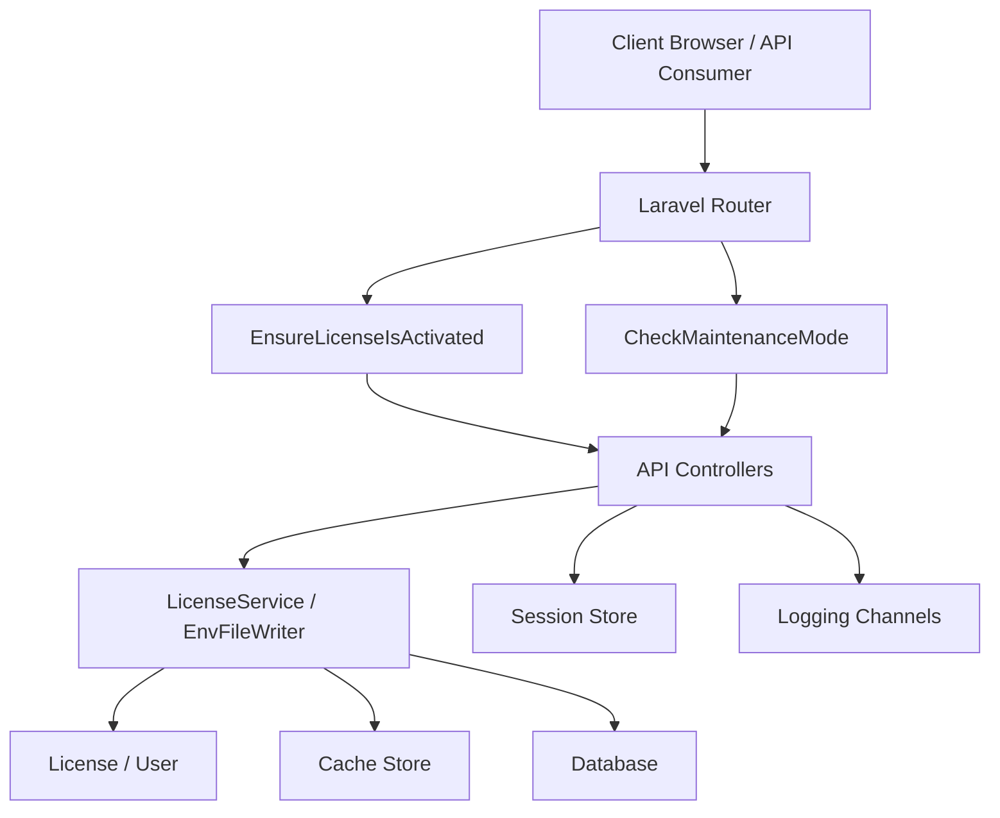
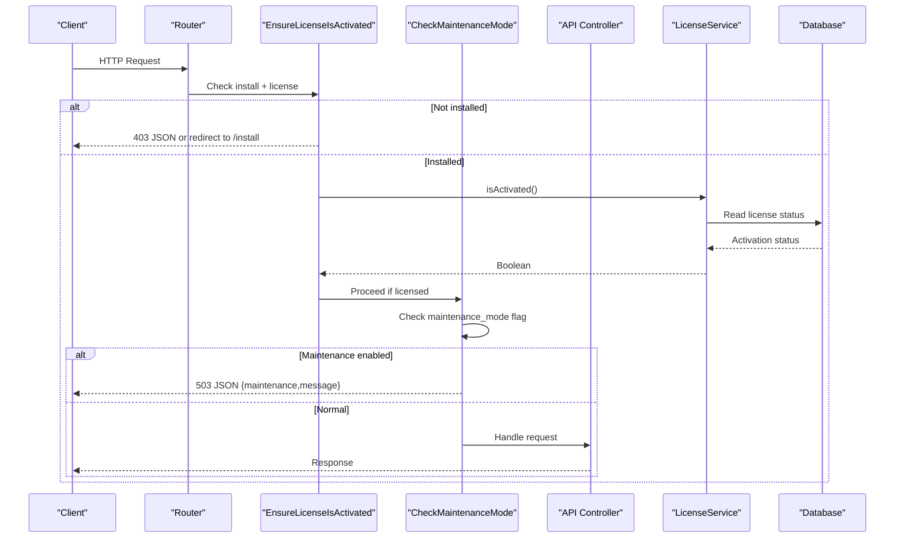
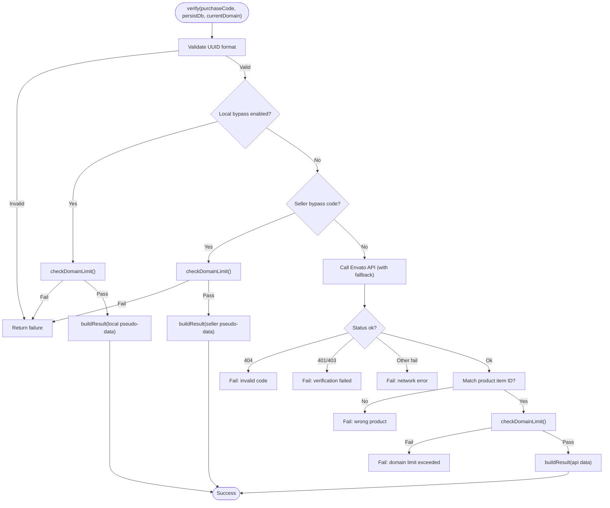
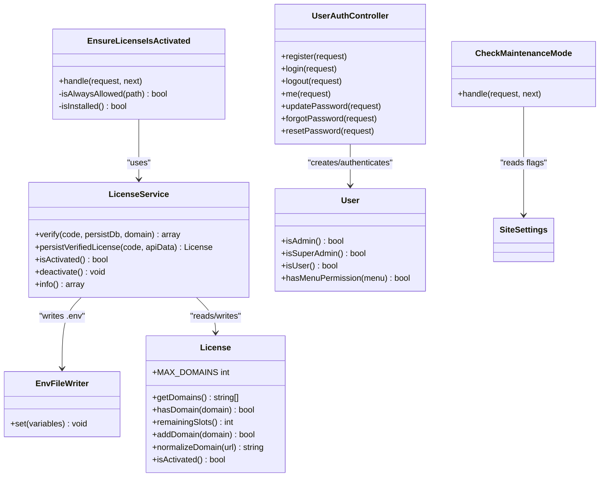

# Security Hardening & Best Practices

<cite>
**Referenced Files in This Document**
- [app.php](file://backend/config/app.php)
- [auth.php](file://backend/config/auth.php)
- [cors.php](file://backend/config/cors.php)
- [session.php](file://backend/config/session.php)
- [logging.php](file://backend/config/logging.php)
- [database.php](file://backend/config/database.php)
- [cache.php](file://backend/config/cache.php)
- [CheckMaintenanceMode.php](file://backend/app/Http/Middleware/CheckMaintenanceMode.php)
- [EnsureLicenseIsActivated.php](file://backend/app/Http/Middleware/EnsureLicenseIsActivated.php)
- [LicenseService.php](file://backend/app/Services/LicenseService.php)
- [EnvFileWriter.php](file://backend/app/Services/EnvFileWriter.php)
- [User.php](file://backend/app/Models/User.php)
- [License.php](file://backend/app/Models/License.php)
- [UserAuthController.php](file://backend/app/Http/Controllers/API/UserAuthController.php)
- [SECURITY_IMPLEMENTATION_GUIDE.md](file://SECURITY_IMPLEMENTATION_GUIDE.md)
</cite>

## Table of Contents
1. [Introduction](#introduction)
2. [Project Structure](#project-structure)
3. [Core Components](#core-components)
4. [Architecture Overview](#architecture-overview)
5. [Detailed Component Analysis](#detailed-component-analysis)
6. [Dependency Analysis](#dependency-analysis)
7. [Performance Considerations](#performance-considerations)
8. [Troubleshooting Guide](#troubleshooting-guide)
9. [Conclusion](#conclusion)
10. [Appendices](#appendices)

## Introduction
This document provides comprehensive security hardening guidance for SonyaBus. It covers environment variable protection, configuration file security, sensitive data handling, rate limiting and brute-force protection, maintenance mode controls, license verification and domain locking, CORS and HTTPS posture, session and cookie security, secure communication protocols, monitoring and audit logging, vulnerability assessment practices, a security checklist, deployment guidelines, and incident response procedures. The recommendations are grounded in the actual backend configuration, middleware, services, models, and controllers present in the repository.

## Project Structure
SonyaBus is a Laravel-based backend with a React frontend. Security-relevant components include:
- Application configuration files controlling debug mode, encryption keys, maintenance driver, and environment flags.
- Authentication and session configuration.
- CORS policy.
- Logging channels and levels.
- Database and cache configuration.
- Middleware enforcing installation state, license activation, and maintenance mode.
- License service implementing Envato purchase code verification, domain limits, and safe .env writes.
- User model and API authentication controller.

**Diagram sources**
- [EnsureLicenseIsActivated.php](file://backend/app/Http/Middleware/EnsureLicenseIsActivated.php)
- [CheckMaintenanceMode.php](file://backend/app/Http/Middleware/CheckMaintenanceMode.php)
- [LicenseService.php](file://backend/app/Services/LicenseService.php)
- [EnvFileWriter.php](file://backend/app/Services/EnvFileWriter.php)
- [License.php](file://backend/app/Models/License.php)
- [User.php](file://backend/app/Models/User.php)
- [session.php](file://backend/config/session.php)
- [logging.php](file://backend/config/logging.php)

**Section sources**
- [app.php](file://backend/config/app.php)
- [auth.php](file://backend/config/auth.php)
- [cors.php](file://backend/config/cors.php)
- [session.php](file://backend/config/session.php)
- [logging.php](file://backend/config/logging.php)
- [database.php](file://backend/config/database.php)
- [cache.php](file://backend/config/cache.php)

## Core Components
- Environment and application settings:
  - Debug mode, app URL, locale, encryption key, previous keys, maintenance driver/store, and install/license flags.
- Authentication and sessions:
  - Guard/provider configuration, password reset token table, expiration/throttle, password confirmation timeout.
  - Session driver, lifetime, encryption, storage, cookie attributes (secure, http_only, same_site, partitioned).
- CORS:
  - Allowed paths, methods, origins, headers, credentials support.
- Logging:
  - Default channel, stack, daily rotation, Slack, Papertrail, stderr, syslog, errorlog, null, emergency.
- Database and cache:
  - Connection drivers, SSL options, Redis configuration, cache stores and prefixing.

Security implications:
- Ensure APP_DEBUG=false in production to avoid information disclosure.
- Enforce a strong APP_KEY and rotate via APP_PREVIOUS_KEYS when rotating keys.
- Use database or Redis session store; enable SESSION_ENCRYPT and secure cookie flags.
- Restrict CORS to known origins and methods; enable supports_credentials only when required.
- Set LOG_LEVEL appropriately and route critical logs to external systems.
- Prefer MySQL/MariaDB/PostgreSQL with TLS where supported; isolate cache and session backends.

**Section sources**
- [app.php](file://backend/config/app.php)
- [auth.php](file://backend/config/auth.php)
- [session.php](file://backend/config/session.php)
- [cors.php](file://backend/config/cors.php)
- [logging.php](file://backend/config/logging.php)
- [database.php](file://backend/config/database.php)
- [cache.php](file://backend/config/cache.php)

## Architecture Overview
The request lifecycle includes two primary security gates before reaching controllers:
- Installation and license gating ensures uninstalled instances block non-install routes and require a valid license for protected endpoints.
- Maintenance mode gating returns a controlled JSON response for most requests while allowing site-settings endpoints to remain accessible.

**Diagram sources**
- [EnsureLicenseIsActivated.php](file://backend/app/Http/Middleware/EnsureLicenseIsActivated.php)
- [CheckMaintenanceMode.php](file://backend/app/Http/Middleware/CheckMaintenanceMode.php)
- [LicenseService.php](file://backend/app/Services/LicenseService.php)
- [License.php](file://backend/app/Models/License.php)

## Detailed Component Analysis

### Environment Variables and Configuration File Protection
- Sensitive values must be stored in .env and never committed:
  - APP_KEY, APP_PREVIOUS_KEYS, DB_* credentials, REDIS_* credentials, MAIL_* credentials, ENVATO_* tokens, SMS gateway secrets.
- .env write operations are centralized through EnvFileWriter, which validates allowed key names and prevents path traversal.
- Application flags:
  - APP_INSTALLED and APP_LICENSED control installation and licensing gates.
  - ENVATO_SKIP_VERIFY allows local bypass under strict conditions.

Recommendations:
- Restrict filesystem permissions so only the web server user can read/write .env.
- Avoid writing secrets at runtime unless absolutely necessary; prefer secret managers.
- Validate all env key names programmatically before writing.

**Section sources**
- [EnvFileWriter.php](file://backend/app/Services/EnvFileWriter.php)
- [app.php](file://backend/config/app.php)

### Sensitive Data Handling
- Passwords:
  - User model casts password as hashed; ensure hashing is enforced on creation/update.
- Reset codes:
  - Reset codes are hashed before storage and not logged.
- License data:
  - Purchase codes are masked in info responses; domains are normalized and limited.

Recommendations:
- Never log raw passwords, tokens, or reset codes.
- Mask or redact sensitive fields in logs and API responses.
- Rotate secrets regularly and use least-privilege database users.

**Section sources**
- [User.php](file://backend/app/Models/User.php)
- [UserAuthController.php](file://backend/app/Http/Controllers/API/UserAuthController.php)
- [LicenseService.php](file://backend/app/Services/LicenseService.php)

### Rate Limiting, API Throttling, and Brute Force Protection
- Auth endpoints should be throttled to prevent brute force and credential stuffing:
  - Register and login endpoints should enforce low per-minute limits.
  - Password change endpoints should have stricter limits.
- The project’s implementation guide documents recommended throttle middleware usage for auth endpoints.

Recommendations:
- Apply explicit throttle middleware to all authentication-related endpoints.
- Consider IP-based and user-based throttling for sensitive actions.
- Monitor failed attempts and implement account lockout policies after repeated failures.

**Section sources**
- [SECURITY_IMPLEMENTATION_GUIDE.md](file://SECURITY_IMPLEMENTATION_GUIDE.md)

### Maintenance Mode Security
- Maintenance mode is enforced by middleware that reads a site setting and returns a standardized JSON response with 503 status.
- Site-settings endpoints are explicitly excluded from maintenance blocking so clients can poll status.

Recommendations:
- Keep maintenance messages generic and non-sensitive.
- Ensure only authorized admin interfaces can toggle maintenance mode.
- Combine with access controls to restrict administrative changes.

**Section sources**
- [CheckMaintenanceMode.php](file://backend/app/Http/Middleware/CheckMaintenanceMode.php)

### License Verification Security and Domain Locking
- LicenseService implements multi-step verification:
  - UUID format validation.
  - Local dev bypass only when explicitly enabled and running in local environment.
  - Seller bypass code restricted to a single hardcoded value.
  - Real Envato API calls with fallback endpoint and timeouts/retries.
  - Product ID match enforcement.
  - Domain limit enforcement (maximum unique domains per purchase code).
- License persistence:
  - Safe .env updates via EnvFileWriter.
  - Cache TTL for activation checks.
- Domain normalization and slot management are handled in the License model.

Recommendations:
- Disable ENVATO_SKIP_VERIFY in production.
- Protect license activation endpoints behind admin-only access.
- Log verification outcomes without exposing secrets.
- Regularly review activated domains and remove stale entries.

**Diagram sources**
- [LicenseService.php](file://backend/app/Services/LicenseService.php)
- [License.php](file://backend/app/Models/License.php)

**Section sources**
- [LicenseService.php](file://backend/app/Services/LicenseService.php)
- [License.php](file://backend/app/Models/License.php)
- [EnvFileWriter.php](file://backend/app/Services/EnvFileWriter.php)

### CORS Configuration
- Current configuration allows broad access patterns:
  - Paths include API and Sanctum CSRF cookie endpoints.
  - Methods and origins are set to allow all.
  - Credentials are disabled by default.

Recommendations:
- Restrict allowed_origins to trusted frontends.
- Narrow allowed_methods to only those needed.
- Enable supports_credentials only when cookies are required and configure SameSite accordingly.
- Expose minimal headers and avoid wildcard headers in production.

**Section sources**
- [cors.php](file://backend/config/cors.php)

### Security Headers and HTTPS Enforcement
- While framework-level security headers are not configured in the referenced files, production deployments should enforce:
  - HSTS, X-Frame-Options, X-Content-Type-Options, Referrer-Policy, Content-Security-Policy.
  - Redirect HTTP to HTTPS and enforce secure cookies.
- Session configuration supports secure cookies and SameSite attributes.

Recommendations:
- Configure reverse proxy or web server to add security headers and enforce HTTPS.
- Set SESSION_SECURE_COOKIE=true and SESSION_SAME_SITE=strict or lax depending on cross-site needs.
- Ensure APP_URL uses https:// in production.

**Section sources**
- [session.php](file://backend/config/session.php)
- [app.php](file://backend/config/app.php)

### Session Security and Cookie Configuration
- Session driver defaults to database; consider Redis for scalability.
- Session lifetime and expire-on-close behavior should align with security policy.
- Cookie attributes:
  - Secure: restrict to HTTPS.
  - HttpOnly: prevent client-side script access.
  - SameSite: mitigate CSRF.
  - Partitioned: optional for advanced cross-site contexts.

Recommendations:
- Enable SESSION_ENCRYPT in production.
- Use short lifetimes for sensitive sessions.
- Avoid wildcard SESSION_DOMAIN unless necessary.
- Rotate session secrets and clear orphaned sessions periodically.

**Section sources**
- [session.php](file://backend/config/session.php)

### Secure Communication Protocols
- Database connections:
  - MySQL/MariaDB support SSL CA configuration.
  - PostgreSQL supports sslmode.
- External APIs:
  - LicenseService uses HTTP client with timeouts and retries.

Recommendations:
- Enforce TLS for all database connections.
- Pin or validate upstream certificates where possible.
- Time out and retry external calls safely; do not expose internal errors.

**Section sources**
- [database.php](file://backend/config/database.php)
- [LicenseService.php](file://backend/app/Services/LicenseService.php)

### Security Monitoring, Audit Logging, and Vulnerability Assessment
- Logging channels provide flexible destinations including daily files, Slack, Papertrail, syslog, and stderr.
- Recommended practices:
  - Route security events (failed logins, license verification failures, maintenance toggles) to dedicated channels.
  - Centralize logs and retain them securely with appropriate retention policies.
  - Perform regular vulnerability scans and dependency audits.

Recommendations:
- Set LOG_LEVEL to warn/error in production.
- Integrate with SIEM or alerting pipelines.
- Run automated dependency scanning and penetration testing.

**Section sources**
- [logging.php](file://backend/config/logging.php)

## Dependency Analysis
Key dependencies and relationships:
- EnsureLicenseIsActivated depends on LicenseService to determine activation status.
- LicenseService depends on EnvFileWriter for safe .env updates and on License model for domain management.
- CheckMaintenanceMode depends on SiteSetting values to gate requests.
- UserAuthController interacts with User model and Laravel Sanctum for token management.

**Diagram sources**
- [EnsureLicenseIsActivated.php](file://backend/app/Http/Middleware/EnsureLicenseIsActivated.php)
- [LicenseService.php](file://backend/app/Services/LicenseService.php)
- [EnvFileWriter.php](file://backend/app/Services/EnvFileWriter.php)
- [License.php](file://backend/app/Models/License.php)
- [CheckMaintenanceMode.php](file://backend/app/Http/Middleware/CheckMaintenanceMode.php)
- [UserAuthController.php](file://backend/app/Http/Controllers/API/UserAuthController.php)
- [User.php](file://backend/app/Models/User.php)

**Section sources**
- [EnsureLicenseIsActivated.php](file://backend/app/Http/Middleware/EnsureLicenseIsActivated.php)
- [LicenseService.php](file://backend/app/Services/LicenseService.php)
- [EnvFileWriter.php](file://backend/app/Services/EnvFileWriter.php)
- [License.php](file://backend/app/Models/License.php)
- [CheckMaintenanceMode.php](file://backend/app/Http/Middleware/CheckMaintenanceMode.php)
- [UserAuthController.php](file://backend/app/Http/Controllers/API/UserAuthController.php)
- [User.php](file://backend/app/Models/User.php)

## Performance Considerations
- Use Redis for sessions and cache to reduce database load.
- Cache license activation checks with appropriate TTL.
- Rotate logs daily and compress old logs.
- Tune database connection pooling and query performance.
- Avoid heavy computations in request path; offload to jobs where applicable.

[No sources needed since this section provides general guidance]

## Troubleshooting Guide
Common issues and mitigations:
- Debug mode enabled in production:
  - Symptom: Stack traces and internal details exposed.
  - Fix: Set APP_DEBUG=false and APP_ENV=production.
- CORS errors:
  - Symptom: Blocked cross-origin requests.
  - Fix: Restrict allowed_origins and methods; enable supports_credentials only when needed.
- Session not persisted:
  - Symptom: Users repeatedly logged out.
  - Fix: Verify session driver and storage; ensure database or Redis is reachable.
- License verification fails:
  - Symptom: 403 responses due to missing or invalid license.
  - Fix: Validate ENVATO_* configuration; check domain limits; inspect logs.
- Maintenance mode blocks legitimate endpoints:
  - Symptom: Clients cannot fetch site settings.
  - Fix: Ensure site-settings endpoints are excluded from maintenance checks.

**Section sources**
- [app.php](file://backend/config/app.php)
- [cors.php](file://backend/config/cors.php)
- [session.php](file://backend/config/session.php)
- [EnsureLicenseIsActivated.php](file://backend/app/Http/Middleware/EnsureLicenseIsActivated.php)
- [CheckMaintenanceMode.php](file://backend/app/Http/Middleware/CheckMaintenanceMode.php)

## Conclusion
SonyaBus includes robust security foundations: installation and license gating, maintenance mode controls, configurable sessions and CORS, and structured logging. To harden further, enforce HTTPS, tighten CORS, apply explicit rate limiting on sensitive endpoints, secure environment variables, and adopt proactive monitoring and vulnerability assessment practices. Follow the deployment guidelines and incident response procedures outlined below to maintain a secure operational posture.

[No sources needed since this section summarizes without analyzing specific files]

## Appendices

### Security Checklist
- Environment and secrets:
  - [ ] APP_DEBUG=false, APP_ENV=production
  - [ ] Strong APP_KEY set; APP_PREVIOUS_KEYS configured during rotation
  - [ ] All secrets in .env; .env excluded from version control
  - [ ] Minimal filesystem permissions on .env and storage
- Authentication and authorization:
  - [ ] Passwords hashed; no plaintext storage
  - [ ] Admin routes protected by role checks
  - [ ] Sanctum tokens managed securely; logout clears tokens
- Sessions and cookies:
  - [ ] SESSION_DRIVER=database or redis
  - [ ] SESSION_ENCRYPT=true
  - [ ] SESSION_SECURE_COOKIE=true, SESSION_HTTP_ONLY=true, SESSION_SAME_SITE=strict/lax
- CORS and HTTPS:
  - [ ] allowed_origins restricted to trusted domains
  - [ ] supports_credentials only when required
  - [ ] HTTPS enforced; HSTS enabled
- Rate limiting and brute force protection:
  - [ ] Auth endpoints throttled
  - [ ] Account lockout or CAPTCHA for repeated failures
- License and domain locking:
  - [ ] ENVATO_SKIP_VERIFY disabled in production
  - [ ] Domain limits enforced; monitor activated domains
- Logging and monitoring:
  - [ ] LOG_LEVEL=warn or error in production
  - [ ] Critical events forwarded to external logging/SIEM
  - [ ] Retention policies applied
- Database and cache:
  - [ ] TLS enabled for DB connections
  - [ ] Redis isolated and secured
- Deployment:
  - [ ] Web server security headers configured
  - [ ] Backups encrypted and tested
  - [ ] Access controls and least privilege enforced

[No sources needed since this section provides general guidance]

### Deployment Security Guidelines
- Use a reverse proxy (e.g., Nginx/Traefik) to terminate TLS and enforce security headers.
- Run the application under a dedicated non-root user.
- Isolate secrets using environment injection or a secrets manager.
- Restrict outbound network access to required endpoints only.
- Enable automatic security updates for OS and dependencies.
- Validate configurations in CI/CD pipelines.

[No sources needed since this section provides general guidance]

### Incident Response Procedures
- Detection:
  - Monitor logs for anomalies (failed logins, license verification failures, maintenance toggles).
- Containment:
  - Temporarily enable maintenance mode for affected areas.
  - Revoke compromised tokens and invalidate sessions.
- Eradication:
  - Rotate secrets (APP_KEY, DB credentials, API tokens).
  - Patch vulnerabilities and update dependencies.
- Recovery:
  - Restore from verified backups if needed.
  - Gradually re-enable features after validation.
- Post-incident:
  - Conduct root cause analysis.
  - Update policies and controls based on findings.

[No sources needed since this section provides general guidance]