# Security Implementation

<cite>
**Referenced Files in This Document**
- [sanctum.php](file://backend/config/sanctum.php)
- [auth.php](file://backend/config/auth.php)
- [session.php](file://backend/config/session.php)
- [cors.php](file://backend/config/cors.php)
- [api.php](file://backend/routes/api.php)
- [web.php](file://backend/routes/web.php)
- [UserAuthController.php](file://backend/app/Http/Controllers/API/UserAuthController.php)
- [AuthController.php](file://backend/app/Http/Controllers/Admin/AuthController.php)
- [User.php](file://backend/app/Models/User.php)
- [EnsureUserIsAdmin.php](file://backend/app/Http/Middleware/EnsureUserIsAdmin.php)
- [EnsureUserIsSuperAdmin.php](file://backend/app/Http/Middleware/EnsureUserIsSuperAdmin.php)
- [EnsureUserHasMenuPermission.php](file://backend/app/Http/Middleware/EnsureUserHasMenuPermission.php)
- [LicenseService.php](file://backend/app\Services\LicenseService.php)
- [License.php](file://backend/app\Models\License.php)
- [EnsureLicenseIsActivated.php](file://backend/app\Http\Middleware\EnsureLicenseIsActivated.php)
- [AdminSessionService.php](file://backend/app\Services\AdminSessionService.php)
- [ApplySessionLifetime.php](file://backend/app/Http/Middleware/ApplySessionLifetime.php)
- [EnforceAdminSessionTimeout.php](file://backend/app/Http/Middleware/EnforceAdminSessionTimeout.php)
- [SiteSettingsService.php](file://backend/app/Services/SiteSettingsService.php)
- [2026_11_15_000000_add_admin_session_lifetime_site_setting.php](file://backend/database/migrations/2026_11_15_000000_add_admin_session_lifetime_site_setting.php)
- [2026_11_15_000010_add_customer_session_lifetime_site_setting.php](file://backend/database/migrations/2026_11_15_000010_add_customer_session_lifetime_site_setting.php)
- [site-settings.blade.php](file://backend/resources/views/admin/partials/site-settings.blade.php)
- [AdminSessionTimeoutTest.php](file://backend/tests/Feature/AdminSessionTimeoutTest.php)
</cite>

## Update Summary
**Changes Made**
- Added comprehensive admin session security system documentation including configurable session expiration and idle timeout enforcement
- Documented separation between admin session behavior and customer API token behavior
- Added validation constraints for session lifetime values (1-10080 minutes for admin, 0-43200 minutes for customers)
- Updated Session Management section with new middleware and service architecture
- Added new diagrams showing the admin session timeout enforcement flow

## Table of Contents
1. Introduction
2. Project Structure
3. Core Components
4. Architecture Overview
5. Detailed Component Analysis
6. Dependency Analysis
7. Performance Considerations
8. Troubleshooting Guide
9. Conclusion

## Introduction
This document explains the security implementation for SonyaBus, focusing on authentication and authorization with Laravel Sanctum, role-based access control, permission management, input validation, CSRF protection, XSS prevention, SQL injection mitigation, rate limiting, file upload security, path traversal prevention, secure environment variable handling, license verification security, session management, and hardening best practices. It maps these controls to concrete files in the backend so you can trace behavior directly in the codebase.

**Updated** Added comprehensive documentation for the new admin session security system that provides configurable session expiration, idle timeout enforcement, and separation between admin session behavior and customer API token behavior.

## Project Structure
The security-relevant parts of the backend are organized around:
- Configuration for authentication, sessions, CORS, and Sanctum
- API routes for public and authenticated endpoints
- Admin web routes protected by session-based auth and middleware
- Middleware enforcing admin, super-admin, menu permissions, and license activation
- Models for users and licenses
- Services for license verification and session management
- New admin session security components for configurable timeouts

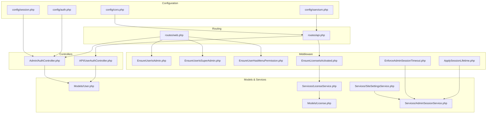

**Diagram sources**
- [sanctum.php:1-88](file://backend/config/sanctum.php#L1-L88)
- [auth.php:1-118](file://backend/config/auth.php#L1-L118)
- [session.php:1-218](file://backend/config/session.php#L1-L218)
- [cors.php:1-35](file://backend/config/cors.php#L1-L35)
- [api.php:1-77](file://backend/routes/api.php#L1-L77)
- [web.php:1-293](file://backend/routes/web.php#L1-L293)
- [UserAuthController.php:1-220](file://backend/app/Http/Controllers/API/UserAuthController.php#L1-L220)
- [AuthController.php:1-83](file://backend/app/Http/Controllers/Admin/AuthController.php#L1-L83)
- [EnsureUserIsAdmin.php:1-41](file://backend/app/Http/Middleware/EnsureUserIsAdmin.php#L1-L41)
- [EnsureUserIsSuperAdmin.php:1-38](file://backend/app/Http/Middleware/EnsureUserIsSuperAdmin.php#L1-L38)
- [EnsureUserHasMenuPermission.php:1-41](file://backend/app/Http/Middleware/EnsureUserHasMenuPermission.php#L1-L41)
- [LicenseService.php:1-408](file://backend/app\Services\LicenseService.php#L1-L408)
- [License.php:1-126](file://backend/app\Models\License.php#L1-L126)
- [EnsureLicenseIsActivated.php:1-169](file://backend/app\Http\Middleware\EnsureLicenseIsActivated.php#L1-L169)
- [AdminSessionService.php:1-121](file://backend/app\Services\AdminSessionService.php#L1-L121)
- [ApplySessionLifetime.php:1-49](file://backend/app/Http/Middleware/ApplySessionLifetime.php#L1-L49)
- [EnforceAdminSessionTimeout.php:1-76](file://backend/app/Http/Middleware/EnforceAdminSessionTimeout.php#L1-L76)
- [SiteSettingsService.php:1-205](file://backend/app/Services/SiteSettingsService.php#L1-L205)

**Section sources**
- [sanctum.php:1-88](file://backend/config/sanctum.php#L1-L88)
- [auth.php:1-118](file://backend/config/auth.php#L1-L118)
- [session.php:1-218](file://backend/config/session.php#L1-L218)
- [cors.php:1-35](file://backend/config/cors.php#L1-L35)
- [api.php:1-77](file://backend/routes/api.php#L1-L77)
- [web.php:1-293](file://backend/routes/web.php#L1-L293)

## Core Components
- Authentication
  - Customer API uses Laravel Sanctum tokens via routes grouped under auth:sanctum.
  - Admin dashboard uses session-based authentication with guards configured in auth.php.
- Authorization
  - Role checks: admin vs super_admin via User model methods.
  - Menu-level permissions enforced through EnsureUserHasMenuPermission middleware.
- License gating
  - Two-stage gate: installation lock and license activation check via EnsureLicenseIsActivated middleware and LicenseService.
- **New** Admin Session Security
  - Configurable session expiration through Site Settings interface.
  - Idle timeout enforcement for admin sessions only.
  - Separation between admin session behavior and customer API token behavior.
  - Validation ensuring values stay within safe bounds (1-10080 minutes for admin, 0-43200 minutes for customers).

Key responsibilities:
- Sanctum configuration for stateful domains, token prefix, and middleware integration.
- Session configuration for lifetime, encryption, cookie flags, and SameSite policy.
- CORS configuration for cross-origin requests between frontend and API.
- Route-level rate limiting for authentication endpoints.
- Input validation in controllers using Laravel's validator rules.
- CSRF protection for session-based admin routes.
- Secure password hashing and reset flows.
- Domain-limited license verification against Envato APIs.
- **New** Admin session lifetime configuration and enforcement through dedicated services and middleware.

**Section sources**
- [sanctum.php:1-88](file://backend/config/sanctum.php#L1-L88)
- [auth.php:1-118](file://backend/config/auth.php#L1-L118)
- [session.php:1-218](file://backend/config/session.php#L1-L218)
- [cors.php:1-35](file://backend/config/cors.php#L1-L35)
- [api.php:1-77](file://backend/routes/api.php#L1-L77)
- [web.php:1-293](file://backend/routes/web.php#L1-L293)
- [UserAuthController.php:1-220](file://backend/app/Http/Controllers/API/UserAuthController.php#L1-L220)
- [AuthController.php:1-83](file://backend/app/Http/Controllers/Admin/AuthController.php#L1-L83)
- [User.php:1-76](file://backend/app/Models/User.php#L1-L76)
- [EnsureUserIsAdmin.php:1-41](file://backend/app/Http/Middleware/EnsureUserIsAdmin.php#L1-L41)
- [EnsureUserIsSuperAdmin.php:1-38](file://backend/app/Http/Middleware/EnsureUserIsSuperAdmin.php#L1-L38)
- [EnsureUserHasMenuPermission.php:1-41](file://backend/app/Http/Middleware/EnsureUserHasMenuPermission.php#L1-L41)
- [LicenseService.php:1-408](file://backend/app\Services\LicenseService.php#L1-L408)
- [License.php:1-126](file://backend/app\Models\License.php#L1-L126)
- [EnsureLicenseIsActivated.php:1-169](file://backend/app\Http\Middleware\EnsureLicenseIsActivated.php#L1-L169)
- [AdminSessionService.php:1-121](file://backend/app\Services/AdminSessionService.php#L1-L121)
- [ApplySessionLifetime.php:1-49](file://backend/app/Http/Middleware/ApplySessionLifetime.php#L1-L49)
- [EnforceAdminSessionTimeout.php:1-76](file://backend/app/Http/Middleware/EnforceAdminSessionTimeout.php#L1-L76)

## Architecture Overview
The system enforces security at multiple layers:
- Routing layer applies middleware for maintenance mode, license gating, and role/permission checks.
- Controllers validate inputs and perform business logic securely.
- Models encapsulate domain rules (roles, permissions, license domain limits).
- Services handle external integrations (Envato license verification) with retries, timeouts, and safe caching.
- **New** Admin session security middleware enforces exact idle timeouts and configures session lifetimes dynamically.

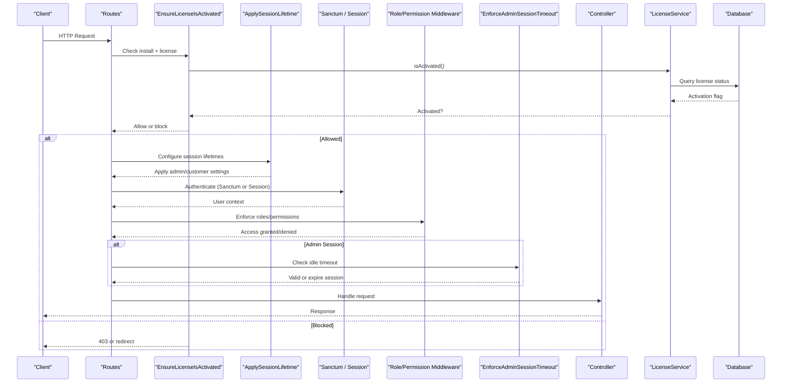

**Diagram sources**
- [api.php:1-77](file://backend/routes/api.php#L1-L77)
- [web.php:1-293](file://backend/routes/web.php#L1-L293)
- [EnsureLicenseIsActivated.php:1-169](file://backend/app\Http\Middleware\EnsureLicenseIsActivated.php#L1-L169)
- [ApplySessionLifetime.php:1-49](file://backend/app/Http/Middleware/ApplySessionLifetime.php#L1-L49)
- [EnforceAdminSessionTimeout.php:1-76](file://backend/app/Http/Middleware/EnforceAdminSessionTimeout.php#L1-L76)
- [LicenseService.php:1-408](file://backend/app\Services\LicenseService.php#L1-L408)
- [License.php:1-126](file://backend/app\Models\License.php#L1-L126)
- [UserAuthController.php:1-220](file://backend/app/Http/Controllers/API/UserAuthController.php#L1-L220)
- [AuthController.php:1-83](file://backend/app/Http/Controllers/Admin/AuthController.php#L1-L83)

## Detailed Component Analysis

### Authentication and Authorization

#### Sanctum API Authentication Flow
- Public registration/login endpoints are rate-limited and validated.
- On success, a Sanctum personal access token is issued; logout deletes the current token.
- Authenticated customer routes require auth:sanctum middleware.

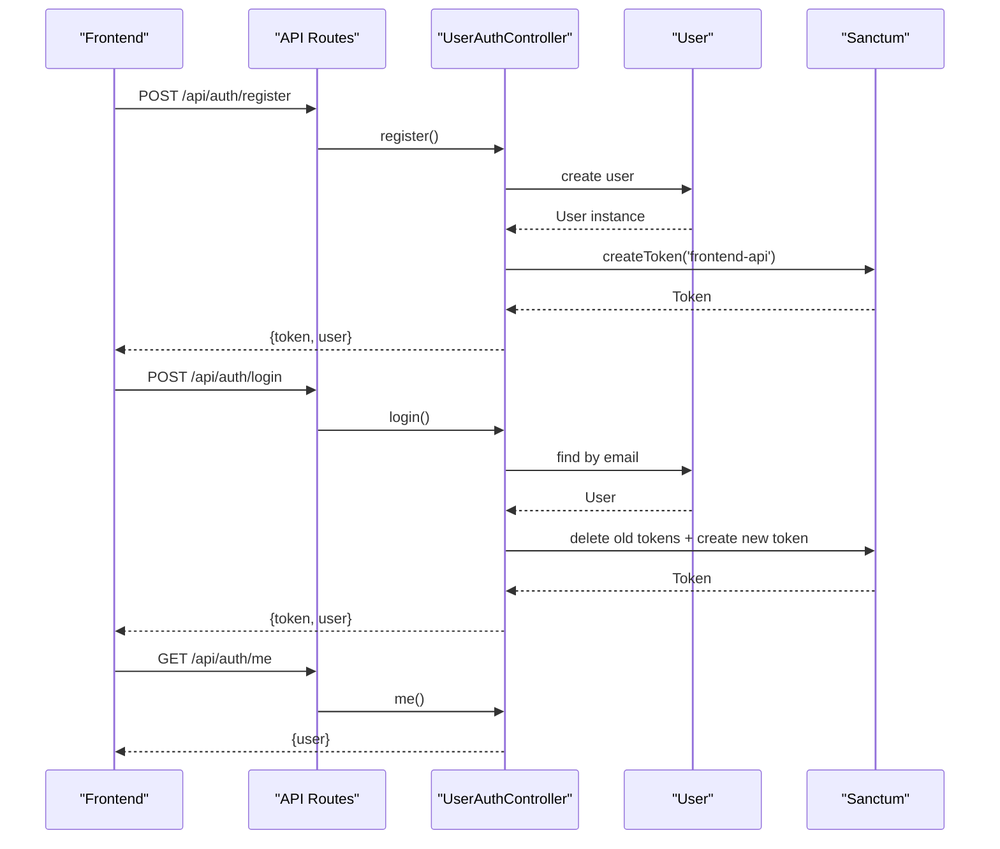

**Diagram sources**
- [api.php:41-75](file://backend/routes/api.php#L41-L75)
- [UserAuthController.php:17-79](file://backend/app/Http/Controllers/API/UserAuthController.php#L17-L79)
- [User.php:1-76](file://backend/app/Models/User.php#L1-L76)

**Section sources**
- [api.php:1-77](file://backend/routes/api.php#L1-L77)
- [UserAuthController.php:17-79](file://backend/app/Http/Controllers/API/UserAuthController.php#L17-L79)
- [User.php:1-76](file://backend/app/Models/User.php#L1-L76)

#### Admin Session-Based Authentication
- Admin login uses session guard with CSRF protection.
- Successful login regenerates session and redirects to admin dashboard.
- Logout invalidates session and regenerates token.

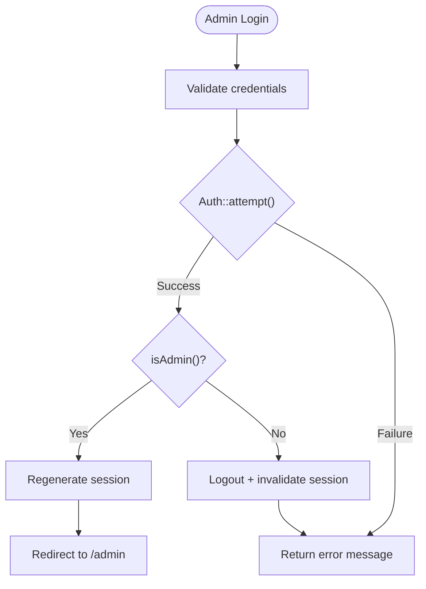

**Diagram sources**
- [web.php:68-70](file://backend/routes/web.php#L68-L70)
- [AuthController.php:24-61](file://backend/app/Http/Controllers/Admin/AuthController.php#L24-L61)
- [User.php:44-52](file://backend/app/Models/User.php#L44-L52)

**Section sources**
- [web.php:68-70](file://backend/routes/web.php#L68-L70)
- [AuthController.php:24-61](file://backend/app/Http/Controllers/Admin/AuthController.php#L24-L61)
- [User.php:44-52](file://backend/app/Models/User.php#L44-L52)

#### Role-Based Access Control and Permissions
- Roles: user, admin, super_admin.
- Super admin bypasses menu permissions; admins must have explicit menu permissions.
- Middleware enforce:
  - EnsureUserIsAdmin: requires admin role.
  - EnsureUserIsSuperAdmin: requires super_admin role.
  - EnsureUserHasMenuPermission: checks per-menu permission array.

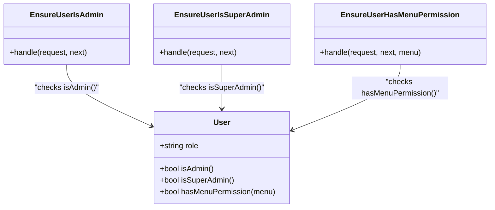

**Diagram sources**
- [User.php:44-74](file://backend/app/Models/User.php#L44-L74)
- [EnsureUserIsAdmin.php:12-38](file://backend/app/Http/Middleware/EnsureUserIsAdmin.php#L12-L38)
- [EnsureUserIsSuperAdmin.php:12-35](file://backend/app/Http/Middleware/EnsureUserIsSuperAdmin.php#L12-L35)
- [EnsureUserHasMenuPermission.php:15-38](file://backend/app/Http/Middleware/EnsureUserHasMenuPermission.php#L15-L38)

**Section sources**
- [User.php:44-74](file://backend/app/Models/User.php#L44-L74)
- [EnsureUserIsAdmin.php:12-38](file://backend/app/Http/Middleware/EnsureUserIsAdmin.php#L12-L38)
- [EnsureUserIsSuperAdmin.php:12-35](file://backend/app/Http/Middleware/EnsureUserIsSuperAdmin.php#L12-L35)
- [EnsureUserHasMenuPermission.php:15-38](file://backend/app/Http/Middleware/EnsureUserHasMenuPermission.php#L15-L38)

### Admin Session Security System

#### Configurable Session Expiration
The new admin session security system provides site administrators with granular control over session lifetimes through the Site Settings interface. The system separates admin session behavior from customer API token behavior.

**Key Features:**
- Admin panel idle timeout: 1-10080 minutes (default: 120 minutes)
- Customer API token lifetime: 0-43200 minutes (default: 1440 minutes, 0 = never expire)
- Real-time configuration through admin interface
- Automatic validation and clamping of values within safe bounds

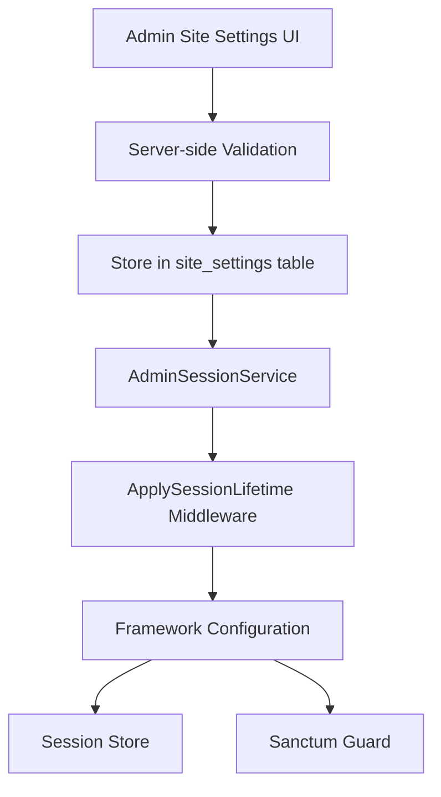

**Diagram sources**
- [site-settings.blade.php:318-339](file://backend/resources/views/admin/partials/site-settings.blade.php#L318-L339)
- [SiteSettingsService.php:61-107](file://backend/app/Services/SiteSettingsService.php#L61-L107)
- [AdminSessionService.php:16-121](file://backend/app\Services\AdminSessionService.php#L16-L121)
- [ApplySessionLifetime.php:27-47](file://backend/app/Http/Middleware/ApplySessionLifetime.php#L27-L47)

#### Idle Timeout Enforcement
The `EnforceAdminSessionTimeout` middleware ensures exact idle timeout enforcement for admin sessions, addressing the non-deterministic nature of Laravel's session garbage collection on low-traffic admin panels.

**Security Mechanisms:**
- Tracks last activity timestamp in session storage
- Compares elapsed time against configured lifetime
- Forces logout and session invalidation when timeout exceeded
- Provides clear "session expired" messages to users
- Only applies to admin sessions (not customer API tokens)

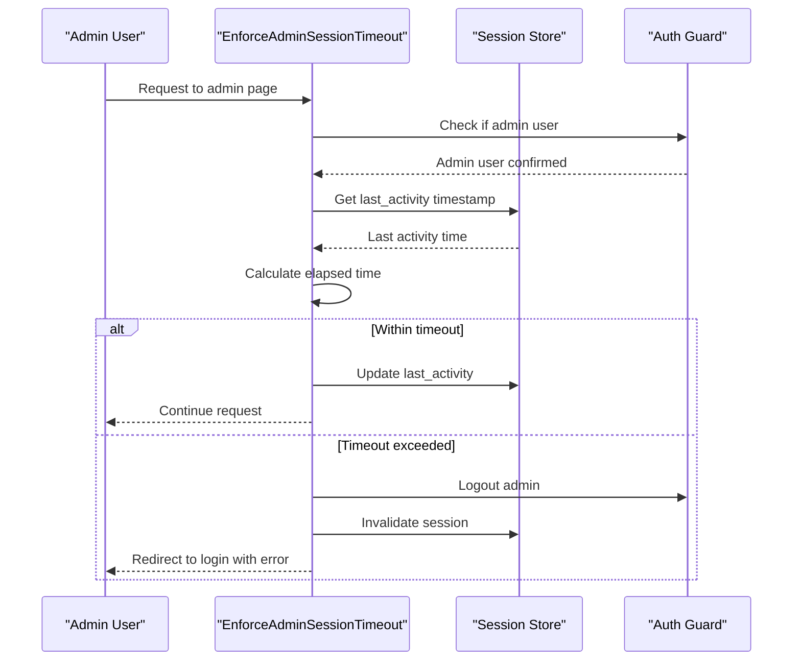

**Diagram sources**
- [EnforceAdminSessionTimeout.php:27-76](file://backend/app/Http/Middleware/EnforceAdminSessionTimeout.php#L27-L76)

#### Admin vs Customer Session Separation
The system maintains strict separation between admin session behavior and customer API token behavior:

- **Admin Sessions**: Subject to configurable idle timeout enforcement
- **Customer API Tokens**: Follow separate lifetime configuration (can be set to never expire)
- **Admin API Tokens**: Use admin panel policy instead of customer policy
- **Global Configuration**: Applied before session store and Sanctum guard initialization

**Section sources**
- [AdminSessionService.php:16-121](file://backend/app\Services\AdminSessionService.php#L16-L121)
- [ApplySessionLifetime.php:10-49](file://backend/app/Http/Middleware/ApplySessionLifetime.php#L10-L49)
- [EnforceAdminSessionTimeout.php:11-76](file://backend/app/Http/Middleware/EnforceAdminSessionTimeout.php#L11-L76)
- [SiteSettingsService.php:61-107](file://backend/app/Services/SiteSettingsService.php#L61-L107)

### Input Validation, CSRF, XSS, and SQL Injection Mitigation

- Input validation
  - Controllers use Laravel's request validation rules for all sensitive endpoints (register, login, password updates, forgot/reset password).
  - Passwords are hashed automatically via model casts.
- CSRF protection
  - Admin routes are session-based and protected by Laravel's default CSRF middleware.
  - Sanctum config includes ValidateCsrfToken middleware for stateful SPA flows.
- XSS prevention
  - Blade templates render content safely by default.
  - Recommended: add security headers middleware to set X-XSS-Protection and CSP.
- SQL injection mitigation
  - Eloquent ORM and parameterized queries prevent SQL injection.
  - Avoid raw SQL where possible; if used, bind parameters.

**Section sources**
- [UserAuthController.php:17-208](file://backend/app/Http/Controllers/API/UserAuthController.php#L17-L208)
- [AuthController.php:24-81](file://backend/app/Http/Controllers/Admin/AuthController.php#L24-L81)
- [sanctum.php:81-85](file://backend/config/sanctum.php#L81-L85)

### Rate Limiting
- Authentication endpoints are rate-limited:
  - API auth group: throttle:10,1.
  - Admin login route: throttle:10,1.
- Additional sensitive endpoints (e.g., password update) should be individually throttled.

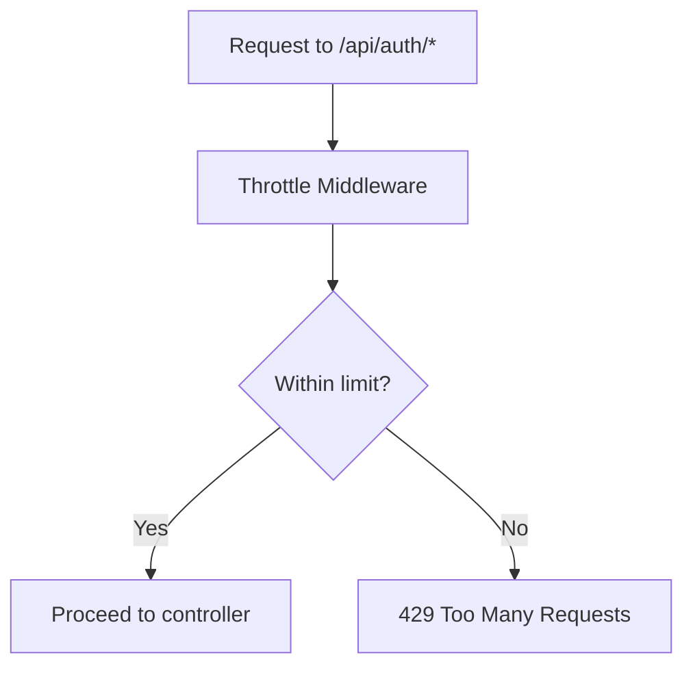

**Diagram sources**
- [api.php:41-46](file://backend/routes/api.php#L41-L46)
- [web.php:68-70](file://backend/routes/web.php#L68-L70)

**Section sources**
- [api.php:41-46](file://backend/routes/api.php#L41-L46)
- [web.php:68-70](file://backend/routes/web.php#L68-L70)

### File Upload Security and Path Traversal Prevention
- Admin site settings include logo/favicon upload routes.
- Recommendations:
  - Validate MIME type and extension server-side.
  - Store uploads outside public directory when possible; serve via storage disk.
  - Sanitize filenames and disallow path traversal characters.
  - Restrict allowed file types and sizes.
  - Set restrictive filesystem permissions.

[No sources needed since this section provides general guidance]

### Secure Environment Variable Handling
- Sanctum stateful domains configurable via SANCTUM_STATEFUL_DOMAINS.
- Session encryption and lifetime controlled via SESSION_ENCRYPT, SESSION_LIFETIME, SESSION_EXPIRE_ON_CLOSE.
- CORS origins and credentials controlled via cors.php.
- Best practices:
  - Never commit .env to version control.
  - Use environment-specific values for production.
  - Rotate APP_KEY regularly.
  - Restrict access to .env and storage directories.

**Section sources**
- [sanctum.php:21-26](file://backend/config/sanctum.php#L21-L26)
- [session.php:35-50](file://backend/config/session.php#L35-L50)
- [cors.php:18-33](file://backend/config/cors.php#L18-L33)

### License Verification Security
- LicenseService enforces strict rules:
  - UUID format validation.
  - Local dev bypass only when explicitly enabled.
  - Seller bypass code restricted to exact constant.
  - Envato API calls with timeout and retry.
  - Product ID match to ensure purchase belongs to SonyaBus.
  - Domain limit enforcement (max 5 unique domains).
- EnsureLicenseIsActivated middleware gates application access:
  - Stage 1: Installation lock.
  - Stage 2: License activation required for non-public routes.

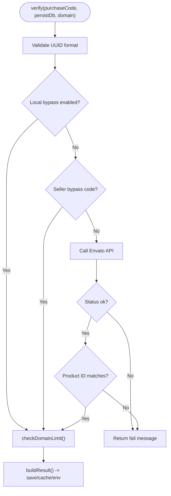

**Diagram sources**
- [LicenseService.php:56-157](file://backend/app\Services\LicenseService.php#L56-L157)
- [LicenseService.php:263-297](file://backend/app\Services\LicenseService.php#L263-L297)
- [LicenseService.php:303-328](file://backend/app\Services\LicenseService.php#L303-L328)
- [LicenseService.php:363-379](file://backend/app\Services\LicenseService.php#L363-L379)
- [License.php:17-126](file://backend/app\Models\License.php#L17-L126)

**Section sources**
- [LicenseService.php:56-157](file://backend/app\Services\LicenseService.php#L56-L157)
- [LicenseService.php:263-297](file://backend/app\Services\LicenseService.php#L263-L297)
- [LicenseService.php:303-328](file://backend/app\Services\LicenseService.php#L303-L328)
- [LicenseService.php:363-379](file://backend/app\Services\LicenseService.php#L363-L379)
- [License.php:17-126](file://backend/app\Models\License.php#L17-L126)
- [EnsureLicenseIsActivated.php:26-169](file://backend/app\Http\Middleware\EnsureLicenseIsActivated.php#L26-L169)

### Session Management
- Session driver defaults to database.
- Lifetime, expiration on close, encryption, httpOnly, SameSite, and partitioned cookies are configurable.
- Admin login/logout performs session regeneration and invalidation for security.
- **New** Admin session security system provides:
  - Configurable idle timeout enforcement through `EnforceAdminSessionTimeout` middleware
  - Dynamic session lifetime configuration via `ApplySessionLifetime` middleware
  - Separation between admin session behavior and customer API token behavior
  - Validation ensuring values stay within safe bounds (1-10080 minutes for admin, 0-43200 minutes for customers)

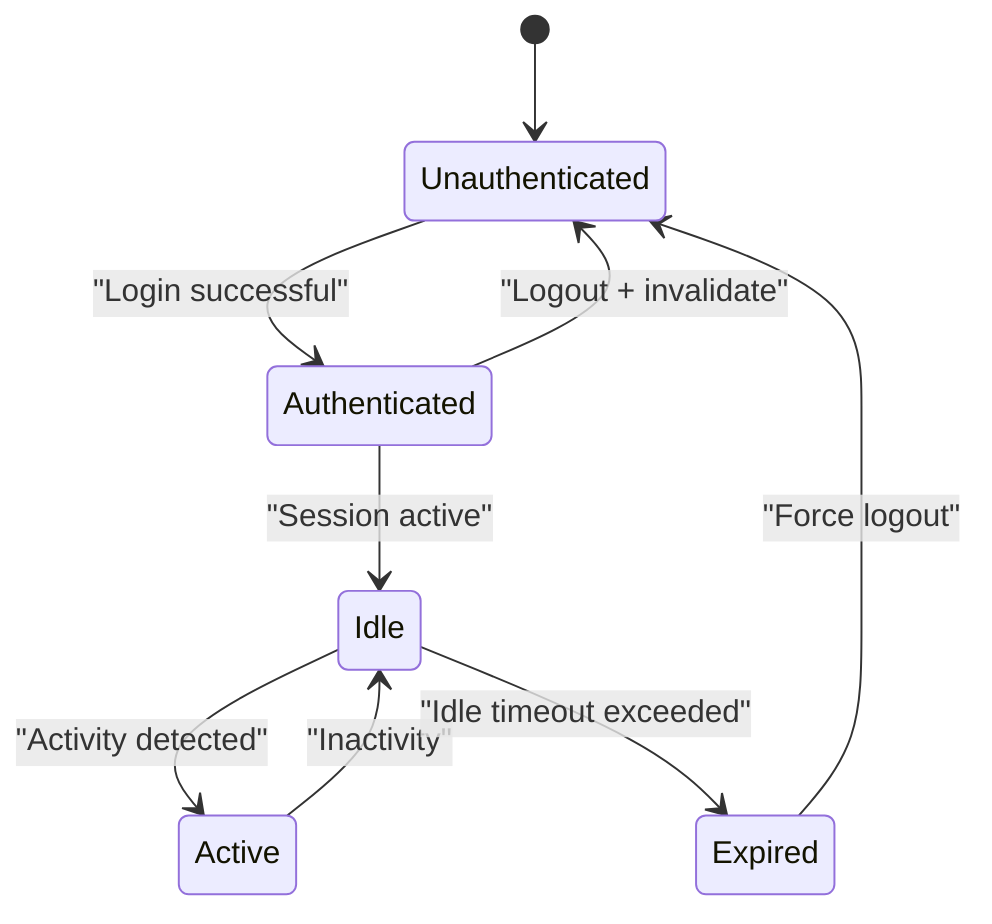

**Diagram sources**
- [session.php:21-50](file://backend/config/session.php#L21-L50)
- [session.php:172-202](file://backend/config/session.php#L172-L202)
- [AuthController.php:54-61](file://backend/app/Http/Controllers/Admin/AuthController.php#L54-L61)
- [EnforceAdminSessionTimeout.php:53-76](file://backend/app/Http/Middleware/EnforceAdminSessionTimeout.php#L53-L76)

**Section sources**
- [session.php:21-50](file://backend/config/session.php#L21-L50)
- [session.php:172-202](file://backend/config/session.php#L172-L202)
- [AuthController.php:54-61](file://backend/app/Http/Controllers/Admin/AuthController.php#L54-L61)
- [AdminSessionService.php:16-121](file://backend/app\Services\AdminSessionService.php#L16-L121)
- [ApplySessionLifetime.php:10-49](file://backend/app/Http/Middleware/ApplySessionLifetime.php#L10-L49)
- [EnforceAdminSessionTimeout.php:11-76](file://backend/app/Http/Middleware/EnforceAdminSessionTimeout.php#L11-L76)

### Security Hardening Best Practices
- CORS
  - Restrict allowed_origins to known frontend domains.
  - Enable supports_credentials only when necessary and pair with proper Sanctum stateful domains.
- Sanctum
  - Set token expiration to a reasonable value.
  - Use token_prefix to aid secret scanning.
- Headers
  - Add security headers middleware to set X-Content-Type-Options, X-Frame-Options, Referrer-Policy, CSP, and HSTS in production.
- Password Policy
  - Enforce minimum length and complexity.
- Logging
  - Avoid logging sensitive data (passwords, reset codes).
  - Implement audit logs for critical actions.

**Section sources**
- [cors.php:18-33](file://backend/config/cors.php#L18-L33)
- [sanctum.php:47-68](file://backend/config/sanctum.php#L47-L68)
- [UserAuthController.php:127-163](file://backend/app/Http/Controllers/API/UserAuthController.php#L127-L163)

## Dependency Analysis
Security components interact as follows:
- Routes apply middleware for license gating, maintenance mode, and role/permission checks.
- Controllers depend on models for user and license operations.
- LicenseService depends on License model and external Envato APIs.
- Session and Sanctum configurations influence how authentication state is maintained.
- **New** Admin session security components depend on SiteSettingsService for configuration and AdminSessionService for lifetime calculations.

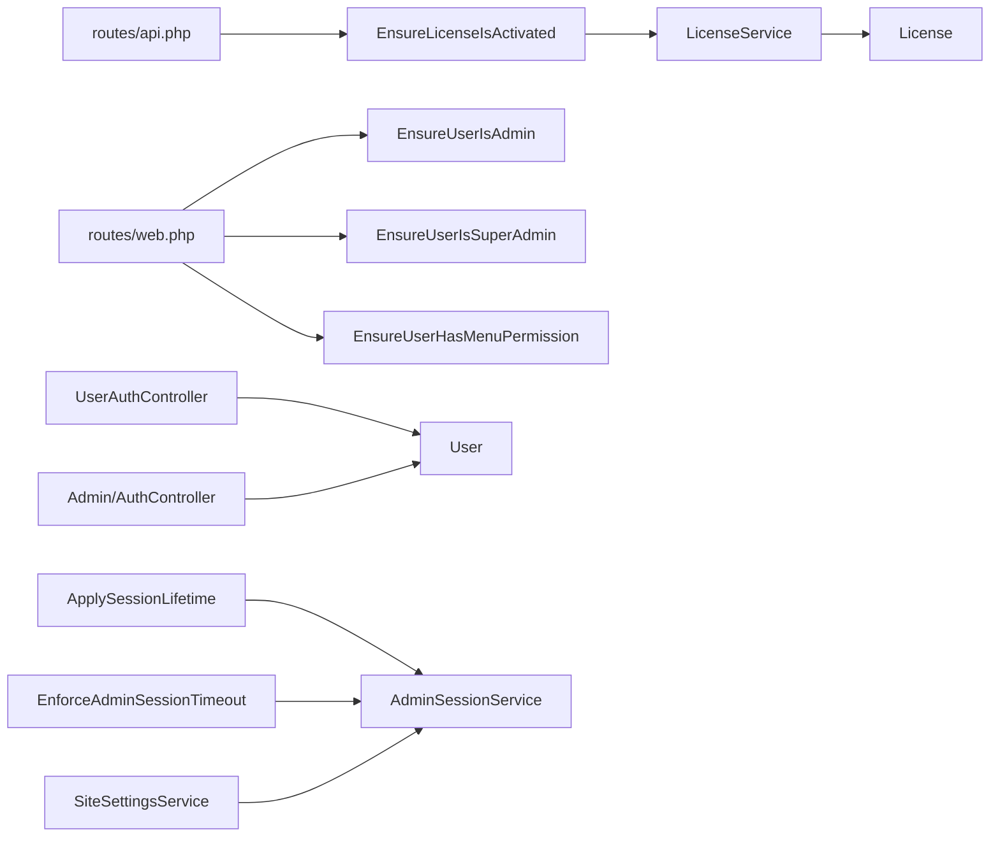

**Diagram sources**
- [api.php:1-77](file://backend/routes/api.php#L1-L77)
- [web.php:1-293](file://backend/routes/web.php#L1-L293)
- [EnsureLicenseIsActivated.php:1-169](file://backend/app\Http\Middleware\EnsureLicenseIsActivated.php#L1-L169)
- [LicenseService.php:1-408](file://backend/app\Services\LicenseService.php#L1-L408)
- [License.php:1-126](file://backend/app\Models\License.php#L1-L126)
- [UserAuthController.php:1-220](file://backend/app/Http/Controllers/API/UserAuthController.php#L1-L220)
- [AuthController.php:1-83](file://backend/app/Http/Controllers/Admin/AuthController.php#L1-L83)
- [ApplySessionLifetime.php:1-49](file://backend/app/Http/Middleware/ApplySessionLifetime.php#L1-L49)
- [EnforceAdminSessionTimeout.php:1-76](file://backend/app/Http/Middleware/EnforceAdminSessionTimeout.php#L1-L76)
- [AdminSessionService.php:1-121](file://backend/app\Services\AdminSessionService.php#L1-L121)
- [SiteSettingsService.php:1-205](file://backend/app/Services/SiteSettingsService.php#L1-L205)

**Section sources**
- [api.php:1-77](file://backend/routes/api.php#L1-L77)
- [web.php:1-293](file://backend/routes/web.php#L1-L293)
- [EnsureLicenseIsActivated.php:1-169](file://backend/app\Http\Middleware\EnsureLicenseIsActivated.php#L1-L169)
- [LicenseService.php:1-408](file://backend/app\Services\LicenseService.php#L1-L408)
- [License.php:1-126](file://backend/app\Models\License.php#L1-L126)
- [UserAuthController.php:1-220](file://backend/app/Http/Controllers/API/UserAuthController.php#L1-L220)
- [AuthController.php:1-83](file://backend/app/Http/Controllers/Admin/AuthController.php#L1-L83)
- [ApplySessionLifetime.php:1-49](file://backend/app/Http/Middleware/ApplySessionLifetime.php#L1-L49)
- [EnforceAdminSessionTimeout.php:1-76](file://backend/app/Http/Middleware/EnforceAdminSessionTimeout.php#L1-L76)
- [AdminSessionService.php:1-121](file://backend/app\Services\AdminSessionService.php#L1-L121)
- [SiteSettingsService.php:1-205](file://backend/app/Services/SiteSettingsService.php#L1-L205)

## Performance Considerations
- Rate limiting protects authentication endpoints from brute-force attacks while maintaining responsiveness.
- LicenseService caches activation status to reduce repeated DB lookups.
- External API calls in LicenseService use timeouts and retries to avoid hanging requests.
- Session driver choice impacts performance; database driver is default but Redis may improve throughput.
- **New** Admin session security system adds minimal overhead through lightweight middleware checks and session storage operations.

[No sources needed since this section provides general guidance]

## Troubleshooting Guide
- 401/403 on API calls
  - Verify Sanctum stateful domains and CORS configuration.
  - Ensure tokens are present and not expired.
- Admin login loops or redirects
  - Confirm session configuration and that CSRF tokens are included.
  - Check role checks in Admin/AuthController and EnsureUserIsAdmin middleware.
- License activation failures
  - Inspect LicenseService logs for API errors.
  - Verify product ID and domain limits.
  - Check EnsureLicenseIsActivated middleware allowlists.
- **New** Admin session timeout issues
  - Verify AdminSessionService configuration values are within valid ranges.
  - Check that ApplySessionLifetime middleware is registered globally.
  - Ensure EnforceAdminSessionTimeout middleware is applied to web group.
  - Validate site settings contain proper session lifetime values.

**Section sources**
- [sanctum.php:21-26](file://backend/config/sanctum.php#L21-L26)
- [cors.php:18-33](file://backend/config/cors.php#L18-L33)
- [UserAuthController.php:17-79](file://backend/app/Http/Controllers/API/UserAuthController.php#L17-L79)
- [AuthController.php:24-61](file://backend/app/Http/Controllers/Admin/AuthController.php#L24-L61)
- [EnsureUserIsAdmin.php:12-38](file://backend/app/Http/Middleware/EnsureUserIsAdmin.php#L12-L38)
- [LicenseService.php:106-157](file://backend/app\Services\LicenseService.php#L106-L157)
- [EnsureLicenseIsActivated.php:98-169](file://backend/app\Http\Middleware\EnsureLicenseIsActivated.php#L98-L169)
- [AdminSessionService.php:41-81](file://backend/app\Services\AdminSessionService.php#L41-L81)
- [ApplySessionLifetime.php:27-47](file://backend/app/Http/Middleware/ApplySessionLifetime.php#L27-L47)
- [EnforceAdminSessionTimeout.php:27-47](file://backend/app/Http/Middleware/EnforceAdminSessionTimeout.php#L27-L47)

## Conclusion
SonyaBus implements a layered security model combining Sanctum-based API authentication, session-based admin authentication, role and permission middleware, robust input validation, CSRF protection, and comprehensive license gating. Configuration files centralize security-critical settings such as CORS, Sanctum, and sessions. The license verification service adds strict validation, domain limits, and safe external API interactions. 

**Updated** The new admin session security system provides site administrators with precise control over session lifetimes through an intuitive interface, while maintaining strict separation between admin session behavior and customer API token behavior. The system includes comprehensive validation, exact idle timeout enforcement, and secure configuration management. Following the recommended hardening steps—restrictive CORS, token expiration, security headers, strong password policies, careful environment management, and appropriate admin session timeout configuration—will further strengthen the application's security posture.