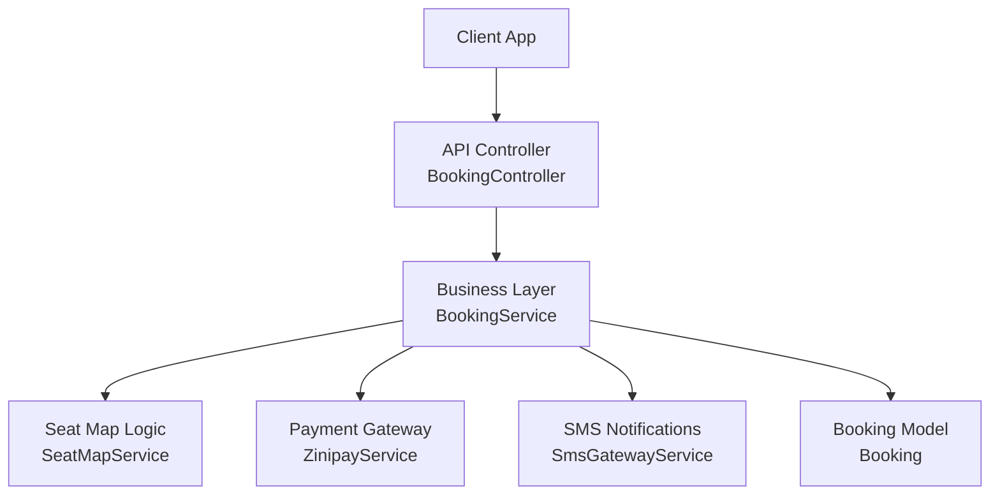
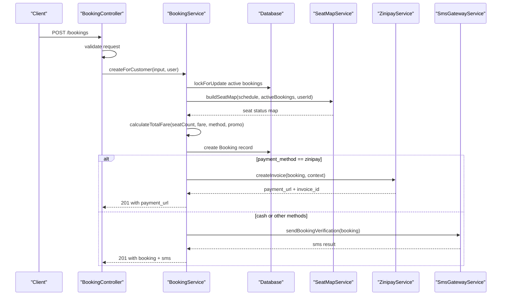
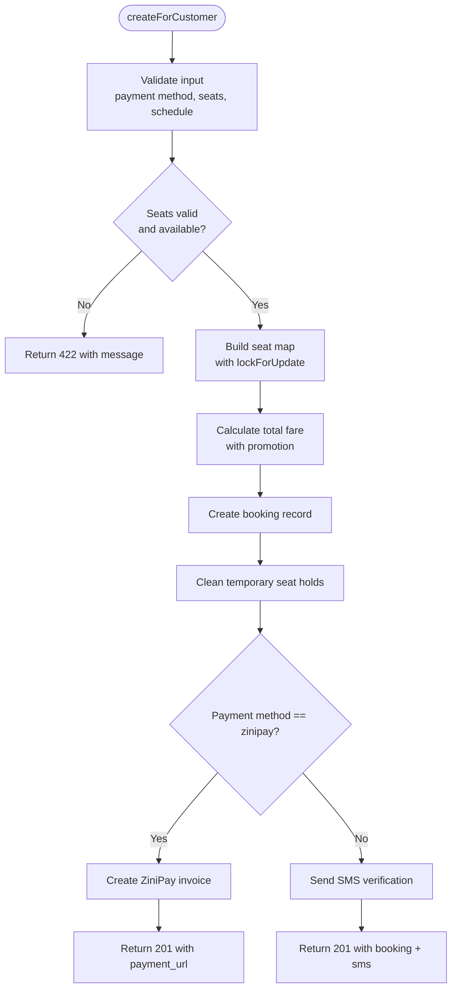
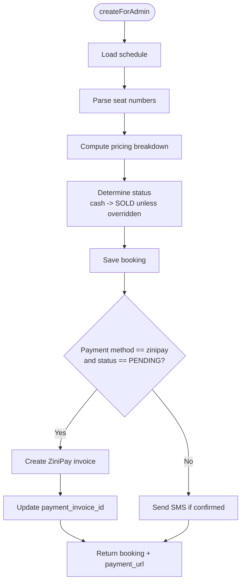
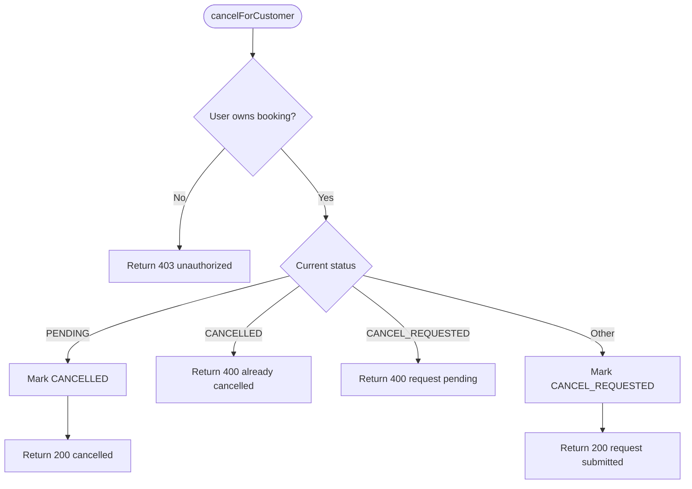
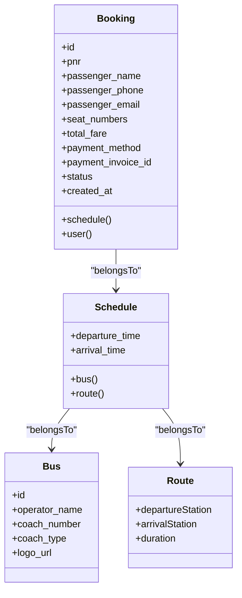
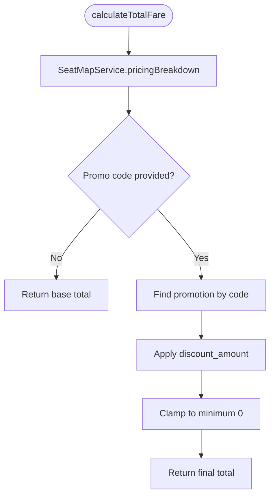
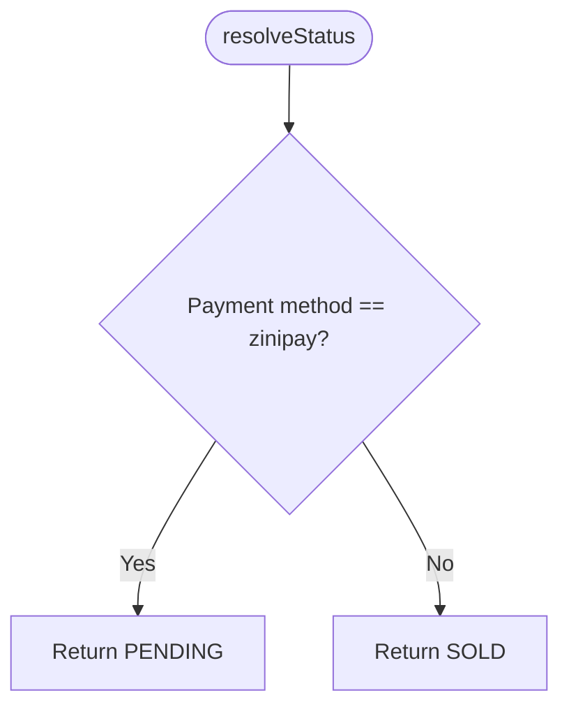
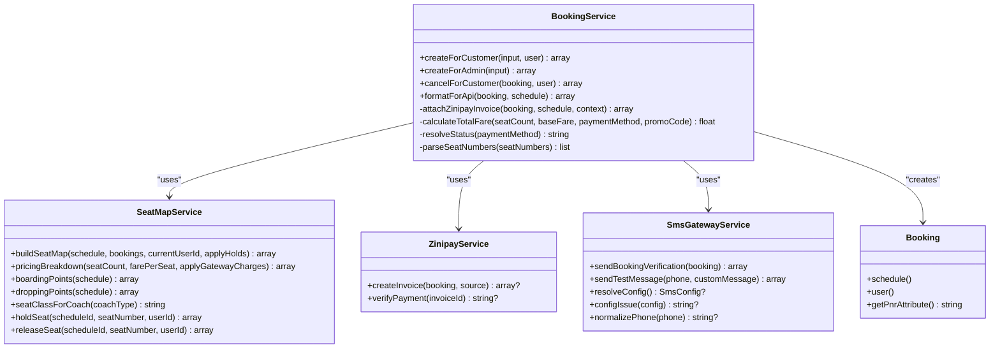

# Booking Service

<cite>
**Referenced Files in This Document**   
- [BookingService.php](file://backend/app/Services/BookingService.php)
- [BookingController.php](file://backend/app/Http/Controllers/API/BookingController.php)
- [Booking.php](file://backend/app/Models/Booking.php)
- [SeatMapService.php](file://backend/app/Services/SeatMapService.php)
- [ZinipayService.php](file://backend/app/Services/ZinipayService.php)
- [SmsGatewayService.php](file://backend/app/Services/SmsGatewayService.php)
</cite>

## Table of Contents
1. [Introduction](#introduction)
2. [Project Structure](#project-structure)
3. [Core Components](#core-components)
4. [Architecture Overview](#architecture-overview)
5. [Detailed Component Analysis](#detailed-component-analysis)
6. [Dependency Analysis](#dependency-analysis)
7. [Performance Considerations](#performance-considerations)
8. [Troubleshooting Guide](#troubleshooting-guide)
9. [Conclusion](#conclusion)

## Introduction
This document explains the booking business logic implemented by the `BookingService` class. It covers customer-initiated bookings with seat locking and transaction safety, administrative bookings without seat locking, cancellation workflows, API data formatting, fare calculation with promotion support, payment method status mapping, and integration patterns with `SeatMapService`, `ZinipayService`, and `SmsGatewayService`.

The service is designed to be shared between the customer API and admin panel while keeping seat availability, pricing, payment, and notification concerns centralized.

## Project Structure
The booking domain lives under the backend application:

- Controller layer: `App\Http\Controllers\API\BookingController`
- Business layer: `App\Services\BookingService`
- Domain model: `App\Models\Booking`
- Supporting services:
  - `App\Services\SeatMapService` for seat map, pricing, boarding/dropping points, and seat holds
  - `App\Services\ZinipayService` for payment invoice creation and verification
  - `App\Services\SmsGatewayService` for SMS notifications

**Diagram sources**
- [BookingController.php:19-40](file://backend/app/Http/Controllers/API/BookingController.php#L19-L40)
- [BookingService.php:14-21](file://backend/app/Services/BookingService.php#L14-L21)
- [SeatMapService.php:9-47](file://backend/app/Services/SeatMapService.php#L9-L47)
- [ZinipayService.php:9-32](file://backend/app/Services/ZinipayService.php#L9-L32)
- [SmsGatewayService.php:11-48](file://backend/app/Services/SmsGatewayService.php#L11-L48)
- [Booking.php:8-47](file://backend/app/Models/Booking.php#L8-L47)

**Section sources**
- [BookingController.php:1-150](file://backend/app/Http/Controllers/API/BookingController.php#L1-L150)
- [BookingService.php:1-335](file://backend/app/Services/BookingService.php#L1-L335)
- [SeatMapService.php:1-593](file://backend/app/Services/SeatMapService.php#L1-L593)
- [ZinipayService.php:1-141](file://backend/app/Services/ZinipayService.php#L1-L141)
- [SmsGatewayService.php:1-255](file://backend/app/Services/SmsGatewayService.php#L1-L255)
- [Booking.php:1-49](file://backend/app/Models/Booking.php#L1-L49)

## Core Components
- `BookingService`: Central orchestrator for booking lifecycle operations.
- `SeatMapService`: Seat availability, seat code generation, pricing breakdown, boarding/dropping point formatting, and temporary seat holds.
- `ZinipayService`: External payment gateway integration for creating invoices and verifying payments.
- `SmsGatewayService`: Multi-driver SMS gateway integration for sending booking confirmation messages.
- `Booking`: Eloquent model representing a ticket, including PNR generation and relationships.

Key responsibilities:
- Validate inputs and enforce business rules.
- Lock seats safely during customer bookings.
- Compute fares with optional promotions.
- Create or update bookings with correct statuses.
- Integrate with payment and SMS systems.
- Format booking data for API responses.

**Section sources**
- [BookingService.php:14-335](file://backend/app/Services/BookingService.php#L14-L335)
- [SeatMapService.php:9-593](file://backend/app/Services/SeatMapService.php#L9-L593)
- [ZinipayService.php:9-141](file://backend/app/Services/ZinipayService.php#L9-L141)
- [SmsGatewayService.php:11-255](file://backend/app/Services/SmsGatewayService.php#L11-L255)
- [Booking.php:8-47](file://backend/app/Models/Booking.php#L8-L47)

## Architecture Overview
The booking flow starts at the API controller and delegates business logic to `BookingService`. For customer bookings, seat validation and locking are performed through `SeatMapService`, and transactions ensure consistency. Payments may be handled via ZiniPay, and SMS notifications are sent after successful booking creation.

**Diagram sources**
- [BookingController.php:19-40](file://backend/app/Http/Controllers/API/BookingController.php#L19-L40)
- [BookingService.php:28-131](file://backend/app/Services/BookingService.php#L28-L131)
- [SeatMapService.php:194-244](file://backend/app/Services/SeatMapService.php#L194-L244)
- [ZinipayService.php:27-97](file://backend/app/Services/ZinipayService.php#L27-L97)
- [SmsGatewayService.php:16-48](file://backend/app/Services/SmsGatewayService.php#L16-L48)

## Detailed Component Analysis

### BookingService
The service encapsulates all booking-related business logic. It coordinates seat validation, pricing, persistence, payment, and notifications.

#### createForCustomer
Purpose:
- Handle customer-initiated bookings with strict seat validation and transaction safety.
- Enforce maximum seat count per booking.
- Prevent manual booking unless authorized.
- Lock seats using cache-based holds and database row locks.
- Calculate total fare with optional promotion discount.
- Persist booking and integrate with payment and SMS systems.

Key behaviors:
- Input validation:
  - Rejects non-admin users attempting manual cash booking.
  - Requires at least one seat and enforces a maximum of four seats.
- Seat validation:
  - Loads active bookings with row-level locking.
  - Builds seat map and checks each requested seat is selectable.
- Pricing:
  - Uses `SeatMapService::pricingBreakdown` based on seat count and base fare.
  - Applies promotion discount if provided.
- Persistence:
  - Creates a booking with passenger details, boarding/dropping points, seat class, seat numbers, total fare, payment method, and resolved status.
  - Cleans up any temporary seat holds for the current user and seats.
- Payment:
  - If payment method is ZiniPay, creates an invoice and returns payment URL.
- Notification:
  - Sends SMS verification for non-ZiniPay bookings.

Error handling:
- Returns HTTP 403 for unauthorized manual booking attempts.
- Returns HTTP 422 for invalid seat selection or seat unavailability.
- Wraps transactional logic in try/catch and returns HTTP 500 on unexpected exceptions.

**Diagram sources**
- [BookingService.php:28-131](file://backend/app/Services/BookingService.php#L28-L131)
- [SeatMapService.php:194-244](file://backend/app/Services/SeatMapService.php#L194-L244)
- [ZinipayService.php:27-97](file://backend/app/Services/ZinipayService.php#L27-L97)
- [SmsGatewayService.php:16-48](file://backend/app/Services/SmsGatewayService.php#L16-L48)

**Section sources**
- [BookingService.php:28-131](file://backend/app/Services/BookingService.php#L28-L131)

#### createForAdmin
Purpose:
- Allow administrative booking creation without seat locking.
- Support explicit status overrides from admin clients.
- Apply gateway charges when needed and compute pricing.
- Optionally create ZiniPay invoice and send SMS for confirmed bookings.

Key behaviors:
- Loads schedule and parses seat numbers.
- Computes pricing breakdown; allows admin-provided total fare override.
- Determines status based on payment method and explicit input.
- Persists booking without seat locking.
- Creates ZiniPay invoice if applicable and updates invoice ID.
- Sends SMS only for confirmed statuses (PAID, SOLD, BOOKED).

**Diagram sources**
- [BookingService.php:138-193](file://backend/app/Services/BookingService.php#L138-L193)
- [SeatMapService.php:343-365](file://backend/app/Services/SeatMapService.php#L343-L365)
- [ZinipayService.php:27-97](file://backend/app/Services/ZinipayService.php#L27-L97)
- [SmsGatewayService.php:16-48](file://backend/app/Services/SmsGatewayService.php#L16-L48)

**Section sources**
- [BookingService.php:138-193](file://backend/app/Services/BookingService.php#L138-L193)

#### cancelForCustomer
Purpose:
- Handle customer cancellation requests with state transitions.

Key behaviors:
- Authorization check ensures the user owns the booking.
- Immediate cancellation for pending bookings.
- Prevents duplicate cancellation requests.
- Transitions eligible bookings to CANCEL_REQUESTED awaiting admin approval.

**Diagram sources**
- [BookingService.php:200-240](file://backend/app/Services/BookingService.php#L200-L240)

**Section sources**
- [BookingService.php:200-240](file://backend/app/Services/BookingService.php#L200-L240)

#### formatForApi
Purpose:
- Transform a booking entity into a structured API response payload.

Key behaviors:
- Eager loads missing relationships (schedule, bus, route stations).
- Normalizes timestamps to ISO 8601 strings.
- Includes PNR, passenger details, seat numbers, fare, payment info, status, and schedule metadata.

**Diagram sources**
- [Booking.php:8-47](file://backend/app/Models/Booking.php#L8-L47)
- [BookingService.php:242-281](file://backend/app/Services/BookingService.php#L242-L281)

**Section sources**
- [BookingService.php:242-281](file://backend/app/Services/BookingService.php#L242-L281)

#### calculateTotalFare
Purpose:
- Compute final fare considering seat count, base fare, payment method, and optional promotion.

Key behaviors:
- Calls `SeatMapService::pricingBreakdown` to include service and gateway charges.
- Applies promotion discount if a valid promotion code exists.
- Ensures total fare does not go below zero.

**Diagram sources**
- [BookingService.php:304-318](file://backend/app/Services/BookingService.php#L304-L318)
- [SeatMapService.php:343-365](file://backend/app/Services/SeatMapService.php#L343-L365)

**Section sources**
- [BookingService.php:304-318](file://backend/app/Services/BookingService.php#L304-L318)

#### resolveStatus
Purpose:
- Map payment method to initial booking status.

Key behaviors:
- ZiniPay results in PENDING until payment completes.
- Cash and other methods default to SOLD.

**Diagram sources**
- [BookingService.php:320-327](file://backend/app/Services/BookingService.php#L320-L327)

**Section sources**
- [BookingService.php:320-327](file://backend/app/Services/BookingService.php#L320-L327)

### Integration Patterns

#### Seat Validation Example
- Customer selects multiple seats.
- Service validates each seat against the built seat map.
- Unavailable seats return a 422 error with a clear message.

Relevant paths:
- [BookingService.php:39-76](file://backend/app/Services/BookingService.php#L39-L76)
- [SeatMapService.php:194-244](file://backend/app/Services/SeatMapService.php#L194-L244)

#### Fare Calculation with Promotions Example
- Service computes base fare plus service and gateway charges.
- If a promotion code is present, it applies the configured discount amount.
- Final fare is clamped to a minimum of zero.

Relevant paths:
- [BookingService.php:78-83](file://backend/app/Services/BookingService.php#L78-L83)
- [BookingService.php:304-318](file://backend/app/Services/BookingService.php#L304-L318)
- [SeatMapService.php:343-365](file://backend/app/Services/SeatMapService.php#L343-L365)

#### PNR Generation Example
- Each booking has a generated PNR prefixed with “SE” and padded booking ID.

Relevant path:
- [Booking.php:43-47](file://backend/app/Models/Booking.php#L43-L47)

#### ZiniPay Invoice Creation Example
- For ZiniPay bookings, service creates an invoice and stores the invoice ID.
- Returns payment URL to client for redirection.

Relevant paths:
- [BookingService.php:113-115](file://backend/app/Services/BookingService.php#L113-L115)
- [BookingService.php:283-302](file://backend/app/Services/BookingService.php#L283-L302)
- [ZinipayService.php:27-97](file://backend/app/Services/ZinipayService.php#L27-L97)

#### SMS Notification Example
- After successful booking creation (non-ZiniPay), service sends SMS verification.
- SMS content uses configurable template or default message.

Relevant paths:
- [BookingService.php:117-126](file://backend/app/Services/BookingService.php#L117-L126)
- [SmsGatewayService.php:16-48](file://backend/app/Services/SmsGatewayService.php#L16-L48)
- [SmsGatewayService.php:136-150](file://backend/app/Services/SmsGatewayService.php#L136-L150)

## Dependency Analysis
The following diagram shows how `BookingService` depends on other components:

**Diagram sources**
- [BookingService.php:14-335](file://backend/app/Services/BookingService.php#L14-L335)
- [SeatMapService.php:9-593](file://backend/app/Services/SeatMapService.php#L9-L593)
- [ZinipayService.php:9-141](file://backend/app/Services/ZinipayService.php#L9-L141)
- [SmsGatewayService.php:11-255](file://backend/app/Services/SmsGatewayService.php#L11-L255)
- [Booking.php:8-47](file://backend/app/Models/Booking.php#L8-L47)

**Section sources**
- [BookingService.php:14-335](file://backend/app/Services/BookingService.php#L14-L335)
- [SeatMapService.php:9-593](file://backend/app/Services/SeatMapService.php#L9-L593)
- [ZinipayService.php:9-141](file://backend/app/Services/ZinipayService.php#L9-L141)
- [SmsGatewayService.php:11-255](file://backend/app/Services/SmsGatewayService.php#L11-L255)
- [Booking.php:8-47](file://backend/app/Models/Booking.php#L8-L47)

## Performance Considerations
- Database locking:
  - `lockForUpdate` prevents race conditions when multiple customers attempt to book overlapping seats.
- Selective column loading:
  - `paidBookingColumns` reduces payload size when building seat maps.
- Cache-based seat holds:
  - Temporary holds avoid repeated DB queries during short-lived seat reservation windows.
- Relationship loading:
  - `loadMissing` ensures efficient eager loading for API payloads.
- Transaction boundaries:
  - All critical steps (seat validation, fare calculation, booking creation, hold cleanup) are wrapped in a single transaction to maintain consistency.

[No sources needed since this section provides general guidance]

## Troubleshooting Guide
Common issues and resolutions:

- Unauthorized manual booking:
  - Non-admin users cannot manually set cash bookings. Ensure proper authorization or use admin endpoints.
  - Relevant path: [BookingService.php:32-37](file://backend/app/Services/BookingService.php#L32-L37)

- Seat selection errors:
  - Empty or excessive seat selections return 422. Validate seat count and availability before submission.
  - Relevant paths: [BookingService.php:39-47](file://backend/app/Services/BookingService.php#L39-L47), [BookingService.php:68-76](file://backend/app/Services/BookingService.php#L68-L76)

- Payment invoice failures:
  - Missing API key or external gateway errors cause invoice creation to fail. Check logs and configuration.
  - Relevant paths: [ZinipayService.php:29-32](file://backend/app/Services/ZinipayService.php#L29-L32), [ZinipayService.php:84-96](file://backend/app/Services/ZinipayService.php#L84-L96)

- SMS delivery failures:
  - Incomplete SMS configuration or invalid phone numbers prevent sending. Verify gateway settings and phone normalization.
  - Relevant paths: [SmsGatewayService.php:18-31](file://backend/app/Services/SmsGatewayService.php#L18-L31), [SmsGatewayService.php:109-134](file://backend/app/Services/SmsGatewayService.php#L109-L134)

- Cancellation conflicts:
  - Duplicate cancellation requests or already-cancelled tickets return 400. Handle these states in the UI.
  - Relevant path: [BookingService.php:219-228](file://backend/app/Services/BookingService.php#L219-L228)

**Section sources**
- [BookingService.php:32-37](file://backend/app/Services/BookingService.php#L32-L37)
- [BookingService.php:39-47](file://backend/app/Services/BookingService.php#L39-L47)
- [BookingService.php:68-76](file://backend/app/Services/BookingService.php#L68-L76)
- [BookingService.php:219-228](file://backend/app/Services/BookingService.php#L219-L228)
- [ZinipayService.php:29-32](file://backend/app/Services/ZinipayService.php#L29-L32)
- [ZinipayService.php:84-96](file://backend/app/Services/ZinipayService.php#L84-L96)
- [SmsGatewayService.php:18-31](file://backend/app/Services/SmsGatewayService.php#L18-L31)
- [SmsGatewayService.php:109-134](file://backend/app/Services/SmsGatewayService.php#L109-L134)

## Conclusion
The `BookingService` centralizes booking business logic with strong safeguards for seat availability, consistent pricing, and reliable integrations with payment and SMS systems. Customer bookings are protected by transactions and seat locking, while administrative bookings provide flexibility without seat constraints. The service’s clear separation of concerns, robust error handling, and extensible design make it suitable for scaling and maintaining a production-grade booking system.

[No sources needed since this section summarizes without analyzing specific files]