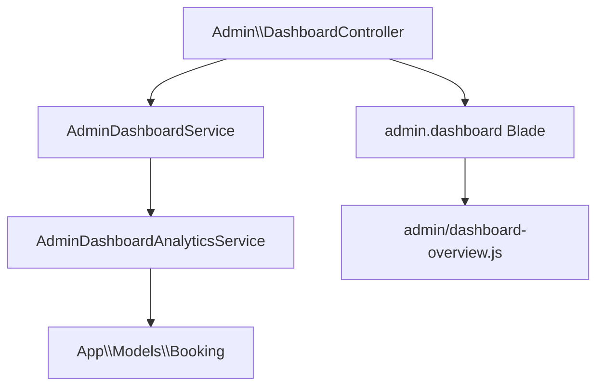
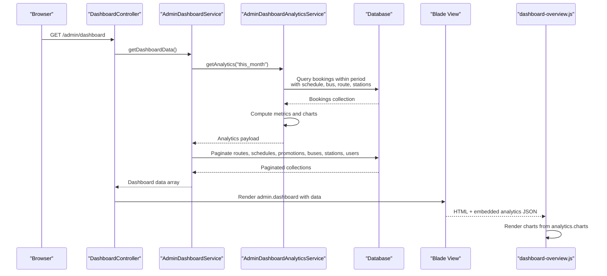
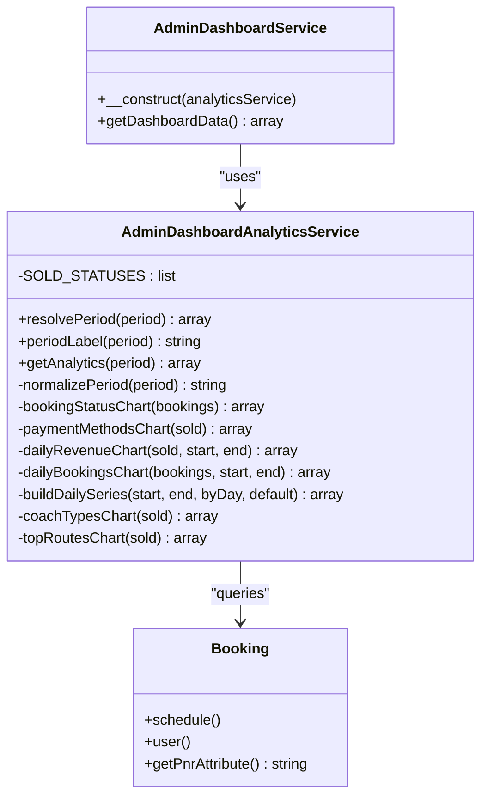
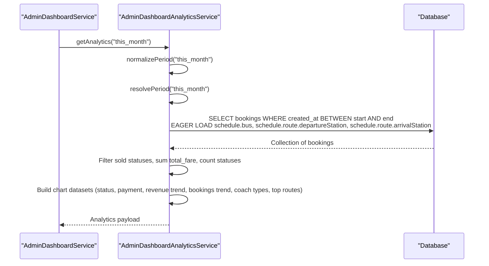
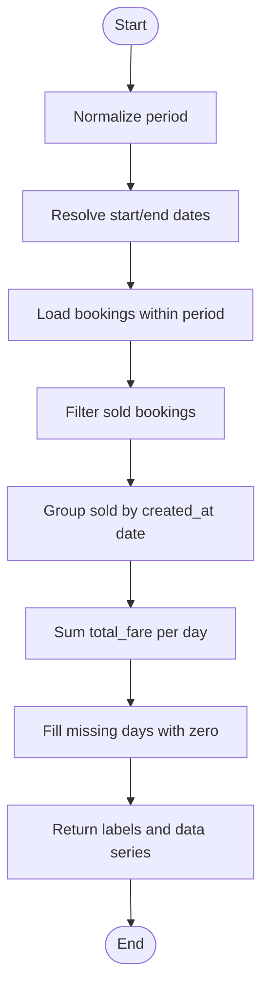
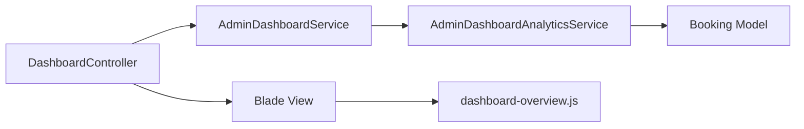

# Dashboard Analytics Service

<cite>
**Referenced Files in This Document**
- [AdminDashboardService.php](file://backend/app/Services/AdminDashboardService.php)
- [AdminDashboardAnalyticsService.php](file://backend/app/Services/AdminDashboardAnalyticsService.php)
- [DashboardController.php](file://backend/app/Http/Controllers/Admin/DashboardController.php)
- [Booking.php](file://backend/app/Models/Booking.php)
- [dashboard.blade.php](file://backend/resources/views/admin/dashboard.blade.php)
- [dashboard-overview.js](file://backend/resources/js/admin/dashboard-overview.js)
</cite>

## Table of Contents
1. [Introduction](#introduction)
2. [Project Structure](#project-structure)
3. [Core Components](#core-components)
4. [Architecture Overview](#architecture-overview)
5. [Detailed Component Analysis](#detailed-component-analysis)
6. [Dependency Analysis](#dependency-analysis)
7. [Performance Considerations](#performance-considerations)
8. [Troubleshooting Guide](#troubleshooting-guide)
9. [Conclusion](#conclusion)

## Introduction
This document explains the dashboard analytics services used by the admin dashboard: `AdminDashboardService` and `AdminDashboardAnalyticsService`. It covers how dashboard statistics are aggregated, how revenue is calculated, how booking analytics are prepared, and how performance metrics are collected for display in the admin interface. It also documents data aggregation patterns, chart data preparation, filtering capabilities, example queries, report generation flow, and integration with the admin dashboard controller and frontend visualization.

## Project Structure
The dashboard analytics feature spans a small set of backend services, a controller, an Eloquent model, a Blade view, and a JavaScript file that renders charts.

**Diagram sources**
- [DashboardController.php:7-16](file://backend/app/Http/Controllers/Admin/DashboardController.php#L7-L16)
- [AdminDashboardService.php:12-80](file://backend/app/Services/AdminDashboardService.php#L12-L80)
- [AdminDashboardAnalyticsService.php:9-84](file://backend/app/Services/AdminDashboardAnalyticsService.php#L9-L84)
- [Booking.php:8-48](file://backend/app/Models/Booking.php#L8-L48)
- [dashboard.blade.php:1-98](file://backend/resources/views/admin/dashboard.blade.php#L1-L98)
- [dashboard-overview.js:112-144](file://backend/resources/js/admin/dashboard-overview.js#L112-L144)

**Section sources**
- [DashboardController.php:7-16](file://backend/app/Http/Controllers/Admin/DashboardController.php#L7-L16)
- [AdminDashboardService.php:12-80](file://backend/app/Services/AdminDashboardService.php#L12-L80)
- [AdminDashboardAnalyticsService.php:9-84](file://backend/app/Services/AdminDashboardAnalyticsService.php#L9-L84)
- [Booking.php:8-48](file://backend/app/Models/Booking.php#L8-L48)
- [dashboard.blade.php:1-98](file://backend/resources/views/admin/dashboard.blade.php#L1-L98)
- [dashboard-overview.js:112-144](file://backend/resources/js/admin/dashboard-overview.js#L112-L144)

## Core Components
- AdminDashboardService: Orchestrates dashboard data retrieval, aggregates high-level metrics, and returns paginated resources for the admin dashboard UI.
- AdminDashboardAnalyticsService: Computes analytics for a given time period, including revenue, booking counts, and chart-ready datasets.
- DashboardController: Wires the service into the request lifecycle and passes data to the Blade view.
- Booking Model: Defines the booking entity and relationships used by analytics.
- Blade View and JS: Render overview cards and charts using the prepared analytics data.

Key responsibilities:
- Period resolution and normalization for analytics windows (today, last 7 days, this month, this year).
- Aggregation of sales revenue, confirmed/pending/cancelled bookings, average fare, and total bookings.
- Chart data preparation for booking status distribution, payment methods, daily revenue trend, daily bookings trend, coach types, and top routes.
- Supplying paginated lists of stations, buses, routes, schedules, promotions, and users for the dashboard tabs.

**Section sources**
- [AdminDashboardService.php:12-80](file://backend/app/Services/AdminDashboardService.php#L12-L80)
- [AdminDashboardAnalyticsService.php:9-227](file://backend/app/Services/AdminDashboardAnalyticsService.php#L9-L227)
- [DashboardController.php:7-16](file://backend/app/Http/Controllers/Admin/DashboardController.php#L7-L16)
- [Booking.php:8-48](file://backend/app/Models/Booking.php#L8-L48)

## Architecture Overview
The admin dashboard request flows through the controller into the orchestration service, which delegates analytics computation to the analytics service. The controller then renders the Blade view with all required data. The frontend JavaScript consumes the analytics charts payload to render visualizations.

**Diagram sources**
- [DashboardController.php:13-16](file://backend/app/Http/Controllers/Admin/DashboardController.php#L13-L16)
- [AdminDashboardService.php:32-79](file://backend/app/Services/AdminDashboardService.php#L32-L79)
- [AdminDashboardAnalyticsService.php:47-84](file://backend/app/Services/AdminDashboardAnalyticsService.php#L47-L84)
- [dashboard.blade.php:1-98](file://backend/resources/views/admin/dashboard.blade.php#L1-L98)
- [dashboard-overview.js:112-144](file://backend/resources/js/admin/dashboard-overview.js#L112-L144)

## Detailed Component Analysis

### AdminDashboardService
Responsibilities:
- Delegates analytics calculation to `AdminDashboardAnalyticsService` for the current period.
- Builds high-level metrics for the dashboard header (e.g., total sales, active/cancelled bookings, total schedules).
- Retrieves paginated resources for dashboard tabs: routes, schedules, promotions, buses, stations, and users.
- Provides both paginated and full station lists for dropdowns or selectors.

Data returned includes:
- Metrics: derived from analytics and direct model counts.
- Analytics: full analytics payload (period, label, metrics, charts).
- Collections: paginated entities for each dashboard tab.
- Site settings and SMS configuration placeholders are included in the method’s documented return type.

Example usage pattern:
- Controller calls `getDashboardData()` and passes the result to the Blade view.

**Section sources**
- [AdminDashboardService.php:12-80](file://backend/app/Services/AdminDashboardService.php#L12-L80)
- [DashboardController.php:13-16](file://backend/app/Http/Controllers/Admin/DashboardController.php#L13-L16)

### AdminDashboardAnalyticsService
Responsibilities:
- Normalizes and resolves time periods for analytics queries.
- Loads bookings within the resolved period with necessary eager-loaded relationships.
- Computes core metrics: sales revenue, confirmed/pending/cancelled bookings, cancel requests, total bookings, and average fare.
- Prepares chart-ready datasets for:
  - Booking status distribution
  - Payment method distribution
  - Daily revenue trend
  - Daily bookings trend
  - Coach type distribution
  - Top routes by booking count

Period handling:
- Supported periods: today, last_7_days, this_month, this_year.
- Unknown periods default to this_month.
- Period labels are human-readable strings suitable for UI headers.

Chart data patterns:
- All charts return `{ labels, data }` arrays for easy consumption by charting libraries.
- Time-series charts fill missing days with zero values to ensure continuous axes.

Revenue calculations:
- Sales revenue is the sum of `total_fare` for bookings whose status is considered “sold” (PAID, SOLD, BOOKED).
- Average fare is computed only when there are confirmed bookings; otherwise it defaults to zero.

Top routes:
- Groups sold bookings by route label built from departure and arrival station names.
- Returns the top five routes by booking count.

Filtering capabilities:
- Filtering is primarily time-based via the period parameter.
- Additional filters (e.g., by station, route, or payment method) can be layered on top of the base bookings collection before computing metrics and charts.

Example query patterns:
- Load bookings within a date range with related schedule, bus, route, and stations.
- Filter by status groups to compute metrics and chart distributions.

**Section sources**
- [AdminDashboardAnalyticsService.php:9-227](file://backend/app/Services/AdminDashboardAnalyticsService.php#L9-L227)

#### Class Diagram

**Diagram sources**
- [AdminDashboardService.php:12-80](file://backend/app/Services/AdminDashboardService.php#L12-L80)
- [AdminDashboardAnalyticsService.php:9-227](file://backend/app/Services/AdminDashboardAnalyticsService.php#L9-L227)
- [Booking.php:8-48](file://backend/app/Models/Booking.php#L8-L48)

#### Sequence Diagram: Analytics Computation

**Diagram sources**
- [AdminDashboardService.php:32-79](file://backend/app/Services/AdminDashboardService.php#L32-L79)
- [AdminDashboardAnalyticsService.php:47-84](file://backend/app/Services/AdminDashboardAnalyticsService.php#L47-L84)
- [AdminDashboardAnalyticsService.php:86-91](file://backend/app/Services/AdminDashboardAnalyticsService.php#L86-L91)
- [AdminDashboardAnalyticsService.php:15-25](file://backend/app/Services/AdminDashboardAnalyticsService.php#L15-L25)

#### Flowchart: Revenue Trend Series Construction

**Diagram sources**
- [AdminDashboardAnalyticsService.php:47-84](file://backend/app/Services/AdminDashboardAnalyticsService.php#L47-L84)
- [AdminDashboardAnalyticsService.php:138-171](file://backend/app/Services/AdminDashboardAnalyticsService.php#L138-L171)

### Integration with Admin Dashboard Controller and Views
- The controller injects `AdminDashboardService` and calls `getDashboardData()` to prepare data for the view.
- The Blade view includes the dashboard overview partial and other tab partials.
- The frontend JavaScript reads chart data from the analytics payload and renders charts using a charting library.

Example rendering flow:
- Controller passes analytics.metrics and analytics.charts to the view.
- The view embeds these values into the page.
- JavaScript initializes charts for booking status, payment methods, and revenue trends using the provided labels and data arrays.

**Section sources**
- [DashboardController.php:7-16](file://backend/app/Http/Controllers/Admin/DashboardController.php#L7-L16)
- [dashboard.blade.php:1-98](file://backend/resources/views/admin/dashboard.blade.php#L1-L98)
- [dashboard-overview.js:112-144](file://backend/resources/js/admin/dashboard-overview.js#L112-L144)

## Dependency Analysis
- AdminDashboardService depends on AdminDashboardAnalyticsService for analytics computation.
- AdminDashboardAnalyticsService depends on the Booking model and Laravel’s Carbon for date handling.
- The controller depends on AdminDashboardService to supply view data.
- The Blade view depends on the controller-provided data and forwards chart payloads to JavaScript.

**Diagram sources**
- [DashboardController.php:7-16](file://backend/app/Http/Controllers/Admin/DashboardController.php#L7-L16)
- [AdminDashboardService.php:12-80](file://backend/app/Services/AdminDashboardService.php#L12-L80)
- [AdminDashboardAnalyticsService.php:9-84](file://backend/app/Services/AdminDashboardAnalyticsService.php#L9-L84)
- [Booking.php:8-48](file://backend/app/Models/Booking.php#L8-L48)
- [dashboard.blade.php:1-98](file://backend/resources/views/admin/dashboard.blade.php#L1-L98)
- [dashboard-overview.js:112-144](file://backend/resources/js/admin/dashboard-overview.js#L112-L144)

**Section sources**
- [DashboardController.php:7-16](file://backend/app/Http/Controllers/Admin/DashboardController.php#L7-L16)
- [AdminDashboardService.php:12-80](file://backend/app/Services/AdminDashboardService.php#L12-L80)
- [AdminDashboardAnalyticsService.php:9-84](file://backend/app/Services/AdminDashboardAnalyticsService.php#L9-L84)
- [Booking.php:8-48](file://backend/app/Models/Booking.php#L8-L48)
- [dashboard.blade.php:1-98](file://backend/resources/views/admin/dashboard.blade.php#L1-L98)
- [dashboard-overview.js:112-144](file://backend/resources/js/admin/dashboard-overview.js#L112-L144)

## Performance Considerations
- Eager loading: The analytics service eagerly loads schedule, bus, route, and station relationships to avoid N+1 queries during chart computations.
- In-memory aggregation: After loading bookings, aggregations (counts, sums, groupBy) are performed in memory using Laravel Collections. This is efficient for moderate dataset sizes but may become costly at scale.
- Date range filtering: Using `whereBetween` on `created_at` reduces database load by limiting the initial dataset.
- Series filling: Missing days are filled with zeros in memory to maintain consistent chart axes without additional queries.
- Pagination: Dashboard tabs use pagination to limit rendered records and reduce response size.

Optimization opportunities:
- For large datasets, consider pre-aggregating daily revenue and booking counts into summary tables or materialized views.
- Introduce caching for analytics results keyed by period and any additional filters.
- Add database indexes on `created_at`, `status`, and foreign keys used in joins (e.g., `schedule_id`) to speed up queries.

[No sources needed since this section provides general guidance]

## Troubleshooting Guide
Common issues and resolutions:
- Empty or incorrect metrics:
  - Verify the selected period and ensure the date boundaries are correct.
  - Confirm that bookings exist within the chosen window and have valid statuses.
- Zero revenue despite bookings:
  - Check that booking statuses are among the “sold” statuses (PAID, SOLD, BOOKED).
  - Ensure `total_fare` is populated and cast correctly.
- Chart labels missing or misaligned:
  - Validate that the chart datasets contain matching labels and data arrays.
  - Confirm that time-series charts include all days between start and end.
- Relationship errors:
  - Ensure schedule, bus, route, and station relationships are properly defined and populated.
  - Handle null relationships gracefully in chart builders (e.g., unknown coach types or routes).

Validation checklist:
- Period normalization accepts expected values; unknown values default to this_month.
- Sold status filter matches business rules.
- Average fare calculation guards against division by zero.
- Top routes fallback returns safe empty data when no bookings exist.

**Section sources**
- [AdminDashboardAnalyticsService.php:47-84](file://backend/app/Services/AdminDashboardAnalyticsService.php#L47-L84)
- [AdminDashboardAnalyticsService.php:86-91](file://backend/app/Services/AdminDashboardAnalyticsService.php#L86-L91)
- [AdminDashboardAnalyticsService.php:173-196](file://backend/app/Services/AdminDashboardAnalyticsService.php#L173-L196)
- [AdminDashboardAnalyticsService.php:199-226](file://backend/app/Services/AdminDashboardAnalyticsService.php#L199-L226)
- [Booking.php:8-48](file://backend/app/Models/Booking.php#L8-L48)

## Conclusion
The dashboard analytics services provide a clear separation of concerns: orchestration (`AdminDashboardService`) and analytics computation (`AdminDashboardAnalyticsService`). They deliver comprehensive metrics and chart-ready datasets for the admin dashboard, covering revenue, booking analytics, and operational insights. The controller integrates these services into the request flow, while the Blade view and JavaScript render the data visually. With careful attention to period handling, relationship loading, and in-memory aggregation, the system offers a robust foundation for admin analytics and reporting.

[No sources needed since this section summarizes without analyzing specific files]