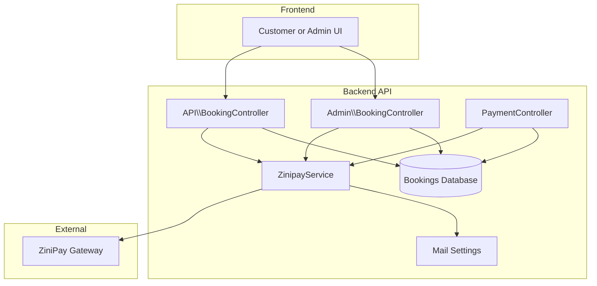
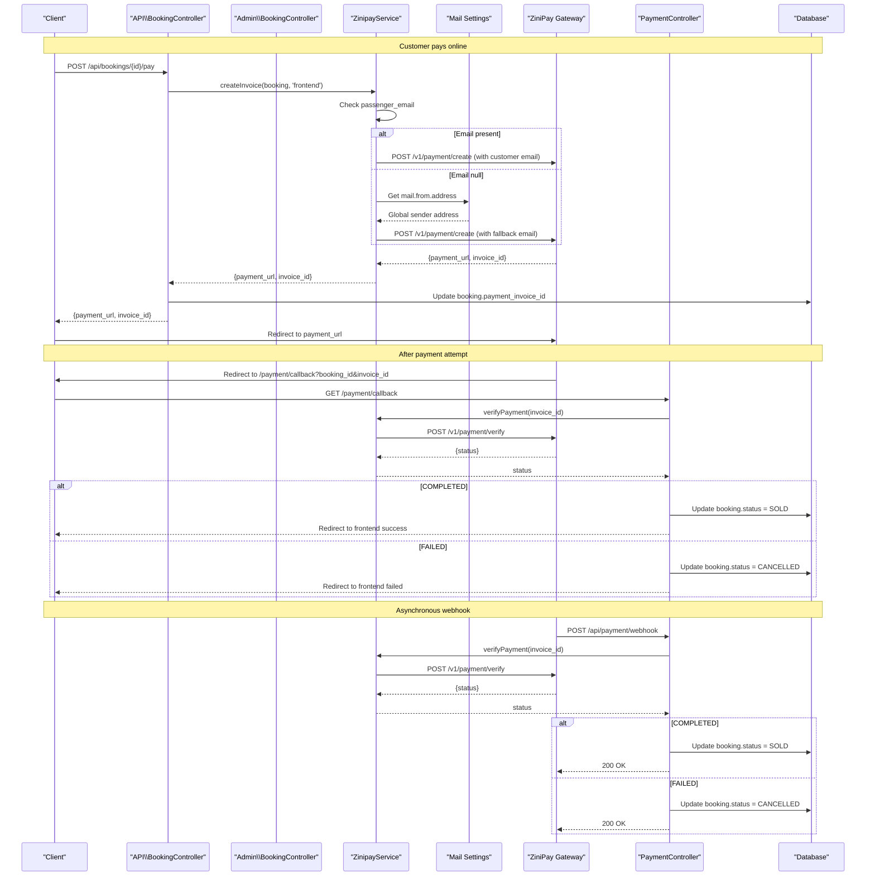
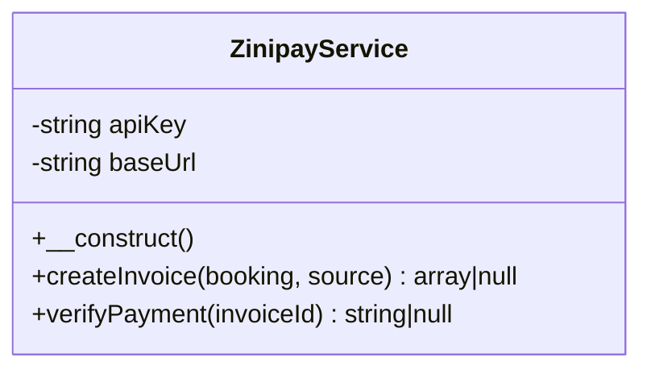
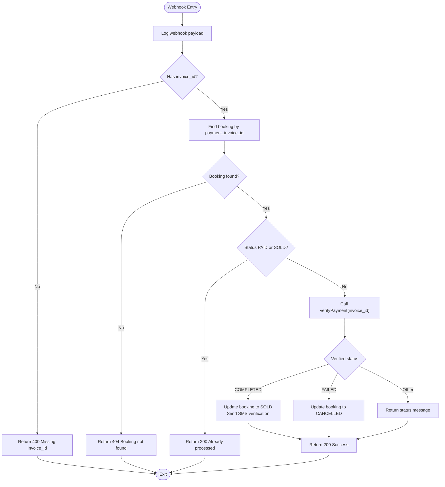
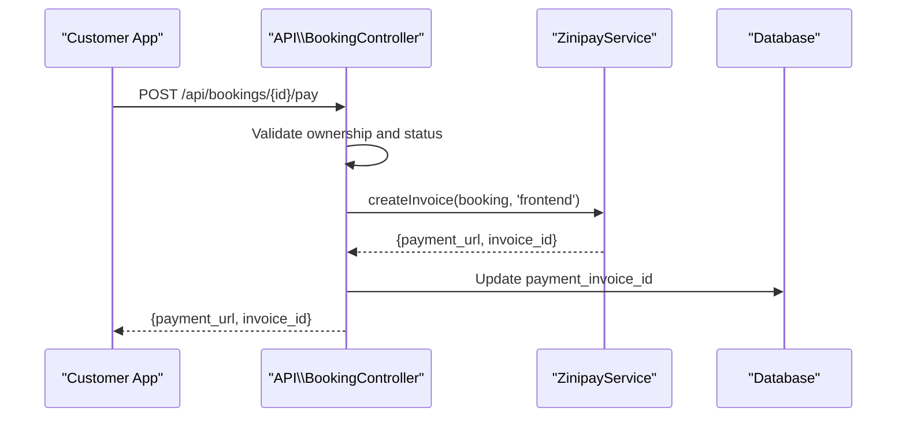
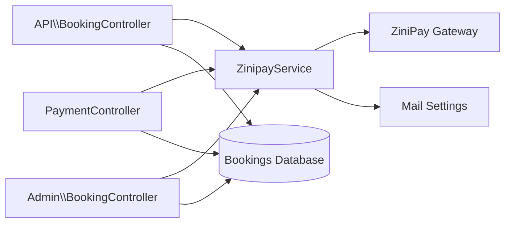

# Payment Service (ZiniPay)

<cite>
**Referenced Files in This Document**
- [ZinipayService.php](file://backend/app/Services/ZinipayService.php)
- [PaymentController.php](file://backend/app/Http/Controllers/PaymentController.php)
- [API BookingController.php](file://backend/app/Http/Controllers/API/BookingController.php)
- [Admin BookingController.php](file://backend/app/Http/Controllers/Admin/BookingController.php)
- [Booking Model.php](file://backend/app/Models/Booking.php)
- [ZinipayPaymentTest.php](file://backend/tests/Feature/ZinipayPaymentTest.php)
- [2026_11_16_000000_make_passenger_email_nullable_on_bookings_table.php](file://backend/database/migrations/2026_11_16_000000_make_passenger_email_nullable_on_bookings_table.php)
</cite>

## Update Summary
**Changes Made**
- Updated ZinipayService documentation to reflect null passenger email handling
- Added explanation of email fallback mechanism using mail settings
- Updated invoice creation flow to include email validation and fallback logic
- Enhanced error handling section with email-related scenarios

## Table of Contents
1. [Introduction](#introduction)
2. [Project Structure](#project-structure)
3. [Core Components](#core-components)
4. [Architecture Overview](#architecture-overview)
5. [Detailed Component Analysis](#detailed-component-analysis)
6. [Dependency Analysis](#dependency-analysis)
7. [Performance Considerations](#performance-considerations)
8. [Troubleshooting Guide](#troubleshooting-guide)
9. [Conclusion](#conclusion)

## Introduction
This document explains the ZiniPay payment integration used by the bus booking application. It focuses on the `ZinipayService` class and its role in creating invoices, verifying payments, and supporting asynchronous webhook confirmation. It also documents how bookings transition through payment states, how errors are handled, and what security considerations apply to payment processing.

The implementation uses:
- A backend service for secure gateway communication
- Controllers for customer and admin payment flows
- Webhook handling for asynchronous payment confirmation
- Tests that validate callback and webhook behavior

**Updated** The system now handles cases where passengers don't provide email addresses during booking, automatically falling back to the global sender address configured in mail settings to ensure compatibility with ZiniPay's email requirements.

## Project Structure
The ZiniPay integration spans a small set of focused backend components:
- `ZinipayService`: Gateway client for invoice creation and payment verification
- `PaymentController`: Handles redirect callbacks, cancellation, and webhooks
- `API\BookingController` and `Admin\BookingController`: Initiate payment for customers and admins
- `Booking` model: Stores booking details, payment method, invoice reference, and status

**Diagram sources**
- [API BookingController.php:118-148](file://backend/app/Http/Controllers/API/BookingController.php#L118-L148)
- [Admin BookingController.php:120-135](file://backend/app/Http/Controllers/Admin/BookingController.php#L120-L135)
- [PaymentController.php:21-136](file://backend/app/Http/Controllers/PaymentController.php#L21-L136)
- [ZinipayService.php:27-97](file://backend/app/Services/ZinipayService.php#L27-L97)

**Section sources**
- [ZinipayService.php:1-143](file://backend/app/Services/ZinipayService.php#L1-L143)
- [PaymentController.php:1-162](file://backend/app/Http/Controllers/PaymentController.php#L1-L162)
- [API BookingController.php:1-150](file://backend/app/Http/Controllers/API/BookingController.php#L1-L150)
- [Admin BookingController.php:1-137](file://backend/app/Http/Controllers/Admin/BookingController.php#L1-L137)
- [Booking Model.php:1-49](file://backend/app/Models/Booking.php#L1-L49)

## Core Components
- `ZinipayService`
  - `createInvoice(Booking $booking, string $source = 'frontend'): ?array`
    - Creates a payment invoice with ZiniPay
    - **Updated** Now handles null passenger emails by falling back to global mail sender address
    - Returns an array containing `payment_url` and optionally `invoice_id`, or `null` on failure
  - `verifyPayment(string $invoiceId): ?string`
    - Verifies the current status of an invoice
    - Returns a status string such as `COMPLETED`, `FAILED`, or `null` on error

- `PaymentController`
  - `callback(Request $request)`
    - Handles ZiniPay redirect after payment attempt
    - Verifies payment via `ZinipayService::verifyPayment`
    - Updates booking status and sends SMS notification on success
  - `cancel(Request $request)`
    - Marks pending bookings as cancelled when user cancels payment
  - `webhook(Request $request)`
    - Receives asynchronous payment notifications from ZiniPay
    - Verifies status directly with ZiniPay before updating booking state

- `API\BookingController`
  - `pay(Request $request, $id)`
    - Authorizes the request against the booking owner
    - Validates booking is `PENDING` and uses `zinipay`
    - Calls `ZinipayService::createInvoice` and persists `payment_invoice_id`

- `Admin\BookingController`
  - `payAdmin($id)`
    - Similar to customer flow but for admin-initiated payments
    - Persists `payment_invoice_id` and redirects to ZiniPay

- `Booking` model
  - Stores `payment_method`, `payment_invoice_id`, and `status`
  - **Updated** `passenger_email` field is now nullable to support bookings without email addresses
  - Provides computed `pnr` attribute for ticket display

**Section sources**
- [ZinipayService.php:20-141](file://backend/app/Services/ZinipayService.php#L20-L141)
- [PaymentController.php:18-136](file://backend/app/Http/Controllers/PaymentController.php#L18-L136)
- [API BookingController.php:118-148](file://backend/app/Http/Controllers/API/BookingController.php#L118-L148)
- [Admin BookingController.php:120-135](file://backend/app/Http/Controllers/Admin/BookingController.php#L120-L135)
- [Booking Model.php:12-31](file://backend/app/Models/Booking.php#L12-L31)

## Architecture Overview
The payment architecture separates concerns between gateway interaction, controller orchestration, and data persistence.

**Diagram sources**
- [API BookingController.php:118-148](file://backend/app/Http/Controllers/API/BookingController.php#L118-L148)
- [ZinipayService.php:27-97](file://backend/app/Services/ZinipayService.php#L27-L97)
- [ZinipayService.php:105-141](file://backend/app/Services/ZinipayService.php#L105-L141)
- [PaymentController.php:21-136](file://backend/app/Http/Controllers/PaymentController.php#L21-L136)

## Detailed Component Analysis

### ZinipayService
Responsibilities:
- Initialize configuration values for API key and base URL
- Create invoices with customer metadata and redirect URLs
- Verify invoice status asynchronously and synchronously
- **Updated** Handle null passenger emails with intelligent fallback to mail settings

Key behaviors:
- `createInvoice`
  - Validates API key presence
  - Builds redirect, cancel, and webhook URLs
  - **Updated** Implements email fallback logic: uses passenger email if available, otherwise falls back to `mail.from.address` config, with final fallback to 'noreply@sonyabus.com'
  - Rewrites hostnames to `127.0.0.1` in local/testing environments to bypass sandbox domain checks
  - Sends HTTP POST to `/v1/payment/create`
  - Returns `payment_url` and optional `invoice_id`
  - Logs errors for missing fields, non-success responses, and exceptions
- `verifyPayment`
  - Validates API key presence
  - Sends HTTP POST to `/v1/payment/verify`
  - Returns status string or null on error
  - Logs failures and exceptions

Error handling strategy:
- Missing API key returns early with logging
- Non-success HTTP responses are logged with status and body
- Exceptions are caught and logged
- Methods return safe defaults (`null`) to callers
- **Updated** Email fallback ensures gateway compatibility even when passenger email is missing

Security considerations:
- Uses HTTPS base URL configured via service config
- Includes API key in headers
- Avoids exposing secrets in logs beyond structured context
- Local/testing environment hostname rewriting supports sandbox testing without changing production URLs
- **Updated** Email fallback uses configured mail settings rather than hardcoded values

**Diagram sources**
- [ZinipayService.php:9-18](file://backend/app/Services/ZinipayService.php#L9-L18)
- [ZinipayService.php:27-97](file://backend/app/Services/ZinipayService.php#L27-L97)
- [ZinipayService.php:105-141](file://backend/app/Services/ZinipayService.php#L105-L141)

**Section sources**
- [ZinipayService.php:1-143](file://backend/app/Services/ZinipayService.php#L1-L143)

### PaymentController
Responsibilities:
- Handle synchronous callback from ZiniPay after payment attempt
- Handle cancellation
- Process asynchronous webhook notifications securely

Callback flow:
- Extracts `booking_id`, `source`, and optional `invoice_id`
- Finds booking; if not found, redirects with error
- If already paid/sold, redirects to success
- Resolves target invoice ID from booking or query parameter
- Calls `ZinipayService::verifyPayment`
- On `COMPLETED`, updates booking to `SOLD` and sends SMS verification
- On `FAILED`, updates booking to `CANCELLED`
- Otherwise logs warning and redirects with error

Webhook flow:
- Logs incoming payload
- Requires `invoice_id`; otherwise returns 400
- Looks up booking by `payment_invoice_id`; otherwise returns 404
- Idempotency: if already paid/sold, returns success without changes
- Verifies status via `ZinipayService::verifyPayment`
- On `COMPLETED`, updates booking to `SOLD` and sends SMS verification
- On `FAILED`, updates booking to `CANCELLED`
- Returns JSON response with message and booking info on success

Cancellation flow:
- If booking exists and is `PENDING`, marks it `CANCELLED`
- Redirects appropriately based on source

**Diagram sources**
- [PaymentController.php:87-136](file://backend/app/Http/Controllers/PaymentController.php#L87-L136)

**Section sources**
- [PaymentController.php:18-162](file://backend/app/Http/Controllers/PaymentController.php#L18-L162)

### API BookingController (Customer Payment)
Responsibilities:
- Enforce authorization: only the booking owner can initiate payment
- Validate booking state and payment method
- Create invoice and persist invoice reference

Flow:
- Lookup booking by ID
- Check ownership and authorization
- Ensure booking is `PENDING` and payment method is `zinipay`
- Call `ZinipayService::createInvoice`
- Persist `payment_invoice_id`
- Return payment URL and invoice ID to client

**Diagram sources**
- [API BookingController.php:118-148](file://backend/app/Http/Controllers/API/BookingController.php#L118-L148)
- [ZinipayService.php:27-97](file://backend/app/Services/ZinipayService.php#L27-L97)

**Section sources**
- [API BookingController.php:118-148](file://backend/app/Http/Controllers/API/BookingController.php#L118-L148)

### Admin BookingController (Admin Payment)
Responsibilities:
- Allow admin to initiate payment for a pending booking using ZiniPay
- Persist invoice reference and redirect to payment page

Flow:
- Validate booking is `PENDING` and payment method is `zinipay`
- Call `ZinipayService::createInvoice`
- Persist `payment_invoice_id`
- Redirect to payment URL

**Section sources**
- [Admin BookingController.php:120-135](file://backend/app/Http/Controllers/Admin/BookingController.php#L120-L135)

### Booking Model
Responsibilities:
- Store booking attributes including payment-related fields
- Provide computed PNR for tickets

Relevant fields:
- `payment_method`: e.g., `zinipay`
- `payment_invoice_id`: external invoice reference
- `status`: e.g., `PENDING`, `SOLD`, `CANCELLED`
- **Updated** `passenger_email`: now nullable to support bookings without email addresses

Computed attribute:
- `pnr`: formatted ticket identifier

**Section sources**
- [Booking Model.php:12-31](file://backend/app/Models/Booking.php#L12-L31)
- [Booking Model.php:43-47](file://backend/app/Models/Booking.php#L43-L47)

## Dependency Analysis
The following diagram shows how controllers depend on the service and how the service depends on the external gateway and mail configuration.

**Diagram sources**
- [API BookingController.php:118-148](file://backend/app/Http/Controllers/API/BookingController.php#L118-L148)
- [Admin BookingController.php:120-135](file://backend/app/Http/Controllers/Admin/BookingController.php#L120-L135)
- [PaymentController.php:21-136](file://backend/app/Http/Controllers/PaymentController.php#L21-L136)
- [ZinipayService.php:27-97](file://backend/app/Services/ZinipayService.php#L27-L97)

**Section sources**
- [API BookingController.php:1-150](file://backend/app/Http/Controllers/API/BookingController.php#L1-L150)
- [Admin BookingController.php:1-137](file://backend/app/Http/Controllers/Admin/BookingController.php#L1-L137)
- [PaymentController.php:1-162](file://backend/app/Http/Controllers/PaymentController.php#L1-L162)
- [ZinipayService.php:1-143](file://backend/app/Services/ZinipayService.php#L1-L143)

## Performance Considerations
- HTTP timeouts: Both invoice creation and verification use a timeout to avoid hanging requests during gateway latency.
- Logging overhead: Extensive logging helps diagnose issues but should be monitored to avoid excessive log volume under high traffic.
- Idempotent webhook handling: The webhook handler avoids duplicate updates by checking existing booking status and re-verifying with the gateway.
- Minimal database writes: Only essential fields are updated (invoice ID and status), reducing contention.
- **Updated** Email fallback resolution is cached by Laravel's config system, minimizing performance impact.

## Troubleshooting Guide
Common issues and resolutions:
- Missing API key
  - Symptom: Invoice creation or verification fails immediately
  - Resolution: Ensure `services.zinipay.api_key` is configured
- Sandbox domain mismatch
  - Symptom: Gateway rejects redirect or webhook URLs in local/testing environments
  - Resolution: Hostname rewriting to `127.0.0.1` is applied automatically in local/testing environments
- Callback verification not completed
  - Symptom: User redirected back but booking remains pending
  - Resolution: Inspect logs for gateway response; ensure `payment_callback` route is reachable and parameters are correct
- Webhook not received or ignored
  - Symptom: Booking does not update after payment
  - Resolution: Confirm webhook endpoint is publicly accessible and returns 200; check logs for payload and verification results
- Authorization errors
  - Symptom: Customer cannot pay their own booking
  - Resolution: Ensure the authenticated user matches the booking owner
- **Updated** Null passenger email causing gateway errors
  - Symptom: Invoice creation fails due to missing customer email
  - Resolution: Configure `mail.from.address` in mail settings; the system will automatically fall back to this address when passenger email is null
- **Updated** Mail settings not configured
  - Symptom: Fallback email not working properly
  - Resolution: Ensure `mail.from.address` is configured in site settings; the system has a default fallback to 'noreply@sonyabus.com'

**Section sources**
- [ZinipayService.php:27-97](file://backend/app/Services/ZinipayService.php#L27-L97)
- [ZinipayService.php:105-141](file://backend/app/Services/ZinipayService.php#L105-L141)
- [PaymentController.php:21-136](file://backend/app/Http/Controllers/PaymentController.php#L21-L136)

## Conclusion
The ZiniPay integration centers around a clean separation of concerns:
- `ZinipayService` encapsulates all gateway interactions with robust error handling and logging
- Controllers manage orchestration, authorization, and user-facing flows
- Webhooks provide reliable asynchronous confirmation with idempotent updates
- Tests validate critical paths for callback and webhook scenarios

**Updated** The system now gracefully handles bookings without passenger email addresses by automatically falling back to the global mail sender address configured in mail settings. This ensures compatibility with ZiniPay's email requirements while maintaining flexibility for different booking scenarios.

For refunds, the current codebase does not implement a refund endpoint or logic. Refund handling would require extending `ZinipayService` with a dedicated refund method and adding corresponding controller endpoints and tests.