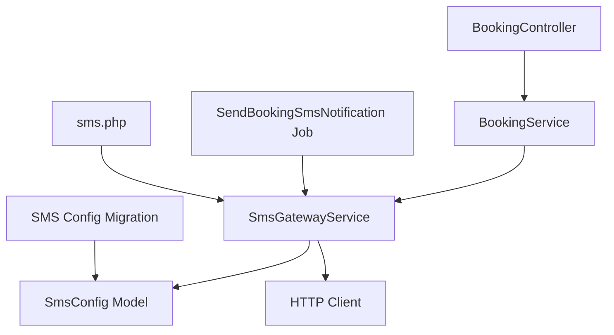
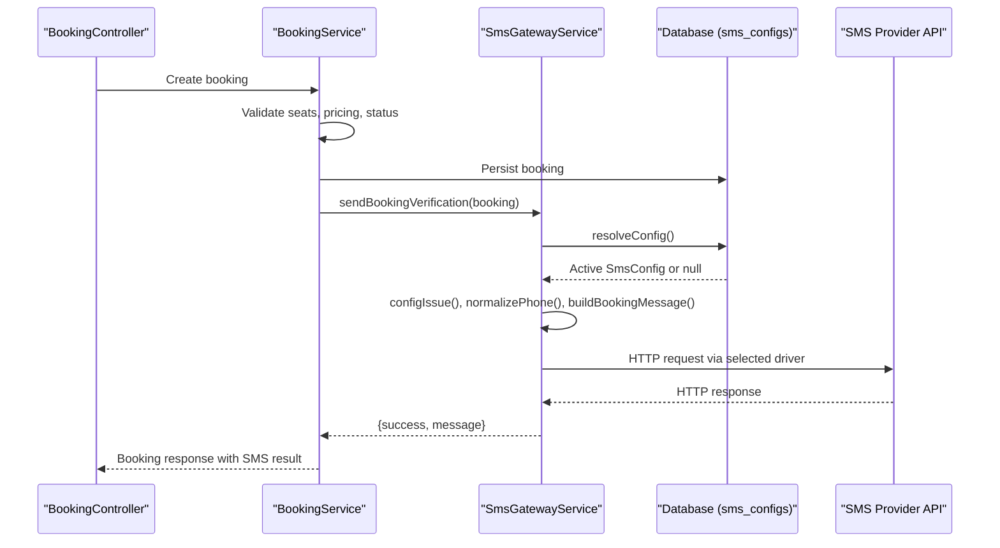
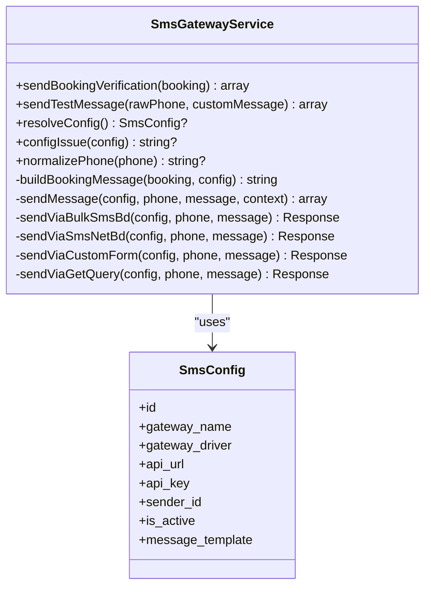
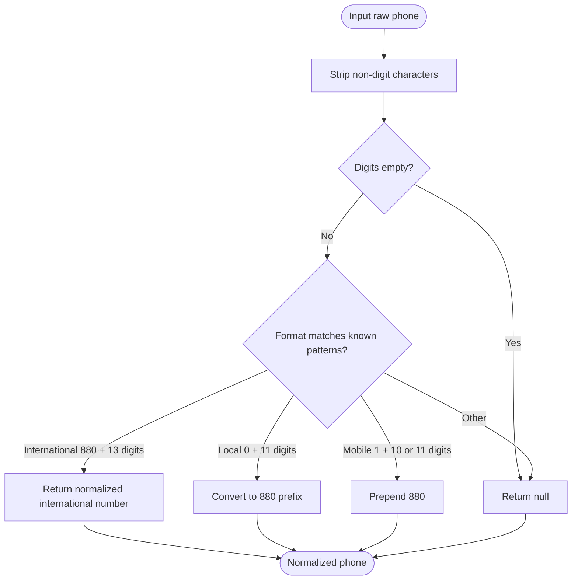
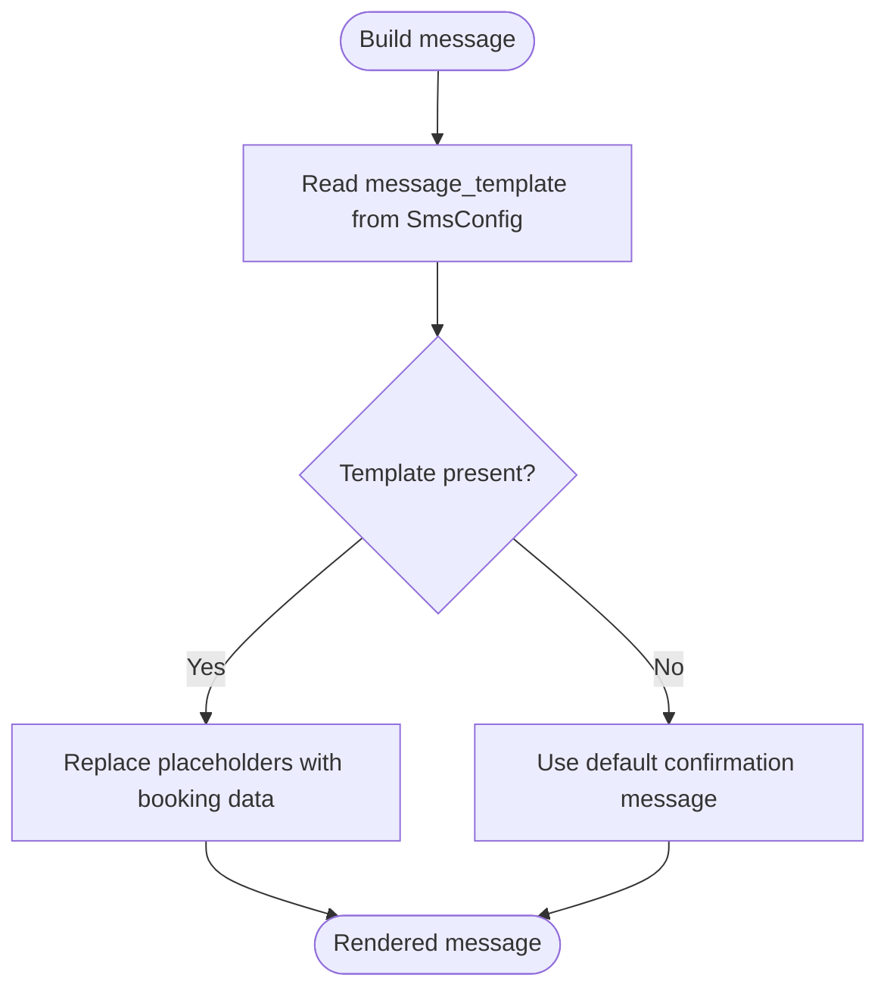
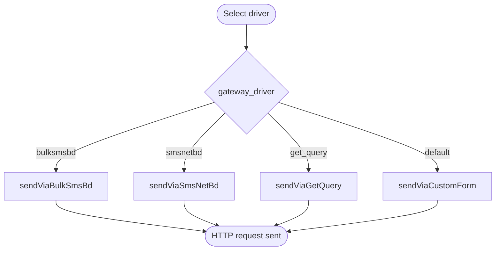
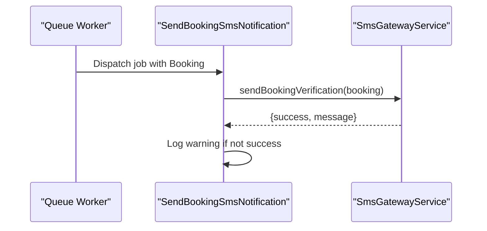
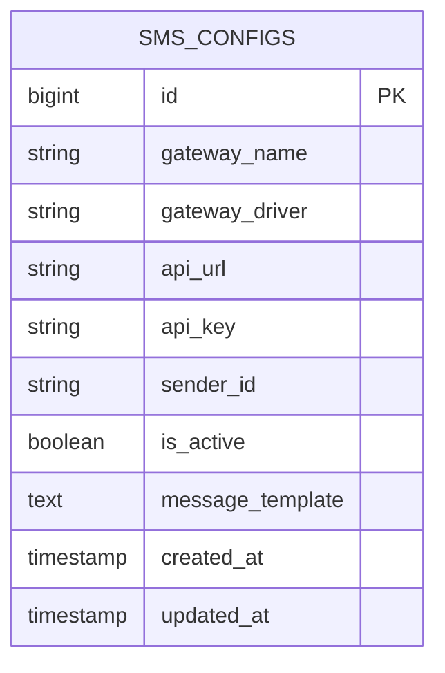
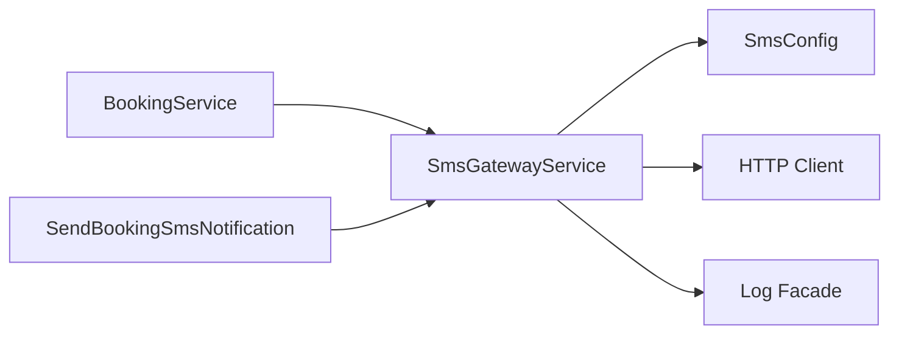

# SMS Gateway Service

<cite>
**Referenced Files in This Document**
- [SmsGatewayService.php](file://backend/app/Services/SmsGatewayService.php)
- [SendBookingSmsNotification.php](file://backend/app/Jobs/SendBookingSmsNotification.php)
- [BookingService.php](file://backend/app/Services/BookingService.php)
- [BookingController.php](file://backend/app/Http/Controllers/API/BookingController.php)
- [SmsConfig.php](file://backend/app/Models/SmsConfig.php)
- [2026_06_02_090000_create_sms_configs_table.php](file://backend/database/migrations/2026_06_02_090000_create_sms_configs_table.php)
- [sms.php](file://backend/config/sms.php)
</cite>

## Table of Contents
1. [Introduction](#introduction)
2. [Project Structure](#project-structure)
3. [Core Components](#core-components)
4. [Architecture Overview](#architecture-overview)
5. [Detailed Component Analysis](#detailed-component-analysis)
6. [Dependency Analysis](#dependency-analysis)
7. [Performance Considerations](#performance-considerations)
8. [Troubleshooting Guide](#troubleshooting-guide)
9. [Conclusion](#conclusion)
10. [Appendices](#appendices)

## Introduction
This document explains the SMS notification system centered on the `SmsGatewayService` class. It provides multi-provider SMS delivery for booking confirmations, phone number normalization for Bangladesh mobile numbers, a message templating system, and driver-based provider routing. The service integrates with queue jobs for asynchronous processing and supports configuration through both database-driven settings and environment-backed defaults.

The main goals are:
- Send booking verification SMS after successful bookings.
- Normalize passenger phone numbers to a consistent format.
- Render messages using configurable templates.
- Route SMS requests through supported providers such as BulkSmsBD, SMS.NET.BD, or custom HTTP endpoints.
- Provide robust error handling, logging, and test messaging capabilities.

## Project Structure
The SMS feature spans services, jobs, models, migrations, and configuration files:

**Diagram sources**
- [BookingController.php:19-40](file://backend/app/Http/Controllers/API/BookingController.php#L19-L40)
- [BookingService.php:16-21](file://backend/app/Services/BookingService.php#L16-L21)
- [SmsGatewayService.php:11-48](file://backend/app/Services/SmsGatewayService.php#L11-L48)
- [SendBookingSmsNotification.php:11-35](file://backend/app/Jobs/SendBookingSmsNotification.php#L11-L35)
- [SmsConfig.php:7-22](file://backend/app/Models/SmsConfig.php#L7-L22)
- [2026_06_02_090000_create_sms_configs_table.php:14-28](file://backend/database/migrations/2026_06_02_090000_create_sms_configs_table.php#L14-L28)
- [sms.php:3-14](file://backend/config/sms.php#L3-L14)

**Section sources**
- [BookingController.php:19-40](file://backend/app/Http/Controllers/API/BookingController.php#L19-L40)
- [BookingService.php:16-21](file://backend/app/Services/BookingService.php#L16-L21)
- [SmsGatewayService.php:11-48](file://backend/app/Services/SmsGatewayService.php#L11-L48)
- [SendBookingSmsNotification.php:11-35](file://backend/app/Jobs/SendBookingSmsNotification.php#L11-L35)
- [SmsConfig.php:7-22](file://backend/app/Models/SmsConfig.php#L7-L22)
- [2026_06_02_090000_create_sms_configs_table.php:14-28](file://backend/database/migrations/2026_06_02_090000_create_sms_configs_table.php#L14-L28)
- [sms.php:3-14](file://backend/config/sms.php#L3-L14)

## Core Components
- `SmsGatewayService`: Orchestrates SMS sending, configuration resolution, phone normalization, message templating, and provider dispatching.
- `SendBookingSmsNotification`: Queue job that triggers SMS delivery asynchronously.
- `BookingService`: Business logic for creating bookings; invokes SMS sending for confirmed bookings.
- `SmsConfig`: Eloquent model representing stored SMS gateway configuration.
- SMS config migration: Defines the `sms_configs` table schema.
- `sms.php`: Environment-backed default configuration values.

Key responsibilities:
- Resolve active SMS configuration from the database.
- Validate required fields per provider.
- Normalize phone numbers to international format.
- Build booking confirmation messages using templates.
- Dispatch HTTP requests to provider APIs.
- Log success and failure outcomes.

**Section sources**
- [SmsGatewayService.php:11-255](file://backend/app/Services/SmsGatewayService.php#L11-L255)
- [SendBookingSmsNotification.php:11-35](file://backend/app/Jobs/SendBookingSmsNotification.php#L11-L35)
- [BookingService.php:16-21](file://backend/app/Services/BookingService.php#L16-L21)
- [SmsConfig.php:7-22](file://backend/app/Models/SmsConfig.php#L7-L22)
- [2026_06_02_090000_create_sms_configs_table.php:14-28](file://backend/database/migrations/2026_06_02_090000_create_sms_configs_table.php#L14-L28)
- [sms.php:3-14](file://backend/config/sms.php#L3-L14)

## Architecture Overview
The SMS architecture uses a driver pattern to route requests to different providers while keeping the calling code unchanged. Configuration is primarily resolved from the latest active row in the `sms_configs` table. If no active configuration exists, the service returns a clear failure result.

**Diagram sources**
- [BookingController.php:19-40](file://backend/app/Http/Controllers/API/BookingController.php#L19-L40)
- [BookingService.php:88-126](file://backend/app/Services/BookingService.php#L88-L126)
- [SmsGatewayService.php:16-48](file://backend/app/Services/SmsGatewayService.php#L16-L48)
- [SmsGatewayService.php:75-107](file://backend/app/Services/SmsGatewayService.php#L75-L107)
- [SmsGatewayService.php:109-150](file://backend/app/Services/SmsGatewayService.php#L109-L150)
- [SmsGatewayService.php:156-202](file://backend/app/Services/SmsGatewayService.php#L156-L202)

## Detailed Component Analysis

### SmsGatewayService
The central service handles end-to-end SMS delivery:

- Configuration resolution:
  - Checks whether the `sms_configs` table exists.
  - Selects the latest active configuration.
  - Returns null if inactive or missing.

- Configuration validation:
  - Requires API URL and API key.
  - Requires sender ID except for specific drivers like SMS.NET.BD.

- Phone normalization:
  - Strips non-digits.
  - Accepts formats:
    - International format starting with 880 and length 13.
    - Local format starting with 0 and length 11.
    - Mobile number starting with 1 and length 10 or 11.

- Message templating:
  - Uses placeholders `{PNR}`, `{SEATS}`, `{FARE}`, `{STATUS}`.
  - Falls back to a default confirmation message when no template is set.

- Driver pattern:
  - Routes to provider-specific methods based on `gateway_driver`.
  - Supported drivers include:
    - `bulksmsbd`
    - `smsnetbd`
    - `get_query`
    - Custom form-based driver by default.

- Error handling:
  - Logs warnings for incomplete configuration or invalid phone numbers.
  - Logs warnings for non-successful HTTP responses.
  - Catches exceptions and logs errors.
  - Returns structured results with `success` and `message`.

**Diagram sources**
- [SmsGatewayService.php:11-255](file://backend/app/Services/SmsGatewayService.php#L11-L255)
- [SmsConfig.php:7-22](file://backend/app/Models/SmsConfig.php#L7-L22)

**Section sources**
- [SmsGatewayService.php:16-48](file://backend/app/Services/SmsGatewayService.php#L16-L48)
- [SmsGatewayService.php:75-107](file://backend/app/Services/SmsGatewayService.php#L75-L107)
- [SmsGatewayService.php:109-150](file://backend/app/Services/SmsGatewayService.php#L109-L150)
- [SmsGatewayService.php:156-202](file://backend/app/Services/SmsGatewayService.php#L156-L202)
- [SmsGatewayService.php:204-253](file://backend/app/Services/SmsGatewayService.php#L204-L253)

### Phone Number Normalization Flow
Normalization ensures consistent international formatting before sending SMS:

**Diagram sources**
- [SmsGatewayService.php:109-134](file://backend/app/Services/SmsGatewayService.php#L109-L134)

**Section sources**
- [SmsGatewayService.php:109-134](file://backend/app/Services/SmsGatewayService.php#L109-L134)

### Message Templating System
The templating system allows administrators to customize booking confirmation messages:

- Placeholders:
  - `{PNR}`: Generated PNR based on booking ID.
  - `{SEATS}`: Seat numbers from the booking.
  - `{FARE}`: Total fare formatted to two decimal places.
  - `{STATUS}`: Booking status.

- Fallback behavior:
  - If no template is configured, a default confirmation message is used.

**Diagram sources**
- [SmsGatewayService.php:136-150](file://backend/app/Services/SmsGatewayService.php#L136-L150)

**Section sources**
- [SmsGatewayService.php:136-150](file://backend/app/Services/SmsGatewayService.php#L136-L150)

### Driver Pattern Implementation
The driver pattern selects the appropriate provider implementation based on the configured `gateway_driver`:

- Supported drivers:
  - `bulksmsbd`: Form-based POST with standard fields.
  - `smsnetbd`: Form-based POST without sender ID requirement.
  - `get_query`: GET request with query parameters.
  - Custom: Default form-based POST with generic field names.

**Diagram sources**
- [SmsGatewayService.php:156-202](file://backend/app/Services/SmsGatewayService.php#L156-L202)
- [SmsGatewayService.php:204-253](file://backend/app/Services/SmsGatewayService.php#L204-L253)

**Section sources**
- [SmsGatewayService.php:156-202](file://backend/app/Services/SmsGatewayService.php#L156-L202)
- [SmsGatewayService.php:204-253](file://backend/app/Services/SmsGatewayService.php#L204-L253)

### Queue Job Integration
Asynchronous SMS delivery is handled by the `SendBookingSmsNotification` job:

- The job implements Laravel’s queue contract.
- It receives a `Booking` instance and calls `SmsGatewayService::sendBookingVerification`.
- On failure, it logs a warning with the reason.

**Diagram sources**
- [SendBookingSmsNotification.php:11-35](file://backend/app/Jobs/SendBookingSmsNotification.php#L11-L35)
- [SmsGatewayService.php:16-48](file://backend/app/Services/SmsGatewayService.php#L16-L48)

**Section sources**
- [SendBookingSmsNotification.php:11-35](file://backend/app/Jobs/SendBookingSmsNotification.php#L11-L35)

### Provider Configuration Management
Configuration is managed through:

- Database-driven configuration:
  - `sms_configs` table stores provider credentials and templates.
  - Only the latest active configuration is used.

- Environment-backed defaults:
  - `sms.php` provides fallback values for gateway name, driver, API URL, API key, sender ID, active flag, and message template.

**Diagram sources**
- [2026_06_02_090000_create_sms_configs_table.php:14-28](file://backend/database/migrations/2026_06_02_090000_create_sms_configs_table.php#L14-L28)

**Section sources**
- [SmsGatewayService.php:75-107](file://backend/app/Services/SmsGatewayService.php#L75-L107)
- [2026_06_02_090000_create_sms_configs_table.php:14-28](file://backend/database/migrations/2026_06_02_090000_create_sms_configs_table.php#L14-L28)
- [sms.php:3-14](file://backend/config/sms.php#L3-L14)

## Dependency Analysis
The SMS subsystem has clear boundaries and dependencies:

- `BookingService` depends on `SmsGatewayService` to send SMS after booking creation.
- `SmsGatewayService` depends on:
  - `SmsConfig` model for configuration.
  - HTTP client for provider communication.
  - Logging facade for diagnostics.
- `SendBookingSmsNotification` depends on `SmsGatewayService` for queue-based delivery.

**Diagram sources**
- [BookingService.php:16-21](file://backend/app/Services/BookingService.php#L16-L21)
- [SendBookingSmsNotification.php:11-35](file://backend/app/Jobs/SendBookingSmsNotification.php#L11-L35)
- [SmsGatewayService.php:11-48](file://backend/app/Services/SmsGatewayService.php#L11-L48)

**Section sources**
- [BookingService.php:16-21](file://backend/app/Services/BookingService.php#L16-L21)
- [SendBookingSmsNotification.php:11-35](file://backend/app/Jobs/SendBookingSmsNotification.php#L11-L35)
- [SmsGatewayService.php:11-48](file://backend/app/Services/SmsGatewayService.php#L11-L48)

## Performance Considerations
- HTTP timeouts are set to 15 seconds for all provider requests to avoid long-running operations.
- Asynchronous processing via queue jobs reduces request latency during booking flows.
- Configuration resolution queries only the latest active record, minimizing database load.
- Logging is selective: warnings for skipped sends and errors for failures, avoiding excessive log volume.

[No sources needed since this section provides general guidance]

## Troubleshooting Guide
Common issues and resolutions:

- SMS gateway not configured or inactive:
  - Ensure an active row exists in `sms_configs`.
  - Verify `is_active` is true.

- Incomplete gateway configuration:
  - Provide API URL and API key.
  - Provide sender ID unless using a driver that does not require it.

- Invalid passenger phone number:
  - Ensure the phone number matches accepted Bangladesh mobile formats.
  - Use normalization rules to convert local numbers to international format.

- Gateway rejected request:
  - Check HTTP status and response body in logs.
  - Validate provider credentials and endpoint URLs.

- Network or provider failure:
  - Inspect exception logs for connection errors.
  - Retry via queue workers or manual resend.

**Section sources**
- [SmsGatewayService.php:16-48](file://backend/app/Services/SmsGatewayService.php#L16-L48)
- [SmsGatewayService.php:75-107](file://backend/app/Services/SmsGatewayService.php#L75-L107)
- [SmsGatewayService.php:156-202](file://backend/app/Services/SmsGatewayService.php#L156-L202)

## Conclusion
The `SmsGatewayService` provides a robust, extensible SMS notification system for booking confirmations. It normalizes phone numbers, renders customizable messages, and routes requests through multiple providers using a clean driver pattern. Configuration is flexible, supporting both database-driven settings and environment-backed defaults. Queue integration enables asynchronous delivery, improving performance and reliability. Proper error handling and logging ensure operational visibility and ease of troubleshooting.

[No sources needed since this section summarizes without analyzing specific files]

## Appendices

### SMS Provider Setup Examples
- BulkSmsBD:
  - Set `gateway_driver` to `bulksmsbd`.
  - Provide API URL, API key, and sender ID.
  - Use form-based POST with standard fields.

- SMS.NET.BD:
  - Set `gateway_driver` to `smsnetbd`.
  - Provide API URL and API key.
  - Sender ID is not required.

- Custom Provider:
  - Set `gateway_driver` to any other value to use the default custom form driver.
  - Provide API URL, API key, and sender ID.
  - Adjust field names according to your provider’s API.

**Section sources**
- [SmsGatewayService.php:156-202](file://backend/app/Services/SmsGatewayService.php#L156-L202)
- [SmsGatewayService.php:204-253](file://backend/app/Services/SmsGatewayService.php#L204-L253)

### Message Template Customization
- Configure `message_template` in `sms_configs`.
- Use placeholders:
  - `{PNR}`
  - `{SEATS}`
  - `{FARE}`
  - `{STATUS}`
- If no template is set, a default confirmation message is used.

**Section sources**
- [SmsGatewayService.php:136-150](file://backend/app/Services/SmsGatewayService.php#L136-L150)

### Delivery Tracking
- Success cases are logged with phone, driver, and HTTP status.
- Failure cases are logged with phone, driver, HTTP status, and response body.
- Queue job logs warnings when SMS delivery fails.

**Section sources**
- [SmsGatewayService.php:168-200](file://backend/app/Services/SmsGatewayService.php#L168-L200)
- [SendBookingSmsNotification.php:25-35](file://backend/app/Jobs/SendBookingSmsNotification.php#L25-L35)

### Error Handling for Failed Deliveries
- Validation failures return structured results with `success: false`.
- HTTP failures return structured results with descriptive messages.
- Exceptions are caught and logged with detailed context.

**Section sources**
- [SmsGatewayService.php:16-48](file://backend/app/Services/SmsGatewayService.php#L16-L48)
- [SmsGatewayService.php:168-200](file://backend/app/Services/SmsGatewayService.php#L168-L200)

### Queue Job Usage
- Dispatch `SendBookingSmsNotification` with a `Booking` instance for asynchronous delivery.
- The job calls `SmsGatewayService::sendBookingVerification` and logs failures.

**Section sources**
- [SendBookingSmsNotification.php:11-35](file://backend/app/Jobs/SendBookingSmsNotification.php#L11-L35)
- [SmsGatewayService.php:16-48](file://backend/app/Services/SmsGatewayService.php#L16-L48)