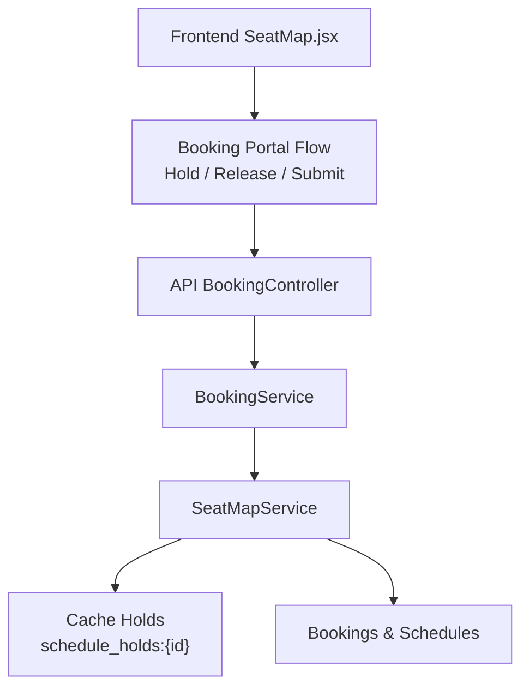
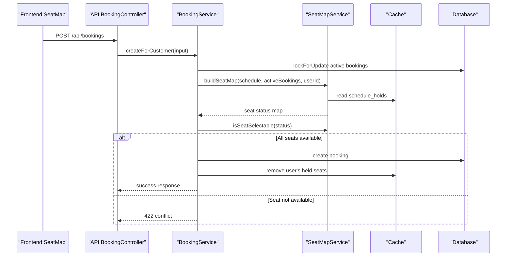
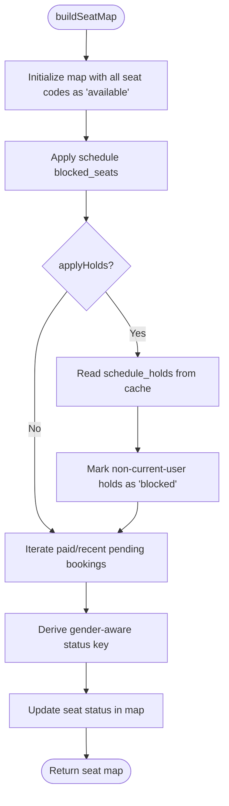
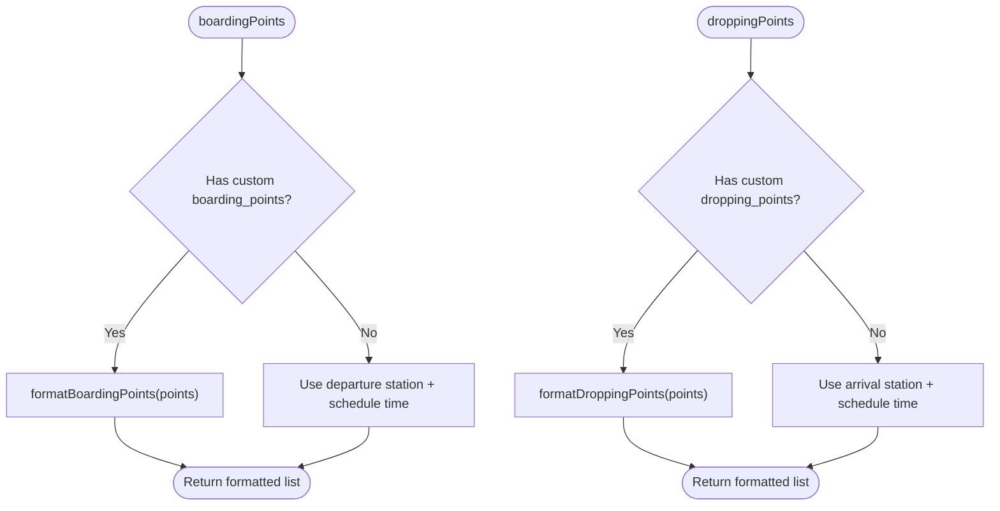
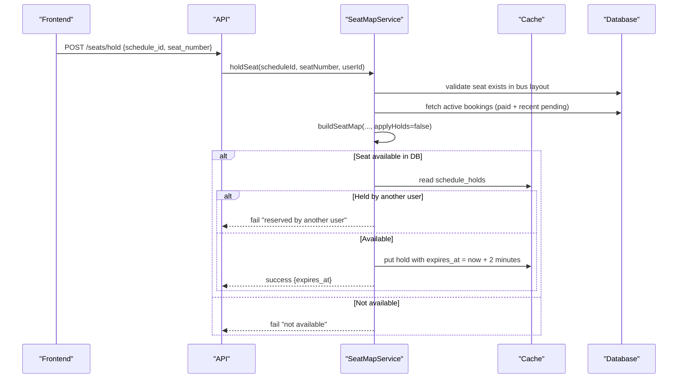
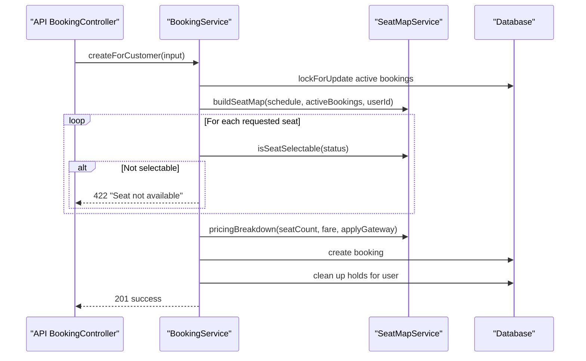
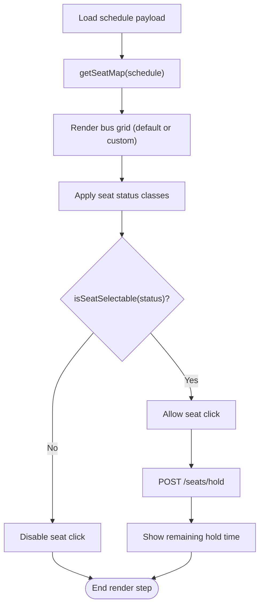
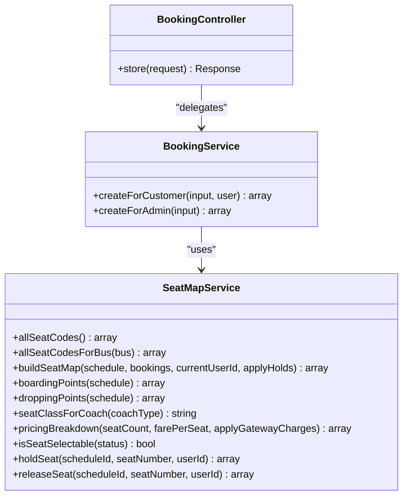

# Seat Map Service

<cite>
**Referenced Files in This Document**
- [SeatMapService.php](file://backend/app/Services/SeatMapService.php)
- [BookingService.php](file://backend/app/Services/BookingService.php)
- [BookingController.php](file://backend/app/Http/Controllers/API/BookingController.php)
- [SeatMap.jsx](file://frontend/src/components/SeatMap.jsx)
- [bookingUtils.js](file://frontend/src/bookingUtils.js)
- [BookingFlowTest.php](file://backend/tests/Feature/BookingFlowTest.php)
</cite>

## Table of Contents
1. [Introduction](#introduction)
2. [Project Structure](#project-structure)
3. [Core Components](#core-components)
4. [Architecture Overview](#architecture-overview)
5. [Detailed Component Analysis](#detailed-component-analysis)
6. [Dependency Analysis](#dependency-analysis)
7. [Performance Considerations](#performance-considerations)
8. [Troubleshooting Guide](#troubleshooting-guide)
9. [Conclusion](#conclusion)

## Introduction
The SeatMapService is the backend authority for seat availability, interactive seat map generation, route stop management, coach classification, fare calculation, and short-term seat holding. It coordinates with the booking system to ensure that real-time seat selection remains consistent across users, while the frontend SeatMap component renders an interactive layout and integrates with hold/release endpoints for a smooth booking experience.

## Project Structure
The seat map feature spans backend services, API controllers, and frontend components:

**Diagram sources**
- [SeatMap.jsx:192-384](file://frontend/src/components/SeatMap.jsx#L192-L384)
- [BookingController.php:10-37](file://backend/app/Http/Controllers/API/BookingController.php#L10-L37)
- [BookingService.php:28-131](file://backend/app/Services/BookingService.php#L28-L131)
- [SeatMapService.php:194-244](file://backend/app/Services/SeatMapService.php#L194-L244)

**Section sources**
- [SeatMapService.php:1-593](file://backend/app/Services/SeatMapService.php#L1-L593)
- [BookingService.php:1-335](file://backend/app/Services/BookingService.php#L1-L335)
- [BookingController.php:1-37](file://backend/app/Http/Controllers/API/BookingController.php#L1-L37)
- [SeatMap.jsx:1-612](file://frontend/src/components/SeatMap.jsx#L1-L612)
- [bookingUtils.js:1-173](file://frontend/src/bookingUtils.js#L1-L173)

## Core Components
- **SeatMapService**: Builds seat maps, validates seats, manages boarding/dropping points, classifies coach types, calculates pricing, and implements 2-minute reservation holds.
- **BookingService**: Orchestrates customer bookings, enforces seat limits, uses SeatMapService for availability checks, and integrates payment and SMS flows.
- **API BookingController**: Validates incoming booking requests and delegates to BookingService.
- **Frontend SeatMap.jsx**: Renders bus layouts, applies gender-aware status, shows live hold timers, and collects passenger details.
- **bookingUtils.js**: Provides client-side seat status labels, selection logic, pricing helpers, and fallback seat map generation.

**Section sources**
- [SeatMapService.php:194-593](file://backend/app/Services/SeatMapService.php#L194-L593)
- [BookingService.php:28-193](file://backend/app/Services/BookingService.php#L28-L193)
- [BookingController.php:10-37](file://backend/app/Http/Controllers/API/BookingController.php#L10-L37)
- [SeatMap.jsx:192-612](file://frontend/src/components/SeatMap.jsx#L192-L612)
- [bookingUtils.js:1-173](file://frontend/src/bookingUtils.js#L1-L173)

## Architecture Overview
The seat map workflow combines server-side state (bookings, cache holds) with client-side rendering and optimistic UI updates.

**Diagram sources**
- [BookingController.php:19-37](file://backend/app/Http/Controllers/API/BookingController.php#L19-L37)
- [BookingService.php:52-127](file://backend/app/Services/BookingService.php#L52-L127)
- [SeatMapService.php:194-244](file://backend/app/Services/SeatMapService.php#L194-L244)

## Detailed Component Analysis

### SeatMapService
SeatMapService centralizes seat-related business logic.

Key responsibilities:
- Generate all valid seat codes based on bus configuration or default layouts.
- Build a real-time seat map combining blocked seats, active holds, and paid/recent pending bookings.
- Provide boarding and dropping point formatting for UI consumption.
- Classify seat class from coach type.
- Calculate fare breakdowns including service/gateway charges and discounts.
- Implement 2-minute seat holding via cache with per-user ownership.

#### buildSeatMap
buildSeatMap constructs a seat code to status mapping:
- Initializes all generated seat codes as available.
- Applies blocked seats from the schedule.
- Applies active holds from other users unless explicitly disabled.
- Marks paid/sold/booked seats and recent pending bookings with gender-aware statuses such as booked_m, booked_f, sold_m, sold_f.

**Diagram sources**
- [SeatMapService.php:194-244](file://backend/app/Services/SeatMapService.php#L194-L244)

**Section sources**
- [SeatMapService.php:194-244](file://backend/app/Services/SeatMapService.php#L194-L244)

#### isSeatSelectable
isSeatSelectable returns true only when the seat status is exactly available. This ensures that blocked, sold, or booked seats cannot be selected by customers.

**Section sources**
- [SeatMapService.php:433-436](file://backend/app/Services/SeatMapService.php#L433-L436)

#### boardingPoints and droppingPoints
boardingPoints and droppingPoints return formatted stop lists:
- If custom route points exist, they are normalized into a standard structure with id, name, value, and time labels.
- Otherwise, defaults are derived from departure/arrival stations and schedule times.

**Diagram sources**
- [SeatMapService.php:246-332](file://backend/app/Services/SeatMapService.php#L246-L332)

**Section sources**
- [SeatMapService.php:246-332](file://backend/app/Services/SeatMapService.php#L246-L332)

#### seatClassForCoach
seatClassForCoach determines the seat class label:
- If the coach type contains AC, it returns E-Class.
- Otherwise, it falls back to the configured default_seat_class.

**Section sources**
- [SeatMapService.php:334-341](file://backend/app/Services/SeatMapService.php#L334-L341)

#### pricingBreakdown
pricingBreakdown computes fare components:
- Seat fare equals farePerSeat multiplied by seatCount.
- Service charge and gateway charge are applied based on configuration and whether gateway charges should apply.
- Discounts for service and gateway charges are subtracted.
- Total is clamped to zero minimum.

**Section sources**
- [SeatMapService.php:343-365](file://backend/app/Services/SeatMapService.php#L343-L365)

#### Seat Holding Mechanism (2-Minute Reservation Locks)
Seat holding is implemented through cache-based reservations:
- holdSeat validates the seat against the bus layout, checks database availability without cache holds, then verifies cache holds to prevent conflicts between users.
- A 2-minute expiration timestamp is stored per seat under a schedule-scoped cache key.
- releaseSeat removes the current user’s hold if present.
- buildSeatMap considers active holds when generating the map, marking them as blocked for other users.

**Diagram sources**
- [SeatMapService.php:502-561](file://backend/app/Services/SeatMapService.php#L502-L561)

**Section sources**
- [SeatMapService.php:502-582](file://backend/app/Services/SeatMapService.php#L502-L582)

### BookingService Integration
BookingService orchestrates customer bookings and relies on SeatMapService for availability and pricing:
- Validates seat count (maximum 4).
- Loads active bookings with row locking to avoid race conditions.
- Uses buildSeatMap and isSeatSelectable to confirm availability.
- Computes total fare using pricingBreakdown.
- Cleans up user-held seats after successful booking.

**Diagram sources**
- [BookingService.php:28-131](file://backend/app/Services/BookingService.php#L28-L131)
- [SeatMapService.php:194-244](file://backend/app/Services/SeatMapService.php#L194-L244)

**Section sources**
- [BookingService.php:28-131](file://backend/app/Services/BookingService.php#L28-L131)

### Frontend SeatMap Rendering
The frontend SeatMap component renders bus layouts and integrates with backend data:
- Generates default grids for layouts like 2+2, 1+2, sleeper, and 2+2_last5.
- Reads seat_map from the schedule payload; otherwise reconstructs a basic map.
- Applies status classes and selection logic using bookingUtils.
- Displays boarding/dropping points, passenger form fields, and fare breakdown.
- Integrates with hold/release endpoints to manage 2-minute reservation locks.

**Diagram sources**
- [SeatMap.jsx:48-190](file://frontend/src/components/SeatMap.jsx#L48-L190)
- [SeatMap.jsx:192-384](file://frontend/src/components/SeatMap.jsx#L192-L384)
- [bookingUtils.js:18-20](file://frontend/src/bookingUtils.js#L18-L20)

**Section sources**
- [SeatMap.jsx:48-384](file://frontend/src/components/SeatMap.jsx#L48-L384)
- [bookingUtils.js:1-173](file://frontend/src/bookingUtils.js#L1-L173)

## Dependency Analysis
SeatMapService depends on:
- Schedule and Bus models for layout and capacity.
- Booking model for occupancy and gender information.
- Cache for temporary seat holds.
- Configuration for default seat class and pricing parameters.

BookingService depends on:
- SeatMapService for availability, pricing, and route points.
- Database transactions with row locking for concurrency safety.
- Payment and SMS services for post-booking workflows.

**Diagram sources**
- [SeatMapService.php:194-593](file://backend/app/Services/SeatMapService.php#L194-L593)
- [BookingService.php:28-193](file://backend/app/Services/BookingService.php#L28-L193)
- [BookingController.php:10-37](file://backend/app/Http/Controllers/API/BookingController.php#L10-L37)

**Section sources**
- [SeatMapService.php:194-593](file://backend/app/Services/SeatMapService.php#L194-L593)
- [BookingService.php:28-193](file://backend/app/Services/BookingService.php#L28-L193)
- [BookingController.php:10-37](file://backend/app/Http/Controllers/API/BookingController.php#L10-L37)

## Performance Considerations
- Use minimal columns for paid bookings to reduce payload size during seat map generation.
- Avoid loading full booking rows when building seat maps; select only necessary fields.
- Cache holds with a short TTL and clean expired entries to prevent memory growth.
- Use row locking during booking creation to prevent race conditions under high concurrency.
- Prefer server-generated seat maps over client reconstruction for accuracy.

[No sources needed since this section provides general guidance]

## Troubleshooting Guide
Common issues and resolutions:
- **Seat appears available but cannot be booked**: Another user may have a cache hold; check schedule_holds and wait for expiration or release.
- **Gender-blocking confusion**: Gender-aware statuses are derived from passenger_gender; ensure correct gender values are passed.
- **Pricing mismatch**: Verify configuration values for service_charge, gateway_charge, and discounts.
- **Route points missing**: Ensure route has boarding_points or falling back to departure/arrival stations.

Validation references:
- Maximum seat limit enforcement is tested.
- Conflict handling for already sold seats is validated.
- Hold behavior across users is verified.

**Section sources**
- [BookingFlowTest.php:243-278](file://backend/tests/Feature/BookingFlowTest.php#L243-L278)
- [SeatMapService.php:343-365](file://backend/app/Services/SeatMapService.php#L343-L365)
- [SeatMapService.php:246-332](file://backend/app/Services/SeatMapService.php#L246-L332)

## Conclusion
SeatMapService provides robust seat allocation logic, real-time availability, and safe reservation holds. Combined with BookingService and the frontend SeatMap component, it delivers a responsive and accurate booking experience. Proper use of cache holds, database locking, and gender-aware status mapping ensures consistency and fairness across concurrent users.

[No sources needed since this section summarizes without analyzing specific files]